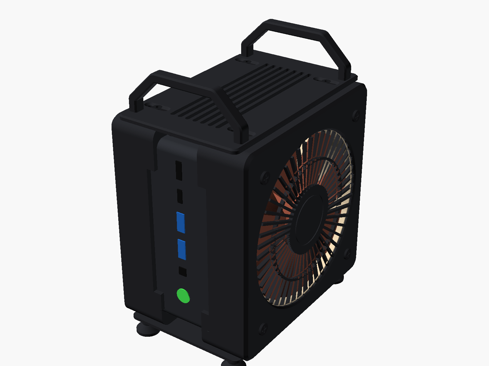
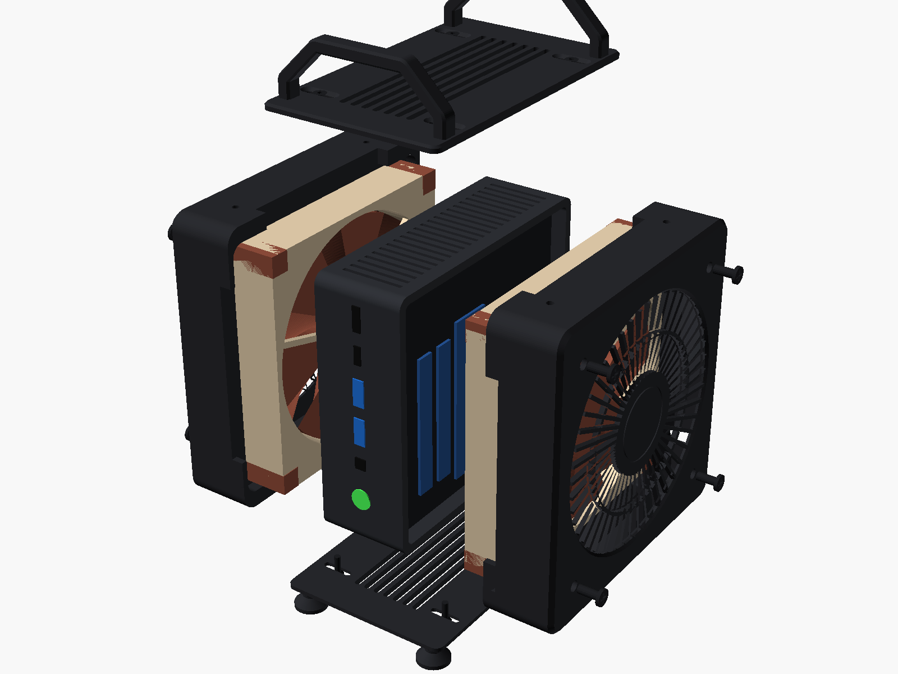
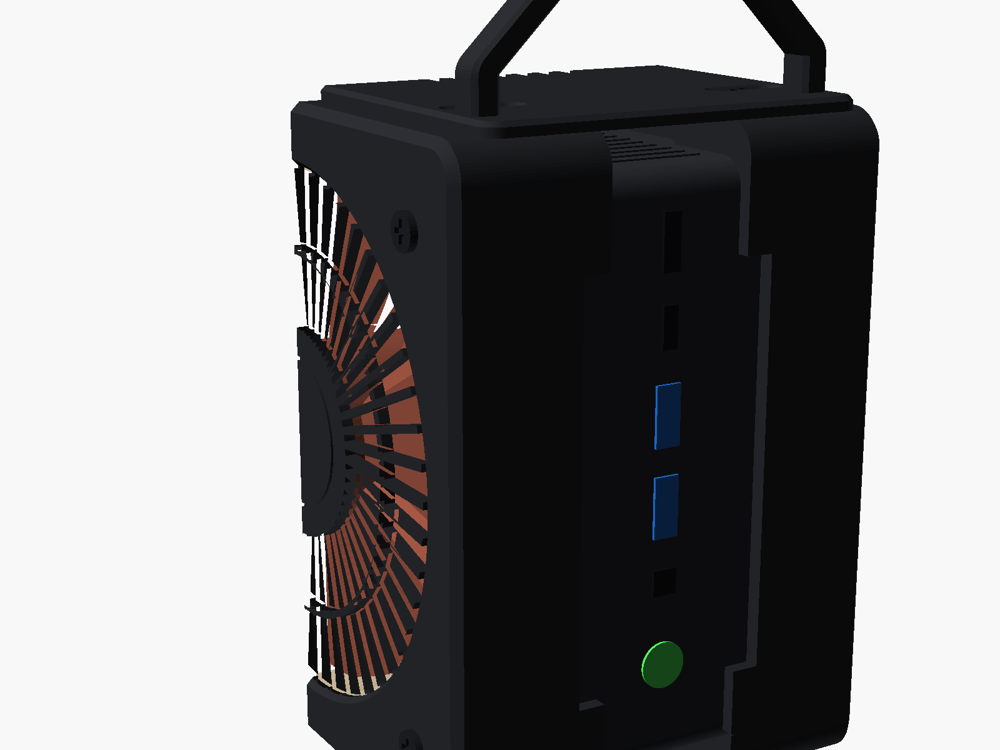
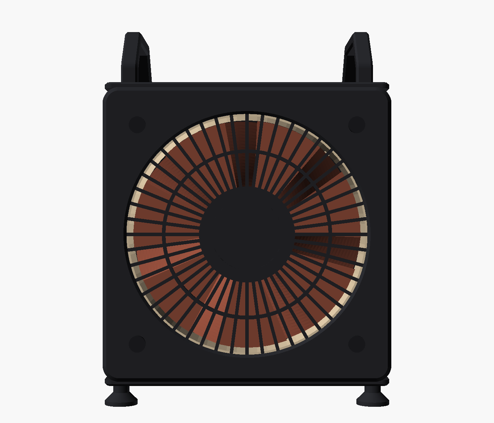
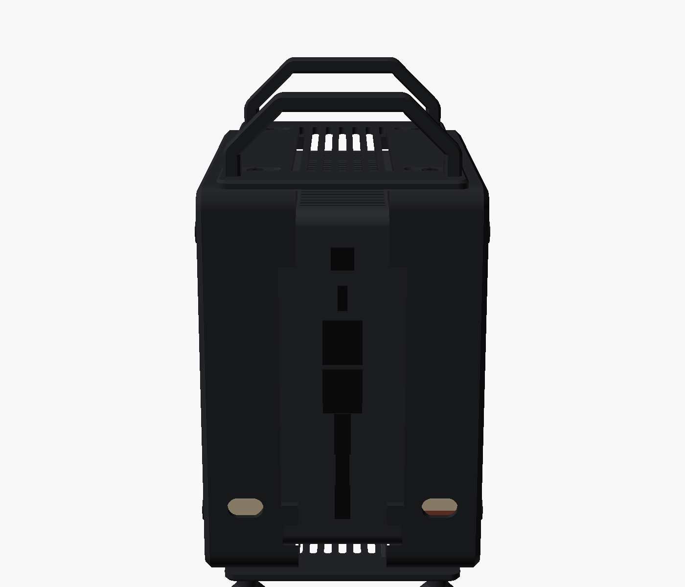
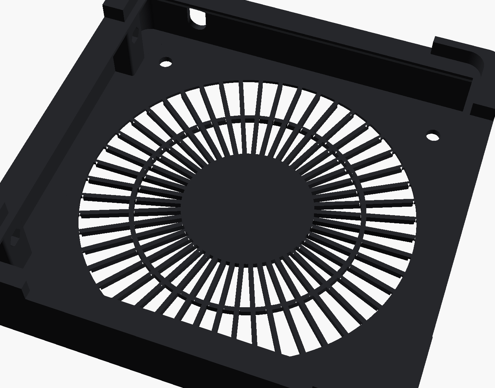
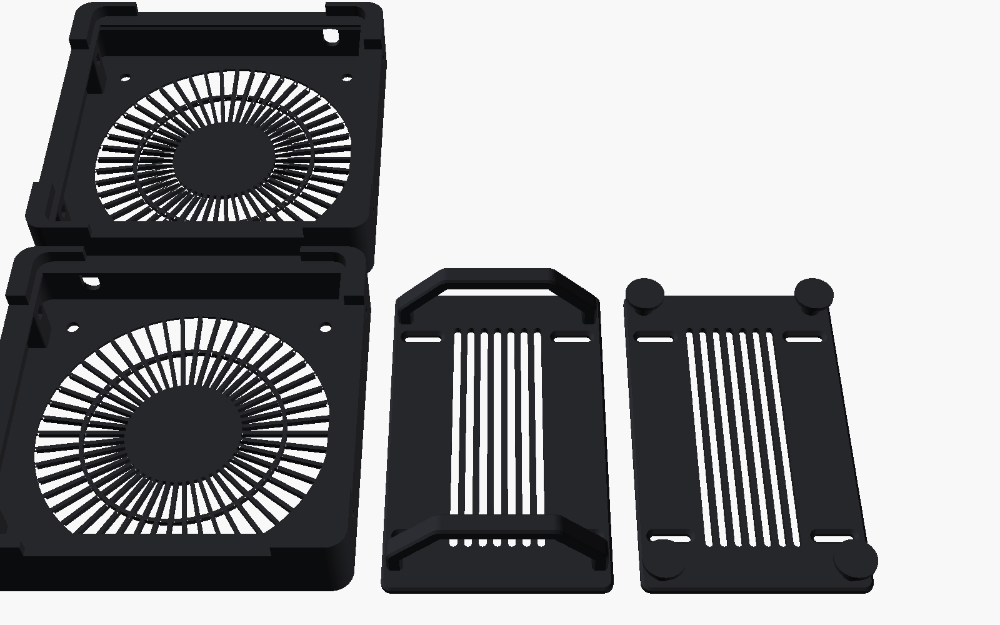

# GMKtec K11 Dual-Fan Case

**English** · [Türkçe](README.tr.md)

A 3D-printable enclosure that turns a GMKtec K11 mini PC into a small, closed tower with two 120 mm fans. The fans are powered from the K11's own USB ports, so there is no soldering and no extra power supply. The front and rear ports stay fully accessible.

| | |
|---|---|
| **Live 3D viewer** | **[hakanuzum.github.io/gmktec-k11-dual-fan-case](https://hakanuzum.github.io/gmktec-k11-dual-fan-case/viewer/)**: rotate, explode, cut a section, show the airflow, colour-code every part and see through the case (**Show how it fits together**), click any part to see what it does |
| **3D preview here** | [Below](#3d-preview): GitHub renders it, drag to rotate |
| **Single parts in 3D** | Click any file in [`stl/`](stl/): GitHub opens it in a 3D viewer |
| **Print files** | [`stl/`](stl/): 4 parts |
| **Editable source** | [`cad/k11_dual_fan_case.scad`](cad/k11_dual_fan_case.scad) (OpenSCAD, with Customizer sliders) |



> **Status:** designed and checked in software (see [Verification](#verification)); not yet printed and fitted on a real K11. Print one fan holder first and dry-fit it before printing the rest. Feedback and photos are welcome in the issues.

## 3D preview

Monochrome, low-poly preview of the closed case with a stand-in K11. Use the [live viewer](https://hakanuzum.github.io/gmktec-k11-dual-fan-case/viewer/) for colours, the exploded view and the airflow.

<!-- model:start -->
```stl
solid K11_DUAL_FAN_CASE_PREVIEW
facet normal 0.7 -0.3 -0.7
outer loop
vertex 50 -65.5 17
vertex 48 -61.5 13
vertex 50 -61.5 15
endloop
endfacet
facet normal 0.7 -0.3 -0.7
outer loop
vertex 50 -65.5 17
vertex 48 -67 15.5
vertex 48 -61.5 13
endloop
endfacet
facet normal 0.7 -0.7 -0.3
outer loop
vertex 50 -65.5 17
vertex 50 -67.5 21
vertex 48 -69.5 21
endloop
endfacet
facet normal 0.7 -0.7 -0.3
outer loop
vertex 50 -65.5 17
vertex 48 -69.5 21
vertex 48 -67 15.5
endloop
endfacet
facet normal 1 -0 -0
outer loop
vertex 50 -65.5 17
vertex 50 -61.5 15
vertex 50 -67.5 21
endloop
endfacet
facet normal 1 0 0
outer loop
vertex 50 -61.5 15
vertex 50 -55 30
vertex 50 -55 33
endloop
endfacet
facet normal 1 0 -0
outer loop
vertex 50 -61.5 15
vertex 50 -52.5 29
vertex 50 -55 30
endloop
endfacet
facet normal 1 0 -0
outer loop
vertex 50 -61.5 15
vertex 50 -18 29
vertex 50 -52.5 29
endloop
endfacet
facet normal 1 0 -0
outer loop
vertex 50 -61.5 15
vertex 50 -55 33
vertex 50 -55 66
endloop
endfacet
facet normal 1 0 0
outer loop
vertex 50 -52.5 34
vertex 50 -55 66
vertex 50 -55 33
endloop
endfacet
facet normal 1 0 -0
outer loop
vertex 50 -52.5 29
vertex 50 -34 37
vertex 50 -50 30
endloop
endfacet
facet normal 1 -0 0
outer loop
vertex 50 -52.5 34
vertex 50 -50 33
vertex 50 -47 50
endloop
endfacet
facet normal 1 0 -0
outer loop
vertex 50 -50 30
vertex 50 -41 44
vertex 50 -50 33
endloop
endfacet
facet normal 1 0 -0
outer loop
vertex 50 -50 30
vertex 50 -40 43
vertex 50 -41 44
endloop
endfacet
facet normal 1 -0 -0
outer loop
vertex 50 -52.5 29
vertex 50 -18 29
vertex 50 -34 37
endloop
endfacet
facet normal 1 0 -0
outer loop
vertex 50 -50 30
vertex 50 -34 37
vertex 50 -40 43
endloop
endfacet
facet normal 1 0 -0
outer loop
vertex 50 -50 33
vertex 50 -41 44
vertex 50 -47 50
endloop
endfacet
facet normal -0 -0.4 -0.9
outer loop
vertex 48 -67 15.5
vertex 22 -67 15.5
vertex 48 -61.5 13
endloop
endfacet
facet normal -0 -0.9 -0.4
outer loop
vertex 48 -67 15.5
vertex 48 -69.5 21
vertex 22 -69.5 21
endloop
endfacet
facet normal 0.7 0 -0.7
outer loop
vertex 50 -61.5 15
vertex 48 -61.5 13
vertex 48 61.5 13
endloop
endfacet
facet normal 1 0 -0
outer loop
vertex 50 -61.5 15
vertex 50 -1 26
vertex 50 -18 29
endloop
endfacet
facet normal 1 0 -0
outer loop
vertex 50 -61.5 15
vertex 50 1 26
vertex 50 -1 26
endloop
endfacet
facet normal 1 0 -0
outer loop
vertex 50 -61.5 15
vertex 50 -55 66
vertex 50 -58 83
endloop
endfacet
facet normal 1 0 0
outer loop
vertex 50 -61.5 15
vertex 50 -67.5 147
vertex 50 -67.5 21
endloop
endfacet
facet normal 0.7 -0.7 0
outer loop
vertex 50 -67.5 21
vertex 48 -69.5 147
vertex 48 -69.5 21
endloop
endfacet
facet normal 1 0 0
outer loop
vertex 50 -61.5 15
vertex 50 -58 83
vertex 50 -58 85
endloop
endfacet
facet normal 1 0 -0
outer loop
vertex 50 -52.5 34
vertex 50 -47 50
vertex 50 -55 66
endloop
endfacet
facet normal 1 0 -0
outer loop
vertex 50 -61.5 15
vertex 50 -58 85
vertex 50 -67.5 147
endloop
endfacet
facet normal 1 0 -0
outer loop
vertex 50 -58 83
vertex 50 -23 83
vertex 50 -58 85
endloop
endfacet
facet normal 1 0 -0
outer loop
vertex 50 -40 43
vertex 50 -15 67.5
vertex 50 -41 44
endloop
endfacet
facet normal 1 0 -0
outer loop
vertex 50 -41 44
vertex 50 -15 67.5
vertex 50 -16.5 69
endloop
endfacet
facet normal 1 0 -0
outer loop
vertex 50 -1 26
vertex 50 1 61
vertex 50 -1 61
endloop
endfacet
facet normal 1 0 0
outer loop
vertex 50 -15 67.5
vertex 50 -11.5 64
vertex 50 -1 61
endloop
endfacet
facet normal 1 -0 -0
outer loop
vertex 50 -15 67.5
vertex 50 -1 61
vertex 50 -16.5 69
endloop
endfacet
facet normal 1 -0 -0
outer loop
vertex 50 -23 83
vertex 50 -20 72.5
vertex 50 -23 85
endloop
endfacet
facet normal 1 0 0
outer loop
vertex 50 -1 61
vertex 50 -20 72.5
vertex 50 -16.5 69
endloop
endfacet
facet normal 1 0 0
outer loop
vertex 50 -1 61
vertex 50 -23 85
vertex 50 -20 72.5
endloop
endfacet
facet normal 1 0 0
outer loop
vertex 50 1 61
vertex 50 -23 85
vertex 50 -1 61
endloop
endfacet
facet normal 1 0 -0
outer loop
vertex 50 1 61
vertex 50 11.5 64
vertex 50 -23 85
endloop
endfacet
facet normal 1 0 0
outer loop
vertex 50 16.5 69
vertex 50 -20 95.5
vertex 50 -23 85
endloop
endfacet
facet normal 0 -0.9 -0.4
outer loop
vertex 48 -67 15.5
vertex 22 -69.5 21
vertex 22 -67 15.5
endloop
endfacet
facet normal 0 -0.4 -0.9
outer loop
vertex 48 -61.5 13
vertex 22 -67 15.5
vertex 22 -61.5 13
endloop
endfacet
facet normal 0 0 -1
outer loop
vertex 48 -61.5 13
vertex 22 -61.5 13
vertex 22 -51.5 13
endloop
endfacet
facet normal 0 0 -1
outer loop
vertex 48 -61.5 13
vertex 22 -51.5 13
vertex 22 -44 13
endloop
endfacet
facet normal -0 -1 -0
outer loop
vertex 48 -69.5 21
vertex 22 -69.5 40
vertex 22 -69.5 21
endloop
endfacet
facet normal 0 0 -1
outer loop
vertex 48 -61.5 13
vertex 22 -44 13
vertex 22 -42.5 13
endloop
endfacet
facet normal 0 -0.4 -0.9
outer loop
vertex 22 -67 15.5
vertex 22 -61.5 13
vertex 22 -61.5 13
endloop
endfacet
facet normal 0 0 -1
outer loop
vertex 22 -61.5 13
vertex 22 -61.5 13
vertex 22 -51.5 13
endloop
endfacet
facet normal -1 0 -0
outer loop
vertex 22 -60.5 21
vertex 22 -52.5 22
vertex 22 -52.5 21
endloop
endfacet
facet normal -1 0 0
outer loop
vertex 22 -65 22.5
vertex 22 -66.5 27
vertex 22 -66.5 40
endloop
endfacet
facet normal -1 0 0
outer loop
vertex 22 -60.5 21
vertex 22 -60.5 23.5
vertex 22 -52.5 22
endloop
endfacet
facet normal -1 0 0
outer loop
vertex 22 -52.5 22
vertex 22 -60.5 23.5
vertex 22 -52 22.5
endloop
endfacet
facet normal -1 0 0
outer loop
vertex 22 -52 22.5
vertex 22 -60.5 23.5
vertex 22 -51.5 23
endloop
endfacet
facet normal 0 0 -1
outer loop
vertex 48 -61.5 13
vertex 22 -42.5 13
vertex 22 42.5 13
endloop
endfacet
facet normal -1 0 0
outer loop
vertex 22 -42.5 13
vertex 22 -42 13.5
vertex 22 42 13.5
endloop
endfacet
facet normal -1 0 0
outer loop
vertex 22 -42 13.5
vertex 22 -41.5 14
vertex 22 41.5 14
endloop
endfacet
facet normal -1 0 0
outer loop
vertex 22 -41.5 14
vertex 22 -41.5 22
vertex 22 41.5 22
endloop
endfacet
facet normal -1 0 0
outer loop
vertex 22 -51.5 23
vertex 22 -60.5 23.5
vertex 22 60.5 23.5
endloop
endfacet
facet normal -1 0 0
outer loop
vertex 22 -41.5 22
vertex 22 -42 22.5
vertex 22 42 22.5
endloop
endfacet
facet normal -1 0 0
outer loop
vertex 22 -42 22.5
vertex 22 -42.5 23
vertex 22 42.5 23
endloop
endfacet
facet normal -1 0 -0
outer loop
vertex 22 -51.5 23
vertex 22 60.5 23.5
vertex 22 -42.5 23
endloop
endfacet
facet normal -0 -1 -0
outer loop
vertex 48 -69.5 21
vertex 22 -69.5 128
vertex 22 -69.5 40
endloop
endfacet
facet normal -1 0 0
outer loop
vertex 22 -60.5 21
vertex 22 -65 22.5
vertex 22 -66.5 128
endloop
endfacet
facet normal -1 0 0
outer loop
vertex 22 -60.5 21
vertex 22 -66.5 128
vertex 22 -60.5 23.5
endloop
endfacet
facet normal -1 0 0
outer loop
vertex 22 -65 22.5
vertex 22 -66.5 40
vertex 22 -66.5 128
endloop
endfacet
facet normal -1 0 0
outer loop
vertex 22 -69.5 40
vertex 22 -69.5 128
vertex 22 -66.5 40
endloop
endfacet
facet normal 1 0 -0
outer loop
vertex 50 -61.5 15
vertex 50 67.5 21
vertex 50 1 26
endloop
endfacet
facet normal 0 0 -1
outer loop
vertex 48 -61.5 13
vertex 47.5 42.5 13
vertex 47.5 51.5 13
endloop
endfacet
facet normal 0 0 -1
outer loop
vertex 48 -61.5 13
vertex 47.5 51.5 13
vertex 48 61.5 13
endloop
endfacet
facet normal 0.7 0 -0.7
outer loop
vertex 50 -61.5 15
vertex 48 61.5 13
vertex 50 61.5 15
endloop
endfacet
facet normal 1 0 0
outer loop
vertex 50 -61.5 15
vertex 50 61.5 15
vertex 50 67.5 21
endloop
endfacet
facet normal 1 0 0
outer loop
vertex 50 67.5 21
vertex 50 18 29
vertex 50 1 26
endloop
endfacet
facet normal 1 0 0
outer loop
vertex 50 -1 26
vertex 50 1 26
vertex 50 1 61
endloop
endfacet
facet normal 0 0 -1
outer loop
vertex 48 -61.5 13
vertex 22 42.5 13
vertex 47.5 42.5 13
endloop
endfacet
facet normal 1 0 0
outer loop
vertex 50 67.5 21
vertex 50 52.5 29
vertex 50 18 29
endloop
endfacet
facet normal 0.7 0.3 -0.7
outer loop
vertex 50 61.5 15
vertex 48 61.5 13
vertex 50 65.5 17
endloop
endfacet
facet normal 0.7 0.3 -0.7
outer loop
vertex 48 61.5 13
vertex 48 67 15.5
vertex 50 65.5 17
endloop
endfacet
facet normal 1 0 0
outer loop
vertex 50 61.5 15
vertex 50 65.5 17
vertex 50 67.5 21
endloop
endfacet
facet normal 0.7 0.7 -0.3
outer loop
vertex 50 65.5 17
vertex 48 69.5 21
vertex 50 67.5 21
endloop
endfacet
facet normal 0.7 0.7 -0.3
outer loop
vertex 50 65.5 17
vertex 48 67 15.5
vertex 48 69.5 21
endloop
endfacet
facet normal 1 0 0
outer loop
vertex 50 67.5 21
vertex 50 55 30
vertex 50 52.5 29
endloop
endfacet
facet normal 1 0 0
outer loop
vertex 50 67.5 21
vertex 50 55 33
vertex 50 55 30
endloop
endfacet
facet normal 1 0 -0
outer loop
vertex 50 18 29
vertex 50 52.5 29
vertex 50 34 37
endloop
endfacet
facet normal 1 0 0
outer loop
vertex 50 40 43
vertex 50 34 37
vertex 50 50 30
endloop
endfacet
facet normal 1 -0 -0
outer loop
vertex 50 34 37
vertex 50 52.5 29
vertex 50 50 30
endloop
endfacet
facet normal 1 0 -0
outer loop
vertex 50 50 30
vertex 50 50 33
vertex 50 41 44
endloop
endfacet
facet normal 1 -0 -0
outer loop
vertex 50 40 43
vertex 50 50 30
vertex 50 41 44
endloop
endfacet
facet normal 1 -0 0
outer loop
vertex 50 47 50
vertex 50 50 33
vertex 50 52.5 34
endloop
endfacet
facet normal 1 0 0
outer loop
vertex 50 47 50
vertex 50 52.5 34
vertex 50 55 33
endloop
endfacet
facet normal 1 0 0
outer loop
vertex 50 47 50
vertex 50 41 44
vertex 50 50 33
endloop
endfacet
facet normal 1 0 0
outer loop
vertex 50 67.5 21
vertex 50 47 50
vertex 50 55 33
endloop
endfacet
facet normal 1 0 0
outer loop
vertex 50 67.5 21
vertex 50 55 66
vertex 50 47 50
endloop
endfacet
facet normal 0 1 -0
outer loop
vertex 48 69.5 21
vertex 40 69.5 36.5
vertex 41.5 69.5 39
endloop
endfacet
facet normal 0 1 -0
outer loop
vertex 48 69.5 21
vertex 37.5 69.5 35
vertex 40 69.5 36.5
endloop
endfacet
facet normal 0 0 -1
outer loop
vertex 47.5 51.5 13
vertex 22 61.5 13
vertex 48 61.5 13
endloop
endfacet
facet normal 0 0.4 -0.9
outer loop
vertex 48 61.5 13
vertex 22 61.5 13
vertex 48 67 15.5
endloop
endfacet
facet normal 0 0.9 -0.4
outer loop
vertex 48 67 15.5
vertex 22 69.5 21
vertex 48 69.5 21
endloop
endfacet
facet normal 0 1 -0
outer loop
vertex 48 69.5 21
vertex 32 69.5 35
vertex 37.5 69.5 35
endloop
endfacet
facet normal 0 1 -0
outer loop
vertex 48 69.5 21
vertex 22 69.5 21
vertex 32 69.5 35
endloop
endfacet
facet normal 1 0 0
outer loop
vertex 50 41 44
vertex 50 16.5 69
vertex 50 40 43
endloop
endfacet
facet normal 1 -0 -0
outer loop
vertex 50 15 67.5
vertex 50 40 43
vertex 50 16.5 69
endloop
endfacet
facet normal 1 0 -0
outer loop
vertex 50 11.5 64
vertex 50 15 67.5
vertex 50 -23 85
endloop
endfacet
facet normal 1 0 0
outer loop
vertex 50 16.5 69
vertex 50 -23 85
vertex 50 15 67.5
endloop
endfacet
facet normal 1 0 -0
outer loop
vertex 50 16.5 69
vertex 50 20 72.5
vertex 50 15 100.5
endloop
endfacet
facet normal 1 0 -0
outer loop
vertex 50 23 83
vertex 50 58 83
vertex 50 23 85
endloop
endfacet
facet normal 1 0 0
outer loop
vertex 50 67.5 21
vertex 50 58 83
vertex 50 55 66
endloop
endfacet
facet normal 0.7 0.7 -0
outer loop
vertex 50 67.5 21
vertex 48 69.5 21
vertex 48 69.5 147
endloop
endfacet
facet normal 0 1 -0
outer loop
vertex 48 69.5 21
vertex 41.5 69.5 39
vertex 48 69.5 147
endloop
endfacet
facet normal 0 1 0
outer loop
vertex 48 69.5 147
vertex 41.5 69.5 39
vertex 40 69.5 41.5
endloop
endfacet
facet normal 0 1 0
outer loop
vertex 48 69.5 147
vertex 40 69.5 41.5
vertex 37.5 69.5 43
endloop
endfacet
facet normal 0 1 0
outer loop
vertex 48 69.5 147
vertex 37.5 69.5 43
vertex 32 69.5 43
endloop
endfacet
facet normal 0 1 0
outer loop
vertex 48 69.5 147
vertex 32 69.5 43
vertex 29.5 69.5 41.5
endloop
endfacet
facet normal 0 1 0
outer loop
vertex 48 69.5 147
vertex 29.5 69.5 41.5
vertex 28.5 69.5 39
endloop
endfacet
facet normal -1 0 0
outer loop
vertex 22 -42.5 13
vertex 22 42 13.5
vertex 22 42.5 13
endloop
endfacet
facet normal -1 0 0
outer loop
vertex 22 -42 13.5
vertex 22 41.5 14
vertex 22 42 13.5
endloop
endfacet
facet normal -1 0 0
outer loop
vertex 22 -41.5 14
vertex 22 41.5 22
vertex 22 41.5 14
endloop
endfacet
facet normal -1 0 -0
outer loop
vertex 22 -41.5 22
vertex 22 42 22.5
vertex 22 41.5 22
endloop
endfacet
facet normal -1 0 -0
outer loop
vertex 22 -42 22.5
vertex 22 42.5 23
vertex 22 42 22.5
endloop
endfacet
facet normal -1 0 -0
outer loop
vertex 22 -42.5 23
vertex 22 60.5 23.5
vertex 22 42.5 23
endloop
endfacet
facet normal 0 0 -1
outer loop
vertex 47.5 51.5 13
vertex 22 51.5 13
vertex 22 61.5 13
endloop
endfacet
facet normal 0 0.4 -0.9
outer loop
vertex 48 67 15.5
vertex 22 61.5 13
vertex 22 67 15.5
endloop
endfacet
facet normal 0 0.9 -0.4
outer loop
vertex 48 67 15.5
vertex 22 67 15.5
vertex 22 69.5 21
endloop
endfacet
facet normal -0 1 0
outer loop
vertex 22 69.5 21
vertex 29.5 69.5 36.5
vertex 32 69.5 35
endloop
endfacet
facet normal -0 1 0
outer loop
vertex 22 69.5 21
vertex 28.5 69.5 39
vertex 29.5 69.5 36.5
endloop
endfacet
facet normal 0 0 -1
outer loop
vertex 22 44 13
vertex 22 44 13
vertex 22 51.5 13
endloop
endfacet
facet normal -1 0 -0
outer loop
vertex 22 42.5 23
vertex 22 60.5 23.5
vertex 22 51.5 23
endloop
endfacet
facet normal 0 0 -1
outer loop
vertex 22 44 13
vertex 22 61.5 13
vertex 22 51.5 13
endloop
endfacet
facet normal -1 0 0
outer loop
vertex 22 52.5 21
vertex 22 52.5 22
vertex 22 60.5 21
endloop
endfacet
facet normal -1 0 0
outer loop
vertex 22 60.5 21
vertex 22 52.5 22
vertex 22 52 22.5
endloop
endfacet
facet normal -1 0 -0
outer loop
vertex 22 51.5 23
vertex 22 60.5 23.5
vertex 22 52 22.5
endloop
endfacet
facet normal -1 0 0
outer loop
vertex 22 60.5 21
vertex 22 52 22.5
vertex 22 60.5 23.5
endloop
endfacet
facet normal -1 0 0
outer loop
vertex 22 60.5 21
vertex 22 60.5 23.5
vertex 22 65 22.5
endloop
endfacet
facet normal -0 1 0
outer loop
vertex 22 69.5 21
vertex 48 69.5 147
vertex 28.5 69.5 39
endloop
endfacet
facet normal 0 1 0
outer loop
vertex 22 69.5 21
vertex 22 69.5 40
vertex 48 69.5 147
endloop
endfacet
facet normal -1 0 0
outer loop
vertex 22 65 22.5
vertex 22 60.5 23.5
vertex 22 60.5 144.5
endloop
endfacet
facet normal -1 0 0
outer loop
vertex 22 65 22.5
vertex 22 60.5 144.5
vertex 22 66.5 27
endloop
endfacet
facet normal -1 0 0
outer loop
vertex 22 66.5 27
vertex 22 60.5 144.5
vertex 22 66.5 40
endloop
endfacet
facet normal -1 0 0
outer loop
vertex 22 66.5 40
vertex 22 66.5 128
vertex 22 69.5 40
endloop
endfacet
facet normal 0.7 -0.7 0
outer loop
vertex 50 -67.5 21
vertex 50 -67.5 147
vertex 48 -69.5 147
endloop
endfacet
facet normal 1 -0 0
outer loop
vertex 50 -67.5 147
vertex 50 -58 85
vertex 50 -55 102
endloop
endfacet
facet normal 0 -1 0
outer loop
vertex 48 -69.5 21
vertex 48 -69.5 147
vertex 22 -69.5 147
endloop
endfacet
facet normal 1 0 -0
outer loop
vertex 50 -23 83
vertex 50 -23 85
vertex 50 -58 85
endloop
endfacet
facet normal 1 0 0
outer loop
vertex 50 16.5 69
vertex 50 -16.5 99
vertex 50 -20 95.5
endloop
endfacet
facet normal 1 -0 -0
outer loop
vertex 50 -16.5 99
vertex 50 16.5 69
vertex 50 -15 100.5
endloop
endfacet
facet normal 1 0 0
outer loop
vertex 50 16.5 69
vertex 50 -11.5 104
vertex 50 -15 100.5
endloop
endfacet
facet normal 1 0 0
outer loop
vertex 50 -15 100.5
vertex 50 -40 125
vertex 50 -16.5 99
endloop
endfacet
facet normal 1 0 0
outer loop
vertex 50 -16.5 99
vertex 50 -40 125
vertex 50 -41 124
endloop
endfacet
facet normal 1 -0 0
outer loop
vertex 50 -67.5 147
vertex 50 -55 102
vertex 50 -47 118
endloop
endfacet
facet normal 1 -0 -0
outer loop
vertex 50 -67.5 147
vertex 50 -47 118
vertex 50 -55 135
endloop
endfacet
facet normal 1 0 -0
outer loop
vertex 50 -47 118
vertex 50 -41 124
vertex 50 -50 135
endloop
endfacet
facet normal 1 0 0
outer loop
vertex 50 -40 125
vertex 50 -50 135
vertex 50 -41 124
endloop
endfacet
facet normal 1 0 0
outer loop
vertex 50 -47 118
vertex 50 -52.5 134
vertex 50 -55 135
endloop
endfacet
facet normal 1 0 0
outer loop
vertex 50 -47 118
vertex 50 -50 135
vertex 50 -52.5 134
endloop
endfacet
facet normal 1 0 0
outer loop
vertex 50 -34 131
vertex 50 -50 138
vertex 50 -50 135
endloop
endfacet
facet normal 1 0 -0
outer loop
vertex 50 -40 125
vertex 50 -34 131
vertex 50 -50 135
endloop
endfacet
facet normal 1 -0 0
outer loop
vertex 50 -67.5 147
vertex 50 -55 135
vertex 50 -55 138
endloop
endfacet
facet normal 1 -0 0
outer loop
vertex 50 -67.5 147
vertex 50 -55 138
vertex 50 -52.5 139
endloop
endfacet
facet normal 0.7 -0.7 0.3
outer loop
vertex 50 -67.5 147
vertex 50 -65.5 151
vertex 48 -69.5 147
endloop
endfacet
facet normal 0.7 -0.7 0.3
outer loop
vertex 48 -69.5 147
vertex 50 -65.5 151
vertex 48 -67 152.5
endloop
endfacet
facet normal 1 0 -0
outer loop
vertex 50 -67.5 147
vertex 50 -61.5 153
vertex 50 -65.5 151
endloop
endfacet
facet normal 0.7 -0.3 0.7
outer loop
vertex 50 -65.5 151
vertex 50 -61.5 153
vertex 48 -61.5 155
endloop
endfacet
facet normal 0.7 -0.3 0.7
outer loop
vertex 50 -65.5 151
vertex 48 -61.5 155
vertex 48 -67 152.5
endloop
endfacet
facet normal 1 -0 0
outer loop
vertex 50 -67.5 147
vertex 50 -52.5 139
vertex 50 -18 139
endloop
endfacet
facet normal 1 -0 0
outer loop
vertex 50 -52.5 139
vertex 50 -50 138
vertex 50 -18 139
endloop
endfacet
facet normal 0 -0.9 0.4
outer loop
vertex 48 -69.5 147
vertex 48 -67 152.5
vertex 22 -69.5 147
endloop
endfacet
facet normal 0 -0.4 0.9
outer loop
vertex 48 -67 152.5
vertex 48 -61.5 155
vertex 22 -67 152.5
endloop
endfacet
facet normal 0 0 1
outer loop
vertex 48 -61.5 155
vertex 47.5 -51.5 155
vertex 22 -51.5 155
endloop
endfacet
facet normal 1 0 -0
outer loop
vertex 50 -34 131
vertex 50 -18 139
vertex 50 -50 138
endloop
endfacet
facet normal 1 0 -0
outer loop
vertex 50 -1 107
vertex 50 1 142
vertex 50 -1 142
endloop
endfacet
facet normal 1 -0 0
outer loop
vertex 50 -67.5 147
vertex 50 -18 139
vertex 50 -1 142
endloop
endfacet
facet normal 1 -0 0
outer loop
vertex 50 -67.5 147
vertex 50 -1 142
vertex 50 1 142
endloop
endfacet
facet normal 1 0 -0
outer loop
vertex 50 -67.5 147
vertex 50 65.5 151
vertex 50 -61.5 153
endloop
endfacet
facet normal 0.7 0 0.7
outer loop
vertex 50 -61.5 153
vertex 48 61.5 155
vertex 48 -61.5 155
endloop
endfacet
facet normal 0 -0 1
outer loop
vertex 48 -61.5 155
vertex 48 61.5 155
vertex 47.5 -51.5 155
endloop
endfacet
facet normal 0 -0 1
outer loop
vertex 47.5 -51.5 155
vertex 48 61.5 155
vertex 47.5 -42.5 155
endloop
endfacet
facet normal 1 -0 0
outer loop
vertex 50 -67.5 147
vertex 50 1 142
vertex 50 65.5 151
endloop
endfacet
facet normal 0 -0 1
outer loop
vertex 47.5 -42.5 155
vertex 47.5 51.5 155
vertex 22 -44 155
endloop
endfacet
facet normal -0 -1 -0
outer loop
vertex 48 -69.5 21
vertex 22 -69.5 147
vertex 22 -69.5 128
endloop
endfacet
facet normal -1 0 0
outer loop
vertex 22 -66.5 40
vertex 22 -69.5 128
vertex 22 -66.5 128
endloop
endfacet
facet normal -1 0 0
outer loop
vertex 22 -66.5 128
vertex 22 -66.5 141
vertex 22 -60.5 23.5
endloop
endfacet
facet normal -1 0 0
outer loop
vertex 22 -66.5 141
vertex 22 -65 145.5
vertex 22 -60.5 23.5
endloop
endfacet
facet normal -1 0 0
outer loop
vertex 22 -65 145.5
vertex 22 -60.5 144.5
vertex 22 -60.5 23.5
endloop
endfacet
facet normal 0 -0.9 0.4
outer loop
vertex 48 -67 152.5
vertex 22 -67 152.5
vertex 22 -69.5 147
endloop
endfacet
facet normal 0 -0.4 0.9
outer loop
vertex 48 -61.5 155
vertex 22 -61.5 155
vertex 22 -67 152.5
endloop
endfacet
facet normal 0 0 1
outer loop
vertex 48 -61.5 155
vertex 22 -51.5 155
vertex 22 -61.5 155
endloop
endfacet
facet normal -1 0 0
outer loop
vertex 22 -65 145.5
vertex 22 -60.5 147
vertex 22 -60.5 144.5
endloop
endfacet
facet normal -1 -0 0
outer loop
vertex 22 -52 145.5
vertex 22 -60.5 144.5
vertex 22 -60.5 147
endloop
endfacet
facet normal -1 0 -0
outer loop
vertex 22 -52 145.5
vertex 22 -51.5 145
vertex 22 -60.5 144.5
endloop
endfacet
facet normal -1 0 0
outer loop
vertex 22 -52 145.5
vertex 22 -60.5 147
vertex 22 -52.5 146
endloop
endfacet
facet normal 0 -0.4 0.9
outer loop
vertex 22 -67 152.5
vertex 22 -61.5 155
vertex 22 -61.5 155
endloop
endfacet
facet normal -1 0 0
outer loop
vertex 22 -52.5 146
vertex 22 -60.5 147
vertex 22 -52.5 147
endloop
endfacet
facet normal -1 0 -0
outer loop
vertex 22 -51.5 145
vertex 22 -42.5 145
vertex 22 -60.5 144.5
endloop
endfacet
facet normal -1 -0 -0
outer loop
vertex 22 -42.5 145
vertex 22 -42 144.5
vertex 22 -60.5 144.5
endloop
endfacet
facet normal -1 0 -0
outer loop
vertex 22 -42.5 145
vertex 22 -42 145.5
vertex 22 -42 144.5
endloop
endfacet
facet normal 0 0 1
outer loop
vertex 22 -44 155
vertex 22 -42.5 155
vertex 22 -44 155
endloop
endfacet
facet normal -1 0 -0
outer loop
vertex 22 -42 145.5
vertex 22 42 145.5
vertex 22 -42 144.5
endloop
endfacet
facet normal -1 0 0
outer loop
vertex 22 -42 145.5
vertex 22 -41.5 146
vertex 22 41.5 146
endloop
endfacet
facet normal -1 0 0
outer loop
vertex 22 -41.5 146
vertex 22 -41.5 154
vertex 22 41.5 154
endloop
endfacet
facet normal 0 0 1
outer loop
vertex 22 -44 155
vertex 22 42.5 155
vertex 22 -42.5 155
endloop
endfacet
facet normal -1 -0 -0
outer loop
vertex 22 -42.5 155
vertex 22 42 154.5
vertex 22 -42 154.5
endloop
endfacet
facet normal -1 0 0
outer loop
vertex 22 -41.5 154
vertex 22 -42 154.5
vertex 22 41.5 154
endloop
endfacet
facet normal 1 0 0
outer loop
vertex 50 16.5 69
vertex 50 15 100.5
vertex 50 11.5 104
endloop
endfacet
facet normal 1 0 0
outer loop
vertex 50 16.5 69
vertex 50 -1 107
vertex 50 -11.5 104
endloop
endfacet
facet normal 1 0 0
outer loop
vertex 50 16.5 69
vertex 50 1 107
vertex 50 -1 107
endloop
endfacet
facet normal 1 0 0
outer loop
vertex 50 16.5 69
vertex 50 11.5 104
vertex 50 1 107
endloop
endfacet
facet normal 1 0 -0
outer loop
vertex 50 20 72.5
vertex 50 23 83
vertex 50 15 100.5
endloop
endfacet
facet normal 1 0 -0
outer loop
vertex 50 23 83
vertex 50 23 85
vertex 50 15 100.5
endloop
endfacet
facet normal 1 0 0
outer loop
vertex 50 16.5 99
vertex 50 15 100.5
vertex 50 23 85
endloop
endfacet
facet normal 1 0 0
outer loop
vertex 50 20 95.5
vertex 50 16.5 99
vertex 50 23 85
endloop
endfacet
facet normal 1 0 -0
outer loop
vertex 50 1 107
vertex 50 1 142
vertex 50 -1 107
endloop
endfacet
facet normal 1 0 -0
outer loop
vertex 50 16.5 99
vertex 50 41 124
vertex 50 15 100.5
endloop
endfacet
facet normal 1 0 -0
outer loop
vertex 50 15 100.5
vertex 50 41 124
vertex 50 40 125
endloop
endfacet
facet normal 1 0 -0
outer loop
vertex 50 58 83
vertex 50 58 85
vertex 50 23 85
endloop
endfacet
facet normal 1 0 0
outer loop
vertex 50 67.5 21
vertex 50 65.5 151
vertex 50 58 83
endloop
endfacet
facet normal 1 0 0
outer loop
vertex 50 55 102
vertex 50 52.5 134
vertex 50 47 118
endloop
endfacet
facet normal 1 0 0
outer loop
vertex 50 65.5 151
vertex 50 58 85
vertex 50 58 83
endloop
endfacet
facet normal 0.7 0.7 0
outer loop
vertex 50 67.5 21
vertex 48 69.5 147
vertex 50 67.5 147
endloop
endfacet
facet normal 1 0 -0
outer loop
vertex 50 67.5 21
vertex 50 67.5 147
vertex 50 65.5 151
endloop
endfacet
facet normal 1 0 0
outer loop
vertex 50 65.5 151
vertex 50 55 102
vertex 50 58 85
endloop
endfacet
facet normal 1 -0 0
outer loop
vertex 50 18 139
vertex 50 34 131
vertex 50 50 138
endloop
endfacet
facet normal 1 0 0
outer loop
vertex 50 65.5 151
vertex 50 1 142
vertex 50 18 139
endloop
endfacet
facet normal 0.7 -0 0.7
outer loop
vertex 50 -61.5 153
vertex 50 61.5 153
vertex 48 61.5 155
endloop
endfacet
facet normal 1 -0 -0
outer loop
vertex 50 -61.5 153
vertex 50 65.5 151
vertex 50 61.5 153
endloop
endfacet
facet normal 0 -0 1
outer loop
vertex 47.5 -42.5 155
vertex 48 61.5 155
vertex 47.5 51.5 155
endloop
endfacet
facet normal 1 -0 0
outer loop
vertex 50 41 124
vertex 50 47 118
vertex 50 50 135
endloop
endfacet
facet normal 1 -0 0
outer loop
vertex 50 34 131
vertex 50 40 125
vertex 50 50 138
endloop
endfacet
facet normal 1 0 -0
outer loop
vertex 50 41 124
vertex 50 50 138
vertex 50 40 125
endloop
endfacet
facet normal 1 0 0
outer loop
vertex 50 41 124
vertex 50 50 135
vertex 50 50 138
endloop
endfacet
facet normal 1 0 -0
outer loop
vertex 50 47 118
vertex 50 52.5 134
vertex 50 50 135
endloop
endfacet
facet normal 1 0 0
outer loop
vertex 50 55 102
vertex 50 55 135
vertex 50 52.5 134
endloop
endfacet
facet normal 1 0 0
outer loop
vertex 50 65.5 151
vertex 50 55 135
vertex 50 55 102
endloop
endfacet
facet normal 1 -0 0
outer loop
vertex 50 18 139
vertex 50 50 138
vertex 50 52.5 139
endloop
endfacet
facet normal 1 0 0
outer loop
vertex 50 65.5 151
vertex 50 18 139
vertex 50 52.5 139
endloop
endfacet
facet normal 1 0 0
outer loop
vertex 50 65.5 151
vertex 50 55 138
vertex 50 55 135
endloop
endfacet
facet normal 1 0 0
outer loop
vertex 50 65.5 151
vertex 50 52.5 139
vertex 50 55 138
endloop
endfacet
facet normal 0.7 0.7 0.3
outer loop
vertex 50 67.5 147
vertex 48 69.5 147
vertex 50 65.5 151
endloop
endfacet
facet normal 0.7 0.7 0.3
outer loop
vertex 48 69.5 147
vertex 48 67 152.5
vertex 50 65.5 151
endloop
endfacet
facet normal 0.7 0.3 0.7
outer loop
vertex 50 61.5 153
vertex 50 65.5 151
vertex 48 61.5 155
endloop
endfacet
facet normal 0.7 0.3 0.7
outer loop
vertex 48 61.5 155
vertex 50 65.5 151
vertex 48 67 152.5
endloop
endfacet
facet normal 0 -0 1
outer loop
vertex 47.5 51.5 155
vertex 48 61.5 155
vertex 22 51.5 155
endloop
endfacet
facet normal -0 0.9 0.4
outer loop
vertex 48 69.5 147
vertex 22 67 152.5
vertex 48 67 152.5
endloop
endfacet
facet normal 0 0.4 0.9
outer loop
vertex 48 61.5 155
vertex 48 67 152.5
vertex 22 67 152.5
endloop
endfacet
facet normal 0 1 0
outer loop
vertex 22 69.5 40
vertex 22 69.5 128
vertex 48 69.5 147
endloop
endfacet
facet normal -1 0 0
outer loop
vertex 22 69.5 40
vertex 22 66.5 128
vertex 22 69.5 128
endloop
endfacet
facet normal -1 0 0
outer loop
vertex 22 66.5 40
vertex 22 60.5 144.5
vertex 22 66.5 128
endloop
endfacet
facet normal 0 -0 1
outer loop
vertex 22 -44 155
vertex 47.5 51.5 155
vertex 22 42.5 155
endloop
endfacet
facet normal -1 -0 0
outer loop
vertex 22 42.5 145
vertex 22 -42 144.5
vertex 22 42 145.5
endloop
endfacet
facet normal -1 0 0
outer loop
vertex 22 -42 145.5
vertex 22 41.5 146
vertex 22 42 145.5
endloop
endfacet
facet normal -1 0 -0
outer loop
vertex 22 42.5 145
vertex 22 51.5 145
vertex 22 -42 144.5
endloop
endfacet
facet normal -1 0 0
outer loop
vertex 22 -41.5 146
vertex 22 41.5 154
vertex 22 41.5 146
endloop
endfacet
facet normal -1 0 -0
outer loop
vertex 22 -42 154.5
vertex 22 42 154.5
vertex 22 41.5 154
endloop
endfacet
facet normal -1 0 -0
outer loop
vertex 22 -42.5 155
vertex 22 42.5 155
vertex 22 42 154.5
endloop
endfacet
facet normal -1 -0 -0
outer loop
vertex 22 51.5 145
vertex 22 60.5 144.5
vertex 22 -42 144.5
endloop
endfacet
facet normal 0 1 -0
outer loop
vertex 48 69.5 147
vertex 22 69.5 128
vertex 22 69.5 147
endloop
endfacet
facet normal 0 0 1
outer loop
vertex 48 61.5 155
vertex 22 61.5 155
vertex 22 51.5 155
endloop
endfacet
facet normal 0 0.9 0.4
outer loop
vertex 48 69.5 147
vertex 22 69.5 147
vertex 22 67 152.5
endloop
endfacet
facet normal 0 0.4 0.9
outer loop
vertex 48 61.5 155
vertex 22 67 152.5
vertex 22 61.5 155
endloop
endfacet
facet normal -1 0 0
outer loop
vertex 22 51.5 145
vertex 22 52 145.5
vertex 22 60.5 144.5
endloop
endfacet
facet normal -1 0 0
outer loop
vertex 22 52 145.5
vertex 22 52.5 146
vertex 22 60.5 147
endloop
endfacet
facet normal -1 0 -0
outer loop
vertex 22 52 145.5
vertex 22 60.5 147
vertex 22 60.5 144.5
endloop
endfacet
facet normal -1 0 0
outer loop
vertex 22 66.5 128
vertex 22 60.5 147
vertex 22 66.5 141
endloop
endfacet
facet normal -1 0 0
outer loop
vertex 22 66.5 128
vertex 22 60.5 144.5
vertex 22 60.5 147
endloop
endfacet
facet normal -1 0 0
outer loop
vertex 22 66.5 141
vertex 22 60.5 147
vertex 22 65 145.5
endloop
endfacet
facet normal -1 0 0
outer loop
vertex 22 52.5 146
vertex 22 52.5 147
vertex 22 60.5 147
endloop
endfacet
facet normal 0 0.4 0.9
outer loop
vertex 22 61.5 155
vertex 22 67 152.5
vertex 22 61.5 155
endloop
endfacet
facet normal -1 0 -0
outer loop
vertex 47.5 -65.5 17
vertex 47.5 -52.5 22
vertex 47.5 -61.5 15.5
endloop
endfacet
facet normal -1 0 0
outer loop
vertex 47.5 -65.5 17
vertex 47.5 -52.5 24
vertex 47.5 -52.5 22
endloop
endfacet
facet normal -1 0 0
outer loop
vertex 47.5 -61.5 15.5
vertex 47.5 -52.5 22
vertex 47.5 -52.5 15.5
endloop
endfacet
facet normal -1 0 0
outer loop
vertex 47.5 -65.5 17
vertex 47.5 -55 30
vertex 47.5 -52.5 24
endloop
endfacet
facet normal -1 0 0
outer loop
vertex 47.5 -52.5 22
vertex 47.5 -52.5 24
vertex 47.5 -52 22.5
endloop
endfacet
facet normal -1 0 0
outer loop
vertex 47.5 -65.5 17
vertex 47.5 -55 33
vertex 47.5 -55 30
endloop
endfacet
facet normal -1 0 -0
outer loop
vertex 47.5 -65.5 17
vertex 47.5 -53.5 35.5
vertex 47.5 -55 33
endloop
endfacet
facet normal -1 -0 -0
outer loop
vertex 47.5 -53 29
vertex 47.5 -52.5 24
vertex 47.5 -55 30
endloop
endfacet
facet normal -1 0 -0
outer loop
vertex 47.5 -52.5 29
vertex 47.5 -52.5 29
vertex 47.5 -52.5 29
endloop
endfacet
facet normal -1 0 0
outer loop
vertex 47.5 -52.5 29
vertex 47.5 -52.5 29
vertex 47.5 -52 29
endloop
endfacet
facet normal -1 0 0
outer loop
vertex 47.5 -52.5 29
vertex 47.5 -52 29
vertex 47.5 -52 29
endloop
endfacet
facet normal 0 0.4 0.9
outer loop
vertex 47.5 -65.5 17
vertex 47.5 -61.5 15.5
vertex 31.5 -61.5 15.5
endloop
endfacet
facet normal -0 0.9 0.4
outer loop
vertex 47.5 -65.5 17
vertex 31.5 -67 21
vertex 47.5 -67 21
endloop
endfacet
facet normal 0 -0 1
outer loop
vertex 47.5 -61.5 15.5
vertex 47.5 -52.5 15.5
vertex 31.5 -61.5 15.5
endloop
endfacet
facet normal -1 0 0
outer loop
vertex 47.5 -52 22.5
vertex 47.5 -52.5 24
vertex 47.5 -51.5 23
endloop
endfacet
facet normal -1 0 0
outer loop
vertex 47.5 -51.5 23
vertex 47.5 -52.5 24
vertex 47.5 -42 24.5
endloop
endfacet
facet normal -1 0 -0
outer loop
vertex 47.5 -51.5 23
vertex 47.5 -42 24.5
vertex 47.5 -42.5 23
endloop
endfacet
facet normal -1 0 0
outer loop
vertex 47.5 -50 30
vertex 47.5 -52 29
vertex 47.5 -52.5 29
endloop
endfacet
facet normal -1 0 0
outer loop
vertex 47.5 -52 29
vertex 47.5 -50 30
vertex 47.5 -44 33
endloop
endfacet
facet normal -1 0 0
outer loop
vertex 47.5 -42 22.5
vertex 47.5 -42.5 23
vertex 47.5 -42 24.5
endloop
endfacet
facet normal -1 0 -0
outer loop
vertex 47.5 -53.5 35.5
vertex 47.5 -52.5 34
vertex 47.5 -55 33
endloop
endfacet
facet normal -1 0 -0
outer loop
vertex 47.5 -53 36
vertex 47.5 -52.5 34
vertex 47.5 -52.5 34
endloop
endfacet
facet normal -1 0 0
outer loop
vertex 47.5 -53 36
vertex 47.5 -52.5 34.5
vertex 47.5 -52.5 34
endloop
endfacet
facet normal -1 0 0
outer loop
vertex 47.5 -53.5 35.5
vertex 47.5 -53 36
vertex 47.5 -52.5 34
endloop
endfacet
facet normal -1 0 0
outer loop
vertex 47.5 -65.5 17
vertex 47.5 -56 70.5
vertex 47.5 -53.5 35.5
endloop
endfacet
facet normal -1 0 0
outer loop
vertex 47.5 -50 30
vertex 47.5 -50 33
vertex 47.5 -44 33
endloop
endfacet
facet normal -1 0 -0
outer loop
vertex 47.5 -52.5 34
vertex 47.5 -44 33
vertex 47.5 -50 33
endloop
endfacet
facet normal -1 0 0
outer loop
vertex 47.5 -52.5 34
vertex 47.5 -52.5 34
vertex 47.5 -44 33
endloop
endfacet
facet normal -1 0 0
outer loop
vertex 47.5 -52.5 34
vertex 47.5 -45 39.5
vertex 47.5 -44 33
endloop
endfacet
facet normal -1 0 0
outer loop
vertex 47.5 -42 24.5
vertex 47.5 -45.5 48.5
vertex 47.5 -34 37
endloop
endfacet
facet normal -1 -0 0
outer loop
vertex 47.5 -46.5 49.5
vertex 47.5 -52.5 34.5
vertex 47.5 -52.5 37.5
endloop
endfacet
facet normal -1 -0 0
outer loop
vertex 47.5 -46.5 49.5
vertex 47.5 -52.5 37.5
vertex 47.5 -47 50
endloop
endfacet
facet normal -1 0 0
outer loop
vertex 47.5 -34 37
vertex 47.5 -45.5 48.5
vertex 47.5 -40 43
endloop
endfacet
facet normal -1 0 0
outer loop
vertex 47.5 -45.5 48.5
vertex 47.5 -41 44
vertex 47.5 -40 43
endloop
endfacet
facet normal 0 0.4 0.9
outer loop
vertex 47.5 -65.5 17
vertex 31.5 -61.5 15.5
vertex 31.5 -65.5 17
endloop
endfacet
facet normal 0 0.9 0.4
outer loop
vertex 47.5 -65.5 17
vertex 31.5 -65.5 17
vertex 31.5 -67 21
endloop
endfacet
facet normal 0 0 1
outer loop
vertex 47.5 -52.5 15.5
vertex 31.5 -52.5 15.5
vertex 31.5 -61.5 15.5
endloop
endfacet
facet normal -1 0 0
outer loop
vertex 47.5 -42 22.5
vertex 47.5 -42 24.5
vertex 47.5 -18 29
endloop
endfacet
facet normal -1 0 0
outer loop
vertex 47.5 -42 24.5
vertex 47.5 -34 37
vertex 47.5 -18 29
endloop
endfacet
facet normal -1 0 0
outer loop
vertex 47.5 -42 22.5
vertex 47.5 -18 29
vertex 47.5 -1 26
endloop
endfacet
facet normal -1 0 0
outer loop
vertex 47.5 -41.5 15.5
vertex 47.5 -41.5 22
vertex 47.5 41.5 22
endloop
endfacet
facet normal -1 0 0
outer loop
vertex 47.5 -41.5 22
vertex 47.5 -42 22.5
vertex 47.5 42 22.5
endloop
endfacet
facet normal -1 0 0
outer loop
vertex 47.5 -42 22.5
vertex 47.5 -1 26
vertex 47.5 42 22.5
endloop
endfacet
facet normal 0 -0 1
outer loop
vertex 47.5 -41.5 15.5
vertex 47.5 41.5 15.5
vertex 31.5 -41.5 15.5
endloop
endfacet
facet normal -1 0 0
outer loop
vertex 47.5 -65.5 17
vertex 47.5 -58 83
vertex 47.5 -56 70.5
endloop
endfacet
facet normal -1 0 0
outer loop
vertex 47.5 -65.5 17
vertex 47.5 -67 21
vertex 47.5 -67 147
endloop
endfacet
facet normal -1 -0 0
outer loop
vertex 47.5 -55 65.5
vertex 47.5 -55 63.5
vertex 47.5 -55 66
endloop
endfacet
facet normal -1 0 0
outer loop
vertex 47.5 -55.5 68
vertex 47.5 -55 66
vertex 47.5 -55 63.5
endloop
endfacet
facet normal 0 1 -0
outer loop
vertex 47.5 -67 21
vertex 31.5 -67 21
vertex 47.5 -67 147
endloop
endfacet
facet normal -1 0 -0
outer loop
vertex 47.5 -55 65.5
vertex 47.5 -47 50
vertex 47.5 -52.5 37.5
endloop
endfacet
facet normal -1 0 -0
outer loop
vertex 47.5 -57 85
vertex 47.5 -56.5 83
vertex 47.5 -58 83
endloop
endfacet
facet normal -1 0 0
outer loop
vertex 47.5 -40 43
vertex 47.5 -41 44
vertex 47.5 -15 67.5
endloop
endfacet
facet normal -1 0 0
outer loop
vertex 47.5 -41 44
vertex 47.5 -16.5 69
vertex 47.5 -15 67.5
endloop
endfacet
facet normal -1 0 0
outer loop
vertex 47.5 -1 26
vertex 47.5 -1 61
vertex 47.5 1 61
endloop
endfacet
facet normal -1 0 -0
outer loop
vertex 47.5 -15 67.5
vertex 47.5 8.5 64.5
vertex 47.5 -11.5 64
endloop
endfacet
facet normal -1 0 0
outer loop
vertex 47.5 1 61
vertex 47.5 -1 61
vertex 47.5 -11.5 64
endloop
endfacet
facet normal -1 0 0
outer loop
vertex 47.5 1 61
vertex 47.5 -11.5 64
vertex 47.5 8.5 64.5
endloop
endfacet
facet normal -1 0 0
outer loop
vertex 47.5 -51 83
vertex 47.5 -23 85
vertex 47.5 -23 83
endloop
endfacet
facet normal -1 -0 -0
outer loop
vertex 47.5 -20 72.5
vertex 47.5 8.5 64.5
vertex 47.5 -16.5 69
endloop
endfacet
facet normal -1 -0 -0
outer loop
vertex 47.5 -23 83
vertex 47.5 8.5 64.5
vertex 47.5 -20 72.5
endloop
endfacet
facet normal -1 0 0
outer loop
vertex 47.5 -15 67.5
vertex 47.5 -16.5 69
vertex 47.5 8.5 64.5
endloop
endfacet
facet normal -1 0 0
outer loop
vertex 47.5 -23 83
vertex 47.5 -23 85
vertex 47.5 8.5 64.5
endloop
endfacet
facet normal -1 0 0
outer loop
vertex 47.5 8.5 64.5
vertex 47.5 -23 85
vertex 47.5 -20 95.5
endloop
endfacet
facet normal 0.7 0.3 0.7
outer loop
vertex 31.5 -65.5 17
vertex 31.5 -61.5 15.5
vertex 23 -60.5 23.5
endloop
endfacet
facet normal 0.7 0.7 0.3
outer loop
vertex 31.5 -65.5 17
vertex 23 -60.5 23.5
vertex 31.5 -67 21
endloop
endfacet
facet normal 0.7 -0 0.7
outer loop
vertex 31.5 -61.5 15.5
vertex 31.5 -52.5 15.5
vertex 23 -60.5 23.5
endloop
endfacet
facet normal 0.7 0 0.7
outer loop
vertex 31.5 -52.5 15.5
vertex 24.5 -52.5 22
vertex 23 -60.5 23.5
endloop
endfacet
facet normal 0.7 -0 0.7
outer loop
vertex 24.5 -52.5 22
vertex 24 -52 22.5
vertex 23 -60.5 23.5
endloop
endfacet
facet normal 0.7 0 0.7
outer loop
vertex 24 -52 22.5
vertex 23.5 -51.5 23
vertex 23 -60.5 23.5
endloop
endfacet
facet normal 0.7 -0 0.7
outer loop
vertex 31.5 -41.5 15.5
vertex 31.5 41.5 15.5
vertex 24.5 -41.5 22
endloop
endfacet
facet normal 0.7 -0 0.7
outer loop
vertex 24.5 -41.5 22
vertex 24.5 41.5 22
vertex 24 -42 22.5
endloop
endfacet
facet normal 0.7 0 0.7
outer loop
vertex 23.5 -51.5 23
vertex 23 60.5 23.5
vertex 23 -60.5 23.5
endloop
endfacet
facet normal 0.7 -0 0.7
outer loop
vertex 23.5 -51.5 23
vertex 23.5 -42.5 23
vertex 23 60.5 23.5
endloop
endfacet
facet normal 0.7 -0 0.7
outer loop
vertex 24 -42 22.5
vertex 23 60.5 23.5
vertex 23.5 -42.5 23
endloop
endfacet
facet normal 0.6 0.8 0
outer loop
vertex 31.5 -67 21
vertex 23 -60.5 23.5
vertex 31.5 -67 147
endloop
endfacet
facet normal -1 0 0
outer loop
vertex 47.5 -41.5 15.5
vertex 47.5 41.5 22
vertex 47.5 41.5 15.5
endloop
endfacet
facet normal -1 0 -0
outer loop
vertex 47.5 -41.5 22
vertex 47.5 42 22.5
vertex 47.5 41.5 22
endloop
endfacet
facet normal -1 0 0
outer loop
vertex 47.5 42 22.5
vertex 47.5 -1 26
vertex 47.5 1 26
endloop
endfacet
facet normal -1 0 0
outer loop
vertex 47.5 42 22.5
vertex 47.5 1 26
vertex 47.5 18 29
endloop
endfacet
facet normal -1 0 0
outer loop
vertex 47.5 42 22.5
vertex 47.5 18 29
vertex 47.5 40.5 24.5
endloop
endfacet
facet normal -1 0 0
outer loop
vertex 47.5 18 29
vertex 47.5 37 29
vertex 47.5 40.5 24.5
endloop
endfacet
facet normal -1 0 0
outer loop
vertex 47.5 -1 26
vertex 47.5 1 61
vertex 47.5 1 26
endloop
endfacet
facet normal -1 0 -0
outer loop
vertex 47.5 34 37
vertex 47.5 37 29
vertex 47.5 18 29
endloop
endfacet
facet normal 0 -0 1
outer loop
vertex 31.5 -41.5 15.5
vertex 47.5 41.5 15.5
vertex 31.5 41.5 15.5
endloop
endfacet
facet normal -1 0 0
outer loop
vertex 47.5 42 22.5
vertex 47.5 40.5 24.5
vertex 47.5 42.5 23
endloop
endfacet
facet normal -1 0 0
outer loop
vertex 47.5 42.5 23
vertex 47.5 40.5 24.5
vertex 47.5 60.5 23.5
endloop
endfacet
facet normal -1 0 -0
outer loop
vertex 47.5 42.5 23
vertex 47.5 60.5 23.5
vertex 47.5 51.5 23
endloop
endfacet
facet normal -1 0 0
outer loop
vertex 47.5 51 29
vertex 47.5 50 30
vertex 47.5 52.5 29
endloop
endfacet
facet normal -1 0 0
outer loop
vertex 47.5 51 29
vertex 47.5 50 30
vertex 47.5 50 30
endloop
endfacet
facet normal -1 0 0
outer loop
vertex 47.5 52.5 15.5
vertex 47.5 52.5 22
vertex 47.5 61.5 15.5
endloop
endfacet
facet normal -1 0 0
outer loop
vertex 47.5 61.5 15.5
vertex 47.5 52.5 22
vertex 47.5 52 22.5
endloop
endfacet
facet normal -1 0 0
outer loop
vertex 47.5 61.5 15.5
vertex 47.5 52 22.5
vertex 47.5 60.5 23.5
endloop
endfacet
facet normal -1 0 -0
outer loop
vertex 47.5 61.5 15.5
vertex 47.5 67 21
vertex 47.5 65.5 17
endloop
endfacet
facet normal -1 0 -0
outer loop
vertex 47.5 51.5 23
vertex 47.5 60.5 23.5
vertex 47.5 52 22.5
endloop
endfacet
facet normal -1 0 0
outer loop
vertex 47.5 61.5 15.5
vertex 47.5 60.5 23.5
vertex 47.5 60 35
endloop
endfacet
facet normal -1 0 0
outer loop
vertex 47.5 51 29
vertex 47.5 52.5 29
vertex 47.5 60 23.5
endloop
endfacet
facet normal -1 0 0
outer loop
vertex 47.5 52.5 29
vertex 47.5 55 30
vertex 47.5 60 23.5
endloop
endfacet
facet normal -1 -0 -0
outer loop
vertex 47.5 55 33
vertex 47.5 60 23.5
vertex 47.5 55 30
endloop
endfacet
facet normal -1 0 0
outer loop
vertex 47.5 61.5 15.5
vertex 47.5 60 35
vertex 47.5 59.5 41
endloop
endfacet
facet normal 0 -0 1
outer loop
vertex 47.5 52.5 15.5
vertex 47.5 61.5 15.5
vertex 31.5 52.5 15.5
endloop
endfacet
facet normal 0 -0.4 0.9
outer loop
vertex 47.5 61.5 15.5
vertex 47.5 65.5 17
vertex 31.5 65.5 17
endloop
endfacet
facet normal 0 -0.9 0.4
outer loop
vertex 47.5 65.5 17
vertex 47.5 67 21
vertex 31.5 65.5 17
endloop
endfacet
facet normal -1 0 0
outer loop
vertex 47.5 37 29
vertex 47.5 34 37
vertex 47.5 38 29
endloop
endfacet
facet normal -1 0 0
outer loop
vertex 47.5 38 29
vertex 47.5 34 37
vertex 47.5 42.5 33.5
endloop
endfacet
facet normal -1 -0 -0
outer loop
vertex 47.5 37 40
vertex 47.5 42.5 33.5
vertex 47.5 34 37
endloop
endfacet
facet normal -1 -0 -0
outer loop
vertex 47.5 40 43
vertex 47.5 50 33
vertex 47.5 40 42.5
endloop
endfacet
facet normal -1 -0 0
outer loop
vertex 47.5 50 30
vertex 47.5 50 30
vertex 47.5 50 33
endloop
endfacet
facet normal -1 0 0
outer loop
vertex 47.5 50 30
vertex 47.5 40 42.5
vertex 47.5 50 33
endloop
endfacet
facet normal -1 0 0
outer loop
vertex 47.5 50 33
vertex 47.5 41 44
vertex 47.5 52.5 34
endloop
endfacet
facet normal -1 0 -0
outer loop
vertex 47.5 38.5 44.5
vertex 47.5 41 44
vertex 47.5 40 43
endloop
endfacet
facet normal -1 -0 -0
outer loop
vertex 47.5 29.5 55.5
vertex 47.5 41 44
vertex 47.5 38.5 44.5
endloop
endfacet
facet normal -1 0 0
outer loop
vertex 47.5 40 43
vertex 47.5 41 44
vertex 47.5 50 33
endloop
endfacet
facet normal -1 0 0
outer loop
vertex 47.5 52.5 34
vertex 47.5 41 44
vertex 47.5 47 50
endloop
endfacet
facet normal -1 0 0
outer loop
vertex 47.5 55 33
vertex 47.5 54 64
vertex 47.5 60 23.5
endloop
endfacet
facet normal -1 0 0
outer loop
vertex 47.5 52.5 34
vertex 47.5 54 64
vertex 47.5 55 33
endloop
endfacet
facet normal -1 -0 -0
outer loop
vertex 47.5 60 35
vertex 47.5 60.5 23.5
vertex 47.5 54.5 64.5
endloop
endfacet
facet normal -1 0 0
outer loop
vertex 47.5 61.5 15.5
vertex 47.5 59.5 41
vertex 47.5 58 85
endloop
endfacet
facet normal -0 -1 0
outer loop
vertex 47.5 67 21
vertex 41.5 67 39
vertex 40 67 36.5
endloop
endfacet
facet normal -0 -1 0
outer loop
vertex 47.5 67 21
vertex 40 67 36.5
vertex 37.5 67 35
endloop
endfacet
facet normal 0 -1 0
outer loop
vertex 47.5 67 21
vertex 37.5 67 35
vertex 32 67 35
endloop
endfacet
facet normal 0 0 1
outer loop
vertex 47.5 61.5 15.5
vertex 31.5 61.5 15.5
vertex 31.5 52.5 15.5
endloop
endfacet
facet normal 0 -0.4 0.9
outer loop
vertex 47.5 61.5 15.5
vertex 31.5 65.5 17
vertex 31.5 61.5 15.5
endloop
endfacet
facet normal 0 -0.9 0.4
outer loop
vertex 47.5 67 21
vertex 31.5 67 21
vertex 31.5 65.5 17
endloop
endfacet
facet normal -0 -1 0
outer loop
vertex 47.5 67 21
vertex 32 67 35
vertex 31.5 67 21
endloop
endfacet
facet normal -1 -0 0
outer loop
vertex 47.5 9.5 63.5
vertex 47.5 1 61
vertex 47.5 8.5 64.5
endloop
endfacet
facet normal -1 0 -0
outer loop
vertex 47.5 10 63.5
vertex 47.5 13.5 67
vertex 47.5 11.5 64
endloop
endfacet
facet normal -1 0 -0
outer loop
vertex 47.5 13.5 67
vertex 47.5 15 67.5
vertex 47.5 11.5 64
endloop
endfacet
facet normal -1 -0 -0
outer loop
vertex 47.5 28 57
vertex 47.5 32 52
vertex 47.5 16.5 69
endloop
endfacet
facet normal -1 0 0
outer loop
vertex 47.5 11.5 64
vertex 47.5 15 67.5
vertex 47.5 15 67.5
endloop
endfacet
facet normal -1 0 0
outer loop
vertex 47.5 19.5 63.5
vertex 47.5 15 67.5
vertex 47.5 10 73
endloop
endfacet
facet normal -1 0 0
outer loop
vertex 47.5 15 67.5
vertex 47.5 10 73
vertex 47.5 15 67.5
endloop
endfacet
facet normal -1 0 0
outer loop
vertex 47.5 16.5 69
vertex 47.5 16 72
vertex 47.5 17 70.5
endloop
endfacet
facet normal -1 0 0
outer loop
vertex 47.5 5.5 79.5
vertex 47.5 16 72
vertex 47.5 16.5 69
endloop
endfacet
facet normal -1 -0 0
outer loop
vertex 47.5 20 72.5
vertex 47.5 17.5 71
vertex 47.5 -6 100.5
endloop
endfacet
facet normal -1 0 0
outer loop
vertex 47.5 5.5 79.5
vertex 47.5 16.5 69
vertex 47.5 32 52
endloop
endfacet
facet normal -1 0 -0
outer loop
vertex 47.5 17 70.5
vertex 47.5 20 72.5
vertex 47.5 16.5 69
endloop
endfacet
facet normal -1 0 0
outer loop
vertex 47.5 17 70.5
vertex 47.5 17.5 71
vertex 47.5 20 72.5
endloop
endfacet
facet normal -1 -0 0
outer loop
vertex 47.5 54 64
vertex 47.5 52.5 34
vertex 47.5 47 50
endloop
endfacet
facet normal -1 0 0
outer loop
vertex 47.5 54.5 64.5
vertex 47.5 55 66
vertex 47.5 60 35
endloop
endfacet
facet normal -1 -0 -0
outer loop
vertex 47.5 57 76.5
vertex 47.5 60 35
vertex 47.5 55 66
endloop
endfacet
facet normal -1 0 0
outer loop
vertex 47.5 61.5 15.5
vertex 47.5 65.5 151
vertex 47.5 67 21
endloop
endfacet
facet normal -1 -0 -0
outer loop
vertex 47.5 51 85
vertex 47.5 51 83
vertex 47.5 23 83
endloop
endfacet
facet normal -1 0 0
outer loop
vertex 47.5 57 78.5
vertex 47.5 58 83
vertex 47.5 59.5 41
endloop
endfacet
facet normal -1 0 0
outer loop
vertex 47.5 59.5 41
vertex 47.5 58 83
vertex 47.5 58 85
endloop
endfacet
facet normal -1 0 0
outer loop
vertex 47.5 57 83
vertex 47.5 58 85
vertex 47.5 58 83
endloop
endfacet
facet normal -1 0 0
outer loop
vertex 47.5 61.5 15.5
vertex 47.5 58 85
vertex 47.5 65.5 151
endloop
endfacet
facet normal -0 -1 0
outer loop
vertex 47.5 67 21
vertex 47.5 67 147
vertex 41.5 67 39
endloop
endfacet
facet normal 0 -1 -0
outer loop
vertex 47.5 67 147
vertex 40 67 41.5
vertex 41.5 67 39
endloop
endfacet
facet normal 0 -1 -0
outer loop
vertex 47.5 67 147
vertex 37.5 67 43
vertex 40 67 41.5
endloop
endfacet
facet normal 0 -1 0
outer loop
vertex 31.5 67 147
vertex 32 67 43
vertex 37.5 67 43
endloop
endfacet
facet normal 0.7 0 0.7
outer loop
vertex 24.5 -41.5 22
vertex 31.5 41.5 15.5
vertex 24.5 41.5 22
endloop
endfacet
facet normal 0.7 0 0.7
outer loop
vertex 24 -42 22.5
vertex 24.5 41.5 22
vertex 24 42 22.5
endloop
endfacet
facet normal 0.7 -0 0.7
outer loop
vertex 24 -42 22.5
vertex 24 42 22.5
vertex 23.5 42.5 23
endloop
endfacet
facet normal 0.7 0 0.7
outer loop
vertex 24 -42 22.5
vertex 23.5 42.5 23
vertex 23 60.5 23.5
endloop
endfacet
facet normal 0.7 -0 0.7
outer loop
vertex 31.5 52.5 15.5
vertex 31.5 61.5 15.5
vertex 24.5 52.5 22
endloop
endfacet
facet normal 0 -1 0
outer loop
vertex 31.5 67 21
vertex 32 67 35
vertex 31.5 67 35.5
endloop
endfacet
facet normal 0.7 -0 0.7
outer loop
vertex 31.5 61.5 15.5
vertex 23 60.5 23.5
vertex 24.5 52.5 22
endloop
endfacet
facet normal 0.7 -0.3 0.7
outer loop
vertex 31.5 61.5 15.5
vertex 31.5 65.5 17
vertex 23 60.5 23.5
endloop
endfacet
facet normal 0.7 -0.7 0.3
outer loop
vertex 31.5 65.5 17
vertex 31.5 67 21
vertex 23 60.5 23.5
endloop
endfacet
facet normal 0.6 -0.8 -0
outer loop
vertex 31.5 67 21
vertex 29.5 65.5 36.5
vertex 23 60.5 23.5
endloop
endfacet
facet normal 0.6 -0.8 0
outer loop
vertex 31.5 67 21
vertex 31.5 67 35.5
vertex 29.5 65.5 36.5
endloop
endfacet
facet normal 0.6 -0.8 0
outer loop
vertex 29.5 65.5 36.5
vertex 28.5 64.5 39
vertex 23 60.5 23.5
endloop
endfacet
facet normal 0.7 -0 0.7
outer loop
vertex 23.5 42.5 23
vertex 23.5 51.5 23
vertex 23 60.5 23.5
endloop
endfacet
facet normal 0.7 0 0.7
outer loop
vertex 24.5 52.5 22
vertex 23 60.5 23.5
vertex 24 52 22.5
endloop
endfacet
facet normal 0.7 -0 0.7
outer loop
vertex 23.5 51.5 23
vertex 24 52 22.5
vertex 23 60.5 23.5
endloop
endfacet
facet normal 0 -1 0
outer loop
vertex 31.5 67 147
vertex 31.5 67 42.5
vertex 32 67 43
endloop
endfacet
facet normal 0.6 -0.8 0
outer loop
vertex 28.5 64.5 39
vertex 29.5 65.5 41.5
vertex 23 60.5 144.5
endloop
endfacet
facet normal 0.6 -0.8 0
outer loop
vertex 28.5 64.5 39
vertex 23 60.5 144.5
vertex 23 60.5 23.5
endloop
endfacet
facet normal 0.6 -0.8 -0
outer loop
vertex 31.5 67 42.5
vertex 23 60.5 144.5
vertex 29.5 65.5 41.5
endloop
endfacet
facet normal -1 0 0
outer loop
vertex 47.5 -65.5 17
vertex 47.5 -61.5 152.5
vertex 47.5 -58 83
endloop
endfacet
facet normal -1 -0 0
outer loop
vertex 47.5 -57 85
vertex 47.5 -58 83
vertex 47.5 -58 85
endloop
endfacet
facet normal -1 0 0
outer loop
vertex 47.5 -51 83
vertex 47.5 -51 85
vertex 47.5 -23 85
endloop
endfacet
facet normal -1 0 0
outer loop
vertex 47.5 -65.5 17
vertex 47.5 -67 147
vertex 47.5 -61.5 152.5
endloop
endfacet
facet normal -1 0 0
outer loop
vertex 47.5 -58 83
vertex 47.5 -60.5 138
vertex 47.5 -58 85
endloop
endfacet
facet normal -1 -0 0
outer loop
vertex 47.5 -57 89.5
vertex 47.5 -58 85
vertex 47.5 -60.5 138
endloop
endfacet
facet normal -1 0 0
outer loop
vertex 47.5 -57 91.5
vertex 47.5 -60.5 139.5
vertex 47.5 -55 102
endloop
endfacet
facet normal -1 -0 0
outer loop
vertex 47.5 -54.5 103.5
vertex 47.5 -55 102
vertex 47.5 -60.5 139.5
endloop
endfacet
facet normal 0 1 0
outer loop
vertex 31.5 -67 21
vertex 31.5 -67 147
vertex 47.5 -67 147
endloop
endfacet
facet normal -1 -0 -0
outer loop
vertex 47.5 -18 97.5
vertex 47.5 8.5 64.5
vertex 47.5 -20 95.5
endloop
endfacet
facet normal -1 0 0
outer loop
vertex 47.5 -17.5 98
vertex 47.5 -16.5 99
vertex 47.5 -5.5 88.5
endloop
endfacet
facet normal -1 -0 -0
outer loop
vertex 47.5 -17.5 98
vertex 47.5 -5.5 88.5
vertex 47.5 -13.5 92.5
endloop
endfacet
facet normal -1 -0 -0
outer loop
vertex 47.5 -28 111
vertex 47.5 -5.5 88.5
vertex 47.5 -16.5 99
endloop
endfacet
facet normal -1 0 0
outer loop
vertex 47.5 -19.5 104.5
vertex 47.5 -15 100.5
vertex 47.5 -8 92.5
endloop
endfacet
facet normal -1 -0 0
outer loop
vertex 47.5 -11.5 104
vertex 47.5 -14.5 100.5
vertex 47.5 -15 100.5
endloop
endfacet
facet normal -1 0 0
outer loop
vertex 47.5 -8 92.5
vertex 47.5 -15 100.5
vertex 47.5 -14.5 100.5
endloop
endfacet
facet normal -1 0 -0
outer loop
vertex 47.5 -14.5 100.5
vertex 47.5 -11.5 104
vertex 47.5 -12.5 100.5
endloop
endfacet
facet normal -1 -0 -0
outer loop
vertex 47.5 -19.5 104.5
vertex 47.5 -15 100.5
vertex 47.5 -19.5 104.5
endloop
endfacet
facet normal -1 0 0
outer loop
vertex 47.5 -12.5 100.5
vertex 47.5 -11.5 104
vertex 47.5 -9.5 103.5
endloop
endfacet
facet normal -1 -0 -0
outer loop
vertex 47.5 -10 104.5
vertex 47.5 -9.5 103.5
vertex 47.5 -11.5 104
endloop
endfacet
facet normal -1 0 -0
outer loop
vertex 47.5 -9.5 104.5
vertex 47.5 -1 107
vertex 47.5 -6 100.5
endloop
endfacet
facet normal -1 0 0
outer loop
vertex 47.5 -54 104
vertex 47.5 -60 144.5
vertex 47.5 -47 118
endloop
endfacet
facet normal -1 0 0
outer loop
vertex 47.5 -61.5 152.5
vertex 47.5 -60.5 138
vertex 47.5 -58 83
endloop
endfacet
facet normal -1 0 0
outer loop
vertex 47.5 -60.5 139.5
vertex 47.5 -60.5 144.5
vertex 47.5 -54.5 103.5
endloop
endfacet
facet normal -1 0 0
outer loop
vertex 47.5 -47 118
vertex 47.5 -60 144.5
vertex 47.5 -55 135
endloop
endfacet
facet normal -1 0 -0
outer loop
vertex 47.5 -47 134.5
vertex 47.5 -41 124
vertex 47.5 -47 118
endloop
endfacet
facet normal -1 -0 -0
outer loop
vertex 47.5 -38.5 123.5
vertex 47.5 -29.5 112.5
vertex 47.5 -41 124
endloop
endfacet
facet normal -1 0 0
outer loop
vertex 47.5 -38.5 123.5
vertex 47.5 -41 124
vertex 47.5 -40 125
endloop
endfacet
facet normal -1 0 -0
outer loop
vertex 47.5 -47 134.5
vertex 47.5 -40 125
vertex 47.5 -41 124
endloop
endfacet
facet normal -1 0 0
outer loop
vertex 47.5 -47 118
vertex 47.5 -55 135
vertex 47.5 -52.5 134
endloop
endfacet
facet normal -1 0 0
outer loop
vertex 47.5 -47 118
vertex 47.5 -52.5 134
vertex 47.5 -50 135
endloop
endfacet
facet normal -1 -0 -0
outer loop
vertex 47.5 -47 134.5
vertex 47.5 -47 118
vertex 47.5 -50 135
endloop
endfacet
facet normal -1 0 0
outer loop
vertex 47.5 -50 135
vertex 47.5 -50 138
vertex 47.5 -49.5 138
endloop
endfacet
facet normal -1 0 0
outer loop
vertex 47.5 -50 135
vertex 47.5 -49.5 138
vertex 47.5 -47 134.5
endloop
endfacet
facet normal -1 0 0
outer loop
vertex 47.5 -40 125
vertex 47.5 -47 134.5
vertex 47.5 -41 132.5
endloop
endfacet
facet normal -1 0 0
outer loop
vertex 47.5 -40 125
vertex 47.5 -41 132.5
vertex 47.5 -34 131
endloop
endfacet
facet normal -1 -0 0
outer loop
vertex 47.5 -37 138.5
vertex 47.5 -41 132.5
vertex 47.5 -42.5 134.5
endloop
endfacet
facet normal -1 -0 -0
outer loop
vertex 47.5 -37 138.5
vertex 47.5 -34 131
vertex 47.5 -41 132.5
endloop
endfacet
facet normal -1 0 0
outer loop
vertex 47.5 -37 138.5
vertex 47.5 -36.5 138.5
vertex 47.5 -34 131
endloop
endfacet
facet normal -1 0 0
outer loop
vertex 47.5 -61.5 152.5
vertex 47.5 -60.5 139.5
vertex 47.5 -60.5 138
endloop
endfacet
facet normal -1 0 0
outer loop
vertex 47.5 -60 144.5
vertex 47.5 -55 138
vertex 47.5 -55 135
endloop
endfacet
facet normal -1 0 0
outer loop
vertex 47.5 -55 138
vertex 47.5 -60 144.5
vertex 47.5 -52.5 139
endloop
endfacet
facet normal -1 0 0
outer loop
vertex 47.5 -52.5 139
vertex 47.5 -60 144.5
vertex 47.5 -51 139
endloop
endfacet
facet normal -1 0 -0
outer loop
vertex 47.5 -61.5 152.5
vertex 47.5 -60.5 144.5
vertex 47.5 -60.5 139.5
endloop
endfacet
facet normal -1 0 -0
outer loop
vertex 47.5 -52 145.5
vertex 47.5 -51.5 145
vertex 47.5 -60.5 144.5
endloop
endfacet
facet normal -1 0 0
outer loop
vertex 47.5 -67 147
vertex 47.5 -65.5 151
vertex 47.5 -61.5 152.5
endloop
endfacet
facet normal -1 -0 0
outer loop
vertex 47.5 -52 145.5
vertex 47.5 -60.5 144.5
vertex 47.5 -61.5 152.5
endloop
endfacet
facet normal -1 0 0
outer loop
vertex 47.5 -52 145.5
vertex 47.5 -61.5 152.5
vertex 47.5 -52.5 146
endloop
endfacet
facet normal -1 0 0
outer loop
vertex 47.5 -52.5 146
vertex 47.5 -61.5 152.5
vertex 47.5 -52.5 152.5
endloop
endfacet
facet normal 0 0.9 -0.4
outer loop
vertex 47.5 -67 147
vertex 31.5 -67 147
vertex 47.5 -65.5 151
endloop
endfacet
facet normal 0 0.4 -0.9
outer loop
vertex 47.5 -65.5 151
vertex 31.5 -61.5 152.5
vertex 47.5 -61.5 152.5
endloop
endfacet
facet normal 0 0 -1
outer loop
vertex 47.5 -61.5 152.5
vertex 31.5 -52.5 152.5
vertex 47.5 -52.5 152.5
endloop
endfacet
facet normal -1 0 0
outer loop
vertex 47.5 -50 138
vertex 47.5 -51 139
vertex 47.5 -49.5 138
endloop
endfacet
facet normal -1 0 0
outer loop
vertex 47.5 -52.5 139
vertex 47.5 -51 139
vertex 47.5 -50 138
endloop
endfacet
facet normal -1 0 -0
outer loop
vertex 47.5 -51.5 145
vertex 47.5 -42.5 145
vertex 47.5 -60.5 144.5
endloop
endfacet
facet normal -1 -0 -0
outer loop
vertex 47.5 -42.5 145
vertex 47.5 -41 144.5
vertex 47.5 -60.5 144.5
endloop
endfacet
facet normal -1 0 0
outer loop
vertex 47.5 -42.5 145
vertex 47.5 -42 145.5
vertex 47.5 -41 144.5
endloop
endfacet
facet normal 0 0.9 -0.4
outer loop
vertex 47.5 -65.5 151
vertex 31.5 -67 147
vertex 31.5 -65.5 151
endloop
endfacet
facet normal 0 0.4 -0.9
outer loop
vertex 47.5 -65.5 151
vertex 31.5 -65.5 151
vertex 31.5 -61.5 152.5
endloop
endfacet
facet normal 0 0 -1
outer loop
vertex 47.5 -61.5 152.5
vertex 31.5 -61.5 152.5
vertex 31.5 -52.5 152.5
endloop
endfacet
facet normal -1 0 0
outer loop
vertex 47.5 -34 131
vertex 47.5 -36.5 138.5
vertex 47.5 -18 139
endloop
endfacet
facet normal -1 0 0
outer loop
vertex 47.5 -1 107
vertex 47.5 -1 142
vertex 47.5 1 142
endloop
endfacet
facet normal -1 0 0
outer loop
vertex 47.5 -36.5 138.5
vertex 47.5 -41 144.5
vertex 47.5 -18 139
endloop
endfacet
facet normal -1 -0 -0
outer loop
vertex 47.5 -42 145.5
vertex 47.5 -18 139
vertex 47.5 -41 144.5
endloop
endfacet
facet normal -1 0 -0
outer loop
vertex 47.5 -42 145.5
vertex 47.5 -1 142
vertex 47.5 -18 139
endloop
endfacet
facet normal -1 0 0
outer loop
vertex 47.5 -42 145.5
vertex 47.5 -41.5 146
vertex 47.5 41.5 146
endloop
endfacet
facet normal -1 0 -0
outer loop
vertex 47.5 -42 145.5
vertex 47.5 42 145.5
vertex 47.5 -1 142
endloop
endfacet
facet normal -1 0 0
outer loop
vertex 47.5 -41.5 146
vertex 47.5 -41.5 152.5
vertex 47.5 41.5 152.5
endloop
endfacet
facet normal 0 0 -1
outer loop
vertex 47.5 -41.5 152.5
vertex 31.5 -41.5 152.5
vertex 31.5 41.5 152.5
endloop
endfacet
facet normal 0.6 0.8 -0
outer loop
vertex 31.5 -67 147
vertex 23 -60.5 23.5
vertex 23 -60.5 144.5
endloop
endfacet
facet normal 0.7 0 -0.7
outer loop
vertex 31.5 -61.5 152.5
vertex 24.5 -52.5 146
vertex 31.5 -52.5 152.5
endloop
endfacet
facet normal 0.7 0.7 -0.3
outer loop
vertex 31.5 -67 147
vertex 23 -60.5 144.5
vertex 31.5 -65.5 151
endloop
endfacet
facet normal 0.7 0.3 -0.7
outer loop
vertex 31.5 -65.5 151
vertex 23 -60.5 144.5
vertex 31.5 -61.5 152.5
endloop
endfacet
facet normal 0.7 0 -0.7
outer loop
vertex 31.5 -61.5 152.5
vertex 23 -60.5 144.5
vertex 24.5 -52.5 146
endloop
endfacet
facet normal 0.7 0 -0.7
outer loop
vertex 24 -52 145.5
vertex 23 -60.5 144.5
vertex 23.5 -51.5 145
endloop
endfacet
facet normal 0.7 -0 -0.7
outer loop
vertex 24.5 -52.5 146
vertex 23 -60.5 144.5
vertex 24 -52 145.5
endloop
endfacet
facet normal 0.7 0 -0.7
outer loop
vertex 23.5 -51.5 145
vertex 23 -60.5 144.5
vertex 23.5 -42.5 145
endloop
endfacet
facet normal 0.7 0 -0.7
outer loop
vertex 31.5 -41.5 152.5
vertex 24.5 -41.5 146
vertex 24.5 41.5 146
endloop
endfacet
facet normal 0.7 -0 -0.7
outer loop
vertex 23.5 -42.5 145
vertex 23 -60.5 144.5
vertex 24 42 145.5
endloop
endfacet
facet normal 0.7 0 -0.7
outer loop
vertex 24.5 -41.5 146
vertex 24 -42 145.5
vertex 24 42 145.5
endloop
endfacet
facet normal 0.7 0 -0.7
outer loop
vertex 24 -42 145.5
vertex 23.5 -42.5 145
vertex 24 42 145.5
endloop
endfacet
facet normal -1 0 0
outer loop
vertex 47.5 20 72.5
vertex 47.5 -6 100.5
vertex 47.5 23 83
endloop
endfacet
facet normal -1 0 0
outer loop
vertex 47.5 23 83
vertex 47.5 -1 107
vertex 47.5 23 85
endloop
endfacet
facet normal -1 0 0
outer loop
vertex 47.5 23 83
vertex 47.5 -6 100.5
vertex 47.5 -1 107
endloop
endfacet
facet normal -1 0 0
outer loop
vertex 47.5 -1 107
vertex 47.5 16.5 99
vertex 47.5 23 85
endloop
endfacet
facet normal -1 -0 0
outer loop
vertex 47.5 51 85
vertex 47.5 23 83
vertex 47.5 23 85
endloop
endfacet
facet normal -1 -0 -0
outer loop
vertex 47.5 20 95.5
vertex 47.5 23 85
vertex 47.5 16.5 99
endloop
endfacet
facet normal -1 -0 -0
outer loop
vertex 47.5 1 107
vertex 47.5 11.5 104
vertex 47.5 -1 107
endloop
endfacet
facet normal -1 0 0
outer loop
vertex 47.5 -1 107
vertex 47.5 11.5 104
vertex 47.5 15 100.5
endloop
endfacet
facet normal -1 0 0
outer loop
vertex 47.5 -1 107
vertex 47.5 15 100.5
vertex 47.5 16.5 99
endloop
endfacet
facet normal -1 0 0
outer loop
vertex 47.5 1 107
vertex 47.5 -1 107
vertex 47.5 1 142
endloop
endfacet
facet normal -1 0 0
outer loop
vertex 47.5 16.5 99
vertex 47.5 15 100.5
vertex 47.5 41 124
endloop
endfacet
facet normal -1 0 0
outer loop
vertex 47.5 15 100.5
vertex 47.5 40 125
vertex 47.5 41 124
endloop
endfacet
facet normal -1 0 0
outer loop
vertex 47.5 57 83
vertex 47.5 56.5 85
vertex 47.5 58 85
endloop
endfacet
facet normal -1 0 0
outer loop
vertex 47.5 55.5 100
vertex 47.5 55 102
vertex 47.5 55.5 102.5
endloop
endfacet
facet normal -1 0 0
outer loop
vertex 47.5 47 118
vertex 47.5 52.5 133.5
vertex 47.5 55.5 102.5
endloop
endfacet
facet normal -1 0 -0
outer loop
vertex 47.5 47 118
vertex 47.5 55.5 102.5
vertex 47.5 55 102
endloop
endfacet
facet normal -1 0 0
outer loop
vertex 47.5 67 21
vertex 47.5 65.5 151
vertex 47.5 67 147
endloop
endfacet
facet normal -1 -0 0
outer loop
vertex 47.5 65.5 151
vertex 47.5 58 85
vertex 47.5 56 97.5
endloop
endfacet
facet normal -0 -1 -0
outer loop
vertex 47.5 67 147
vertex 31.5 67 147
vertex 37.5 67 43
endloop
endfacet
facet normal -1 -0 0
outer loop
vertex 47.5 42 145.5
vertex 47.5 1 142
vertex 47.5 -1 142
endloop
endfacet
facet normal -1 0 0
outer loop
vertex 47.5 -42 145.5
vertex 47.5 41.5 146
vertex 47.5 42 145.5
endloop
endfacet
facet normal -1 0 0
outer loop
vertex 47.5 -41.5 146
vertex 47.5 41.5 152.5
vertex 47.5 41.5 146
endloop
endfacet
facet normal 0 0 -1
outer loop
vertex 47.5 -41.5 152.5
vertex 31.5 41.5 152.5
vertex 47.5 41.5 152.5
endloop
endfacet
facet normal -1 -0 0
outer loop
vertex 47.5 42 145.5
vertex 47.5 18 139
vertex 47.5 1 142
endloop
endfacet
facet normal -1 0 -0
outer loop
vertex 47.5 18 139
vertex 47.5 42 144.5
vertex 47.5 34 131
endloop
endfacet
facet normal -1 0 -0
outer loop
vertex 47.5 42 145.5
vertex 47.5 42 144.5
vertex 47.5 18 139
endloop
endfacet
facet normal -1 -0 0
outer loop
vertex 47.5 44.5 127
vertex 47.5 41 124
vertex 47.5 40 125
endloop
endfacet
facet normal -1 0 -0
outer loop
vertex 47.5 34 131
vertex 47.5 44.5 127
vertex 47.5 40 125
endloop
endfacet
facet normal -1 0 -0
outer loop
vertex 47.5 41 124
vertex 47.5 52.5 133.5
vertex 47.5 47 118
endloop
endfacet
facet normal -1 0 0
outer loop
vertex 47.5 41 124
vertex 47.5 44.5 127
vertex 47.5 52.5 133.5
endloop
endfacet
facet normal -1 0 0
outer loop
vertex 47.5 34 131
vertex 47.5 42 144.5
vertex 47.5 44.5 127
endloop
endfacet
facet normal -1 0 0
outer loop
vertex 47.5 44.5 127
vertex 47.5 45 127.5
vertex 47.5 52.5 133.5
endloop
endfacet
facet normal -1 -0 0
outer loop
vertex 47.5 52.5 134
vertex 47.5 45 128.5
vertex 47.5 44 135
endloop
endfacet
facet normal -1 0 0
outer loop
vertex 47.5 52.5 134
vertex 47.5 44 135
vertex 47.5 50 135
endloop
endfacet
facet normal -1 0 0
outer loop
vertex 47.5 44 135
vertex 47.5 50 138
vertex 47.5 50 135
endloop
endfacet
facet normal -1 0 0
outer loop
vertex 47.5 52.5 133.5
vertex 47.5 52.5 134
vertex 47.5 55.5 102.5
endloop
endfacet
facet normal -1 0 0
outer loop
vertex 47.5 55.5 102.5
vertex 47.5 52.5 134
vertex 47.5 52.5 134
endloop
endfacet
facet normal -1 -0 -0
outer loop
vertex 47.5 53 134
vertex 47.5 55.5 102.5
vertex 47.5 52.5 134
endloop
endfacet
facet normal -1 0 0
outer loop
vertex 47.5 53.5 134.5
vertex 47.5 55 135
vertex 47.5 56 97.5
endloop
endfacet
facet normal -1 -0 0
outer loop
vertex 47.5 65.5 151
vertex 47.5 56 97.5
vertex 47.5 55 135
endloop
endfacet
facet normal -1 -0 0
outer loop
vertex 47.5 42.5 145
vertex 47.5 42 144.5
vertex 47.5 42 145.5
endloop
endfacet
facet normal -1 0 0
outer loop
vertex 47.5 52 139
vertex 47.5 50 138
vertex 47.5 44 135
endloop
endfacet
facet normal -1 0 0
outer loop
vertex 47.5 50 138
vertex 47.5 52 139
vertex 47.5 52.5 139
endloop
endfacet
facet normal -1 0 -0
outer loop
vertex 47.5 42.5 145
vertex 47.5 51.5 145
vertex 47.5 42 144.5
endloop
endfacet
facet normal -1 -0 -0
outer loop
vertex 47.5 51.5 145
vertex 47.5 52.5 144.5
vertex 47.5 42 144.5
endloop
endfacet
facet normal -1 0 0
outer loop
vertex 47.5 51.5 145
vertex 47.5 52 145.5
vertex 47.5 52.5 144.5
endloop
endfacet
facet normal -1 0 -0
outer loop
vertex 47.5 52 139
vertex 47.5 52.5 139
vertex 47.5 52.5 139
endloop
endfacet
facet normal -1 0 0
outer loop
vertex 47.5 52.5 139
vertex 47.5 52.5 139
vertex 47.5 52.5 139
endloop
endfacet
facet normal -1 0 0
outer loop
vertex 47.5 53 139
vertex 47.5 52.5 144.5
vertex 47.5 55 138
endloop
endfacet
facet normal -1 -0 0
outer loop
vertex 47.5 65.5 151
vertex 47.5 55 135
vertex 47.5 55 138
endloop
endfacet
facet normal -1 0 0
outer loop
vertex 47.5 52 145.5
vertex 47.5 52.5 146
vertex 47.5 52.5 144.5
endloop
endfacet
facet normal -1 -0 0
outer loop
vertex 47.5 65.5 151
vertex 47.5 55 138
vertex 47.5 52.5 144.5
endloop
endfacet
facet normal -1 0 0
outer loop
vertex 47.5 52.5 146
vertex 47.5 52.5 152.5
vertex 47.5 61.5 152.5
endloop
endfacet
facet normal -1 0 -0
outer loop
vertex 47.5 52.5 146
vertex 47.5 65.5 151
vertex 47.5 52.5 144.5
endloop
endfacet
facet normal -1 0 0
outer loop
vertex 47.5 52.5 146
vertex 47.5 61.5 152.5
vertex 47.5 65.5 151
endloop
endfacet
facet normal 0 0 -1
outer loop
vertex 47.5 52.5 152.5
vertex 31.5 61.5 152.5
vertex 47.5 61.5 152.5
endloop
endfacet
facet normal -0 -0.9 -0.4
outer loop
vertex 47.5 67 147
vertex 47.5 65.5 151
vertex 31.5 65.5 151
endloop
endfacet
facet normal 0 -0.4 -0.9
outer loop
vertex 47.5 61.5 152.5
vertex 31.5 65.5 151
vertex 47.5 65.5 151
endloop
endfacet
facet normal 0 0 -1
outer loop
vertex 47.5 52.5 152.5
vertex 31.5 52.5 152.5
vertex 31.5 61.5 152.5
endloop
endfacet
facet normal 0 -0.9 -0.4
outer loop
vertex 47.5 67 147
vertex 31.5 65.5 151
vertex 31.5 67 147
endloop
endfacet
facet normal -0 -0.4 -0.9
outer loop
vertex 47.5 61.5 152.5
vertex 31.5 61.5 152.5
vertex 31.5 65.5 151
endloop
endfacet
facet normal 0.6 -0.8 0
outer loop
vertex 31.5 67 147
vertex 23 60.5 144.5
vertex 31.5 67 42.5
endloop
endfacet
facet normal 0.7 0 -0.7
outer loop
vertex 31.5 -41.5 152.5
vertex 24.5 41.5 146
vertex 31.5 41.5 152.5
endloop
endfacet
facet normal 0.7 0 -0.7
outer loop
vertex 24 42 145.5
vertex 23 -60.5 144.5
vertex 23.5 42.5 145
endloop
endfacet
facet normal 0.7 0 -0.7
outer loop
vertex 23.5 42.5 145
vertex 23 -60.5 144.5
vertex 23.5 51.5 145
endloop
endfacet
facet normal 0.7 0 -0.7
outer loop
vertex 24.5 -41.5 146
vertex 24 42 145.5
vertex 24.5 41.5 146
endloop
endfacet
facet normal 0.7 0 -0.7
outer loop
vertex 23.5 51.5 145
vertex 23 -60.5 144.5
vertex 23 60.5 144.5
endloop
endfacet
facet normal 0.7 0 -0.7
outer loop
vertex 31.5 52.5 152.5
vertex 23 60.5 144.5
vertex 31.5 61.5 152.5
endloop
endfacet
facet normal 0.7 -0 -0.7
outer loop
vertex 31.5 52.5 152.5
vertex 24.5 52.5 146
vertex 23 60.5 144.5
endloop
endfacet
facet normal 0.7 -0.7 -0.3
outer loop
vertex 31.5 67 147
vertex 31.5 65.5 151
vertex 23 60.5 144.5
endloop
endfacet
facet normal 0.7 -0.3 -0.7
outer loop
vertex 31.5 61.5 152.5
vertex 23 60.5 144.5
vertex 31.5 65.5 151
endloop
endfacet
facet normal 0.7 -0 -0.7
outer loop
vertex 23.5 51.5 145
vertex 23 60.5 144.5
vertex 24 52 145.5
endloop
endfacet
facet normal 0.7 0 -0.7
outer loop
vertex 24.5 52.5 146
vertex 24 52 145.5
vertex 23 60.5 144.5
endloop
endfacet
facet normal -0 -1 0
outer loop
vertex 47.5 -52.5 15.5
vertex 47.5 -52.5 22
vertex 31.5 -52.5 15.5
endloop
endfacet
facet normal 0 1 -0
outer loop
vertex 47.5 -41.5 15.5
vertex 31.5 -41.5 15.5
vertex 47.5 -41.5 22
endloop
endfacet
facet normal 0 -0.9 0.4
outer loop
vertex 47.5 -52.5 22
vertex 47.5 -52 22.5
vertex 24.5 -52.5 22
endloop
endfacet
facet normal -0 -1 -0
outer loop
vertex 47.5 -52.5 22
vertex 24.5 -52.5 22
vertex 31.5 -52.5 15.5
endloop
endfacet
facet normal 0 -0.4 0.9
outer loop
vertex 47.5 -52 22.5
vertex 47.5 -51.5 23
vertex 24 -52 22.5
endloop
endfacet
facet normal 0 -0 1
outer loop
vertex 47.5 -51.5 23
vertex 47.5 -42.5 23
vertex 23.5 -51.5 23
endloop
endfacet
facet normal -0 0.9 0.4
outer loop
vertex 47.5 -41.5 22
vertex 24 -42 22.5
vertex 47.5 -42 22.5
endloop
endfacet
facet normal -0 0.4 0.9
outer loop
vertex 47.5 -42 22.5
vertex 23.5 -42.5 23
vertex 47.5 -42.5 23
endloop
endfacet
facet normal 0 1 0
outer loop
vertex 47.5 -41.5 22
vertex 31.5 -41.5 15.5
vertex 24.5 -41.5 22
endloop
endfacet
facet normal 0 -0.9 0.4
outer loop
vertex 47.5 -52 22.5
vertex 24 -52 22.5
vertex 24.5 -52.5 22
endloop
endfacet
facet normal 0 -0.4 0.9
outer loop
vertex 47.5 -51.5 23
vertex 23.5 -51.5 23
vertex 24 -52 22.5
endloop
endfacet
facet normal 0 0 1
outer loop
vertex 47.5 -42.5 23
vertex 23.5 -42.5 23
vertex 23.5 -51.5 23
endloop
endfacet
facet normal 0 0.9 0.4
outer loop
vertex 47.5 -41.5 22
vertex 24.5 -41.5 22
vertex 24 -42 22.5
endloop
endfacet
facet normal 0 0.4 0.9
outer loop
vertex 47.5 -42 22.5
vertex 24 -42 22.5
vertex 23.5 -42.5 23
endloop
endfacet
facet normal -1 0 0
outer loop
vertex 22 -52.5 21
vertex 22 -52.5 22
vertex 22 -51.5 23
endloop
endfacet
facet normal 0 0 -1
outer loop
vertex 22 -51.5 13
vertex 22 -51.5 13
vertex 22 -44 13
endloop
endfacet
facet normal -1 0 0
outer loop
vertex 22 -44 13
vertex 22 -44 21
vertex 22 -42.5 13
endloop
endfacet
facet normal -1 -0 0
outer loop
vertex 22 -52.5 21
vertex 22 -42.5 23
vertex 22 -44 21
endloop
endfacet
facet normal -1 0 -0
outer loop
vertex 22 -42.5 13
vertex 22 -41.5 14
vertex 22 -42 13.5
endloop
endfacet
facet normal -1 0 0
outer loop
vertex 22 -42.5 13
vertex 22 -41.5 22
vertex 22 -41.5 14
endloop
endfacet
facet normal -1 0 -0
outer loop
vertex 22 -44 21
vertex 22 -41.5 22
vertex 22 -42.5 13
endloop
endfacet
facet normal -1 0 0
outer loop
vertex 22 -52.5 22
vertex 22 -52 22.5
vertex 22 -51.5 23
endloop
endfacet
facet normal -1 0 0
outer loop
vertex 22 -52.5 21
vertex 22 -51.5 23
vertex 22 -42.5 23
endloop
endfacet
facet normal -1 0 0
outer loop
vertex 22 -44 21
vertex 22 -42 22.5
vertex 22 -41.5 22
endloop
endfacet
facet normal -1 0 0
outer loop
vertex 22 -44 21
vertex 22 -42.5 23
vertex 22 -42 22.5
endloop
endfacet
facet normal -0 -1 0
outer loop
vertex 47.5 41.5 15.5
vertex 47.5 41.5 22
vertex 31.5 41.5 15.5
endloop
endfacet
facet normal 0 1 -0
outer loop
vertex 47.5 52.5 15.5
vertex 31.5 52.5 15.5
vertex 47.5 52.5 22
endloop
endfacet
facet normal 0 0 -1
outer loop
vertex 47.5 42.5 13
vertex 22 51.5 13
vertex 47.5 51.5 13
endloop
endfacet
facet normal 0 -0.9 0.4
outer loop
vertex 47.5 41.5 22
vertex 47.5 42 22.5
vertex 24.5 41.5 22
endloop
endfacet
facet normal 0 -0.4 0.9
outer loop
vertex 47.5 42 22.5
vertex 47.5 42.5 23
vertex 24 42 22.5
endloop
endfacet
facet normal 0 -0 1
outer loop
vertex 47.5 42.5 23
vertex 47.5 51.5 23
vertex 23.5 42.5 23
endloop
endfacet
facet normal 0 0.4 0.9
outer loop
vertex 47.5 51.5 23
vertex 47.5 52 22.5
vertex 23.5 51.5 23
endloop
endfacet
facet normal -0 -1 -0
outer loop
vertex 47.5 41.5 22
vertex 24.5 41.5 22
vertex 31.5 41.5 15.5
endloop
endfacet
facet normal -0 0.9 0.4
outer loop
vertex 47.5 52.5 22
vertex 24 52 22.5
vertex 47.5 52 22.5
endloop
endfacet
facet normal 0 1 0
outer loop
vertex 47.5 52.5 22
vertex 31.5 52.5 15.5
vertex 24.5 52.5 22
endloop
endfacet
facet normal 0 0 -1
outer loop
vertex 47.5 42.5 13
vertex 22 42.5 13
vertex 22 44 13
endloop
endfacet
facet normal 0 0 -1
outer loop
vertex 47.5 42.5 13
vertex 22 44 13
vertex 22 51.5 13
endloop
endfacet
facet normal 0 -0.9 0.4
outer loop
vertex 47.5 42 22.5
vertex 24 42 22.5
vertex 24.5 41.5 22
endloop
endfacet
facet normal 0 -0.4 0.9
outer loop
vertex 47.5 42.5 23
vertex 23.5 42.5 23
vertex 24 42 22.5
endloop
endfacet
facet normal 0 0 1
outer loop
vertex 47.5 51.5 23
vertex 23.5 51.5 23
vertex 23.5 42.5 23
endloop
endfacet
facet normal 0 0.4 0.9
outer loop
vertex 47.5 52 22.5
vertex 24 52 22.5
vertex 23.5 51.5 23
endloop
endfacet
facet normal 0 0.9 0.4
outer loop
vertex 47.5 52.5 22
vertex 24.5 52.5 22
vertex 24 52 22.5
endloop
endfacet
facet normal -1 -0 -0
outer loop
vertex 22 42 13.5
vertex 22 44 13
vertex 22 42.5 13
endloop
endfacet
facet normal -1 0 0
outer loop
vertex 22 42 13.5
vertex 22 41.5 14
vertex 22 44 13
endloop
endfacet
facet normal -1 0 0
outer loop
vertex 22 41.5 14
vertex 22 42.5 23
vertex 22 44 13
endloop
endfacet
facet normal -1 0 0
outer loop
vertex 22 41.5 14
vertex 22 41.5 22
vertex 22 42.5 23
endloop
endfacet
facet normal 0 0 -1
outer loop
vertex 22 42.5 13
vertex 22 44 13
vertex 22 44 13
endloop
endfacet
facet normal -1 -0 -0
outer loop
vertex 22 44 13
vertex 22 42.5 23
vertex 22 44 21
endloop
endfacet
facet normal -1 0 0
outer loop
vertex 22 44 21
vertex 22 52.5 22
vertex 22 52.5 21
endloop
endfacet
facet normal -1 0 0
outer loop
vertex 22 41.5 22
vertex 22 42 22.5
vertex 22 42.5 23
endloop
endfacet
facet normal -1 0 0
outer loop
vertex 22 44 21
vertex 22 42.5 23
vertex 22 51.5 23
endloop
endfacet
facet normal -1 0 0
outer loop
vertex 22 44 21
vertex 22 51.5 23
vertex 22 52 22.5
endloop
endfacet
facet normal -1 0 0
outer loop
vertex 22 44 21
vertex 22 52 22.5
vertex 22 52.5 22
endloop
endfacet
facet normal 0 -1 0
outer loop
vertex 47.5 -52.5 146
vertex 47.5 -52.5 152.5
vertex 31.5 -52.5 152.5
endloop
endfacet
facet normal 0 1 -0
outer loop
vertex 47.5 -41.5 146
vertex 31.5 -41.5 152.5
vertex 47.5 -41.5 152.5
endloop
endfacet
facet normal 0 -0.9 -0.4
outer loop
vertex 47.5 -52 145.5
vertex 47.5 -52.5 146
vertex 24 -52 145.5
endloop
endfacet
facet normal -0 -1 0
outer loop
vertex 47.5 -52.5 146
vertex 31.5 -52.5 152.5
vertex 24.5 -52.5 146
endloop
endfacet
facet normal 0 -0.4 -0.9
outer loop
vertex 47.5 -52 145.5
vertex 23.5 -51.5 145
vertex 47.5 -51.5 145
endloop
endfacet
facet normal 0 0 -1
outer loop
vertex 47.5 -51.5 145
vertex 23.5 -42.5 145
vertex 47.5 -42.5 145
endloop
endfacet
facet normal 0 0.9 -0.4
outer loop
vertex 47.5 -42 145.5
vertex 24.5 -41.5 146
vertex 47.5 -41.5 146
endloop
endfacet
facet normal 0 0.4 -0.9
outer loop
vertex 47.5 -42.5 145
vertex 24 -42 145.5
vertex 47.5 -42 145.5
endloop
endfacet
facet normal 0 -0 1
outer loop
vertex 47.5 -51.5 155
vertex 47.5 -42.5 155
vertex 22 -51.5 155
endloop
endfacet
facet normal 0 1 -0
outer loop
vertex 47.5 -41.5 146
vertex 24.5 -41.5 146
vertex 31.5 -41.5 152.5
endloop
endfacet
facet normal -0 -0.9 -0.4
outer loop
vertex 47.5 -52.5 146
vertex 24.5 -52.5 146
vertex 24 -52 145.5
endloop
endfacet
facet normal -0 -0.4 -0.9
outer loop
vertex 47.5 -52 145.5
vertex 24 -52 145.5
vertex 23.5 -51.5 145
endloop
endfacet
facet normal 0 0 -1
outer loop
vertex 47.5 -51.5 145
vertex 23.5 -51.5 145
vertex 23.5 -42.5 145
endloop
endfacet
facet normal 0 0.9 -0.4
outer loop
vertex 47.5 -42 145.5
vertex 24 -42 145.5
vertex 24.5 -41.5 146
endloop
endfacet
facet normal 0 0.4 -0.9
outer loop
vertex 47.5 -42.5 145
vertex 23.5 -42.5 145
vertex 24 -42 145.5
endloop
endfacet
facet normal 0 0 1
outer loop
vertex 47.5 -42.5 155
vertex 22 -44 155
vertex 22 -51.5 155
endloop
endfacet
facet normal -1 -0 -0
outer loop
vertex 22 -52 145.5
vertex 22 -52.5 146
vertex 22 -44 147
endloop
endfacet
facet normal -1 -0 -0
outer loop
vertex 22 -52 145.5
vertex 22 -44 147
vertex 22 -51.5 145
endloop
endfacet
facet normal -1 0 -0
outer loop
vertex 22 -51.5 145
vertex 22 -44 147
vertex 22 -42.5 145
endloop
endfacet
facet normal -1 0 -0
outer loop
vertex 22 -42.5 145
vertex 22 -41.5 146
vertex 22 -42 145.5
endloop
endfacet
facet normal -1 -0 0
outer loop
vertex 22 -52.5 146
vertex 22 -52.5 147
vertex 22 -44 147
endloop
endfacet
facet normal -1 0 0
outer loop
vertex 22 -42.5 145
vertex 22 -44 147
vertex 22 -44 155
endloop
endfacet
facet normal 0 0 1
outer loop
vertex 22 -44 155
vertex 22 -44 155
vertex 22 -44 155
endloop
endfacet
facet normal -1 0 0
outer loop
vertex 22 -42.5 145
vertex 22 -41.5 154
vertex 22 -41.5 146
endloop
endfacet
facet normal -1 0 -0
outer loop
vertex 22 -42.5 145
vertex 22 -44 155
vertex 22 -41.5 154
endloop
endfacet
facet normal -1 0 0
outer loop
vertex 22 -44 155
vertex 22 -42 154.5
vertex 22 -41.5 154
endloop
endfacet
facet normal -1 0 0
outer loop
vertex 22 -44 155
vertex 22 -42.5 155
vertex 22 -42 154.5
endloop
endfacet
facet normal 0 -1 0
outer loop
vertex 47.5 41.5 146
vertex 47.5 41.5 152.5
vertex 31.5 41.5 152.5
endloop
endfacet
facet normal 0 1 -0
outer loop
vertex 47.5 52.5 146
vertex 31.5 52.5 152.5
vertex 47.5 52.5 152.5
endloop
endfacet
facet normal 0 -0.9 -0.4
outer loop
vertex 47.5 42 145.5
vertex 47.5 41.5 146
vertex 24 42 145.5
endloop
endfacet
facet normal 0 -0.4 -0.9
outer loop
vertex 47.5 42.5 145
vertex 47.5 42 145.5
vertex 23.5 42.5 145
endloop
endfacet
facet normal 0 0 -1
outer loop
vertex 47.5 42.5 145
vertex 23.5 51.5 145
vertex 47.5 51.5 145
endloop
endfacet
facet normal 0 0.4 -0.9
outer loop
vertex 47.5 51.5 145
vertex 24 52 145.5
vertex 47.5 52 145.5
endloop
endfacet
facet normal -0 -1 0
outer loop
vertex 47.5 41.5 146
vertex 31.5 41.5 152.5
vertex 24.5 41.5 146
endloop
endfacet
facet normal 0 0.9 -0.4
outer loop
vertex 47.5 52 145.5
vertex 24.5 52.5 146
vertex 47.5 52.5 146
endloop
endfacet
facet normal 0 1 -0
outer loop
vertex 47.5 52.5 146
vertex 24.5 52.5 146
vertex 31.5 52.5 152.5
endloop
endfacet
facet normal -0 -0.9 -0.4
outer loop
vertex 47.5 41.5 146
vertex 24.5 41.5 146
vertex 24 42 145.5
endloop
endfacet
facet normal -0 -0.4 -0.9
outer loop
vertex 47.5 42 145.5
vertex 24 42 145.5
vertex 23.5 42.5 145
endloop
endfacet
facet normal 0 0 -1
outer loop
vertex 47.5 42.5 145
vertex 23.5 42.5 145
vertex 23.5 51.5 145
endloop
endfacet
facet normal 0 0.4 -0.9
outer loop
vertex 47.5 51.5 145
vertex 23.5 51.5 145
vertex 24 52 145.5
endloop
endfacet
facet normal 0 0 1
outer loop
vertex 47.5 51.5 155
vertex 22 51.5 155
vertex 22 42.5 155
endloop
endfacet
facet normal 0 0.9 -0.4
outer loop
vertex 47.5 52 145.5
vertex 24 52 145.5
vertex 24.5 52.5 146
endloop
endfacet
facet normal -1 -0 -0
outer loop
vertex 22 42.5 145
vertex 22 42 145.5
vertex 22 44 147
endloop
endfacet
facet normal -1 -0 -0
outer loop
vertex 22 42 145.5
vertex 22 41.5 146
vertex 22 44 147
endloop
endfacet
facet normal -1 0 -0
outer loop
vertex 22 42.5 145
vertex 22 52.5 147
vertex 22 51.5 145
endloop
endfacet
facet normal -1 0 -0
outer loop
vertex 22 51.5 145
vertex 22 52.5 146
vertex 22 52 145.5
endloop
endfacet
facet normal -1 -0 0
outer loop
vertex 22 41.5 146
vertex 22 42.5 155
vertex 22 44 147
endloop
endfacet
facet normal -1 0 0
outer loop
vertex 22 41.5 146
vertex 22 41.5 154
vertex 22 42.5 155
endloop
endfacet
facet normal -1 0 0
outer loop
vertex 22 41.5 154
vertex 22 42 154.5
vertex 22 42.5 155
endloop
endfacet
facet normal -1 0 -0
outer loop
vertex 22 42.5 145
vertex 22 44 147
vertex 22 52.5 147
endloop
endfacet
facet normal -1 -0 -0
outer loop
vertex 22 42.5 155
vertex 22 44 155
vertex 22 44 147
endloop
endfacet
facet normal 0 -0 1
outer loop
vertex 22 42.5 155
vertex 22 51.5 155
vertex 22 44 155
endloop
endfacet
facet normal 0 -0 1
outer loop
vertex 22 44 155
vertex 22 51.5 155
vertex 22 51.5 155
endloop
endfacet
facet normal -1 0 0
outer loop
vertex 22 51.5 145
vertex 22 52.5 147
vertex 22 52.5 146
endloop
endfacet
facet normal 0 0 -1
outer loop
vertex 22 -61.5 13
vertex 22 -51.5 13
vertex 22 -51.5 13
endloop
endfacet
facet normal 0 -0.9 -0.4
outer loop
vertex 22 -67 15.5
vertex 22 -69.5 21
vertex 16 -67 15.5
endloop
endfacet
facet normal 0 -0.4 -0.9
outer loop
vertex 22 -67 15.5
vertex 16 -61.5 13
vertex 22 -61.5 13
endloop
endfacet
facet normal -0 -0.4 -0.9
outer loop
vertex 22 -67 15.5
vertex 16 -67 15.5
vertex 16 -61.5 13
endloop
endfacet
facet normal -1 0 -0
outer loop
vertex 16 -67 15.5
vertex 16 -60.5 21
vertex 16 -61.5 13
endloop
endfacet
facet normal -0 -0.9 -0.4
outer loop
vertex 22 -69.5 21
vertex 16 -69.5 21
vertex 16 -67 15.5
endloop
endfacet
facet normal -1 0 0
outer loop
vertex 16 -67 15.5
vertex 16 -69.5 21
vertex 16 -65 22.5
endloop
endfacet
facet normal 0 0.4 0.9
outer loop
vertex 22 -60.5 21
vertex 16 -60.5 21
vertex 16 -65 22.5
endloop
endfacet
facet normal -1 0 0
outer loop
vertex 16 -67 15.5
vertex 16 -65 22.5
vertex 16 -60.5 21
endloop
endfacet
facet normal 0 0 -1
outer loop
vertex 22 -61.5 13
vertex 16 -44 13
vertex 22 -51.5 13
endloop
endfacet
facet normal 0 -0 1
outer loop
vertex 22 -60.5 21
vertex 22 -52.5 21
vertex 16 -60.5 21
endloop
endfacet
facet normal 0 0 -1
outer loop
vertex 22 -61.5 13
vertex 16 -61.5 13
vertex 16 -44 13
endloop
endfacet
facet normal -1 0 0
outer loop
vertex 16 -61.5 13
vertex 16 -60.5 21
vertex 16 -44 13
endloop
endfacet
facet normal 0 0 1
outer loop
vertex 22 -52.5 21
vertex 16 -44 21
vertex 16 -60.5 21
endloop
endfacet
facet normal -0 0.9 0.4
outer loop
vertex 22 -65 22.5
vertex 16 -66.5 27
vertex 22 -66.5 27
endloop
endfacet
facet normal -0 0.4 0.9
outer loop
vertex 22 -60.5 21
vertex 16 -65 22.5
vertex 22 -65 22.5
endloop
endfacet
facet normal -0 -1 0
outer loop
vertex 22 -69.5 21
vertex 22 -69.5 40
vertex 16 -69.5 21
endloop
endfacet
facet normal 0 0.9 0.4
outer loop
vertex 22 -65 22.5
vertex 16 -65 22.5
vertex 16 -66.5 27
endloop
endfacet
facet normal -1 0 0
outer loop
vertex 16 -69.5 21
vertex 16 -66.5 27
vertex 16 -65 22.5
endloop
endfacet
facet normal -1 0 0
outer loop
vertex 16 -69.5 21
vertex 16 -69.5 40
vertex 16 -66.5 27
endloop
endfacet
facet normal 0 0 -1
outer loop
vertex 22 -51.5 13
vertex 16 -44 13
vertex 22 -44 13
endloop
endfacet
facet normal 0 1 -0
outer loop
vertex 22 -44 13
vertex 16 -44 13
vertex 22 -44 21
endloop
endfacet
facet normal 0 0 1
outer loop
vertex 22 -52.5 21
vertex 22 -44 21
vertex 16 -44 21
endloop
endfacet
facet normal -1 0 0
outer loop
vertex 16 -60.5 21
vertex 16 -44 21
vertex 16 -44 13
endloop
endfacet
facet normal 0 1 -0
outer loop
vertex 22 -44 21
vertex 16 -44 13
vertex 16 -44 21
endloop
endfacet
facet normal 0 1 -0
outer loop
vertex 22 -66.5 27
vertex 16 -66.5 40
vertex 22 -66.5 40
endloop
endfacet
facet normal 0 1 -0
outer loop
vertex 22 -66.5 27
vertex 16 -66.5 27
vertex 16 -66.5 40
endloop
endfacet
facet normal 0 -1 0
outer loop
vertex 16 -69.5 21
vertex 22 -69.5 40
vertex 16 -69.5 40
endloop
endfacet
facet normal -1 0 0
outer loop
vertex 16 -66.5 27
vertex 16 -69.5 40
vertex 16 -66.5 40
endloop
endfacet
facet normal 0 -0 1
outer loop
vertex 22 -69.5 40
vertex 22 -66.5 40
vertex 16 -69.5 40
endloop
endfacet
facet normal 0 0 1
outer loop
vertex 22 -66.5 40
vertex 16 -66.5 40
vertex 16 -69.5 40
endloop
endfacet
facet normal 0 -1 0
outer loop
vertex 22 44 13
vertex 22 44 21
vertex 16 44 21
endloop
endfacet
facet normal 0 -0 1
outer loop
vertex 22 44 21
vertex 22 52.5 21
vertex 16 44 21
endloop
endfacet
facet normal -0 -1 -0
outer loop
vertex 22 44 13
vertex 16 44 21
vertex 16 44 13
endloop
endfacet
facet normal 0 0 -1
outer loop
vertex 22 44 13
vertex 16 44 13
vertex 16 61.5 13
endloop
endfacet
facet normal -1 0 0
outer loop
vertex 16 44 13
vertex 16 44 21
vertex 16 60.5 21
endloop
endfacet
facet normal 0 0 -1
outer loop
vertex 22 44 13
vertex 16 61.5 13
vertex 22 61.5 13
endloop
endfacet
facet normal 0 0 1
outer loop
vertex 16 44 21
vertex 22 52.5 21
vertex 22 60.5 21
endloop
endfacet
facet normal -1 0 0
outer loop
vertex 16 44 13
vertex 16 60.5 21
vertex 16 61.5 13
endloop
endfacet
facet normal 0 -0 1
outer loop
vertex 16 44 21
vertex 22 60.5 21
vertex 16 60.5 21
endloop
endfacet
facet normal 0 0.4 -0.9
outer loop
vertex 22 61.5 13
vertex 16 67 15.5
vertex 22 67 15.5
endloop
endfacet
facet normal 0 -0.4 0.9
outer loop
vertex 22 60.5 21
vertex 22 65 22.5
vertex 16 60.5 21
endloop
endfacet
facet normal 0 0.9 -0.4
outer loop
vertex 22 67 15.5
vertex 16 69.5 21
vertex 22 69.5 21
endloop
endfacet
facet normal 0 0.4 -0.9
outer loop
vertex 22 61.5 13
vertex 16 61.5 13
vertex 16 67 15.5
endloop
endfacet
facet normal -1 0 -0
outer loop
vertex 16 60.5 21
vertex 16 67 15.5
vertex 16 61.5 13
endloop
endfacet
facet normal 0 0.9 -0.4
outer loop
vertex 22 67 15.5
vertex 16 67 15.5
vertex 16 69.5 21
endloop
endfacet
facet normal -1 0 0
outer loop
vertex 16 60.5 21
vertex 16 65 22.5
vertex 16 67 15.5
endloop
endfacet
facet normal -1 0 0
outer loop
vertex 16 67 15.5
vertex 16 65 22.5
vertex 16 69.5 21
endloop
endfacet
facet normal 0 -0.9 0.4
outer loop
vertex 22 65 22.5
vertex 22 66.5 27
vertex 16 65 22.5
endloop
endfacet
facet normal 0 -0.4 0.9
outer loop
vertex 22 65 22.5
vertex 16 65 22.5
vertex 16 60.5 21
endloop
endfacet
facet normal 0 -0.9 0.4
outer loop
vertex 22 66.5 27
vertex 16 66.5 27
vertex 16 65 22.5
endloop
endfacet
facet normal -1 0 0
outer loop
vertex 16 69.5 21
vertex 16 65 22.5
vertex 16 66.5 27
endloop
endfacet
facet normal 0 1 -0
outer loop
vertex 22 69.5 21
vertex 16 69.5 21
vertex 16 69.5 40
endloop
endfacet
facet normal -1 0 0
outer loop
vertex 16 69.5 21
vertex 16 66.5 27
vertex 16 69.5 40
endloop
endfacet
facet normal -0 -1 0
outer loop
vertex 22 66.5 27
vertex 22 66.5 40
vertex 16 66.5 27
endloop
endfacet
facet normal 0 1 -0
outer loop
vertex 22 69.5 21
vertex 16 69.5 40
vertex 22 69.5 40
endloop
endfacet
facet normal 0 -1 0
outer loop
vertex 16 66.5 27
vertex 22 66.5 40
vertex 16 66.5 40
endloop
endfacet
facet normal -1 0 0
outer loop
vertex 16 66.5 27
vertex 16 66.5 40
vertex 16 69.5 40
endloop
endfacet
facet normal 0 -0 1
outer loop
vertex 22 66.5 40
vertex 22 69.5 40
vertex 16 66.5 40
endloop
endfacet
facet normal 0 0 1
outer loop
vertex 22 69.5 40
vertex 16 69.5 40
vertex 16 66.5 40
endloop
endfacet
facet normal 0 0 -1
outer loop
vertex 22 -69.5 128
vertex 16 -66.5 128
vertex 22 -66.5 128
endloop
endfacet
facet normal 0 0 -1
outer loop
vertex 22 -69.5 128
vertex 16 -69.5 128
vertex 16 -66.5 128
endloop
endfacet
facet normal -0 -1 0
outer loop
vertex 22 -69.5 128
vertex 22 -69.5 147
vertex 16 -69.5 128
endloop
endfacet
facet normal 0 1 -0
outer loop
vertex 22 -66.5 128
vertex 16 -66.5 141
vertex 22 -66.5 141
endloop
endfacet
facet normal 0 1 -0
outer loop
vertex 22 -66.5 128
vertex 16 -66.5 128
vertex 16 -66.5 141
endloop
endfacet
facet normal -1 0 0
outer loop
vertex 16 -69.5 128
vertex 16 -66.5 141
vertex 16 -66.5 128
endloop
endfacet
facet normal 0 -0 1
outer loop
vertex 22 -61.5 155
vertex 22 -51.5 155
vertex 22 -61.5 155
endloop
endfacet
facet normal 0 0.9 -0.4
outer loop
vertex 22 -66.5 141
vertex 16 -65 145.5
vertex 22 -65 145.5
endloop
endfacet
facet normal 0 -1 0
outer loop
vertex 16 -69.5 128
vertex 22 -69.5 147
vertex 16 -69.5 147
endloop
endfacet
facet normal -1 0 0
outer loop
vertex 16 -69.5 128
vertex 16 -69.5 147
vertex 16 -66.5 141
endloop
endfacet
facet normal 0 0.9 -0.4
outer loop
vertex 22 -66.5 141
vertex 16 -66.5 141
vertex 16 -65 145.5
endloop
endfacet
facet normal -1 0 0
outer loop
vertex 16 -66.5 141
vertex 16 -69.5 147
vertex 16 -65 145.5
endloop
endfacet
facet normal 0 0.4 -0.9
outer loop
vertex 22 -65 145.5
vertex 16 -65 145.5
vertex 16 -60.5 147
endloop
endfacet
facet normal 0 -0.9 0.4
outer loop
vertex 22 -69.5 147
vertex 22 -67 152.5
vertex 16 -69.5 147
endloop
endfacet
facet normal 0 0.4 -0.9
outer loop
vertex 22 -65 145.5
vertex 16 -60.5 147
vertex 22 -60.5 147
endloop
endfacet
facet normal 0 -0.4 0.9
outer loop
vertex 22 -67 152.5
vertex 22 -61.5 155
vertex 16 -67 152.5
endloop
endfacet
facet normal -1 0 0
outer loop
vertex 16 -65 145.5
vertex 16 -69.5 147
vertex 16 -67 152.5
endloop
endfacet
facet normal -1 0 0
outer loop
vertex 16 -65 145.5
vertex 16 -67 152.5
vertex 16 -60.5 147
endloop
endfacet
facet normal 0 -0.9 0.4
outer loop
vertex 22 -67 152.5
vertex 16 -67 152.5
vertex 16 -69.5 147
endloop
endfacet
facet normal 0 -0.4 0.9
outer loop
vertex 22 -61.5 155
vertex 16 -61.5 155
vertex 16 -67 152.5
endloop
endfacet
facet normal -1 0 0
outer loop
vertex 16 -67 152.5
vertex 16 -61.5 155
vertex 16 -60.5 147
endloop
endfacet
facet normal 0 0 -1
outer loop
vertex 22 -60.5 147
vertex 16 -44 147
vertex 22 -52.5 147
endloop
endfacet
facet normal 0 -0 1
outer loop
vertex 22 -61.5 155
vertex 22 -51.5 155
vertex 16 -61.5 155
endloop
endfacet
facet normal 0 -0 1
outer loop
vertex 16 -61.5 155
vertex 22 -51.5 155
vertex 22 -44 155
endloop
endfacet
facet normal 0 0 -1
outer loop
vertex 22 -60.5 147
vertex 16 -60.5 147
vertex 16 -44 147
endloop
endfacet
facet normal -1 0 -0
outer loop
vertex 16 -61.5 155
vertex 16 -44 155
vertex 16 -60.5 147
endloop
endfacet
facet normal 0 -0 1
outer loop
vertex 22 -51.5 155
vertex 22 -44 155
vertex 22 -44 155
endloop
endfacet
facet normal 0 0 -1
outer loop
vertex 22 -52.5 147
vertex 16 -44 147
vertex 22 -44 147
endloop
endfacet
facet normal 0 1 -0
outer loop
vertex 22 -44 147
vertex 16 -44 147
vertex 22 -44 155
endloop
endfacet
facet normal 0 -0 1
outer loop
vertex 22 -44 155
vertex 22 -44 155
vertex 16 -44 155
endloop
endfacet
facet normal -1 0 0
outer loop
vertex 16 -60.5 147
vertex 16 -44 155
vertex 16 -44 147
endloop
endfacet
facet normal 0 -0 1
outer loop
vertex 16 -61.5 155
vertex 22 -44 155
vertex 16 -44 155
endloop
endfacet
facet normal 0 1 -0
outer loop
vertex 22 -44 155
vertex 16 -44 147
vertex 16 -44 155
endloop
endfacet
facet normal 0 0 -1
outer loop
vertex 22 66.5 128
vertex 16 69.5 128
vertex 22 69.5 128
endloop
endfacet
facet normal 0 0 -1
outer loop
vertex 22 66.5 128
vertex 16 66.5 128
vertex 16 69.5 128
endloop
endfacet
facet normal -0 -1 0
outer loop
vertex 22 66.5 128
vertex 22 66.5 141
vertex 16 66.5 128
endloop
endfacet
facet normal -1 0 0
outer loop
vertex 16 66.5 128
vertex 16 66.5 141
vertex 16 69.5 128
endloop
endfacet
facet normal 0 1 -0
outer loop
vertex 22 69.5 128
vertex 16 69.5 128
vertex 16 69.5 147
endloop
endfacet
facet normal 0 -1 0
outer loop
vertex 16 66.5 128
vertex 22 66.5 141
vertex 16 66.5 141
endloop
endfacet
facet normal 0 0 -1
outer loop
vertex 22 44 147
vertex 16 44 147
vertex 22 52.5 147
endloop
endfacet
facet normal 0 -1 0
outer loop
vertex 22 44 147
vertex 22 44 155
vertex 16 44 155
endloop
endfacet
facet normal 0 -0 1
outer loop
vertex 22 44 155
vertex 22 51.5 155
vertex 16 44 155
endloop
endfacet
facet normal -0 -1 -0
outer loop
vertex 22 44 147
vertex 16 44 155
vertex 16 44 147
endloop
endfacet
facet normal -1 0 0
outer loop
vertex 16 44 147
vertex 16 44 155
vertex 16 60.5 147
endloop
endfacet
facet normal 0 -0 1
outer loop
vertex 22 51.5 155
vertex 22 61.5 155
vertex 22 51.5 155
endloop
endfacet
facet normal 0 1 -0
outer loop
vertex 22 69.5 128
vertex 16 69.5 147
vertex 22 69.5 147
endloop
endfacet
facet normal 0 -0.4 -0.9
outer loop
vertex 22 65 145.5
vertex 22 60.5 147
vertex 16 65 145.5
endloop
endfacet
facet normal 0 -0.9 -0.4
outer loop
vertex 22 66.5 141
vertex 22 65 145.5
vertex 16 66.5 141
endloop
endfacet
facet normal -1 0 0
outer loop
vertex 16 69.5 128
vertex 16 66.5 141
vertex 16 69.5 147
endloop
endfacet
facet normal -0 -0.9 -0.4
outer loop
vertex 22 65 145.5
vertex 16 65 145.5
vertex 16 66.5 141
endloop
endfacet
facet normal -1 0 0
outer loop
vertex 16 66.5 141
vertex 16 65 145.5
vertex 16 69.5 147
endloop
endfacet
facet normal 0 0 -1
outer loop
vertex 22 52.5 147
vertex 16 60.5 147
vertex 22 60.5 147
endloop
endfacet
facet normal 0 -0 1
outer loop
vertex 22 51.5 155
vertex 22 61.5 155
vertex 16 44 155
endloop
endfacet
facet normal 0 -0 1
outer loop
vertex 16 44 155
vertex 22 61.5 155
vertex 22 61.5 155
endloop
endfacet
facet normal 0 0 -1
outer loop
vertex 16 44 147
vertex 16 60.5 147
vertex 22 52.5 147
endloop
endfacet
facet normal 0 -0 1
outer loop
vertex 16 44 155
vertex 22 61.5 155
vertex 16 61.5 155
endloop
endfacet
facet normal -1 0 -0
outer loop
vertex 16 44 155
vertex 16 61.5 155
vertex 16 60.5 147
endloop
endfacet
facet normal 0 0.4 0.9
outer loop
vertex 22 61.5 155
vertex 22 67 152.5
vertex 16 61.5 155
endloop
endfacet
facet normal -0 0.9 0.4
outer loop
vertex 22 69.5 147
vertex 16 67 152.5
vertex 22 67 152.5
endloop
endfacet
facet normal -0 -0.4 -0.9
outer loop
vertex 22 60.5 147
vertex 16 60.5 147
vertex 16 65 145.5
endloop
endfacet
facet normal -1 0 0
outer loop
vertex 16 65 145.5
vertex 16 60.5 147
vertex 16 67 152.5
endloop
endfacet
facet normal 0 0.9 0.4
outer loop
vertex 22 69.5 147
vertex 16 69.5 147
vertex 16 67 152.5
endloop
endfacet
facet normal -1 0 0
outer loop
vertex 16 65 145.5
vertex 16 67 152.5
vertex 16 69.5 147
endloop
endfacet
facet normal -1 0 0
outer loop
vertex 16 60.5 147
vertex 16 61.5 155
vertex 16 67 152.5
endloop
endfacet
facet normal 0 0.4 0.9
outer loop
vertex 22 67 152.5
vertex 16 67 152.5
vertex 16 61.5 155
endloop
endfacet
facet normal 0 0.5 0.9
outer loop
vertex 47.5 -52.5 29
vertex 50 -55 30
vertex 50 -52.5 29
endloop
endfacet
facet normal 0 0.5 0.9
outer loop
vertex 47.5 -53 29
vertex 50 -55 30
vertex 47.5 -52.5 29
endloop
endfacet
facet normal 0 0.5 0.9
outer loop
vertex 47.5 -52.5 29
vertex 50 -55 30
vertex 47.5 -52.5 29
endloop
endfacet
facet normal -0 0.5 0.9
outer loop
vertex 47.5 -53 29
vertex 47.5 -55 30
vertex 50 -55 30
endloop
endfacet
facet normal 0 -0.5 0.9
outer loop
vertex 47.5 -50 30
vertex 50 -52.5 29
vertex 50 -50 30
endloop
endfacet
facet normal 0 -0.5 0.9
outer loop
vertex 47.5 -50 30
vertex 47.5 -52.5 29
vertex 50 -52.5 29
endloop
endfacet
facet normal 0 1 -0
outer loop
vertex 50 -55 30
vertex 47.5 -55 30
vertex 50 -55 33
endloop
endfacet
facet normal 0 0.5 -0.9
outer loop
vertex 47.5 -55 33
vertex 50 -52.5 34
vertex 50 -55 33
endloop
endfacet
facet normal -0 1 0
outer loop
vertex 47.5 -55 33
vertex 50 -55 33
vertex 47.5 -55 30
endloop
endfacet
facet normal 0 0.5 -0.9
outer loop
vertex 47.5 -55 33
vertex 47.5 -52.5 34
vertex 50 -52.5 34
endloop
endfacet
facet normal 0 -1 0
outer loop
vertex 47.5 -50 33
vertex 50 -50 30
vertex 50 -50 33
endloop
endfacet
facet normal -0 -0.5 -0.9
outer loop
vertex 50 -52.5 34
vertex 47.5 -52.5 34
vertex 50 -50 33
endloop
endfacet
facet normal 0 -1 0
outer loop
vertex 47.5 -50 33
vertex 47.5 -50 30
vertex 50 -50 30
endloop
endfacet
facet normal 0 -0.5 -0.9
outer loop
vertex 47.5 -52.5 34
vertex 47.5 -50 33
vertex 50 -50 33
endloop
endfacet
facet normal 0 0.5 0.9
outer loop
vertex 50 50 30
vertex 50 52.5 29
vertex 47.5 52.5 29
endloop
endfacet
facet normal 0 0.5 0.9
outer loop
vertex 50 50 30
vertex 47.5 52.5 29
vertex 47.5 50 30
endloop
endfacet
facet normal 0 -0.5 0.9
outer loop
vertex 50 52.5 29
vertex 50 55 30
vertex 47.5 55 30
endloop
endfacet
facet normal 0 -0.5 0.9
outer loop
vertex 50 52.5 29
vertex 47.5 55 30
vertex 47.5 52.5 29
endloop
endfacet
facet normal 0 1 -0
outer loop
vertex 50 50 30
vertex 47.5 50 30
vertex 50 50 33
endloop
endfacet
facet normal 0 0.5 -0.9
outer loop
vertex 50 52.5 34
vertex 50 50 33
vertex 47.5 50 33
endloop
endfacet
facet normal -0 1 0
outer loop
vertex 47.5 50 33
vertex 50 50 33
vertex 47.5 50 30
endloop
endfacet
facet normal 0 0.5 -0.9
outer loop
vertex 50 52.5 34
vertex 47.5 50 33
vertex 47.5 52.5 34
endloop
endfacet
facet normal -0 -1 -0
outer loop
vertex 50 55 33
vertex 47.5 55 33
vertex 50 55 30
endloop
endfacet
facet normal -0 -0.5 -0.9
outer loop
vertex 50 52.5 34
vertex 47.5 52.5 34
vertex 50 55 33
endloop
endfacet
facet normal -0 -1 -0
outer loop
vertex 50 55 30
vertex 47.5 55 33
vertex 47.5 55 30
endloop
endfacet
facet normal 0 -0.5 -0.9
outer loop
vertex 47.5 55 33
vertex 50 55 33
vertex 47.5 52.5 34
endloop
endfacet
facet normal 0 0.5 0.9
outer loop
vertex 47.5 -52.5 134
vertex 50 -55 135
vertex 50 -52.5 134
endloop
endfacet
facet normal 0 1 -0
outer loop
vertex 50 -55 135
vertex 47.5 -55 135
vertex 50 -55 138
endloop
endfacet
facet normal -0 0.5 0.9
outer loop
vertex 47.5 -52.5 134
vertex 47.5 -55 135
vertex 50 -55 135
endloop
endfacet
facet normal -0 1 0
outer loop
vertex 47.5 -55 138
vertex 50 -55 138
vertex 47.5 -55 135
endloop
endfacet
facet normal 0 -0.5 0.9
outer loop
vertex 47.5 -50 135
vertex 50 -52.5 134
vertex 50 -50 135
endloop
endfacet
facet normal 0 -1 0
outer loop
vertex 47.5 -50 138
vertex 50 -50 135
vertex 50 -50 138
endloop
endfacet
facet normal 0 -0.5 0.9
outer loop
vertex 47.5 -50 135
vertex 47.5 -52.5 134
vertex 50 -52.5 134
endloop
endfacet
facet normal 0 -1 0
outer loop
vertex 47.5 -50 138
vertex 47.5 -50 135
vertex 50 -50 135
endloop
endfacet
facet normal 0 0.5 -0.9
outer loop
vertex 50 -55 138
vertex 47.5 -55 138
vertex 50 -52.5 139
endloop
endfacet
facet normal 0 0.5 -0.9
outer loop
vertex 47.5 -55 138
vertex 47.5 -52.5 139
vertex 50 -52.5 139
endloop
endfacet
facet normal -0 -0.5 -0.9
outer loop
vertex 50 -52.5 139
vertex 47.5 -52.5 139
vertex 50 -50 138
endloop
endfacet
facet normal 0 -0.5 -0.9
outer loop
vertex 47.5 -50 138
vertex 50 -50 138
vertex 47.5 -52.5 139
endloop
endfacet
facet normal 0 0.5 0.9
outer loop
vertex 50 50 135
vertex 50 52.5 134
vertex 47.5 52.5 134
endloop
endfacet
facet normal 0 1 -0
outer loop
vertex 50 50 135
vertex 47.5 50 135
vertex 50 50 138
endloop
endfacet
facet normal -0 0.5 0.9
outer loop
vertex 47.5 52.5 134
vertex 47.5 50 135
vertex 50 50 135
endloop
endfacet
facet normal -0 0.5 0.9
outer loop
vertex 47.5 52.5 134
vertex 50 50 135
vertex 47.5 52.5 134
endloop
endfacet
facet normal -0 1 0
outer loop
vertex 47.5 50 138
vertex 50 50 138
vertex 47.5 50 135
endloop
endfacet
facet normal 0 -0.5 0.9
outer loop
vertex 50 52.5 134
vertex 50 55 135
vertex 47.5 55 135
endloop
endfacet
facet normal -0 -1 -0
outer loop
vertex 50 55 138
vertex 47.5 55 138
vertex 50 55 135
endloop
endfacet
facet normal 0 -0.5 0.9
outer loop
vertex 47.5 53 134
vertex 47.5 52.5 134
vertex 50 52.5 134
endloop
endfacet
facet normal -0 -0.5 0.9
outer loop
vertex 47.5 53 134
vertex 50 52.5 134
vertex 47.5 53.5 134.5
endloop
endfacet
facet normal 0 -0.5 0.9
outer loop
vertex 47.5 53.5 134.5
vertex 50 52.5 134
vertex 47.5 55 135
endloop
endfacet
facet normal -0 -1 -0
outer loop
vertex 50 55 135
vertex 47.5 55 138
vertex 47.5 55 135
endloop
endfacet
facet normal 0 0.5 -0.9
outer loop
vertex 50 50 138
vertex 47.5 50 138
vertex 50 52.5 139
endloop
endfacet
facet normal 0 0.5 -0.9
outer loop
vertex 47.5 50 138
vertex 47.5 52.5 139
vertex 50 52.5 139
endloop
endfacet
facet normal -0 -0.5 -0.9
outer loop
vertex 50 52.5 139
vertex 47.5 52.5 139
vertex 50 55 138
endloop
endfacet
facet normal 0 -0.5 -0.9
outer loop
vertex 47.5 53 139
vertex 47.5 55 138
vertex 50 55 138
endloop
endfacet
facet normal 0 -0.5 -0.9
outer loop
vertex 47.5 52.5 139
vertex 50 55 138
vertex 47.5 52.5 139
endloop
endfacet
facet normal -0 -0.5 -0.9
outer loop
vertex 47.5 52.5 139
vertex 47.5 53 139
vertex 50 55 138
endloop
endfacet
facet normal -1 0 0
outer loop
vertex 47.5 -53 29
vertex 47.5 -52.5 29
vertex 47.5 -52.5 24
endloop
endfacet
facet normal -1 0 0
outer loop
vertex 47.5 -52.5 29
vertex 47.5 -52.5 29
vertex 47.5 -52.5 24
endloop
endfacet
facet normal -1 0 -0
outer loop
vertex 47.5 -52.5 29
vertex 47.5 -52 29
vertex 47.5 -52.5 24
endloop
endfacet
facet normal -1 0 0
outer loop
vertex 47.5 -52.5 24
vertex 47.5 -52 29
vertex 47.5 -42 24.5
endloop
endfacet
facet normal -1 -0 -0
outer loop
vertex 47.5 -52 29
vertex 47.5 -42 24.5
vertex 47.5 -52 29
endloop
endfacet
facet normal -1 0 0
outer loop
vertex 47.5 -52 29
vertex 47.5 -44 33
vertex 47.5 -42 24.5
endloop
endfacet
facet normal -1 0 0
outer loop
vertex 47.5 -53 36
vertex 47.5 -52.5 37.5
vertex 47.5 -52.5 34.5
endloop
endfacet
facet normal -1 0 0
outer loop
vertex 47.5 -53.5 35.5
vertex 47.5 -55 63.5
vertex 47.5 -53 36
endloop
endfacet
facet normal -1 0 0
outer loop
vertex 47.5 -53 36
vertex 47.5 -55 63.5
vertex 47.5 -52.5 37.5
endloop
endfacet
facet normal -1 0 -0
outer loop
vertex 47.5 -52.5 34.5
vertex 47.5 -45.5 48.5
vertex 47.5 -52.5 34
endloop
endfacet
facet normal -1 0 0
outer loop
vertex 47.5 -42 24.5
vertex 47.5 -44 33
vertex 47.5 -45.5 48.5
endloop
endfacet
facet normal -1 -0 0
outer loop
vertex 47.5 -45 39.5
vertex 47.5 -52.5 34
vertex 47.5 -45.5 48.5
endloop
endfacet
facet normal -1 0 0
outer loop
vertex 47.5 -44 33
vertex 47.5 -45 39.5
vertex 47.5 -45.5 48.5
endloop
endfacet
facet normal -1 0 -0
outer loop
vertex 47.5 -46.5 49.5
vertex 47.5 -45.5 48.5
vertex 47.5 -52.5 34.5
endloop
endfacet
facet normal -1 0 0
outer loop
vertex 47.5 -55.5 68
vertex 47.5 -55 63.5
vertex 47.5 -53.5 35.5
endloop
endfacet
facet normal -1 -0 -0
outer loop
vertex 47.5 -55 65.5
vertex 47.5 -52.5 37.5
vertex 47.5 -55 63.5
endloop
endfacet
facet normal -1 0 0
outer loop
vertex 47.5 -56 70.5
vertex 47.5 -55.5 68
vertex 47.5 -53.5 35.5
endloop
endfacet
facet normal -1 -0 0
outer loop
vertex 47.5 -51 83
vertex 47.5 -56.5 83
vertex 47.5 -51 85
endloop
endfacet
facet normal -1 0 0
outer loop
vertex 47.5 8.5 64.5
vertex 47.5 -13.5 92.5
vertex 47.5 -5.5 88.5
endloop
endfacet
facet normal -1 0 0
outer loop
vertex 47.5 19.5 63.5
vertex 47.5 10 73
vertex 47.5 -29.5 112.5
endloop
endfacet
facet normal 0 -0 1
outer loop
vertex 22 -60.5 23.5
vertex 23 -60.5 23.5
vertex 22 60.5 23.5
endloop
endfacet
facet normal 0 1 -0
outer loop
vertex 23 -60.5 23.5
vertex 22 -60.5 23.5
vertex 23 -60.5 144.5
endloop
endfacet
facet normal -1 0 0
outer loop
vertex 47.5 37 29
vertex 47.5 38 29
vertex 47.5 40.5 24.5
endloop
endfacet
facet normal -1 0 -0
outer loop
vertex 47.5 38 29
vertex 47.5 51 29
vertex 47.5 40.5 24.5
endloop
endfacet
facet normal -1 -0 -0
outer loop
vertex 47.5 51 29
vertex 47.5 60.5 23.5
vertex 47.5 40.5 24.5
endloop
endfacet
facet normal -1 0 0
outer loop
vertex 47.5 38 29
vertex 47.5 50 30
vertex 47.5 51 29
endloop
endfacet
facet normal -1 0 0
outer loop
vertex 47.5 51 29
vertex 47.5 60 23.5
vertex 47.5 60.5 23.5
endloop
endfacet
facet normal -1 0 0
outer loop
vertex 47.5 38 29
vertex 47.5 42.5 33.5
vertex 47.5 50 30
endloop
endfacet
facet normal -1 0 0
outer loop
vertex 47.5 37 40
vertex 47.5 40 42.5
vertex 47.5 42.5 33.5
endloop
endfacet
facet normal -1 0 0
outer loop
vertex 47.5 42.5 33.5
vertex 47.5 40 42.5
vertex 47.5 50 30
endloop
endfacet
facet normal -1 -0 -0
outer loop
vertex 47.5 54.5 64.5
vertex 47.5 60.5 23.5
vertex 47.5 60 23.5
endloop
endfacet
facet normal -1 0 -0
outer loop
vertex 47.5 9.5 63.5
vertex 47.5 13.5 67
vertex 47.5 10 63.5
endloop
endfacet
facet normal -1 0 0
outer loop
vertex 47.5 9.5 63.5
vertex 47.5 8.5 64.5
vertex 47.5 13.5 67
endloop
endfacet
facet normal -1 -0 -0
outer loop
vertex 47.5 29.5 55.5
vertex 47.5 38.5 44.5
vertex 47.5 32 52
endloop
endfacet
facet normal -1 0 0
outer loop
vertex 47.5 28 57
vertex 47.5 29.5 55.5
vertex 47.5 32 52
endloop
endfacet
facet normal -1 0 0
outer loop
vertex 47.5 5.5 79.5
vertex 47.5 32 52
vertex 47.5 38.5 44.5
endloop
endfacet
facet normal -1 0 0
outer loop
vertex 47.5 8.5 64.5
vertex 47.5 10 73
vertex 47.5 13.5 67
endloop
endfacet
facet normal -1 0 0
outer loop
vertex 47.5 13.5 67
vertex 47.5 10 73
vertex 47.5 15 67.5
endloop
endfacet
facet normal -1 -0 -0
outer loop
vertex 47.5 5.5 79.5
vertex 47.5 38.5 44.5
vertex 47.5 -8 92.5
endloop
endfacet
facet normal -1 0 0
outer loop
vertex 47.5 19.5 63.5
vertex 47.5 -29.5 112.5
vertex 47.5 38.5 44.5
endloop
endfacet
facet normal -1 0 0
outer loop
vertex 47.5 8.5 64.5
vertex 47.5 -5.5 88.5
vertex 47.5 10 73
endloop
endfacet
facet normal -1 0 0
outer loop
vertex 47.5 38.5 44.5
vertex 47.5 -19.5 104.5
vertex 47.5 -8 92.5
endloop
endfacet
facet normal -1 0 0
outer loop
vertex 47.5 5.5 79.5
vertex 47.5 -6 100.5
vertex 47.5 16 72
endloop
endfacet
facet normal -1 -0 0
outer loop
vertex 47.5 17.5 71
vertex 47.5 17 70.5
vertex 47.5 -6 100.5
endloop
endfacet
facet normal -1 0 0
outer loop
vertex 47.5 16 72
vertex 47.5 -6 100.5
vertex 47.5 17 70.5
endloop
endfacet
facet normal -1 0 0
outer loop
vertex 47.5 60 23.5
vertex 47.5 54 64
vertex 47.5 54.5 64.5
endloop
endfacet
facet normal -1 0 0
outer loop
vertex 47.5 57 76.5
vertex 47.5 59.5 41
vertex 47.5 60 35
endloop
endfacet
facet normal -1 0 0
outer loop
vertex 47.5 57 76.5
vertex 47.5 57 78.5
vertex 47.5 59.5 41
endloop
endfacet
facet normal -1 0 0
outer loop
vertex 47.5 57 83
vertex 47.5 51 83
vertex 47.5 56.5 85
endloop
endfacet
facet normal -0 0 1
outer loop
vertex 22 60.5 23.5
vertex 23 -60.5 23.5
vertex 23 60.5 23.5
endloop
endfacet
facet normal -0 -1 -0
outer loop
vertex 23 60.5 23.5
vertex 22 60.5 144.5
vertex 22 60.5 23.5
endloop
endfacet
facet normal -1 0 -0
outer loop
vertex 47.5 -57 85
vertex 47.5 -51 85
vertex 47.5 -56.5 83
endloop
endfacet
facet normal -1 0 0
outer loop
vertex 47.5 -57 89.5
vertex 47.5 -60.5 138
vertex 47.5 -57 91.5
endloop
endfacet
facet normal -1 -0 0
outer loop
vertex 47.5 -54 104
vertex 47.5 -54.5 103.5
vertex 47.5 -60 144.5
endloop
endfacet
facet normal -1 0 0
outer loop
vertex 47.5 -18 97.5
vertex 47.5 -17.5 98
vertex 47.5 8.5 64.5
endloop
endfacet
facet normal -1 0 0
outer loop
vertex 47.5 8.5 64.5
vertex 47.5 -17.5 98
vertex 47.5 -13.5 92.5
endloop
endfacet
facet normal -1 0 0
outer loop
vertex 47.5 -29.5 112.5
vertex 47.5 -19.5 104.5
vertex 47.5 38.5 44.5
endloop
endfacet
facet normal -1 0 0
outer loop
vertex 47.5 -5.5 88.5
vertex 47.5 -29.5 112.5
vertex 47.5 10 73
endloop
endfacet
facet normal -1 0 0
outer loop
vertex 47.5 -8 92.5
vertex 47.5 -6 100.5
vertex 47.5 5.5 79.5
endloop
endfacet
facet normal -1 0 0
outer loop
vertex 47.5 -14.5 100.5
vertex 47.5 -12.5 100.5
vertex 47.5 -8 92.5
endloop
endfacet
facet normal -1 0 0
outer loop
vertex 47.5 -8 92.5
vertex 47.5 -12.5 100.5
vertex 47.5 -6 100.5
endloop
endfacet
facet normal -1 0 0
outer loop
vertex 47.5 -12.5 100.5
vertex 47.5 -9.5 103.5
vertex 47.5 -6 100.5
endloop
endfacet
facet normal -1 0 0
outer loop
vertex 47.5 -28 111
vertex 47.5 -29.5 112.5
vertex 47.5 -5.5 88.5
endloop
endfacet
facet normal -1 -0 -0
outer loop
vertex 47.5 -19.5 104.5
vertex 47.5 -19.5 104.5
vertex 47.5 -29.5 112.5
endloop
endfacet
facet normal -1 -0 -0
outer loop
vertex 47.5 -38.5 123.5
vertex 47.5 -19.5 104.5
vertex 47.5 -29.5 112.5
endloop
endfacet
facet normal -1 0 0
outer loop
vertex 47.5 -10 104.5
vertex 47.5 -9.5 104.5
vertex 47.5 -9.5 103.5
endloop
endfacet
facet normal -1 -0 -0
outer loop
vertex 47.5 -9.5 104.5
vertex 47.5 -6 100.5
vertex 47.5 -9.5 103.5
endloop
endfacet
facet normal -1 0 0
outer loop
vertex 47.5 -57 91.5
vertex 47.5 -60.5 138
vertex 47.5 -60.5 139.5
endloop
endfacet
facet normal -1 0 0
outer loop
vertex 47.5 -54.5 103.5
vertex 47.5 -60.5 144.5
vertex 47.5 -60 144.5
endloop
endfacet
facet normal -1 0 0
outer loop
vertex 47.5 -47 134.5
vertex 47.5 -49.5 138
vertex 47.5 -42.5 134.5
endloop
endfacet
facet normal -1 0 0
outer loop
vertex 47.5 -47 134.5
vertex 47.5 -42.5 134.5
vertex 47.5 -41 132.5
endloop
endfacet
facet normal -1 -0 0
outer loop
vertex 47.5 -37 138.5
vertex 47.5 -42.5 134.5
vertex 47.5 -49.5 138
endloop
endfacet
facet normal -1 -0 -0
outer loop
vertex 47.5 -60.5 144.5
vertex 47.5 -51 139
vertex 47.5 -60 144.5
endloop
endfacet
facet normal -1 0 0
outer loop
vertex 47.5 -49.5 138
vertex 47.5 -51 139
vertex 47.5 -41 144.5
endloop
endfacet
facet normal -1 0 0
outer loop
vertex 47.5 -51 139
vertex 47.5 -60.5 144.5
vertex 47.5 -41 144.5
endloop
endfacet
facet normal -1 0 0
outer loop
vertex 47.5 -49.5 138
vertex 47.5 -41 144.5
vertex 47.5 -37 138.5
endloop
endfacet
facet normal -1 0 0
outer loop
vertex 47.5 -37 138.5
vertex 47.5 -41 144.5
vertex 47.5 -36.5 138.5
endloop
endfacet
facet normal 0 1 0
outer loop
vertex 22 -60.5 23.5
vertex 22 -60.5 144.5
vertex 23 -60.5 144.5
endloop
endfacet
facet normal 0 0 -1
outer loop
vertex 22 -60.5 144.5
vertex 23 60.5 144.5
vertex 23 -60.5 144.5
endloop
endfacet
facet normal 0 0 -1
outer loop
vertex 22 -60.5 144.5
vertex 22 -42 144.5
vertex 23 60.5 144.5
endloop
endfacet
facet normal -1 0 -0
outer loop
vertex 47.5 51 85
vertex 47.5 56.5 85
vertex 47.5 51 83
endloop
endfacet
facet normal -1 0 0
outer loop
vertex 47.5 55.5 100
vertex 47.5 55.5 102.5
vertex 47.5 56 97.5
endloop
endfacet
facet normal -1 -0 -0
outer loop
vertex 47.5 53 134
vertex 47.5 56 97.5
vertex 47.5 55.5 102.5
endloop
endfacet
facet normal -1 0 0
outer loop
vertex 47.5 44.5 127
vertex 47.5 44 135
vertex 47.5 45 128.5
endloop
endfacet
facet normal -1 -0 0
outer loop
vertex 47.5 45 127.5
vertex 47.5 44.5 127
vertex 47.5 52.5 134
endloop
endfacet
facet normal -1 -0 0
outer loop
vertex 47.5 52.5 134
vertex 47.5 44.5 127
vertex 47.5 45 128.5
endloop
endfacet
facet normal -1 0 0
outer loop
vertex 47.5 45 127.5
vertex 47.5 52.5 134
vertex 47.5 52.5 133.5
endloop
endfacet
facet normal -1 0 0
outer loop
vertex 47.5 44.5 127
vertex 47.5 42 144.5
vertex 47.5 44 135
endloop
endfacet
facet normal -1 0 0
outer loop
vertex 47.5 53 134
vertex 47.5 53.5 134.5
vertex 47.5 56 97.5
endloop
endfacet
facet normal -1 -0 0
outer loop
vertex 47.5 52 139
vertex 47.5 44 135
vertex 47.5 42 144.5
endloop
endfacet
facet normal -1 0 -0
outer loop
vertex 47.5 42 144.5
vertex 47.5 52.5 139
vertex 47.5 52 139
endloop
endfacet
facet normal -1 0 0
outer loop
vertex 47.5 42 144.5
vertex 47.5 52.5 144.5
vertex 47.5 52.5 139
endloop
endfacet
facet normal -1 0 0
outer loop
vertex 47.5 52.5 139
vertex 47.5 52.5 139
vertex 47.5 52.5 144.5
endloop
endfacet
facet normal -1 0 0
outer loop
vertex 47.5 52.5 139
vertex 47.5 52.5 144.5
vertex 47.5 53 139
endloop
endfacet
facet normal 0 -1 0
outer loop
vertex 22 60.5 144.5
vertex 23 60.5 23.5
vertex 23 60.5 144.5
endloop
endfacet
facet normal 0 0 -1
outer loop
vertex 22 -42 144.5
vertex 22 60.5 144.5
vertex 23 60.5 144.5
endloop
endfacet
facet normal 0 0.7 0.7
outer loop
vertex 50 -34 37
vertex 47.5 -34 37
vertex 50 -40 43
endloop
endfacet
facet normal 0 0.7 0.7
outer loop
vertex 47.5 -45.5 48.5
vertex 50 -47 50
vertex 47.5 -41 44
endloop
endfacet
facet normal -0 0.7 0.7
outer loop
vertex 47.5 -40 43
vertex 50 -40 43
vertex 47.5 -34 37
endloop
endfacet
facet normal 0 0.7 0.7
outer loop
vertex 50 -47 50
vertex 50 -41 44
vertex 47.5 -41 44
endloop
endfacet
facet normal -0 0.2 1
outer loop
vertex 47.5 -18 29
vertex 50 -18 29
vertex 47.5 -1 26
endloop
endfacet
facet normal 0 0.2 1
outer loop
vertex 50 -18 29
vertex 50 -1 26
vertex 47.5 -1 26
endloop
endfacet
facet normal -0 0.5 0.9
outer loop
vertex 47.5 -34 37
vertex 50 -34 37
vertex 47.5 -18 29
endloop
endfacet
facet normal 0 0.5 0.9
outer loop
vertex 50 -18 29
vertex 47.5 -18 29
vertex 50 -34 37
endloop
endfacet
facet normal 0 -1 0
outer loop
vertex 47.5 -1 26
vertex 50 -1 26
vertex 47.5 -1 61
endloop
endfacet
facet normal -0 0.9 0.5
outer loop
vertex 47.5 -55 65.5
vertex 50 -55 66
vertex 47.5 -47 50
endloop
endfacet
facet normal -0 0.9 0.5
outer loop
vertex 47.5 -55 65.5
vertex 47.5 -55 66
vertex 50 -55 66
endloop
endfacet
facet normal -0 0.7 0.7
outer loop
vertex 47.5 -46.5 49.5
vertex 50 -47 50
vertex 47.5 -45.5 48.5
endloop
endfacet
facet normal -0 0.7 0.7
outer loop
vertex 47.5 -46.5 49.5
vertex 47.5 -47 50
vertex 50 -47 50
endloop
endfacet
facet normal 0 0.9 0.5
outer loop
vertex 50 -47 50
vertex 47.5 -47 50
vertex 50 -55 66
endloop
endfacet
facet normal 0 1 0.2
outer loop
vertex 50 -55 66
vertex 47.5 -55 66
vertex 50 -58 83
endloop
endfacet
facet normal 0 1 0.2
outer loop
vertex 47.5 -55.5 68
vertex 50 -58 83
vertex 47.5 -55 66
endloop
endfacet
facet normal 0 1 0.2
outer loop
vertex 47.5 -56 70.5
vertex 50 -58 83
vertex 47.5 -55.5 68
endloop
endfacet
facet normal -0 1 0.2
outer loop
vertex 47.5 -56 70.5
vertex 47.5 -58 83
vertex 50 -58 83
endloop
endfacet
facet normal 0 0 -1
outer loop
vertex 50 -58 83
vertex 47.5 -58 83
vertex 50 -23 83
endloop
endfacet
facet normal -0 0 -1
outer loop
vertex 47.5 -56.5 83
vertex 50 -23 83
vertex 47.5 -58 83
endloop
endfacet
facet normal 0 0 -1
outer loop
vertex 47.5 -56.5 83
vertex 47.5 -51 83
vertex 50 -23 83
endloop
endfacet
facet normal 0 0.7 -0.7
outer loop
vertex 50 -40 43
vertex 47.5 -40 43
vertex 50 -15 67.5
endloop
endfacet
facet normal 0 -0.7 0.7
outer loop
vertex 47.5 -41 44
vertex 50 -41 44
vertex 47.5 -16.5 69
endloop
endfacet
facet normal 0 -0.7 0.7
outer loop
vertex 50 -41 44
vertex 50 -16.5 69
vertex 47.5 -16.5 69
endloop
endfacet
facet normal 0 0.7 -0.7
outer loop
vertex 47.5 -15 67.5
vertex 50 -15 67.5
vertex 47.5 -40 43
endloop
endfacet
facet normal 0 -1 0
outer loop
vertex 50 -1 26
vertex 50 -1 61
vertex 47.5 -1 61
endloop
endfacet
facet normal 0 -0.7 -0.7
outer loop
vertex 50 -11.5 64
vertex 47.5 -15 67.5
vertex 47.5 -11.5 64
endloop
endfacet
facet normal -0 -0.3 -1
outer loop
vertex 50 -11.5 64
vertex 47.5 -11.5 64
vertex 50 -1 61
endloop
endfacet
facet normal 0 -0.3 -1
outer loop
vertex 47.5 -1 61
vertex 50 -1 61
vertex 47.5 -11.5 64
endloop
endfacet
facet normal 0 -0.7 -0.7
outer loop
vertex 50 -16.5 69
vertex 47.5 -20 72.5
vertex 47.5 -16.5 69
endloop
endfacet
facet normal -0 -0.7 -0.7
outer loop
vertex 50 -20 72.5
vertex 47.5 -20 72.5
vertex 50 -16.5 69
endloop
endfacet
facet normal 0 0 -1
outer loop
vertex 47.5 -51 83
vertex 47.5 -23 83
vertex 50 -23 83
endloop
endfacet
facet normal 0 -1 -0.3
outer loop
vertex 47.5 -20 72.5
vertex 50 -20 72.5
vertex 47.5 -23 83
endloop
endfacet
facet normal -0 -1 -0.3
outer loop
vertex 50 -23 83
vertex 47.5 -23 83
vertex 50 -20 72.5
endloop
endfacet
facet normal -0 -0.7 -0.7
outer loop
vertex 50 -15 67.5
vertex 47.5 -15 67.5
vertex 50 -11.5 64
endloop
endfacet
facet normal 0 -0.2 1
outer loop
vertex 50 1 26
vertex 47.5 18 29
vertex 47.5 1 26
endloop
endfacet
facet normal 0 -0.2 1
outer loop
vertex 50 1 26
vertex 50 18 29
vertex 47.5 18 29
endloop
endfacet
facet normal 0 1 0
outer loop
vertex 50 1 61
vertex 50 1 26
vertex 47.5 1 26
endloop
endfacet
facet normal 0 -0.5 0.9
outer loop
vertex 47.5 34 37
vertex 47.5 18 29
vertex 50 18 29
endloop
endfacet
facet normal 0 -0.5 0.9
outer loop
vertex 50 18 29
vertex 50 34 37
vertex 47.5 34 37
endloop
endfacet
facet normal 0 -0.7 0.7
outer loop
vertex 47.5 37 40
vertex 47.5 34 37
vertex 50 34 37
endloop
endfacet
facet normal 0 -0.7 0.7
outer loop
vertex 50 40 43
vertex 47.5 40 43
vertex 50 34 37
endloop
endfacet
facet normal -0 -0.7 0.7
outer loop
vertex 47.5 37 40
vertex 50 34 37
vertex 47.5 40 42.5
endloop
endfacet
facet normal 0 -0.7 0.7
outer loop
vertex 47.5 40 42.5
vertex 50 34 37
vertex 47.5 40 43
endloop
endfacet
facet normal 0 -0.7 -0.7
outer loop
vertex 47.5 38.5 44.5
vertex 47.5 40 43
vertex 50 40 43
endloop
endfacet
facet normal 0 -0.7 0.7
outer loop
vertex 50 47 50
vertex 47.5 41 44
vertex 50 41 44
endloop
endfacet
facet normal 0 -0.7 0.7
outer loop
vertex 47.5 41 44
vertex 50 47 50
vertex 47.5 47 50
endloop
endfacet
facet normal -0 1 0
outer loop
vertex 47.5 1 61
vertex 50 1 61
vertex 47.5 1 26
endloop
endfacet
facet normal 0 0.3 -1
outer loop
vertex 50 1 61
vertex 47.5 1 61
vertex 50 11.5 64
endloop
endfacet
facet normal 0 0.3 -1
outer loop
vertex 47.5 9.5 63.5
vertex 50 11.5 64
vertex 47.5 1 61
endloop
endfacet
facet normal 0 0.7 -0.7
outer loop
vertex 50 11.5 64
vertex 47.5 11.5 64
vertex 50 15 67.5
endloop
endfacet
facet normal -0 0.3 -1
outer loop
vertex 47.5 9.5 63.5
vertex 47.5 10 63.5
vertex 50 11.5 64
endloop
endfacet
facet normal 0 0.3 -1
outer loop
vertex 47.5 10 63.5
vertex 47.5 11.5 64
vertex 50 11.5 64
endloop
endfacet
facet normal 0 0.7 0.7
outer loop
vertex 50 41 44
vertex 47.5 41 44
vertex 50 16.5 69
endloop
endfacet
facet normal 0 -0.7 -0.7
outer loop
vertex 47.5 19.5 63.5
vertex 47.5 38.5 44.5
vertex 50 40 43
endloop
endfacet
facet normal 0 0.7 0.7
outer loop
vertex 47.5 29.5 55.5
vertex 50 16.5 69
vertex 47.5 41 44
endloop
endfacet
facet normal -0 -0.7 -0.7
outer loop
vertex 50 15 67.5
vertex 47.5 15 67.5
vertex 50 40 43
endloop
endfacet
facet normal 0 -0.7 -0.7
outer loop
vertex 47.5 19.5 63.5
vertex 50 40 43
vertex 47.5 15 67.5
endloop
endfacet
facet normal 0 0.7 0.7
outer loop
vertex 47.5 28 57
vertex 50 16.5 69
vertex 47.5 29.5 55.5
endloop
endfacet
facet normal -0 0.7 0.7
outer loop
vertex 47.5 28 57
vertex 47.5 16.5 69
vertex 50 16.5 69
endloop
endfacet
facet normal 0 0.7 -0.7
outer loop
vertex 47.5 11.5 64
vertex 47.5 15 67.5
vertex 50 15 67.5
endloop
endfacet
facet normal 0 0.7 -0.7
outer loop
vertex 50 16.5 69
vertex 47.5 16.5 69
vertex 50 20 72.5
endloop
endfacet
facet normal 0 0.7 -0.7
outer loop
vertex 47.5 16.5 69
vertex 47.5 20 72.5
vertex 50 20 72.5
endloop
endfacet
facet normal 0 1 -0.3
outer loop
vertex 50 20 72.5
vertex 47.5 20 72.5
vertex 50 23 83
endloop
endfacet
facet normal 0 1 -0.3
outer loop
vertex 47.5 23 83
vertex 50 23 83
vertex 47.5 20 72.5
endloop
endfacet
facet normal 0 0 -1
outer loop
vertex 50 23 83
vertex 47.5 23 83
vertex 50 58 83
endloop
endfacet
facet normal 0 -0.9 0.5
outer loop
vertex 47.5 54 64
vertex 47.5 47 50
vertex 50 47 50
endloop
endfacet
facet normal 0 -0.9 0.5
outer loop
vertex 47.5 54 64
vertex 50 47 50
vertex 47.5 54.5 64.5
endloop
endfacet
facet normal 0 -0.9 0.5
outer loop
vertex 50 47 50
vertex 50 55 66
vertex 47.5 55 66
endloop
endfacet
facet normal -0 -0.9 0.5
outer loop
vertex 47.5 54.5 64.5
vertex 50 47 50
vertex 47.5 55 66
endloop
endfacet
facet normal 0 -0 -1
outer loop
vertex 47.5 51 83
vertex 50 58 83
vertex 47.5 23 83
endloop
endfacet
facet normal 0 -1 0.2
outer loop
vertex 47.5 57 76.5
vertex 47.5 55 66
vertex 50 55 66
endloop
endfacet
facet normal 0 -1 0.2
outer loop
vertex 47.5 57 76.5
vertex 50 55 66
vertex 47.5 57 78.5
endloop
endfacet
facet normal 0 -1 0.2
outer loop
vertex 50 58 83
vertex 47.5 58 83
vertex 50 55 66
endloop
endfacet
facet normal -0 -1 0.2
outer loop
vertex 47.5 57 78.5
vertex 50 55 66
vertex 47.5 58 83
endloop
endfacet
facet normal 0 0 -1
outer loop
vertex 47.5 51 83
vertex 47.5 57 83
vertex 50 58 83
endloop
endfacet
facet normal 0 0 -1
outer loop
vertex 47.5 57 83
vertex 47.5 58 83
vertex 50 58 83
endloop
endfacet
facet normal -0 0 1
outer loop
vertex 47.5 -57 85
vertex 47.5 -58 85
vertex 50 -58 85
endloop
endfacet
facet normal -0 -0 1
outer loop
vertex 47.5 -57 85
vertex 50 -58 85
vertex 47.5 -51 85
endloop
endfacet
facet normal 0 1 -0.2
outer loop
vertex 50 -58 85
vertex 47.5 -58 85
vertex 50 -55 102
endloop
endfacet
facet normal 0 1 -0.2
outer loop
vertex 47.5 -57 89.5
vertex 50 -55 102
vertex 47.5 -58 85
endloop
endfacet
facet normal 0 1 -0.2
outer loop
vertex 47.5 -57 89.5
vertex 47.5 -57 91.5
vertex 50 -55 102
endloop
endfacet
facet normal 0 1 -0.2
outer loop
vertex 47.5 -57 91.5
vertex 47.5 -55 102
vertex 50 -55 102
endloop
endfacet
facet normal -0 -0 1
outer loop
vertex 47.5 -51 85
vertex 50 -58 85
vertex 47.5 -23 85
endloop
endfacet
facet normal 0 0.9 -0.5
outer loop
vertex 50 -55 102
vertex 47.5 -55 102
vertex 50 -47 118
endloop
endfacet
facet normal -0 0.9 -0.5
outer loop
vertex 47.5 -54.5 103.5
vertex 50 -47 118
vertex 47.5 -55 102
endloop
endfacet
facet normal 0 0.9 -0.5
outer loop
vertex 47.5 -54.5 103.5
vertex 47.5 -54 104
vertex 50 -47 118
endloop
endfacet
facet normal 0 0.9 -0.5
outer loop
vertex 47.5 -54 104
vertex 47.5 -47 118
vertex 50 -47 118
endloop
endfacet
facet normal 0 -0 1
outer loop
vertex 50 -58 85
vertex 50 -23 85
vertex 47.5 -23 85
endloop
endfacet
facet normal 0 -1 0.3
outer loop
vertex 47.5 -23 85
vertex 50 -23 85
vertex 47.5 -20 95.5
endloop
endfacet
facet normal 0 -1 0.3
outer loop
vertex 50 -23 85
vertex 50 -20 95.5
vertex 47.5 -20 95.5
endloop
endfacet
facet normal 0 -0.7 0.7
outer loop
vertex 47.5 -18 97.5
vertex 47.5 -20 95.5
vertex 50 -20 95.5
endloop
endfacet
facet normal -0 -0.7 0.7
outer loop
vertex 47.5 -18 97.5
vertex 50 -20 95.5
vertex 47.5 -17.5 98
endloop
endfacet
facet normal 0 -0.7 0.7
outer loop
vertex 50 -20 95.5
vertex 50 -16.5 99
vertex 47.5 -16.5 99
endloop
endfacet
facet normal -0 -0.7 0.7
outer loop
vertex 47.5 -17.5 98
vertex 50 -20 95.5
vertex 47.5 -16.5 99
endloop
endfacet
facet normal 0 -0.7 0.7
outer loop
vertex 47.5 -11.5 104
vertex 47.5 -15 100.5
vertex 50 -15 100.5
endloop
endfacet
facet normal 0 -0.7 -0.7
outer loop
vertex 47.5 -28 111
vertex 47.5 -16.5 99
vertex 50 -16.5 99
endloop
endfacet
facet normal 0 0.7 0.7
outer loop
vertex 50 -15 100.5
vertex 47.5 -15 100.5
vertex 50 -40 125
endloop
endfacet
facet normal 0 -0.7 -0.7
outer loop
vertex 47.5 -29.5 112.5
vertex 47.5 -28 111
vertex 50 -16.5 99
endloop
endfacet
facet normal 0 0.7 0.7
outer loop
vertex 47.5 -19.5 104.5
vertex 50 -40 125
vertex 47.5 -15 100.5
endloop
endfacet
facet normal -0 -0.7 -0.7
outer loop
vertex 47.5 -29.5 112.5
vertex 50 -16.5 99
vertex 47.5 -41 124
endloop
endfacet
facet normal 0 -0.7 -0.7
outer loop
vertex 47.5 -41 124
vertex 50 -16.5 99
vertex 50 -41 124
endloop
endfacet
facet normal -0 0.7 0.7
outer loop
vertex 47.5 -38.5 123.5
vertex 50 -40 125
vertex 47.5 -19.5 104.5
endloop
endfacet
facet normal 0 -0.7 0.7
outer loop
vertex 47.5 -11.5 104
vertex 50 -15 100.5
vertex 50 -11.5 104
endloop
endfacet
facet normal 0 -0.3 1
outer loop
vertex 47.5 -10 104.5
vertex 47.5 -11.5 104
vertex 50 -11.5 104
endloop
endfacet
facet normal 0 -0.3 1
outer loop
vertex 47.5 -10 104.5
vertex 50 -11.5 104
vertex 47.5 -9.5 104.5
endloop
endfacet
facet normal 0 -0.3 1
outer loop
vertex 50 -11.5 104
vertex 50 -1 107
vertex 47.5 -1 107
endloop
endfacet
facet normal 0 -0.3 1
outer loop
vertex 47.5 -9.5 104.5
vertex 50 -11.5 104
vertex 47.5 -1 107
endloop
endfacet
facet normal 0 -1 0
outer loop
vertex 47.5 -1 107
vertex 50 -1 107
vertex 47.5 -1 142
endloop
endfacet
facet normal 0 0.7 -0.7
outer loop
vertex 47.5 -41 124
vertex 50 -47 118
vertex 47.5 -47 118
endloop
endfacet
facet normal 0 0.7 -0.7
outer loop
vertex 50 -47 118
vertex 47.5 -41 124
vertex 50 -41 124
endloop
endfacet
facet normal -0 0.7 0.7
outer loop
vertex 47.5 -38.5 123.5
vertex 47.5 -40 125
vertex 50 -40 125
endloop
endfacet
facet normal 0 0.7 -0.7
outer loop
vertex 50 -40 125
vertex 47.5 -40 125
vertex 50 -34 131
endloop
endfacet
facet normal 0 0.7 -0.7
outer loop
vertex 47.5 -40 125
vertex 47.5 -34 131
vertex 50 -34 131
endloop
endfacet
facet normal 0 0.5 -0.9
outer loop
vertex 50 -34 131
vertex 47.5 -34 131
vertex 50 -18 139
endloop
endfacet
facet normal 0 0.5 -0.9
outer loop
vertex 47.5 -34 131
vertex 47.5 -18 139
vertex 50 -18 139
endloop
endfacet
facet normal 0 -1 0
outer loop
vertex 50 -1 107
vertex 50 -1 142
vertex 47.5 -1 142
endloop
endfacet
facet normal 0 0.2 -1
outer loop
vertex 50 -18 139
vertex 47.5 -18 139
vertex 50 -1 142
endloop
endfacet
facet normal 0 0.2 -1
outer loop
vertex 47.5 -1 142
vertex 50 -1 142
vertex 47.5 -18 139
endloop
endfacet
facet normal 0 0.7 0.7
outer loop
vertex 50 11.5 104
vertex 50 15 100.5
vertex 47.5 15 100.5
endloop
endfacet
facet normal 0 1 0.3
outer loop
vertex 47.5 20 95.5
vertex 50 23 85
vertex 47.5 23 85
endloop
endfacet
facet normal 0 1 0.3
outer loop
vertex 50 20 95.5
vertex 50 23 85
vertex 47.5 20 95.5
endloop
endfacet
facet normal -0 0 1
outer loop
vertex 47.5 51 85
vertex 47.5 23 85
vertex 50 23 85
endloop
endfacet
facet normal 0 0.7 0.7
outer loop
vertex 50 20 95.5
vertex 47.5 20 95.5
vertex 50 16.5 99
endloop
endfacet
facet normal -0 0.7 0.7
outer loop
vertex 47.5 16.5 99
vertex 50 16.5 99
vertex 47.5 20 95.5
endloop
endfacet
facet normal 0 0.3 1
outer loop
vertex 50 1 107
vertex 50 11.5 104
vertex 47.5 11.5 104
endloop
endfacet
facet normal -0 0.3 1
outer loop
vertex 47.5 1 107
vertex 50 1 107
vertex 47.5 11.5 104
endloop
endfacet
facet normal -0 0.7 0.7
outer loop
vertex 47.5 11.5 104
vertex 50 11.5 104
vertex 47.5 15 100.5
endloop
endfacet
facet normal 0 1 -0
outer loop
vertex 50 1 107
vertex 47.5 1 107
vertex 50 1 142
endloop
endfacet
facet normal 0 0.7 -0.7
outer loop
vertex 50 16.5 99
vertex 47.5 16.5 99
vertex 50 41 124
endloop
endfacet
facet normal 0 -0.7 0.7
outer loop
vertex 47.5 15 100.5
vertex 50 15 100.5
vertex 47.5 40 125
endloop
endfacet
facet normal 0 -0.7 0.7
outer loop
vertex 50 15 100.5
vertex 50 40 125
vertex 47.5 40 125
endloop
endfacet
facet normal 0 0.7 -0.7
outer loop
vertex 47.5 41 124
vertex 50 41 124
vertex 47.5 16.5 99
endloop
endfacet
facet normal 0 -0 1
outer loop
vertex 50 23 85
vertex 50 58 85
vertex 47.5 58 85
endloop
endfacet
facet normal -0 -0 1
outer loop
vertex 47.5 51 85
vertex 50 23 85
vertex 47.5 56.5 85
endloop
endfacet
facet normal -0 -0 1
outer loop
vertex 47.5 56.5 85
vertex 50 23 85
vertex 47.5 58 85
endloop
endfacet
facet normal 0 -1 -0.2
outer loop
vertex 47.5 56 97.5
vertex 47.5 58 85
vertex 50 58 85
endloop
endfacet
facet normal -0 -1 -0.2
outer loop
vertex 50 58 85
vertex 50 55 102
vertex 47.5 55 102
endloop
endfacet
facet normal 0 -1 -0.2
outer loop
vertex 47.5 55.5 100
vertex 47.5 56 97.5
vertex 50 58 85
endloop
endfacet
facet normal 0 -1 -0.2
outer loop
vertex 47.5 55.5 100
vertex 50 58 85
vertex 47.5 55 102
endloop
endfacet
facet normal -0 -0.9 -0.5
outer loop
vertex 50 55 102
vertex 50 47 118
vertex 47.5 47 118
endloop
endfacet
facet normal 0 -0.9 -0.5
outer loop
vertex 47.5 47 118
vertex 47.5 55 102
vertex 50 55 102
endloop
endfacet
facet normal -0 1 0
outer loop
vertex 47.5 1 142
vertex 50 1 142
vertex 47.5 1 107
endloop
endfacet
facet normal -0 -0.5 -0.9
outer loop
vertex 50 18 139
vertex 47.5 18 139
vertex 50 34 131
endloop
endfacet
facet normal 0 -0.5 -0.9
outer loop
vertex 47.5 34 131
vertex 50 34 131
vertex 47.5 18 139
endloop
endfacet
facet normal -0 -0.2 -1
outer loop
vertex 50 1 142
vertex 47.5 1 142
vertex 50 18 139
endloop
endfacet
facet normal 0 -0.2 -1
outer loop
vertex 47.5 18 139
vertex 50 18 139
vertex 47.5 1 142
endloop
endfacet
facet normal -0 -0.7 -0.7
outer loop
vertex 50 41 124
vertex 47.5 41 124
vertex 50 47 118
endloop
endfacet
facet normal 0 -0.7 -0.7
outer loop
vertex 47.5 40 125
vertex 50 40 125
vertex 47.5 34 131
endloop
endfacet
facet normal 0 -0.7 -0.7
outer loop
vertex 47.5 41 124
vertex 47.5 47 118
vertex 50 47 118
endloop
endfacet
facet normal -0 -0.7 -0.7
outer loop
vertex 50 34 131
vertex 47.5 34 131
vertex 50 40 125
endloop
endfacet
facet normal -0.9 0 0.4
outer loop
vertex 40 67 36.5
vertex 41.5 69.5 39
vertex 40 69.5 36.5
endloop
endfacet
facet normal -0.9 0 0.4
outer loop
vertex 40 67 36.5
vertex 41.5 67 39
vertex 41.5 69.5 39
endloop
endfacet
facet normal -0.4 0 0.9
outer loop
vertex 40 67 36.5
vertex 40 69.5 36.5
vertex 37.5 67 35
endloop
endfacet
facet normal -0.4 0 0.9
outer loop
vertex 37.5 67 35
vertex 40 69.5 36.5
vertex 37.5 69.5 35
endloop
endfacet
facet normal -0.9 0 -0.4
outer loop
vertex 41.5 67 39
vertex 40 69.5 41.5
vertex 41.5 69.5 39
endloop
endfacet
facet normal -0.9 0 -0.4
outer loop
vertex 41.5 67 39
vertex 40 67 41.5
vertex 40 69.5 41.5
endloop
endfacet
facet normal -0.4 0 -0.9
outer loop
vertex 40 67 41.5
vertex 37.5 69.5 43
vertex 40 69.5 41.5
endloop
endfacet
facet normal -0.4 0 -0.9
outer loop
vertex 40 67 41.5
vertex 37.5 67 43
vertex 37.5 69.5 43
endloop
endfacet
facet normal 0 -0 1
outer loop
vertex 37.5 67 35
vertex 37.5 69.5 35
vertex 32 67 35
endloop
endfacet
facet normal 0 -0 1
outer loop
vertex 32 67 35
vertex 37.5 69.5 35
vertex 32 69.5 35
endloop
endfacet
facet normal 0 0 -1
outer loop
vertex 37.5 67 43
vertex 32 69.5 43
vertex 37.5 69.5 43
endloop
endfacet
facet normal -0 -0 -1
outer loop
vertex 32 69.5 43
vertex 37.5 67 43
vertex 32 67 43
endloop
endfacet
facet normal 0.4 -0 0.9
outer loop
vertex 31.5 67 35.5
vertex 32 67 35
vertex 32 69.5 35
endloop
endfacet
facet normal 0.4 -0 0.9
outer loop
vertex 31.5 67 35.5
vertex 32 69.5 35
vertex 29.5 65.5 36.5
endloop
endfacet
facet normal 0.4 0 0.9
outer loop
vertex 32 69.5 35
vertex 29.5 69.5 36.5
vertex 29.5 65.5 36.5
endloop
endfacet
facet normal 0.9 -0 0.4
outer loop
vertex 29.5 65.5 36.5
vertex 29.5 69.5 36.5
vertex 28.5 64.5 39
endloop
endfacet
facet normal 0.4 0 -0.9
outer loop
vertex 31.5 67 42.5
vertex 32 69.5 43
vertex 32 67 43
endloop
endfacet
facet normal 0.4 -0 -0.9
outer loop
vertex 31.5 67 42.5
vertex 29.5 69.5 41.5
vertex 32 69.5 43
endloop
endfacet
facet normal 0.4 0 -0.9
outer loop
vertex 31.5 67 42.5
vertex 29.5 65.5 41.5
vertex 29.5 69.5 41.5
endloop
endfacet
facet normal 0.9 0 -0.4
outer loop
vertex 28.5 69.5 39
vertex 29.5 69.5 41.5
vertex 29.5 65.5 41.5
endloop
endfacet
facet normal 0.9 0 0.4
outer loop
vertex 29.5 69.5 36.5
vertex 28.5 69.5 39
vertex 28.5 64.5 39
endloop
endfacet
facet normal 0.9 0 -0.4
outer loop
vertex 28.5 69.5 39
vertex 29.5 65.5 41.5
vertex 28.5 64.5 39
endloop
endfacet
facet normal -0.7 -0.3 0.7
outer loop
vertex -50 -65.5 151
vertex -48 -61.5 155
vertex -50 -61.5 153
endloop
endfacet
facet normal -0.7 -0.3 0.7
outer loop
vertex -50 -65.5 151
vertex -48 -67 152.5
vertex -48 -61.5 155
endloop
endfacet
facet normal -0.7 -0.7 0.3
outer loop
vertex -50 -65.5 151
vertex -50 -67.5 147
vertex -48 -69.5 147
endloop
endfacet
facet normal -0.7 -0.7 0.3
outer loop
vertex -50 -65.5 151
vertex -48 -69.5 147
vertex -48 -67 152.5
endloop
endfacet
facet normal -1 0 -0
outer loop
vertex -50 -65.5 151
vertex -50 -61.5 153
vertex -50 -67.5 147
endloop
endfacet
facet normal -1 0 0
outer loop
vertex -50 -61.5 153
vertex -50 -55 138
vertex -50 -55 135
endloop
endfacet
facet normal -1 0 -0
outer loop
vertex -50 -61.5 153
vertex -50 -52.5 139
vertex -50 -55 138
endloop
endfacet
facet normal -1 0 -0
outer loop
vertex -50 -61.5 153
vertex -50 -18 139
vertex -50 -52.5 139
endloop
endfacet
facet normal -1 0 -0
outer loop
vertex -50 -61.5 153
vertex -50 -55 135
vertex -50 -55 102
endloop
endfacet
facet normal -1 -0 0
outer loop
vertex -50 -52.5 134
vertex -50 -55 102
vertex -50 -55 135
endloop
endfacet
facet normal -1 -0 -0
outer loop
vertex -50 -52.5 139
vertex -50 -34 131
vertex -50 -50 138
endloop
endfacet
facet normal -1 0 0
outer loop
vertex -50 -52.5 134
vertex -50 -50 135
vertex -50 -47 118
endloop
endfacet
facet normal -1 -0 -0
outer loop
vertex -50 -50 138
vertex -50 -41 124
vertex -50 -50 135
endloop
endfacet
facet normal -1 0 -0
outer loop
vertex -50 -50 138
vertex -50 -40 125
vertex -50 -41 124
endloop
endfacet
facet normal -1 0 -0
outer loop
vertex -50 -52.5 139
vertex -50 -18 139
vertex -50 -34 131
endloop
endfacet
facet normal -1 0 -0
outer loop
vertex -50 -50 138
vertex -50 -34 131
vertex -50 -40 125
endloop
endfacet
facet normal -1 0 -0
outer loop
vertex -50 -50 135
vertex -50 -41 124
vertex -50 -47 118
endloop
endfacet
facet normal 0 -0.4 0.9
outer loop
vertex -48 -67 152.5
vertex -22 -67 152.5
vertex -48 -61.5 155
endloop
endfacet
facet normal 0 -0.9 0.4
outer loop
vertex -48 -67 152.5
vertex -48 -69.5 147
vertex -22 -69.5 147
endloop
endfacet
facet normal -0.7 0 0.7
outer loop
vertex -50 -61.5 153
vertex -48 -61.5 155
vertex -48 61.5 155
endloop
endfacet
facet normal -1 0 -0
outer loop
vertex -50 -61.5 153
vertex -50 -1 142
vertex -50 -18 139
endloop
endfacet
facet normal -1 -0 -0
outer loop
vertex -50 -61.5 153
vertex -50 1 142
vertex -50 -1 142
endloop
endfacet
facet normal -1 0 -0
outer loop
vertex -50 -61.5 153
vertex -50 -55 102
vertex -50 -58 85
endloop
endfacet
facet normal -1 -0 0
outer loop
vertex -50 -61.5 153
vertex -50 -67.5 21
vertex -50 -67.5 147
endloop
endfacet
facet normal -0.7 -0.7 0
outer loop
vertex -50 -67.5 147
vertex -48 -69.5 21
vertex -48 -69.5 147
endloop
endfacet
facet normal -1 0 0
outer loop
vertex -50 -61.5 153
vertex -50 -58 85
vertex -50 -58 83
endloop
endfacet
facet normal -1 0 -0
outer loop
vertex -50 -52.5 134
vertex -50 -47 118
vertex -50 -55 102
endloop
endfacet
facet normal -1 0 -0
outer loop
vertex -50 -61.5 153
vertex -50 -58 83
vertex -50 -67.5 21
endloop
endfacet
facet normal -1 0 -0
outer loop
vertex -50 -58 85
vertex -50 -23 85
vertex -50 -58 83
endloop
endfacet
facet normal -1 -0 -0
outer loop
vertex -50 -40 125
vertex -50 -15 100.5
vertex -50 -41 124
endloop
endfacet
facet normal -1 0 -0
outer loop
vertex -50 -41 124
vertex -50 -15 100.5
vertex -50 -16.5 99
endloop
endfacet
facet normal -1 -0 -0
outer loop
vertex -50 -1 142
vertex -50 1 107
vertex -50 -1 107
endloop
endfacet
facet normal -1 0 0
outer loop
vertex -50 -15 100.5
vertex -50 -11.5 104
vertex -50 -1 107
endloop
endfacet
facet normal -1 0 -0
outer loop
vertex -50 -15 100.5
vertex -50 -1 107
vertex -50 -16.5 99
endloop
endfacet
facet normal -1 0 -0
outer loop
vertex -50 -23 85
vertex -50 -20 95.5
vertex -50 -23 83
endloop
endfacet
facet normal -1 -0 0
outer loop
vertex -50 -1 107
vertex -50 -20 95.5
vertex -50 -16.5 99
endloop
endfacet
facet normal -1 -0 0
outer loop
vertex -50 -1 107
vertex -50 -23 83
vertex -50 -20 95.5
endloop
endfacet
facet normal -1 -0 0
outer loop
vertex -50 1 107
vertex -50 -23 83
vertex -50 -1 107
endloop
endfacet
facet normal -1 0 -0
outer loop
vertex -50 1 107
vertex -50 11.5 104
vertex -50 -23 83
endloop
endfacet
facet normal -1 -0 0
outer loop
vertex -50 16.5 99
vertex -50 -20 72.5
vertex -50 -23 83
endloop
endfacet
facet normal 0 -0.9 0.4
outer loop
vertex -48 -67 152.5
vertex -22 -69.5 147
vertex -22 -67 152.5
endloop
endfacet
facet normal 0 -0.4 0.9
outer loop
vertex -48 -61.5 155
vertex -22 -67 152.5
vertex -22 -61.5 155
endloop
endfacet
facet normal 0 0 1
outer loop
vertex -48 -61.5 155
vertex -22 -61.5 155
vertex -22 -51.5 155
endloop
endfacet
facet normal 0 0 1
outer loop
vertex -48 -61.5 155
vertex -22 -51.5 155
vertex -22 -44 155
endloop
endfacet
facet normal 0 -1 0
outer loop
vertex -48 -69.5 147
vertex -22 -69.5 128
vertex -22 -69.5 147
endloop
endfacet
facet normal 0 -0 1
outer loop
vertex -48 -61.5 155
vertex -22 -44 155
vertex -22 -42.5 155
endloop
endfacet
facet normal 0 -0.4 0.9
outer loop
vertex -22 -67 152.5
vertex -22 -61.5 155
vertex -22 -61.5 155
endloop
endfacet
facet normal 0 0 1
outer loop
vertex -22 -61.5 155
vertex -22 -61.5 155
vertex -22 -51.5 155
endloop
endfacet
facet normal 1 -0 -0
outer loop
vertex -22 -60.5 147
vertex -22 -52.5 146
vertex -22 -52.5 147
endloop
endfacet
facet normal 1 0 0
outer loop
vertex -22 -65 145.5
vertex -22 -66.5 141
vertex -22 -66.5 128
endloop
endfacet
facet normal 1 -0 0
outer loop
vertex -22 -60.5 147
vertex -22 -60.5 144.5
vertex -22 -52.5 146
endloop
endfacet
facet normal 1 -0 0
outer loop
vertex -22 -52.5 146
vertex -22 -60.5 144.5
vertex -22 -52 145.5
endloop
endfacet
facet normal 1 -0 0
outer loop
vertex -22 -52 145.5
vertex -22 -60.5 144.5
vertex -22 -51.5 145
endloop
endfacet
facet normal 0 0 1
outer loop
vertex -48 -61.5 155
vertex -22 -42.5 155
vertex -22 42.5 155
endloop
endfacet
facet normal 1 -0 0
outer loop
vertex -22 -42.5 155
vertex -22 -42 154.5
vertex -22 42 154.5
endloop
endfacet
facet normal 1 -0 0
outer loop
vertex -22 -42 154.5
vertex -22 -41.5 154
vertex -22 41.5 154
endloop
endfacet
facet normal 1 -0 0
outer loop
vertex -22 -41.5 154
vertex -22 -41.5 146
vertex -22 41.5 146
endloop
endfacet
facet normal 1 -0 0
outer loop
vertex -22 -51.5 145
vertex -22 -60.5 144.5
vertex -22 60.5 144.5
endloop
endfacet
facet normal 1 -0 0
outer loop
vertex -22 -41.5 146
vertex -22 -42 145.5
vertex -22 42 145.5
endloop
endfacet
facet normal 1 -0 0
outer loop
vertex -22 -42 145.5
vertex -22 -42.5 145
vertex -22 42.5 145
endloop
endfacet
facet normal 1 -0 -0
outer loop
vertex -22 -51.5 145
vertex -22 60.5 144.5
vertex -22 -42.5 145
endloop
endfacet
facet normal 0 -1 0
outer loop
vertex -48 -69.5 147
vertex -22 -69.5 40
vertex -22 -69.5 128
endloop
endfacet
facet normal 1 0 0
outer loop
vertex -22 -60.5 147
vertex -22 -65 145.5
vertex -22 -66.5 40
endloop
endfacet
facet normal 1 -0 0
outer loop
vertex -22 -60.5 147
vertex -22 -66.5 40
vertex -22 -60.5 144.5
endloop
endfacet
facet normal 1 0 0
outer loop
vertex -22 -65 145.5
vertex -22 -66.5 128
vertex -22 -66.5 40
endloop
endfacet
facet normal 1 -0 0
outer loop
vertex -22 -69.5 128
vertex -22 -69.5 40
vertex -22 -66.5 128
endloop
endfacet
facet normal -1 0 -0
outer loop
vertex -50 -61.5 153
vertex -50 67.5 147
vertex -50 1 142
endloop
endfacet
facet normal 0 0 1
outer loop
vertex -48 -61.5 155
vertex -47.5 42.5 155
vertex -47.5 51.5 155
endloop
endfacet
facet normal 0 -0 1
outer loop
vertex -48 -61.5 155
vertex -47.5 51.5 155
vertex -48 61.5 155
endloop
endfacet
facet normal -0.7 0 0.7
outer loop
vertex -50 -61.5 153
vertex -48 61.5 155
vertex -50 61.5 153
endloop
endfacet
facet normal -1 0 0
outer loop
vertex -50 -61.5 153
vertex -50 61.5 153
vertex -50 67.5 147
endloop
endfacet
facet normal -1 -0 0
outer loop
vertex -50 67.5 147
vertex -50 18 139
vertex -50 1 142
endloop
endfacet
facet normal -1 0 0
outer loop
vertex -50 -1 142
vertex -50 1 142
vertex -50 1 107
endloop
endfacet
facet normal 0 -0 1
outer loop
vertex -48 -61.5 155
vertex -22 42.5 155
vertex -47.5 42.5 155
endloop
endfacet
facet normal -1 -0 0
outer loop
vertex -50 67.5 147
vertex -50 52.5 139
vertex -50 18 139
endloop
endfacet
facet normal -0.7 0.3 0.7
outer loop
vertex -50 61.5 153
vertex -48 61.5 155
vertex -50 65.5 151
endloop
endfacet
facet normal -0.7 0.3 0.7
outer loop
vertex -48 61.5 155
vertex -48 67 152.5
vertex -50 65.5 151
endloop
endfacet
facet normal -1 0 0
outer loop
vertex -50 61.5 153
vertex -50 65.5 151
vertex -50 67.5 147
endloop
endfacet
facet normal -0.7 0.7 0.3
outer loop
vertex -50 65.5 151
vertex -48 69.5 147
vertex -50 67.5 147
endloop
endfacet
facet normal -0.7 0.7 0.3
outer loop
vertex -50 65.5 151
vertex -48 67 152.5
vertex -48 69.5 147
endloop
endfacet
facet normal -1 -0 0
outer loop
vertex -50 67.5 147
vertex -50 55 138
vertex -50 52.5 139
endloop
endfacet
facet normal -1 -0 0
outer loop
vertex -50 67.5 147
vertex -50 55 135
vertex -50 55 138
endloop
endfacet
facet normal -1 0 -0
outer loop
vertex -50 18 139
vertex -50 52.5 139
vertex -50 34 131
endloop
endfacet
facet normal -1 0 0
outer loop
vertex -50 40 125
vertex -50 34 131
vertex -50 50 138
endloop
endfacet
facet normal -1 0 -0
outer loop
vertex -50 34 131
vertex -50 52.5 139
vertex -50 50 138
endloop
endfacet
facet normal -1 0 -0
outer loop
vertex -50 50 138
vertex -50 50 135
vertex -50 41 124
endloop
endfacet
facet normal -1 0 -0
outer loop
vertex -50 40 125
vertex -50 50 138
vertex -50 41 124
endloop
endfacet
facet normal -1 0 0
outer loop
vertex -50 47 118
vertex -50 50 135
vertex -50 52.5 134
endloop
endfacet
facet normal -1 0 0
outer loop
vertex -50 47 118
vertex -50 52.5 134
vertex -50 55 135
endloop
endfacet
facet normal -1 0 0
outer loop
vertex -50 47 118
vertex -50 41 124
vertex -50 50 135
endloop
endfacet
facet normal -1 -0 0
outer loop
vertex -50 67.5 147
vertex -50 47 118
vertex -50 55 135
endloop
endfacet
facet normal -1 -0 0
outer loop
vertex -50 67.5 147
vertex -50 55 102
vertex -50 47 118
endloop
endfacet
facet normal 0 -0 1
outer loop
vertex -47.5 51.5 155
vertex -22 61.5 155
vertex -48 61.5 155
endloop
endfacet
facet normal -0 0.4 0.9
outer loop
vertex -48 61.5 155
vertex -22 61.5 155
vertex -48 67 152.5
endloop
endfacet
facet normal 0 0.9 0.4
outer loop
vertex -48 67 152.5
vertex -22 69.5 147
vertex -48 69.5 147
endloop
endfacet
facet normal -1 -0 0
outer loop
vertex -50 41 124
vertex -50 16.5 99
vertex -50 40 125
endloop
endfacet
facet normal -1 0 -0
outer loop
vertex -50 15 100.5
vertex -50 40 125
vertex -50 16.5 99
endloop
endfacet
facet normal -1 0 -0
outer loop
vertex -50 11.5 104
vertex -50 15 100.5
vertex -50 -23 83
endloop
endfacet
facet normal -1 -0 0
outer loop
vertex -50 16.5 99
vertex -50 -23 83
vertex -50 15 100.5
endloop
endfacet
facet normal -1 0 -0
outer loop
vertex -50 16.5 99
vertex -50 20 95.5
vertex -50 15 67.5
endloop
endfacet
facet normal -1 0 -0
outer loop
vertex -50 23 85
vertex -50 58 85
vertex -50 23 83
endloop
endfacet
facet normal -1 -0 0
outer loop
vertex -50 67.5 147
vertex -50 58 85
vertex -50 55 102
endloop
endfacet
facet normal -0.7 0.7 0
outer loop
vertex -50 67.5 147
vertex -48 69.5 147
vertex -48 69.5 21
endloop
endfacet
facet normal -0 1 0
outer loop
vertex -48 69.5 147
vertex -22 69.5 147
vertex -48 69.5 21
endloop
endfacet
facet normal 1 -0 0
outer loop
vertex -22 -42.5 155
vertex -22 42 154.5
vertex -22 42.5 155
endloop
endfacet
facet normal 1 -0 0
outer loop
vertex -22 -42 154.5
vertex -22 41.5 154
vertex -22 42 154.5
endloop
endfacet
facet normal 1 -0 0
outer loop
vertex -22 -41.5 154
vertex -22 41.5 146
vertex -22 41.5 154
endloop
endfacet
facet normal 1 -0 -0
outer loop
vertex -22 -41.5 146
vertex -22 42 145.5
vertex -22 41.5 146
endloop
endfacet
facet normal 1 -0 -0
outer loop
vertex -22 -42 145.5
vertex -22 42.5 145
vertex -22 42 145.5
endloop
endfacet
facet normal 1 -0 -0
outer loop
vertex -22 -42.5 145
vertex -22 60.5 144.5
vertex -22 42.5 145
endloop
endfacet
facet normal 0 0 1
outer loop
vertex -47.5 51.5 155
vertex -22 51.5 155
vertex -22 61.5 155
endloop
endfacet
facet normal 0 0.4 0.9
outer loop
vertex -48 67 152.5
vertex -22 61.5 155
vertex -22 67 152.5
endloop
endfacet
facet normal -0 0.9 0.4
outer loop
vertex -48 67 152.5
vertex -22 67 152.5
vertex -22 69.5 147
endloop
endfacet
facet normal 0 -0 1
outer loop
vertex -22 44 155
vertex -22 44 155
vertex -22 51.5 155
endloop
endfacet
facet normal 1 -0 -0
outer loop
vertex -22 42.5 145
vertex -22 60.5 144.5
vertex -22 51.5 145
endloop
endfacet
facet normal 0 -0 1
outer loop
vertex -22 44 155
vertex -22 61.5 155
vertex -22 51.5 155
endloop
endfacet
facet normal 1 0 -0
outer loop
vertex -22 52.5 147
vertex -22 52.5 146
vertex -22 60.5 147
endloop
endfacet
facet normal 1 0 0
outer loop
vertex -22 60.5 147
vertex -22 52.5 146
vertex -22 52 145.5
endloop
endfacet
facet normal 1 -0 -0
outer loop
vertex -22 51.5 145
vertex -22 60.5 144.5
vertex -22 52 145.5
endloop
endfacet
facet normal 1 0 0
outer loop
vertex -22 60.5 147
vertex -22 52 145.5
vertex -22 60.5 144.5
endloop
endfacet
facet normal 1 -0 0
outer loop
vertex -22 60.5 147
vertex -22 60.5 144.5
vertex -22 65 145.5
endloop
endfacet
facet normal 0 1 0
outer loop
vertex -22 69.5 147
vertex -22 69.5 128
vertex -48 69.5 21
endloop
endfacet
facet normal 1 0 0
outer loop
vertex -22 65 145.5
vertex -22 60.5 144.5
vertex -22 60.5 23.5
endloop
endfacet
facet normal 1 -0 0
outer loop
vertex -22 65 145.5
vertex -22 60.5 23.5
vertex -22 66.5 141
endloop
endfacet
facet normal 1 -0 0
outer loop
vertex -22 66.5 141
vertex -22 60.5 23.5
vertex -22 66.5 128
endloop
endfacet
facet normal 1 -0 0
outer loop
vertex -22 66.5 128
vertex -22 66.5 40
vertex -22 69.5 128
endloop
endfacet
facet normal -0.7 -0.7 -0
outer loop
vertex -50 -67.5 147
vertex -50 -67.5 21
vertex -48 -69.5 21
endloop
endfacet
facet normal -1 0 0
outer loop
vertex -50 -67.5 21
vertex -50 -58 83
vertex -50 -55 66
endloop
endfacet
facet normal 0 -1 0
outer loop
vertex -48 -69.5 147
vertex -48 -69.5 21
vertex -22 -69.5 21
endloop
endfacet
facet normal -1 -0 -0
outer loop
vertex -50 -23 85
vertex -50 -23 83
vertex -50 -58 83
endloop
endfacet
facet normal -1 -0 0
outer loop
vertex -50 16.5 99
vertex -50 -16.5 69
vertex -50 -20 72.5
endloop
endfacet
facet normal -1 0 -0
outer loop
vertex -50 -16.5 69
vertex -50 16.5 99
vertex -50 -15 67.5
endloop
endfacet
facet normal -1 -0 0
outer loop
vertex -50 16.5 99
vertex -50 -11.5 64
vertex -50 -15 67.5
endloop
endfacet
facet normal -1 -0 0
outer loop
vertex -50 -15 67.5
vertex -50 -40 43
vertex -50 -16.5 69
endloop
endfacet
facet normal -1 -0 0
outer loop
vertex -50 -16.5 69
vertex -50 -40 43
vertex -50 -41 44
endloop
endfacet
facet normal -1 0 0
outer loop
vertex -50 -67.5 21
vertex -50 -55 66
vertex -50 -47 50
endloop
endfacet
facet normal -1 0 -0
outer loop
vertex -50 -67.5 21
vertex -50 -47 50
vertex -50 -55 33
endloop
endfacet
facet normal -1 0 -0
outer loop
vertex -50 -47 50
vertex -50 -41 44
vertex -50 -50 33
endloop
endfacet
facet normal -1 -0 0
outer loop
vertex -50 -40 43
vertex -50 -50 33
vertex -50 -41 44
endloop
endfacet
facet normal -1 0 0
outer loop
vertex -50 -47 50
vertex -50 -52.5 34
vertex -50 -55 33
endloop
endfacet
facet normal -1 -0 0
outer loop
vertex -50 -47 50
vertex -50 -50 33
vertex -50 -52.5 34
endloop
endfacet
facet normal -1 -0 0
outer loop
vertex -50 -34 37
vertex -50 -50 30
vertex -50 -50 33
endloop
endfacet
facet normal -1 0 -0
outer loop
vertex -50 -40 43
vertex -50 -34 37
vertex -50 -50 33
endloop
endfacet
facet normal -1 0 0
outer loop
vertex -50 -67.5 21
vertex -50 -55 33
vertex -50 -55 30
endloop
endfacet
facet normal -1 0 0
outer loop
vertex -50 -67.5 21
vertex -50 -55 30
vertex -50 -52.5 29
endloop
endfacet
facet normal -0.7 -0.7 -0.3
outer loop
vertex -50 -67.5 21
vertex -50 -65.5 17
vertex -48 -69.5 21
endloop
endfacet
facet normal -0.7 -0.7 -0.3
outer loop
vertex -48 -69.5 21
vertex -50 -65.5 17
vertex -48 -67 15.5
endloop
endfacet
facet normal -1 -0 -0
outer loop
vertex -50 -67.5 21
vertex -50 -61.5 15
vertex -50 -65.5 17
endloop
endfacet
facet normal -0.7 -0.3 -0.7
outer loop
vertex -50 -65.5 17
vertex -50 -61.5 15
vertex -48 -61.5 13
endloop
endfacet
facet normal -0.7 -0.3 -0.7
outer loop
vertex -50 -65.5 17
vertex -48 -61.5 13
vertex -48 -67 15.5
endloop
endfacet
facet normal -1 0 0
outer loop
vertex -50 -67.5 21
vertex -50 -52.5 29
vertex -50 -18 29
endloop
endfacet
facet normal -1 0 0
outer loop
vertex -50 -52.5 29
vertex -50 -50 30
vertex -50 -18 29
endloop
endfacet
facet normal 0 -0.9 -0.4
outer loop
vertex -48 -69.5 21
vertex -48 -67 15.5
vertex -22 -69.5 21
endloop
endfacet
facet normal 0 -0.4 -0.9
outer loop
vertex -48 -67 15.5
vertex -48 -61.5 13
vertex -22 -67 15.5
endloop
endfacet
facet normal 0 0 -1
outer loop
vertex -48 -61.5 13
vertex -47.5 -51.5 13
vertex -22 -51.5 13
endloop
endfacet
facet normal -1 -0 -0
outer loop
vertex -50 -34 37
vertex -50 -18 29
vertex -50 -50 30
endloop
endfacet
facet normal -1 -0 -0
outer loop
vertex -50 -1 61
vertex -50 1 26
vertex -50 -1 26
endloop
endfacet
facet normal -1 0 0
outer loop
vertex -50 -67.5 21
vertex -50 -18 29
vertex -50 -1 26
endloop
endfacet
facet normal -1 0 0
outer loop
vertex -50 -67.5 21
vertex -50 -1 26
vertex -50 1 26
endloop
endfacet
facet normal -1 0 -0
outer loop
vertex -50 -67.5 21
vertex -50 65.5 17
vertex -50 -61.5 15
endloop
endfacet
facet normal -0.7 -0 -0.7
outer loop
vertex -50 -61.5 15
vertex -48 61.5 13
vertex -48 -61.5 13
endloop
endfacet
facet normal 0 0 -1
outer loop
vertex -48 -61.5 13
vertex -48 61.5 13
vertex -47.5 -51.5 13
endloop
endfacet
facet normal 0 0 -1
outer loop
vertex -47.5 -51.5 13
vertex -48 61.5 13
vertex -47.5 -42.5 13
endloop
endfacet
facet normal -1 0 0
outer loop
vertex -50 -67.5 21
vertex -50 1 26
vertex -50 65.5 17
endloop
endfacet
facet normal 0 0 -1
outer loop
vertex -47.5 -42.5 13
vertex -47.5 51.5 13
vertex -22 -44 13
endloop
endfacet
facet normal 0 -1 0
outer loop
vertex -48 -69.5 147
vertex -22 -69.5 21
vertex -22 -69.5 40
endloop
endfacet
facet normal 1 -0 0
outer loop
vertex -22 -66.5 128
vertex -22 -69.5 40
vertex -22 -66.5 40
endloop
endfacet
facet normal 1 -0 0
outer loop
vertex -22 -66.5 40
vertex -22 -66.5 27
vertex -22 -60.5 144.5
endloop
endfacet
facet normal 1 -0 0
outer loop
vertex -22 -66.5 27
vertex -22 -65 22.5
vertex -22 -60.5 144.5
endloop
endfacet
facet normal 1 0 0
outer loop
vertex -22 -65 22.5
vertex -22 -60.5 23.5
vertex -22 -60.5 144.5
endloop
endfacet
facet normal 0 -0.9 -0.4
outer loop
vertex -48 -67 15.5
vertex -22 -67 15.5
vertex -22 -69.5 21
endloop
endfacet
facet normal 0 -0.4 -0.9
outer loop
vertex -48 -61.5 13
vertex -22 -61.5 13
vertex -22 -67 15.5
endloop
endfacet
facet normal 0 0 -1
outer loop
vertex -48 -61.5 13
vertex -22 -51.5 13
vertex -22 -61.5 13
endloop
endfacet
facet normal 1 -0 0
outer loop
vertex -22 -65 22.5
vertex -22 -60.5 21
vertex -22 -60.5 23.5
endloop
endfacet
facet normal 1 0 0
outer loop
vertex -22 -52 22.5
vertex -22 -60.5 23.5
vertex -22 -60.5 21
endloop
endfacet
facet normal 1 0 -0
outer loop
vertex -22 -52 22.5
vertex -22 -51.5 23
vertex -22 -60.5 23.5
endloop
endfacet
facet normal 1 -0 0
outer loop
vertex -22 -52 22.5
vertex -22 -60.5 21
vertex -22 -52.5 22
endloop
endfacet
facet normal 0 -0.4 -0.9
outer loop
vertex -22 -67 15.5
vertex -22 -61.5 13
vertex -22 -61.5 13
endloop
endfacet
facet normal 1 -0 0
outer loop
vertex -22 -52.5 22
vertex -22 -60.5 21
vertex -22 -52.5 21
endloop
endfacet
facet normal 1 0 -0
outer loop
vertex -22 -51.5 23
vertex -22 -42.5 23
vertex -22 -60.5 23.5
endloop
endfacet
facet normal 1 0 -0
outer loop
vertex -22 -42.5 23
vertex -22 -42 23.5
vertex -22 -60.5 23.5
endloop
endfacet
facet normal 1 -0 -0
outer loop
vertex -22 -42.5 23
vertex -22 -42 22.5
vertex -22 -42 23.5
endloop
endfacet
facet normal 0 0 -1
outer loop
vertex -22 -44 13
vertex -22 -42.5 13
vertex -22 -44 13
endloop
endfacet
facet normal 1 0 -0
outer loop
vertex -22 -42 22.5
vertex -22 42 22.5
vertex -22 -42 23.5
endloop
endfacet
facet normal 1 -0 0
outer loop
vertex -22 -42 22.5
vertex -22 -41.5 22
vertex -22 41.5 22
endloop
endfacet
facet normal 1 -0 0
outer loop
vertex -22 -41.5 22
vertex -22 -41.5 14
vertex -22 41.5 14
endloop
endfacet
facet normal 0 0 -1
outer loop
vertex -22 -44 13
vertex -22 42.5 13
vertex -22 -42.5 13
endloop
endfacet
facet normal 1 0 -0
outer loop
vertex -22 -42.5 13
vertex -22 42 13.5
vertex -22 -42 13.5
endloop
endfacet
facet normal 1 -0 0
outer loop
vertex -22 -41.5 14
vertex -22 -42 13.5
vertex -22 41.5 14
endloop
endfacet
facet normal -1 0 0
outer loop
vertex -50 16.5 99
vertex -50 15 67.5
vertex -50 11.5 64
endloop
endfacet
facet normal -1 -0 0
outer loop
vertex -50 16.5 99
vertex -50 -1 61
vertex -50 -11.5 64
endloop
endfacet
facet normal -1 -0 0
outer loop
vertex -50 16.5 99
vertex -50 1 61
vertex -50 -1 61
endloop
endfacet
facet normal -1 0 0
outer loop
vertex -50 16.5 99
vertex -50 11.5 64
vertex -50 1 61
endloop
endfacet
facet normal -1 0 -0
outer loop
vertex -50 20 95.5
vertex -50 23 85
vertex -50 15 67.5
endloop
endfacet
facet normal -1 0 -0
outer loop
vertex -50 23 85
vertex -50 23 83
vertex -50 15 67.5
endloop
endfacet
facet normal -1 -0 0
outer loop
vertex -50 16.5 69
vertex -50 15 67.5
vertex -50 23 83
endloop
endfacet
facet normal -1 -0 0
outer loop
vertex -50 20 72.5
vertex -50 16.5 69
vertex -50 23 83
endloop
endfacet
facet normal -1 -0 -0
outer loop
vertex -50 1 61
vertex -50 1 26
vertex -50 -1 61
endloop
endfacet
facet normal -1 -0 -0
outer loop
vertex -50 16.5 69
vertex -50 41 44
vertex -50 15 67.5
endloop
endfacet
facet normal -1 0 -0
outer loop
vertex -50 15 67.5
vertex -50 41 44
vertex -50 40 43
endloop
endfacet
facet normal -1 -0 -0
outer loop
vertex -50 58 85
vertex -50 58 83
vertex -50 23 83
endloop
endfacet
facet normal -1 -0 0
outer loop
vertex -50 67.5 147
vertex -50 65.5 17
vertex -50 58 85
endloop
endfacet
facet normal -1 -0 0
outer loop
vertex -50 55 66
vertex -50 52.5 34
vertex -50 47 50
endloop
endfacet
facet normal -1 0 0
outer loop
vertex -50 65.5 17
vertex -50 58 83
vertex -50 58 85
endloop
endfacet
facet normal -0.7 0.7 0
outer loop
vertex -50 67.5 147
vertex -48 69.5 21
vertex -50 67.5 21
endloop
endfacet
facet normal -1 0 -0
outer loop
vertex -50 67.5 147
vertex -50 67.5 21
vertex -50 65.5 17
endloop
endfacet
facet normal -1 0 0
outer loop
vertex -50 65.5 17
vertex -50 55 66
vertex -50 58 83
endloop
endfacet
facet normal 0 1 0
outer loop
vertex -22 69.5 128
vertex -37.5 69.5 43
vertex -40 69.5 41.5
endloop
endfacet
facet normal 0 1 0
outer loop
vertex -22 69.5 128
vertex -40 69.5 41.5
vertex -41.5 69.5 39
endloop
endfacet
facet normal 0 1 0
outer loop
vertex -22 69.5 128
vertex -41.5 69.5 39
vertex -48 69.5 21
endloop
endfacet
facet normal -1 0 0
outer loop
vertex -50 18 29
vertex -50 34 37
vertex -50 50 30
endloop
endfacet
facet normal -1 0 0
outer loop
vertex -50 65.5 17
vertex -50 1 26
vertex -50 18 29
endloop
endfacet
facet normal -0.7 0 -0.7
outer loop
vertex -50 -61.5 15
vertex -50 61.5 15
vertex -48 61.5 13
endloop
endfacet
facet normal -1 0 -0
outer loop
vertex -50 -61.5 15
vertex -50 65.5 17
vertex -50 61.5 15
endloop
endfacet
facet normal 0 0 -1
outer loop
vertex -47.5 -42.5 13
vertex -48 61.5 13
vertex -47.5 51.5 13
endloop
endfacet
facet normal -1 0 0
outer loop
vertex -50 41 44
vertex -50 47 50
vertex -50 50 33
endloop
endfacet
facet normal -1 0 0
outer loop
vertex -50 34 37
vertex -50 40 43
vertex -50 50 30
endloop
endfacet
facet normal -1 -0 -0
outer loop
vertex -50 41 44
vertex -50 50 30
vertex -50 40 43
endloop
endfacet
facet normal -1 0 0
outer loop
vertex -50 41 44
vertex -50 50 33
vertex -50 50 30
endloop
endfacet
facet normal -1 0 -0
outer loop
vertex -50 47 50
vertex -50 52.5 34
vertex -50 50 33
endloop
endfacet
facet normal -1 -0 0
outer loop
vertex -50 55 66
vertex -50 55 33
vertex -50 52.5 34
endloop
endfacet
facet normal -1 0 0
outer loop
vertex -50 65.5 17
vertex -50 55 33
vertex -50 55 66
endloop
endfacet
facet normal -0 1 0
outer loop
vertex -48 69.5 21
vertex -41.5 69.5 39
vertex -40 69.5 36.5
endloop
endfacet
facet normal -0 1 0
outer loop
vertex -48 69.5 21
vertex -40 69.5 36.5
vertex -37.5 69.5 35
endloop
endfacet
facet normal -1 0 0
outer loop
vertex -50 18 29
vertex -50 50 30
vertex -50 52.5 29
endloop
endfacet
facet normal -1 0 0
outer loop
vertex -50 65.5 17
vertex -50 18 29
vertex -50 52.5 29
endloop
endfacet
facet normal -1 0 0
outer loop
vertex -50 65.5 17
vertex -50 55 30
vertex -50 55 33
endloop
endfacet
facet normal -1 0 0
outer loop
vertex -50 65.5 17
vertex -50 52.5 29
vertex -50 55 30
endloop
endfacet
facet normal -0.7 0.7 -0.3
outer loop
vertex -50 67.5 21
vertex -48 69.5 21
vertex -50 65.5 17
endloop
endfacet
facet normal -0.7 0.7 -0.3
outer loop
vertex -48 69.5 21
vertex -48 67 15.5
vertex -50 65.5 17
endloop
endfacet
facet normal -0.7 0.3 -0.7
outer loop
vertex -50 61.5 15
vertex -50 65.5 17
vertex -48 61.5 13
endloop
endfacet
facet normal -0.7 0.3 -0.7
outer loop
vertex -48 61.5 13
vertex -50 65.5 17
vertex -48 67 15.5
endloop
endfacet
facet normal 0 1 0
outer loop
vertex -48 69.5 21
vertex -32 69.5 35
vertex -29.5 69.5 36.5
endloop
endfacet
facet normal 0 1 0
outer loop
vertex -48 69.5 21
vertex -29.5 69.5 36.5
vertex -22 69.5 40
endloop
endfacet
facet normal 0 1 0
outer loop
vertex -48 69.5 21
vertex -37.5 69.5 35
vertex -32 69.5 35
endloop
endfacet
facet normal 0 0 -1
outer loop
vertex -47.5 51.5 13
vertex -48 61.5 13
vertex -22 51.5 13
endloop
endfacet
facet normal 0 0.9 -0.4
outer loop
vertex -48 69.5 21
vertex -22 67 15.5
vertex -48 67 15.5
endloop
endfacet
facet normal 0 0.4 -0.9
outer loop
vertex -48 61.5 13
vertex -48 67 15.5
vertex -22 67 15.5
endloop
endfacet
facet normal 0 1 0
outer loop
vertex -22 69.5 128
vertex -32 69.5 43
vertex -37.5 69.5 43
endloop
endfacet
facet normal 0 1 0
outer loop
vertex -22 69.5 128
vertex -29.5 69.5 41.5
vertex -32 69.5 43
endloop
endfacet
facet normal 0 1 0
outer loop
vertex -22 69.5 128
vertex -28.5 69.5 39
vertex -29.5 69.5 41.5
endloop
endfacet
facet normal 0 1 0
outer loop
vertex -22 69.5 128
vertex -22 69.5 40
vertex -28.5 69.5 39
endloop
endfacet
facet normal 1 -0 0
outer loop
vertex -22 69.5 128
vertex -22 66.5 40
vertex -22 69.5 40
endloop
endfacet
facet normal 1 -0 0
outer loop
vertex -22 66.5 128
vertex -22 60.5 23.5
vertex -22 66.5 40
endloop
endfacet
facet normal 0 0 -1
outer loop
vertex -22 -44 13
vertex -47.5 51.5 13
vertex -22 42.5 13
endloop
endfacet
facet normal 1 0 0
outer loop
vertex -22 42.5 23
vertex -22 -42 23.5
vertex -22 42 22.5
endloop
endfacet
facet normal 1 -0 0
outer loop
vertex -22 -42 22.5
vertex -22 41.5 22
vertex -22 42 22.5
endloop
endfacet
facet normal 1 0 -0
outer loop
vertex -22 42.5 23
vertex -22 51.5 23
vertex -22 -42 23.5
endloop
endfacet
facet normal 1 -0 0
outer loop
vertex -22 -41.5 22
vertex -22 41.5 14
vertex -22 41.5 22
endloop
endfacet
facet normal 1 0 -0
outer loop
vertex -22 -42 13.5
vertex -22 42 13.5
vertex -22 41.5 14
endloop
endfacet
facet normal 1 0 -0
outer loop
vertex -22 -42.5 13
vertex -22 42.5 13
vertex -22 42 13.5
endloop
endfacet
facet normal 1 0 -0
outer loop
vertex -22 51.5 23
vertex -22 60.5 23.5
vertex -22 -42 23.5
endloop
endfacet
facet normal 0 1 -0
outer loop
vertex -22 69.5 40
vertex -29.5 69.5 36.5
vertex -28.5 69.5 39
endloop
endfacet
facet normal -0 1 0
outer loop
vertex -48 69.5 21
vertex -22 69.5 40
vertex -22 69.5 21
endloop
endfacet
facet normal 0 0 -1
outer loop
vertex -48 61.5 13
vertex -22 61.5 13
vertex -22 51.5 13
endloop
endfacet
facet normal 0 0.9 -0.4
outer loop
vertex -48 69.5 21
vertex -22 69.5 21
vertex -22 67 15.5
endloop
endfacet
facet normal 0 0.4 -0.9
outer loop
vertex -48 61.5 13
vertex -22 67 15.5
vertex -22 61.5 13
endloop
endfacet
facet normal 1 -0 0
outer loop
vertex -22 51.5 23
vertex -22 52 22.5
vertex -22 60.5 23.5
endloop
endfacet
facet normal 1 0 0
outer loop
vertex -22 52 22.5
vertex -22 52.5 22
vertex -22 60.5 21
endloop
endfacet
facet normal 1 -0 -0
outer loop
vertex -22 52 22.5
vertex -22 60.5 21
vertex -22 60.5 23.5
endloop
endfacet
facet normal 1 -0 0
outer loop
vertex -22 66.5 40
vertex -22 60.5 21
vertex -22 66.5 27
endloop
endfacet
facet normal 1 0 0
outer loop
vertex -22 66.5 40
vertex -22 60.5 23.5
vertex -22 60.5 21
endloop
endfacet
facet normal 1 -0 0
outer loop
vertex -22 66.5 27
vertex -22 60.5 21
vertex -22 65 22.5
endloop
endfacet
facet normal 1 -0 0
outer loop
vertex -22 52.5 22
vertex -22 52.5 21
vertex -22 60.5 21
endloop
endfacet
facet normal 0 0.4 -0.9
outer loop
vertex -22 61.5 13
vertex -22 67 15.5
vertex -22 61.5 13
endloop
endfacet
facet normal 1 -0 -0
outer loop
vertex -47.5 -65.5 151
vertex -47.5 -52.5 146
vertex -47.5 -61.5 152.5
endloop
endfacet
facet normal 1 -0 0
outer loop
vertex -47.5 -65.5 151
vertex -47.5 -52.5 144
vertex -47.5 -52.5 146
endloop
endfacet
facet normal 1 -0 0
outer loop
vertex -47.5 -61.5 152.5
vertex -47.5 -52.5 146
vertex -47.5 -52.5 152.5
endloop
endfacet
facet normal 1 -0 0
outer loop
vertex -47.5 -65.5 151
vertex -47.5 -55 138
vertex -47.5 -52.5 144
endloop
endfacet
facet normal 1 -0 0
outer loop
vertex -47.5 -52.5 146
vertex -47.5 -52.5 144
vertex -47.5 -52 145.5
endloop
endfacet
facet normal 1 -0 0
outer loop
vertex -47.5 -65.5 151
vertex -47.5 -55 135
vertex -47.5 -55 138
endloop
endfacet
facet normal 1 -0 -0
outer loop
vertex -47.5 -65.5 151
vertex -47.5 -53.5 132.5
vertex -47.5 -55 135
endloop
endfacet
facet normal 1 0 -0
outer loop
vertex -47.5 -53 139
vertex -47.5 -52.5 144
vertex -47.5 -55 138
endloop
endfacet
facet normal 1 0 -0
outer loop
vertex -47.5 -52.5 139
vertex -47.5 -52.5 139
vertex -47.5 -52.5 139
endloop
endfacet
facet normal 1 -0 0
outer loop
vertex -47.5 -52.5 139
vertex -47.5 -52.5 139
vertex -47.5 -52 139
endloop
endfacet
facet normal 1 -0 0
outer loop
vertex -47.5 -52.5 139
vertex -47.5 -52 139
vertex -47.5 -52 139
endloop
endfacet
facet normal 0 0.4 -0.9
outer loop
vertex -47.5 -65.5 151
vertex -47.5 -61.5 152.5
vertex -31.5 -61.5 152.5
endloop
endfacet
facet normal 0 0.9 -0.4
outer loop
vertex -47.5 -65.5 151
vertex -31.5 -67 147
vertex -47.5 -67 147
endloop
endfacet
facet normal 0 0 -1
outer loop
vertex -47.5 -61.5 152.5
vertex -47.5 -52.5 152.5
vertex -31.5 -61.5 152.5
endloop
endfacet
facet normal 1 -0 0
outer loop
vertex -47.5 -52 145.5
vertex -47.5 -52.5 144
vertex -47.5 -51.5 145
endloop
endfacet
facet normal 1 0 0
outer loop
vertex -47.5 -51.5 145
vertex -47.5 -52.5 144
vertex -47.5 -42 143.5
endloop
endfacet
facet normal 1 -0 -0
outer loop
vertex -47.5 -51.5 145
vertex -47.5 -42 143.5
vertex -47.5 -42.5 145
endloop
endfacet
facet normal 1 0 0
outer loop
vertex -47.5 -50 138
vertex -47.5 -52 139
vertex -47.5 -52.5 139
endloop
endfacet
facet normal 1 0 0
outer loop
vertex -47.5 -52 139
vertex -47.5 -50 138
vertex -47.5 -44 135
endloop
endfacet
facet normal 1 0 0
outer loop
vertex -47.5 -42 145.5
vertex -47.5 -42.5 145
vertex -47.5 -42 143.5
endloop
endfacet
facet normal 1 0 -0
outer loop
vertex -47.5 -53.5 132.5
vertex -47.5 -52.5 134
vertex -47.5 -55 135
endloop
endfacet
facet normal 1 0 -0
outer loop
vertex -47.5 -53 132
vertex -47.5 -52.5 134
vertex -47.5 -52.5 134
endloop
endfacet
facet normal 1 0 0
outer loop
vertex -47.5 -53 132
vertex -47.5 -52.5 133.5
vertex -47.5 -52.5 134
endloop
endfacet
facet normal 1 -0 0
outer loop
vertex -47.5 -53.5 132.5
vertex -47.5 -53 132
vertex -47.5 -52.5 134
endloop
endfacet
facet normal 1 -0 0
outer loop
vertex -47.5 -65.5 151
vertex -47.5 -56 97.5
vertex -47.5 -53.5 132.5
endloop
endfacet
facet normal 1 0 0
outer loop
vertex -47.5 -50 138
vertex -47.5 -50 135
vertex -47.5 -44 135
endloop
endfacet
facet normal 1 0 -0
outer loop
vertex -47.5 -52.5 134
vertex -47.5 -44 135
vertex -47.5 -50 135
endloop
endfacet
facet normal 1 -0 0
outer loop
vertex -47.5 -52.5 134
vertex -47.5 -52.5 134
vertex -47.5 -44 135
endloop
endfacet
facet normal 1 -0 0
outer loop
vertex -47.5 -52.5 134
vertex -47.5 -45 128.5
vertex -47.5 -44 135
endloop
endfacet
facet normal 1 -0 0
outer loop
vertex -47.5 -42 143.5
vertex -47.5 -45.5 119.5
vertex -47.5 -34 131
endloop
endfacet
facet normal 1 0 0
outer loop
vertex -47.5 -46.5 118.5
vertex -47.5 -52.5 133.5
vertex -47.5 -52.5 130.5
endloop
endfacet
facet normal 1 0 0
outer loop
vertex -47.5 -46.5 118.5
vertex -47.5 -52.5 130.5
vertex -47.5 -47 118
endloop
endfacet
facet normal 1 -0 0
outer loop
vertex -47.5 -34 131
vertex -47.5 -45.5 119.5
vertex -47.5 -40 125
endloop
endfacet
facet normal 1 0 0
outer loop
vertex -47.5 -45.5 119.5
vertex -47.5 -41 124
vertex -47.5 -40 125
endloop
endfacet
facet normal 0 0.4 -0.9
outer loop
vertex -47.5 -65.5 151
vertex -31.5 -61.5 152.5
vertex -31.5 -65.5 151
endloop
endfacet
facet normal 0 0.9 -0.4
outer loop
vertex -47.5 -65.5 151
vertex -31.5 -65.5 151
vertex -31.5 -67 147
endloop
endfacet
facet normal 0 0 -1
outer loop
vertex -47.5 -52.5 152.5
vertex -31.5 -52.5 152.5
vertex -31.5 -61.5 152.5
endloop
endfacet
facet normal 1 0 0
outer loop
vertex -47.5 -42 145.5
vertex -47.5 -42 143.5
vertex -47.5 -18 139
endloop
endfacet
facet normal 1 -0 0
outer loop
vertex -47.5 -42 143.5
vertex -47.5 -34 131
vertex -47.5 -18 139
endloop
endfacet
facet normal 1 -0 0
outer loop
vertex -47.5 -42 145.5
vertex -47.5 -18 139
vertex -47.5 -1 142
endloop
endfacet
facet normal 1 -0 0
outer loop
vertex -47.5 -41.5 152.5
vertex -47.5 -41.5 146
vertex -47.5 41.5 146
endloop
endfacet
facet normal 1 -0 0
outer loop
vertex -47.5 -41.5 146
vertex -47.5 -42 145.5
vertex -47.5 42 145.5
endloop
endfacet
facet normal 1 -0 0
outer loop
vertex -47.5 -42 145.5
vertex -47.5 -1 142
vertex -47.5 42 145.5
endloop
endfacet
facet normal 0 0 -1
outer loop
vertex -47.5 -41.5 152.5
vertex -47.5 41.5 152.5
vertex -31.5 -41.5 152.5
endloop
endfacet
facet normal 1 -0 0
outer loop
vertex -47.5 -65.5 151
vertex -47.5 -58 85
vertex -47.5 -56 97.5
endloop
endfacet
facet normal 1 0 0
outer loop
vertex -47.5 -65.5 151
vertex -47.5 -67 147
vertex -47.5 -67 21
endloop
endfacet
facet normal 1 0 0
outer loop
vertex -47.5 -55 102.5
vertex -47.5 -55 104.5
vertex -47.5 -55 102
endloop
endfacet
facet normal 1 0 0
outer loop
vertex -47.5 -55.5 100
vertex -47.5 -55 102
vertex -47.5 -55 104.5
endloop
endfacet
facet normal -0 1 0
outer loop
vertex -47.5 -67 147
vertex -31.5 -67 147
vertex -47.5 -67 21
endloop
endfacet
facet normal 1 0 -0
outer loop
vertex -47.5 -55 102.5
vertex -47.5 -47 118
vertex -47.5 -52.5 130.5
endloop
endfacet
facet normal 1 0 -0
outer loop
vertex -47.5 -57 83
vertex -47.5 -56.5 85
vertex -47.5 -58 85
endloop
endfacet
facet normal 1 0 0
outer loop
vertex -47.5 -40 125
vertex -47.5 -41 124
vertex -47.5 -15 100.5
endloop
endfacet
facet normal 1 -0 0
outer loop
vertex -47.5 -41 124
vertex -47.5 -16.5 99
vertex -47.5 -15 100.5
endloop
endfacet
facet normal 1 -0 0
outer loop
vertex -47.5 -1 142
vertex -47.5 -1 107
vertex -47.5 1 107
endloop
endfacet
facet normal 1 0 -0
outer loop
vertex -47.5 -15 100.5
vertex -47.5 8.5 103.5
vertex -47.5 -11.5 104
endloop
endfacet
facet normal 1 0 0
outer loop
vertex -47.5 1 107
vertex -47.5 -1 107
vertex -47.5 -11.5 104
endloop
endfacet
facet normal 1 0 0
outer loop
vertex -47.5 1 107
vertex -47.5 -11.5 104
vertex -47.5 8.5 103.5
endloop
endfacet
facet normal 1 -0 0
outer loop
vertex -47.5 -51 85
vertex -47.5 -23 83
vertex -47.5 -23 85
endloop
endfacet
facet normal 1 0 -0
outer loop
vertex -47.5 -20 95.5
vertex -47.5 8.5 103.5
vertex -47.5 -16.5 99
endloop
endfacet
facet normal 1 0 -0
outer loop
vertex -47.5 -23 85
vertex -47.5 8.5 103.5
vertex -47.5 -20 95.5
endloop
endfacet
facet normal 1 -0 0
outer loop
vertex -47.5 -15 100.5
vertex -47.5 -16.5 99
vertex -47.5 8.5 103.5
endloop
endfacet
facet normal 1 -0 0
outer loop
vertex -47.5 -23 85
vertex -47.5 -23 83
vertex -47.5 8.5 103.5
endloop
endfacet
facet normal 1 0 0
outer loop
vertex -47.5 8.5 103.5
vertex -47.5 -23 83
vertex -47.5 -20 72.5
endloop
endfacet
facet normal -0.7 0.3 -0.7
outer loop
vertex -31.5 -65.5 151
vertex -31.5 -61.5 152.5
vertex -23 -60.5 144.5
endloop
endfacet
facet normal -0.7 0.7 -0.3
outer loop
vertex -31.5 -65.5 151
vertex -23 -60.5 144.5
vertex -31.5 -67 147
endloop
endfacet
facet normal -0.7 0 -0.7
outer loop
vertex -31.5 -61.5 152.5
vertex -31.5 -52.5 152.5
vertex -23 -60.5 144.5
endloop
endfacet
facet normal -0.7 0 -0.7
outer loop
vertex -31.5 -52.5 152.5
vertex -24.5 -52.5 146
vertex -23 -60.5 144.5
endloop
endfacet
facet normal -0.7 -0 -0.7
outer loop
vertex -24.5 -52.5 146
vertex -24 -52 145.5
vertex -23 -60.5 144.5
endloop
endfacet
facet normal -0.7 0 -0.7
outer loop
vertex -24 -52 145.5
vertex -23.5 -51.5 145
vertex -23 -60.5 144.5
endloop
endfacet
facet normal -0.7 0 -0.7
outer loop
vertex -31.5 -41.5 152.5
vertex -31.5 41.5 152.5
vertex -24.5 -41.5 146
endloop
endfacet
facet normal -0.7 0 -0.7
outer loop
vertex -24.5 -41.5 146
vertex -24.5 41.5 146
vertex -24 -42 145.5
endloop
endfacet
facet normal -0.7 -0 -0.7
outer loop
vertex -23.5 -51.5 145
vertex -23 60.5 144.5
vertex -23 -60.5 144.5
endloop
endfacet
facet normal -0.7 0 -0.7
outer loop
vertex -23.5 -51.5 145
vertex -23.5 -42.5 145
vertex -23 60.5 144.5
endloop
endfacet
facet normal -0.7 -0 -0.7
outer loop
vertex -24 -42 145.5
vertex -23 60.5 144.5
vertex -23.5 -42.5 145
endloop
endfacet
facet normal -0.6 0.8 0
outer loop
vertex -31.5 -67 147
vertex -23 -60.5 144.5
vertex -31.5 -67 21
endloop
endfacet
facet normal 1 -0 0
outer loop
vertex -47.5 -41.5 152.5
vertex -47.5 41.5 146
vertex -47.5 41.5 152.5
endloop
endfacet
facet normal 1 -0 -0
outer loop
vertex -47.5 -41.5 146
vertex -47.5 42 145.5
vertex -47.5 41.5 146
endloop
endfacet
facet normal 1 -0 0
outer loop
vertex -47.5 42 145.5
vertex -47.5 -1 142
vertex -47.5 1 142
endloop
endfacet
facet normal 1 0 0
outer loop
vertex -47.5 42 145.5
vertex -47.5 1 142
vertex -47.5 18 139
endloop
endfacet
facet normal 1 -0 0
outer loop
vertex -47.5 42 145.5
vertex -47.5 18 139
vertex -47.5 40.5 143.5
endloop
endfacet
facet normal 1 -0 0
outer loop
vertex -47.5 18 139
vertex -47.5 37 139
vertex -47.5 40.5 143.5
endloop
endfacet
facet normal 1 -0 0
outer loop
vertex -47.5 -1 142
vertex -47.5 1 107
vertex -47.5 1 142
endloop
endfacet
facet normal 1 0 -0
outer loop
vertex -47.5 34 131
vertex -47.5 37 139
vertex -47.5 18 139
endloop
endfacet
facet normal 0 0 -1
outer loop
vertex -31.5 -41.5 152.5
vertex -47.5 41.5 152.5
vertex -31.5 41.5 152.5
endloop
endfacet
facet normal 1 -0 0
outer loop
vertex -47.5 42 145.5
vertex -47.5 40.5 143.5
vertex -47.5 42.5 145
endloop
endfacet
facet normal 1 -0 0
outer loop
vertex -47.5 42.5 145
vertex -47.5 40.5 143.5
vertex -47.5 60.5 144.5
endloop
endfacet
facet normal 1 -0 -0
outer loop
vertex -47.5 42.5 145
vertex -47.5 60.5 144.5
vertex -47.5 51.5 145
endloop
endfacet
facet normal 1 -0 0
outer loop
vertex -47.5 51 139
vertex -47.5 50 138
vertex -47.5 52.5 139
endloop
endfacet
facet normal 1 0 0
outer loop
vertex -47.5 51 139
vertex -47.5 50 138
vertex -47.5 50 138
endloop
endfacet
facet normal 1 -0 0
outer loop
vertex -47.5 52.5 152.5
vertex -47.5 52.5 146
vertex -47.5 61.5 152.5
endloop
endfacet
facet normal 1 0 0
outer loop
vertex -47.5 61.5 152.5
vertex -47.5 52.5 146
vertex -47.5 52 145.5
endloop
endfacet
facet normal 1 0 0
outer loop
vertex -47.5 61.5 152.5
vertex -47.5 52 145.5
vertex -47.5 60.5 144.5
endloop
endfacet
facet normal 1 -0 -0
outer loop
vertex -47.5 61.5 152.5
vertex -47.5 67 147
vertex -47.5 65.5 151
endloop
endfacet
facet normal 1 -0 -0
outer loop
vertex -47.5 51.5 145
vertex -47.5 60.5 144.5
vertex -47.5 52 145.5
endloop
endfacet
facet normal 1 0 0
outer loop
vertex -47.5 61.5 152.5
vertex -47.5 60.5 144.5
vertex -47.5 60 133
endloop
endfacet
facet normal 1 -0 0
outer loop
vertex -47.5 51 139
vertex -47.5 52.5 139
vertex -47.5 60 144.5
endloop
endfacet
facet normal 1 -0 0
outer loop
vertex -47.5 52.5 139
vertex -47.5 55 138
vertex -47.5 60 144.5
endloop
endfacet
facet normal 1 0 -0
outer loop
vertex -47.5 55 135
vertex -47.5 60 144.5
vertex -47.5 55 138
endloop
endfacet
facet normal 1 0 0
outer loop
vertex -47.5 61.5 152.5
vertex -47.5 60 133
vertex -47.5 59.5 127
endloop
endfacet
facet normal 0 0 -1
outer loop
vertex -47.5 52.5 152.5
vertex -47.5 61.5 152.5
vertex -31.5 52.5 152.5
endloop
endfacet
facet normal 0 -0.4 -0.9
outer loop
vertex -47.5 61.5 152.5
vertex -47.5 65.5 151
vertex -31.5 65.5 151
endloop
endfacet
facet normal 0 -0.9 -0.4
outer loop
vertex -47.5 65.5 151
vertex -47.5 67 147
vertex -31.5 65.5 151
endloop
endfacet
facet normal 1 -0 0
outer loop
vertex -47.5 37 139
vertex -47.5 34 131
vertex -47.5 38 139
endloop
endfacet
facet normal 1 -0 0
outer loop
vertex -47.5 38 139
vertex -47.5 34 131
vertex -47.5 42.5 134.5
endloop
endfacet
facet normal 1 0 -0
outer loop
vertex -47.5 37 128
vertex -47.5 42.5 134.5
vertex -47.5 34 131
endloop
endfacet
facet normal 1 0 -0
outer loop
vertex -47.5 40 125
vertex -47.5 50 135
vertex -47.5 40 125.5
endloop
endfacet
facet normal 1 0 0
outer loop
vertex -47.5 50 138
vertex -47.5 50 138
vertex -47.5 50 135
endloop
endfacet
facet normal 1 -0 0
outer loop
vertex -47.5 50 138
vertex -47.5 40 125.5
vertex -47.5 50 135
endloop
endfacet
facet normal 1 -0 0
outer loop
vertex -47.5 50 135
vertex -47.5 41 124
vertex -47.5 52.5 134
endloop
endfacet
facet normal 1 0 -0
outer loop
vertex -47.5 38.5 123.5
vertex -47.5 41 124
vertex -47.5 40 125
endloop
endfacet
facet normal 1 0 -0
outer loop
vertex -47.5 29.5 112.5
vertex -47.5 41 124
vertex -47.5 38.5 123.5
endloop
endfacet
facet normal 1 -0 0
outer loop
vertex -47.5 40 125
vertex -47.5 41 124
vertex -47.5 50 135
endloop
endfacet
facet normal 1 0 0
outer loop
vertex -47.5 52.5 134
vertex -47.5 41 124
vertex -47.5 47 118
endloop
endfacet
facet normal 1 -0 0
outer loop
vertex -47.5 55 135
vertex -47.5 54 104
vertex -47.5 60 144.5
endloop
endfacet
facet normal 1 -0 0
outer loop
vertex -47.5 52.5 134
vertex -47.5 54 104
vertex -47.5 55 135
endloop
endfacet
facet normal 1 0 -0
outer loop
vertex -47.5 60 133
vertex -47.5 60.5 144.5
vertex -47.5 54.5 103.5
endloop
endfacet
facet normal 1 0 0
outer loop
vertex -47.5 61.5 152.5
vertex -47.5 59.5 127
vertex -47.5 58 83
endloop
endfacet
facet normal 0 0 -1
outer loop
vertex -47.5 61.5 152.5
vertex -31.5 61.5 152.5
vertex -31.5 52.5 152.5
endloop
endfacet
facet normal 0 -0.4 -0.9
outer loop
vertex -47.5 61.5 152.5
vertex -31.5 65.5 151
vertex -31.5 61.5 152.5
endloop
endfacet
facet normal 0 -0.9 -0.4
outer loop
vertex -47.5 67 147
vertex -31.5 67 147
vertex -31.5 65.5 151
endloop
endfacet
facet normal 1 0 0
outer loop
vertex -47.5 9.5 104.5
vertex -47.5 1 107
vertex -47.5 8.5 103.5
endloop
endfacet
facet normal 1 -0 -0
outer loop
vertex -47.5 10 104.5
vertex -47.5 13.5 101
vertex -47.5 11.5 104
endloop
endfacet
facet normal 1 -0 -0
outer loop
vertex -47.5 13.5 101
vertex -47.5 15 100.5
vertex -47.5 11.5 104
endloop
endfacet
facet normal 1 0 -0
outer loop
vertex -47.5 28 111
vertex -47.5 32 116
vertex -47.5 16.5 99
endloop
endfacet
facet normal 1 0 0
outer loop
vertex -47.5 11.5 104
vertex -47.5 15 100.5
vertex -47.5 15 100.5
endloop
endfacet
facet normal 1 0 0
outer loop
vertex -47.5 19.5 104.5
vertex -47.5 15 100.5
vertex -47.5 10 95
endloop
endfacet
facet normal 1 -0 0
outer loop
vertex -47.5 15 100.5
vertex -47.5 10 95
vertex -47.5 15 100.5
endloop
endfacet
facet normal 1 -0 0
outer loop
vertex -47.5 16.5 99
vertex -47.5 16 96
vertex -47.5 17 97.5
endloop
endfacet
facet normal 1 0 0
outer loop
vertex -47.5 5.5 88.5
vertex -47.5 16 96
vertex -47.5 16.5 99
endloop
endfacet
facet normal 1 0 0
outer loop
vertex -47.5 20 95.5
vertex -47.5 17.5 97
vertex -47.5 -6 67.5
endloop
endfacet
facet normal 1 0 0
outer loop
vertex -47.5 5.5 88.5
vertex -47.5 16.5 99
vertex -47.5 32 116
endloop
endfacet
facet normal 1 -0 -0
outer loop
vertex -47.5 17 97.5
vertex -47.5 20 95.5
vertex -47.5 16.5 99
endloop
endfacet
facet normal 1 0 0
outer loop
vertex -47.5 17 97.5
vertex -47.5 17.5 97
vertex -47.5 20 95.5
endloop
endfacet
facet normal 1 0 0
outer loop
vertex -47.5 54 104
vertex -47.5 52.5 134
vertex -47.5 47 118
endloop
endfacet
facet normal 1 -0 0
outer loop
vertex -47.5 54.5 103.5
vertex -47.5 55 102
vertex -47.5 60 133
endloop
endfacet
facet normal 1 0 -0
outer loop
vertex -47.5 57 91.5
vertex -47.5 60 133
vertex -47.5 55 102
endloop
endfacet
facet normal 1 -0 0
outer loop
vertex -47.5 61.5 152.5
vertex -47.5 65.5 17
vertex -47.5 67 147
endloop
endfacet
facet normal 0 -1 0
outer loop
vertex -47.5 67 147
vertex -47.5 67 21
vertex -31.5 67 147
endloop
endfacet
facet normal 1 0 -0
outer loop
vertex -47.5 51 83
vertex -47.5 51 85
vertex -47.5 23 85
endloop
endfacet
facet normal 1 -0 0
outer loop
vertex -47.5 57 89.5
vertex -47.5 58 85
vertex -47.5 59.5 127
endloop
endfacet
facet normal 1 0 0
outer loop
vertex -47.5 59.5 127
vertex -47.5 58 85
vertex -47.5 58 83
endloop
endfacet
facet normal 1 -0 0
outer loop
vertex -47.5 57 85
vertex -47.5 58 83
vertex -47.5 58 85
endloop
endfacet
facet normal 1 0 0
outer loop
vertex -47.5 61.5 152.5
vertex -47.5 58 83
vertex -47.5 65.5 17
endloop
endfacet
facet normal -0.7 0 -0.7
outer loop
vertex -24.5 -41.5 146
vertex -31.5 41.5 152.5
vertex -24.5 41.5 146
endloop
endfacet
facet normal -0.7 0 -0.7
outer loop
vertex -24 -42 145.5
vertex -24.5 41.5 146
vertex -24 42 145.5
endloop
endfacet
facet normal -0.7 0 -0.7
outer loop
vertex -24 -42 145.5
vertex -24 42 145.5
vertex -23.5 42.5 145
endloop
endfacet
facet normal -0.7 0 -0.7
outer loop
vertex -24 -42 145.5
vertex -23.5 42.5 145
vertex -23 60.5 144.5
endloop
endfacet
facet normal -0.7 0 -0.7
outer loop
vertex -31.5 52.5 152.5
vertex -31.5 61.5 152.5
vertex -24.5 52.5 146
endloop
endfacet
facet normal -0.7 -0 -0.7
outer loop
vertex -31.5 61.5 152.5
vertex -23 60.5 144.5
vertex -24.5 52.5 146
endloop
endfacet
facet normal -0.7 -0.3 -0.7
outer loop
vertex -31.5 61.5 152.5
vertex -31.5 65.5 151
vertex -23 60.5 144.5
endloop
endfacet
facet normal -0.7 -0.7 -0.3
outer loop
vertex -31.5 65.5 151
vertex -31.5 67 147
vertex -23 60.5 144.5
endloop
endfacet
facet normal -0.7 0 -0.7
outer loop
vertex -23.5 42.5 145
vertex -23.5 51.5 145
vertex -23 60.5 144.5
endloop
endfacet
facet normal -0.7 0 -0.7
outer loop
vertex -24.5 52.5 146
vertex -23 60.5 144.5
vertex -24 52 145.5
endloop
endfacet
facet normal -0.7 -0 -0.7
outer loop
vertex -23.5 51.5 145
vertex -24 52 145.5
vertex -23 60.5 144.5
endloop
endfacet
facet normal -0.6 -0.8 0
outer loop
vertex -31.5 67 147
vertex -23 60.5 23.5
vertex -23 60.5 144.5
endloop
endfacet
facet normal 1 -0 0
outer loop
vertex -47.5 -65.5 151
vertex -47.5 -61.5 15.5
vertex -47.5 -58 85
endloop
endfacet
facet normal 1 0 0
outer loop
vertex -47.5 -57 83
vertex -47.5 -58 85
vertex -47.5 -58 83
endloop
endfacet
facet normal 1 -0 0
outer loop
vertex -47.5 -51 85
vertex -47.5 -51 83
vertex -47.5 -23 83
endloop
endfacet
facet normal 1 0 0
outer loop
vertex -47.5 -65.5 151
vertex -47.5 -67 21
vertex -47.5 -61.5 15.5
endloop
endfacet
facet normal 1 -0 0
outer loop
vertex -47.5 -58 85
vertex -47.5 -60.5 30
vertex -47.5 -58 83
endloop
endfacet
facet normal 1 0 0
outer loop
vertex -47.5 -57 78.5
vertex -47.5 -58 83
vertex -47.5 -60.5 30
endloop
endfacet
facet normal 1 -0 0
outer loop
vertex -47.5 -57 76.5
vertex -47.5 -60.5 28.5
vertex -47.5 -55 66
endloop
endfacet
facet normal 1 0 0
outer loop
vertex -47.5 -54.5 64.5
vertex -47.5 -55 66
vertex -47.5 -60.5 28.5
endloop
endfacet
facet normal 0 1 0
outer loop
vertex -31.5 -67 147
vertex -31.5 -67 21
vertex -47.5 -67 21
endloop
endfacet
facet normal 1 0 -0
outer loop
vertex -47.5 -18 70.5
vertex -47.5 8.5 103.5
vertex -47.5 -20 72.5
endloop
endfacet
facet normal 1 -0 0
outer loop
vertex -47.5 -17.5 70
vertex -47.5 -16.5 69
vertex -47.5 -5.5 79.5
endloop
endfacet
facet normal 1 0 -0
outer loop
vertex -47.5 -17.5 70
vertex -47.5 -5.5 79.5
vertex -47.5 -13.5 75.5
endloop
endfacet
facet normal 1 0 -0
outer loop
vertex -47.5 -28 57
vertex -47.5 -5.5 79.5
vertex -47.5 -16.5 69
endloop
endfacet
facet normal 1 0 0
outer loop
vertex -47.5 -19.5 63.5
vertex -47.5 -15 67.5
vertex -47.5 -8 75.5
endloop
endfacet
facet normal 1 0 0
outer loop
vertex -47.5 -11.5 64
vertex -47.5 -14.5 67.5
vertex -47.5 -15 67.5
endloop
endfacet
facet normal 1 -0 0
outer loop
vertex -47.5 -8 75.5
vertex -47.5 -15 67.5
vertex -47.5 -14.5 67.5
endloop
endfacet
facet normal 1 -0 -0
outer loop
vertex -47.5 -14.5 67.5
vertex -47.5 -11.5 64
vertex -47.5 -12.5 67.5
endloop
endfacet
facet normal 1 0 -0
outer loop
vertex -47.5 -19.5 63.5
vertex -47.5 -15 67.5
vertex -47.5 -19.5 63.5
endloop
endfacet
facet normal 1 -0 0
outer loop
vertex -47.5 -12.5 67.5
vertex -47.5 -11.5 64
vertex -47.5 -9.5 64.5
endloop
endfacet
facet normal 1 0 -0
outer loop
vertex -47.5 -10 63.5
vertex -47.5 -9.5 64.5
vertex -47.5 -11.5 64
endloop
endfacet
facet normal 1 -0 -0
outer loop
vertex -47.5 -9.5 63.5
vertex -47.5 -1 61
vertex -47.5 -6 67.5
endloop
endfacet
facet normal 1 -0 0
outer loop
vertex -47.5 -54 64
vertex -47.5 -60 23.5
vertex -47.5 -47 50
endloop
endfacet
facet normal 1 0 0
outer loop
vertex -47.5 -61.5 15.5
vertex -47.5 -60.5 30
vertex -47.5 -58 85
endloop
endfacet
facet normal 1 -0 0
outer loop
vertex -47.5 -60.5 28.5
vertex -47.5 -60.5 23.5
vertex -47.5 -54.5 64.5
endloop
endfacet
facet normal 1 -0 0
outer loop
vertex -47.5 -47 50
vertex -47.5 -60 23.5
vertex -47.5 -55 33
endloop
endfacet
facet normal 1 0 -0
outer loop
vertex -47.5 -47 33.5
vertex -47.5 -41 44
vertex -47.5 -47 50
endloop
endfacet
facet normal 1 0 -0
outer loop
vertex -47.5 -38.5 44.5
vertex -47.5 -29.5 55.5
vertex -47.5 -41 44
endloop
endfacet
facet normal 1 0 0
outer loop
vertex -47.5 -38.5 44.5
vertex -47.5 -41 44
vertex -47.5 -40 43
endloop
endfacet
facet normal 1 0 -0
outer loop
vertex -47.5 -47 33.5
vertex -47.5 -40 43
vertex -47.5 -41 44
endloop
endfacet
facet normal 1 -0 0
outer loop
vertex -47.5 -47 50
vertex -47.5 -55 33
vertex -47.5 -52.5 34
endloop
endfacet
facet normal 1 0 0
outer loop
vertex -47.5 -47 50
vertex -47.5 -52.5 34
vertex -47.5 -50 33
endloop
endfacet
facet normal 1 0 -0
outer loop
vertex -47.5 -47 33.5
vertex -47.5 -47 50
vertex -47.5 -50 33
endloop
endfacet
facet normal 1 0 0
outer loop
vertex -47.5 -50 33
vertex -47.5 -50 30
vertex -47.5 -49.5 30
endloop
endfacet
facet normal 1 -0 0
outer loop
vertex -47.5 -50 33
vertex -47.5 -49.5 30
vertex -47.5 -47 33.5
endloop
endfacet
facet normal 1 -0 0
outer loop
vertex -47.5 -40 43
vertex -47.5 -47 33.5
vertex -47.5 -41 35.5
endloop
endfacet
facet normal 1 -0 0
outer loop
vertex -47.5 -40 43
vertex -47.5 -41 35.5
vertex -47.5 -34 37
endloop
endfacet
facet normal 1 0 0
outer loop
vertex -47.5 -37 29.5
vertex -47.5 -41 35.5
vertex -47.5 -42.5 33.5
endloop
endfacet
facet normal 1 0 -0
outer loop
vertex -47.5 -37 29.5
vertex -47.5 -34 37
vertex -47.5 -41 35.5
endloop
endfacet
facet normal 1 -0 0
outer loop
vertex -47.5 -37 29.5
vertex -47.5 -36.5 29.5
vertex -47.5 -34 37
endloop
endfacet
facet normal 1 0 0
outer loop
vertex -47.5 -61.5 15.5
vertex -47.5 -60.5 28.5
vertex -47.5 -60.5 30
endloop
endfacet
facet normal 1 0 0
outer loop
vertex -47.5 -60 23.5
vertex -47.5 -55 30
vertex -47.5 -55 33
endloop
endfacet
facet normal 1 -0 0
outer loop
vertex -47.5 -55 30
vertex -47.5 -60 23.5
vertex -47.5 -52.5 29
endloop
endfacet
facet normal 1 -0 0
outer loop
vertex -47.5 -52.5 29
vertex -47.5 -60 23.5
vertex -47.5 -51 29
endloop
endfacet
facet normal 1 0 -0
outer loop
vertex -47.5 -61.5 15.5
vertex -47.5 -60.5 23.5
vertex -47.5 -60.5 28.5
endloop
endfacet
facet normal 1 0 -0
outer loop
vertex -47.5 -52 22.5
vertex -47.5 -51.5 23
vertex -47.5 -60.5 23.5
endloop
endfacet
facet normal 1 0 0
outer loop
vertex -47.5 -67 21
vertex -47.5 -65.5 17
vertex -47.5 -61.5 15.5
endloop
endfacet
facet normal 1 0 0
outer loop
vertex -47.5 -52 22.5
vertex -47.5 -60.5 23.5
vertex -47.5 -61.5 15.5
endloop
endfacet
facet normal 1 -0 0
outer loop
vertex -47.5 -52 22.5
vertex -47.5 -61.5 15.5
vertex -47.5 -52.5 22
endloop
endfacet
facet normal 1 -0 0
outer loop
vertex -47.5 -52.5 22
vertex -47.5 -61.5 15.5
vertex -47.5 -52.5 15.5
endloop
endfacet
facet normal -0 0.9 0.4
outer loop
vertex -47.5 -67 21
vertex -31.5 -67 21
vertex -47.5 -65.5 17
endloop
endfacet
facet normal 0 0.4 0.9
outer loop
vertex -47.5 -65.5 17
vertex -31.5 -61.5 15.5
vertex -47.5 -61.5 15.5
endloop
endfacet
facet normal 0 -0 1
outer loop
vertex -47.5 -61.5 15.5
vertex -31.5 -52.5 15.5
vertex -47.5 -52.5 15.5
endloop
endfacet
facet normal 1 -0 0
outer loop
vertex -47.5 -50 30
vertex -47.5 -51 29
vertex -47.5 -49.5 30
endloop
endfacet
facet normal 1 -0 0
outer loop
vertex -47.5 -52.5 29
vertex -47.5 -51 29
vertex -47.5 -50 30
endloop
endfacet
facet normal 1 0 -0
outer loop
vertex -47.5 -51.5 23
vertex -47.5 -42.5 23
vertex -47.5 -60.5 23.5
endloop
endfacet
facet normal 1 0 -0
outer loop
vertex -47.5 -42.5 23
vertex -47.5 -41 23.5
vertex -47.5 -60.5 23.5
endloop
endfacet
facet normal 1 -0 0
outer loop
vertex -47.5 -42.5 23
vertex -47.5 -42 22.5
vertex -47.5 -41 23.5
endloop
endfacet
facet normal 0 0.9 0.4
outer loop
vertex -47.5 -65.5 17
vertex -31.5 -67 21
vertex -31.5 -65.5 17
endloop
endfacet
facet normal -0 0.4 0.9
outer loop
vertex -47.5 -65.5 17
vertex -31.5 -65.5 17
vertex -31.5 -61.5 15.5
endloop
endfacet
facet normal 0 0 1
outer loop
vertex -47.5 -61.5 15.5
vertex -31.5 -61.5 15.5
vertex -31.5 -52.5 15.5
endloop
endfacet
facet normal 1 0 0
outer loop
vertex -47.5 -34 37
vertex -47.5 -36.5 29.5
vertex -47.5 -18 29
endloop
endfacet
facet normal 1 -0 0
outer loop
vertex -47.5 -1 61
vertex -47.5 -1 26
vertex -47.5 1 26
endloop
endfacet
facet normal 1 -0 0
outer loop
vertex -47.5 -36.5 29.5
vertex -47.5 -41 23.5
vertex -47.5 -18 29
endloop
endfacet
facet normal 1 0 -0
outer loop
vertex -47.5 -42 22.5
vertex -47.5 -18 29
vertex -47.5 -41 23.5
endloop
endfacet
facet normal 1 0 -0
outer loop
vertex -47.5 -42 22.5
vertex -47.5 -1 26
vertex -47.5 -18 29
endloop
endfacet
facet normal 1 -0 0
outer loop
vertex -47.5 -42 22.5
vertex -47.5 -41.5 22
vertex -47.5 41.5 22
endloop
endfacet
facet normal 1 0 -0
outer loop
vertex -47.5 -42 22.5
vertex -47.5 42 22.5
vertex -47.5 -1 26
endloop
endfacet
facet normal 1 -0 0
outer loop
vertex -47.5 -41.5 22
vertex -47.5 -41.5 15.5
vertex -47.5 41.5 15.5
endloop
endfacet
facet normal 0 0 1
outer loop
vertex -47.5 -41.5 15.5
vertex -31.5 -41.5 15.5
vertex -31.5 41.5 15.5
endloop
endfacet
facet normal -0.6 0.8 0
outer loop
vertex -31.5 -67 21
vertex -23 -60.5 144.5
vertex -23 -60.5 23.5
endloop
endfacet
facet normal -0.7 0 0.7
outer loop
vertex -31.5 -61.5 15.5
vertex -24.5 -52.5 22
vertex -31.5 -52.5 15.5
endloop
endfacet
facet normal -0.7 0.7 0.3
outer loop
vertex -31.5 -67 21
vertex -23 -60.5 23.5
vertex -31.5 -65.5 17
endloop
endfacet
facet normal -0.7 0.3 0.7
outer loop
vertex -31.5 -65.5 17
vertex -23 -60.5 23.5
vertex -31.5 -61.5 15.5
endloop
endfacet
facet normal -0.7 0 0.7
outer loop
vertex -31.5 -61.5 15.5
vertex -23 -60.5 23.5
vertex -24.5 -52.5 22
endloop
endfacet
facet normal -0.7 0 0.7
outer loop
vertex -24 -52 22.5
vertex -23 -60.5 23.5
vertex -23.5 -51.5 23
endloop
endfacet
facet normal -0.7 -0 0.7
outer loop
vertex -24.5 -52.5 22
vertex -23 -60.5 23.5
vertex -24 -52 22.5
endloop
endfacet
facet normal -0.7 0 0.7
outer loop
vertex -23.5 -51.5 23
vertex -23 -60.5 23.5
vertex -23.5 -42.5 23
endloop
endfacet
facet normal -0.7 0 0.7
outer loop
vertex -31.5 -41.5 15.5
vertex -24.5 -41.5 22
vertex -24.5 41.5 22
endloop
endfacet
facet normal -0.7 -0 0.7
outer loop
vertex -23.5 -42.5 23
vertex -23 -60.5 23.5
vertex -24 42 22.5
endloop
endfacet
facet normal -0.7 0 0.7
outer loop
vertex -24.5 -41.5 22
vertex -24 -42 22.5
vertex -24 42 22.5
endloop
endfacet
facet normal -0.7 0 0.7
outer loop
vertex -24 -42 22.5
vertex -23.5 -42.5 23
vertex -24 42 22.5
endloop
endfacet
facet normal 1 -0 0
outer loop
vertex -47.5 20 95.5
vertex -47.5 -6 67.5
vertex -47.5 23 85
endloop
endfacet
facet normal 1 -0 0
outer loop
vertex -47.5 23 85
vertex -47.5 -1 61
vertex -47.5 23 83
endloop
endfacet
facet normal 1 0 0
outer loop
vertex -47.5 23 85
vertex -47.5 -6 67.5
vertex -47.5 -1 61
endloop
endfacet
facet normal 1 0 0
outer loop
vertex -47.5 -1 61
vertex -47.5 16.5 69
vertex -47.5 23 83
endloop
endfacet
facet normal 1 0 0
outer loop
vertex -47.5 51 83
vertex -47.5 23 85
vertex -47.5 23 83
endloop
endfacet
facet normal 1 0 -0
outer loop
vertex -47.5 20 72.5
vertex -47.5 23 83
vertex -47.5 16.5 69
endloop
endfacet
facet normal 1 0 -0
outer loop
vertex -47.5 1 61
vertex -47.5 11.5 64
vertex -47.5 -1 61
endloop
endfacet
facet normal 1 0 0
outer loop
vertex -47.5 -1 61
vertex -47.5 11.5 64
vertex -47.5 15 67.5
endloop
endfacet
facet normal 1 0 0
outer loop
vertex -47.5 -1 61
vertex -47.5 15 67.5
vertex -47.5 16.5 69
endloop
endfacet
facet normal 1 0 0
outer loop
vertex -47.5 1 61
vertex -47.5 -1 61
vertex -47.5 1 26
endloop
endfacet
facet normal 1 0 0
outer loop
vertex -47.5 16.5 69
vertex -47.5 15 67.5
vertex -47.5 41 44
endloop
endfacet
facet normal 1 -0 0
outer loop
vertex -47.5 15 67.5
vertex -47.5 40 43
vertex -47.5 41 44
endloop
endfacet
facet normal 1 -0 0
outer loop
vertex -47.5 57 85
vertex -47.5 56.5 83
vertex -47.5 58 83
endloop
endfacet
facet normal 1 0 0
outer loop
vertex -47.5 55.5 68
vertex -47.5 55 66
vertex -47.5 55.5 65.5
endloop
endfacet
facet normal 1 -0 0
outer loop
vertex -47.5 47 50
vertex -47.5 52.5 34.5
vertex -47.5 55.5 65.5
endloop
endfacet
facet normal 1 0 -0
outer loop
vertex -47.5 47 50
vertex -47.5 55.5 65.5
vertex -47.5 55 66
endloop
endfacet
facet normal 1 -0 0
outer loop
vertex -47.5 67 147
vertex -47.5 65.5 17
vertex -47.5 67 21
endloop
endfacet
facet normal 1 0 0
outer loop
vertex -47.5 65.5 17
vertex -47.5 58 83
vertex -47.5 56 70.5
endloop
endfacet
facet normal 0 -1 -0
outer loop
vertex -31.5 67 147
vertex -41.5 67 39
vertex -40 67 41.5
endloop
endfacet
facet normal 0 -1 -0
outer loop
vertex -31.5 67 147
vertex -47.5 67 21
vertex -41.5 67 39
endloop
endfacet
facet normal 0 -1 -0
outer loop
vertex -31.5 67 147
vertex -40 67 41.5
vertex -37.5 67 43
endloop
endfacet
facet normal 0 -1 -0
outer loop
vertex -31.5 67 147
vertex -37.5 67 43
vertex -32 67 43
endloop
endfacet
facet normal 1 0 0
outer loop
vertex -47.5 42 22.5
vertex -47.5 1 26
vertex -47.5 -1 26
endloop
endfacet
facet normal 1 -0 0
outer loop
vertex -47.5 -42 22.5
vertex -47.5 41.5 22
vertex -47.5 42 22.5
endloop
endfacet
facet normal 1 -0 0
outer loop
vertex -47.5 -41.5 22
vertex -47.5 41.5 15.5
vertex -47.5 41.5 22
endloop
endfacet
facet normal 0 -0 1
outer loop
vertex -47.5 -41.5 15.5
vertex -31.5 41.5 15.5
vertex -47.5 41.5 15.5
endloop
endfacet
facet normal 1 0 0
outer loop
vertex -47.5 42 22.5
vertex -47.5 18 29
vertex -47.5 1 26
endloop
endfacet
facet normal 1 -0 -0
outer loop
vertex -47.5 18 29
vertex -47.5 42 23.5
vertex -47.5 34 37
endloop
endfacet
facet normal 1 0 -0
outer loop
vertex -47.5 42 22.5
vertex -47.5 42 23.5
vertex -47.5 18 29
endloop
endfacet
facet normal 1 0 0
outer loop
vertex -47.5 44.5 41
vertex -47.5 41 44
vertex -47.5 40 43
endloop
endfacet
facet normal 1 0 -0
outer loop
vertex -47.5 34 37
vertex -47.5 44.5 41
vertex -47.5 40 43
endloop
endfacet
facet normal 1 -0 -0
outer loop
vertex -47.5 41 44
vertex -47.5 52.5 34.5
vertex -47.5 47 50
endloop
endfacet
facet normal 1 0 0
outer loop
vertex -47.5 41 44
vertex -47.5 44.5 41
vertex -47.5 52.5 34.5
endloop
endfacet
facet normal 1 -0 0
outer loop
vertex -47.5 34 37
vertex -47.5 42 23.5
vertex -47.5 44.5 41
endloop
endfacet
facet normal 1 0 0
outer loop
vertex -47.5 44.5 41
vertex -47.5 45 40.5
vertex -47.5 52.5 34.5
endloop
endfacet
facet normal 1 0 0
outer loop
vertex -47.5 52.5 34
vertex -47.5 45 39.5
vertex -47.5 44 33
endloop
endfacet
facet normal 1 0 0
outer loop
vertex -47.5 52.5 34
vertex -47.5 44 33
vertex -47.5 50 33
endloop
endfacet
facet normal 1 -0 0
outer loop
vertex -47.5 44 33
vertex -47.5 50 30
vertex -47.5 50 33
endloop
endfacet
facet normal 1 -0 0
outer loop
vertex -47.5 52.5 34.5
vertex -47.5 52.5 34
vertex -47.5 55.5 65.5
endloop
endfacet
facet normal 1 -0 0
outer loop
vertex -47.5 55.5 65.5
vertex -47.5 52.5 34
vertex -47.5 52.5 34
endloop
endfacet
facet normal 1 0 -0
outer loop
vertex -47.5 53 34
vertex -47.5 55.5 65.5
vertex -47.5 52.5 34
endloop
endfacet
facet normal 1 -0 0
outer loop
vertex -47.5 53.5 33.5
vertex -47.5 55 33
vertex -47.5 56 70.5
endloop
endfacet
facet normal 1 0 0
outer loop
vertex -47.5 65.5 17
vertex -47.5 56 70.5
vertex -47.5 55 33
endloop
endfacet
facet normal 0 -1 0
outer loop
vertex -47.5 67 21
vertex -40 67 36.5
vertex -41.5 67 39
endloop
endfacet
facet normal 0 -1 0
outer loop
vertex -47.5 67 21
vertex -37.5 67 35
vertex -40 67 36.5
endloop
endfacet
facet normal 1 0 0
outer loop
vertex -47.5 42.5 23
vertex -47.5 42 23.5
vertex -47.5 42 22.5
endloop
endfacet
facet normal 1 0 0
outer loop
vertex -47.5 52 29
vertex -47.5 50 30
vertex -47.5 44 33
endloop
endfacet
facet normal 1 0 0
outer loop
vertex -47.5 50 30
vertex -47.5 52 29
vertex -47.5 52.5 29
endloop
endfacet
facet normal 1 0 -0
outer loop
vertex -47.5 42.5 23
vertex -47.5 51.5 23
vertex -47.5 42 23.5
endloop
endfacet
facet normal 1 0 -0
outer loop
vertex -47.5 51.5 23
vertex -47.5 52.5 23.5
vertex -47.5 42 23.5
endloop
endfacet
facet normal 1 -0 0
outer loop
vertex -47.5 51.5 23
vertex -47.5 52 22.5
vertex -47.5 52.5 23.5
endloop
endfacet
facet normal 1 -0 -0
outer loop
vertex -47.5 52 29
vertex -47.5 52.5 29
vertex -47.5 52.5 29
endloop
endfacet
facet normal 1 0 0
outer loop
vertex -47.5 52.5 29
vertex -47.5 52.5 29
vertex -47.5 52.5 29
endloop
endfacet
facet normal 1 -0 0
outer loop
vertex -47.5 53 29
vertex -47.5 52.5 23.5
vertex -47.5 55 30
endloop
endfacet
facet normal 1 0 0
outer loop
vertex -47.5 65.5 17
vertex -47.5 55 33
vertex -47.5 55 30
endloop
endfacet
facet normal 1 -0 0
outer loop
vertex -47.5 52 22.5
vertex -47.5 52.5 22
vertex -47.5 52.5 23.5
endloop
endfacet
facet normal 1 0 0
outer loop
vertex -47.5 65.5 17
vertex -47.5 55 30
vertex -47.5 52.5 23.5
endloop
endfacet
facet normal 1 -0 0
outer loop
vertex -47.5 52.5 22
vertex -47.5 52.5 15.5
vertex -47.5 61.5 15.5
endloop
endfacet
facet normal 1 -0 -0
outer loop
vertex -47.5 52.5 22
vertex -47.5 65.5 17
vertex -47.5 52.5 23.5
endloop
endfacet
facet normal 1 -0 0
outer loop
vertex -47.5 52.5 22
vertex -47.5 61.5 15.5
vertex -47.5 65.5 17
endloop
endfacet
facet normal 0 -0 1
outer loop
vertex -47.5 52.5 15.5
vertex -31.5 61.5 15.5
vertex -47.5 61.5 15.5
endloop
endfacet
facet normal 0 -0.9 0.4
outer loop
vertex -47.5 67 21
vertex -47.5 65.5 17
vertex -31.5 65.5 17
endloop
endfacet
facet normal 0 -0.4 0.9
outer loop
vertex -47.5 61.5 15.5
vertex -31.5 65.5 17
vertex -47.5 65.5 17
endloop
endfacet
facet normal 0 -1 0
outer loop
vertex -47.5 67 21
vertex -31.5 67 21
vertex -37.5 67 35
endloop
endfacet
facet normal 0 -1 0
outer loop
vertex -31.5 67 21
vertex -32 67 35
vertex -37.5 67 35
endloop
endfacet
facet normal 0 0 1
outer loop
vertex -47.5 52.5 15.5
vertex -31.5 52.5 15.5
vertex -31.5 61.5 15.5
endloop
endfacet
facet normal 0 -0.9 0.4
outer loop
vertex -47.5 67 21
vertex -31.5 65.5 17
vertex -31.5 67 21
endloop
endfacet
facet normal 0 -0.4 0.9
outer loop
vertex -47.5 61.5 15.5
vertex -31.5 61.5 15.5
vertex -31.5 65.5 17
endloop
endfacet
facet normal 0 -1 -0
outer loop
vertex -31.5 67 147
vertex -32 67 43
vertex -31.5 67 42.5
endloop
endfacet
facet normal -0.6 -0.8 -0
outer loop
vertex -31.5 67 147
vertex -31.5 67 42.5
vertex -29.5 65.5 41.5
endloop
endfacet
facet normal -0.6 -0.8 0
outer loop
vertex -31.5 67 147
vertex -29.5 65.5 41.5
vertex -28.5 64.5 39
endloop
endfacet
facet normal -0.6 -0.8 0
outer loop
vertex -31.5 67 147
vertex -28.5 64.5 39
vertex -23 60.5 23.5
endloop
endfacet
facet normal -0.7 0 0.7
outer loop
vertex -31.5 -41.5 15.5
vertex -24.5 41.5 22
vertex -31.5 41.5 15.5
endloop
endfacet
facet normal -0.7 0 0.7
outer loop
vertex -24 42 22.5
vertex -23 -60.5 23.5
vertex -23.5 42.5 23
endloop
endfacet
facet normal -0.7 0 0.7
outer loop
vertex -23.5 42.5 23
vertex -23 -60.5 23.5
vertex -23.5 51.5 23
endloop
endfacet
facet normal -0.7 0 0.7
outer loop
vertex -24.5 -41.5 22
vertex -24 42 22.5
vertex -24.5 41.5 22
endloop
endfacet
facet normal -0.7 0 0.7
outer loop
vertex -23.5 51.5 23
vertex -23 -60.5 23.5
vertex -23 60.5 23.5
endloop
endfacet
facet normal -0.6 -0.8 0
outer loop
vertex -23 60.5 23.5
vertex -29.5 65.5 36.5
vertex -31.5 67 35.5
endloop
endfacet
facet normal -0.6 -0.8 -0
outer loop
vertex -23 60.5 23.5
vertex -28.5 64.5 39
vertex -29.5 65.5 36.5
endloop
endfacet
facet normal -0 -1 0
outer loop
vertex -31.5 67 21
vertex -31.5 67 35.5
vertex -32 67 35
endloop
endfacet
facet normal -0.6 -0.8 0
outer loop
vertex -31.5 67 21
vertex -23 60.5 23.5
vertex -31.5 67 35.5
endloop
endfacet
facet normal -0.7 0 0.7
outer loop
vertex -31.5 52.5 15.5
vertex -23 60.5 23.5
vertex -31.5 61.5 15.5
endloop
endfacet
facet normal -0.7 -0 0.7
outer loop
vertex -31.5 52.5 15.5
vertex -24.5 52.5 22
vertex -23 60.5 23.5
endloop
endfacet
facet normal -0.7 -0.7 0.3
outer loop
vertex -31.5 67 21
vertex -31.5 65.5 17
vertex -23 60.5 23.5
endloop
endfacet
facet normal -0.7 -0.3 0.7
outer loop
vertex -31.5 61.5 15.5
vertex -23 60.5 23.5
vertex -31.5 65.5 17
endloop
endfacet
facet normal -0.7 -0 0.7
outer loop
vertex -23.5 51.5 23
vertex -23 60.5 23.5
vertex -24 52 22.5
endloop
endfacet
facet normal -0.7 0 0.7
outer loop
vertex -24.5 52.5 22
vertex -24 52 22.5
vertex -23 60.5 23.5
endloop
endfacet
facet normal 0 -1 0
outer loop
vertex -47.5 -52.5 152.5
vertex -47.5 -52.5 146
vertex -31.5 -52.5 152.5
endloop
endfacet
facet normal -0 1 0
outer loop
vertex -47.5 -41.5 152.5
vertex -31.5 -41.5 152.5
vertex -47.5 -41.5 146
endloop
endfacet
facet normal 0 -0.9 -0.4
outer loop
vertex -47.5 -52.5 146
vertex -47.5 -52 145.5
vertex -24.5 -52.5 146
endloop
endfacet
facet normal 0 -1 0
outer loop
vertex -47.5 -52.5 146
vertex -24.5 -52.5 146
vertex -31.5 -52.5 152.5
endloop
endfacet
facet normal 0 -0.4 -0.9
outer loop
vertex -47.5 -52 145.5
vertex -47.5 -51.5 145
vertex -24 -52 145.5
endloop
endfacet
facet normal 0 0 -1
outer loop
vertex -47.5 -51.5 145
vertex -47.5 -42.5 145
vertex -23.5 -51.5 145
endloop
endfacet
facet normal 0 0.9 -0.4
outer loop
vertex -47.5 -41.5 146
vertex -24 -42 145.5
vertex -47.5 -42 145.5
endloop
endfacet
facet normal 0 0.4 -0.9
outer loop
vertex -47.5 -42 145.5
vertex -23.5 -42.5 145
vertex -47.5 -42.5 145
endloop
endfacet
facet normal -0 1 0
outer loop
vertex -47.5 -41.5 146
vertex -31.5 -41.5 152.5
vertex -24.5 -41.5 146
endloop
endfacet
facet normal 0 -0.9 -0.4
outer loop
vertex -47.5 -52 145.5
vertex -24 -52 145.5
vertex -24.5 -52.5 146
endloop
endfacet
facet normal 0 -0.4 -0.9
outer loop
vertex -47.5 -51.5 145
vertex -23.5 -51.5 145
vertex -24 -52 145.5
endloop
endfacet
facet normal 0 0 -1
outer loop
vertex -47.5 -42.5 145
vertex -23.5 -42.5 145
vertex -23.5 -51.5 145
endloop
endfacet
facet normal 0 0.9 -0.4
outer loop
vertex -47.5 -41.5 146
vertex -24.5 -41.5 146
vertex -24 -42 145.5
endloop
endfacet
facet normal 0 0.4 -0.9
outer loop
vertex -47.5 -42 145.5
vertex -24 -42 145.5
vertex -23.5 -42.5 145
endloop
endfacet
facet normal 1 0 0
outer loop
vertex -22 -52.5 147
vertex -22 -52.5 146
vertex -22 -51.5 145
endloop
endfacet
facet normal 0 0 1
outer loop
vertex -22 -51.5 155
vertex -22 -51.5 155
vertex -22 -44 155
endloop
endfacet
facet normal 1 0 0
outer loop
vertex -22 -44 155
vertex -22 -44 147
vertex -22 -42.5 155
endloop
endfacet
facet normal 1 -0 -0
outer loop
vertex -22 -52.5 147
vertex -22 -42.5 145
vertex -22 -44 147
endloop
endfacet
facet normal 1 -0 -0
outer loop
vertex -22 -42.5 155
vertex -22 -41.5 154
vertex -22 -42 154.5
endloop
endfacet
facet normal 1 -0 0
outer loop
vertex -22 -42.5 155
vertex -22 -41.5 146
vertex -22 -41.5 154
endloop
endfacet
facet normal 1 0 0
outer loop
vertex -22 -44 147
vertex -22 -41.5 146
vertex -22 -42.5 155
endloop
endfacet
facet normal 1 0 0
outer loop
vertex -22 -52.5 146
vertex -22 -52 145.5
vertex -22 -51.5 145
endloop
endfacet
facet normal 1 -0 0
outer loop
vertex -22 -52.5 147
vertex -22 -51.5 145
vertex -22 -42.5 145
endloop
endfacet
facet normal 1 0 -0
outer loop
vertex -22 -44 147
vertex -22 -42 145.5
vertex -22 -41.5 146
endloop
endfacet
facet normal 1 0 -0
outer loop
vertex -22 -44 147
vertex -22 -42.5 145
vertex -22 -42 145.5
endloop
endfacet
facet normal 0 -1 0
outer loop
vertex -47.5 41.5 152.5
vertex -47.5 41.5 146
vertex -31.5 41.5 152.5
endloop
endfacet
facet normal -0 1 0
outer loop
vertex -47.5 52.5 152.5
vertex -31.5 52.5 152.5
vertex -47.5 52.5 146
endloop
endfacet
facet normal 0 -0 1
outer loop
vertex -47.5 42.5 155
vertex -22 51.5 155
vertex -47.5 51.5 155
endloop
endfacet
facet normal 0 -0.9 -0.4
outer loop
vertex -47.5 41.5 146
vertex -47.5 42 145.5
vertex -24.5 41.5 146
endloop
endfacet
facet normal 0 -0.4 -0.9
outer loop
vertex -47.5 42 145.5
vertex -47.5 42.5 145
vertex -24 42 145.5
endloop
endfacet
facet normal 0 0 -1
outer loop
vertex -47.5 42.5 145
vertex -47.5 51.5 145
vertex -23.5 42.5 145
endloop
endfacet
facet normal 0 0.4 -0.9
outer loop
vertex -47.5 51.5 145
vertex -47.5 52 145.5
vertex -23.5 51.5 145
endloop
endfacet
facet normal 0 -1 0
outer loop
vertex -47.5 41.5 146
vertex -24.5 41.5 146
vertex -31.5 41.5 152.5
endloop
endfacet
facet normal 0 0.9 -0.4
outer loop
vertex -47.5 52.5 146
vertex -24 52 145.5
vertex -47.5 52 145.5
endloop
endfacet
facet normal -0 1 0
outer loop
vertex -47.5 52.5 146
vertex -31.5 52.5 152.5
vertex -24.5 52.5 146
endloop
endfacet
facet normal 0 -0 1
outer loop
vertex -47.5 42.5 155
vertex -22 42.5 155
vertex -22 44 155
endloop
endfacet
facet normal 0 0 1
outer loop
vertex -47.5 42.5 155
vertex -22 44 155
vertex -22 51.5 155
endloop
endfacet
facet normal 0 -0.9 -0.4
outer loop
vertex -47.5 42 145.5
vertex -24 42 145.5
vertex -24.5 41.5 146
endloop
endfacet
facet normal 0 -0.4 -0.9
outer loop
vertex -47.5 42.5 145
vertex -23.5 42.5 145
vertex -24 42 145.5
endloop
endfacet
facet normal 0 0 -1
outer loop
vertex -47.5 51.5 145
vertex -23.5 51.5 145
vertex -23.5 42.5 145
endloop
endfacet
facet normal 0 0.4 -0.9
outer loop
vertex -47.5 52 145.5
vertex -24 52 145.5
vertex -23.5 51.5 145
endloop
endfacet
facet normal 0 0.9 -0.4
outer loop
vertex -47.5 52.5 146
vertex -24.5 52.5 146
vertex -24 52 145.5
endloop
endfacet
facet normal 1 0 -0
outer loop
vertex -22 42 154.5
vertex -22 44 155
vertex -22 42.5 155
endloop
endfacet
facet normal 1 -0 0
outer loop
vertex -22 42 154.5
vertex -22 41.5 154
vertex -22 44 155
endloop
endfacet
facet normal 1 -0 0
outer loop
vertex -22 41.5 154
vertex -22 42.5 145
vertex -22 44 155
endloop
endfacet
facet normal 1 0 0
outer loop
vertex -22 41.5 154
vertex -22 41.5 146
vertex -22 42.5 145
endloop
endfacet
facet normal 0 -0 1
outer loop
vertex -22 42.5 155
vertex -22 44 155
vertex -22 44 155
endloop
endfacet
facet normal 1 -0 0
outer loop
vertex -22 44 155
vertex -22 42.5 145
vertex -22 44 147
endloop
endfacet
facet normal 1 0 -0
outer loop
vertex -22 44 147
vertex -22 52.5 146
vertex -22 52.5 147
endloop
endfacet
facet normal 1 0 0
outer loop
vertex -22 41.5 146
vertex -22 42 145.5
vertex -22 42.5 145
endloop
endfacet
facet normal 1 0 -0
outer loop
vertex -22 44 147
vertex -22 42.5 145
vertex -22 51.5 145
endloop
endfacet
facet normal 1 0 -0
outer loop
vertex -22 44 147
vertex -22 51.5 145
vertex -22 52 145.5
endloop
endfacet
facet normal 1 0 -0
outer loop
vertex -22 44 147
vertex -22 52 145.5
vertex -22 52.5 146
endloop
endfacet
facet normal 0 -1 0
outer loop
vertex -47.5 -52.5 22
vertex -47.5 -52.5 15.5
vertex -31.5 -52.5 15.5
endloop
endfacet
facet normal 0 1 0
outer loop
vertex -47.5 -41.5 22
vertex -31.5 -41.5 15.5
vertex -47.5 -41.5 15.5
endloop
endfacet
facet normal 0 -0.9 0.4
outer loop
vertex -47.5 -52 22.5
vertex -47.5 -52.5 22
vertex -24 -52 22.5
endloop
endfacet
facet normal 0 -1 0
outer loop
vertex -47.5 -52.5 22
vertex -31.5 -52.5 15.5
vertex -24.5 -52.5 22
endloop
endfacet
facet normal 0 -0.4 0.9
outer loop
vertex -47.5 -52 22.5
vertex -23.5 -51.5 23
vertex -47.5 -51.5 23
endloop
endfacet
facet normal 0 -0 1
outer loop
vertex -47.5 -51.5 23
vertex -23.5 -42.5 23
vertex -47.5 -42.5 23
endloop
endfacet
facet normal 0 0.9 0.4
outer loop
vertex -47.5 -42 22.5
vertex -24.5 -41.5 22
vertex -47.5 -41.5 22
endloop
endfacet
facet normal 0 0.4 0.9
outer loop
vertex -47.5 -42.5 23
vertex -24 -42 22.5
vertex -47.5 -42 22.5
endloop
endfacet
facet normal 0 0 -1
outer loop
vertex -47.5 -51.5 13
vertex -47.5 -42.5 13
vertex -22 -51.5 13
endloop
endfacet
facet normal -0 1 0
outer loop
vertex -47.5 -41.5 22
vertex -24.5 -41.5 22
vertex -31.5 -41.5 15.5
endloop
endfacet
facet normal 0 -0.9 0.4
outer loop
vertex -47.5 -52.5 22
vertex -24.5 -52.5 22
vertex -24 -52 22.5
endloop
endfacet
facet normal 0 -0.4 0.9
outer loop
vertex -47.5 -52 22.5
vertex -24 -52 22.5
vertex -23.5 -51.5 23
endloop
endfacet
facet normal 0 0 1
outer loop
vertex -47.5 -51.5 23
vertex -23.5 -51.5 23
vertex -23.5 -42.5 23
endloop
endfacet
facet normal -0 0.9 0.4
outer loop
vertex -47.5 -42 22.5
vertex -24 -42 22.5
vertex -24.5 -41.5 22
endloop
endfacet
facet normal -0 0.4 0.9
outer loop
vertex -47.5 -42.5 23
vertex -23.5 -42.5 23
vertex -24 -42 22.5
endloop
endfacet
facet normal 0 0 -1
outer loop
vertex -47.5 -42.5 13
vertex -22 -44 13
vertex -22 -51.5 13
endloop
endfacet
facet normal 1 -0 0
outer loop
vertex -22 -52 22.5
vertex -22 -52.5 22
vertex -22 -44 21
endloop
endfacet
facet normal 1 -0 0
outer loop
vertex -22 -52 22.5
vertex -22 -44 21
vertex -22 -51.5 23
endloop
endfacet
facet normal 1 0 0
outer loop
vertex -22 -51.5 23
vertex -22 -44 21
vertex -22 -42.5 23
endloop
endfacet
facet normal 1 -0 -0
outer loop
vertex -22 -42.5 23
vertex -22 -41.5 22
vertex -22 -42 22.5
endloop
endfacet
facet normal 1 -0 0
outer loop
vertex -22 -52.5 22
vertex -22 -52.5 21
vertex -22 -44 21
endloop
endfacet
facet normal 1 0 0
outer loop
vertex -22 -42.5 23
vertex -22 -44 21
vertex -22 -44 13
endloop
endfacet
facet normal 0 0 -1
outer loop
vertex -22 -44 13
vertex -22 -44 13
vertex -22 -44 13
endloop
endfacet
facet normal 1 -0 0
outer loop
vertex -22 -42.5 23
vertex -22 -41.5 14
vertex -22 -41.5 22
endloop
endfacet
facet normal 1 0 0
outer loop
vertex -22 -42.5 23
vertex -22 -44 13
vertex -22 -41.5 14
endloop
endfacet
facet normal 1 0 -0
outer loop
vertex -22 -44 13
vertex -22 -42 13.5
vertex -22 -41.5 14
endloop
endfacet
facet normal 1 0 -0
outer loop
vertex -22 -44 13
vertex -22 -42.5 13
vertex -22 -42 13.5
endloop
endfacet
facet normal 0 -1 0
outer loop
vertex -47.5 41.5 22
vertex -47.5 41.5 15.5
vertex -31.5 41.5 15.5
endloop
endfacet
facet normal 0 1 0
outer loop
vertex -47.5 52.5 22
vertex -31.5 52.5 15.5
vertex -47.5 52.5 15.5
endloop
endfacet
facet normal 0 -0.9 0.4
outer loop
vertex -47.5 42 22.5
vertex -47.5 41.5 22
vertex -24 42 22.5
endloop
endfacet
facet normal 0 -0.4 0.9
outer loop
vertex -47.5 42.5 23
vertex -47.5 42 22.5
vertex -23.5 42.5 23
endloop
endfacet
facet normal 0 -0 1
outer loop
vertex -47.5 42.5 23
vertex -23.5 51.5 23
vertex -47.5 51.5 23
endloop
endfacet
facet normal 0 0.4 0.9
outer loop
vertex -47.5 51.5 23
vertex -24 52 22.5
vertex -47.5 52 22.5
endloop
endfacet
facet normal 0 -1 0
outer loop
vertex -47.5 41.5 22
vertex -31.5 41.5 15.5
vertex -24.5 41.5 22
endloop
endfacet
facet normal 0 0.9 0.4
outer loop
vertex -47.5 52 22.5
vertex -24.5 52.5 22
vertex -47.5 52.5 22
endloop
endfacet
facet normal -0 1 0
outer loop
vertex -47.5 52.5 22
vertex -24.5 52.5 22
vertex -31.5 52.5 15.5
endloop
endfacet
facet normal 0 -0.9 0.4
outer loop
vertex -47.5 41.5 22
vertex -24.5 41.5 22
vertex -24 42 22.5
endloop
endfacet
facet normal 0 -0.4 0.9
outer loop
vertex -47.5 42 22.5
vertex -24 42 22.5
vertex -23.5 42.5 23
endloop
endfacet
facet normal 0 0 1
outer loop
vertex -47.5 42.5 23
vertex -23.5 42.5 23
vertex -23.5 51.5 23
endloop
endfacet
facet normal -0 0.4 0.9
outer loop
vertex -47.5 51.5 23
vertex -23.5 51.5 23
vertex -24 52 22.5
endloop
endfacet
facet normal 0 0 -1
outer loop
vertex -47.5 51.5 13
vertex -22 51.5 13
vertex -22 42.5 13
endloop
endfacet
facet normal -0 0.9 0.4
outer loop
vertex -47.5 52 22.5
vertex -24 52 22.5
vertex -24.5 52.5 22
endloop
endfacet
facet normal 1 -0 0
outer loop
vertex -22 42.5 23
vertex -22 42 22.5
vertex -22 44 21
endloop
endfacet
facet normal 1 -0 0
outer loop
vertex -22 42 22.5
vertex -22 41.5 22
vertex -22 44 21
endloop
endfacet
facet normal 1 -0 -0
outer loop
vertex -22 42.5 23
vertex -22 52.5 21
vertex -22 51.5 23
endloop
endfacet
facet normal 1 -0 -0
outer loop
vertex -22 51.5 23
vertex -22 52.5 22
vertex -22 52 22.5
endloop
endfacet
facet normal 1 -0 -0
outer loop
vertex -22 41.5 22
vertex -22 42.5 13
vertex -22 44 21
endloop
endfacet
facet normal 1 0 0
outer loop
vertex -22 41.5 22
vertex -22 41.5 14
vertex -22 42.5 13
endloop
endfacet
facet normal 1 0 0
outer loop
vertex -22 41.5 14
vertex -22 42 13.5
vertex -22 42.5 13
endloop
endfacet
facet normal 1 0 0
outer loop
vertex -22 42.5 23
vertex -22 44 21
vertex -22 52.5 21
endloop
endfacet
facet normal 1 -0 0
outer loop
vertex -22 42.5 13
vertex -22 44 13
vertex -22 44 21
endloop
endfacet
facet normal 0 0 -1
outer loop
vertex -22 42.5 13
vertex -22 51.5 13
vertex -22 44 13
endloop
endfacet
facet normal 0 0 -1
outer loop
vertex -22 44 13
vertex -22 51.5 13
vertex -22 51.5 13
endloop
endfacet
facet normal 1 -0 0
outer loop
vertex -22 51.5 23
vertex -22 52.5 21
vertex -22 52.5 22
endloop
endfacet
facet normal 0 -0 1
outer loop
vertex -22 -61.5 155
vertex -22 -51.5 155
vertex -22 -51.5 155
endloop
endfacet
facet normal 0 -0.9 0.4
outer loop
vertex -22 -67 152.5
vertex -22 -69.5 147
vertex -16 -67 152.5
endloop
endfacet
facet normal 0 -0.4 0.9
outer loop
vertex -22 -67 152.5
vertex -16 -61.5 155
vertex -22 -61.5 155
endloop
endfacet
facet normal 0 -0.4 0.9
outer loop
vertex -22 -67 152.5
vertex -16 -67 152.5
vertex -16 -61.5 155
endloop
endfacet
facet normal 1 -0 -0
outer loop
vertex -16 -67 152.5
vertex -16 -60.5 147
vertex -16 -61.5 155
endloop
endfacet
facet normal 0 -0.9 0.4
outer loop
vertex -22 -69.5 147
vertex -16 -69.5 147
vertex -16 -67 152.5
endloop
endfacet
facet normal 1 0 0
outer loop
vertex -16 -67 152.5
vertex -16 -69.5 147
vertex -16 -65 145.5
endloop
endfacet
facet normal 0 0.4 -0.9
outer loop
vertex -22 -60.5 147
vertex -16 -60.5 147
vertex -16 -65 145.5
endloop
endfacet
facet normal 1 -0 0
outer loop
vertex -16 -67 152.5
vertex -16 -65 145.5
vertex -16 -60.5 147
endloop
endfacet
facet normal 0 -0 1
outer loop
vertex -22 -61.5 155
vertex -16 -44 155
vertex -22 -51.5 155
endloop
endfacet
facet normal 0 0 -1
outer loop
vertex -22 -60.5 147
vertex -22 -52.5 147
vertex -16 -60.5 147
endloop
endfacet
facet normal 0 0 1
outer loop
vertex -22 -61.5 155
vertex -16 -61.5 155
vertex -16 -44 155
endloop
endfacet
facet normal 1 -0 0
outer loop
vertex -16 -61.5 155
vertex -16 -60.5 147
vertex -16 -44 155
endloop
endfacet
facet normal 0 0 -1
outer loop
vertex -22 -52.5 147
vertex -16 -44 147
vertex -16 -60.5 147
endloop
endfacet
facet normal 0 0.9 -0.4
outer loop
vertex -22 -65 145.5
vertex -16 -66.5 141
vertex -22 -66.5 141
endloop
endfacet
facet normal 0 0.4 -0.9
outer loop
vertex -22 -60.5 147
vertex -16 -65 145.5
vertex -22 -65 145.5
endloop
endfacet
facet normal 0 -1 0
outer loop
vertex -22 -69.5 147
vertex -22 -69.5 128
vertex -16 -69.5 147
endloop
endfacet
facet normal 0 0.9 -0.4
outer loop
vertex -22 -65 145.5
vertex -16 -65 145.5
vertex -16 -66.5 141
endloop
endfacet
facet normal 1 -0 0
outer loop
vertex -16 -69.5 147
vertex -16 -66.5 141
vertex -16 -65 145.5
endloop
endfacet
facet normal 1 -0 0
outer loop
vertex -16 -69.5 147
vertex -16 -69.5 128
vertex -16 -66.5 141
endloop
endfacet
facet normal 0 -0 1
outer loop
vertex -22 -51.5 155
vertex -16 -44 155
vertex -22 -44 155
endloop
endfacet
facet normal -0 1 0
outer loop
vertex -22 -44 155
vertex -16 -44 155
vertex -22 -44 147
endloop
endfacet
facet normal 0 0 -1
outer loop
vertex -22 -52.5 147
vertex -22 -44 147
vertex -16 -44 147
endloop
endfacet
facet normal 1 0 0
outer loop
vertex -16 -60.5 147
vertex -16 -44 147
vertex -16 -44 155
endloop
endfacet
facet normal -0 1 0
outer loop
vertex -22 -44 147
vertex -16 -44 155
vertex -16 -44 147
endloop
endfacet
facet normal 0 1 0
outer loop
vertex -22 -66.5 141
vertex -16 -66.5 128
vertex -22 -66.5 128
endloop
endfacet
facet normal -0 1 0
outer loop
vertex -22 -66.5 141
vertex -16 -66.5 141
vertex -16 -66.5 128
endloop
endfacet
facet normal 0 -1 -0
outer loop
vertex -16 -69.5 147
vertex -22 -69.5 128
vertex -16 -69.5 128
endloop
endfacet
facet normal 1 -0 0
outer loop
vertex -16 -66.5 141
vertex -16 -69.5 128
vertex -16 -66.5 128
endloop
endfacet
facet normal 0 0 -1
outer loop
vertex -22 -69.5 128
vertex -22 -66.5 128
vertex -16 -69.5 128
endloop
endfacet
facet normal 0 0 -1
outer loop
vertex -22 -66.5 128
vertex -16 -66.5 128
vertex -16 -69.5 128
endloop
endfacet
facet normal 0 -1 0
outer loop
vertex -22 44 155
vertex -22 44 147
vertex -16 44 147
endloop
endfacet
facet normal 0 0 -1
outer loop
vertex -22 44 147
vertex -22 52.5 147
vertex -16 44 147
endloop
endfacet
facet normal 0 -1 0
outer loop
vertex -22 44 155
vertex -16 44 147
vertex -16 44 155
endloop
endfacet
facet normal 0 0 1
outer loop
vertex -22 44 155
vertex -16 44 155
vertex -16 61.5 155
endloop
endfacet
facet normal 1 -0 0
outer loop
vertex -16 44 155
vertex -16 44 147
vertex -16 60.5 147
endloop
endfacet
facet normal 0 -0 1
outer loop
vertex -22 44 155
vertex -16 61.5 155
vertex -22 61.5 155
endloop
endfacet
facet normal 0 0 -1
outer loop
vertex -16 44 147
vertex -22 52.5 147
vertex -22 60.5 147
endloop
endfacet
facet normal 1 -0 0
outer loop
vertex -16 44 155
vertex -16 60.5 147
vertex -16 61.5 155
endloop
endfacet
facet normal 0 0 -1
outer loop
vertex -16 44 147
vertex -22 60.5 147
vertex -16 60.5 147
endloop
endfacet
facet normal 0 0.4 0.9
outer loop
vertex -22 61.5 155
vertex -16 67 152.5
vertex -22 67 152.5
endloop
endfacet
facet normal 0 -0.4 -0.9
outer loop
vertex -22 60.5 147
vertex -22 65 145.5
vertex -16 60.5 147
endloop
endfacet
facet normal 0 0.9 0.4
outer loop
vertex -22 67 152.5
vertex -16 69.5 147
vertex -22 69.5 147
endloop
endfacet
facet normal -0 0.4 0.9
outer loop
vertex -22 61.5 155
vertex -16 61.5 155
vertex -16 67 152.5
endloop
endfacet
facet normal 1 0 -0
outer loop
vertex -16 60.5 147
vertex -16 67 152.5
vertex -16 61.5 155
endloop
endfacet
facet normal -0 0.9 0.4
outer loop
vertex -22 67 152.5
vertex -16 67 152.5
vertex -16 69.5 147
endloop
endfacet
facet normal 1 -0 0
outer loop
vertex -16 60.5 147
vertex -16 65 145.5
vertex -16 67 152.5
endloop
endfacet
facet normal 1 -0 0
outer loop
vertex -16 67 152.5
vertex -16 65 145.5
vertex -16 69.5 147
endloop
endfacet
facet normal 0 -0.9 -0.4
outer loop
vertex -22 65 145.5
vertex -22 66.5 141
vertex -16 65 145.5
endloop
endfacet
facet normal 0 -0.4 -0.9
outer loop
vertex -22 65 145.5
vertex -16 65 145.5
vertex -16 60.5 147
endloop
endfacet
facet normal 0 -0.9 -0.4
outer loop
vertex -22 66.5 141
vertex -16 66.5 141
vertex -16 65 145.5
endloop
endfacet
facet normal 1 0 0
outer loop
vertex -16 69.5 147
vertex -16 65 145.5
vertex -16 66.5 141
endloop
endfacet
facet normal -0 1 0
outer loop
vertex -22 69.5 147
vertex -16 69.5 147
vertex -16 69.5 128
endloop
endfacet
facet normal 1 0 0
outer loop
vertex -16 69.5 147
vertex -16 66.5 141
vertex -16 69.5 128
endloop
endfacet
facet normal 0 -1 0
outer loop
vertex -22 66.5 141
vertex -22 66.5 128
vertex -16 66.5 141
endloop
endfacet
facet normal 0 1 0
outer loop
vertex -22 69.5 147
vertex -16 69.5 128
vertex -22 69.5 128
endloop
endfacet
facet normal 0 -1 -0
outer loop
vertex -16 66.5 141
vertex -22 66.5 128
vertex -16 66.5 128
endloop
endfacet
facet normal 1 -0 0
outer loop
vertex -16 66.5 141
vertex -16 66.5 128
vertex -16 69.5 128
endloop
endfacet
facet normal 0 0 -1
outer loop
vertex -22 66.5 128
vertex -22 69.5 128
vertex -16 66.5 128
endloop
endfacet
facet normal 0 0 -1
outer loop
vertex -22 69.5 128
vertex -16 69.5 128
vertex -16 66.5 128
endloop
endfacet
facet normal 0 -0 1
outer loop
vertex -22 -69.5 40
vertex -16 -66.5 40
vertex -22 -66.5 40
endloop
endfacet
facet normal 0 0 1
outer loop
vertex -22 -69.5 40
vertex -16 -69.5 40
vertex -16 -66.5 40
endloop
endfacet
facet normal 0 -1 0
outer loop
vertex -22 -69.5 40
vertex -22 -69.5 21
vertex -16 -69.5 40
endloop
endfacet
facet normal 0 1 0
outer loop
vertex -22 -66.5 40
vertex -16 -66.5 27
vertex -22 -66.5 27
endloop
endfacet
facet normal -0 1 0
outer loop
vertex -22 -66.5 40
vertex -16 -66.5 40
vertex -16 -66.5 27
endloop
endfacet
facet normal 1 -0 0
outer loop
vertex -16 -69.5 40
vertex -16 -66.5 27
vertex -16 -66.5 40
endloop
endfacet
facet normal 0 0 -1
outer loop
vertex -22 -61.5 13
vertex -22 -51.5 13
vertex -22 -61.5 13
endloop
endfacet
facet normal 0 0.9 0.4
outer loop
vertex -22 -66.5 27
vertex -16 -65 22.5
vertex -22 -65 22.5
endloop
endfacet
facet normal 0 -1 -0
outer loop
vertex -16 -69.5 40
vertex -22 -69.5 21
vertex -16 -69.5 21
endloop
endfacet
facet normal 1 -0 0
outer loop
vertex -16 -69.5 40
vertex -16 -69.5 21
vertex -16 -66.5 27
endloop
endfacet
facet normal -0 0.9 0.4
outer loop
vertex -22 -66.5 27
vertex -16 -66.5 27
vertex -16 -65 22.5
endloop
endfacet
facet normal 1 -0 0
outer loop
vertex -16 -66.5 27
vertex -16 -69.5 21
vertex -16 -65 22.5
endloop
endfacet
facet normal -0 0.4 0.9
outer loop
vertex -22 -65 22.5
vertex -16 -65 22.5
vertex -16 -60.5 21
endloop
endfacet
facet normal 0 -0.9 -0.4
outer loop
vertex -22 -69.5 21
vertex -22 -67 15.5
vertex -16 -69.5 21
endloop
endfacet
facet normal 0 0.4 0.9
outer loop
vertex -22 -65 22.5
vertex -16 -60.5 21
vertex -22 -60.5 21
endloop
endfacet
facet normal 0 -0.4 -0.9
outer loop
vertex -22 -67 15.5
vertex -22 -61.5 13
vertex -16 -67 15.5
endloop
endfacet
facet normal 1 0 0
outer loop
vertex -16 -65 22.5
vertex -16 -69.5 21
vertex -16 -67 15.5
endloop
endfacet
facet normal 1 -0 0
outer loop
vertex -16 -65 22.5
vertex -16 -67 15.5
vertex -16 -60.5 21
endloop
endfacet
facet normal 0 -0.9 -0.4
outer loop
vertex -22 -67 15.5
vertex -16 -67 15.5
vertex -16 -69.5 21
endloop
endfacet
facet normal 0 -0.4 -0.9
outer loop
vertex -22 -61.5 13
vertex -16 -61.5 13
vertex -16 -67 15.5
endloop
endfacet
facet normal 1 -0 0
outer loop
vertex -16 -67 15.5
vertex -16 -61.5 13
vertex -16 -60.5 21
endloop
endfacet
facet normal 0 -0 1
outer loop
vertex -22 -60.5 21
vertex -16 -44 21
vertex -22 -52.5 21
endloop
endfacet
facet normal 0 0 -1
outer loop
vertex -22 -61.5 13
vertex -22 -51.5 13
vertex -16 -61.5 13
endloop
endfacet
facet normal 0 0 -1
outer loop
vertex -16 -61.5 13
vertex -22 -51.5 13
vertex -22 -44 13
endloop
endfacet
facet normal 0 0 1
outer loop
vertex -22 -60.5 21
vertex -16 -60.5 21
vertex -16 -44 21
endloop
endfacet
facet normal 1 0 -0
outer loop
vertex -16 -61.5 13
vertex -16 -44 13
vertex -16 -60.5 21
endloop
endfacet
facet normal 0 0 -1
outer loop
vertex -22 -51.5 13
vertex -22 -44 13
vertex -22 -44 13
endloop
endfacet
facet normal 0 -0 1
outer loop
vertex -22 -52.5 21
vertex -16 -44 21
vertex -22 -44 21
endloop
endfacet
facet normal -0 1 0
outer loop
vertex -22 -44 21
vertex -16 -44 21
vertex -22 -44 13
endloop
endfacet
facet normal 0 0 -1
outer loop
vertex -22 -44 13
vertex -22 -44 13
vertex -16 -44 13
endloop
endfacet
facet normal 1 -0 0
outer loop
vertex -16 -60.5 21
vertex -16 -44 13
vertex -16 -44 21
endloop
endfacet
facet normal 0 0 -1
outer loop
vertex -16 -61.5 13
vertex -22 -44 13
vertex -16 -44 13
endloop
endfacet
facet normal -0 1 0
outer loop
vertex -22 -44 13
vertex -16 -44 21
vertex -16 -44 13
endloop
endfacet
facet normal 0 -0 1
outer loop
vertex -22 66.5 40
vertex -16 69.5 40
vertex -22 69.5 40
endloop
endfacet
facet normal 0 0 1
outer loop
vertex -22 66.5 40
vertex -16 66.5 40
vertex -16 69.5 40
endloop
endfacet
facet normal 0 -1 0
outer loop
vertex -22 66.5 40
vertex -22 66.5 27
vertex -16 66.5 40
endloop
endfacet
facet normal 1 -0 0
outer loop
vertex -16 66.5 40
vertex -16 66.5 27
vertex -16 69.5 40
endloop
endfacet
facet normal -0 1 0
outer loop
vertex -22 69.5 40
vertex -16 69.5 40
vertex -16 69.5 21
endloop
endfacet
facet normal 0 -1 -0
outer loop
vertex -16 66.5 40
vertex -22 66.5 27
vertex -16 66.5 27
endloop
endfacet
facet normal 0 -0 1
outer loop
vertex -22 44 21
vertex -16 44 21
vertex -22 52.5 21
endloop
endfacet
facet normal 0 -1 0
outer loop
vertex -22 44 21
vertex -22 44 13
vertex -16 44 13
endloop
endfacet
facet normal 0 0 -1
outer loop
vertex -22 44 13
vertex -22 51.5 13
vertex -16 44 13
endloop
endfacet
facet normal 0 -1 0
outer loop
vertex -22 44 21
vertex -16 44 13
vertex -16 44 21
endloop
endfacet
facet normal 1 -0 0
outer loop
vertex -16 44 21
vertex -16 44 13
vertex -16 60.5 21
endloop
endfacet
facet normal 0 0 -1
outer loop
vertex -22 51.5 13
vertex -22 61.5 13
vertex -22 51.5 13
endloop
endfacet
facet normal 0 1 0
outer loop
vertex -22 69.5 40
vertex -16 69.5 21
vertex -22 69.5 21
endloop
endfacet
facet normal 0 -0.4 0.9
outer loop
vertex -22 65 22.5
vertex -22 60.5 21
vertex -16 65 22.5
endloop
endfacet
facet normal 0 -0.9 0.4
outer loop
vertex -22 66.5 27
vertex -22 65 22.5
vertex -16 66.5 27
endloop
endfacet
facet normal 1 0 0
outer loop
vertex -16 69.5 40
vertex -16 66.5 27
vertex -16 69.5 21
endloop
endfacet
facet normal 0 -0.9 0.4
outer loop
vertex -22 65 22.5
vertex -16 65 22.5
vertex -16 66.5 27
endloop
endfacet
facet normal 1 0 0
outer loop
vertex -16 66.5 27
vertex -16 65 22.5
vertex -16 69.5 21
endloop
endfacet
facet normal 0 -0 1
outer loop
vertex -22 52.5 21
vertex -16 60.5 21
vertex -22 60.5 21
endloop
endfacet
facet normal 0 0 -1
outer loop
vertex -22 51.5 13
vertex -22 61.5 13
vertex -16 44 13
endloop
endfacet
facet normal 0 0 -1
outer loop
vertex -16 44 13
vertex -22 61.5 13
vertex -22 61.5 13
endloop
endfacet
facet normal 0 -0 1
outer loop
vertex -16 44 21
vertex -16 60.5 21
vertex -22 52.5 21
endloop
endfacet
facet normal 0 0 -1
outer loop
vertex -16 44 13
vertex -22 61.5 13
vertex -16 61.5 13
endloop
endfacet
facet normal 1 0 -0
outer loop
vertex -16 44 13
vertex -16 61.5 13
vertex -16 60.5 21
endloop
endfacet
facet normal 0 0.4 -0.9
outer loop
vertex -22 61.5 13
vertex -22 67 15.5
vertex -16 61.5 13
endloop
endfacet
facet normal 0 0.9 -0.4
outer loop
vertex -22 69.5 21
vertex -16 67 15.5
vertex -22 67 15.5
endloop
endfacet
facet normal 0 -0.4 0.9
outer loop
vertex -22 60.5 21
vertex -16 60.5 21
vertex -16 65 22.5
endloop
endfacet
facet normal 1 0 0
outer loop
vertex -16 65 22.5
vertex -16 60.5 21
vertex -16 67 15.5
endloop
endfacet
facet normal 0 0.9 -0.4
outer loop
vertex -22 69.5 21
vertex -16 69.5 21
vertex -16 67 15.5
endloop
endfacet
facet normal 1 -0 0
outer loop
vertex -16 65 22.5
vertex -16 67 15.5
vertex -16 69.5 21
endloop
endfacet
facet normal 1 -0 0
outer loop
vertex -16 60.5 21
vertex -16 61.5 13
vertex -16 67 15.5
endloop
endfacet
facet normal 0 0.4 -0.9
outer loop
vertex -22 67 15.5
vertex -16 67 15.5
vertex -16 61.5 13
endloop
endfacet
facet normal 0 0.5 -0.9
outer loop
vertex -47.5 -52.5 139
vertex -50 -55 138
vertex -50 -52.5 139
endloop
endfacet
facet normal 0 0.5 -0.9
outer loop
vertex -47.5 -53 139
vertex -50 -55 138
vertex -47.5 -52.5 139
endloop
endfacet
facet normal -0 0.5 -0.9
outer loop
vertex -47.5 -52.5 139
vertex -50 -55 138
vertex -47.5 -52.5 139
endloop
endfacet
facet normal 0 0.5 -0.9
outer loop
vertex -47.5 -53 139
vertex -47.5 -55 138
vertex -50 -55 138
endloop
endfacet
facet normal 0 -0.5 -0.9
outer loop
vertex -47.5 -50 138
vertex -50 -52.5 139
vertex -50 -50 138
endloop
endfacet
facet normal -0 -0.5 -0.9
outer loop
vertex -47.5 -50 138
vertex -47.5 -52.5 139
vertex -50 -52.5 139
endloop
endfacet
facet normal -0 1 0
outer loop
vertex -50 -55 138
vertex -47.5 -55 138
vertex -50 -55 135
endloop
endfacet
facet normal 0 0.5 0.9
outer loop
vertex -47.5 -55 135
vertex -50 -52.5 134
vertex -50 -55 135
endloop
endfacet
facet normal 0 1 -0
outer loop
vertex -47.5 -55 135
vertex -50 -55 135
vertex -47.5 -55 138
endloop
endfacet
facet normal 0 0.5 0.9
outer loop
vertex -47.5 -55 135
vertex -47.5 -52.5 134
vertex -50 -52.5 134
endloop
endfacet
facet normal -0 -1 -0
outer loop
vertex -47.5 -50 135
vertex -50 -50 138
vertex -50 -50 135
endloop
endfacet
facet normal 0 -0.5 0.9
outer loop
vertex -50 -52.5 134
vertex -47.5 -52.5 134
vertex -50 -50 135
endloop
endfacet
facet normal 0 -1 0
outer loop
vertex -47.5 -50 135
vertex -47.5 -50 138
vertex -50 -50 138
endloop
endfacet
facet normal 0 -0.5 0.9
outer loop
vertex -47.5 -52.5 134
vertex -47.5 -50 135
vertex -50 -50 135
endloop
endfacet
facet normal 0 0.5 -0.9
outer loop
vertex -50 50 138
vertex -50 52.5 139
vertex -47.5 52.5 139
endloop
endfacet
facet normal 0 0.5 -0.9
outer loop
vertex -50 50 138
vertex -47.5 52.5 139
vertex -47.5 50 138
endloop
endfacet
facet normal 0 -0.5 -0.9
outer loop
vertex -50 52.5 139
vertex -50 55 138
vertex -47.5 55 138
endloop
endfacet
facet normal 0 -0.5 -0.9
outer loop
vertex -50 52.5 139
vertex -47.5 55 138
vertex -47.5 52.5 139
endloop
endfacet
facet normal -0 1 0
outer loop
vertex -50 50 138
vertex -47.5 50 138
vertex -50 50 135
endloop
endfacet
facet normal -0 0.5 0.9
outer loop
vertex -50 52.5 134
vertex -50 50 135
vertex -47.5 50 135
endloop
endfacet
facet normal 0 1 -0
outer loop
vertex -47.5 50 135
vertex -50 50 135
vertex -47.5 50 138
endloop
endfacet
facet normal 0 0.5 0.9
outer loop
vertex -50 52.5 134
vertex -47.5 50 135
vertex -47.5 52.5 134
endloop
endfacet
facet normal 0 -1 0
outer loop
vertex -50 55 135
vertex -47.5 55 135
vertex -50 55 138
endloop
endfacet
facet normal 0 -0.5 0.9
outer loop
vertex -50 52.5 134
vertex -47.5 52.5 134
vertex -50 55 135
endloop
endfacet
facet normal 0 -1 0
outer loop
vertex -50 55 138
vertex -47.5 55 135
vertex -47.5 55 138
endloop
endfacet
facet normal 0 -0.5 0.9
outer loop
vertex -47.5 55 135
vertex -50 55 135
vertex -47.5 52.5 134
endloop
endfacet
facet normal 0 0.5 -0.9
outer loop
vertex -47.5 -52.5 34
vertex -50 -55 33
vertex -50 -52.5 34
endloop
endfacet
facet normal -0 1 0
outer loop
vertex -50 -55 33
vertex -47.5 -55 33
vertex -50 -55 30
endloop
endfacet
facet normal 0 0.5 -0.9
outer loop
vertex -47.5 -52.5 34
vertex -47.5 -55 33
vertex -50 -55 33
endloop
endfacet
facet normal 0 1 -0
outer loop
vertex -47.5 -55 30
vertex -50 -55 30
vertex -47.5 -55 33
endloop
endfacet
facet normal 0 -0.5 -0.9
outer loop
vertex -47.5 -50 33
vertex -50 -52.5 34
vertex -50 -50 33
endloop
endfacet
facet normal -0 -1 -0
outer loop
vertex -47.5 -50 30
vertex -50 -50 33
vertex -50 -50 30
endloop
endfacet
facet normal -0 -0.5 -0.9
outer loop
vertex -47.5 -50 33
vertex -47.5 -52.5 34
vertex -50 -52.5 34
endloop
endfacet
facet normal 0 -1 0
outer loop
vertex -47.5 -50 30
vertex -47.5 -50 33
vertex -50 -50 33
endloop
endfacet
facet normal -0 0.5 0.9
outer loop
vertex -50 -55 30
vertex -47.5 -55 30
vertex -50 -52.5 29
endloop
endfacet
facet normal 0 0.5 0.9
outer loop
vertex -47.5 -55 30
vertex -47.5 -52.5 29
vertex -50 -52.5 29
endloop
endfacet
facet normal 0 -0.5 0.9
outer loop
vertex -50 -52.5 29
vertex -47.5 -52.5 29
vertex -50 -50 30
endloop
endfacet
facet normal 0 -0.5 0.9
outer loop
vertex -47.5 -50 30
vertex -50 -50 30
vertex -47.5 -52.5 29
endloop
endfacet
facet normal 0 0.5 -0.9
outer loop
vertex -50 50 33
vertex -50 52.5 34
vertex -47.5 52.5 34
endloop
endfacet
facet normal -0 1 0
outer loop
vertex -50 50 33
vertex -47.5 50 33
vertex -50 50 30
endloop
endfacet
facet normal 0 0.5 -0.9
outer loop
vertex -47.5 52.5 34
vertex -47.5 50 33
vertex -50 50 33
endloop
endfacet
facet normal 0 0.5 -0.9
outer loop
vertex -47.5 52.5 34
vertex -50 50 33
vertex -47.5 52.5 34
endloop
endfacet
facet normal 0 1 -0
outer loop
vertex -47.5 50 30
vertex -50 50 30
vertex -47.5 50 33
endloop
endfacet
facet normal 0 -0.5 -0.9
outer loop
vertex -50 52.5 34
vertex -50 55 33
vertex -47.5 55 33
endloop
endfacet
facet normal 0 -1 0
outer loop
vertex -50 55 30
vertex -47.5 55 30
vertex -50 55 33
endloop
endfacet
facet normal -0 -0.5 -0.9
outer loop
vertex -47.5 53 34
vertex -47.5 52.5 34
vertex -50 52.5 34
endloop
endfacet
facet normal -0 -0.5 -0.9
outer loop
vertex -47.5 53 34
vertex -50 52.5 34
vertex -47.5 53.5 33.5
endloop
endfacet
facet normal 0 -0.5 -0.9
outer loop
vertex -47.5 53.5 33.5
vertex -50 52.5 34
vertex -47.5 55 33
endloop
endfacet
facet normal 0 -1 0
outer loop
vertex -50 55 33
vertex -47.5 55 30
vertex -47.5 55 33
endloop
endfacet
facet normal -0 0.5 0.9
outer loop
vertex -50 50 30
vertex -47.5 50 30
vertex -50 52.5 29
endloop
endfacet
facet normal 0 0.5 0.9
outer loop
vertex -47.5 50 30
vertex -47.5 52.5 29
vertex -50 52.5 29
endloop
endfacet
facet normal 0 -0.5 0.9
outer loop
vertex -50 52.5 29
vertex -47.5 52.5 29
vertex -50 55 30
endloop
endfacet
facet normal 0 -0.5 0.9
outer loop
vertex -47.5 53 29
vertex -47.5 55 30
vertex -50 55 30
endloop
endfacet
facet normal 0 -0.5 0.9
outer loop
vertex -47.5 52.5 29
vertex -50 55 30
vertex -47.5 52.5 29
endloop
endfacet
facet normal -0 -0.5 0.9
outer loop
vertex -47.5 52.5 29
vertex -47.5 53 29
vertex -50 55 30
endloop
endfacet
facet normal 1 0 0
outer loop
vertex -47.5 -53 139
vertex -47.5 -52.5 139
vertex -47.5 -52.5 144
endloop
endfacet
facet normal 1 0 0
outer loop
vertex -47.5 -52.5 139
vertex -47.5 -52.5 139
vertex -47.5 -52.5 144
endloop
endfacet
facet normal 1 -0 -0
outer loop
vertex -47.5 -52.5 139
vertex -47.5 -52 139
vertex -47.5 -52.5 144
endloop
endfacet
facet normal 1 -0 0
outer loop
vertex -47.5 -52.5 144
vertex -47.5 -52 139
vertex -47.5 -42 143.5
endloop
endfacet
facet normal 1 0 -0
outer loop
vertex -47.5 -52 139
vertex -47.5 -42 143.5
vertex -47.5 -52 139
endloop
endfacet
facet normal 1 -0 0
outer loop
vertex -47.5 -52 139
vertex -47.5 -44 135
vertex -47.5 -42 143.5
endloop
endfacet
facet normal 1 -0 0
outer loop
vertex -47.5 -53 132
vertex -47.5 -52.5 130.5
vertex -47.5 -52.5 133.5
endloop
endfacet
facet normal 1 -0 0
outer loop
vertex -47.5 -53.5 132.5
vertex -47.5 -55 104.5
vertex -47.5 -53 132
endloop
endfacet
facet normal 1 -0 0
outer loop
vertex -47.5 -53 132
vertex -47.5 -55 104.5
vertex -47.5 -52.5 130.5
endloop
endfacet
facet normal 1 -0 -0
outer loop
vertex -47.5 -52.5 133.5
vertex -47.5 -45.5 119.5
vertex -47.5 -52.5 134
endloop
endfacet
facet normal 1 0 0
outer loop
vertex -47.5 -42 143.5
vertex -47.5 -44 135
vertex -47.5 -45.5 119.5
endloop
endfacet
facet normal 1 0 0
outer loop
vertex -47.5 -45 128.5
vertex -47.5 -52.5 134
vertex -47.5 -45.5 119.5
endloop
endfacet
facet normal 1 0 0
outer loop
vertex -47.5 -44 135
vertex -47.5 -45 128.5
vertex -47.5 -45.5 119.5
endloop
endfacet
facet normal 1 0 -0
outer loop
vertex -47.5 -46.5 118.5
vertex -47.5 -45.5 119.5
vertex -47.5 -52.5 133.5
endloop
endfacet
facet normal 1 0 0
outer loop
vertex -47.5 -55.5 100
vertex -47.5 -55 104.5
vertex -47.5 -53.5 132.5
endloop
endfacet
facet normal 1 0 -0
outer loop
vertex -47.5 -55 102.5
vertex -47.5 -52.5 130.5
vertex -47.5 -55 104.5
endloop
endfacet
facet normal 1 0 0
outer loop
vertex -47.5 -56 97.5
vertex -47.5 -55.5 100
vertex -47.5 -53.5 132.5
endloop
endfacet
facet normal 1 0 0
outer loop
vertex -47.5 -51 85
vertex -47.5 -56.5 85
vertex -47.5 -51 83
endloop
endfacet
facet normal 1 -0 0
outer loop
vertex -47.5 8.5 103.5
vertex -47.5 -13.5 75.5
vertex -47.5 -5.5 79.5
endloop
endfacet
facet normal 1 0 0
outer loop
vertex -47.5 19.5 104.5
vertex -47.5 10 95
vertex -47.5 -29.5 55.5
endloop
endfacet
facet normal 0 0 -1
outer loop
vertex -22 -60.5 144.5
vertex -23 -60.5 144.5
vertex -22 60.5 144.5
endloop
endfacet
facet normal -0 1 0
outer loop
vertex -23 -60.5 144.5
vertex -22 -60.5 144.5
vertex -23 -60.5 23.5
endloop
endfacet
facet normal 1 -0 0
outer loop
vertex -47.5 37 139
vertex -47.5 38 139
vertex -47.5 40.5 143.5
endloop
endfacet
facet normal 1 -0 -0
outer loop
vertex -47.5 38 139
vertex -47.5 51 139
vertex -47.5 40.5 143.5
endloop
endfacet
facet normal 1 0 -0
outer loop
vertex -47.5 51 139
vertex -47.5 60.5 144.5
vertex -47.5 40.5 143.5
endloop
endfacet
facet normal 1 -0 0
outer loop
vertex -47.5 38 139
vertex -47.5 50 138
vertex -47.5 51 139
endloop
endfacet
facet normal 1 0 0
outer loop
vertex -47.5 51 139
vertex -47.5 60 144.5
vertex -47.5 60.5 144.5
endloop
endfacet
facet normal 1 -0 0
outer loop
vertex -47.5 38 139
vertex -47.5 42.5 134.5
vertex -47.5 50 138
endloop
endfacet
facet normal 1 -0 0
outer loop
vertex -47.5 37 128
vertex -47.5 40 125.5
vertex -47.5 42.5 134.5
endloop
endfacet
facet normal 1 -0 0
outer loop
vertex -47.5 42.5 134.5
vertex -47.5 40 125.5
vertex -47.5 50 138
endloop
endfacet
facet normal 1 0 -0
outer loop
vertex -47.5 54.5 103.5
vertex -47.5 60.5 144.5
vertex -47.5 60 144.5
endloop
endfacet
facet normal 1 -0 -0
outer loop
vertex -47.5 9.5 104.5
vertex -47.5 13.5 101
vertex -47.5 10 104.5
endloop
endfacet
facet normal 1 0 0
outer loop
vertex -47.5 9.5 104.5
vertex -47.5 8.5 103.5
vertex -47.5 13.5 101
endloop
endfacet
facet normal 1 0 -0
outer loop
vertex -47.5 29.5 112.5
vertex -47.5 38.5 123.5
vertex -47.5 32 116
endloop
endfacet
facet normal 1 0 0
outer loop
vertex -47.5 28 111
vertex -47.5 29.5 112.5
vertex -47.5 32 116
endloop
endfacet
facet normal 1 0 0
outer loop
vertex -47.5 5.5 88.5
vertex -47.5 32 116
vertex -47.5 38.5 123.5
endloop
endfacet
facet normal 1 -0 0
outer loop
vertex -47.5 8.5 103.5
vertex -47.5 10 95
vertex -47.5 13.5 101
endloop
endfacet
facet normal 1 -0 0
outer loop
vertex -47.5 13.5 101
vertex -47.5 10 95
vertex -47.5 15 100.5
endloop
endfacet
facet normal 1 0 -0
outer loop
vertex -47.5 5.5 88.5
vertex -47.5 38.5 123.5
vertex -47.5 -8 75.5
endloop
endfacet
facet normal 1 -0 0
outer loop
vertex -47.5 19.5 104.5
vertex -47.5 -29.5 55.5
vertex -47.5 38.5 123.5
endloop
endfacet
facet normal 1 -0 0
outer loop
vertex -47.5 8.5 103.5
vertex -47.5 -5.5 79.5
vertex -47.5 10 95
endloop
endfacet
facet normal 1 -0 0
outer loop
vertex -47.5 38.5 123.5
vertex -47.5 -19.5 63.5
vertex -47.5 -8 75.5
endloop
endfacet
facet normal 1 -0 0
outer loop
vertex -47.5 5.5 88.5
vertex -47.5 -6 67.5
vertex -47.5 16 96
endloop
endfacet
facet normal 1 0 0
outer loop
vertex -47.5 17.5 97
vertex -47.5 17 97.5
vertex -47.5 -6 67.5
endloop
endfacet
facet normal 1 -0 0
outer loop
vertex -47.5 16 96
vertex -47.5 -6 67.5
vertex -47.5 17 97.5
endloop
endfacet
facet normal 1 0 0
outer loop
vertex -47.5 60 144.5
vertex -47.5 54 104
vertex -47.5 54.5 103.5
endloop
endfacet
facet normal 1 0 0
outer loop
vertex -47.5 57 91.5
vertex -47.5 59.5 127
vertex -47.5 60 133
endloop
endfacet
facet normal 1 -0 0
outer loop
vertex -47.5 57 91.5
vertex -47.5 57 89.5
vertex -47.5 59.5 127
endloop
endfacet
facet normal 1 0 0
outer loop
vertex -47.5 57 85
vertex -47.5 51 85
vertex -47.5 56.5 83
endloop
endfacet
facet normal -0 0 -1
outer loop
vertex -22 60.5 144.5
vertex -23 -60.5 144.5
vertex -23 60.5 144.5
endloop
endfacet
facet normal 0 -1 0
outer loop
vertex -23 60.5 144.5
vertex -22 60.5 23.5
vertex -22 60.5 144.5
endloop
endfacet
facet normal 1 0 -0
outer loop
vertex -47.5 -57 83
vertex -47.5 -51 83
vertex -47.5 -56.5 85
endloop
endfacet
facet normal 1 -0 0
outer loop
vertex -47.5 -57 78.5
vertex -47.5 -60.5 30
vertex -47.5 -57 76.5
endloop
endfacet
facet normal 1 0 0
outer loop
vertex -47.5 -54 64
vertex -47.5 -54.5 64.5
vertex -47.5 -60 23.5
endloop
endfacet
facet normal 1 -0 0
outer loop
vertex -47.5 -18 70.5
vertex -47.5 -17.5 70
vertex -47.5 8.5 103.5
endloop
endfacet
facet normal 1 -0 0
outer loop
vertex -47.5 8.5 103.5
vertex -47.5 -17.5 70
vertex -47.5 -13.5 75.5
endloop
endfacet
facet normal 1 0 0
outer loop
vertex -47.5 -29.5 55.5
vertex -47.5 -19.5 63.5
vertex -47.5 38.5 123.5
endloop
endfacet
facet normal 1 -0 0
outer loop
vertex -47.5 -5.5 79.5
vertex -47.5 -29.5 55.5
vertex -47.5 10 95
endloop
endfacet
facet normal 1 -0 0
outer loop
vertex -47.5 -8 75.5
vertex -47.5 -6 67.5
vertex -47.5 5.5 88.5
endloop
endfacet
facet normal 1 0 0
outer loop
vertex -47.5 -14.5 67.5
vertex -47.5 -12.5 67.5
vertex -47.5 -8 75.5
endloop
endfacet
facet normal 1 -0 0
outer loop
vertex -47.5 -8 75.5
vertex -47.5 -12.5 67.5
vertex -47.5 -6 67.5
endloop
endfacet
facet normal 1 -0 0
outer loop
vertex -47.5 -12.5 67.5
vertex -47.5 -9.5 64.5
vertex -47.5 -6 67.5
endloop
endfacet
facet normal 1 -0 0
outer loop
vertex -47.5 -28 57
vertex -47.5 -29.5 55.5
vertex -47.5 -5.5 79.5
endloop
endfacet
facet normal 1 0 -0
outer loop
vertex -47.5 -19.5 63.5
vertex -47.5 -19.5 63.5
vertex -47.5 -29.5 55.5
endloop
endfacet
facet normal 1 0 -0
outer loop
vertex -47.5 -38.5 44.5
vertex -47.5 -19.5 63.5
vertex -47.5 -29.5 55.5
endloop
endfacet
facet normal 1 -0 0
outer loop
vertex -47.5 -10 63.5
vertex -47.5 -9.5 63.5
vertex -47.5 -9.5 64.5
endloop
endfacet
facet normal 1 0 -0
outer loop
vertex -47.5 -9.5 63.5
vertex -47.5 -6 67.5
vertex -47.5 -9.5 64.5
endloop
endfacet
facet normal 1 0 0
outer loop
vertex -47.5 -57 76.5
vertex -47.5 -60.5 30
vertex -47.5 -60.5 28.5
endloop
endfacet
facet normal 1 -0 0
outer loop
vertex -47.5 -54.5 64.5
vertex -47.5 -60.5 23.5
vertex -47.5 -60 23.5
endloop
endfacet
facet normal 1 -0 0
outer loop
vertex -47.5 -47 33.5
vertex -47.5 -49.5 30
vertex -47.5 -42.5 33.5
endloop
endfacet
facet normal 1 -0 0
outer loop
vertex -47.5 -47 33.5
vertex -47.5 -42.5 33.5
vertex -47.5 -41 35.5
endloop
endfacet
facet normal 1 0 0
outer loop
vertex -47.5 -37 29.5
vertex -47.5 -42.5 33.5
vertex -47.5 -49.5 30
endloop
endfacet
facet normal 1 0 -0
outer loop
vertex -47.5 -60.5 23.5
vertex -47.5 -51 29
vertex -47.5 -60 23.5
endloop
endfacet
facet normal 1 0 0
outer loop
vertex -47.5 -49.5 30
vertex -47.5 -51 29
vertex -47.5 -41 23.5
endloop
endfacet
facet normal 1 -0 0
outer loop
vertex -47.5 -51 29
vertex -47.5 -60.5 23.5
vertex -47.5 -41 23.5
endloop
endfacet
facet normal 1 -0 0
outer loop
vertex -47.5 -49.5 30
vertex -47.5 -41 23.5
vertex -47.5 -37 29.5
endloop
endfacet
facet normal 1 -0 0
outer loop
vertex -47.5 -37 29.5
vertex -47.5 -41 23.5
vertex -47.5 -36.5 29.5
endloop
endfacet
facet normal 0 1 0
outer loop
vertex -22 -60.5 144.5
vertex -22 -60.5 23.5
vertex -23 -60.5 23.5
endloop
endfacet
facet normal 0 0 1
outer loop
vertex -22 -60.5 23.5
vertex -23 60.5 23.5
vertex -23 -60.5 23.5
endloop
endfacet
facet normal 0 -0 1
outer loop
vertex -22 -60.5 23.5
vertex -22 -42 23.5
vertex -23 60.5 23.5
endloop
endfacet
facet normal 1 0 -0
outer loop
vertex -47.5 51 83
vertex -47.5 56.5 83
vertex -47.5 51 85
endloop
endfacet
facet normal 1 -0 0
outer loop
vertex -47.5 55.5 68
vertex -47.5 55.5 65.5
vertex -47.5 56 70.5
endloop
endfacet
facet normal 1 0 -0
outer loop
vertex -47.5 53 34
vertex -47.5 56 70.5
vertex -47.5 55.5 65.5
endloop
endfacet
facet normal 1 -0 0
outer loop
vertex -47.5 44.5 41
vertex -47.5 44 33
vertex -47.5 45 39.5
endloop
endfacet
facet normal 1 0 0
outer loop
vertex -47.5 45 40.5
vertex -47.5 44.5 41
vertex -47.5 52.5 34
endloop
endfacet
facet normal 1 0 0
outer loop
vertex -47.5 52.5 34
vertex -47.5 44.5 41
vertex -47.5 45 39.5
endloop
endfacet
facet normal 1 -0 0
outer loop
vertex -47.5 45 40.5
vertex -47.5 52.5 34
vertex -47.5 52.5 34.5
endloop
endfacet
facet normal 1 -0 0
outer loop
vertex -47.5 44.5 41
vertex -47.5 42 23.5
vertex -47.5 44 33
endloop
endfacet
facet normal 1 -0 0
outer loop
vertex -47.5 53 34
vertex -47.5 53.5 33.5
vertex -47.5 56 70.5
endloop
endfacet
facet normal 1 0 0
outer loop
vertex -47.5 52 29
vertex -47.5 44 33
vertex -47.5 42 23.5
endloop
endfacet
facet normal 1 0 -0
outer loop
vertex -47.5 42 23.5
vertex -47.5 52.5 29
vertex -47.5 52 29
endloop
endfacet
facet normal 1 0 0
outer loop
vertex -47.5 42 23.5
vertex -47.5 52.5 23.5
vertex -47.5 52.5 29
endloop
endfacet
facet normal 1 0 0
outer loop
vertex -47.5 52.5 29
vertex -47.5 52.5 29
vertex -47.5 52.5 23.5
endloop
endfacet
facet normal 1 -0 0
outer loop
vertex -47.5 52.5 29
vertex -47.5 52.5 23.5
vertex -47.5 53 29
endloop
endfacet
facet normal 0 -1 0
outer loop
vertex -23 60.5 23.5
vertex -22 60.5 23.5
vertex -23 60.5 144.5
endloop
endfacet
facet normal 0 -0 1
outer loop
vertex -22 -42 23.5
vertex -22 60.5 23.5
vertex -23 60.5 23.5
endloop
endfacet
facet normal 0 0.7 -0.7
outer loop
vertex -50 -34 131
vertex -47.5 -34 131
vertex -50 -40 125
endloop
endfacet
facet normal -0 0.7 -0.7
outer loop
vertex -47.5 -45.5 119.5
vertex -50 -47 118
vertex -47.5 -41 124
endloop
endfacet
facet normal 0 0.7 -0.7
outer loop
vertex -47.5 -40 125
vertex -50 -40 125
vertex -47.5 -34 131
endloop
endfacet
facet normal 0 0.7 -0.7
outer loop
vertex -50 -47 118
vertex -50 -41 124
vertex -47.5 -41 124
endloop
endfacet
facet normal 0 0.2 -1
outer loop
vertex -47.5 -18 139
vertex -50 -18 139
vertex -47.5 -1 142
endloop
endfacet
facet normal 0 0.2 -1
outer loop
vertex -50 -18 139
vertex -50 -1 142
vertex -47.5 -1 142
endloop
endfacet
facet normal 0 0.5 -0.9
outer loop
vertex -47.5 -34 131
vertex -50 -34 131
vertex -47.5 -18 139
endloop
endfacet
facet normal 0 0.5 -0.9
outer loop
vertex -50 -18 139
vertex -47.5 -18 139
vertex -50 -34 131
endloop
endfacet
facet normal -0 -1 -0
outer loop
vertex -47.5 -1 142
vertex -50 -1 142
vertex -47.5 -1 107
endloop
endfacet
facet normal 0 0.9 -0.5
outer loop
vertex -47.5 -55 102.5
vertex -50 -55 102
vertex -47.5 -47 118
endloop
endfacet
facet normal 0 0.9 -0.5
outer loop
vertex -47.5 -55 102.5
vertex -47.5 -55 102
vertex -50 -55 102
endloop
endfacet
facet normal 0 0.7 -0.7
outer loop
vertex -47.5 -46.5 118.5
vertex -50 -47 118
vertex -47.5 -45.5 119.5
endloop
endfacet
facet normal 0 0.7 -0.7
outer loop
vertex -47.5 -46.5 118.5
vertex -47.5 -47 118
vertex -50 -47 118
endloop
endfacet
facet normal 0 0.9 -0.5
outer loop
vertex -50 -47 118
vertex -47.5 -47 118
vertex -50 -55 102
endloop
endfacet
facet normal 0 1 -0.2
outer loop
vertex -50 -55 102
vertex -47.5 -55 102
vertex -50 -58 85
endloop
endfacet
facet normal -0 1 -0.2
outer loop
vertex -47.5 -55.5 100
vertex -50 -58 85
vertex -47.5 -55 102
endloop
endfacet
facet normal 0 1 -0.2
outer loop
vertex -47.5 -56 97.5
vertex -50 -58 85
vertex -47.5 -55.5 100
endloop
endfacet
facet normal 0 1 -0.2
outer loop
vertex -47.5 -56 97.5
vertex -47.5 -58 85
vertex -50 -58 85
endloop
endfacet
facet normal -0 0 1
outer loop
vertex -50 -58 85
vertex -47.5 -58 85
vertex -50 -23 85
endloop
endfacet
facet normal 0 0 1
outer loop
vertex -47.5 -56.5 85
vertex -50 -23 85
vertex -47.5 -58 85
endloop
endfacet
facet normal -0 0 1
outer loop
vertex -47.5 -56.5 85
vertex -47.5 -51 85
vertex -50 -23 85
endloop
endfacet
facet normal -0 0.7 0.7
outer loop
vertex -50 -40 125
vertex -47.5 -40 125
vertex -50 -15 100.5
endloop
endfacet
facet normal -0 -0.7 -0.7
outer loop
vertex -47.5 -41 124
vertex -50 -41 124
vertex -47.5 -16.5 99
endloop
endfacet
facet normal 0 -0.7 -0.7
outer loop
vertex -50 -41 124
vertex -50 -16.5 99
vertex -47.5 -16.5 99
endloop
endfacet
facet normal 0 0.7 0.7
outer loop
vertex -47.5 -15 100.5
vertex -50 -15 100.5
vertex -47.5 -40 125
endloop
endfacet
facet normal 0 -1 0
outer loop
vertex -50 -1 142
vertex -50 -1 107
vertex -47.5 -1 107
endloop
endfacet
facet normal 0 -0.7 0.7
outer loop
vertex -50 -11.5 104
vertex -47.5 -15 100.5
vertex -47.5 -11.5 104
endloop
endfacet
facet normal 0 -0.3 1
outer loop
vertex -50 -11.5 104
vertex -47.5 -11.5 104
vertex -50 -1 107
endloop
endfacet
facet normal 0 -0.3 1
outer loop
vertex -47.5 -1 107
vertex -50 -1 107
vertex -47.5 -11.5 104
endloop
endfacet
facet normal 0 -0.7 0.7
outer loop
vertex -50 -16.5 99
vertex -47.5 -20 95.5
vertex -47.5 -16.5 99
endloop
endfacet
facet normal 0 -0.7 0.7
outer loop
vertex -50 -20 95.5
vertex -47.5 -20 95.5
vertex -50 -16.5 99
endloop
endfacet
facet normal 0 0 1
outer loop
vertex -47.5 -51 85
vertex -47.5 -23 85
vertex -50 -23 85
endloop
endfacet
facet normal 0 -1 0.3
outer loop
vertex -47.5 -20 95.5
vertex -50 -20 95.5
vertex -47.5 -23 85
endloop
endfacet
facet normal 0 -1 0.3
outer loop
vertex -50 -23 85
vertex -47.5 -23 85
vertex -50 -20 95.5
endloop
endfacet
facet normal 0 -0.7 0.7
outer loop
vertex -50 -15 100.5
vertex -47.5 -15 100.5
vertex -50 -11.5 104
endloop
endfacet
facet normal 0 -0.2 -1
outer loop
vertex -50 1 142
vertex -47.5 18 139
vertex -47.5 1 142
endloop
endfacet
facet normal 0 -0.2 -1
outer loop
vertex -50 1 142
vertex -50 18 139
vertex -47.5 18 139
endloop
endfacet
facet normal 0 1 0
outer loop
vertex -50 1 107
vertex -50 1 142
vertex -47.5 1 142
endloop
endfacet
facet normal -0 -0.5 -0.9
outer loop
vertex -47.5 34 131
vertex -47.5 18 139
vertex -50 18 139
endloop
endfacet
facet normal 0 -0.5 -0.9
outer loop
vertex -50 18 139
vertex -50 34 131
vertex -47.5 34 131
endloop
endfacet
facet normal -0 -0.7 -0.7
outer loop
vertex -47.5 37 128
vertex -47.5 34 131
vertex -50 34 131
endloop
endfacet
facet normal 0 -0.7 -0.7
outer loop
vertex -50 40 125
vertex -47.5 40 125
vertex -50 34 131
endloop
endfacet
facet normal 0 -0.7 -0.7
outer loop
vertex -47.5 37 128
vertex -50 34 131
vertex -47.5 40 125.5
endloop
endfacet
facet normal -0 -0.7 -0.7
outer loop
vertex -47.5 40 125.5
vertex -50 34 131
vertex -47.5 40 125
endloop
endfacet
facet normal 0 -0.7 0.7
outer loop
vertex -47.5 38.5 123.5
vertex -47.5 40 125
vertex -50 40 125
endloop
endfacet
facet normal -0 -0.7 -0.7
outer loop
vertex -50 47 118
vertex -47.5 41 124
vertex -50 41 124
endloop
endfacet
facet normal 0 -0.7 -0.7
outer loop
vertex -47.5 41 124
vertex -50 47 118
vertex -47.5 47 118
endloop
endfacet
facet normal 0 1 -0
outer loop
vertex -47.5 1 107
vertex -50 1 107
vertex -47.5 1 142
endloop
endfacet
facet normal -0 0.3 1
outer loop
vertex -50 1 107
vertex -47.5 1 107
vertex -50 11.5 104
endloop
endfacet
facet normal -0 0.3 1
outer loop
vertex -47.5 9.5 104.5
vertex -50 11.5 104
vertex -47.5 1 107
endloop
endfacet
facet normal -0 0.7 0.7
outer loop
vertex -50 11.5 104
vertex -47.5 11.5 104
vertex -50 15 100.5
endloop
endfacet
facet normal -0 0.3 1
outer loop
vertex -47.5 9.5 104.5
vertex -47.5 10 104.5
vertex -50 11.5 104
endloop
endfacet
facet normal 0 0.3 1
outer loop
vertex -47.5 10 104.5
vertex -47.5 11.5 104
vertex -50 11.5 104
endloop
endfacet
facet normal 0 0.7 -0.7
outer loop
vertex -50 41 124
vertex -47.5 41 124
vertex -50 16.5 99
endloop
endfacet
facet normal 0 -0.7 0.7
outer loop
vertex -47.5 19.5 104.5
vertex -47.5 38.5 123.5
vertex -50 40 125
endloop
endfacet
facet normal 0 0.7 -0.7
outer loop
vertex -47.5 29.5 112.5
vertex -50 16.5 99
vertex -47.5 41 124
endloop
endfacet
facet normal 0 -0.7 0.7
outer loop
vertex -50 15 100.5
vertex -47.5 15 100.5
vertex -50 40 125
endloop
endfacet
facet normal -0 -0.7 0.7
outer loop
vertex -47.5 19.5 104.5
vertex -50 40 125
vertex -47.5 15 100.5
endloop
endfacet
facet normal -0 0.7 -0.7
outer loop
vertex -47.5 28 111
vertex -50 16.5 99
vertex -47.5 29.5 112.5
endloop
endfacet
facet normal 0 0.7 -0.7
outer loop
vertex -47.5 28 111
vertex -47.5 16.5 99
vertex -50 16.5 99
endloop
endfacet
facet normal 0 0.7 0.7
outer loop
vertex -47.5 11.5 104
vertex -47.5 15 100.5
vertex -50 15 100.5
endloop
endfacet
facet normal -0 0.7 0.7
outer loop
vertex -50 16.5 99
vertex -47.5 16.5 99
vertex -50 20 95.5
endloop
endfacet
facet normal 0 0.7 0.7
outer loop
vertex -47.5 16.5 99
vertex -47.5 20 95.5
vertex -50 20 95.5
endloop
endfacet
facet normal -0 1 0.3
outer loop
vertex -50 20 95.5
vertex -47.5 20 95.5
vertex -50 23 85
endloop
endfacet
facet normal 0 1 0.3
outer loop
vertex -47.5 23 85
vertex -50 23 85
vertex -47.5 20 95.5
endloop
endfacet
facet normal 0 -0 1
outer loop
vertex -50 23 85
vertex -47.5 23 85
vertex -50 58 85
endloop
endfacet
facet normal -0 -0.9 -0.5
outer loop
vertex -47.5 54 104
vertex -47.5 47 118
vertex -50 47 118
endloop
endfacet
facet normal -0 -0.9 -0.5
outer loop
vertex -47.5 54 104
vertex -50 47 118
vertex -47.5 54.5 103.5
endloop
endfacet
facet normal 0 -0.9 -0.5
outer loop
vertex -50 47 118
vertex -50 55 102
vertex -47.5 55 102
endloop
endfacet
facet normal 0 -0.9 -0.5
outer loop
vertex -47.5 54.5 103.5
vertex -50 47 118
vertex -47.5 55 102
endloop
endfacet
facet normal 0 0 1
outer loop
vertex -47.5 51 85
vertex -50 58 85
vertex -47.5 23 85
endloop
endfacet
facet normal -0 -1 -0.2
outer loop
vertex -47.5 57 91.5
vertex -47.5 55 102
vertex -50 55 102
endloop
endfacet
facet normal -0 -1 -0.2
outer loop
vertex -47.5 57 91.5
vertex -50 55 102
vertex -47.5 57 89.5
endloop
endfacet
facet normal 0 -1 -0.2
outer loop
vertex -50 58 85
vertex -47.5 58 85
vertex -50 55 102
endloop
endfacet
facet normal 0 -1 -0.2
outer loop
vertex -47.5 57 89.5
vertex -50 55 102
vertex -47.5 58 85
endloop
endfacet
facet normal 0 -0 1
outer loop
vertex -47.5 51 85
vertex -47.5 57 85
vertex -50 58 85
endloop
endfacet
facet normal 0 -0 1
outer loop
vertex -47.5 57 85
vertex -47.5 58 85
vertex -50 58 85
endloop
endfacet
facet normal -0 -0 -1
outer loop
vertex -47.5 -57 83
vertex -47.5 -58 83
vertex -50 -58 83
endloop
endfacet
facet normal -0 0 -1
outer loop
vertex -47.5 -57 83
vertex -50 -58 83
vertex -47.5 -51 83
endloop
endfacet
facet normal -0 1 0.2
outer loop
vertex -50 -58 83
vertex -47.5 -58 83
vertex -50 -55 66
endloop
endfacet
facet normal -0 1 0.2
outer loop
vertex -47.5 -57 78.5
vertex -50 -55 66
vertex -47.5 -58 83
endloop
endfacet
facet normal -0 1 0.2
outer loop
vertex -47.5 -57 78.5
vertex -47.5 -57 76.5
vertex -50 -55 66
endloop
endfacet
facet normal 0 1 0.2
outer loop
vertex -47.5 -57 76.5
vertex -47.5 -55 66
vertex -50 -55 66
endloop
endfacet
facet normal -0 0 -1
outer loop
vertex -47.5 -51 83
vertex -50 -58 83
vertex -47.5 -23 83
endloop
endfacet
facet normal -0 0.9 0.5
outer loop
vertex -50 -55 66
vertex -47.5 -55 66
vertex -50 -47 50
endloop
endfacet
facet normal 0 0.9 0.5
outer loop
vertex -47.5 -54.5 64.5
vertex -50 -47 50
vertex -47.5 -55 66
endloop
endfacet
facet normal -0 0.9 0.5
outer loop
vertex -47.5 -54.5 64.5
vertex -47.5 -54 64
vertex -50 -47 50
endloop
endfacet
facet normal 0 0.9 0.5
outer loop
vertex -47.5 -54 64
vertex -47.5 -47 50
vertex -50 -47 50
endloop
endfacet
facet normal 0 0 -1
outer loop
vertex -50 -58 83
vertex -50 -23 83
vertex -47.5 -23 83
endloop
endfacet
facet normal -0 -1 -0.3
outer loop
vertex -47.5 -23 83
vertex -50 -23 83
vertex -47.5 -20 72.5
endloop
endfacet
facet normal 0 -1 -0.3
outer loop
vertex -50 -23 83
vertex -50 -20 72.5
vertex -47.5 -20 72.5
endloop
endfacet
facet normal -0 -0.7 -0.7
outer loop
vertex -47.5 -18 70.5
vertex -47.5 -20 72.5
vertex -50 -20 72.5
endloop
endfacet
facet normal 0 -0.7 -0.7
outer loop
vertex -47.5 -18 70.5
vertex -50 -20 72.5
vertex -47.5 -17.5 70
endloop
endfacet
facet normal 0 -0.7 -0.7
outer loop
vertex -50 -20 72.5
vertex -50 -16.5 69
vertex -47.5 -16.5 69
endloop
endfacet
facet normal 0 -0.7 -0.7
outer loop
vertex -47.5 -17.5 70
vertex -50 -20 72.5
vertex -47.5 -16.5 69
endloop
endfacet
facet normal -0 -0.7 -0.7
outer loop
vertex -47.5 -11.5 64
vertex -47.5 -15 67.5
vertex -50 -15 67.5
endloop
endfacet
facet normal 0 -0.7 0.7
outer loop
vertex -47.5 -28 57
vertex -47.5 -16.5 69
vertex -50 -16.5 69
endloop
endfacet
facet normal 0 0.7 -0.7
outer loop
vertex -50 -15 67.5
vertex -47.5 -15 67.5
vertex -50 -40 43
endloop
endfacet
facet normal -0 -0.7 0.7
outer loop
vertex -47.5 -29.5 55.5
vertex -47.5 -28 57
vertex -50 -16.5 69
endloop
endfacet
facet normal 0 0.7 -0.7
outer loop
vertex -47.5 -19.5 63.5
vertex -50 -40 43
vertex -47.5 -15 67.5
endloop
endfacet
facet normal 0 -0.7 0.7
outer loop
vertex -47.5 -29.5 55.5
vertex -50 -16.5 69
vertex -47.5 -41 44
endloop
endfacet
facet normal 0 -0.7 0.7
outer loop
vertex -47.5 -41 44
vertex -50 -16.5 69
vertex -50 -41 44
endloop
endfacet
facet normal -0 0.7 -0.7
outer loop
vertex -47.5 -38.5 44.5
vertex -50 -40 43
vertex -47.5 -19.5 63.5
endloop
endfacet
facet normal 0 -0.7 -0.7
outer loop
vertex -47.5 -11.5 64
vertex -50 -15 67.5
vertex -50 -11.5 64
endloop
endfacet
facet normal -0 -0.3 -1
outer loop
vertex -47.5 -10 63.5
vertex -47.5 -11.5 64
vertex -50 -11.5 64
endloop
endfacet
facet normal 0 -0.3 -1
outer loop
vertex -47.5 -10 63.5
vertex -50 -11.5 64
vertex -47.5 -9.5 63.5
endloop
endfacet
facet normal 0 -0.3 -1
outer loop
vertex -50 -11.5 64
vertex -50 -1 61
vertex -47.5 -1 61
endloop
endfacet
facet normal -0 -0.3 -1
outer loop
vertex -47.5 -9.5 63.5
vertex -50 -11.5 64
vertex -47.5 -1 61
endloop
endfacet
facet normal -0 -1 -0
outer loop
vertex -47.5 -1 61
vertex -50 -1 61
vertex -47.5 -1 26
endloop
endfacet
facet normal -0 0.7 0.7
outer loop
vertex -47.5 -41 44
vertex -50 -47 50
vertex -47.5 -47 50
endloop
endfacet
facet normal 0 0.7 0.7
outer loop
vertex -50 -47 50
vertex -47.5 -41 44
vertex -50 -41 44
endloop
endfacet
facet normal 0 0.7 -0.7
outer loop
vertex -47.5 -38.5 44.5
vertex -47.5 -40 43
vertex -50 -40 43
endloop
endfacet
facet normal -0 0.7 0.7
outer loop
vertex -50 -40 43
vertex -47.5 -40 43
vertex -50 -34 37
endloop
endfacet
facet normal 0 0.7 0.7
outer loop
vertex -47.5 -40 43
vertex -47.5 -34 37
vertex -50 -34 37
endloop
endfacet
facet normal -0 0.5 0.9
outer loop
vertex -50 -34 37
vertex -47.5 -34 37
vertex -50 -18 29
endloop
endfacet
facet normal 0 0.5 0.9
outer loop
vertex -47.5 -34 37
vertex -47.5 -18 29
vertex -50 -18 29
endloop
endfacet
facet normal 0 -1 0
outer loop
vertex -50 -1 61
vertex -50 -1 26
vertex -47.5 -1 26
endloop
endfacet
facet normal -0 0.2 1
outer loop
vertex -50 -18 29
vertex -47.5 -18 29
vertex -50 -1 26
endloop
endfacet
facet normal 0 0.2 1
outer loop
vertex -47.5 -1 26
vertex -50 -1 26
vertex -47.5 -18 29
endloop
endfacet
facet normal 0 0.7 -0.7
outer loop
vertex -50 11.5 64
vertex -50 15 67.5
vertex -47.5 15 67.5
endloop
endfacet
facet normal 0 1 -0.3
outer loop
vertex -47.5 20 72.5
vertex -50 23 83
vertex -47.5 23 83
endloop
endfacet
facet normal 0 1 -0.3
outer loop
vertex -50 20 72.5
vertex -50 23 83
vertex -47.5 20 72.5
endloop
endfacet
facet normal -0 -0 -1
outer loop
vertex -47.5 51 83
vertex -47.5 23 83
vertex -50 23 83
endloop
endfacet
facet normal 0 0.7 -0.7
outer loop
vertex -50 20 72.5
vertex -47.5 20 72.5
vertex -50 16.5 69
endloop
endfacet
facet normal 0 0.7 -0.7
outer loop
vertex -47.5 16.5 69
vertex -50 16.5 69
vertex -47.5 20 72.5
endloop
endfacet
facet normal 0 0.3 -1
outer loop
vertex -50 1 61
vertex -50 11.5 64
vertex -47.5 11.5 64
endloop
endfacet
facet normal 0 0.3 -1
outer loop
vertex -47.5 1 61
vertex -50 1 61
vertex -47.5 11.5 64
endloop
endfacet
facet normal 0 0.7 -0.7
outer loop
vertex -47.5 11.5 64
vertex -50 11.5 64
vertex -47.5 15 67.5
endloop
endfacet
facet normal -0 1 0
outer loop
vertex -50 1 61
vertex -47.5 1 61
vertex -50 1 26
endloop
endfacet
facet normal -0 0.7 0.7
outer loop
vertex -50 16.5 69
vertex -47.5 16.5 69
vertex -50 41 44
endloop
endfacet
facet normal -0 -0.7 -0.7
outer loop
vertex -47.5 15 67.5
vertex -50 15 67.5
vertex -47.5 40 43
endloop
endfacet
facet normal 0 -0.7 -0.7
outer loop
vertex -50 15 67.5
vertex -50 40 43
vertex -47.5 40 43
endloop
endfacet
facet normal 0 0.7 0.7
outer loop
vertex -47.5 41 44
vertex -50 41 44
vertex -47.5 16.5 69
endloop
endfacet
facet normal 0 0 -1
outer loop
vertex -50 23 83
vertex -50 58 83
vertex -47.5 58 83
endloop
endfacet
facet normal -0 0 -1
outer loop
vertex -47.5 51 83
vertex -50 23 83
vertex -47.5 56.5 83
endloop
endfacet
facet normal -0 0 -1
outer loop
vertex -47.5 56.5 83
vertex -50 23 83
vertex -47.5 58 83
endloop
endfacet
facet normal 0 -1 0.2
outer loop
vertex -47.5 56 70.5
vertex -47.5 58 83
vertex -50 58 83
endloop
endfacet
facet normal 0 -1 0.2
outer loop
vertex -50 58 83
vertex -50 55 66
vertex -47.5 55 66
endloop
endfacet
facet normal 0 -1 0.2
outer loop
vertex -47.5 55.5 68
vertex -47.5 56 70.5
vertex -50 58 83
endloop
endfacet
facet normal -0 -1 0.2
outer loop
vertex -47.5 55.5 68
vertex -50 58 83
vertex -47.5 55 66
endloop
endfacet
facet normal 0 -0.9 0.5
outer loop
vertex -50 55 66
vertex -50 47 50
vertex -47.5 47 50
endloop
endfacet
facet normal 0 -0.9 0.5
outer loop
vertex -47.5 47 50
vertex -47.5 55 66
vertex -50 55 66
endloop
endfacet
facet normal 0 1 -0
outer loop
vertex -47.5 1 26
vertex -50 1 26
vertex -47.5 1 61
endloop
endfacet
facet normal 0 -0.5 0.9
outer loop
vertex -50 18 29
vertex -47.5 18 29
vertex -50 34 37
endloop
endfacet
facet normal 0 -0.5 0.9
outer loop
vertex -47.5 34 37
vertex -50 34 37
vertex -47.5 18 29
endloop
endfacet
facet normal 0 -0.2 1
outer loop
vertex -50 1 26
vertex -47.5 1 26
vertex -50 18 29
endloop
endfacet
facet normal 0 -0.2 1
outer loop
vertex -47.5 18 29
vertex -50 18 29
vertex -47.5 1 26
endloop
endfacet
facet normal 0 -0.7 0.7
outer loop
vertex -50 41 44
vertex -47.5 41 44
vertex -50 47 50
endloop
endfacet
facet normal 0 -0.7 0.7
outer loop
vertex -47.5 40 43
vertex -50 40 43
vertex -47.5 34 37
endloop
endfacet
facet normal 0 -0.7 0.7
outer loop
vertex -47.5 41 44
vertex -47.5 47 50
vertex -50 47 50
endloop
endfacet
facet normal 0 -0.7 0.7
outer loop
vertex -50 34 37
vertex -47.5 34 37
vertex -50 40 43
endloop
endfacet
facet normal 0.9 0 -0.4
outer loop
vertex -40 67 41.5
vertex -41.5 69.5 39
vertex -40 69.5 41.5
endloop
endfacet
facet normal 0.9 0 -0.4
outer loop
vertex -40 67 41.5
vertex -41.5 67 39
vertex -41.5 69.5 39
endloop
endfacet
facet normal 0.4 0 -0.9
outer loop
vertex -40 67 41.5
vertex -40 69.5 41.5
vertex -37.5 67 43
endloop
endfacet
facet normal 0.4 0 -0.9
outer loop
vertex -37.5 67 43
vertex -40 69.5 41.5
vertex -37.5 69.5 43
endloop
endfacet
facet normal 0.9 0 0.4
outer loop
vertex -41.5 67 39
vertex -40 69.5 36.5
vertex -41.5 69.5 39
endloop
endfacet
facet normal 0.9 -0 0.4
outer loop
vertex -41.5 67 39
vertex -40 67 36.5
vertex -40 69.5 36.5
endloop
endfacet
facet normal 0.4 0 0.9
outer loop
vertex -40 67 36.5
vertex -37.5 69.5 35
vertex -40 69.5 36.5
endloop
endfacet
facet normal 0.4 -0 0.9
outer loop
vertex -40 67 36.5
vertex -37.5 67 35
vertex -37.5 69.5 35
endloop
endfacet
facet normal 0 0 -1
outer loop
vertex -37.5 67 43
vertex -37.5 69.5 43
vertex -32 67 43
endloop
endfacet
facet normal 0 0 -1
outer loop
vertex -32 67 43
vertex -37.5 69.5 43
vertex -32 69.5 43
endloop
endfacet
facet normal -0 0 1
outer loop
vertex -37.5 69.5 35
vertex -37.5 67 35
vertex -32 69.5 35
endloop
endfacet
facet normal 0 0 1
outer loop
vertex -37.5 67 35
vertex -32 67 35
vertex -32 69.5 35
endloop
endfacet
facet normal -0.4 0 -0.9
outer loop
vertex -31.5 67 42.5
vertex -32 67 43
vertex -32 69.5 43
endloop
endfacet
facet normal -0.4 -0 -0.9
outer loop
vertex -31.5 67 42.5
vertex -32 69.5 43
vertex -29.5 65.5 41.5
endloop
endfacet
facet normal -0.4 -0 -0.9
outer loop
vertex -32 69.5 43
vertex -29.5 69.5 41.5
vertex -29.5 65.5 41.5
endloop
endfacet
facet normal -0.9 0 -0.4
outer loop
vertex -29.5 65.5 41.5
vertex -29.5 69.5 41.5
vertex -28.5 64.5 39
endloop
endfacet
facet normal -0.4 0 0.9
outer loop
vertex -31.5 67 35.5
vertex -32 69.5 35
vertex -32 67 35
endloop
endfacet
facet normal -0.4 -0 0.9
outer loop
vertex -31.5 67 35.5
vertex -29.5 69.5 36.5
vertex -32 69.5 35
endloop
endfacet
facet normal -0.4 0 0.9
outer loop
vertex -31.5 67 35.5
vertex -29.5 65.5 36.5
vertex -29.5 69.5 36.5
endloop
endfacet
facet normal -0.9 0 0.4
outer loop
vertex -28.5 69.5 39
vertex -29.5 69.5 36.5
vertex -29.5 65.5 36.5
endloop
endfacet
facet normal -0.9 -0 -0.4
outer loop
vertex -29.5 69.5 41.5
vertex -28.5 69.5 39
vertex -28.5 64.5 39
endloop
endfacet
facet normal -0.9 0 0.4
outer loop
vertex -28.5 69.5 39
vertex -29.5 65.5 36.5
vertex -28.5 64.5 39
endloop
endfacet
facet normal -0.9 -0.4 0
outer loop
vertex -42 -68.5 155
vertex -42 -68.5 157
vertex -43 -65.5 155
endloop
endfacet
facet normal 0 0 -1
outer loop
vertex -42 -68.5 155
vertex -43 -65.5 155
vertex -42 -65.5 155
endloop
endfacet
facet normal 0 0 -1
outer loop
vertex -42 -68.5 155
vertex -42 -65.5 155
vertex -39 -69.5 155
endloop
endfacet
facet normal -0.4 -0.9 0
outer loop
vertex -42 -68.5 155
vertex -39 -69.5 155
vertex -42 -68.5 157
endloop
endfacet
facet normal -0.9 -0.4 0
outer loop
vertex -43 -65.5 155
vertex -42 -68.5 157
vertex -43 -65.5 157
endloop
endfacet
facet normal -0.4 -0.9 0
outer loop
vertex -39 -69.5 155
vertex -39 -69.5 157
vertex -42 -68.5 157
endloop
endfacet
facet normal -0.7 -0.3 0.7
outer loop
vertex -42 -68.5 157
vertex -41 -67.5 158
vertex -43 -65.5 157
endloop
endfacet
facet normal -0.7 -0.3 0.7
outer loop
vertex -43 -65.5 157
vertex -41 -67.5 158
vertex -42 -65.5 158
endloop
endfacet
facet normal -0.3 -0.7 0.7
outer loop
vertex -42 -68.5 157
vertex -39 -69.5 157
vertex -41 -67.5 158
endloop
endfacet
facet normal 0 0 1
outer loop
vertex -42 -65.5 158
vertex -41 -67.5 158
vertex -39 -68.5 158
endloop
endfacet
facet normal -0 0 1
outer loop
vertex -42 -65.5 158
vertex -40 -61.5 158
vertex -41 -60.5 158
endloop
endfacet
facet normal -0.3 -0.7 0.7
outer loop
vertex -41 -67.5 158
vertex -39 -69.5 157
vertex -39 -68.5 158
endloop
endfacet
facet normal -0 0 -1
outer loop
vertex -39 -69.5 155
vertex -38.5 -47 155
vertex -38 -48.5 155
endloop
endfacet
facet normal 0 -0 -1
outer loop
vertex -39 -69.5 155
vertex -38 -48.5 155
vertex -25 -48.5 155
endloop
endfacet
facet normal 0 0 1
outer loop
vertex -35 -54.5 158
vertex -37 -48.5 158
vertex -36 -53.5 158
endloop
endfacet
facet normal 0 -0 1
outer loop
vertex -40 -53.5 158
vertex -37 -48.5 158
vertex -38 -48 158
endloop
endfacet
facet normal 0 -0 1
outer loop
vertex -40 -53.5 158
vertex -38 -48 158
vertex -38.5 -47 158
endloop
endfacet
facet normal 0 -0 1
outer loop
vertex -40 -53.5 158
vertex -36 -53.5 158
vertex -37 -48.5 158
endloop
endfacet
facet normal 0 0 -1
outer loop
vertex -39 -69.5 155
vertex -25 -48.5 155
vertex -18 -51 155
endloop
endfacet
facet normal 0 0 -1
outer loop
vertex -39 -69.5 155
vertex -18 -51 155
vertex -16.5 -51.5 155
endloop
endfacet
facet normal 0 -0 1
outer loop
vertex -35 -54.5 158
vertex -16.5 -51.5 158
vertex -17.5 -51 158
endloop
endfacet
facet normal 0 0 1
outer loop
vertex -35 -54.5 158
vertex -24 -48.5 158
vertex -37 -48.5 158
endloop
endfacet
facet normal -0 -0 -1
outer loop
vertex -23.5 -48 155
vertex -18 -51 155
vertex -25 -48.5 155
endloop
endfacet
facet normal -0 -0 -1
outer loop
vertex -23 -47 155
vertex -18 -51 155
vertex -23.5 -48 155
endloop
endfacet
facet normal 0 0 -1
outer loop
vertex -24 -45.5 155
vertex -18 -51 155
vertex -23 -47 155
endloop
endfacet
facet normal -0 0 1
outer loop
vertex -35 -54.5 158
vertex -17.5 -51 158
vertex -24 -48.5 158
endloop
endfacet
facet normal -0 -0 1
outer loop
vertex -24 -48.5 158
vertex -18 -50 158
vertex -23 -47 158
endloop
endfacet
facet normal -0 -0 1
outer loop
vertex -23 -47 158
vertex -18 -50 158
vertex -23.5 -46 158
endloop
endfacet
facet normal 0 0 -1
outer loop
vertex -43 -65.5 155
vertex -43 65.5 155
vertex -42 -65.5 155
endloop
endfacet
facet normal 0 0 -1
outer loop
vertex -42 -65.5 155
vertex -42 68.5 155
vertex -39 -69.5 155
endloop
endfacet
facet normal -1 0 0
outer loop
vertex -43 -65.5 155
vertex -43 -65.5 157
vertex -43 65.5 157
endloop
endfacet
facet normal 0 -0 -1
outer loop
vertex -39 -69.5 155
vertex -37 45.5 155
vertex -38.5 -47 155
endloop
endfacet
facet normal -0.7 0 0.7
outer loop
vertex -43 -65.5 157
vertex -42 -65.5 158
vertex -43 65.5 157
endloop
endfacet
facet normal 0 -0 1
outer loop
vertex -42 -65.5 158
vertex -41 -60.5 158
vertex -41 67.5 158
endloop
endfacet
facet normal 0 -0 -1
outer loop
vertex -38.5 -47 155
vertex -37 45.5 155
vertex -38 -46 155
endloop
endfacet
facet normal 0 -0 1
outer loop
vertex -41 -60.5 158
vertex -41 -54.5 158
vertex -41 67.5 158
endloop
endfacet
facet normal 0 -0 1
outer loop
vertex -41 -54.5 158
vertex -40 -53.5 158
vertex -41 67.5 158
endloop
endfacet
facet normal 0 -0 1
outer loop
vertex -40 -53.5 158
vertex -38.5 -47 158
vertex -40 53.5 158
endloop
endfacet
facet normal 0 0 1
outer loop
vertex -40 53.5 158
vertex -38.5 -47 158
vertex -38 -45.5 158
endloop
endfacet
facet normal -0 -0 1
outer loop
vertex -40 53.5 158
vertex -38 -45.5 158
vertex -25 -45.5 158
endloop
endfacet
facet normal 0 0 1
outer loop
vertex -18 30 158
vertex -25 -45.5 158
vertex -23.5 -46 158
endloop
endfacet
facet normal 0 -0 -1
outer loop
vertex -38 -46 155
vertex -18 50 155
vertex -37 -45.5 155
endloop
endfacet
facet normal 0 -0 -1
outer loop
vertex -37 -45.5 155
vertex -18 50 155
vertex -24 -45.5 155
endloop
endfacet
facet normal 0 -0 1
outer loop
vertex -35 -54.5 158
vertex -11 -51.5 158
vertex -16.5 -51.5 158
endloop
endfacet
facet normal 0 -0 1
outer loop
vertex -35 -54.5 158
vertex -5.5 -51.5 158
vertex -11 -51.5 158
endloop
endfacet
facet normal 0 -1 0
outer loop
vertex -39 -69.5 155
vertex 39 -69.5 157
vertex -39 -69.5 157
endloop
endfacet
facet normal -0 -0 1
outer loop
vertex -42 -65.5 158
vertex 41 -67.5 158
vertex -40 -61.5 158
endloop
endfacet
facet normal 0 -0.7 0.7
outer loop
vertex -39 -69.5 157
vertex 39 -69.5 157
vertex -39 -68.5 158
endloop
endfacet
facet normal -0 0 1
outer loop
vertex -42 -65.5 158
vertex -39 -68.5 158
vertex 41 -67.5 158
endloop
endfacet
facet normal 0 0 1
outer loop
vertex -40 -61.5 158
vertex 41 -67.5 158
vertex -36 -61.5 158
endloop
endfacet
facet normal -0 -0 1
outer loop
vertex -18 -50 158
vertex -24 -48.5 158
vertex -17.5 -51 158
endloop
endfacet
facet normal 0 0 -1
outer loop
vertex -11 -51.5 155
vertex -15.5 -51 155
vertex -12 -51 155
endloop
endfacet
facet normal 0 0 -1
outer loop
vertex -15.5 -51 155
vertex -12.5 -50 155
vertex -12 -51 155
endloop
endfacet
facet normal -0 0 1
outer loop
vertex -16.5 -51.5 158
vertex -12 -51 158
vertex -15.5 -51 158
endloop
endfacet
facet normal -0 0 1
outer loop
vertex -15.5 -51 158
vertex -12 -51 158
vertex -15 -50 158
endloop
endfacet
facet normal 0 -0 1
outer loop
vertex -16.5 -51.5 158
vertex -11 -51.5 158
vertex -12 -51 158
endloop
endfacet
facet normal -0 -0 1
outer loop
vertex -36 -61.5 158
vertex 41 -67.5 158
vertex -35 -60.5 158
endloop
endfacet
facet normal -0 -0 1
outer loop
vertex -35 -60.5 158
vertex 41 -67.5 158
vertex -35 -54.5 158
endloop
endfacet
facet normal 0 0 -1
outer loop
vertex -39 -69.5 155
vertex -16.5 -51.5 155
vertex 42 -68.5 155
endloop
endfacet
facet normal 0 -0 1
outer loop
vertex -35 -54.5 158
vertex 35 -54.5 158
vertex -5.5 -51.5 158
endloop
endfacet
facet normal 0 0 -1
outer loop
vertex -10 -51 155
vertex -5.5 -51.5 155
vertex -11 -51.5 155
endloop
endfacet
facet normal -0 -0 -1
outer loop
vertex -10 -51 155
vertex -7 -50 155
vertex -6.5 -51 155
endloop
endfacet
facet normal -0 -0 -1
outer loop
vertex -10 -51 155
vertex -6.5 -51 155
vertex -5.5 -51.5 155
endloop
endfacet
facet normal -0 0 1
outer loop
vertex -11 -51.5 158
vertex -6.5 -51 158
vertex -10 -51 158
endloop
endfacet
facet normal -0 0 1
outer loop
vertex -10 -51 158
vertex -6.5 -51 158
vertex -9.5 -50 158
endloop
endfacet
facet normal 0 -0 1
outer loop
vertex -11 -51.5 158
vertex -5.5 -51.5 158
vertex -6.5 -51 158
endloop
endfacet
facet normal 0 0 -1
outer loop
vertex -4.5 -51 155
vertex 0 -51.5 155
vertex -5.5 -51.5 155
endloop
endfacet
facet normal -0 -0 -1
outer loop
vertex -4.5 -51 155
vertex -1.5 -50 155
vertex -1 -51 155
endloop
endfacet
facet normal -0 -0 -1
outer loop
vertex -4.5 -51 155
vertex -1 -51 155
vertex 0 -51.5 155
endloop
endfacet
facet normal 0 -0 1
outer loop
vertex -5.5 -51.5 158
vertex -1 -51 158
vertex -4.5 -51 158
endloop
endfacet
facet normal 0 -0 1
outer loop
vertex -4.5 -51 158
vertex -1.5 -50 158
vertex -4 -50 158
endloop
endfacet
facet normal 0 -0 1
outer loop
vertex -5.5 -51.5 158
vertex 0 -51.5 158
vertex -1 -51 158
endloop
endfacet
facet normal 0 -0 1
outer loop
vertex -4.5 -51 158
vertex -1 -51 158
vertex -1.5 -50 158
endloop
endfacet
facet normal 0 0 1
outer loop
vertex -18 30 158
vertex -23.5 -46 158
vertex -18 -50 158
endloop
endfacet
facet normal -0 -0 -1
outer loop
vertex -18 50 155
vertex -18 -51 155
vertex -24 -45.5 155
endloop
endfacet
facet normal 0 -0 -1
outer loop
vertex -15 50 155
vertex -12.5 -50 155
vertex -15.5 -51 155
endloop
endfacet
facet normal -0 0 1
outer loop
vertex -12.5 50 158
vertex -15 -50 158
vertex -12 -51 158
endloop
endfacet
facet normal -0 -0 -1
outer loop
vertex -9.5 50 155
vertex -7 -50 155
vertex -10 -51 155
endloop
endfacet
facet normal -0 0 1
outer loop
vertex -7 50 158
vertex -9.5 -50 158
vertex -6.5 -51 158
endloop
endfacet
facet normal -0 -0 -1
outer loop
vertex -4 50 155
vertex -1.5 -50 155
vertex -4.5 -51 155
endloop
endfacet
facet normal -0 0 1
outer loop
vertex -1.5 50 158
vertex -4 -50 158
vertex -1.5 -50 158
endloop
endfacet
facet normal 0 0 -1
outer loop
vertex -39 -69.5 155
vertex -38.5 47 155
vertex -38 46 155
endloop
endfacet
facet normal 0 0 -1
outer loop
vertex -39 -69.5 155
vertex -38 46 155
vertex -37 45.5 155
endloop
endfacet
facet normal 0 0 -1
outer loop
vertex -39 -69.5 155
vertex -42 68.5 155
vertex -38.5 47 155
endloop
endfacet
facet normal 0 0 -1
outer loop
vertex -38 -46 155
vertex -37 45.5 155
vertex -25 45.5 155
endloop
endfacet
facet normal 0 0 1
outer loop
vertex -25 -45.5 158
vertex -38 46 158
vertex -38.5 47 158
endloop
endfacet
facet normal 0 0 1
outer loop
vertex -25 -45.5 158
vertex -37 45.5 158
vertex -38 46 158
endloop
endfacet
facet normal 0 0 -1
outer loop
vertex -42 -65.5 155
vertex -43 65.5 155
vertex -42 68.5 155
endloop
endfacet
facet normal -1 0 0
outer loop
vertex -43 -65.5 155
vertex -43 65.5 157
vertex -43 65.5 155
endloop
endfacet
facet normal -0.7 0 0.7
outer loop
vertex -42 -65.5 158
vertex -42 65.5 158
vertex -43 65.5 157
endloop
endfacet
facet normal 0 -0 1
outer loop
vertex -42 -65.5 158
vertex -41 67.5 158
vertex -42 65.5 158
endloop
endfacet
facet normal 0 0 1
outer loop
vertex -40 -53.5 158
vertex -41 54.5 158
vertex -41 67.5 158
endloop
endfacet
facet normal 0 -0 1
outer loop
vertex -40 -53.5 158
vertex -40 53.5 158
vertex -41 54.5 158
endloop
endfacet
facet normal -0 -0 1
outer loop
vertex -40 53.5 158
vertex -25 -45.5 158
vertex -38.5 47 158
endloop
endfacet
facet normal 0 0 -1
outer loop
vertex -38 -46 155
vertex -25 45.5 155
vertex -23.5 46 155
endloop
endfacet
facet normal 0 0 -1
outer loop
vertex -38 -46 155
vertex -23.5 46 155
vertex -18 50 155
endloop
endfacet
facet normal 0 -0 1
outer loop
vertex -25 -45.5 158
vertex -18 30 158
vertex -37 45.5 158
endloop
endfacet
facet normal -0 0 1
outer loop
vertex -40 53.5 158
vertex -38.5 47 158
vertex -38 48 158
endloop
endfacet
facet normal -0 0 1
outer loop
vertex -40 53.5 158
vertex -38 48 158
vertex -37 48.5 158
endloop
endfacet
facet normal -0 0 1
outer loop
vertex -40 53.5 158
vertex -37 48.5 158
vertex -36 53.5 158
endloop
endfacet
facet normal -0 0 1
outer loop
vertex -36 53.5 158
vertex -37 48.5 158
vertex -25 48.5 158
endloop
endfacet
facet normal 0 -0 -1
outer loop
vertex -42 68.5 155
vertex -38 48 155
vertex -38.5 47 155
endloop
endfacet
facet normal 0 -0 -1
outer loop
vertex -42 68.5 155
vertex -37 48.5 155
vertex -38 48 155
endloop
endfacet
facet normal -0.9 0.4 0
outer loop
vertex -43 65.5 155
vertex -43 65.5 157
vertex -42 68.5 155
endloop
endfacet
facet normal -0.4 0.9 0
outer loop
vertex -42 68.5 155
vertex -42 68.5 157
vertex -39 69.5 155
endloop
endfacet
facet normal -0.9 0.4 0
outer loop
vertex -42 68.5 155
vertex -43 65.5 157
vertex -42 68.5 157
endloop
endfacet
facet normal -0.4 0.9 0
outer loop
vertex -39 69.5 155
vertex -42 68.5 157
vertex -39 69.5 157
endloop
endfacet
facet normal 0 -0 1
outer loop
vertex -41 54.5 158
vertex -41 60.5 158
vertex -41 67.5 158
endloop
endfacet
facet normal -0 -0 1
outer loop
vertex -41 60.5 158
vertex -40 61.5 158
vertex -41 67.5 158
endloop
endfacet
facet normal -0.7 0.3 0.7
outer loop
vertex -43 65.5 157
vertex -41 67.5 158
vertex -42 68.5 157
endloop
endfacet
facet normal -0.7 0.3 0.7
outer loop
vertex -43 65.5 157
vertex -42 65.5 158
vertex -41 67.5 158
endloop
endfacet
facet normal -0.3 0.7 0.7
outer loop
vertex -42 68.5 157
vertex -41 67.5 158
vertex -39 69.5 157
endloop
endfacet
facet normal 0 0 1
outer loop
vertex -41 67.5 158
vertex -40 61.5 158
vertex -36 61.5 158
endloop
endfacet
facet normal -0.3 0.7 0.7
outer loop
vertex -41 67.5 158
vertex -39 68.5 158
vertex -39 69.5 157
endloop
endfacet
facet normal -0 -0 -1
outer loop
vertex -42 68.5 155
vertex -25 48.5 155
vertex -37 48.5 155
endloop
endfacet
facet normal 0 0 1
outer loop
vertex -41 67.5 158
vertex -36 61.5 158
vertex -35 60.5 158
endloop
endfacet
facet normal -0 -0 1
outer loop
vertex -37 45.5 158
vertex -18 30 158
vertex -25 45.5 158
endloop
endfacet
facet normal -0 -0 1
outer loop
vertex -25 45.5 158
vertex -18 30 158
vertex -23.5 46 158
endloop
endfacet
facet normal 0 -0 -1
outer loop
vertex -23 47 155
vertex -18 50 155
vertex -23.5 46 155
endloop
endfacet
facet normal 0 -0 -1
outer loop
vertex -23.5 48 155
vertex -18 50 155
vertex -23 47 155
endloop
endfacet
facet normal -0 0 1
outer loop
vertex -35 54.5 158
vertex -25 48.5 158
vertex -18 51 158
endloop
endfacet
facet normal 0 -0 1
outer loop
vertex -23.5 46 158
vertex -18 51 158
vertex -23 47 158
endloop
endfacet
facet normal 0 -0 1
outer loop
vertex -23 47 158
vertex -18 51 158
vertex -23.5 48 158
endloop
endfacet
facet normal 0 -0 1
outer loop
vertex -23.5 48 158
vertex -18 51 158
vertex -25 48.5 158
endloop
endfacet
facet normal -0 -0 -1
outer loop
vertex -42 68.5 155
vertex -23.5 48 155
vertex -25 48.5 155
endloop
endfacet
facet normal 0 -0 -1
outer loop
vertex -42 68.5 155
vertex -18 50 155
vertex -23.5 48 155
endloop
endfacet
facet normal -0 -0 1
outer loop
vertex -36 53.5 158
vertex -25 48.5 158
vertex -35 54.5 158
endloop
endfacet
facet normal 0 -0 -1
outer loop
vertex -42 68.5 155
vertex -17.5 51 155
vertex -18 50 155
endloop
endfacet
facet normal 0 -0 -1
outer loop
vertex -42 68.5 155
vertex -16.5 51.5 155
vertex -17.5 51 155
endloop
endfacet
facet normal -0 0 1
outer loop
vertex -35 54.5 158
vertex -18 51 158
vertex -16.5 51.5 158
endloop
endfacet
facet normal 0 0 -1
outer loop
vertex -12.5 -50 155
vertex -15 50 155
vertex -12.5 50 155
endloop
endfacet
facet normal 0 0 1
outer loop
vertex -12.5 50 158
vertex -15 50 158
vertex -15 -50 158
endloop
endfacet
facet normal 0 0 -1
outer loop
vertex -7 -50 155
vertex -9.5 50 155
vertex -7 50 155
endloop
endfacet
facet normal 0 -0 1
outer loop
vertex -9.5 -50 158
vertex -7 50 158
vertex -9.5 50 158
endloop
endfacet
facet normal 0 0 -1
outer loop
vertex -1.5 -50 155
vertex -4 50 155
vertex -1.5 50 155
endloop
endfacet
facet normal 0 -0 1
outer loop
vertex -4 -50 158
vertex -1.5 50 158
vertex -4 50 158
endloop
endfacet
facet normal 0 -0 1
outer loop
vertex -18 30 158
vertex -18 51 158
vertex -23.5 46 158
endloop
endfacet
facet normal -0 -0 -1
outer loop
vertex -15.5 51 155
vertex -12.5 50 155
vertex -15 50 155
endloop
endfacet
facet normal 0 -0 -1
outer loop
vertex -15.5 51 155
vertex -12 51 155
vertex -12.5 50 155
endloop
endfacet
facet normal 0 0 -1
outer loop
vertex -12 51 155
vertex -15.5 51 155
vertex -11 51.5 155
endloop
endfacet
facet normal 0 -0 1
outer loop
vertex -15 50 158
vertex -12 51 158
vertex -15.5 51 158
endloop
endfacet
facet normal 0 -0 1
outer loop
vertex -15.5 51 158
vertex -11 51.5 158
vertex -16.5 51.5 158
endloop
endfacet
facet normal 0 0 1
outer loop
vertex -15 50 158
vertex -12.5 50 158
vertex -12 51 158
endloop
endfacet
facet normal 0 0 1
outer loop
vertex -15.5 51 158
vertex -12 51 158
vertex -11 51.5 158
endloop
endfacet
facet normal 0 -0 1
outer loop
vertex -35 54.5 158
vertex 35 60.5 158
vertex -35 60.5 158
endloop
endfacet
facet normal 0 0 -1
outer loop
vertex -42 68.5 155
vertex -39 69.5 155
vertex 39 69.5 155
endloop
endfacet
facet normal 0 1 0
outer loop
vertex -39 69.5 155
vertex -39 69.5 157
vertex 39 69.5 157
endloop
endfacet
facet normal -0 0 1
outer loop
vertex -41 67.5 158
vertex -35 60.5 158
vertex 35 60.5 158
endloop
endfacet
facet normal 0 -0 1
outer loop
vertex -41 67.5 158
vertex 39 68.5 158
vertex -39 68.5 158
endloop
endfacet
facet normal -0 0.7 0.7
outer loop
vertex -39 69.5 157
vertex -39 68.5 158
vertex 39 68.5 158
endloop
endfacet
facet normal -0 -0 -1
outer loop
vertex -10 51 155
vertex -7 50 155
vertex -9.5 50 155
endloop
endfacet
facet normal -0 -0 -1
outer loop
vertex -11 51.5 155
vertex -6.5 51 155
vertex -10 51 155
endloop
endfacet
facet normal 0 -0 -1
outer loop
vertex -10 51 155
vertex -6.5 51 155
vertex -7 50 155
endloop
endfacet
facet normal 0 -0 -1
outer loop
vertex -11 51.5 155
vertex -5.5 51.5 155
vertex -6.5 51 155
endloop
endfacet
facet normal 0 -0 1
outer loop
vertex -10 51 158
vertex -5.5 51.5 158
vertex -11 51.5 158
endloop
endfacet
facet normal 0 -0 1
outer loop
vertex -9.5 50 158
vertex -6.5 51 158
vertex -10 51 158
endloop
endfacet
facet normal 0 0 1
outer loop
vertex -9.5 50 158
vertex -7 50 158
vertex -6.5 51 158
endloop
endfacet
facet normal 0 0 1
outer loop
vertex -10 51 158
vertex -6.5 51 158
vertex -5.5 51.5 158
endloop
endfacet
facet normal -0 -0 -1
outer loop
vertex -5.5 51.5 155
vertex -1 51 155
vertex -4.5 51 155
endloop
endfacet
facet normal -0 -0 -1
outer loop
vertex -4.5 51 155
vertex -1.5 50 155
vertex -4 50 155
endloop
endfacet
facet normal 0 -0 -1
outer loop
vertex -4.5 51 155
vertex -1 51 155
vertex -1.5 50 155
endloop
endfacet
facet normal 0 -0 -1
outer loop
vertex -5.5 51.5 155
vertex 0 51.5 155
vertex -1 51 155
endloop
endfacet
facet normal 0 -0 1
outer loop
vertex -4 50 158
vertex -1 51 158
vertex -4.5 51 158
endloop
endfacet
facet normal 0 -0 1
outer loop
vertex -4.5 51 158
vertex 0 51.5 158
vertex -5.5 51.5 158
endloop
endfacet
facet normal 0 0 1
outer loop
vertex -4 50 158
vertex -1.5 50 158
vertex -1 51 158
endloop
endfacet
facet normal 0 0 1
outer loop
vertex -4.5 51 158
vertex -1 51 158
vertex 0 51.5 158
endloop
endfacet
facet normal -0 0 1
outer loop
vertex -35 54.5 158
vertex -16.5 51.5 158
vertex 35 60.5 158
endloop
endfacet
facet normal 0 -0 -1
outer loop
vertex -42 68.5 155
vertex 39 69.5 155
vertex -16.5 51.5 155
endloop
endfacet
facet normal 0 0 -1
outer loop
vertex 42 -68.5 155
vertex -16.5 -51.5 155
vertex -15.5 -51 155
endloop
endfacet
facet normal 0 0 -1
outer loop
vertex 42 -68.5 155
vertex -15.5 -51 155
vertex -11 -51.5 155
endloop
endfacet
facet normal 0 0 -1
outer loop
vertex 42 -68.5 155
vertex -11 -51.5 155
vertex -5.5 -51.5 155
endloop
endfacet
facet normal 0 0 1
outer loop
vertex 35 -54.5 158
vertex 0 -51.5 158
vertex -5.5 -51.5 158
endloop
endfacet
facet normal 0 0 -1
outer loop
vertex 0 -51.5 155
vertex 1 -51 155
vertex 5.5 -51.5 155
endloop
endfacet
facet normal -0 -0 -1
outer loop
vertex 1.5 -50 155
vertex 4.5 -51 155
vertex 1 -51 155
endloop
endfacet
facet normal 0 0 -1
outer loop
vertex 1.5 -50 155
vertex 4 -50 155
vertex 4.5 -51 155
endloop
endfacet
facet normal 0 0 -1
outer loop
vertex 1 -51 155
vertex 4.5 -51 155
vertex 5.5 -51.5 155
endloop
endfacet
facet normal 0 -0 1
outer loop
vertex 0 -51.5 158
vertex 4.5 -51 158
vertex 1 -51 158
endloop
endfacet
facet normal 0 -0 1
outer loop
vertex 1 -51 158
vertex 4 -50 158
vertex 1.5 -50 158
endloop
endfacet
facet normal 0 -0 1
outer loop
vertex 0 -51.5 158
vertex 5.5 -51.5 158
vertex 4.5 -51 158
endloop
endfacet
facet normal 0 -0 1
outer loop
vertex 1 -51 158
vertex 4.5 -51 158
vertex 4 -50 158
endloop
endfacet
facet normal -0 -0 -1
outer loop
vertex 6.5 -51 155
vertex 11 -51.5 155
vertex 5.5 -51.5 155
endloop
endfacet
facet normal -0 -0 -1
outer loop
vertex 7 -50 155
vertex 10 -51 155
vertex 6.5 -51 155
endloop
endfacet
facet normal 0 0 -1
outer loop
vertex 6.5 -51 155
vertex 10 -51 155
vertex 11 -51.5 155
endloop
endfacet
facet normal 0 0 -1
outer loop
vertex 7 -50 155
vertex 9.5 -50 155
vertex 10 -51 155
endloop
endfacet
facet normal 0 -0 1
outer loop
vertex 5.5 -51.5 158
vertex 10 -51 158
vertex 6.5 -51 158
endloop
endfacet
facet normal 0 -0 1
outer loop
vertex 6.5 -51 158
vertex 9.5 -50 158
vertex 7 -50 158
endloop
endfacet
facet normal 0 -0 1
outer loop
vertex 6.5 -51 158
vertex 10 -51 158
vertex 9.5 -50 158
endloop
endfacet
facet normal 0 -0 1
outer loop
vertex 5.5 -51.5 158
vertex 11 -51.5 158
vertex 10 -51 158
endloop
endfacet
facet normal 0 -1 0
outer loop
vertex -39 -69.5 155
vertex 39 -69.5 155
vertex 39 -69.5 157
endloop
endfacet
facet normal 0 -0 -1
outer loop
vertex -39 -69.5 155
vertex 42 -68.5 155
vertex 39 -69.5 155
endloop
endfacet
facet normal 0 -0.7 0.7
outer loop
vertex -39 -68.5 158
vertex 39 -69.5 157
vertex 39 -68.5 158
endloop
endfacet
facet normal 0 0 1
outer loop
vertex -39 -68.5 158
vertex 39 -68.5 158
vertex 41 -67.5 158
endloop
endfacet
facet normal -0 -0 1
outer loop
vertex -35 -54.5 158
vertex 41 -67.5 158
vertex 36 -61.5 158
endloop
endfacet
facet normal 0 0 -1
outer loop
vertex 42 -68.5 155
vertex -5.5 -51.5 155
vertex 0 -51.5 155
endloop
endfacet
facet normal 0 0 -1
outer loop
vertex 42 -68.5 155
vertex 0 -51.5 155
vertex 5.5 -51.5 155
endloop
endfacet
facet normal -0 -0 1
outer loop
vertex -35 -54.5 158
vertex 36 -61.5 158
vertex 35 -60.5 158
endloop
endfacet
facet normal -0 0 1
outer loop
vertex -35 -54.5 158
vertex 35 -60.5 158
vertex 35 -54.5 158
endloop
endfacet
facet normal 0 0 1
outer loop
vertex 35 -54.5 158
vertex 5.5 -51.5 158
vertex 0 -51.5 158
endloop
endfacet
facet normal 0 0 -1
outer loop
vertex 42 -68.5 155
vertex 5.5 -51.5 155
vertex 11 -51.5 155
endloop
endfacet
facet normal 0 0 1
outer loop
vertex 35 -54.5 158
vertex 11 -51.5 158
vertex 5.5 -51.5 158
endloop
endfacet
facet normal 0 0 1
outer loop
vertex 35 -54.5 158
vertex 16.5 -51.5 158
vertex 11 -51.5 158
endloop
endfacet
facet normal -0 -0 -1
outer loop
vertex 12 -51 155
vertex 16.5 -51.5 155
vertex 11 -51.5 155
endloop
endfacet
facet normal -0 -0 -1
outer loop
vertex 12.5 -50 155
vertex 15.5 -51 155
vertex 12 -51 155
endloop
endfacet
facet normal 0 0 -1
outer loop
vertex 12 -51 155
vertex 15.5 -51 155
vertex 16.5 -51.5 155
endloop
endfacet
facet normal 0 0 -1
outer loop
vertex 12.5 -50 155
vertex 15 -50 155
vertex 15.5 -51 155
endloop
endfacet
facet normal 0 -0 1
outer loop
vertex 11 -51.5 158
vertex 15.5 -51 158
vertex 12 -51 158
endloop
endfacet
facet normal 0 -0 1
outer loop
vertex 12 -51 158
vertex 15 -50 158
vertex 12.5 -50 158
endloop
endfacet
facet normal 0 -0 1
outer loop
vertex 11 -51.5 158
vertex 16.5 -51.5 158
vertex 15.5 -51 158
endloop
endfacet
facet normal 0 -0 1
outer loop
vertex 12 -51 158
vertex 15.5 -51 158
vertex 15 -50 158
endloop
endfacet
facet normal 0 -0 -1
outer loop
vertex 18 -50 155
vertex 23.5 -48 155
vertex 17.5 -51 155
endloop
endfacet
facet normal 0 -0 1
outer loop
vertex 18 -51 158
vertex 23.5 -46 158
vertex 18 -30 158
endloop
endfacet
facet normal -0 -0 -1
outer loop
vertex 1.5 50 155
vertex 4 -50 155
vertex 1.5 -50 155
endloop
endfacet
facet normal -0 0 1
outer loop
vertex 4 50 158
vertex 1.5 -50 158
vertex 4 -50 158
endloop
endfacet
facet normal -0 -0 -1
outer loop
vertex 7 50 155
vertex 9.5 -50 155
vertex 7 -50 155
endloop
endfacet
facet normal -0 0 1
outer loop
vertex 9.5 50 158
vertex 7 -50 158
vertex 9.5 -50 158
endloop
endfacet
facet normal 0 0 -1
outer loop
vertex 18 -50 155
vertex 18 32 155
vertex 23 -47 155
endloop
endfacet
facet normal -0 -0 -1
outer loop
vertex 12.5 50 155
vertex 15 -50 155
vertex 12.5 -50 155
endloop
endfacet
facet normal -0 0 1
outer loop
vertex 15 50 158
vertex 12.5 -50 158
vertex 15 -50 158
endloop
endfacet
facet normal 0 0 -1
outer loop
vertex 42 -68.5 155
vertex 11 -51.5 155
vertex 16.5 -51.5 155
endloop
endfacet
facet normal 0 0 -1
outer loop
vertex 42 -68.5 155
vertex 16.5 -51.5 155
vertex 17.5 -51 155
endloop
endfacet
facet normal 0 0 1
outer loop
vertex 35 -54.5 158
vertex 18 -51 158
vertex 16.5 -51.5 158
endloop
endfacet
facet normal 0 0 -1
outer loop
vertex 42 -68.5 155
vertex 17.5 -51 155
vertex 25 -48.5 155
endloop
endfacet
facet normal 0 -0 1
outer loop
vertex 35 -54.5 158
vertex 36 -53.5 158
vertex 25 -48.5 158
endloop
endfacet
facet normal -0 0 -1
outer loop
vertex 25 -48.5 155
vertex 17.5 -51 155
vertex 23.5 -48 155
endloop
endfacet
facet normal -0 0 -1
outer loop
vertex 23.5 -48 155
vertex 18 -50 155
vertex 23 -47 155
endloop
endfacet
facet normal -0 0 1
outer loop
vertex 23.5 -48 158
vertex 18 -51 158
vertex 25 -48.5 158
endloop
endfacet
facet normal -0 0 1
outer loop
vertex 23 -47 158
vertex 18 -51 158
vertex 23.5 -48 158
endloop
endfacet
facet normal -0 0 1
outer loop
vertex 23.5 -46 158
vertex 18 -51 158
vertex 23 -47 158
endloop
endfacet
facet normal 0 0 1
outer loop
vertex 35 -54.5 158
vertex 25 -48.5 158
vertex 18 -51 158
endloop
endfacet
facet normal 0 0 1
outer loop
vertex 25 -45.5 158
vertex 18 -30 158
vertex 23.5 -46 158
endloop
endfacet
facet normal 0 0 -1
outer loop
vertex 42 -68.5 155
vertex 25 -48.5 155
vertex 37 -48.5 155
endloop
endfacet
facet normal 0.4 -0.9 0
outer loop
vertex 39 -69.5 155
vertex 42 -68.5 155
vertex 39 -69.5 157
endloop
endfacet
facet normal 0.9 -0.4 0
outer loop
vertex 42 -68.5 155
vertex 43 -65.5 155
vertex 42 -68.5 157
endloop
endfacet
facet normal 0.4 -0.9 0
outer loop
vertex 42 -68.5 155
vertex 42 -68.5 157
vertex 39 -69.5 157
endloop
endfacet
facet normal 0.9 -0.4 0
outer loop
vertex 43 -65.5 155
vertex 43 -65.5 157
vertex 42 -68.5 157
endloop
endfacet
facet normal 0.3 -0.7 0.7
outer loop
vertex 39 -69.5 157
vertex 41 -67.5 158
vertex 39 -68.5 158
endloop
endfacet
facet normal -0 -0 1
outer loop
vertex 36 -61.5 158
vertex 41 -67.5 158
vertex 40 -61.5 158
endloop
endfacet
facet normal 0.3 -0.7 0.7
outer loop
vertex 39 -69.5 157
vertex 42 -68.5 157
vertex 41 -67.5 158
endloop
endfacet
facet normal 0.7 -0.3 0.7
outer loop
vertex 42 -68.5 157
vertex 43 -65.5 157
vertex 41 -67.5 158
endloop
endfacet
facet normal 0.7 -0.3 0.7
outer loop
vertex 43 -65.5 157
vertex 42 -65.5 158
vertex 41 -67.5 158
endloop
endfacet
facet normal 0 0 1
outer loop
vertex 40 -61.5 158
vertex 41 -67.5 158
vertex 41 -60.5 158
endloop
endfacet
facet normal 0 0 1
outer loop
vertex 41 -67.5 158
vertex 41 -54.5 158
vertex 41 -60.5 158
endloop
endfacet
facet normal 0 0 -1
outer loop
vertex 42 -68.5 155
vertex 37 -48.5 155
vertex 38 -48 155
endloop
endfacet
facet normal 0 0 -1
outer loop
vertex 42 -68.5 155
vertex 38 -48 155
vertex 38.5 -47 155
endloop
endfacet
facet normal 0 -0 1
outer loop
vertex 36 -53.5 158
vertex 37 -48.5 158
vertex 25 -48.5 158
endloop
endfacet
facet normal 0 -0 1
outer loop
vertex 36 -53.5 158
vertex 40 -53.5 158
vertex 37 -48.5 158
endloop
endfacet
facet normal 0 0 1
outer loop
vertex 40 -53.5 158
vertex 38 -48 158
vertex 37 -48.5 158
endloop
endfacet
facet normal 0 0 1
outer loop
vertex 40 -53.5 158
vertex 38.5 -47 158
vertex 38 -48 158
endloop
endfacet
facet normal 0 0 -1
outer loop
vertex 23 -47 155
vertex 18 32 155
vertex 23.5 -46 155
endloop
endfacet
facet normal 0 0 -1
outer loop
vertex 23.5 -46 155
vertex 18 32 155
vertex 25 -45.5 155
endloop
endfacet
facet normal 0 0 -1
outer loop
vertex 25 -45.5 155
vertex 18 32 155
vertex 37 -45.5 155
endloop
endfacet
facet normal -0 0 1
outer loop
vertex 18 -30 158
vertex 25 -45.5 158
vertex 37 45.5 158
endloop
endfacet
facet normal 0 0 -1
outer loop
vertex 42 -68.5 155
vertex 38.5 -47 155
vertex 38 46 155
endloop
endfacet
facet normal 0 0 -1
outer loop
vertex 42 -68.5 155
vertex 43 65.5 155
vertex 43 -65.5 155
endloop
endfacet
facet normal 1 0 -0
outer loop
vertex 43 -65.5 155
vertex 43 65.5 157
vertex 43 -65.5 157
endloop
endfacet
facet normal 0.7 0 0.7
outer loop
vertex 43 -65.5 157
vertex 42 65.5 158
vertex 42 -65.5 158
endloop
endfacet
facet normal 0 0 1
outer loop
vertex 41 -67.5 158
vertex 42 -65.5 158
vertex 42 65.5 158
endloop
endfacet
facet normal 0 -0 1
outer loop
vertex 41 -67.5 158
vertex 41 67.5 158
vertex 41 -54.5 158
endloop
endfacet
facet normal 0 0 -1
outer loop
vertex 37 -45.5 155
vertex 38 46 155
vertex 38 -46 155
endloop
endfacet
facet normal -0 0 1
outer loop
vertex 40 53.5 158
vertex 25 -45.5 158
vertex 37 -45.5 158
endloop
endfacet
facet normal 0 0 -1
outer loop
vertex 38 -46 155
vertex 38 46 155
vertex 38.5 -47 155
endloop
endfacet
facet normal 0 0 1
outer loop
vertex 40 53.5 158
vertex 38 -46 158
vertex 38.5 -47 158
endloop
endfacet
facet normal 0 -0 1
outer loop
vertex 40 -53.5 158
vertex 40 53.5 158
vertex 38.5 -47 158
endloop
endfacet
facet normal 0 0 1
outer loop
vertex 40 53.5 158
vertex 37 -45.5 158
vertex 38 -46 158
endloop
endfacet
facet normal -0 0 1
outer loop
vertex 40 -53.5 158
vertex 41 -54.5 158
vertex 41 67.5 158
endloop
endfacet
facet normal 0 0 -1
outer loop
vertex 4 -50 155
vertex 1.5 50 155
vertex 4 50 155
endloop
endfacet
facet normal 0 -0 1
outer loop
vertex 1.5 -50 158
vertex 4 50 158
vertex 1.5 50 158
endloop
endfacet
facet normal 0 0 -1
outer loop
vertex 9.5 -50 155
vertex 7 50 155
vertex 9.5 50 155
endloop
endfacet
facet normal 0 -0 1
outer loop
vertex 7 -50 158
vertex 9.5 50 158
vertex 7 50 158
endloop
endfacet
facet normal 0 0 -1
outer loop
vertex 15 -50 155
vertex 12.5 50 155
vertex 15 50 155
endloop
endfacet
facet normal 0 0 1
outer loop
vertex 15 50 158
vertex 12.5 50 158
vertex 12.5 -50 158
endloop
endfacet
facet normal 0 -0 1
outer loop
vertex 18 -30 158
vertex 23.5 46 158
vertex 18 50 158
endloop
endfacet
facet normal -0 -0 -1
outer loop
vertex 0 51.5 155
vertex 4.5 51 155
vertex 1 51 155
endloop
endfacet
facet normal -0 -0 -1
outer loop
vertex 1 51 155
vertex 4 50 155
vertex 1.5 50 155
endloop
endfacet
facet normal 0 -0 -1
outer loop
vertex 1 51 155
vertex 4.5 51 155
vertex 4 50 155
endloop
endfacet
facet normal 0 -0 -1
outer loop
vertex 0 51.5 155
vertex 5.5 51.5 155
vertex 4.5 51 155
endloop
endfacet
facet normal 0 -0 1
outer loop
vertex 1.5 50 158
vertex 4.5 51 158
vertex 1 51 158
endloop
endfacet
facet normal 0 -0 1
outer loop
vertex 1 51 158
vertex 5.5 51.5 158
vertex 0 51.5 158
endloop
endfacet
facet normal 0 0 1
outer loop
vertex 1.5 50 158
vertex 4 50 158
vertex 4.5 51 158
endloop
endfacet
facet normal 0 0 1
outer loop
vertex 1 51 158
vertex 4.5 51 158
vertex 5.5 51.5 158
endloop
endfacet
facet normal -0 -0 -1
outer loop
vertex 5.5 51.5 155
vertex 10 51 155
vertex 6.5 51 155
endloop
endfacet
facet normal -0 -0 -1
outer loop
vertex 6.5 51 155
vertex 9.5 50 155
vertex 7 50 155
endloop
endfacet
facet normal 0 -0 -1
outer loop
vertex 6.5 51 155
vertex 10 51 155
vertex 9.5 50 155
endloop
endfacet
facet normal 0 -0 -1
outer loop
vertex 5.5 51.5 155
vertex 11 51.5 155
vertex 10 51 155
endloop
endfacet
facet normal 0 -0 1
outer loop
vertex 7 50 158
vertex 10 51 158
vertex 6.5 51 158
endloop
endfacet
facet normal 0 -0 1
outer loop
vertex 6.5 51 158
vertex 11 51.5 158
vertex 5.5 51.5 158
endloop
endfacet
facet normal 0 0 1
outer loop
vertex 7 50 158
vertex 9.5 50 158
vertex 10 51 158
endloop
endfacet
facet normal 0 0 1
outer loop
vertex 6.5 51 158
vertex 10 51 158
vertex 11 51.5 158
endloop
endfacet
facet normal -0 0 -1
outer loop
vertex 39 69.5 155
vertex -15.5 51 155
vertex -16.5 51.5 155
endloop
endfacet
facet normal 0 0 -1
outer loop
vertex 39 69.5 155
vertex -11 51.5 155
vertex -15.5 51 155
endloop
endfacet
facet normal -0 0 1
outer loop
vertex 35 60.5 158
vertex -16.5 51.5 158
vertex -11 51.5 158
endloop
endfacet
facet normal -0 0 -1
outer loop
vertex 39 69.5 155
vertex -5.5 51.5 155
vertex -11 51.5 155
endloop
endfacet
facet normal -0 0 1
outer loop
vertex 35 60.5 158
vertex -11 51.5 158
vertex -5.5 51.5 158
endloop
endfacet
facet normal -0 0 1
outer loop
vertex 35 60.5 158
vertex -5.5 51.5 158
vertex 0 51.5 158
endloop
endfacet
facet normal -0 0 1
outer loop
vertex -41 67.5 158
vertex 35 60.5 158
vertex 36 61.5 158
endloop
endfacet
facet normal -0 -0 -1
outer loop
vertex 12 51 155
vertex 15 50 155
vertex 12.5 50 155
endloop
endfacet
facet normal -0 -0 -1
outer loop
vertex 11 51.5 155
vertex 15.5 51 155
vertex 12 51 155
endloop
endfacet
facet normal 0 -0 -1
outer loop
vertex 12 51 155
vertex 15.5 51 155
vertex 15 50 155
endloop
endfacet
facet normal 0 -0 -1
outer loop
vertex 11 51.5 155
vertex 16.5 51.5 155
vertex 15.5 51 155
endloop
endfacet
facet normal 0 -0 1
outer loop
vertex 12.5 50 158
vertex 15.5 51 158
vertex 12 51 158
endloop
endfacet
facet normal 0 -0 1
outer loop
vertex 12 51 158
vertex 16.5 51.5 158
vertex 11 51.5 158
endloop
endfacet
facet normal 0 0 1
outer loop
vertex 12.5 50 158
vertex 15 50 158
vertex 15.5 51 158
endloop
endfacet
facet normal 0 0 1
outer loop
vertex 12 51 158
vertex 15.5 51 158
vertex 16.5 51.5 158
endloop
endfacet
facet normal 0 0 -1
outer loop
vertex 18 32 155
vertex 18 50 155
vertex 23.5 46 155
endloop
endfacet
facet normal -0 -0 -1
outer loop
vertex 17.5 51 155
vertex 23.5 48 155
vertex 18 50 155
endloop
endfacet
facet normal -0 -0 1
outer loop
vertex 18 50 158
vertex 23.5 48 158
vertex 17.5 51 158
endloop
endfacet
facet normal -0 0 -1
outer loop
vertex 39 69.5 155
vertex 0 51.5 155
vertex -5.5 51.5 155
endloop
endfacet
facet normal -0 0 -1
outer loop
vertex 39 69.5 155
vertex 5.5 51.5 155
vertex 0 51.5 155
endloop
endfacet
facet normal -0 0 1
outer loop
vertex 35 60.5 158
vertex 0 51.5 158
vertex 5.5 51.5 158
endloop
endfacet
facet normal -0 1 0
outer loop
vertex -39 69.5 155
vertex 39 69.5 157
vertex 39 69.5 155
endloop
endfacet
facet normal -0 -0 1
outer loop
vertex -41 67.5 158
vertex 36 61.5 158
vertex 40 61.5 158
endloop
endfacet
facet normal 0 0.7 0.7
outer loop
vertex -39 69.5 157
vertex 39 68.5 158
vertex 39 69.5 157
endloop
endfacet
facet normal 0 0 1
outer loop
vertex -41 67.5 158
vertex 40 61.5 158
vertex 41 67.5 158
endloop
endfacet
facet normal 0 -0 1
outer loop
vertex -41 67.5 158
vertex 41 67.5 158
vertex 39 68.5 158
endloop
endfacet
facet normal -0 0 -1
outer loop
vertex 39 69.5 155
vertex 11 51.5 155
vertex 5.5 51.5 155
endloop
endfacet
facet normal -0 0 1
outer loop
vertex 35 60.5 158
vertex 5.5 51.5 158
vertex 11 51.5 158
endloop
endfacet
facet normal -0 0 1
outer loop
vertex 35 60.5 158
vertex 11 51.5 158
vertex 16.5 51.5 158
endloop
endfacet
facet normal 0 0 -1
outer loop
vertex 37 -45.5 155
vertex 18 32 155
vertex 37 45.5 155
endloop
endfacet
facet normal 0 -0 1
outer loop
vertex 18 -30 158
vertex 25 45.5 158
vertex 23.5 46 158
endloop
endfacet
facet normal 0 -0 1
outer loop
vertex 18 -30 158
vertex 37 45.5 158
vertex 25 45.5 158
endloop
endfacet
facet normal 0 0 -1
outer loop
vertex 37 -45.5 155
vertex 37 45.5 155
vertex 38 46 155
endloop
endfacet
facet normal 0 -0 1
outer loop
vertex 25 -45.5 158
vertex 38 46 158
vertex 37 45.5 158
endloop
endfacet
facet normal 0 -0 1
outer loop
vertex 25 -45.5 158
vertex 38.5 47 158
vertex 38 46 158
endloop
endfacet
facet normal 0 0 -1
outer loop
vertex 42 -68.5 155
vertex 38 46 155
vertex 38.5 47 155
endloop
endfacet
facet normal 0 0 -1
outer loop
vertex 42 -68.5 155
vertex 38.5 47 155
vertex 39 69.5 155
endloop
endfacet
facet normal 0 0 1
outer loop
vertex 40 53.5 158
vertex 38.5 47 158
vertex 25 -45.5 158
endloop
endfacet
facet normal 0 0 -1
outer loop
vertex 42 -68.5 155
vertex 39 69.5 155
vertex 43 65.5 155
endloop
endfacet
facet normal 1 0 0
outer loop
vertex 43 -65.5 155
vertex 43 65.5 155
vertex 43 65.5 157
endloop
endfacet
facet normal 0 -0 1
outer loop
vertex 40 -53.5 158
vertex 41 54.5 158
vertex 40 53.5 158
endloop
endfacet
facet normal 0.7 -0 0.7
outer loop
vertex 43 -65.5 157
vertex 43 65.5 157
vertex 42 65.5 158
endloop
endfacet
facet normal 0 -0 1
outer loop
vertex 40 -53.5 158
vertex 41 67.5 158
vertex 41 54.5 158
endloop
endfacet
facet normal 0 -0 1
outer loop
vertex 41 -67.5 158
vertex 42 65.5 158
vertex 41 67.5 158
endloop
endfacet
facet normal 0 0 -1
outer loop
vertex 18 32 155
vertex 23.5 46 155
vertex 25 45.5 155
endloop
endfacet
facet normal -0 0 -1
outer loop
vertex 37 45.5 155
vertex 18 32 155
vertex 25 45.5 155
endloop
endfacet
facet normal 0 0 -1
outer loop
vertex 23.5 46 155
vertex 18 50 155
vertex 23 47 155
endloop
endfacet
facet normal 0 0 -1
outer loop
vertex 23 47 155
vertex 18 50 155
vertex 23.5 48 155
endloop
endfacet
facet normal 0 0 -1
outer loop
vertex 23.5 48 155
vertex 17.5 51 155
vertex 25 48.5 155
endloop
endfacet
facet normal 0 0 1
outer loop
vertex 23 47 158
vertex 18 50 158
vertex 23.5 46 158
endloop
endfacet
facet normal 0 0 1
outer loop
vertex 23.5 48 158
vertex 18 50 158
vertex 23 47 158
endloop
endfacet
facet normal 0 0 1
outer loop
vertex 25 48.5 158
vertex 17.5 51 158
vertex 23.5 48 158
endloop
endfacet
facet normal -0 0 -1
outer loop
vertex 39 69.5 155
vertex 16.5 51.5 155
vertex 11 51.5 155
endloop
endfacet
facet normal -0 0 -1
outer loop
vertex 39 69.5 155
vertex 17.5 51 155
vertex 16.5 51.5 155
endloop
endfacet
facet normal 0 0 1
outer loop
vertex 35 60.5 158
vertex 16.5 51.5 158
vertex 17.5 51 158
endloop
endfacet
facet normal 0 0 1
outer loop
vertex 35 60.5 158
vertex 17.5 51 158
vertex 25 48.5 158
endloop
endfacet
facet normal -0 0 -1
outer loop
vertex 39 69.5 155
vertex 25 48.5 155
vertex 17.5 51 155
endloop
endfacet
facet normal 0 0 1
outer loop
vertex 36 53.5 158
vertex 35 54.5 158
vertex 25 48.5 158
endloop
endfacet
facet normal 0 -0 1
outer loop
vertex 35 54.5 158
vertex 35 60.5 158
vertex 25 48.5 158
endloop
endfacet
facet normal -0 0 1
outer loop
vertex 36 53.5 158
vertex 25 48.5 158
vertex 37 48.5 158
endloop
endfacet
facet normal -0 0 1
outer loop
vertex 36 53.5 158
vertex 37 48.5 158
vertex 40 53.5 158
endloop
endfacet
facet normal 0 0 1
outer loop
vertex 40 53.5 158
vertex 38 48 158
vertex 38.5 47 158
endloop
endfacet
facet normal 0 0 1
outer loop
vertex 40 53.5 158
vertex 37 48.5 158
vertex 38 48 158
endloop
endfacet
facet normal -0 0 -1
outer loop
vertex 39 69.5 155
vertex 37 48.5 155
vertex 25 48.5 155
endloop
endfacet
facet normal -0 0 -1
outer loop
vertex 39 69.5 155
vertex 38 48 155
vertex 37 48.5 155
endloop
endfacet
facet normal -0 0 -1
outer loop
vertex 39 69.5 155
vertex 38.5 47 155
vertex 38 48 155
endloop
endfacet
facet normal 0.4 0.9 -0
outer loop
vertex 39 69.5 155
vertex 39 69.5 157
vertex 42 68.5 155
endloop
endfacet
facet normal 0 0 -1
outer loop
vertex 39 69.5 155
vertex 42 68.5 155
vertex 43 65.5 155
endloop
endfacet
facet normal 0.9 0.4 0
outer loop
vertex 43 65.5 155
vertex 42 68.5 155
vertex 43 65.5 157
endloop
endfacet
facet normal 0.4 0.9 0
outer loop
vertex 42 68.5 155
vertex 39 69.5 157
vertex 42 68.5 157
endloop
endfacet
facet normal 0.9 0.4 -0
outer loop
vertex 42 68.5 155
vertex 42 68.5 157
vertex 43 65.5 157
endloop
endfacet
facet normal 0.3 0.7 0.7
outer loop
vertex 39 69.5 157
vertex 39 68.5 158
vertex 41 67.5 158
endloop
endfacet
facet normal 0 -0 1
outer loop
vertex 41 54.5 158
vertex 41 67.5 158
vertex 41 60.5 158
endloop
endfacet
facet normal 0 -0 1
outer loop
vertex 41 60.5 158
vertex 41 67.5 158
vertex 40 61.5 158
endloop
endfacet
facet normal 0.3 0.7 0.7
outer loop
vertex 39 69.5 157
vertex 41 67.5 158
vertex 42 68.5 157
endloop
endfacet
facet normal 0.7 0.3 0.7
outer loop
vertex 43 65.5 157
vertex 42 68.5 157
vertex 41 67.5 158
endloop
endfacet
facet normal 0.7 0.3 0.7
outer loop
vertex 43 65.5 157
vertex 41 67.5 158
vertex 42 65.5 158
endloop
endfacet
facet normal -0.7 -0.7 -0.3
outer loop
vertex -40 -61.5 158
vertex -41 -60.5 158
vertex -41 -60.5 158
endloop
endfacet
facet normal -0.9 -0 -0.4
outer loop
vertex -41 -60.5 158
vertex -41 -54.5 158
vertex -41 -60.5 158
endloop
endfacet
facet normal -0.9 0 -0.4
outer loop
vertex -41 -60.5 158
vertex -41 -54.5 158
vertex -41 -54.5 158
endloop
endfacet
facet normal -0.7 0.7 -0.3
outer loop
vertex -41 -54.5 158
vertex -40 -53.5 158
vertex -41 -54.5 158
endloop
endfacet
facet normal -0.7 0.7 -0.3
outer loop
vertex -41 -54.5 158
vertex -40 -53.5 158
vertex -40 -53.5 158
endloop
endfacet
facet normal -0 1 -0
outer loop
vertex -40 -53.5 158
vertex -40 -53.5 158
vertex -36 -53.5 158
endloop
endfacet
facet normal -0.7 -0.7 -0
outer loop
vertex -40 -61.5 158
vertex -41 -60.5 165
vertex -41 -60.5 158
endloop
endfacet
facet normal -0.7 -0.7 -0
outer loop
vertex -40 -61.5 158
vertex -40 -61.5 165
vertex -41 -60.5 165
endloop
endfacet
facet normal -1 0 -0
outer loop
vertex -41 -60.5 158
vertex -41 -54.5 165
vertex -41 -54.5 158
endloop
endfacet
facet normal -0.7 0.7 0
outer loop
vertex -41 -54.5 158
vertex -40 -53.5 165
vertex -40 -53.5 158
endloop
endfacet
facet normal 0 1 0
outer loop
vertex -40 -53.5 158
vertex -40 -53.5 165
vertex -36 -53.5 158
endloop
endfacet
facet normal -1 0 -0
outer loop
vertex -41 -60.5 158
vertex -41 -60.5 165
vertex -41 -54.5 165
endloop
endfacet
facet normal -0.7 0.7 0
outer loop
vertex -41 -54.5 158
vertex -41 -54.5 165
vertex -40 -53.5 165
endloop
endfacet
facet normal -0 -1 0
outer loop
vertex -40 -61.5 158
vertex -36 -61.5 158
vertex -36 -61.5 165.5
endloop
endfacet
facet normal 0.7 -0.7 0
outer loop
vertex -36 -61.5 158
vertex -35 -60.5 158
vertex -35 -60.5 165.5
endloop
endfacet
facet normal 1 0 0
outer loop
vertex -35 -60.5 158
vertex -35 -54.5 158
vertex -35 -54.5 165.5
endloop
endfacet
facet normal 0.7 0.7 -0
outer loop
vertex -35 -54.5 158
vertex -36 -53.5 158
vertex -36 -53.5 165.5
endloop
endfacet
facet normal -0 -1 0
outer loop
vertex -40 -61.5 158
vertex -36 -61.5 165.5
vertex -40 -61.5 165
endloop
endfacet
facet normal -0.7 -0.7 0.3
outer loop
vertex -40 -61.5 165
vertex -38.5 -61.5 168.5
vertex -41 -60.5 165
endloop
endfacet
facet normal -0 -1 -0
outer loop
vertex -40 -61.5 165
vertex -36 -61.5 165.5
vertex -38.5 -61.5 168.5
endloop
endfacet
facet normal -0.9 -0 0.4
outer loop
vertex -41 -60.5 165
vertex -39.5 -54.5 168.5
vertex -41 -54.5 165
endloop
endfacet
facet normal -0.7 0.7 0.3
outer loop
vertex -41 -54.5 165
vertex -39.5 -54.5 168.5
vertex -40 -53.5 165
endloop
endfacet
facet normal 0.7 -0.7 0
outer loop
vertex -36 -61.5 158
vertex -35 -60.5 165.5
vertex -36 -61.5 165.5
endloop
endfacet
facet normal 1 0 -0
outer loop
vertex -35 -60.5 158
vertex -35 -54.5 165.5
vertex -35 -60.5 165.5
endloop
endfacet
facet normal -0 1 0
outer loop
vertex -36 -53.5 158
vertex -40 -53.5 165
vertex -36 -53.5 165.5
endloop
endfacet
facet normal 0.7 0.7 0
outer loop
vertex -35 -54.5 158
vertex -36 -53.5 165.5
vertex -35 -54.5 165.5
endloop
endfacet
facet normal -0.7 -0.7 0.3
outer loop
vertex -41 -60.5 165
vertex -38.5 -61.5 168.5
vertex -39.5 -60.5 168.5
endloop
endfacet
facet normal -0.9 0 0.4
outer loop
vertex -41 -60.5 165
vertex -39.5 -60.5 168.5
vertex -39.5 -54.5 168.5
endloop
endfacet
facet normal -0.7 0.7 0.3
outer loop
vertex -40 -53.5 165
vertex -39.5 -54.5 168.5
vertex -38.5 -53.5 168.5
endloop
endfacet
facet normal 0.6 -0.6 -0.6
outer loop
vertex -36 -61.5 165.5
vertex -35 -60.5 165.5
vertex -20.5 -60.5 180
endloop
endfacet
facet normal 0.7 0 -0.7
outer loop
vertex -35 -60.5 165.5
vertex -35 -54.5 165.5
vertex -20.5 -60.5 180
endloop
endfacet
facet normal 0.6 0.6 -0.6
outer loop
vertex -35 -54.5 165.5
vertex -36 -53.5 165.5
vertex -20.5 -54.5 180
endloop
endfacet
facet normal -0.6 -0.6 0.6
outer loop
vertex -38.5 -61.5 168.5
vertex -23.5 -60.5 184.5
vertex -39.5 -60.5 168.5
endloop
endfacet
facet normal -0 1 -0
outer loop
vertex -40 -53.5 165
vertex -23.5 -53.5 183.5
vertex -36 -53.5 165.5
endloop
endfacet
facet normal 0 1 -0
outer loop
vertex -40 -53.5 165
vertex -38.5 -53.5 168.5
vertex -23.5 -53.5 183.5
endloop
endfacet
facet normal -0.6 0.6 0.6
outer loop
vertex -39.5 -54.5 168.5
vertex -23.5 -53.5 183.5
vertex -38.5 -53.5 168.5
endloop
endfacet
facet normal -0 -1 0
outer loop
vertex -36 -61.5 165.5
vertex -20.5 -61.5 181
vertex -38.5 -61.5 168.5
endloop
endfacet
facet normal -0.6 -0.6 0.6
outer loop
vertex -38.5 -61.5 168.5
vertex -23.5 -61.5 183.5
vertex -23.5 -60.5 184.5
endloop
endfacet
facet normal -0 -1 0
outer loop
vertex -38.5 -61.5 168.5
vertex -20.5 -61.5 181
vertex -23.5 -61.5 183.5
endloop
endfacet
facet normal 0 1 -0
outer loop
vertex -36 -53.5 165.5
vertex -23.5 -53.5 183.5
vertex -20.5 -53.5 181
endloop
endfacet
facet normal 0.6 -0.6 -0.6
outer loop
vertex -36 -61.5 165.5
vertex -20.5 -60.5 180
vertex -20.5 -61.5 181
endloop
endfacet
facet normal 0.7 0 -0.7
outer loop
vertex -35 -54.5 165.5
vertex -20.5 -54.5 180
vertex -20.5 -60.5 180
endloop
endfacet
facet normal 0.6 0.6 -0.6
outer loop
vertex -36 -53.5 165.5
vertex -20.5 -53.5 181
vertex -20.5 -54.5 180
endloop
endfacet
facet normal -0.7 0 0.7
outer loop
vertex -39.5 -54.5 168.5
vertex -39.5 -60.5 168.5
vertex -23.5 -54.5 184.5
endloop
endfacet
facet normal -0.6 0.6 0.6
outer loop
vertex -39.5 -54.5 168.5
vertex -23.5 -54.5 184.5
vertex -23.5 -53.5 183.5
endloop
endfacet
facet normal -0.3 -0.7 0.7
outer loop
vertex -23.5 -61.5 183.5
vertex -20 -60.5 186
vertex -23.5 -60.5 184.5
endloop
endfacet
facet normal -0.7 0 0.7
outer loop
vertex -39.5 -60.5 168.5
vertex -23.5 -60.5 184.5
vertex -23.5 -54.5 184.5
endloop
endfacet
facet normal -0.4 0 0.9
outer loop
vertex -23.5 -60.5 184.5
vertex -20 -54.5 186
vertex -23.5 -54.5 184.5
endloop
endfacet
facet normal -0.3 0.7 0.7
outer loop
vertex -23.5 -53.5 183.5
vertex -23.5 -54.5 184.5
vertex -20 -54.5 186
endloop
endfacet
facet normal -0.3 -0.7 0.7
outer loop
vertex -23.5 -61.5 183.5
vertex -20 -61.5 185
vertex -20 -60.5 186
endloop
endfacet
facet normal -0.4 0 0.9
outer loop
vertex -23.5 -60.5 184.5
vertex -20 -60.5 186
vertex -20 -54.5 186
endloop
endfacet
facet normal -0.3 0.7 0.7
outer loop
vertex -23.5 -53.5 183.5
vertex -20 -54.5 186
vertex -20 -53.5 185
endloop
endfacet
facet normal 0 -0.7 -0.7
outer loop
vertex -20.5 -61.5 181
vertex -20.5 -60.5 180
vertex 20.5 -60.5 180
endloop
endfacet
facet normal -0 -1 0
outer loop
vertex -23.5 -61.5 183.5
vertex -20.5 -61.5 181
vertex 23.5 -61.5 183.5
endloop
endfacet
facet normal 0 0 -1
outer loop
vertex -20.5 -60.5 180
vertex -20.5 -54.5 180
vertex 20.5 -54.5 180
endloop
endfacet
facet normal 0 0.7 -0.7
outer loop
vertex -20.5 -54.5 180
vertex -20.5 -53.5 181
vertex 20.5 -53.5 181
endloop
endfacet
facet normal 0 1 -0
outer loop
vertex -23.5 -53.5 183.5
vertex 23.5 -53.5 183.5
vertex -20.5 -53.5 181
endloop
endfacet
facet normal -0 -1 -0
outer loop
vertex -23.5 -61.5 183.5
vertex 23.5 -61.5 183.5
vertex -20 -61.5 185
endloop
endfacet
facet normal 0 -0.7 0.7
outer loop
vertex -20 -61.5 185
vertex 20 -61.5 185
vertex -20 -60.5 186
endloop
endfacet
facet normal 0 1 0
outer loop
vertex -23.5 -53.5 183.5
vertex -20 -53.5 185
vertex 23.5 -53.5 183.5
endloop
endfacet
facet normal 0 -0 1
outer loop
vertex -20 -60.5 186
vertex 20 -54.5 186
vertex -20 -54.5 186
endloop
endfacet
facet normal 0 0.7 0.7
outer loop
vertex -20 -53.5 185
vertex -20 -54.5 186
vertex 20 -53.5 185
endloop
endfacet
facet normal 0.7 -0.7 -0.3
outer loop
vertex 40 -61.5 158
vertex 41 -60.5 158
vertex 41 -60.5 158
endloop
endfacet
facet normal -0 1 0
outer loop
vertex 36 -53.5 158
vertex 40 -53.5 158
vertex 40 -53.5 158
endloop
endfacet
facet normal 0.7 0.7 -0.3
outer loop
vertex 40 -53.5 158
vertex 40 -53.5 158
vertex 41 -54.5 158
endloop
endfacet
facet normal 0.9 0 -0.4
outer loop
vertex 41 -60.5 158
vertex 41 -54.5 158
vertex 41 -60.5 158
endloop
endfacet
facet normal 0.9 0 -0.4
outer loop
vertex 41 -60.5 158
vertex 41 -54.5 158
vertex 41 -54.5 158
endloop
endfacet
facet normal 0.7 0.7 -0.3
outer loop
vertex 40 -53.5 158
vertex 41 -54.5 158
vertex 41 -54.5 158
endloop
endfacet
facet normal -0.7 -0.7 0
outer loop
vertex 36 -61.5 158
vertex 36 -61.5 165.5
vertex 35 -60.5 158
endloop
endfacet
facet normal 0 -1 0
outer loop
vertex 36 -61.5 158
vertex 40 -61.5 158
vertex 36 -61.5 165.5
endloop
endfacet
facet normal -1 0 0
outer loop
vertex 35 -60.5 158
vertex 35 -60.5 165.5
vertex 35 -54.5 158
endloop
endfacet
facet normal -0.7 0.7 0
outer loop
vertex 35 -54.5 158
vertex 35 -54.5 165.5
vertex 36 -53.5 158
endloop
endfacet
facet normal -0 1 0
outer loop
vertex 36 -53.5 158
vertex 36 -53.5 165.5
vertex 40 -53.5 158
endloop
endfacet
facet normal 0.7 -0.7 -0
outer loop
vertex 40 -61.5 158
vertex 41 -60.5 158
vertex 41 -60.5 165
endloop
endfacet
facet normal 0.7 -0.7 -0
outer loop
vertex 40 -61.5 158
vertex 41 -60.5 165
vertex 40 -61.5 165
endloop
endfacet
facet normal 1 0 -0
outer loop
vertex 41 -60.5 158
vertex 41 -54.5 158
vertex 41 -54.5 165
endloop
endfacet
facet normal 0.7 0.7 0
outer loop
vertex 40 -53.5 158
vertex 41 -54.5 165
vertex 41 -54.5 158
endloop
endfacet
facet normal 1 -0 0
outer loop
vertex 41 -60.5 158
vertex 41 -54.5 165
vertex 41 -60.5 165
endloop
endfacet
facet normal 0.7 0.7 0
outer loop
vertex 40 -53.5 158
vertex 40 -53.5 165
vertex 41 -54.5 165
endloop
endfacet
facet normal -0.6 -0.6 -0.6
outer loop
vertex 36 -61.5 165.5
vertex 20.5 -60.5 180
vertex 35 -60.5 165.5
endloop
endfacet
facet normal -0.7 0 -0.7
outer loop
vertex 35 -60.5 165.5
vertex 20.5 -54.5 180
vertex 35 -54.5 165.5
endloop
endfacet
facet normal -0.7 -0.7 0
outer loop
vertex 35 -60.5 158
vertex 36 -61.5 165.5
vertex 35 -60.5 165.5
endloop
endfacet
facet normal -1 0 0
outer loop
vertex 35 -54.5 158
vertex 35 -60.5 165.5
vertex 35 -54.5 165.5
endloop
endfacet
facet normal -0.7 0.7 0
outer loop
vertex 36 -53.5 158
vertex 35 -54.5 165.5
vertex 36 -53.5 165.5
endloop
endfacet
facet normal 0 -1 0
outer loop
vertex 40 -61.5 158
vertex 40 -61.5 165
vertex 36 -61.5 165.5
endloop
endfacet
facet normal 0 -1 -0
outer loop
vertex 36 -61.5 165.5
vertex 40 -61.5 165
vertex 38.5 -61.5 168.5
endloop
endfacet
facet normal 0.7 -0.7 0.3
outer loop
vertex 40 -61.5 165
vertex 41 -60.5 165
vertex 38.5 -61.5 168.5
endloop
endfacet
facet normal 0 1 0
outer loop
vertex 40 -53.5 158
vertex 36 -53.5 165.5
vertex 40 -53.5 165
endloop
endfacet
facet normal 0.9 -0 0.4
outer loop
vertex 41 -60.5 165
vertex 41 -54.5 165
vertex 39.5 -60.5 168.5
endloop
endfacet
facet normal 0 1 -0
outer loop
vertex 36 -53.5 165.5
vertex 38.5 -53.5 168.5
vertex 40 -53.5 165
endloop
endfacet
facet normal 0.7 0.7 0.3
outer loop
vertex 40 -53.5 165
vertex 38.5 -53.5 168.5
vertex 41 -54.5 165
endloop
endfacet
facet normal 0.7 -0.7 0.3
outer loop
vertex 41 -60.5 165
vertex 39.5 -60.5 168.5
vertex 38.5 -61.5 168.5
endloop
endfacet
facet normal 0.9 0 0.4
outer loop
vertex 41 -54.5 165
vertex 39.5 -54.5 168.5
vertex 39.5 -60.5 168.5
endloop
endfacet
facet normal 0.7 0.7 0.3
outer loop
vertex 41 -54.5 165
vertex 38.5 -53.5 168.5
vertex 39.5 -54.5 168.5
endloop
endfacet
facet normal 0 -0.7 -0.7
outer loop
vertex -20.5 -61.5 181
vertex 20.5 -60.5 180
vertex 20.5 -61.5 181
endloop
endfacet
facet normal 0 -1 0
outer loop
vertex -20.5 -61.5 181
vertex 20.5 -61.5 181
vertex 23.5 -61.5 183.5
endloop
endfacet
facet normal 0 0 -1
outer loop
vertex -20.5 -60.5 180
vertex 20.5 -54.5 180
vertex 20.5 -60.5 180
endloop
endfacet
facet normal 0 0.7 -0.7
outer loop
vertex -20.5 -54.5 180
vertex 20.5 -53.5 181
vertex 20.5 -54.5 180
endloop
endfacet
facet normal -0 1 0
outer loop
vertex -20.5 -53.5 181
vertex 23.5 -53.5 183.5
vertex 20.5 -53.5 181
endloop
endfacet
facet normal 0 -1 0
outer loop
vertex -20 -61.5 185
vertex 23.5 -61.5 183.5
vertex 20 -61.5 185
endloop
endfacet
facet normal 0 -0.7 0.7
outer loop
vertex -20 -60.5 186
vertex 20 -61.5 185
vertex 20 -60.5 186
endloop
endfacet
facet normal 0 0 1
outer loop
vertex -20 -60.5 186
vertex 20 -60.5 186
vertex 20 -54.5 186
endloop
endfacet
facet normal -0 1 0
outer loop
vertex -20 -53.5 185
vertex 20 -53.5 185
vertex 23.5 -53.5 183.5
endloop
endfacet
facet normal -0 0.7 0.7
outer loop
vertex -20 -54.5 186
vertex 20 -54.5 186
vertex 20 -53.5 185
endloop
endfacet
facet normal 0.3 -0.7 0.7
outer loop
vertex 20 -61.5 185
vertex 23.5 -61.5 183.5
vertex 20 -60.5 186
endloop
endfacet
facet normal 0.4 0 0.9
outer loop
vertex 20 -60.5 186
vertex 23.5 -54.5 184.5
vertex 20 -54.5 186
endloop
endfacet
facet normal 0.3 0.7 0.7
outer loop
vertex 20 -53.5 185
vertex 20 -54.5 186
vertex 23.5 -53.5 183.5
endloop
endfacet
facet normal 0 -1 0
outer loop
vertex 36 -61.5 165.5
vertex 38.5 -61.5 168.5
vertex 20.5 -61.5 181
endloop
endfacet
facet normal -0.6 0.6 -0.6
outer loop
vertex 35 -54.5 165.5
vertex 20.5 -53.5 181
vertex 36 -53.5 165.5
endloop
endfacet
facet normal -0 1 -0
outer loop
vertex 36 -53.5 165.5
vertex 20.5 -53.5 181
vertex 38.5 -53.5 168.5
endloop
endfacet
facet normal -0.6 -0.6 -0.6
outer loop
vertex 36 -61.5 165.5
vertex 20.5 -61.5 181
vertex 20.5 -60.5 180
endloop
endfacet
facet normal -0.7 0 -0.7
outer loop
vertex 35 -60.5 165.5
vertex 20.5 -60.5 180
vertex 20.5 -54.5 180
endloop
endfacet
facet normal -0.6 0.6 -0.6
outer loop
vertex 35 -54.5 165.5
vertex 20.5 -54.5 180
vertex 20.5 -53.5 181
endloop
endfacet
facet normal 0 -1 0
outer loop
vertex 38.5 -61.5 168.5
vertex 26 -61.5 181
vertex 20.5 -61.5 181
endloop
endfacet
facet normal 0.6 -0.6 0.6
outer loop
vertex 38.5 -61.5 168.5
vertex 27 -60.5 181
vertex 26 -61.5 181
endloop
endfacet
facet normal 0 1 -0
outer loop
vertex 38.5 -53.5 168.5
vertex 20.5 -53.5 181
vertex 26 -53.5 181
endloop
endfacet
facet normal 0.7 -0 0.7
outer loop
vertex 39.5 -60.5 168.5
vertex 23.5 -54.5 184.5
vertex 27 -60.5 181
endloop
endfacet
facet normal 0.7 0 0.7
outer loop
vertex 39.5 -60.5 168.5
vertex 27 -55 181
vertex 23.5 -54.5 184.5
endloop
endfacet
facet normal 0.6 -0.6 0.6
outer loop
vertex 39.5 -60.5 168.5
vertex 27 -60.5 181
vertex 27 -60.5 181
endloop
endfacet
facet normal 0.6 0.6 0.6
outer loop
vertex 38.5 -53.5 168.5
vertex 26 -53.5 181
vertex 27 -54.5 181
endloop
endfacet
facet normal 0.7 0 0.7
outer loop
vertex 39.5 -54.5 168.5
vertex 27 -54.5 181
vertex 27 -55 181
endloop
endfacet
facet normal 0.6 0.6 0.6
outer loop
vertex 39.5 -54.5 168.5
vertex 27 -54.5 181
vertex 27 -54.5 181
endloop
endfacet
facet normal 0.6 -0.6 0.6
outer loop
vertex 38.5 -61.5 168.5
vertex 39.5 -60.5 168.5
vertex 27 -60.5 181
endloop
endfacet
facet normal 0.6 0.6 0.6
outer loop
vertex 38.5 -53.5 168.5
vertex 27 -54.5 181
vertex 39.5 -54.5 168.5
endloop
endfacet
facet normal 0.7 -0 0.7
outer loop
vertex 39.5 -60.5 168.5
vertex 39.5 -54.5 168.5
vertex 27 -55 181
endloop
endfacet
facet normal 0 -1 0
outer loop
vertex 20.5 -61.5 181
vertex 26 -61.5 181
vertex 23.5 -61.5 183.5
endloop
endfacet
facet normal 0.6 -0.6 0.6
outer loop
vertex 26 -61.5 181
vertex 26 -61 181.5
vertex 23.5 -61.5 183.5
endloop
endfacet
facet normal 0.6 -0.6 0.6
outer loop
vertex 26 -61.5 181
vertex 27 -60.5 181
vertex 26 -61 181.5
endloop
endfacet
facet normal -0 1 0
outer loop
vertex 20.5 -53.5 181
vertex 23.5 -53.5 183.5
vertex 26 -53.5 181
endloop
endfacet
facet normal 0.6 -0.6 0.6
outer loop
vertex 26 -61 181.5
vertex 27 -60.5 181
vertex 27 -60.5 181
endloop
endfacet
facet normal 0.6 0.6 0.6
outer loop
vertex 26 -53.5 181
vertex 23.5 -53.5 183.5
vertex 26 -54 181.5
endloop
endfacet
facet normal 0.6 0.6 0.6
outer loop
vertex 26 -54 181.5
vertex 27 -54.5 181
vertex 27 -54.5 181
endloop
endfacet
facet normal 0.6 0.6 0.6
outer loop
vertex 26 -53.5 181
vertex 26 -54 181.5
vertex 27 -54.5 181
endloop
endfacet
facet normal 0.6 -0.6 0.6
outer loop
vertex 26 -61 181.5
vertex 23.5 -60.5 184.5
vertex 23.5 -61.5 183.5
endloop
endfacet
facet normal 0.3 -0.7 0.7
outer loop
vertex 20 -60.5 186
vertex 23.5 -61.5 183.5
vertex 23.5 -60.5 184.5
endloop
endfacet
facet normal 0.6 -0.6 0.6
outer loop
vertex 26 -61 181.5
vertex 27 -60.5 181
vertex 23.5 -60.5 184.5
endloop
endfacet
facet normal 0.7 -0 0.7
outer loop
vertex 23.5 -54.5 184.5
vertex 23.5 -60.5 184.5
vertex 27 -60.5 181
endloop
endfacet
facet normal 0.6 0.6 0.6
outer loop
vertex 26 -54 181.5
vertex 23.5 -54.5 184.5
vertex 27 -54.5 181
endloop
endfacet
facet normal 0.7 -0 0.7
outer loop
vertex 27 -55 181
vertex 27 -54.5 181
vertex 23.5 -54.5 184.5
endloop
endfacet
facet normal 0.6 0.6 0.6
outer loop
vertex 26 -54 181.5
vertex 23.5 -53.5 183.5
vertex 23.5 -54.5 184.5
endloop
endfacet
facet normal 0.4 -0 0.9
outer loop
vertex 20 -60.5 186
vertex 23.5 -60.5 184.5
vertex 23.5 -54.5 184.5
endloop
endfacet
facet normal 0.3 0.7 0.7
outer loop
vertex 20 -54.5 186
vertex 23.5 -54.5 184.5
vertex 23.5 -53.5 183.5
endloop
endfacet
facet normal -0.7 -0.7 -0.3
outer loop
vertex -41 54.5 158
vertex -41 54.5 158
vertex -40 53.5 158
endloop
endfacet
facet normal -0.9 -0 -0.4
outer loop
vertex -41 54.5 158
vertex -41 60.5 158
vertex -41 54.5 158
endloop
endfacet
facet normal -0.9 0 -0.4
outer loop
vertex -41 54.5 158
vertex -41 60.5 158
vertex -41 60.5 158
endloop
endfacet
facet normal -0.7 -0.7 -0.3
outer loop
vertex -41 54.5 158
vertex -40 53.5 158
vertex -40 53.5 158
endloop
endfacet
facet normal -0.7 0.7 -0.3
outer loop
vertex -41 60.5 158
vertex -40 61.5 158
vertex -41 60.5 158
endloop
endfacet
facet normal -0.7 -0.7 -0
outer loop
vertex -41 54.5 158
vertex -40 53.5 158
vertex -41 54.5 165
endloop
endfacet
facet normal -1 0 -0
outer loop
vertex -41 54.5 158
vertex -41 60.5 165
vertex -41 60.5 158
endloop
endfacet
facet normal -0 -1 0
outer loop
vertex -40 53.5 158
vertex -36 53.5 165.5
vertex -40 53.5 158
endloop
endfacet
facet normal -0.7 -0.7 0
outer loop
vertex -40 53.5 158
vertex -40 53.5 165
vertex -41 54.5 165
endloop
endfacet
facet normal -1 -0 -0
outer loop
vertex -41 54.5 158
vertex -41 54.5 165
vertex -41 60.5 165
endloop
endfacet
facet normal -0.7 0.7 -0
outer loop
vertex -41 60.5 158
vertex -40 61.5 165
vertex -40 61.5 158
endloop
endfacet
facet normal 0 1 -0
outer loop
vertex -40 61.5 158
vertex -40 61.5 165
vertex -36 61.5 158
endloop
endfacet
facet normal -0.7 0.7 -0
outer loop
vertex -41 60.5 158
vertex -41 60.5 165
vertex -40 61.5 165
endloop
endfacet
facet normal 0 -1 0
outer loop
vertex -40 53.5 158
vertex -36 53.5 158
vertex -36 53.5 165.5
endloop
endfacet
facet normal 0.7 -0.7 0
outer loop
vertex -36 53.5 158
vertex -35 54.5 158
vertex -35 54.5 165.5
endloop
endfacet
facet normal 1 0 0
outer loop
vertex -35 54.5 158
vertex -35 60.5 158
vertex -35 60.5 165.5
endloop
endfacet
facet normal 0.7 0.7 -0
outer loop
vertex -35 60.5 158
vertex -36 61.5 158
vertex -36 61.5 165.5
endloop
endfacet
facet normal -0 -1 0
outer loop
vertex -40 53.5 158
vertex -36 53.5 165.5
vertex -40 53.5 165
endloop
endfacet
facet normal -0.7 -0.7 0.3
outer loop
vertex -41 54.5 165
vertex -40 53.5 165
vertex -38.5 53.5 168.5
endloop
endfacet
facet normal -0 -1 -0
outer loop
vertex -40 53.5 165
vertex -36 53.5 165.5
vertex -38.5 53.5 168.5
endloop
endfacet
facet normal -0.9 -0 0.4
outer loop
vertex -41 54.5 165
vertex -39.5 60.5 168.5
vertex -41 60.5 165
endloop
endfacet
facet normal -0.7 0.7 0.3
outer loop
vertex -41 60.5 165
vertex -39.5 60.5 168.5
vertex -40 61.5 165
endloop
endfacet
facet normal 0.7 -0.7 0
outer loop
vertex -36 53.5 158
vertex -35 54.5 165.5
vertex -36 53.5 165.5
endloop
endfacet
facet normal 1 0 -0
outer loop
vertex -35 54.5 158
vertex -35 60.5 165.5
vertex -35 54.5 165.5
endloop
endfacet
facet normal 0 1 0
outer loop
vertex -36 61.5 158
vertex -40 61.5 165
vertex -36 61.5 165.5
endloop
endfacet
facet normal 0.7 0.7 0
outer loop
vertex -35 60.5 158
vertex -36 61.5 165.5
vertex -35 60.5 165.5
endloop
endfacet
facet normal -0.7 -0.7 0.3
outer loop
vertex -41 54.5 165
vertex -38.5 53.5 168.5
vertex -39.5 54.5 168.5
endloop
endfacet
facet normal -0.9 0 0.4
outer loop
vertex -41 54.5 165
vertex -39.5 54.5 168.5
vertex -39.5 60.5 168.5
endloop
endfacet
facet normal -0.7 0.7 0.3
outer loop
vertex -40 61.5 165
vertex -39.5 60.5 168.5
vertex -38.5 61.5 168.5
endloop
endfacet
facet normal 0.6 -0.6 -0.6
outer loop
vertex -36 53.5 165.5
vertex -35 54.5 165.5
vertex -20.5 54.5 180
endloop
endfacet
facet normal 0.7 0 -0.7
outer loop
vertex -35 54.5 165.5
vertex -35 60.5 165.5
vertex -20.5 54.5 180
endloop
endfacet
facet normal 0.6 0.6 -0.6
outer loop
vertex -35 60.5 165.5
vertex -36 61.5 165.5
vertex -20.5 60.5 180
endloop
endfacet
facet normal -0.6 -0.6 0.6
outer loop
vertex -39.5 54.5 168.5
vertex -38.5 53.5 168.5
vertex -23.5 54.5 184.5
endloop
endfacet
facet normal 0 1 0
outer loop
vertex -40 61.5 165
vertex -23.5 61.5 183.5
vertex -36 61.5 165.5
endloop
endfacet
facet normal 0 1 0
outer loop
vertex -40 61.5 165
vertex -38.5 61.5 168.5
vertex -23.5 61.5 183.5
endloop
endfacet
facet normal -0.6 0.6 0.6
outer loop
vertex -39.5 60.5 168.5
vertex -23.5 61.5 183.5
vertex -38.5 61.5 168.5
endloop
endfacet
facet normal -0 -1 0
outer loop
vertex -36 53.5 165.5
vertex -20.5 53.5 181
vertex -38.5 53.5 168.5
endloop
endfacet
facet normal -0.6 -0.6 0.6
outer loop
vertex -38.5 53.5 168.5
vertex -23.5 53.5 183.5
vertex -23.5 54.5 184.5
endloop
endfacet
facet normal 0 -1 -0
outer loop
vertex -38.5 53.5 168.5
vertex -20.5 53.5 181
vertex -23.5 53.5 183.5
endloop
endfacet
facet normal -0 1 0
outer loop
vertex -36 61.5 165.5
vertex -23.5 61.5 183.5
vertex -20.5 61.5 181
endloop
endfacet
facet normal 0.6 -0.6 -0.6
outer loop
vertex -36 53.5 165.5
vertex -20.5 54.5 180
vertex -20.5 53.5 181
endloop
endfacet
facet normal 0.7 0 -0.7
outer loop
vertex -35 60.5 165.5
vertex -20.5 60.5 180
vertex -20.5 54.5 180
endloop
endfacet
facet normal 0.6 0.6 -0.6
outer loop
vertex -36 61.5 165.5
vertex -20.5 61.5 181
vertex -20.5 60.5 180
endloop
endfacet
facet normal -0.7 0 0.7
outer loop
vertex -39.5 60.5 168.5
vertex -39.5 54.5 168.5
vertex -23.5 60.5 184.5
endloop
endfacet
facet normal -0.6 0.6 0.6
outer loop
vertex -39.5 60.5 168.5
vertex -23.5 60.5 184.5
vertex -23.5 61.5 183.5
endloop
endfacet
facet normal -0.7 -0 0.7
outer loop
vertex -39.5 54.5 168.5
vertex -23.5 54.5 184.5
vertex -23.5 60.5 184.5
endloop
endfacet
facet normal -0.3 -0.7 0.7
outer loop
vertex -23.5 53.5 183.5
vertex -20 54.5 186
vertex -23.5 54.5 184.5
endloop
endfacet
facet normal -0.4 -0 0.9
outer loop
vertex -23.5 54.5 184.5
vertex -20 60.5 186
vertex -23.5 60.5 184.5
endloop
endfacet
facet normal -0.3 0.7 0.7
outer loop
vertex -23.5 60.5 184.5
vertex -20 60.5 186
vertex -23.5 61.5 183.5
endloop
endfacet
facet normal -0.3 -0.7 0.7
outer loop
vertex -23.5 53.5 183.5
vertex -20 53.5 185
vertex -20 54.5 186
endloop
endfacet
facet normal -0.4 0 0.9
outer loop
vertex -23.5 54.5 184.5
vertex -20 54.5 186
vertex -20 60.5 186
endloop
endfacet
facet normal -0.3 0.7 0.7
outer loop
vertex -23.5 61.5 183.5
vertex -20 60.5 186
vertex -20 61.5 185
endloop
endfacet
facet normal 0 0 -1
outer loop
vertex -20.5 54.5 180
vertex -20.5 60.5 180
vertex 20.5 60.5 180
endloop
endfacet
facet normal 0 -0.7 -0.7
outer loop
vertex -20.5 54.5 180
vertex 20.5 54.5 180
vertex -20.5 53.5 181
endloop
endfacet
facet normal 0 -1 -0
outer loop
vertex -23.5 53.5 183.5
vertex -20.5 53.5 181
vertex 23.5 53.5 183.5
endloop
endfacet
facet normal 0 0.7 -0.7
outer loop
vertex -20.5 60.5 180
vertex -20.5 61.5 181
vertex 20.5 61.5 181
endloop
endfacet
facet normal -0 1 0
outer loop
vertex -23.5 61.5 183.5
vertex 23.5 61.5 183.5
vertex -20.5 61.5 181
endloop
endfacet
facet normal 0 -1 0
outer loop
vertex -23.5 53.5 183.5
vertex 23.5 53.5 183.5
vertex -20 53.5 185
endloop
endfacet
facet normal 0 -0.7 0.7
outer loop
vertex -20 53.5 185
vertex 20 53.5 185
vertex -20 54.5 186
endloop
endfacet
facet normal 0 -0 1
outer loop
vertex -20 54.5 186
vertex 20 60.5 186
vertex -20 60.5 186
endloop
endfacet
facet normal -0 1 -0
outer loop
vertex -23.5 61.5 183.5
vertex -20 61.5 185
vertex 23.5 61.5 183.5
endloop
endfacet
facet normal 0 0.7 0.7
outer loop
vertex -20 60.5 186
vertex 20 61.5 185
vertex -20 61.5 185
endloop
endfacet
facet normal 0 -1 0
outer loop
vertex 36 53.5 158
vertex 40 53.5 158
vertex 40 53.5 158
endloop
endfacet
facet normal 0.7 -0.7 -0.3
outer loop
vertex 40 53.5 158
vertex 41 54.5 158
vertex 40 53.5 158
endloop
endfacet
facet normal 0.7 -0.7 -0.3
outer loop
vertex 40 53.5 158
vertex 41 54.5 158
vertex 41 54.5 158
endloop
endfacet
facet normal 0.9 0 -0.4
outer loop
vertex 41 54.5 158
vertex 41 60.5 158
vertex 41 54.5 158
endloop
endfacet
facet normal 0.9 0 -0.4
outer loop
vertex 41 54.5 158
vertex 41 60.5 158
vertex 41 60.5 158
endloop
endfacet
facet normal 0.7 0.7 -0.3
outer loop
vertex 41 60.5 158
vertex 40 61.5 158
vertex 41 60.5 158
endloop
endfacet
facet normal -0.7 -0.7 0
outer loop
vertex 36 53.5 158
vertex 36 53.5 165.5
vertex 35 54.5 158
endloop
endfacet
facet normal 0 -1 0
outer loop
vertex 36 53.5 158
vertex 40 53.5 158
vertex 36 53.5 165.5
endloop
endfacet
facet normal -1 0 0
outer loop
vertex 35 54.5 158
vertex 35 54.5 165.5
vertex 35 60.5 158
endloop
endfacet
facet normal -0.7 0.7 0
outer loop
vertex 35 60.5 158
vertex 35 60.5 165.5
vertex 36 61.5 158
endloop
endfacet
facet normal -0 1 0
outer loop
vertex 36 61.5 158
vertex 36 61.5 165.5
vertex 40 61.5 158
endloop
endfacet
facet normal 0.7 -0.7 0
outer loop
vertex 40 53.5 158
vertex 41 54.5 158
vertex 41 54.5 165
endloop
endfacet
facet normal 1 -0 0
outer loop
vertex 41 54.5 158
vertex 41 60.5 158
vertex 41 60.5 165
endloop
endfacet
facet normal 0.7 -0.7 -0
outer loop
vertex 40 53.5 158
vertex 41 54.5 165
vertex 40 53.5 165
endloop
endfacet
facet normal 1 -0 0
outer loop
vertex 41 54.5 158
vertex 41 60.5 165
vertex 41 54.5 165
endloop
endfacet
facet normal 0.7 0.7 -0
outer loop
vertex 41 60.5 158
vertex 40 61.5 158
vertex 41 60.5 165
endloop
endfacet
facet normal 0.7 0.7 -0
outer loop
vertex 40 61.5 158
vertex 40 61.5 165
vertex 41 60.5 165
endloop
endfacet
facet normal -0.6 -0.6 -0.6
outer loop
vertex 36 53.5 165.5
vertex 20.5 54.5 180
vertex 35 54.5 165.5
endloop
endfacet
facet normal -0.7 0 -0.7
outer loop
vertex 35 54.5 165.5
vertex 20.5 60.5 180
vertex 35 60.5 165.5
endloop
endfacet
facet normal -0.7 -0.7 0
outer loop
vertex 35 54.5 158
vertex 36 53.5 165.5
vertex 35 54.5 165.5
endloop
endfacet
facet normal -1 0 0
outer loop
vertex 35 60.5 158
vertex 35 54.5 165.5
vertex 35 60.5 165.5
endloop
endfacet
facet normal -0.7 0.7 0
outer loop
vertex 36 61.5 158
vertex 35 60.5 165.5
vertex 36 61.5 165.5
endloop
endfacet
facet normal 0 -1 0
outer loop
vertex 40 53.5 158
vertex 40 53.5 165
vertex 36 53.5 165.5
endloop
endfacet
facet normal 0 -1 -0
outer loop
vertex 36 53.5 165.5
vertex 40 53.5 165
vertex 38.5 53.5 168.5
endloop
endfacet
facet normal 0.7 -0.7 0.3
outer loop
vertex 40 53.5 165
vertex 41 54.5 165
vertex 38.5 53.5 168.5
endloop
endfacet
facet normal 0.9 0 0.4
outer loop
vertex 41 54.5 165
vertex 41 60.5 165
vertex 39.5 54.5 168.5
endloop
endfacet
facet normal -0 1 -0
outer loop
vertex 40 61.5 158
vertex 36 61.5 165.5
vertex 40 61.5 165
endloop
endfacet
facet normal -0 1 0
outer loop
vertex 36 61.5 165.5
vertex 38.5 61.5 168.5
vertex 40 61.5 165
endloop
endfacet
facet normal 0.7 0.7 0.3
outer loop
vertex 41 60.5 165
vertex 40 61.5 165
vertex 38.5 61.5 168.5
endloop
endfacet
facet normal 0.7 -0.7 0.3
outer loop
vertex 41 54.5 165
vertex 39.5 54.5 168.5
vertex 38.5 53.5 168.5
endloop
endfacet
facet normal 0.9 0 0.4
outer loop
vertex 41 60.5 165
vertex 39.5 60.5 168.5
vertex 39.5 54.5 168.5
endloop
endfacet
facet normal 0.7 0.7 0.3
outer loop
vertex 41 60.5 165
vertex 38.5 61.5 168.5
vertex 39.5 60.5 168.5
endloop
endfacet
facet normal 0 0 -1
outer loop
vertex -20.5 54.5 180
vertex 20.5 60.5 180
vertex 20.5 54.5 180
endloop
endfacet
facet normal 0 -0.7 -0.7
outer loop
vertex -20.5 53.5 181
vertex 20.5 54.5 180
vertex 20.5 53.5 181
endloop
endfacet
facet normal 0 -1 0
outer loop
vertex -20.5 53.5 181
vertex 20.5 53.5 181
vertex 23.5 53.5 183.5
endloop
endfacet
facet normal 0 0.7 -0.7
outer loop
vertex -20.5 60.5 180
vertex 20.5 61.5 181
vertex 20.5 60.5 180
endloop
endfacet
facet normal -0 1 0
outer loop
vertex -20.5 61.5 181
vertex 23.5 61.5 183.5
vertex 20.5 61.5 181
endloop
endfacet
facet normal 0 -1 0
outer loop
vertex -20 53.5 185
vertex 23.5 53.5 183.5
vertex 20 53.5 185
endloop
endfacet
facet normal 0 -0.7 0.7
outer loop
vertex -20 54.5 186
vertex 20 53.5 185
vertex 20 54.5 186
endloop
endfacet
facet normal 0 0 1
outer loop
vertex -20 54.5 186
vertex 20 54.5 186
vertex 20 60.5 186
endloop
endfacet
facet normal -0 1 0
outer loop
vertex -20 61.5 185
vertex 20 61.5 185
vertex 23.5 61.5 183.5
endloop
endfacet
facet normal -0 0.7 0.7
outer loop
vertex -20 60.5 186
vertex 20 60.5 186
vertex 20 61.5 185
endloop
endfacet
facet normal 0.3 -0.7 0.7
outer loop
vertex 20 53.5 185
vertex 23.5 53.5 183.5
vertex 20 54.5 186
endloop
endfacet
facet normal 0.4 0 0.9
outer loop
vertex 20 54.5 186
vertex 23.5 60.5 184.5
vertex 20 60.5 186
endloop
endfacet
facet normal 0.3 0.7 0.7
outer loop
vertex 20 60.5 186
vertex 23.5 61.5 183.5
vertex 20 61.5 185
endloop
endfacet
facet normal 0 -1 0
outer loop
vertex 36 53.5 165.5
vertex 38.5 53.5 168.5
vertex 20.5 53.5 181
endloop
endfacet
facet normal -0.6 0.6 -0.6
outer loop
vertex 35 60.5 165.5
vertex 20.5 61.5 181
vertex 36 61.5 165.5
endloop
endfacet
facet normal -0 1 -0
outer loop
vertex 36 61.5 165.5
vertex 20.5 61.5 181
vertex 38.5 61.5 168.5
endloop
endfacet
facet normal -0.6 -0.6 -0.6
outer loop
vertex 36 53.5 165.5
vertex 20.5 53.5 181
vertex 20.5 54.5 180
endloop
endfacet
facet normal -0.7 0 -0.7
outer loop
vertex 35 54.5 165.5
vertex 20.5 54.5 180
vertex 20.5 60.5 180
endloop
endfacet
facet normal -0.6 0.6 -0.6
outer loop
vertex 35 60.5 165.5
vertex 20.5 60.5 180
vertex 20.5 61.5 181
endloop
endfacet
facet normal 0 -1 0
outer loop
vertex 38.5 53.5 168.5
vertex 26 53.5 181
vertex 20.5 53.5 181
endloop
endfacet
facet normal 0.6 -0.6 0.6
outer loop
vertex 38.5 53.5 168.5
vertex 27 54.5 181
vertex 26 53.5 181
endloop
endfacet
facet normal 0.7 -0 0.7
outer loop
vertex 39.5 54.5 168.5
vertex 23.5 60.5 184.5
vertex 27 54.5 181
endloop
endfacet
facet normal 0.6 -0.6 0.6
outer loop
vertex 39.5 54.5 168.5
vertex 27 54.5 181
vertex 27 54.5 181
endloop
endfacet
facet normal 0.7 0 0.7
outer loop
vertex 39.5 54.5 168.5
vertex 27 60 181
vertex 23.5 60.5 184.5
endloop
endfacet
facet normal 0.6 0.6 0.6
outer loop
vertex 39.5 60.5 168.5
vertex 27 60.5 181
vertex 27 60.5 181
endloop
endfacet
facet normal 0.7 0 0.7
outer loop
vertex 39.5 60.5 168.5
vertex 27 60.5 181
vertex 27 60 181
endloop
endfacet
facet normal 0 1 -0
outer loop
vertex 38.5 61.5 168.5
vertex 20.5 61.5 181
vertex 26 61.5 181
endloop
endfacet
facet normal 0.6 0.6 0.6
outer loop
vertex 38.5 61.5 168.5
vertex 26 61.5 181
vertex 27 60.5 181
endloop
endfacet
facet normal 0.6 -0.6 0.6
outer loop
vertex 38.5 53.5 168.5
vertex 39.5 54.5 168.5
vertex 27 54.5 181
endloop
endfacet
facet normal 0.7 -0 0.7
outer loop
vertex 39.5 54.5 168.5
vertex 39.5 60.5 168.5
vertex 27 60 181
endloop
endfacet
facet normal 0.6 0.6 0.6
outer loop
vertex 39.5 60.5 168.5
vertex 38.5 61.5 168.5
vertex 27 60.5 181
endloop
endfacet
facet normal 0 -1 0
outer loop
vertex 20.5 53.5 181
vertex 26 53.5 181
vertex 23.5 53.5 183.5
endloop
endfacet
facet normal 0.6 -0.6 0.6
outer loop
vertex 26 53.5 181
vertex 26 54 181.5
vertex 23.5 53.5 183.5
endloop
endfacet
facet normal 0.6 -0.6 0.6
outer loop
vertex 26 53.5 181
vertex 27 54.5 181
vertex 26 54 181.5
endloop
endfacet
facet normal 0.6 -0.6 0.6
outer loop
vertex 26 54 181.5
vertex 27 54.5 181
vertex 27 54.5 181
endloop
endfacet
facet normal 0.6 0.6 0.6
outer loop
vertex 26 61 181.5
vertex 27 60.5 181
vertex 27 60.5 181
endloop
endfacet
facet normal -0 1 0
outer loop
vertex 20.5 61.5 181
vertex 23.5 61.5 183.5
vertex 26 61.5 181
endloop
endfacet
facet normal 0.6 0.6 0.6
outer loop
vertex 26 61 181.5
vertex 26 61.5 181
vertex 23.5 61.5 183.5
endloop
endfacet
facet normal 0.6 0.6 0.6
outer loop
vertex 26 61 181.5
vertex 27 60.5 181
vertex 26 61.5 181
endloop
endfacet
facet normal 0.6 -0.6 0.6
outer loop
vertex 26 54 181.5
vertex 27 54.5 181
vertex 23.5 54.5 184.5
endloop
endfacet
facet normal 0.7 -0 0.7
outer loop
vertex 23.5 60.5 184.5
vertex 23.5 54.5 184.5
vertex 27 54.5 181
endloop
endfacet
facet normal 0.6 -0.6 0.6
outer loop
vertex 26 54 181.5
vertex 23.5 54.5 184.5
vertex 23.5 53.5 183.5
endloop
endfacet
facet normal 0.6 0.6 0.6
outer loop
vertex 26 61 181.5
vertex 23.5 60.5 184.5
vertex 27 60.5 181
endloop
endfacet
facet normal 0.7 -0 0.7
outer loop
vertex 27 60 181
vertex 27 60.5 181
vertex 23.5 60.5 184.5
endloop
endfacet
facet normal 0.3 -0.7 0.7
outer loop
vertex 20 54.5 186
vertex 23.5 53.5 183.5
vertex 23.5 54.5 184.5
endloop
endfacet
facet normal 0.4 -0 0.9
outer loop
vertex 20 54.5 186
vertex 23.5 54.5 184.5
vertex 23.5 60.5 184.5
endloop
endfacet
facet normal 0.6 0.6 0.6
outer loop
vertex 26 61 181.5
vertex 23.5 61.5 183.5
vertex 23.5 60.5 184.5
endloop
endfacet
facet normal 0.3 0.7 0.7
outer loop
vertex 20 60.5 186
vertex 23.5 60.5 184.5
vertex 23.5 61.5 183.5
endloop
endfacet
facet normal 0.9 0.4 0
outer loop
vertex -38.5 -47 158
vertex -38 -48.5 155
vertex -38.5 -47 155
endloop
endfacet
facet normal 0.9 -0.4 -0
outer loop
vertex -38 -45.5 158
vertex -38.5 -47 155
vertex -38 -46 155
endloop
endfacet
facet normal 0.9 0.4 0
outer loop
vertex -38.5 -47 158
vertex -38 -48 158
vertex -38 -48.5 155
endloop
endfacet
facet normal 0.9 -0.4 0
outer loop
vertex -38 -45.5 158
vertex -38.5 -47 158
vertex -38.5 -47 155
endloop
endfacet
facet normal 0.4 -0.9 0
outer loop
vertex -38 -45.5 158
vertex -38 -46 155
vertex -37 -45.5 155
endloop
endfacet
facet normal 0 1 0.1
outer loop
vertex -37 -48.5 158
vertex -25 -48.5 155
vertex -38 -48.5 155
endloop
endfacet
facet normal 0.4 0.9 -0
outer loop
vertex -38 -48 158
vertex -37 -48.5 158
vertex -38 -48.5 155
endloop
endfacet
facet normal 0 -1 -0.1
outer loop
vertex -25 -45.5 158
vertex -38 -45.5 158
vertex -37 -45.5 155
endloop
endfacet
facet normal -0 -1 0.1
outer loop
vertex -37 -45.5 155
vertex -24 -45.5 155
vertex -25 -45.5 158
endloop
endfacet
facet normal -0 1 -0.1
outer loop
vertex -37 -48.5 158
vertex -24 -48.5 158
vertex -25 -48.5 155
endloop
endfacet
facet normal -0.4 0.9 0
outer loop
vertex -23.5 -48 155
vertex -25 -48.5 155
vertex -24 -48.5 158
endloop
endfacet
facet normal -0.9 0.4 -0
outer loop
vertex -23 -47 155
vertex -23.5 -48 155
vertex -24 -48.5 158
endloop
endfacet
facet normal -0.9 -0.4 0
outer loop
vertex -24 -45.5 155
vertex -23 -47 155
vertex -23 -47 158
endloop
endfacet
facet normal -0.4 -0.9 -0
outer loop
vertex -24 -45.5 155
vertex -23.5 -46 158
vertex -25 -45.5 158
endloop
endfacet
facet normal -0.9 0.4 0
outer loop
vertex -23 -47 155
vertex -24 -48.5 158
vertex -23 -47 158
endloop
endfacet
facet normal -0.9 -0.4 0
outer loop
vertex -24 -45.5 155
vertex -23 -47 158
vertex -23.5 -46 158
endloop
endfacet
facet normal 0.9 0.4 0
outer loop
vertex -38.5 47 158
vertex -38 46 155
vertex -38.5 47 155
endloop
endfacet
facet normal 0.9 -0.4 0
outer loop
vertex -38 48 158
vertex -38.5 47 155
vertex -38 48 155
endloop
endfacet
facet normal 0.9 -0.4 0
outer loop
vertex -38 48 158
vertex -38.5 47 158
vertex -38.5 47 155
endloop
endfacet
facet normal 0.9 0.4 0
outer loop
vertex -38.5 47 158
vertex -38 46 158
vertex -38 46 155
endloop
endfacet
facet normal 0.4 0.9 0
outer loop
vertex -38 46 158
vertex -37 45.5 155
vertex -38 46 155
endloop
endfacet
facet normal 0.4 -0.9 0
outer loop
vertex -37 48.5 158
vertex -38 48 155
vertex -37 48.5 155
endloop
endfacet
facet normal 0 1 0
outer loop
vertex -37 45.5 158
vertex -25 45.5 155
vertex -37 45.5 155
endloop
endfacet
facet normal 0.4 0.9 0
outer loop
vertex -38 46 158
vertex -37 45.5 158
vertex -37 45.5 155
endloop
endfacet
facet normal 0.4 -0.9 0
outer loop
vertex -37 48.5 158
vertex -38 48 158
vertex -38 48 155
endloop
endfacet
facet normal -0 -1 -0
outer loop
vertex -25 48.5 158
vertex -37 48.5 158
vertex -37 48.5 155
endloop
endfacet
facet normal 0 -1 0
outer loop
vertex -37 48.5 155
vertex -25 48.5 155
vertex -25 48.5 158
endloop
endfacet
facet normal 0 1 -0
outer loop
vertex -25 45.5 155
vertex -37 45.5 158
vertex -25 45.5 158
endloop
endfacet
facet normal -0.4 0.9 0
outer loop
vertex -23.5 46 155
vertex -25 45.5 155
vertex -25 45.5 158
endloop
endfacet
facet normal -0.9 0.4 0
outer loop
vertex -23 47 155
vertex -23.5 46 155
vertex -23.5 46 158
endloop
endfacet
facet normal -0.9 -0.4 0
outer loop
vertex -23.5 48 155
vertex -23 47 155
vertex -23 47 158
endloop
endfacet
facet normal -0.4 -0.9 0
outer loop
vertex -25 48.5 155
vertex -23.5 48 155
vertex -23.5 48 158
endloop
endfacet
facet normal -0.4 -0.9 0
outer loop
vertex -25 48.5 155
vertex -23.5 48 158
vertex -25 48.5 158
endloop
endfacet
facet normal -0.4 0.9 0
outer loop
vertex -23.5 46 155
vertex -25 45.5 158
vertex -23.5 46 158
endloop
endfacet
facet normal -0.9 0.4 0
outer loop
vertex -23 47 155
vertex -23.5 46 158
vertex -23 47 158
endloop
endfacet
facet normal -0.9 -0.4 0
outer loop
vertex -23.5 48 155
vertex -23 47 158
vertex -23.5 48 158
endloop
endfacet
facet normal 0.4 0.9 -0
outer loop
vertex 25 -48.5 155
vertex 23.5 -48 155
vertex 23.5 -48 158
endloop
endfacet
facet normal 0.9 0.4 -0
outer loop
vertex 23.5 -48 155
vertex 23 -47 155
vertex 23 -47 158
endloop
endfacet
facet normal 0.9 -0.4 0
outer loop
vertex 23 -47 155
vertex 23.5 -46 155
vertex 23.5 -46 158
endloop
endfacet
facet normal 0.4 -0.9 0
outer loop
vertex 23.5 -46 155
vertex 25 -45.5 155
vertex 25 -45.5 158
endloop
endfacet
facet normal 0.9 0.4 0
outer loop
vertex 23.5 -48 155
vertex 23 -47 158
vertex 23.5 -48 158
endloop
endfacet
facet normal 0.9 -0.4 0
outer loop
vertex 23 -47 155
vertex 23.5 -46 158
vertex 23 -47 158
endloop
endfacet
facet normal 0.4 -0.9 0
outer loop
vertex 23.5 -46 155
vertex 25 -45.5 158
vertex 23.5 -46 158
endloop
endfacet
facet normal 0.4 0.9 0
outer loop
vertex 25 -48.5 155
vertex 23.5 -48 158
vertex 25 -48.5 158
endloop
endfacet
facet normal 0 1 -0
outer loop
vertex 37 -48.5 155
vertex 25 -48.5 155
vertex 25 -48.5 158
endloop
endfacet
facet normal 0 -1 0
outer loop
vertex 25 -45.5 155
vertex 37 -45.5 158
vertex 25 -45.5 158
endloop
endfacet
facet normal 0 -1 0
outer loop
vertex 25 -45.5 155
vertex 37 -45.5 155
vertex 37 -45.5 158
endloop
endfacet
facet normal -0.4 0.9 0
outer loop
vertex 38 -48 155
vertex 37 -48.5 155
vertex 37 -48.5 158
endloop
endfacet
facet normal -0.4 -0.9 0
outer loop
vertex 37 -45.5 155
vertex 38 -46 155
vertex 38 -46 158
endloop
endfacet
facet normal -0 1 0
outer loop
vertex 25 -48.5 158
vertex 37 -48.5 158
vertex 37 -48.5 155
endloop
endfacet
facet normal -0.4 0.9 0
outer loop
vertex 38 -48 155
vertex 37 -48.5 158
vertex 38 -48 158
endloop
endfacet
facet normal -0.4 -0.9 0
outer loop
vertex 37 -45.5 155
vertex 38 -46 158
vertex 37 -45.5 158
endloop
endfacet
facet normal -0.9 0.4 0
outer loop
vertex 38.5 -47 155
vertex 38 -48 155
vertex 38 -48 158
endloop
endfacet
facet normal -0.9 -0.4 0
outer loop
vertex 38 -46 155
vertex 38.5 -47 155
vertex 38.5 -47 158
endloop
endfacet
facet normal -0.9 -0.4 0
outer loop
vertex 38 -46 155
vertex 38.5 -47 158
vertex 38 -46 158
endloop
endfacet
facet normal -0.9 0.4 0
outer loop
vertex 38.5 -47 155
vertex 38 -48 158
vertex 38.5 -47 158
endloop
endfacet
facet normal 0.9 0.4 -0
outer loop
vertex 23.5 46 155
vertex 23 47 155
vertex 23 47 158
endloop
endfacet
facet normal 0.4 0.9 -0
outer loop
vertex 25 45.5 155
vertex 23.5 46 155
vertex 23.5 46 158
endloop
endfacet
facet normal 0.9 -0.4 0
outer loop
vertex 23 47 155
vertex 23.5 48 155
vertex 23.5 48 158
endloop
endfacet
facet normal 0.4 -0.9 0
outer loop
vertex 23.5 48 155
vertex 25 48.5 155
vertex 25 48.5 158
endloop
endfacet
facet normal 0.9 0.4 0
outer loop
vertex 23.5 46 155
vertex 23 47 158
vertex 23.5 46 158
endloop
endfacet
facet normal 0.9 -0.4 0
outer loop
vertex 23 47 155
vertex 23.5 48 158
vertex 23 47 158
endloop
endfacet
facet normal 0.4 -0.9 0
outer loop
vertex 23.5 48 155
vertex 25 48.5 158
vertex 23.5 48 158
endloop
endfacet
facet normal 0.4 0.9 0
outer loop
vertex 25 45.5 155
vertex 23.5 46 158
vertex 25 45.5 158
endloop
endfacet
facet normal 0 1 -0
outer loop
vertex 37 45.5 155
vertex 25 45.5 155
vertex 25 45.5 158
endloop
endfacet
facet normal 0 -1 0
outer loop
vertex 25 48.5 155
vertex 37 48.5 155
vertex 25 48.5 158
endloop
endfacet
facet normal -0.4 0.9 0
outer loop
vertex 38 46 155
vertex 37 45.5 155
vertex 37 45.5 158
endloop
endfacet
facet normal -0.4 -0.9 0
outer loop
vertex 37 48.5 155
vertex 38 48 155
vertex 38 48 158
endloop
endfacet
facet normal -0 1 0
outer loop
vertex 25 45.5 158
vertex 37 45.5 158
vertex 37 45.5 155
endloop
endfacet
facet normal -0 -1 -0
outer loop
vertex 37 48.5 158
vertex 25 48.5 158
vertex 37 48.5 155
endloop
endfacet
facet normal -0.4 0.9 0
outer loop
vertex 38 46 155
vertex 37 45.5 158
vertex 38 46 158
endloop
endfacet
facet normal -0.4 -0.9 0
outer loop
vertex 37 48.5 155
vertex 38 48 158
vertex 37 48.5 158
endloop
endfacet
facet normal -0.9 0.4 0
outer loop
vertex 38.5 47 155
vertex 38 46 155
vertex 38 46 158
endloop
endfacet
facet normal -0.9 -0.4 0
outer loop
vertex 38 48 155
vertex 38.5 47 155
vertex 38.5 47 158
endloop
endfacet
facet normal -0.9 0.4 0
outer loop
vertex 38.5 47 155
vertex 38 46 158
vertex 38.5 47 158
endloop
endfacet
facet normal -0.9 -0.4 0
outer loop
vertex 38 48 155
vertex 38.5 47 158
vertex 38 48 158
endloop
endfacet
facet normal 0.5 0.9 0
outer loop
vertex -16.5 -51.5 155
vertex -18 -51 155
vertex -17.5 -51 158
endloop
endfacet
facet normal -0.4 0.9 0
outer loop
vertex -15.5 -51 155
vertex -16.5 -51.5 155
vertex -16.5 -51.5 158
endloop
endfacet
facet normal 0.9 0.4 -0
outer loop
vertex -18 -51 155
vertex -18 -50 158
vertex -17.5 -51 158
endloop
endfacet
facet normal 0.4 0.9 0
outer loop
vertex -16.5 -51.5 155
vertex -17.5 -51 158
vertex -16.5 -51.5 158
endloop
endfacet
facet normal -0.4 0.9 0
outer loop
vertex -15.5 -51 155
vertex -16.5 -51.5 158
vertex -15.5 -51 158
endloop
endfacet
facet normal -0.9 0.4 -0
outer loop
vertex -15.5 -51 155
vertex -15.5 -51 158
vertex -15 -50 158
endloop
endfacet
facet normal 1 0 0.1
outer loop
vertex -18 50 155
vertex -18 -50 158
vertex -18 -51 155
endloop
endfacet
facet normal -1 0 0.1
outer loop
vertex -15 50 155
vertex -15.5 -51 155
vertex -15 -50 158
endloop
endfacet
facet normal 1 0 0
outer loop
vertex -18 50 155
vertex -18 30 158
vertex -18 -50 158
endloop
endfacet
facet normal -1 0 0
outer loop
vertex -15 -50 158
vertex -15 50 158
vertex -15 50 155
endloop
endfacet
facet normal 1 -0 -0.1
outer loop
vertex -18 30 158
vertex -18 50 155
vertex -18 51 158
endloop
endfacet
facet normal 0.9 -0.4 0
outer loop
vertex -18 50 155
vertex -17.5 51 155
vertex -18 51 158
endloop
endfacet
facet normal 0.4 -0.9 0
outer loop
vertex -17.5 51 155
vertex -16.5 51.5 155
vertex -16.5 51.5 158
endloop
endfacet
facet normal 0.5 -0.9 -0
outer loop
vertex -17.5 51 155
vertex -16.5 51.5 158
vertex -18 51 158
endloop
endfacet
facet normal -0.4 -0.9 0
outer loop
vertex -16.5 51.5 155
vertex -15.5 51 158
vertex -16.5 51.5 158
endloop
endfacet
facet normal -0.4 -0.9 0
outer loop
vertex -16.5 51.5 155
vertex -15.5 51 155
vertex -15.5 51 158
endloop
endfacet
facet normal -0.9 -0.4 0
outer loop
vertex -15.5 51 155
vertex -15 50 155
vertex -15 50 158
endloop
endfacet
facet normal -0.9 -0.4 0
outer loop
vertex -15.5 51 155
vertex -15 50 158
vertex -15.5 51 158
endloop
endfacet
facet normal 0.9 0.4 0
outer loop
vertex -12 -51 155
vertex -12.5 -50 155
vertex -12 -51 158
endloop
endfacet
facet normal 0.4 0.9 -0
outer loop
vertex -11 -51.5 155
vertex -12 -51 155
vertex -12 -51 158
endloop
endfacet
facet normal 0.4 0.9 0
outer loop
vertex -11 -51.5 155
vertex -12 -51 158
vertex -11 -51.5 158
endloop
endfacet
facet normal -0.4 0.9 0
outer loop
vertex -10 -51 155
vertex -11 -51.5 155
vertex -11 -51.5 158
endloop
endfacet
facet normal -0.4 0.9 0
outer loop
vertex -10 -51 155
vertex -11 -51.5 158
vertex -10 -51 158
endloop
endfacet
facet normal -0.9 0.4 -0
outer loop
vertex -10 -51 155
vertex -10 -51 158
vertex -9.5 -50 158
endloop
endfacet
facet normal 1 0 -0.1
outer loop
vertex -12.5 50 158
vertex -12 -51 158
vertex -12.5 -50 155
endloop
endfacet
facet normal -1 0 0.1
outer loop
vertex -9.5 50 155
vertex -10 -51 155
vertex -9.5 -50 158
endloop
endfacet
facet normal 1 0 0
outer loop
vertex -12.5 -50 155
vertex -12.5 50 155
vertex -12.5 50 158
endloop
endfacet
facet normal -1 0 0
outer loop
vertex -9.5 -50 158
vertex -9.5 50 158
vertex -9.5 50 155
endloop
endfacet
facet normal 0.9 -0.4 0
outer loop
vertex -12.5 50 155
vertex -12 51 155
vertex -12 51 158
endloop
endfacet
facet normal 0.4 -0.9 0
outer loop
vertex -12 51 155
vertex -11 51.5 155
vertex -11 51.5 158
endloop
endfacet
facet normal 0.9 -0.4 0
outer loop
vertex -12.5 50 155
vertex -12 51 158
vertex -12.5 50 158
endloop
endfacet
facet normal 0.4 -0.9 0
outer loop
vertex -12 51 155
vertex -11 51.5 158
vertex -12 51 158
endloop
endfacet
facet normal -0.4 -0.9 0
outer loop
vertex -11 51.5 155
vertex -10 51 155
vertex -10 51 158
endloop
endfacet
facet normal -0.9 -0.4 0
outer loop
vertex -10 51 155
vertex -9.5 50 155
vertex -9.5 50 158
endloop
endfacet
facet normal -0.4 -0.9 0
outer loop
vertex -11 51.5 155
vertex -10 51 158
vertex -11 51.5 158
endloop
endfacet
facet normal -0.9 -0.4 0
outer loop
vertex -10 51 155
vertex -9.5 50 158
vertex -10 51 158
endloop
endfacet
facet normal 0.9 0.4 0
outer loop
vertex -6.5 -51 155
vertex -7 -50 155
vertex -6.5 -51 158
endloop
endfacet
facet normal 0.4 0.9 -0
outer loop
vertex -5.5 -51.5 155
vertex -6.5 -51 155
vertex -6.5 -51 158
endloop
endfacet
facet normal 0.4 0.9 0
outer loop
vertex -5.5 -51.5 155
vertex -6.5 -51 158
vertex -5.5 -51.5 158
endloop
endfacet
facet normal -0.4 0.9 0
outer loop
vertex -4.5 -51 155
vertex -5.5 -51.5 155
vertex -5.5 -51.5 158
endloop
endfacet
facet normal -0.4 0.9 0
outer loop
vertex -4.5 -51 155
vertex -5.5 -51.5 158
vertex -4.5 -51 158
endloop
endfacet
facet normal -0.9 0.4 -0
outer loop
vertex -4.5 -51 155
vertex -4.5 -51 158
vertex -4 -50 158
endloop
endfacet
facet normal 1 0 -0.1
outer loop
vertex -7 50 158
vertex -6.5 -51 158
vertex -7 -50 155
endloop
endfacet
facet normal -1 0 0.1
outer loop
vertex -4 50 155
vertex -4.5 -51 155
vertex -4 -50 158
endloop
endfacet
facet normal 1 0 0
outer loop
vertex -7 -50 155
vertex -7 50 155
vertex -7 50 158
endloop
endfacet
facet normal -1 0 0
outer loop
vertex -4 -50 158
vertex -4 50 158
vertex -4 50 155
endloop
endfacet
facet normal 0.9 -0.4 0
outer loop
vertex -7 50 155
vertex -6.5 51 155
vertex -6.5 51 158
endloop
endfacet
facet normal 0.4 -0.9 0
outer loop
vertex -6.5 51 155
vertex -5.5 51.5 155
vertex -5.5 51.5 158
endloop
endfacet
facet normal 0.9 -0.4 0
outer loop
vertex -7 50 155
vertex -6.5 51 158
vertex -7 50 158
endloop
endfacet
facet normal 0.4 -0.9 0
outer loop
vertex -6.5 51 155
vertex -5.5 51.5 158
vertex -6.5 51 158
endloop
endfacet
facet normal -0.4 -0.9 0
outer loop
vertex -5.5 51.5 155
vertex -4.5 51 155
vertex -4.5 51 158
endloop
endfacet
facet normal -0.9 -0.4 0
outer loop
vertex -4.5 51 155
vertex -4 50 155
vertex -4 50 158
endloop
endfacet
facet normal -0.4 -0.9 0
outer loop
vertex -5.5 51.5 155
vertex -4.5 51 158
vertex -5.5 51.5 158
endloop
endfacet
facet normal -0.9 -0.4 0
outer loop
vertex -4.5 51 155
vertex -4 50 158
vertex -4.5 51 158
endloop
endfacet
facet normal 0.9 0.4 -0
outer loop
vertex -1 -51 155
vertex -1.5 -50 155
vertex -1.5 -50 158
endloop
endfacet
facet normal 0.4 0.9 -0
outer loop
vertex -1 -51 155
vertex -1 -51 158
vertex 0 -51.5 155
endloop
endfacet
facet normal 0.9 0.4 0
outer loop
vertex -1 -51 155
vertex -1.5 -50 158
vertex -1 -51 158
endloop
endfacet
facet normal 0.4 0.9 0
outer loop
vertex 0 -51.5 155
vertex -1 -51 158
vertex 0 -51.5 158
endloop
endfacet
facet normal 1 0 0
outer loop
vertex -1.5 50 158
vertex -1.5 -50 158
vertex -1.5 -50 155
endloop
endfacet
facet normal 1 0 0
outer loop
vertex -1.5 -50 155
vertex -1.5 50 155
vertex -1.5 50 158
endloop
endfacet
facet normal 0.9 -0.4 0
outer loop
vertex -1.5 50 155
vertex -1 51 155
vertex -1 51 158
endloop
endfacet
facet normal 0.4 -0.9 0
outer loop
vertex -1 51 155
vertex 0 51.5 155
vertex 0 51.5 158
endloop
endfacet
facet normal 0.9 -0.4 0
outer loop
vertex -1.5 50 155
vertex -1 51 158
vertex -1.5 50 158
endloop
endfacet
facet normal 0.4 -0.9 0
outer loop
vertex -1 51 155
vertex 0 51.5 158
vertex -1 51 158
endloop
endfacet
facet normal -0.4 0.9 0
outer loop
vertex 0 -51.5 155
vertex 0 -51.5 158
vertex 1 -51 155
endloop
endfacet
facet normal -0.9 0.4 0
outer loop
vertex 1.5 -50 155
vertex 1 -51 155
vertex 1 -51 158
endloop
endfacet
facet normal -0.4 0.9 0
outer loop
vertex 1 -51 155
vertex 0 -51.5 158
vertex 1 -51 158
endloop
endfacet
facet normal -0.9 0.4 0
outer loop
vertex 1.5 -50 155
vertex 1 -51 158
vertex 1.5 -50 158
endloop
endfacet
facet normal -1 0 0
outer loop
vertex 1.5 50 155
vertex 1.5 -50 155
vertex 1.5 -50 158
endloop
endfacet
facet normal -1 0 0
outer loop
vertex 1.5 -50 158
vertex 1.5 50 158
vertex 1.5 50 155
endloop
endfacet
facet normal -0.4 -0.9 0
outer loop
vertex 0 51.5 155
vertex 1 51 155
vertex 1 51 158
endloop
endfacet
facet normal -0.9 -0.4 0
outer loop
vertex 1 51 155
vertex 1.5 50 155
vertex 1.5 50 158
endloop
endfacet
facet normal -0.4 -0.9 0
outer loop
vertex 0 51.5 155
vertex 1 51 158
vertex 0 51.5 158
endloop
endfacet
facet normal -0.9 -0.4 0
outer loop
vertex 1 51 155
vertex 1.5 50 158
vertex 1 51 158
endloop
endfacet
facet normal 0.9 0.4 -0
outer loop
vertex 4.5 -51 155
vertex 4 -50 155
vertex 4 -50 158
endloop
endfacet
facet normal 0.4 0.9 -0
outer loop
vertex 5.5 -51.5 155
vertex 4.5 -51 155
vertex 4.5 -51 158
endloop
endfacet
facet normal 0.9 0.4 0
outer loop
vertex 4.5 -51 155
vertex 4 -50 158
vertex 4.5 -51 158
endloop
endfacet
facet normal 0.4 0.9 0
outer loop
vertex 5.5 -51.5 155
vertex 4.5 -51 158
vertex 5.5 -51.5 158
endloop
endfacet
facet normal -0.4 0.9 0
outer loop
vertex 6.5 -51 155
vertex 5.5 -51.5 155
vertex 5.5 -51.5 158
endloop
endfacet
facet normal -0.9 0.4 0
outer loop
vertex 7 -50 155
vertex 6.5 -51 155
vertex 6.5 -51 158
endloop
endfacet
facet normal -0.4 0.9 0
outer loop
vertex 6.5 -51 155
vertex 5.5 -51.5 158
vertex 6.5 -51 158
endloop
endfacet
facet normal -0.9 0.4 0
outer loop
vertex 7 -50 155
vertex 6.5 -51 158
vertex 7 -50 158
endloop
endfacet
facet normal 1 0 0
outer loop
vertex 4 50 158
vertex 4 -50 158
vertex 4 -50 155
endloop
endfacet
facet normal -1 0 0
outer loop
vertex 7 50 155
vertex 7 -50 155
vertex 7 -50 158
endloop
endfacet
facet normal 1 0 0
outer loop
vertex 4 -50 155
vertex 4 50 155
vertex 4 50 158
endloop
endfacet
facet normal -1 0 0
outer loop
vertex 7 -50 158
vertex 7 50 158
vertex 7 50 155
endloop
endfacet
facet normal 0.9 -0.4 0
outer loop
vertex 4 50 155
vertex 4.5 51 155
vertex 4.5 51 158
endloop
endfacet
facet normal 0.4 -0.9 0
outer loop
vertex 4.5 51 155
vertex 5.5 51.5 155
vertex 5.5 51.5 158
endloop
endfacet
facet normal 0.9 -0.4 0
outer loop
vertex 4 50 155
vertex 4.5 51 158
vertex 4 50 158
endloop
endfacet
facet normal 0.4 -0.9 0
outer loop
vertex 4.5 51 155
vertex 5.5 51.5 158
vertex 4.5 51 158
endloop
endfacet
facet normal -0.4 -0.9 0
outer loop
vertex 5.5 51.5 155
vertex 6.5 51 155
vertex 6.5 51 158
endloop
endfacet
facet normal -0.9 -0.4 0
outer loop
vertex 6.5 51 155
vertex 7 50 155
vertex 7 50 158
endloop
endfacet
facet normal -0.4 -0.9 0
outer loop
vertex 5.5 51.5 155
vertex 6.5 51 158
vertex 5.5 51.5 158
endloop
endfacet
facet normal -0.9 -0.4 0
outer loop
vertex 6.5 51 155
vertex 7 50 158
vertex 6.5 51 158
endloop
endfacet
facet normal 0.9 0.4 -0
outer loop
vertex 10 -51 155
vertex 9.5 -50 155
vertex 9.5 -50 158
endloop
endfacet
facet normal 0.4 0.9 -0
outer loop
vertex 11 -51.5 155
vertex 10 -51 155
vertex 10 -51 158
endloop
endfacet
facet normal 0.9 0.4 0
outer loop
vertex 10 -51 155
vertex 9.5 -50 158
vertex 10 -51 158
endloop
endfacet
facet normal 0.4 0.9 0
outer loop
vertex 11 -51.5 155
vertex 10 -51 158
vertex 11 -51.5 158
endloop
endfacet
facet normal -0.4 0.9 0
outer loop
vertex 12 -51 155
vertex 11 -51.5 155
vertex 11 -51.5 158
endloop
endfacet
facet normal -0.9 0.4 0
outer loop
vertex 12.5 -50 155
vertex 12 -51 155
vertex 12 -51 158
endloop
endfacet
facet normal -0.4 0.9 0
outer loop
vertex 12 -51 155
vertex 11 -51.5 158
vertex 12 -51 158
endloop
endfacet
facet normal -0.9 0.4 0
outer loop
vertex 12.5 -50 155
vertex 12 -51 158
vertex 12.5 -50 158
endloop
endfacet
facet normal 1 0 0
outer loop
vertex 9.5 50 158
vertex 9.5 -50 158
vertex 9.5 -50 155
endloop
endfacet
facet normal -1 0 0
outer loop
vertex 12.5 50 155
vertex 12.5 -50 155
vertex 12.5 -50 158
endloop
endfacet
facet normal 1 0 0
outer loop
vertex 9.5 -50 155
vertex 9.5 50 155
vertex 9.5 50 158
endloop
endfacet
facet normal -1 0 0
outer loop
vertex 12.5 -50 158
vertex 12.5 50 158
vertex 12.5 50 155
endloop
endfacet
facet normal 0.9 -0.4 0
outer loop
vertex 9.5 50 155
vertex 10 51 155
vertex 10 51 158
endloop
endfacet
facet normal 0.4 -0.9 0
outer loop
vertex 10 51 155
vertex 11 51.5 155
vertex 11 51.5 158
endloop
endfacet
facet normal 0.9 -0.4 0
outer loop
vertex 9.5 50 155
vertex 10 51 158
vertex 9.5 50 158
endloop
endfacet
facet normal 0.4 -0.9 0
outer loop
vertex 10 51 155
vertex 11 51.5 158
vertex 10 51 158
endloop
endfacet
facet normal -0.4 -0.9 0
outer loop
vertex 11 51.5 155
vertex 12 51 155
vertex 12 51 158
endloop
endfacet
facet normal -0.9 -0.4 0
outer loop
vertex 12 51 155
vertex 12.5 50 155
vertex 12.5 50 158
endloop
endfacet
facet normal -0.4 -0.9 0
outer loop
vertex 11 51.5 155
vertex 12 51 158
vertex 11 51.5 158
endloop
endfacet
facet normal -0.9 -0.4 0
outer loop
vertex 12 51 155
vertex 12.5 50 158
vertex 12 51 158
endloop
endfacet
facet normal 0.9 0.4 -0
outer loop
vertex 15.5 -51 155
vertex 15 -50 155
vertex 15 -50 158
endloop
endfacet
facet normal 0.4 0.9 -0
outer loop
vertex 16.5 -51.5 155
vertex 15.5 -51 155
vertex 15.5 -51 158
endloop
endfacet
facet normal 0.9 0.4 0
outer loop
vertex 15.5 -51 155
vertex 15 -50 158
vertex 15.5 -51 158
endloop
endfacet
facet normal -0.4 0.9 0
outer loop
vertex 17.5 -51 155
vertex 16.5 -51.5 155
vertex 16.5 -51.5 158
endloop
endfacet
facet normal -0.9 0.4 0
outer loop
vertex 18 -50 155
vertex 17.5 -51 155
vertex 18 -51 158
endloop
endfacet
facet normal 0.4 0.9 0
outer loop
vertex 16.5 -51.5 155
vertex 15.5 -51 158
vertex 16.5 -51.5 158
endloop
endfacet
facet normal -0.5 0.9 -0
outer loop
vertex 17.5 -51 155
vertex 16.5 -51.5 158
vertex 18 -51 158
endloop
endfacet
facet normal -1 0 -0.1
outer loop
vertex 18 -50 155
vertex 18 -51 158
vertex 18 -30 158
endloop
endfacet
facet normal 1 0 0
outer loop
vertex 15 50 158
vertex 15 -50 158
vertex 15 -50 155
endloop
endfacet
facet normal -1 0 0
outer loop
vertex 18 -50 155
vertex 18 -30 158
vertex 18 32 155
endloop
endfacet
facet normal 1 0 0
outer loop
vertex 15 -50 155
vertex 15 50 155
vertex 15 50 158
endloop
endfacet
facet normal -1 -0 -0
outer loop
vertex 18 -30 158
vertex 18 50 155
vertex 18 32 155
endloop
endfacet
facet normal -1 0 0
outer loop
vertex 18 -30 158
vertex 18 50 158
vertex 18 50 155
endloop
endfacet
facet normal 0.9 -0.4 0
outer loop
vertex 15 50 155
vertex 15.5 51 155
vertex 15.5 51 158
endloop
endfacet
facet normal 0.9 -0.4 0
outer loop
vertex 15 50 155
vertex 15.5 51 158
vertex 15 50 158
endloop
endfacet
facet normal 0.4 -0.9 0
outer loop
vertex 15.5 51 155
vertex 16.5 51.5 158
vertex 15.5 51 158
endloop
endfacet
facet normal 0.4 -0.9 0
outer loop
vertex 15.5 51 155
vertex 16.5 51.5 155
vertex 16.5 51.5 158
endloop
endfacet
facet normal -0.4 -0.9 0
outer loop
vertex 16.5 51.5 155
vertex 17.5 51 155
vertex 17.5 51 158
endloop
endfacet
facet normal -0.9 -0.4 0
outer loop
vertex 17.5 51 155
vertex 18 50 155
vertex 18 50 158
endloop
endfacet
facet normal -0.4 -0.9 0
outer loop
vertex 16.5 51.5 155
vertex 17.5 51 158
vertex 16.5 51.5 158
endloop
endfacet
facet normal -0.9 -0.4 0
outer loop
vertex 17.5 51 155
vertex 18 50 158
vertex 17.5 51 158
endloop
endfacet
facet normal 0 0 1
outer loop
vertex -42 -68.5 13
vertex -42 -65.5 13
vertex -43 -65.5 13
endloop
endfacet
facet normal -0 -0 1
outer loop
vertex -42 -68.5 13
vertex -39 -69.5 13
vertex -42 -65.5 13
endloop
endfacet
facet normal -0.9 -0.4 0
outer loop
vertex -42 -68.5 13
vertex -43 -65.5 13
vertex -42 -68.5 11
endloop
endfacet
facet normal -0.4 -0.9 -0
outer loop
vertex -42 -68.5 13
vertex -42 -68.5 11
vertex -39 -69.5 13
endloop
endfacet
facet normal -0.9 -0.4 -0
outer loop
vertex -43 -65.5 13
vertex -43 -65.5 11
vertex -42 -68.5 11
endloop
endfacet
facet normal -0.4 -0.9 0
outer loop
vertex -39 -69.5 13
vertex -42 -68.5 11
vertex -39 -69.5 11
endloop
endfacet
facet normal 0 -0 1
outer loop
vertex -39 -69.5 13
vertex -38 -48.5 13
vertex -38.5 -47 13
endloop
endfacet
facet normal 0 -0 1
outer loop
vertex -39 -69.5 13
vertex -25 -48.5 13
vertex -38 -48.5 13
endloop
endfacet
facet normal -0.7 -0.3 -0.7
outer loop
vertex -42 -68.5 11
vertex -43 -65.5 11
vertex -41 -67.5 10
endloop
endfacet
facet normal -0.3 -0.7 -0.7
outer loop
vertex -42 -68.5 11
vertex -41 -67.5 10
vertex -39 -69.5 11
endloop
endfacet
facet normal -0.7 -0.3 -0.7
outer loop
vertex -43 -65.5 11
vertex -42 -65.5 10
vertex -41 -67.5 10
endloop
endfacet
facet normal 0 0 -1
outer loop
vertex -41 -67.5 10
vertex -42 -65.5 10
vertex -39 -68.5 10
endloop
endfacet
facet normal -0.3 -0.7 -0.7
outer loop
vertex -39 -69.5 11
vertex -41 -67.5 10
vertex -39 -68.5 10
endloop
endfacet
facet normal 0 -0 -1
outer loop
vertex -42 -65.5 10
vertex -38 -65 10
vertex -39 -68.5 10
endloop
endfacet
facet normal 0 0 -1
outer loop
vertex -42 -65.5 10
vertex -39 -62 10
vertex -38 -65 10
endloop
endfacet
facet normal 0 -0 -1
outer loop
vertex -42 -65.5 10
vertex -38 -59 10
vertex -39 -62 10
endloop
endfacet
facet normal 0 -0 -1
outer loop
vertex -42 -65.5 10
vertex -37 -48.5 10
vertex -38 -59 10
endloop
endfacet
facet normal 0 0 -1
outer loop
vertex -42 -65.5 10
vertex -38.5 -47 10
vertex -38 -48 10
endloop
endfacet
facet normal 0 0 -1
outer loop
vertex -42 -65.5 10
vertex -38 -48 10
vertex -37 -48.5 10
endloop
endfacet
facet normal 0 0 -1
outer loop
vertex -39 -68.5 10
vertex -38 -65 10
vertex -35 -66 10
endloop
endfacet
facet normal 0 0 -1
outer loop
vertex -38 -59 10
vertex -37 -48.5 10
vertex -35 -58 10
endloop
endfacet
facet normal 0 0 -1
outer loop
vertex -35 -58 10
vertex -37 -48.5 10
vertex -32 -59 10
endloop
endfacet
facet normal 0 -0 1
outer loop
vertex -39 -69.5 13
vertex -17.5 -51 13
vertex -25 -48.5 13
endloop
endfacet
facet normal 0 -0 1
outer loop
vertex -39 -69.5 13
vertex -16.5 -51.5 13
vertex -17.5 -51 13
endloop
endfacet
facet normal 0 -0 -1
outer loop
vertex -32 -59 10
vertex -24 -48.5 10
vertex -17.5 -51 10
endloop
endfacet
facet normal 0 0 -1
outer loop
vertex -32 -59 10
vertex -17.5 -51 10
vertex -16.5 -51.5 10
endloop
endfacet
facet normal 0 0 1
outer loop
vertex -23.5 -48 13
vertex -25 -48.5 13
vertex -17.5 -51 13
endloop
endfacet
facet normal 0 0 1
outer loop
vertex -23 -47 13
vertex -23.5 -48 13
vertex -18 -50 13
endloop
endfacet
facet normal -0 -0 1
outer loop
vertex -24 -45.5 13
vertex -23 -47 13
vertex -18 -50 13
endloop
endfacet
facet normal -0 -0 -1
outer loop
vertex -32 -59 10
vertex -37 -48.5 10
vertex -24 -48.5 10
endloop
endfacet
facet normal 0 0 -1
outer loop
vertex -24 -48.5 10
vertex -23 -47 10
vertex -18 -50 10
endloop
endfacet
facet normal 0 0 -1
outer loop
vertex -23 -47 10
vertex -23.5 -46 10
vertex -18 -50 10
endloop
endfacet
facet normal -0 -0 1
outer loop
vertex -42 -65.5 13
vertex -39 -69.5 13
vertex -42 68.5 13
endloop
endfacet
facet normal 0 -0 1
outer loop
vertex -43 -65.5 13
vertex -42 -65.5 13
vertex -43 65.5 13
endloop
endfacet
facet normal 0 0 1
outer loop
vertex -39 -69.5 13
vertex -38.5 -47 13
vertex -37 45.5 13
endloop
endfacet
facet normal -1 -0 -0
outer loop
vertex -43 -65.5 13
vertex -43 65.5 11
vertex -43 -65.5 11
endloop
endfacet
facet normal -0.7 0 -0.7
outer loop
vertex -43 -65.5 11
vertex -43 65.5 11
vertex -42 -65.5 10
endloop
endfacet
facet normal 0 -0 -1
outer loop
vertex -42 -65.5 10
vertex -37 45.5 10
vertex -38.5 -47 10
endloop
endfacet
facet normal 0 0 1
outer loop
vertex -38.5 -47 13
vertex -38 -46 13
vertex -37 45.5 13
endloop
endfacet
facet normal 0 0 -1
outer loop
vertex -37 45.5 10
vertex -38 -45.5 10
vertex -38.5 -47 10
endloop
endfacet
facet normal -0 0 -1
outer loop
vertex -25 -45.5 10
vertex -38 -45.5 10
vertex -18 30 10
endloop
endfacet
facet normal 0 0 -1
outer loop
vertex -23.5 -46 10
vertex -25 -45.5 10
vertex -18 30 10
endloop
endfacet
facet normal 0 0 1
outer loop
vertex -38 -46 13
vertex -37 -45.5 13
vertex -18 50 13
endloop
endfacet
facet normal -0 0 1
outer loop
vertex -37 -45.5 13
vertex -24 -45.5 13
vertex -18 50 13
endloop
endfacet
facet normal 0 -1 0
outer loop
vertex -39 -69.5 13
vertex -39 -69.5 11
vertex 39 -69.5 11
endloop
endfacet
facet normal 0 0 -1
outer loop
vertex -32 -59 10
vertex -16.5 -51.5 10
vertex -11 -51.5 10
endloop
endfacet
facet normal 0 0 -1
outer loop
vertex -32 -59 10
vertex -11 -51.5 10
vertex -5.5 -51.5 10
endloop
endfacet
facet normal 0 -0.7 -0.7
outer loop
vertex -39 -69.5 11
vertex -39 -68.5 10
vertex 39 -69.5 11
endloop
endfacet
facet normal 0 0 -1
outer loop
vertex -39 -68.5 10
vertex -35 -66 10
vertex 41 -67.5 10
endloop
endfacet
facet normal 0 0 -1
outer loop
vertex -35 -66 10
vertex -32 -65 10
vertex 32 -65 10
endloop
endfacet
facet normal 0 0 1
outer loop
vertex -17.5 -51 13
vertex -18 -50 13
vertex -23.5 -48 13
endloop
endfacet
facet normal -0 -0 1
outer loop
vertex -15.5 -51 13
vertex -12 -51 13
vertex -12.5 -50 13
endloop
endfacet
facet normal -0 -0 1
outer loop
vertex -11 -51.5 13
vertex -12 -51 13
vertex -15.5 -51 13
endloop
endfacet
facet normal 0 0 -1
outer loop
vertex -18 -50 10
vertex -17.5 -51 10
vertex -24 -48.5 10
endloop
endfacet
facet normal 0 -0 -1
outer loop
vertex -16.5 -51.5 10
vertex -15.5 -51 10
vertex -12 -51 10
endloop
endfacet
facet normal 0 -0 -1
outer loop
vertex -15.5 -51 10
vertex -15 -50 10
vertex -12 -51 10
endloop
endfacet
facet normal 0 0 -1
outer loop
vertex -16.5 -51.5 10
vertex -12 -51 10
vertex -11 -51.5 10
endloop
endfacet
facet normal 0 -0 1
outer loop
vertex -39 -69.5 13
vertex 42 -68.5 13
vertex -16.5 -51.5 13
endloop
endfacet
facet normal 0 0 -1
outer loop
vertex -32 -65 10
vertex -31 -62 10
vertex 31 -62 10
endloop
endfacet
facet normal 0 0 -1
outer loop
vertex -31 -62 10
vertex -32 -59 10
vertex 32 -59 10
endloop
endfacet
facet normal 0 0 -1
outer loop
vertex -32 -59 10
vertex -5.5 -51.5 10
vertex 32 -59 10
endloop
endfacet
facet normal -0 0 1
outer loop
vertex -10 -51 13
vertex -11 -51.5 13
vertex -5.5 -51.5 13
endloop
endfacet
facet normal -0 -0 1
outer loop
vertex -10 -51 13
vertex -6.5 -51 13
vertex -7 -50 13
endloop
endfacet
facet normal -0 -0 1
outer loop
vertex -10 -51 13
vertex -5.5 -51.5 13
vertex -6.5 -51 13
endloop
endfacet
facet normal -0 0 1
outer loop
vertex -4.5 -51 13
vertex -5.5 -51.5 13
vertex 0 -51.5 13
endloop
endfacet
facet normal -0 -0 1
outer loop
vertex -4.5 -51 13
vertex -1 -51 13
vertex -1.5 -50 13
endloop
endfacet
facet normal -0 -0 1
outer loop
vertex -4.5 -51 13
vertex 0 -51.5 13
vertex -1 -51 13
endloop
endfacet
facet normal 0 -0 -1
outer loop
vertex -11 -51.5 10
vertex -10 -51 10
vertex -6.5 -51 10
endloop
endfacet
facet normal 0 -0 -1
outer loop
vertex -10 -51 10
vertex -9.5 -50 10
vertex -6.5 -51 10
endloop
endfacet
facet normal 0 0 -1
outer loop
vertex -11 -51.5 10
vertex -6.5 -51 10
vertex -5.5 -51.5 10
endloop
endfacet
facet normal 0 0 -1
outer loop
vertex -5.5 -51.5 10
vertex -4.5 -51 10
vertex -1 -51 10
endloop
endfacet
facet normal 0 0 -1
outer loop
vertex -4.5 -51 10
vertex -4 -50 10
vertex -1 -51 10
endloop
endfacet
facet normal 0 0 -1
outer loop
vertex -5.5 -51.5 10
vertex -1 -51 10
vertex 0 -51.5 10
endloop
endfacet
facet normal -0 -0 -1
outer loop
vertex -18 30 10
vertex -18 -50 10
vertex -23.5 -46 10
endloop
endfacet
facet normal 0 0 1
outer loop
vertex -18 50 13
vertex -24 -45.5 13
vertex -18 -50 13
endloop
endfacet
facet normal -0 -0 1
outer loop
vertex -15 50 13
vertex -15.5 -51 13
vertex -12.5 -50 13
endloop
endfacet
facet normal 0 -0 -1
outer loop
vertex -12.5 50 10
vertex -12 -51 10
vertex -15 -50 10
endloop
endfacet
facet normal -0 0 1
outer loop
vertex -9.5 50 13
vertex -10 -51 13
vertex -7 -50 13
endloop
endfacet
facet normal -0 0 1
outer loop
vertex -4 50 13
vertex -4.5 -51 13
vertex -1.5 -50 13
endloop
endfacet
facet normal 0 -0 -1
outer loop
vertex -7 50 10
vertex -6.5 -51 10
vertex -9.5 -50 10
endloop
endfacet
facet normal -0 -0 -1
outer loop
vertex -1.5 50 10
vertex -1 -51 10
vertex -4 -50 10
endloop
endfacet
facet normal 0 -0 1
outer loop
vertex -39 -69.5 13
vertex -38 46 13
vertex -38.5 47 13
endloop
endfacet
facet normal 0 -0 1
outer loop
vertex -39 -69.5 13
vertex -37 45.5 13
vertex -38 46 13
endloop
endfacet
facet normal 0 -0 1
outer loop
vertex -39 -69.5 13
vertex -38.5 47 13
vertex -42 68.5 13
endloop
endfacet
facet normal 0 -0 1
outer loop
vertex -38 -46 13
vertex -25 45.5 13
vertex -37 45.5 13
endloop
endfacet
facet normal 0 0 -1
outer loop
vertex -42 -65.5 10
vertex -38 46 10
vertex -37 45.5 10
endloop
endfacet
facet normal 0 0 -1
outer loop
vertex -42 -65.5 10
vertex -38.5 47 10
vertex -38 46 10
endloop
endfacet
facet normal 0 0 -1
outer loop
vertex -42 -65.5 10
vertex -39 62 10
vertex -38.5 47 10
endloop
endfacet
facet normal -1 0 0
outer loop
vertex -43 -65.5 13
vertex -43 65.5 13
vertex -43 65.5 11
endloop
endfacet
facet normal 0 -0 1
outer loop
vertex -42 -65.5 13
vertex -42 68.5 13
vertex -43 65.5 13
endloop
endfacet
facet normal -0.7 0 -0.7
outer loop
vertex -42 -65.5 10
vertex -43 65.5 11
vertex -42 65.5 10
endloop
endfacet
facet normal 0 0 -1
outer loop
vertex -42 -65.5 10
vertex -41 67.5 10
vertex -39 62 10
endloop
endfacet
facet normal 0 0 -1
outer loop
vertex -42 -65.5 10
vertex -42 65.5 10
vertex -41 67.5 10
endloop
endfacet
facet normal 0 -0 1
outer loop
vertex -38 -46 13
vertex -23.5 46 13
vertex -25 45.5 13
endloop
endfacet
facet normal 0 -0 1
outer loop
vertex -38 -46 13
vertex -18 50 13
vertex -23.5 46 13
endloop
endfacet
facet normal 0 -0 -1
outer loop
vertex -37 45.5 10
vertex -18 30 10
vertex -38 -45.5 10
endloop
endfacet
facet normal 0 -0 -1
outer loop
vertex -39 62 10
vertex -38 48.5 10
vertex -38.5 47 10
endloop
endfacet
facet normal -0 0 1
outer loop
vertex -42 68.5 13
vertex -38.5 47 13
vertex -38 48 13
endloop
endfacet
facet normal -0 0 1
outer loop
vertex -42 68.5 13
vertex -38 48 13
vertex -37 48.5 13
endloop
endfacet
facet normal -0.9 0.4 0
outer loop
vertex -43 65.5 13
vertex -42 68.5 13
vertex -43 65.5 11
endloop
endfacet
facet normal -0.4 0.9 0
outer loop
vertex -42 68.5 13
vertex -39 69.5 13
vertex -42 68.5 11
endloop
endfacet
facet normal -0.9 0.4 0
outer loop
vertex -42 68.5 13
vertex -42 68.5 11
vertex -43 65.5 11
endloop
endfacet
facet normal -0.4 0.9 0
outer loop
vertex -39 69.5 13
vertex -39 69.5 11
vertex -42 68.5 11
endloop
endfacet
facet normal -0 -0 1
outer loop
vertex -42 68.5 13
vertex -37 48.5 13
vertex -24 48.5 13
endloop
endfacet
facet normal -0 0 -1
outer loop
vertex -38 59 10
vertex -38 48.5 10
vertex -39 62 10
endloop
endfacet
facet normal -0.7 0.3 -0.7
outer loop
vertex -43 65.5 11
vertex -42 68.5 11
vertex -41 67.5 10
endloop
endfacet
facet normal -0.3 0.7 -0.7
outer loop
vertex -42 68.5 11
vertex -39 69.5 11
vertex -41 67.5 10
endloop
endfacet
facet normal -0.7 0.3 -0.7
outer loop
vertex -43 65.5 11
vertex -41 67.5 10
vertex -42 65.5 10
endloop
endfacet
facet normal 0 -0 -1
outer loop
vertex -41 67.5 10
vertex -38 65 10
vertex -39 62 10
endloop
endfacet
facet normal -0.3 0.7 -0.7
outer loop
vertex -39 69.5 11
vertex -39 68.5 10
vertex -41 67.5 10
endloop
endfacet
facet normal 0 -0 -1
outer loop
vertex -41 67.5 10
vertex -35 66 10
vertex -38 65 10
endloop
endfacet
facet normal 0 -0 -1
outer loop
vertex -38 59 10
vertex -35 58 10
vertex -38 48.5 10
endloop
endfacet
facet normal -0 0 1
outer loop
vertex -23 47 13
vertex -23.5 46 13
vertex -18 50 13
endloop
endfacet
facet normal 0 -0 1
outer loop
vertex -24 48.5 13
vertex -23 47 13
vertex -18 50 13
endloop
endfacet
facet normal 0 -0 -1
outer loop
vertex -35 58 10
vertex -25 48.5 10
vertex -38 48.5 10
endloop
endfacet
facet normal 0 0 -1
outer loop
vertex -37 45.5 10
vertex -24 45.5 10
vertex -18 30 10
endloop
endfacet
facet normal 0 -0 -1
outer loop
vertex -24 45.5 10
vertex -23 47 10
vertex -18 51 10
endloop
endfacet
facet normal 0 0 -1
outer loop
vertex -23 47 10
vertex -23.5 48 10
vertex -18 51 10
endloop
endfacet
facet normal 0 0 -1
outer loop
vertex -23.5 48 10
vertex -25 48.5 10
vertex -18 51 10
endloop
endfacet
facet normal 0 0 1
outer loop
vertex -42 68.5 13
vertex -24 48.5 13
vertex -18 50 13
endloop
endfacet
facet normal -0 0 1
outer loop
vertex -42 68.5 13
vertex -18 50 13
vertex -17.5 51 13
endloop
endfacet
facet normal -0 0 1
outer loop
vertex -42 68.5 13
vertex -17.5 51 13
vertex -16.5 51.5 13
endloop
endfacet
facet normal 0 0 -1
outer loop
vertex -35 58 10
vertex -32 59 10
vertex -25 48.5 10
endloop
endfacet
facet normal 0 -0 -1
outer loop
vertex -32 59 10
vertex -18 51 10
vertex -25 48.5 10
endloop
endfacet
facet normal 0 -0 -1
outer loop
vertex -32 59 10
vertex -16.5 51.5 10
vertex -18 51 10
endloop
endfacet
facet normal 0 -0 1
outer loop
vertex -12.5 -50 13
vertex -12 51 13
vertex -15 50 13
endloop
endfacet
facet normal -0 0 -1
outer loop
vertex -12.5 50 10
vertex -15 -50 10
vertex -15.5 51 10
endloop
endfacet
facet normal 0 -0 1
outer loop
vertex -7 -50 13
vertex -6.5 51 13
vertex -9.5 50 13
endloop
endfacet
facet normal 0 -0 1
outer loop
vertex -1.5 -50 13
vertex -1 51 13
vertex -4 50 13
endloop
endfacet
facet normal -0 0 -1
outer loop
vertex -9.5 -50 10
vertex -10 51 10
vertex -7 50 10
endloop
endfacet
facet normal -0 0 -1
outer loop
vertex -4 -50 10
vertex -4.5 51 10
vertex -1.5 50 10
endloop
endfacet
facet normal -0 0 1
outer loop
vertex -15.5 51 13
vertex -15 50 13
vertex -12 51 13
endloop
endfacet
facet normal 0 -0 1
outer loop
vertex -12 51 13
vertex -11 51.5 13
vertex -15.5 51 13
endloop
endfacet
facet normal -0 0 -1
outer loop
vertex -18 30 10
vertex -24 45.5 10
vertex -18 51 10
endloop
endfacet
facet normal 0 -0 -1
outer loop
vertex -15.5 51 10
vertex -16.5 51.5 10
vertex -11 51.5 10
endloop
endfacet
facet normal -0 0 -1
outer loop
vertex -15.5 51 10
vertex -12 51 10
vertex -12.5 50 10
endloop
endfacet
facet normal -0 0 -1
outer loop
vertex -15.5 51 10
vertex -11 51.5 10
vertex -12 51 10
endloop
endfacet
facet normal 0 -0 1
outer loop
vertex -42 68.5 13
vertex 39 69.5 13
vertex -39 69.5 13
endloop
endfacet
facet normal 0 1 0
outer loop
vertex -39 69.5 13
vertex 39 69.5 11
vertex -39 69.5 11
endloop
endfacet
facet normal -0 -0 -1
outer loop
vertex -32 59 10
vertex -11 51.5 10
vertex -16.5 51.5 10
endloop
endfacet
facet normal -0 -0 -1
outer loop
vertex -32 59 10
vertex -5.5 51.5 10
vertex -11 51.5 10
endloop
endfacet
facet normal -0 -0 -1
outer loop
vertex -41 67.5 10
vertex 32 65 10
vertex -35 66 10
endloop
endfacet
facet normal 0 0 -1
outer loop
vertex -41 67.5 10
vertex -39 68.5 10
vertex 39 68.5 10
endloop
endfacet
facet normal -0 -0 -1
outer loop
vertex -35 66 10
vertex 32 65 10
vertex -32 65 10
endloop
endfacet
facet normal 0 0.7 -0.7
outer loop
vertex -39 69.5 11
vertex 39 68.5 10
vertex -39 68.5 10
endloop
endfacet
facet normal 0 0 1
outer loop
vertex -11 51.5 13
vertex -10 51 13
vertex -6.5 51 13
endloop
endfacet
facet normal -0 0 1
outer loop
vertex -10 51 13
vertex -9.5 50 13
vertex -6.5 51 13
endloop
endfacet
facet normal -0 0 1
outer loop
vertex -11 51.5 13
vertex -6.5 51 13
vertex -5.5 51.5 13
endloop
endfacet
facet normal 0 0 1
outer loop
vertex -5.5 51.5 13
vertex -4.5 51 13
vertex -1 51 13
endloop
endfacet
facet normal -0 0 1
outer loop
vertex -4.5 51 13
vertex -4 50 13
vertex -1 51 13
endloop
endfacet
facet normal -0 0 1
outer loop
vertex -5.5 51.5 13
vertex -1 51 13
vertex 0 51.5 13
endloop
endfacet
facet normal 0 -0 -1
outer loop
vertex -10 51 10
vertex -11 51.5 10
vertex -5.5 51.5 10
endloop
endfacet
facet normal -0 0 -1
outer loop
vertex -10 51 10
vertex -6.5 51 10
vertex -7 50 10
endloop
endfacet
facet normal -0 0 -1
outer loop
vertex -10 51 10
vertex -5.5 51.5 10
vertex -6.5 51 10
endloop
endfacet
facet normal 0 -0 -1
outer loop
vertex -4.5 51 10
vertex -5.5 51.5 10
vertex 0 51.5 10
endloop
endfacet
facet normal -0 0 -1
outer loop
vertex -4.5 51 10
vertex -1 51 10
vertex -1.5 50 10
endloop
endfacet
facet normal -0 0 -1
outer loop
vertex -4.5 51 10
vertex 0 51.5 10
vertex -1 51 10
endloop
endfacet
facet normal -0 0 1
outer loop
vertex -42 68.5 13
vertex -16.5 51.5 13
vertex 39 69.5 13
endloop
endfacet
facet normal 0 0 -1
outer loop
vertex -32 59 10
vertex -31 62 10
vertex 31 62 10
endloop
endfacet
facet normal 0 0 -1
outer loop
vertex -31 62 10
vertex -32 65 10
vertex 32 65 10
endloop
endfacet
facet normal 0 -0 -1
outer loop
vertex -32 59 10
vertex 32 59 10
vertex -5.5 51.5 10
endloop
endfacet
facet normal 0 0 1
outer loop
vertex 42 -68.5 13
vertex -15.5 -51 13
vertex -16.5 -51.5 13
endloop
endfacet
facet normal -0 -0 1
outer loop
vertex 42 -68.5 13
vertex -11 -51.5 13
vertex -15.5 -51 13
endloop
endfacet
facet normal 0 0 1
outer loop
vertex 42 -68.5 13
vertex -5.5 -51.5 13
vertex -11 -51.5 13
endloop
endfacet
facet normal 0 0 -1
outer loop
vertex -35 -66 10
vertex 32 -65 10
vertex 35 -66 10
endloop
endfacet
facet normal 0 0 -1
outer loop
vertex -32 -65 10
vertex 31 -62 10
vertex 32 -65 10
endloop
endfacet
facet normal 0 -0 -1
outer loop
vertex -31 -62 10
vertex 32 -59 10
vertex 31 -62 10
endloop
endfacet
facet normal 0 0 -1
outer loop
vertex 32 -59 10
vertex -5.5 -51.5 10
vertex 0 -51.5 10
endloop
endfacet
facet normal 0 -0 1
outer loop
vertex 0 -51.5 13
vertex 5.5 -51.5 13
vertex 1 -51 13
endloop
endfacet
facet normal -0 -0 1
outer loop
vertex 1 -51 13
vertex 4.5 -51 13
vertex 4 -50 13
endloop
endfacet
facet normal -0 -0 1
outer loop
vertex 1 -51 13
vertex 5.5 -51.5 13
vertex 4.5 -51 13
endloop
endfacet
facet normal -0 0 1
outer loop
vertex 6.5 -51 13
vertex 5.5 -51.5 13
vertex 11 -51.5 13
endloop
endfacet
facet normal -0 -0 1
outer loop
vertex 6.5 -51 13
vertex 10 -51 13
vertex 9.5 -50 13
endloop
endfacet
facet normal -0 -0 1
outer loop
vertex 6.5 -51 13
vertex 11 -51.5 13
vertex 10 -51 13
endloop
endfacet
facet normal 0 -0 -1
outer loop
vertex 0 -51.5 10
vertex 1 -51 10
vertex 4.5 -51 10
endloop
endfacet
facet normal 0 -0 -1
outer loop
vertex 1 -51 10
vertex 1.5 -50 10
vertex 4.5 -51 10
endloop
endfacet
facet normal 0 0 -1
outer loop
vertex 0 -51.5 10
vertex 4.5 -51 10
vertex 5.5 -51.5 10
endloop
endfacet
facet normal 0 -0 -1
outer loop
vertex 5.5 -51.5 10
vertex 6.5 -51 10
vertex 10 -51 10
endloop
endfacet
facet normal 0 -0 -1
outer loop
vertex 6.5 -51 10
vertex 7 -50 10
vertex 10 -51 10
endloop
endfacet
facet normal 0 0 -1
outer loop
vertex 5.5 -51.5 10
vertex 10 -51 10
vertex 11 -51.5 10
endloop
endfacet
facet normal 0 -1 0
outer loop
vertex -39 -69.5 13
vertex 39 -69.5 11
vertex 39 -69.5 13
endloop
endfacet
facet normal 0 0 1
outer loop
vertex -39 -69.5 13
vertex 39 -69.5 13
vertex 42 -68.5 13
endloop
endfacet
facet normal 0 0 1
outer loop
vertex 42 -68.5 13
vertex 0 -51.5 13
vertex -5.5 -51.5 13
endloop
endfacet
facet normal 0 0 1
outer loop
vertex 42 -68.5 13
vertex 5.5 -51.5 13
vertex 0 -51.5 13
endloop
endfacet
facet normal 0 0 1
outer loop
vertex 42 -68.5 13
vertex 11 -51.5 13
vertex 5.5 -51.5 13
endloop
endfacet
facet normal 0 -0.7 -0.7
outer loop
vertex -39 -68.5 10
vertex 39 -68.5 10
vertex 39 -69.5 11
endloop
endfacet
facet normal 0 -0 -1
outer loop
vertex -39 -68.5 10
vertex 41 -67.5 10
vertex 39 -68.5 10
endloop
endfacet
facet normal 0 0 -1
outer loop
vertex -35 -66 10
vertex 35 -66 10
vertex 41 -67.5 10
endloop
endfacet
facet normal 0 0 -1
outer loop
vertex 32 -59 10
vertex 0 -51.5 10
vertex 5.5 -51.5 10
endloop
endfacet
facet normal 0 0 -1
outer loop
vertex 32 -59 10
vertex 5.5 -51.5 10
vertex 11 -51.5 10
endloop
endfacet
facet normal 0 0 -1
outer loop
vertex 32 -59 10
vertex 11 -51.5 10
vertex 16.5 -51.5 10
endloop
endfacet
facet normal -0 0 1
outer loop
vertex 12 -51 13
vertex 11 -51.5 13
vertex 16.5 -51.5 13
endloop
endfacet
facet normal -0 -0 1
outer loop
vertex 12 -51 13
vertex 15.5 -51 13
vertex 15 -50 13
endloop
endfacet
facet normal -0 -0 1
outer loop
vertex 12 -51 13
vertex 16.5 -51.5 13
vertex 15.5 -51 13
endloop
endfacet
facet normal 0 -0 -1
outer loop
vertex 11 -51.5 10
vertex 12 -51 10
vertex 15.5 -51 10
endloop
endfacet
facet normal 0 -0 -1
outer loop
vertex 12 -51 10
vertex 12.5 -50 10
vertex 15.5 -51 10
endloop
endfacet
facet normal 0 0 -1
outer loop
vertex 11 -51.5 10
vertex 15.5 -51 10
vertex 16.5 -51.5 10
endloop
endfacet
facet normal 0 -0 -1
outer loop
vertex 18 -51 10
vertex 18 -30 10
vertex 24 -45.5 10
endloop
endfacet
facet normal -0 0 1
outer loop
vertex 1.5 50 13
vertex 1 -51 13
vertex 4 -50 13
endloop
endfacet
facet normal -0 0 1
outer loop
vertex 7 50 13
vertex 6.5 -51 13
vertex 9.5 -50 13
endloop
endfacet
facet normal 0 -0 -1
outer loop
vertex 4 50 10
vertex 4.5 -51 10
vertex 1.5 -50 10
endloop
endfacet
facet normal 0 -0 -1
outer loop
vertex 9.5 50 10
vertex 10 -51 10
vertex 7 -50 10
endloop
endfacet
facet normal 0 -0 1
outer loop
vertex 18 -51 13
vertex 23 -47 13
vertex 18 32 13
endloop
endfacet
facet normal -0 0 1
outer loop
vertex 12.5 50 13
vertex 12 -51 13
vertex 15 -50 13
endloop
endfacet
facet normal 0 -0 -1
outer loop
vertex 15 50 10
vertex 15.5 -51 10
vertex 12.5 -50 10
endloop
endfacet
facet normal 0 0 1
outer loop
vertex 42 -68.5 13
vertex 16.5 -51.5 13
vertex 11 -51.5 13
endloop
endfacet
facet normal 0 0 1
outer loop
vertex 42 -68.5 13
vertex 18 -51 13
vertex 16.5 -51.5 13
endloop
endfacet
facet normal 0 0 1
outer loop
vertex 42 -68.5 13
vertex 24 -48.5 13
vertex 18 -51 13
endloop
endfacet
facet normal 0 0 -1
outer loop
vertex 32 -59 10
vertex 16.5 -51.5 10
vertex 18 -51 10
endloop
endfacet
facet normal 0 0 -1
outer loop
vertex 32 -59 10
vertex 18 -51 10
vertex 25 -48.5 10
endloop
endfacet
facet normal 0 0 -1
outer loop
vertex 32 -59 10
vertex 25 -48.5 10
vertex 35 -58 10
endloop
endfacet
facet normal 0 -0 1
outer loop
vertex 24 -48.5 13
vertex 23 -47 13
vertex 18 -51 13
endloop
endfacet
facet normal 0 -0 -1
outer loop
vertex 23.5 -48 10
vertex 25 -48.5 10
vertex 18 -51 10
endloop
endfacet
facet normal 0 -0 -1
outer loop
vertex 23 -47 10
vertex 23.5 -48 10
vertex 18 -51 10
endloop
endfacet
facet normal -0 0 -1
outer loop
vertex 24 -45.5 10
vertex 23 -47 10
vertex 18 -51 10
endloop
endfacet
facet normal -0 -0 -1
outer loop
vertex 37 -45.5 10
vertex 24 -45.5 10
vertex 18 -30 10
endloop
endfacet
facet normal 0 0 -1
outer loop
vertex 35 -58 10
vertex 25 -48.5 10
vertex 38 -48.5 10
endloop
endfacet
facet normal -0 -0 1
outer loop
vertex 42 -68.5 13
vertex 37 -48.5 13
vertex 24 -48.5 13
endloop
endfacet
facet normal 0.4 -0.9 0
outer loop
vertex 39 -69.5 13
vertex 39 -69.5 11
vertex 42 -68.5 13
endloop
endfacet
facet normal 0.9 -0.4 0
outer loop
vertex 42 -68.5 13
vertex 42 -68.5 11
vertex 43 -65.5 13
endloop
endfacet
facet normal 0.4 -0.9 0
outer loop
vertex 42 -68.5 13
vertex 39 -69.5 11
vertex 42 -68.5 11
endloop
endfacet
facet normal 0.9 -0.4 0
outer loop
vertex 43 -65.5 13
vertex 42 -68.5 11
vertex 43 -65.5 11
endloop
endfacet
facet normal 0 0 1
outer loop
vertex 42 -68.5 13
vertex 38 -48 13
vertex 37 -48.5 13
endloop
endfacet
facet normal 0 0 1
outer loop
vertex 42 -68.5 13
vertex 38.5 -47 13
vertex 38 -48 13
endloop
endfacet
facet normal 0 -0 -1
outer loop
vertex 35 -58 10
vertex 38 -48.5 10
vertex 38 -59 10
endloop
endfacet
facet normal 0.3 -0.7 -0.7
outer loop
vertex 39 -69.5 11
vertex 41 -67.5 10
vertex 42 -68.5 11
endloop
endfacet
facet normal 0.7 -0.3 -0.7
outer loop
vertex 42 -68.5 11
vertex 41 -67.5 10
vertex 43 -65.5 11
endloop
endfacet
facet normal 0.3 -0.7 -0.7
outer loop
vertex 39 -69.5 11
vertex 39 -68.5 10
vertex 41 -67.5 10
endloop
endfacet
facet normal 0 0 -1
outer loop
vertex 35 -66 10
vertex 38 -65 10
vertex 41 -67.5 10
endloop
endfacet
facet normal 0 0 -1
outer loop
vertex 38 -65 10
vertex 39 -62 10
vertex 41 -67.5 10
endloop
endfacet
facet normal 0.7 -0.3 -0.7
outer loop
vertex 43 -65.5 11
vertex 41 -67.5 10
vertex 42 -65.5 10
endloop
endfacet
facet normal 0 0 -1
outer loop
vertex 39 -62 10
vertex 38 -59 10
vertex 38 -48.5 10
endloop
endfacet
facet normal 0 0 -1
outer loop
vertex 39 -62 10
vertex 38 -48.5 10
vertex 38.5 -47 10
endloop
endfacet
facet normal 0 -0 1
outer loop
vertex 23 -47 13
vertex 23.5 -46 13
vertex 18 32 13
endloop
endfacet
facet normal 0 -0 1
outer loop
vertex 23.5 -46 13
vertex 25 -45.5 13
vertex 18 32 13
endloop
endfacet
facet normal 0 -0 1
outer loop
vertex 25 -45.5 13
vertex 37 -45.5 13
vertex 18 32 13
endloop
endfacet
facet normal 0 0 -1
outer loop
vertex 18 -30 10
vertex 25 45.5 10
vertex 37 -45.5 10
endloop
endfacet
facet normal 0 0 1
outer loop
vertex 42 -68.5 13
vertex 38 46 13
vertex 38.5 -47 13
endloop
endfacet
facet normal 0 0 1
outer loop
vertex 42 -68.5 13
vertex 43 -65.5 13
vertex 43 65.5 13
endloop
endfacet
facet normal 1 -0 0
outer loop
vertex 43 -65.5 13
vertex 43 -65.5 11
vertex 43 65.5 11
endloop
endfacet
facet normal 0 0 -1
outer loop
vertex 41 -67.5 10
vertex 42 65.5 10
vertex 42 -65.5 10
endloop
endfacet
facet normal 0.7 0 -0.7
outer loop
vertex 43 -65.5 11
vertex 42 -65.5 10
vertex 42 65.5 10
endloop
endfacet
facet normal 0 0 -1
outer loop
vertex 39 -62 10
vertex 41 67.5 10
vertex 41 -67.5 10
endloop
endfacet
facet normal -0 0 1
outer loop
vertex 37 -45.5 13
vertex 38 -46 13
vertex 38 46 13
endloop
endfacet
facet normal -0 -0 1
outer loop
vertex 38 -46 13
vertex 38.5 -47 13
vertex 38 46 13
endloop
endfacet
facet normal 0 0 -1
outer loop
vertex 39 -62 10
vertex 38.5 -47 10
vertex 41 67.5 10
endloop
endfacet
facet normal -0 0 -1
outer loop
vertex 41 67.5 10
vertex 38 -46 10
vertex 37 -45.5 10
endloop
endfacet
facet normal -0 0 -1
outer loop
vertex 41 67.5 10
vertex 38.5 -47 10
vertex 38 -46 10
endloop
endfacet
facet normal 0 -0 1
outer loop
vertex 4 -50 13
vertex 4.5 51 13
vertex 1.5 50 13
endloop
endfacet
facet normal 0 -0 1
outer loop
vertex 9.5 -50 13
vertex 10 51 13
vertex 7 50 13
endloop
endfacet
facet normal 0 0 -1
outer loop
vertex 1.5 -50 10
vertex 1 51 10
vertex 4 50 10
endloop
endfacet
facet normal -0 0 -1
outer loop
vertex 9.5 50 10
vertex 7 -50 10
vertex 6.5 51 10
endloop
endfacet
facet normal 0 -0 1
outer loop
vertex 15 -50 13
vertex 15.5 51 13
vertex 12.5 50 13
endloop
endfacet
facet normal -0 0 -1
outer loop
vertex 15 50 10
vertex 12.5 -50 10
vertex 12 51 10
endloop
endfacet
facet normal -0 0 -1
outer loop
vertex 18 -30 10
vertex 17.5 51 10
vertex 23.5 46 10
endloop
endfacet
facet normal 0 0 1
outer loop
vertex 0 51.5 13
vertex 1 51 13
vertex 4.5 51 13
endloop
endfacet
facet normal -0 0 1
outer loop
vertex 1 51 13
vertex 1.5 50 13
vertex 4.5 51 13
endloop
endfacet
facet normal -0 0 1
outer loop
vertex 0 51.5 13
vertex 4.5 51 13
vertex 5.5 51.5 13
endloop
endfacet
facet normal 0 0 1
outer loop
vertex 5.5 51.5 13
vertex 6.5 51 13
vertex 10 51 13
endloop
endfacet
facet normal -0 0 1
outer loop
vertex 6.5 51 13
vertex 7 50 13
vertex 10 51 13
endloop
endfacet
facet normal -0 0 1
outer loop
vertex 5.5 51.5 13
vertex 10 51 13
vertex 11 51.5 13
endloop
endfacet
facet normal 0 0 -1
outer loop
vertex 1 51 10
vertex 0 51.5 10
vertex 5.5 51.5 10
endloop
endfacet
facet normal 0 -0 -1
outer loop
vertex 1 51 10
vertex 4.5 51 10
vertex 4 50 10
endloop
endfacet
facet normal 0 -0 -1
outer loop
vertex 1 51 10
vertex 5.5 51.5 10
vertex 4.5 51 10
endloop
endfacet
facet normal 0 -0 -1
outer loop
vertex 6.5 51 10
vertex 5.5 51.5 10
vertex 11 51.5 10
endloop
endfacet
facet normal -0 0 -1
outer loop
vertex 6.5 51 10
vertex 10 51 10
vertex 9.5 50 10
endloop
endfacet
facet normal -0 0 -1
outer loop
vertex 6.5 51 10
vertex 11 51.5 10
vertex 10 51 10
endloop
endfacet
facet normal 0 0 1
outer loop
vertex 39 69.5 13
vertex -16.5 51.5 13
vertex -15.5 51 13
endloop
endfacet
facet normal -0 0 1
outer loop
vertex 39 69.5 13
vertex -15.5 51 13
vertex -11 51.5 13
endloop
endfacet
facet normal -0 0 1
outer loop
vertex 39 69.5 13
vertex -11 51.5 13
vertex -5.5 51.5 13
endloop
endfacet
facet normal -0 0 -1
outer loop
vertex 32 59 10
vertex 0 51.5 10
vertex -5.5 51.5 10
endloop
endfacet
facet normal 0 0 -1
outer loop
vertex -32 59 10
vertex 31 62 10
vertex 32 59 10
endloop
endfacet
facet normal 0 -0 -1
outer loop
vertex -31 62 10
vertex 32 65 10
vertex 31 62 10
endloop
endfacet
facet normal 0 -0 -1
outer loop
vertex -41 67.5 10
vertex 35 66 10
vertex 32 65 10
endloop
endfacet
facet normal 0 0 1
outer loop
vertex 11 51.5 13
vertex 12 51 13
vertex 15.5 51 13
endloop
endfacet
facet normal -0 0 1
outer loop
vertex 12 51 13
vertex 12.5 50 13
vertex 15.5 51 13
endloop
endfacet
facet normal -0 0 1
outer loop
vertex 11 51.5 13
vertex 15.5 51 13
vertex 16.5 51.5 13
endloop
endfacet
facet normal -0 0 1
outer loop
vertex 18 32 13
vertex 24 45.5 13
vertex 18 50 13
endloop
endfacet
facet normal 0 0 1
outer loop
vertex 17.5 51 13
vertex 18 50 13
vertex 23.5 48 13
endloop
endfacet
facet normal 0 -0 -1
outer loop
vertex 12 51 10
vertex 11 51.5 10
vertex 16.5 51.5 10
endloop
endfacet
facet normal -0 0 -1
outer loop
vertex 12 51 10
vertex 15.5 51 10
vertex 15 50 10
endloop
endfacet
facet normal -0 0 -1
outer loop
vertex 12 51 10
vertex 16.5 51.5 10
vertex 15.5 51 10
endloop
endfacet
facet normal -0 0 1
outer loop
vertex 39 69.5 13
vertex -5.5 51.5 13
vertex 0 51.5 13
endloop
endfacet
facet normal -0 0 1
outer loop
vertex 39 69.5 13
vertex 0 51.5 13
vertex 5.5 51.5 13
endloop
endfacet
facet normal -0 1 0
outer loop
vertex -39 69.5 13
vertex 39 69.5 13
vertex 39 69.5 11
endloop
endfacet
facet normal -0 0 1
outer loop
vertex 39 69.5 13
vertex 5.5 51.5 13
vertex 11 51.5 13
endloop
endfacet
facet normal -0 0 -1
outer loop
vertex 32 59 10
vertex 5.5 51.5 10
vertex 0 51.5 10
endloop
endfacet
facet normal 0 0.7 -0.7
outer loop
vertex -39 69.5 11
vertex 39 69.5 11
vertex 39 68.5 10
endloop
endfacet
facet normal 0 -0 -1
outer loop
vertex -41 67.5 10
vertex 41 67.5 10
vertex 35 66 10
endloop
endfacet
facet normal 0 0 -1
outer loop
vertex -41 67.5 10
vertex 39 68.5 10
vertex 41 67.5 10
endloop
endfacet
facet normal -0 0 -1
outer loop
vertex 32 59 10
vertex 11 51.5 10
vertex 5.5 51.5 10
endloop
endfacet
facet normal -0 0 -1
outer loop
vertex 32 59 10
vertex 16.5 51.5 10
vertex 11 51.5 10
endloop
endfacet
facet normal 0 -0 1
outer loop
vertex 37 -45.5 13
vertex 37 45.5 13
vertex 18 32 13
endloop
endfacet
facet normal 0 0 -1
outer loop
vertex 18 -30 10
vertex 23.5 46 10
vertex 25 45.5 10
endloop
endfacet
facet normal 0 -0 1
outer loop
vertex 37 -45.5 13
vertex 38 46 13
vertex 37 45.5 13
endloop
endfacet
facet normal 0 0 1
outer loop
vertex 42 -68.5 13
vertex 38.5 47 13
vertex 38 46 13
endloop
endfacet
facet normal 0 0 1
outer loop
vertex 42 -68.5 13
vertex 39 69.5 13
vertex 38.5 47 13
endloop
endfacet
facet normal -0 -0 -1
outer loop
vertex 25 45.5 10
vertex 38 45.5 10
vertex 37 -45.5 10
endloop
endfacet
facet normal 0 -0 -1
outer loop
vertex 37 -45.5 10
vertex 38 45.5 10
vertex 38.5 47 10
endloop
endfacet
facet normal 1 -0 0
outer loop
vertex 43 -65.5 13
vertex 43 65.5 11
vertex 43 65.5 13
endloop
endfacet
facet normal 0 -0 1
outer loop
vertex 42 -68.5 13
vertex 43 65.5 13
vertex 39 69.5 13
endloop
endfacet
facet normal 0.7 0 -0.7
outer loop
vertex 43 -65.5 11
vertex 42 65.5 10
vertex 43 65.5 11
endloop
endfacet
facet normal -0 0 -1
outer loop
vertex 41 67.5 10
vertex 37 -45.5 10
vertex 38.5 47 10
endloop
endfacet
facet normal 0 0 -1
outer loop
vertex 41 -67.5 10
vertex 41 67.5 10
vertex 42 65.5 10
endloop
endfacet
facet normal 0 -0 1
outer loop
vertex 37 45.5 13
vertex 24 45.5 13
vertex 18 32 13
endloop
endfacet
facet normal 0 0 1
outer loop
vertex 24 45.5 13
vertex 23 47 13
vertex 18 50 13
endloop
endfacet
facet normal 0 -0 1
outer loop
vertex 23 47 13
vertex 23.5 48 13
vertex 18 50 13
endloop
endfacet
facet normal 0 -0 1
outer loop
vertex 23.5 48 13
vertex 25 48.5 13
vertex 17.5 51 13
endloop
endfacet
facet normal -0 -0 -1
outer loop
vertex 23 47 10
vertex 23.5 46 10
vertex 17.5 51 10
endloop
endfacet
facet normal -0 0 -1
outer loop
vertex 23.5 48 10
vertex 23 47 10
vertex 17.5 51 10
endloop
endfacet
facet normal -0 0 -1
outer loop
vertex 25 48.5 10
vertex 23.5 48 10
vertex 17.5 51 10
endloop
endfacet
facet normal -0 -0 -1
outer loop
vertex 32 59 10
vertex 37 48.5 10
vertex 25 48.5 10
endloop
endfacet
facet normal -0 0 1
outer loop
vertex 39 69.5 13
vertex 11 51.5 13
vertex 16.5 51.5 13
endloop
endfacet
facet normal 0 0 1
outer loop
vertex 39 69.5 13
vertex 16.5 51.5 13
vertex 17.5 51 13
endloop
endfacet
facet normal 0 0 1
outer loop
vertex 39 69.5 13
vertex 17.5 51 13
vertex 25 48.5 13
endloop
endfacet
facet normal 0 -0 -1
outer loop
vertex 32 59 10
vertex 17.5 51 10
vertex 16.5 51.5 10
endloop
endfacet
facet normal -0 0 -1
outer loop
vertex 32 59 10
vertex 25 48.5 10
vertex 17.5 51 10
endloop
endfacet
facet normal -0 -0 -1
outer loop
vertex 35 58 10
vertex 38 48 10
vertex 37 48.5 10
endloop
endfacet
facet normal -0 -0 -1
outer loop
vertex 38 59 10
vertex 38.5 47 10
vertex 38 48 10
endloop
endfacet
facet normal 0 0 1
outer loop
vertex 39 69.5 13
vertex 25 48.5 13
vertex 38 48.5 13
endloop
endfacet
facet normal 0 0 1
outer loop
vertex 39 69.5 13
vertex 38 48.5 13
vertex 38.5 47 13
endloop
endfacet
facet normal 0.4 0.9 0
outer loop
vertex 39 69.5 13
vertex 42 68.5 13
vertex 39 69.5 11
endloop
endfacet
facet normal -0 -0 1
outer loop
vertex 39 69.5 13
vertex 43 65.5 13
vertex 42 68.5 13
endloop
endfacet
facet normal 0.9 0.4 0
outer loop
vertex 43 65.5 13
vertex 43 65.5 11
vertex 42 68.5 13
endloop
endfacet
facet normal 0.4 0.9 0
outer loop
vertex 42 68.5 13
vertex 42 68.5 11
vertex 39 69.5 11
endloop
endfacet
facet normal 0.9 0.4 0
outer loop
vertex 42 68.5 13
vertex 43 65.5 11
vertex 42 68.5 11
endloop
endfacet
facet normal 0 0 -1
outer loop
vertex 32 59 10
vertex 35 58 10
vertex 37 48.5 10
endloop
endfacet
facet normal 0 0 -1
outer loop
vertex 35 58 10
vertex 38 59 10
vertex 38 48 10
endloop
endfacet
facet normal 0 -0 -1
outer loop
vertex 38 59 10
vertex 39 62 10
vertex 38.5 47 10
endloop
endfacet
facet normal 0 -0 -1
outer loop
vertex 39 62 10
vertex 41 67.5 10
vertex 38.5 47 10
endloop
endfacet
facet normal 0.3 0.7 -0.7
outer loop
vertex 39 69.5 11
vertex 42 68.5 11
vertex 41 67.5 10
endloop
endfacet
facet normal 0.7 0.3 -0.7
outer loop
vertex 43 65.5 11
vertex 41 67.5 10
vertex 42 68.5 11
endloop
endfacet
facet normal 0 -0 -1
outer loop
vertex 38 65 10
vertex 41 67.5 10
vertex 39 62 10
endloop
endfacet
facet normal 0.3 0.7 -0.7
outer loop
vertex 39 69.5 11
vertex 41 67.5 10
vertex 39 68.5 10
endloop
endfacet
facet normal 0 -0 -1
outer loop
vertex 35 66 10
vertex 41 67.5 10
vertex 38 65 10
endloop
endfacet
facet normal 0.7 0.3 -0.7
outer loop
vertex 43 65.5 11
vertex 42 65.5 10
vertex 41 67.5 10
endloop
endfacet
facet normal -0.9 -0.4 0
outer loop
vertex -39 -62 10
vertex -38 -65 6
vertex -38 -65 10
endloop
endfacet
facet normal -0.9 0.4 0
outer loop
vertex -39 -62 10
vertex -38 -59 10
vertex -39 -62 6
endloop
endfacet
facet normal -0.4 -0.9 0
outer loop
vertex -38 -65 10
vertex -35 -66 6
vertex -35 -66 10
endloop
endfacet
facet normal 0.4 -0.9 0
outer loop
vertex -35 -66 10
vertex -32 -65 6
vertex -32 -65 10
endloop
endfacet
facet normal -0.4 0.9 0
outer loop
vertex -38 -59 10
vertex -35 -58 10
vertex -38 -59 6
endloop
endfacet
facet normal 0.4 0.9 0
outer loop
vertex -35 -58 10
vertex -32 -59 10
vertex -35 -58 6
endloop
endfacet
facet normal -0.9 -0.4 -0
outer loop
vertex -39 -62 10
vertex -39 -62 6
vertex -38 -65 6
endloop
endfacet
facet normal -0.9 0.4 0
outer loop
vertex -38 -59 10
vertex -38 -59 6
vertex -39 -62 6
endloop
endfacet
facet normal -0.4 -0.9 -0
outer loop
vertex -38 -65 10
vertex -38 -65 6
vertex -35 -66 6
endloop
endfacet
facet normal 0.4 -0.9 0
outer loop
vertex -35 -66 10
vertex -35 -66 6
vertex -32 -65 6
endloop
endfacet
facet normal -0.4 0.9 0
outer loop
vertex -35 -58 10
vertex -35 -58 6
vertex -38 -59 6
endloop
endfacet
facet normal 0.4 0.9 0
outer loop
vertex -32 -59 10
vertex -32 -59 6
vertex -35 -58 6
endloop
endfacet
facet normal 0.9 -0.4 0
outer loop
vertex -32 -65 10
vertex -31 -62 6
vertex -31 -62 10
endloop
endfacet
facet normal 0.9 0.4 -0
outer loop
vertex -31 -62 10
vertex -32 -59 6
vertex -32 -59 10
endloop
endfacet
facet normal 0.9 -0.4 0
outer loop
vertex -32 -65 10
vertex -32 -65 6
vertex -31 -62 6
endloop
endfacet
facet normal 0.9 0.4 0
outer loop
vertex -31 -62 10
vertex -31 -62 6
vertex -32 -59 6
endloop
endfacet
facet normal -0.7 -0.3 0.7
outer loop
vertex -39 -62 6
vertex -43 -62 2
vertex -38 -65 6
endloop
endfacet
facet normal -0.7 -0.3 0.7
outer loop
vertex -38 -65 6
vertex -43 -62 2
vertex -40.5 -67.5 2
endloop
endfacet
facet normal -0.3 -0.7 0.7
outer loop
vertex -38 -65 6
vertex -40.5 -67.5 2
vertex -35 -70 2
endloop
endfacet
facet normal -0.7 0.3 0.7
outer loop
vertex -39 -62 6
vertex -38 -59 6
vertex -43 -62 2
endloop
endfacet
facet normal -0.7 0.3 0.7
outer loop
vertex -38 -59 6
vertex -40.5 -56.5 2
vertex -43 -62 2
endloop
endfacet
facet normal -0.3 0.7 0.7
outer loop
vertex -38 -59 6
vertex -35 -54 2
vertex -40.5 -56.5 2
endloop
endfacet
facet normal -0.3 -0.7 0.7
outer loop
vertex -38 -65 6
vertex -35 -70 2
vertex -35 -66 6
endloop
endfacet
facet normal 0.3 -0.7 0.7
outer loop
vertex -35 -66 6
vertex -35 -70 2
vertex -32 -65 6
endloop
endfacet
facet normal -0.3 0.7 0.7
outer loop
vertex -38 -59 6
vertex -35 -58 6
vertex -35 -54 2
endloop
endfacet
facet normal 0.3 0.7 0.7
outer loop
vertex -35 -58 6
vertex -32 -59 6
vertex -35 -54 2
endloop
endfacet
facet normal 0.7 -0.3 0.7
outer loop
vertex -32 -65 6
vertex -27 -62 2
vertex -31 -62 6
endloop
endfacet
facet normal 0.3 -0.7 0.7
outer loop
vertex -32 -65 6
vertex -35 -70 2
vertex -29.5 -67.5 2
endloop
endfacet
facet normal 0.7 -0.3 0.7
outer loop
vertex -32 -65 6
vertex -29.5 -67.5 2
vertex -27 -62 2
endloop
endfacet
facet normal 0.7 0.3 0.7
outer loop
vertex -31 -62 6
vertex -27 -62 2
vertex -32 -59 6
endloop
endfacet
facet normal 0.3 0.7 0.7
outer loop
vertex -32 -59 6
vertex -29.5 -56.5 2
vertex -35 -54 2
endloop
endfacet
facet normal 0.7 0.3 0.7
outer loop
vertex -32 -59 6
vertex -27 -62 2
vertex -29.5 -56.5 2
endloop
endfacet
facet normal -0.9 -0.4 -0
outer loop
vertex -40.5 -67.5 2
vertex -43 -62 2
vertex -43 -62 0
endloop
endfacet
facet normal -0.9 -0.4 0
outer loop
vertex -40.5 -67.5 2
vertex -43 -62 0
vertex -40.5 -67.5 0
endloop
endfacet
facet normal 0 0 -1
outer loop
vertex -40.5 -67.5 0
vertex -43 -62 0
vertex -40.5 -56.5 0
endloop
endfacet
facet normal -0.4 -0.9 -0
outer loop
vertex -40.5 -67.5 2
vertex -40.5 -67.5 0
vertex -35 -70 0
endloop
endfacet
facet normal 0 0 -1
outer loop
vertex -40.5 -67.5 0
vertex -40.5 -56.5 0
vertex -35 -70 0
endloop
endfacet
facet normal -0.9 0.4 0
outer loop
vertex -43 -62 2
vertex -40.5 -56.5 2
vertex -40.5 -56.5 0
endloop
endfacet
facet normal -0.4 0.9 0
outer loop
vertex -40.5 -56.5 2
vertex -35 -54 2
vertex -40.5 -56.5 0
endloop
endfacet
facet normal -0.9 0.4 0
outer loop
vertex -43 -62 2
vertex -40.5 -56.5 0
vertex -43 -62 0
endloop
endfacet
facet normal -0.4 -0.9 0
outer loop
vertex -40.5 -67.5 2
vertex -35 -70 0
vertex -35 -70 2
endloop
endfacet
facet normal 0.4 -0.9 0
outer loop
vertex -35 -70 2
vertex -35 -70 0
vertex -29.5 -67.5 0
endloop
endfacet
facet normal 0 0 -1
outer loop
vertex -35 -70 0
vertex -35 -54 0
vertex -29.5 -67.5 0
endloop
endfacet
facet normal 0.4 0.9 0
outer loop
vertex -35 -54 2
vertex -29.5 -56.5 2
vertex -35 -54 0
endloop
endfacet
facet normal 0 0 -1
outer loop
vertex -40.5 -56.5 0
vertex -35 -54 0
vertex -35 -70 0
endloop
endfacet
facet normal -0.4 0.9 0
outer loop
vertex -35 -54 2
vertex -35 -54 0
vertex -40.5 -56.5 0
endloop
endfacet
facet normal 0.4 -0.9 0
outer loop
vertex -35 -70 2
vertex -29.5 -67.5 0
vertex -29.5 -67.5 2
endloop
endfacet
facet normal 0.9 -0.4 0
outer loop
vertex -29.5 -67.5 2
vertex -29.5 -67.5 0
vertex -27 -62 2
endloop
endfacet
facet normal 0.9 -0.4 0
outer loop
vertex -27 -62 2
vertex -29.5 -67.5 0
vertex -27 -62 0
endloop
endfacet
facet normal 0 0 -1
outer loop
vertex -29.5 -67.5 0
vertex -29.5 -56.5 0
vertex -27 -62 0
endloop
endfacet
facet normal 0.9 0.4 0
outer loop
vertex -27 -62 2
vertex -27 -62 0
vertex -29.5 -56.5 2
endloop
endfacet
facet normal 0 0 -1
outer loop
vertex -35 -54 0
vertex -29.5 -56.5 0
vertex -29.5 -67.5 0
endloop
endfacet
facet normal 0.4 0.9 0
outer loop
vertex -35 -54 0
vertex -29.5 -56.5 2
vertex -29.5 -56.5 0
endloop
endfacet
facet normal 0.9 0.4 0
outer loop
vertex -29.5 -56.5 2
vertex -27 -62 0
vertex -29.5 -56.5 0
endloop
endfacet
facet normal -0.9 -0.4 0
outer loop
vertex -38 59 10
vertex -39 62 10
vertex -38 59 6
endloop
endfacet
facet normal -0.9 0.4 0
outer loop
vertex -39 62 10
vertex -38 65 10
vertex -39 62 6
endloop
endfacet
facet normal -0.4 -0.9 0
outer loop
vertex -38 59 10
vertex -35 58 6
vertex -35 58 10
endloop
endfacet
facet normal 0.4 -0.9 0
outer loop
vertex -35 58 10
vertex -32 59 6
vertex -32 59 10
endloop
endfacet
facet normal -0.4 0.9 0
outer loop
vertex -38 65 10
vertex -35 66 10
vertex -38 65 6
endloop
endfacet
facet normal 0.4 0.9 0
outer loop
vertex -35 66 10
vertex -32 65 10
vertex -35 66 6
endloop
endfacet
facet normal -0.9 -0.4 -0
outer loop
vertex -39 62 10
vertex -39 62 6
vertex -38 59 6
endloop
endfacet
facet normal -0.9 0.4 0
outer loop
vertex -38 65 10
vertex -38 65 6
vertex -39 62 6
endloop
endfacet
facet normal -0.4 -0.9 -0
outer loop
vertex -38 59 10
vertex -38 59 6
vertex -35 58 6
endloop
endfacet
facet normal 0.4 -0.9 0
outer loop
vertex -35 58 10
vertex -35 58 6
vertex -32 59 6
endloop
endfacet
facet normal -0.4 0.9 0
outer loop
vertex -35 66 10
vertex -35 66 6
vertex -38 65 6
endloop
endfacet
facet normal 0.4 0.9 0
outer loop
vertex -32 65 10
vertex -32 65 6
vertex -35 66 6
endloop
endfacet
facet normal 0.9 -0.4 0
outer loop
vertex -32 59 10
vertex -31 62 6
vertex -31 62 10
endloop
endfacet
facet normal 0.9 0.4 -0
outer loop
vertex -31 62 10
vertex -32 65 6
vertex -32 65 10
endloop
endfacet
facet normal 0.9 -0.4 0
outer loop
vertex -32 59 10
vertex -32 59 6
vertex -31 62 6
endloop
endfacet
facet normal 0.9 0.4 0
outer loop
vertex -31 62 10
vertex -31 62 6
vertex -32 65 6
endloop
endfacet
facet normal -0.7 -0.3 0.7
outer loop
vertex -38 59 6
vertex -39 62 6
vertex -43 62 2
endloop
endfacet
facet normal -0.7 -0.3 0.7
outer loop
vertex -38 59 6
vertex -43 62 2
vertex -40.5 56.5 2
endloop
endfacet
facet normal -0.3 -0.7 0.7
outer loop
vertex -38 59 6
vertex -40.5 56.5 2
vertex -35 54 2
endloop
endfacet
facet normal -0.7 0.3 0.7
outer loop
vertex -39 62 6
vertex -38 65 6
vertex -43 62 2
endloop
endfacet
facet normal -0.7 0.3 0.7
outer loop
vertex -38 65 6
vertex -40.5 67.5 2
vertex -43 62 2
endloop
endfacet
facet normal -0.3 0.7 0.7
outer loop
vertex -38 65 6
vertex -35 70 2
vertex -40.5 67.5 2
endloop
endfacet
facet normal -0.3 -0.7 0.7
outer loop
vertex -38 59 6
vertex -35 54 2
vertex -35 58 6
endloop
endfacet
facet normal 0.3 -0.7 0.7
outer loop
vertex -35 58 6
vertex -35 54 2
vertex -32 59 6
endloop
endfacet
facet normal -0.3 0.7 0.7
outer loop
vertex -38 65 6
vertex -35 66 6
vertex -35 70 2
endloop
endfacet
facet normal 0.3 0.7 0.7
outer loop
vertex -35 66 6
vertex -32 65 6
vertex -35 70 2
endloop
endfacet
facet normal 0.7 -0.3 0.7
outer loop
vertex -32 59 6
vertex -27 62 2
vertex -31 62 6
endloop
endfacet
facet normal 0.3 -0.7 0.7
outer loop
vertex -32 59 6
vertex -35 54 2
vertex -29.5 56.5 2
endloop
endfacet
facet normal 0.7 -0.3 0.7
outer loop
vertex -32 59 6
vertex -29.5 56.5 2
vertex -27 62 2
endloop
endfacet
facet normal 0.7 0.3 0.7
outer loop
vertex -31 62 6
vertex -27 62 2
vertex -32 65 6
endloop
endfacet
facet normal 0.3 0.7 0.7
outer loop
vertex -32 65 6
vertex -29.5 67.5 2
vertex -35 70 2
endloop
endfacet
facet normal 0.7 0.3 0.7
outer loop
vertex -32 65 6
vertex -27 62 2
vertex -29.5 67.5 2
endloop
endfacet
facet normal -0.9 -0.4 -0
outer loop
vertex -40.5 56.5 2
vertex -43 62 2
vertex -43 62 0
endloop
endfacet
facet normal -0.9 -0.4 0
outer loop
vertex -40.5 56.5 2
vertex -43 62 0
vertex -40.5 56.5 0
endloop
endfacet
facet normal -0.4 -0.9 -0
outer loop
vertex -40.5 56.5 2
vertex -40.5 56.5 0
vertex -35 54 0
endloop
endfacet
facet normal 0 0 -1
outer loop
vertex -40.5 56.5 0
vertex -40.5 67.5 0
vertex -35 54 0
endloop
endfacet
facet normal -0.9 0.4 0
outer loop
vertex -43 62 2
vertex -40.5 67.5 2
vertex -40.5 67.5 0
endloop
endfacet
facet normal -0.4 0.9 0
outer loop
vertex -40.5 67.5 2
vertex -35 70 2
vertex -40.5 67.5 0
endloop
endfacet
facet normal -0.9 0.4 0
outer loop
vertex -43 62 2
vertex -40.5 67.5 0
vertex -43 62 0
endloop
endfacet
facet normal 0 0 -1
outer loop
vertex -40.5 56.5 0
vertex -43 62 0
vertex -40.5 67.5 0
endloop
endfacet
facet normal -0.4 -0.9 0
outer loop
vertex -40.5 56.5 2
vertex -35 54 0
vertex -35 54 2
endloop
endfacet
facet normal 0.4 -0.9 0
outer loop
vertex -35 54 2
vertex -35 54 0
vertex -29.5 56.5 0
endloop
endfacet
facet normal 0 0 -1
outer loop
vertex -35 54 0
vertex -35 70 0
vertex -29.5 56.5 0
endloop
endfacet
facet normal 0.4 0.9 0
outer loop
vertex -35 70 2
vertex -29.5 67.5 2
vertex -35 70 0
endloop
endfacet
facet normal 0 0 -1
outer loop
vertex -40.5 67.5 0
vertex -35 70 0
vertex -35 54 0
endloop
endfacet
facet normal -0.4 0.9 0
outer loop
vertex -35 70 2
vertex -35 70 0
vertex -40.5 67.5 0
endloop
endfacet
facet normal 0.4 -0.9 0
outer loop
vertex -35 54 2
vertex -29.5 56.5 0
vertex -29.5 56.5 2
endloop
endfacet
facet normal 0.9 -0.4 0
outer loop
vertex -29.5 56.5 2
vertex -29.5 56.5 0
vertex -27 62 2
endloop
endfacet
facet normal 0.9 -0.4 0
outer loop
vertex -27 62 2
vertex -29.5 56.5 0
vertex -27 62 0
endloop
endfacet
facet normal 0.9 0.4 0
outer loop
vertex -27 62 2
vertex -27 62 0
vertex -29.5 67.5 2
endloop
endfacet
facet normal 0 0 -1
outer loop
vertex -35 70 0
vertex -29.5 67.5 0
vertex -29.5 56.5 0
endloop
endfacet
facet normal 0.4 0.9 0
outer loop
vertex -35 70 0
vertex -29.5 67.5 2
vertex -29.5 67.5 0
endloop
endfacet
facet normal 0 0 -1
outer loop
vertex -29.5 56.5 0
vertex -29.5 67.5 0
vertex -27 62 0
endloop
endfacet
facet normal 0.9 0.4 0
outer loop
vertex -29.5 67.5 2
vertex -27 62 0
vertex -29.5 67.5 0
endloop
endfacet
facet normal -0.9 -0.4 0
outer loop
vertex 32 -65 10
vertex 31 -62 10
vertex 32 -65 6
endloop
endfacet
facet normal -0.9 0.4 0
outer loop
vertex 31 -62 10
vertex 32 -59 10
vertex 31 -62 6
endloop
endfacet
facet normal -0.9 -0.4 -0
outer loop
vertex 31 -62 10
vertex 31 -62 6
vertex 32 -65 6
endloop
endfacet
facet normal -0.9 0.4 0
outer loop
vertex 32 -59 10
vertex 32 -59 6
vertex 31 -62 6
endloop
endfacet
facet normal -0.4 -0.9 0
outer loop
vertex 32 -65 10
vertex 35 -66 6
vertex 35 -66 10
endloop
endfacet
facet normal 0.4 -0.9 0
outer loop
vertex 35 -66 10
vertex 38 -65 6
vertex 38 -65 10
endloop
endfacet
facet normal -0.4 0.9 0
outer loop
vertex 32 -59 10
vertex 35 -58 10
vertex 32 -59 6
endloop
endfacet
facet normal 0.4 0.9 0
outer loop
vertex 35 -58 10
vertex 38 -59 10
vertex 35 -58 6
endloop
endfacet
facet normal 0.9 -0.4 0
outer loop
vertex 38 -65 10
vertex 39 -62 6
vertex 39 -62 10
endloop
endfacet
facet normal 0.9 0.4 -0
outer loop
vertex 39 -62 10
vertex 38 -59 6
vertex 38 -59 10
endloop
endfacet
facet normal -0.4 -0.9 -0
outer loop
vertex 32 -65 10
vertex 32 -65 6
vertex 35 -66 6
endloop
endfacet
facet normal 0.4 -0.9 0
outer loop
vertex 35 -66 10
vertex 35 -66 6
vertex 38 -65 6
endloop
endfacet
facet normal -0.4 0.9 0
outer loop
vertex 35 -58 10
vertex 35 -58 6
vertex 32 -59 6
endloop
endfacet
facet normal 0.4 0.9 0
outer loop
vertex 38 -59 10
vertex 38 -59 6
vertex 35 -58 6
endloop
endfacet
facet normal 0.9 -0.4 0
outer loop
vertex 38 -65 10
vertex 38 -65 6
vertex 39 -62 6
endloop
endfacet
facet normal 0.9 0.4 0
outer loop
vertex 39 -62 10
vertex 39 -62 6
vertex 38 -59 6
endloop
endfacet
facet normal -0.7 -0.3 0.7
outer loop
vertex 32 -65 6
vertex 31 -62 6
vertex 27 -62 2
endloop
endfacet
facet normal -0.7 -0.3 0.7
outer loop
vertex 32 -65 6
vertex 27 -62 2
vertex 29.5 -67.5 2
endloop
endfacet
facet normal -0.3 -0.7 0.7
outer loop
vertex 32 -65 6
vertex 29.5 -67.5 2
vertex 35 -70 2
endloop
endfacet
facet normal -0.7 0.3 0.7
outer loop
vertex 31 -62 6
vertex 32 -59 6
vertex 27 -62 2
endloop
endfacet
facet normal -0.7 0.3 0.7
outer loop
vertex 32 -59 6
vertex 29.5 -56.5 2
vertex 27 -62 2
endloop
endfacet
facet normal -0.3 0.7 0.7
outer loop
vertex 32 -59 6
vertex 35 -54 2
vertex 29.5 -56.5 2
endloop
endfacet
facet normal -0.3 -0.7 0.7
outer loop
vertex 32 -65 6
vertex 35 -70 2
vertex 35 -66 6
endloop
endfacet
facet normal 0.3 -0.7 0.7
outer loop
vertex 35 -66 6
vertex 35 -70 2
vertex 38 -65 6
endloop
endfacet
facet normal -0.3 0.7 0.7
outer loop
vertex 32 -59 6
vertex 35 -58 6
vertex 35 -54 2
endloop
endfacet
facet normal 0.3 0.7 0.7
outer loop
vertex 35 -58 6
vertex 38 -59 6
vertex 35 -54 2
endloop
endfacet
facet normal 0.7 -0.3 0.7
outer loop
vertex 38 -65 6
vertex 43 -62 2
vertex 39 -62 6
endloop
endfacet
facet normal 0.3 -0.7 0.7
outer loop
vertex 38 -65 6
vertex 35 -70 2
vertex 40.5 -67.5 2
endloop
endfacet
facet normal 0.7 -0.3 0.7
outer loop
vertex 38 -65 6
vertex 40.5 -67.5 2
vertex 43 -62 2
endloop
endfacet
facet normal 0.7 0.3 0.7
outer loop
vertex 39 -62 6
vertex 43 -62 2
vertex 38 -59 6
endloop
endfacet
facet normal 0.3 0.7 0.7
outer loop
vertex 38 -59 6
vertex 40.5 -56.5 2
vertex 35 -54 2
endloop
endfacet
facet normal 0.7 0.3 0.7
outer loop
vertex 38 -59 6
vertex 43 -62 2
vertex 40.5 -56.5 2
endloop
endfacet
facet normal -0.9 -0.4 -0
outer loop
vertex 29.5 -67.5 2
vertex 27 -62 2
vertex 27 -62 0
endloop
endfacet
facet normal -0.9 -0.4 0
outer loop
vertex 29.5 -67.5 2
vertex 27 -62 0
vertex 29.5 -67.5 0
endloop
endfacet
facet normal 0 0 -1
outer loop
vertex 29.5 -67.5 0
vertex 27 -62 0
vertex 29.5 -56.5 0
endloop
endfacet
facet normal -0.4 -0.9 -0
outer loop
vertex 29.5 -67.5 2
vertex 29.5 -67.5 0
vertex 35 -70 0
endloop
endfacet
facet normal 0 0 -1
outer loop
vertex 29.5 -67.5 0
vertex 29.5 -56.5 0
vertex 35 -70 0
endloop
endfacet
facet normal -0.9 0.4 0
outer loop
vertex 27 -62 2
vertex 29.5 -56.5 2
vertex 29.5 -56.5 0
endloop
endfacet
facet normal -0.4 0.9 0
outer loop
vertex 29.5 -56.5 2
vertex 35 -54 2
vertex 29.5 -56.5 0
endloop
endfacet
facet normal -0.9 0.4 0
outer loop
vertex 27 -62 2
vertex 29.5 -56.5 0
vertex 27 -62 0
endloop
endfacet
facet normal -0.4 -0.9 0
outer loop
vertex 29.5 -67.5 2
vertex 35 -70 0
vertex 35 -70 2
endloop
endfacet
facet normal 0.4 -0.9 0
outer loop
vertex 35 -70 2
vertex 35 -70 0
vertex 40.5 -67.5 0
endloop
endfacet
facet normal 0 0 -1
outer loop
vertex 35 -70 0
vertex 35 -54 0
vertex 40.5 -67.5 0
endloop
endfacet
facet normal 0.4 0.9 0
outer loop
vertex 35 -54 2
vertex 40.5 -56.5 2
vertex 35 -54 0
endloop
endfacet
facet normal 0 0 -1
outer loop
vertex 29.5 -56.5 0
vertex 35 -54 0
vertex 35 -70 0
endloop
endfacet
facet normal -0.4 0.9 0
outer loop
vertex 29.5 -56.5 0
vertex 35 -54 2
vertex 35 -54 0
endloop
endfacet
facet normal 0.4 -0.9 0
outer loop
vertex 35 -70 2
vertex 40.5 -67.5 0
vertex 40.5 -67.5 2
endloop
endfacet
facet normal 0.9 -0.4 0
outer loop
vertex 40.5 -67.5 2
vertex 40.5 -67.5 0
vertex 43 -62 2
endloop
endfacet
facet normal 0.9 -0.4 0
outer loop
vertex 43 -62 2
vertex 40.5 -67.5 0
vertex 43 -62 0
endloop
endfacet
facet normal 0 0 -1
outer loop
vertex 40.5 -67.5 0
vertex 40.5 -56.5 0
vertex 43 -62 0
endloop
endfacet
facet normal 0.9 0.4 0
outer loop
vertex 43 -62 2
vertex 43 -62 0
vertex 40.5 -56.5 2
endloop
endfacet
facet normal 0 0 -1
outer loop
vertex 35 -54 0
vertex 40.5 -56.5 0
vertex 40.5 -67.5 0
endloop
endfacet
facet normal 0.4 0.9 0
outer loop
vertex 40.5 -56.5 2
vertex 40.5 -56.5 0
vertex 35 -54 0
endloop
endfacet
facet normal 0.9 0.4 0
outer loop
vertex 40.5 -56.5 2
vertex 43 -62 0
vertex 40.5 -56.5 0
endloop
endfacet
facet normal -0.9 -0.4 0
outer loop
vertex 32 59 10
vertex 31 62 10
vertex 32 59 6
endloop
endfacet
facet normal -0.9 0.4 0
outer loop
vertex 31 62 10
vertex 32 65 10
vertex 31 62 6
endloop
endfacet
facet normal -0.9 -0.4 -0
outer loop
vertex 31 62 10
vertex 31 62 6
vertex 32 59 6
endloop
endfacet
facet normal -0.9 0.4 0
outer loop
vertex 32 65 10
vertex 32 65 6
vertex 31 62 6
endloop
endfacet
facet normal -0.4 -0.9 0
outer loop
vertex 32 59 10
vertex 35 58 6
vertex 35 58 10
endloop
endfacet
facet normal 0.4 -0.9 0
outer loop
vertex 35 58 10
vertex 38 59 6
vertex 38 59 10
endloop
endfacet
facet normal -0.4 0.9 0
outer loop
vertex 32 65 10
vertex 35 66 10
vertex 32 65 6
endloop
endfacet
facet normal 0.4 0.9 0
outer loop
vertex 35 66 10
vertex 38 65 10
vertex 35 66 6
endloop
endfacet
facet normal 0.9 -0.4 0
outer loop
vertex 38 59 10
vertex 39 62 6
vertex 39 62 10
endloop
endfacet
facet normal 0.9 0.4 0
outer loop
vertex 38 65 10
vertex 39 62 10
vertex 38 65 6
endloop
endfacet
facet normal -0.4 -0.9 -0
outer loop
vertex 32 59 10
vertex 32 59 6
vertex 35 58 6
endloop
endfacet
facet normal 0.4 -0.9 0
outer loop
vertex 35 58 10
vertex 35 58 6
vertex 38 59 6
endloop
endfacet
facet normal -0.4 0.9 0
outer loop
vertex 35 66 10
vertex 35 66 6
vertex 32 65 6
endloop
endfacet
facet normal 0.4 0.9 0
outer loop
vertex 38 65 10
vertex 38 65 6
vertex 35 66 6
endloop
endfacet
facet normal 0.9 -0.4 0
outer loop
vertex 38 59 10
vertex 38 59 6
vertex 39 62 6
endloop
endfacet
facet normal 0.9 0.4 0
outer loop
vertex 39 62 10
vertex 39 62 6
vertex 38 65 6
endloop
endfacet
facet normal -0.7 -0.3 0.7
outer loop
vertex 32 59 6
vertex 31 62 6
vertex 27 62 2
endloop
endfacet
facet normal -0.7 -0.3 0.7
outer loop
vertex 32 59 6
vertex 27 62 2
vertex 29.5 56.5 2
endloop
endfacet
facet normal -0.3 -0.7 0.7
outer loop
vertex 32 59 6
vertex 29.5 56.5 2
vertex 35 54 2
endloop
endfacet
facet normal -0.7 0.3 0.7
outer loop
vertex 31 62 6
vertex 32 65 6
vertex 27 62 2
endloop
endfacet
facet normal -0.7 0.3 0.7
outer loop
vertex 32 65 6
vertex 29.5 67.5 2
vertex 27 62 2
endloop
endfacet
facet normal -0.3 0.7 0.7
outer loop
vertex 32 65 6
vertex 35 70 2
vertex 29.5 67.5 2
endloop
endfacet
facet normal -0.3 -0.7 0.7
outer loop
vertex 32 59 6
vertex 35 54 2
vertex 35 58 6
endloop
endfacet
facet normal 0.3 -0.7 0.7
outer loop
vertex 35 58 6
vertex 35 54 2
vertex 38 59 6
endloop
endfacet
facet normal -0.3 0.7 0.7
outer loop
vertex 32 65 6
vertex 35 66 6
vertex 35 70 2
endloop
endfacet
facet normal 0.3 0.7 0.7
outer loop
vertex 35 66 6
vertex 38 65 6
vertex 35 70 2
endloop
endfacet
facet normal 0.7 -0.3 0.7
outer loop
vertex 38 59 6
vertex 43 62 2
vertex 39 62 6
endloop
endfacet
facet normal 0.3 -0.7 0.7
outer loop
vertex 38 59 6
vertex 35 54 2
vertex 40.5 56.5 2
endloop
endfacet
facet normal 0.7 -0.3 0.7
outer loop
vertex 38 59 6
vertex 40.5 56.5 2
vertex 43 62 2
endloop
endfacet
facet normal 0.7 0.3 0.7
outer loop
vertex 38 65 6
vertex 39 62 6
vertex 43 62 2
endloop
endfacet
facet normal 0.3 0.7 0.7
outer loop
vertex 38 65 6
vertex 40.5 67.5 2
vertex 35 70 2
endloop
endfacet
facet normal 0.7 0.3 0.7
outer loop
vertex 38 65 6
vertex 43 62 2
vertex 40.5 67.5 2
endloop
endfacet
facet normal -0.9 -0.4 -0
outer loop
vertex 29.5 56.5 2
vertex 27 62 2
vertex 27 62 0
endloop
endfacet
facet normal -0.9 -0.4 0
outer loop
vertex 29.5 56.5 2
vertex 27 62 0
vertex 29.5 56.5 0
endloop
endfacet
facet normal -0.4 -0.9 -0
outer loop
vertex 29.5 56.5 2
vertex 29.5 56.5 0
vertex 35 54 0
endloop
endfacet
facet normal 0 0 -1
outer loop
vertex 29.5 56.5 0
vertex 29.5 67.5 0
vertex 35 54 0
endloop
endfacet
facet normal -0.9 0.4 0
outer loop
vertex 27 62 2
vertex 29.5 67.5 2
vertex 29.5 67.5 0
endloop
endfacet
facet normal -0.4 0.9 0
outer loop
vertex 29.5 67.5 2
vertex 35 70 2
vertex 29.5 67.5 0
endloop
endfacet
facet normal -0.9 0.4 0
outer loop
vertex 27 62 2
vertex 29.5 67.5 0
vertex 27 62 0
endloop
endfacet
facet normal 0 0 -1
outer loop
vertex 29.5 56.5 0
vertex 27 62 0
vertex 29.5 67.5 0
endloop
endfacet
facet normal -0.4 -0.9 0
outer loop
vertex 29.5 56.5 2
vertex 35 54 0
vertex 35 54 2
endloop
endfacet
facet normal 0.4 -0.9 0
outer loop
vertex 35 54 2
vertex 35 54 0
vertex 40.5 56.5 0
endloop
endfacet
facet normal 0 0 -1
outer loop
vertex 35 54 0
vertex 35 70 0
vertex 40.5 56.5 0
endloop
endfacet
facet normal 0.4 0.9 0
outer loop
vertex 35 70 2
vertex 40.5 67.5 2
vertex 35 70 0
endloop
endfacet
facet normal 0 0 -1
outer loop
vertex 29.5 67.5 0
vertex 35 70 0
vertex 35 54 0
endloop
endfacet
facet normal -0.4 0.9 0
outer loop
vertex 29.5 67.5 0
vertex 35 70 2
vertex 35 70 0
endloop
endfacet
facet normal 0.4 -0.9 0
outer loop
vertex 35 54 2
vertex 40.5 56.5 0
vertex 40.5 56.5 2
endloop
endfacet
facet normal 0.9 -0.4 0
outer loop
vertex 40.5 56.5 2
vertex 40.5 56.5 0
vertex 43 62 2
endloop
endfacet
facet normal 0.9 -0.4 0
outer loop
vertex 43 62 2
vertex 40.5 56.5 0
vertex 43 62 0
endloop
endfacet
facet normal 0.9 0.4 0
outer loop
vertex 43 62 2
vertex 43 62 0
vertex 40.5 67.5 2
endloop
endfacet
facet normal 0 0 -1
outer loop
vertex 35 70 0
vertex 40.5 67.5 0
vertex 40.5 56.5 0
endloop
endfacet
facet normal 0.4 0.9 0
outer loop
vertex 40.5 67.5 2
vertex 40.5 67.5 0
vertex 35 70 0
endloop
endfacet
facet normal 0 0 -1
outer loop
vertex 40.5 56.5 0
vertex 40.5 67.5 0
vertex 43 62 0
endloop
endfacet
facet normal 0.9 0.4 0
outer loop
vertex 40.5 67.5 2
vertex 43 62 0
vertex 40.5 67.5 0
endloop
endfacet
facet normal 0.9 0.4 -0
outer loop
vertex -38 -48.5 13
vertex -38.5 -47 10
vertex -38.5 -47 13
endloop
endfacet
facet normal 0.9 -0.4 0
outer loop
vertex -38.5 -47 13
vertex -38 -45.5 10
vertex -38 -46 13
endloop
endfacet
facet normal 0.4 -0.9 -0
outer loop
vertex -38 -46 13
vertex -38 -45.5 10
vertex -37 -45.5 13
endloop
endfacet
facet normal 0 1 -0.1
outer loop
vertex -25 -48.5 13
vertex -37 -48.5 10
vertex -38 -48.5 13
endloop
endfacet
facet normal 0.9 -0.4 0
outer loop
vertex -38.5 -47 13
vertex -38.5 -47 10
vertex -38 -45.5 10
endloop
endfacet
facet normal 0.9 0.4 -0
outer loop
vertex -38 -48.5 13
vertex -38 -48 10
vertex -38.5 -47 10
endloop
endfacet
facet normal 0.4 0.9 0
outer loop
vertex -38 -48.5 13
vertex -37 -48.5 10
vertex -38 -48 10
endloop
endfacet
facet normal 0 -1 0.1
outer loop
vertex -25 -45.5 10
vertex -37 -45.5 13
vertex -38 -45.5 10
endloop
endfacet
facet normal -0 -1 -0.1
outer loop
vertex -37 -45.5 13
vertex -25 -45.5 10
vertex -24 -45.5 13
endloop
endfacet
facet normal -0.4 0.9 -0
outer loop
vertex -23.5 -48 13
vertex -24 -48.5 10
vertex -25 -48.5 13
endloop
endfacet
facet normal -0.9 0.4 0
outer loop
vertex -23 -47 13
vertex -24 -48.5 10
vertex -23.5 -48 13
endloop
endfacet
facet normal -0.9 -0.4 0
outer loop
vertex -24 -45.5 13
vertex -23 -47 10
vertex -23 -47 13
endloop
endfacet
facet normal -0 1 0.1
outer loop
vertex -37 -48.5 10
vertex -25 -48.5 13
vertex -24 -48.5 10
endloop
endfacet
facet normal -0.4 -0.9 0
outer loop
vertex -23.5 -46 10
vertex -24 -45.5 13
vertex -25 -45.5 10
endloop
endfacet
facet normal -0.9 0.4 0
outer loop
vertex -23 -47 13
vertex -23 -47 10
vertex -24 -48.5 10
endloop
endfacet
facet normal -0.9 -0.4 -0
outer loop
vertex -24 -45.5 13
vertex -23.5 -46 10
vertex -23 -47 10
endloop
endfacet
facet normal 0.9 0.4 -0
outer loop
vertex -38.5 47 10
vertex -38.5 47 13
vertex -38 46 13
endloop
endfacet
facet normal 0.9 -0.4 0
outer loop
vertex -38 48.5 10
vertex -38 48 13
vertex -38.5 47 13
endloop
endfacet
facet normal 0.4 0.9 -0
outer loop
vertex -38 46 10
vertex -38 46 13
vertex -37 45.5 13
endloop
endfacet
facet normal 0.4 -0.9 -0
outer loop
vertex -38 48.5 10
vertex -37 48.5 13
vertex -38 48 13
endloop
endfacet
facet normal 0 1 0
outer loop
vertex -37 45.5 10
vertex -37 45.5 13
vertex -25 45.5 13
endloop
endfacet
facet normal 0.9 -0.4 0
outer loop
vertex -38 48.5 10
vertex -38.5 47 13
vertex -38.5 47 10
endloop
endfacet
facet normal 0.9 0.4 0
outer loop
vertex -38.5 47 10
vertex -38 46 13
vertex -38 46 10
endloop
endfacet
facet normal 0.4 0.9 0
outer loop
vertex -38 46 10
vertex -37 45.5 13
vertex -37 45.5 10
endloop
endfacet
facet normal 0 -1 0.1
outer loop
vertex -25 48.5 10
vertex -37 48.5 13
vertex -38 48.5 10
endloop
endfacet
facet normal -0 -1 -0.1
outer loop
vertex -37 48.5 13
vertex -25 48.5 10
vertex -24 48.5 13
endloop
endfacet
facet normal -0.4 0.9 -0
outer loop
vertex -23.5 46 13
vertex -24 45.5 10
vertex -25 45.5 13
endloop
endfacet
facet normal -0.9 0.4 0
outer loop
vertex -23 47 13
vertex -24 45.5 10
vertex -23.5 46 13
endloop
endfacet
facet normal -0.9 -0.4 0
outer loop
vertex -24 48.5 13
vertex -23 47 10
vertex -23 47 13
endloop
endfacet
facet normal -0 1 0.1
outer loop
vertex -37 45.5 10
vertex -25 45.5 13
vertex -24 45.5 10
endloop
endfacet
facet normal -0.4 -0.9 0
outer loop
vertex -24 48.5 13
vertex -25 48.5 10
vertex -23.5 48 10
endloop
endfacet
facet normal -0.9 0.4 0
outer loop
vertex -23 47 13
vertex -23 47 10
vertex -24 45.5 10
endloop
endfacet
facet normal -0.9 -0.4 -0
outer loop
vertex -24 48.5 13
vertex -23.5 48 10
vertex -23 47 10
endloop
endfacet
facet normal 0.9 0.4 -0
outer loop
vertex 24 -48.5 13
vertex 23 -47 10
vertex 23 -47 13
endloop
endfacet
facet normal 0.9 -0.4 0
outer loop
vertex 23 -47 13
vertex 24 -45.5 10
vertex 23.5 -46 13
endloop
endfacet
facet normal 0.4 -0.9 -0
outer loop
vertex 23.5 -46 13
vertex 24 -45.5 10
vertex 25 -45.5 13
endloop
endfacet
facet normal 0 1 -0.1
outer loop
vertex 37 -48.5 13
vertex 25 -48.5 10
vertex 24 -48.5 13
endloop
endfacet
facet normal 0.9 0.4 -0
outer loop
vertex 24 -48.5 13
vertex 23.5 -48 10
vertex 23 -47 10
endloop
endfacet
facet normal 0.9 -0.4 0
outer loop
vertex 23 -47 13
vertex 23 -47 10
vertex 24 -45.5 10
endloop
endfacet
facet normal 0.4 0.9 0
outer loop
vertex 24 -48.5 13
vertex 25 -48.5 10
vertex 23.5 -48 10
endloop
endfacet
facet normal 0 -1 0.1
outer loop
vertex 37 -45.5 10
vertex 25 -45.5 13
vertex 24 -45.5 10
endloop
endfacet
facet normal 0 -1 0
outer loop
vertex 25 -45.5 13
vertex 37 -45.5 10
vertex 37 -45.5 13
endloop
endfacet
facet normal -0.4 0.9 -0
outer loop
vertex 38 -48 13
vertex 38 -48.5 10
vertex 37 -48.5 13
endloop
endfacet
facet normal -0.4 -0.9 0
outer loop
vertex 37 -45.5 13
vertex 38 -46 10
vertex 38 -46 13
endloop
endfacet
facet normal -0.9 0.4 0
outer loop
vertex 38.5 -47 13
vertex 38 -48.5 10
vertex 38 -48 13
endloop
endfacet
facet normal -0.9 -0.4 0
outer loop
vertex 38 -46 13
vertex 38.5 -47 10
vertex 38.5 -47 13
endloop
endfacet
facet normal -0 1 0.1
outer loop
vertex 25 -48.5 10
vertex 37 -48.5 13
vertex 38 -48.5 10
endloop
endfacet
facet normal -0.4 -0.9 -0
outer loop
vertex 37 -45.5 13
vertex 37 -45.5 10
vertex 38 -46 10
endloop
endfacet
facet normal -0.9 -0.4 -0
outer loop
vertex 38.5 -47 10
vertex 38 -46 13
vertex 38 -46 10
endloop
endfacet
facet normal -0.9 0.4 0
outer loop
vertex 38 -48.5 10
vertex 38.5 -47 13
vertex 38.5 -47 10
endloop
endfacet
facet normal 0.9 0.4 -0
outer loop
vertex 24 45.5 13
vertex 23 47 10
vertex 23 47 13
endloop
endfacet
facet normal 0.9 -0.4 0
outer loop
vertex 23 47 13
vertex 23.5 48 10
vertex 23.5 48 13
endloop
endfacet
facet normal 0.4 -0.9 0
outer loop
vertex 23.5 48 13
vertex 25 48.5 10
vertex 25 48.5 13
endloop
endfacet
facet normal 0 1 -0.1
outer loop
vertex 37 45.5 13
vertex 25 45.5 10
vertex 24 45.5 13
endloop
endfacet
facet normal 0.9 0.4 -0
outer loop
vertex 24 45.5 13
vertex 23.5 46 10
vertex 23 47 10
endloop
endfacet
facet normal 0.9 -0.4 0
outer loop
vertex 23 47 13
vertex 23 47 10
vertex 23.5 48 10
endloop
endfacet
facet normal 0.4 -0.9 0
outer loop
vertex 23.5 48 13
vertex 23.5 48 10
vertex 25 48.5 10
endloop
endfacet
facet normal 0.4 0.9 0
outer loop
vertex 23.5 46 10
vertex 24 45.5 13
vertex 25 45.5 10
endloop
endfacet
facet normal -0 -1 -0
outer loop
vertex 37 48.5 10
vertex 25 48.5 13
vertex 25 48.5 10
endloop
endfacet
facet normal -0 -1 -0.1
outer loop
vertex 25 48.5 13
vertex 37 48.5 10
vertex 38 48.5 13
endloop
endfacet
facet normal -0.4 0.9 -0
outer loop
vertex 38 46 13
vertex 38 45.5 10
vertex 37 45.5 13
endloop
endfacet
facet normal -0.9 0.4 0
outer loop
vertex 38.5 47 13
vertex 38 45.5 10
vertex 38 46 13
endloop
endfacet
facet normal -0.9 -0.4 0
outer loop
vertex 38 48.5 13
vertex 38.5 47 10
vertex 38.5 47 13
endloop
endfacet
facet normal -0 1 0.1
outer loop
vertex 25 45.5 10
vertex 37 45.5 13
vertex 38 45.5 10
endloop
endfacet
facet normal -0.4 -0.9 0
outer loop
vertex 38 48 10
vertex 38 48.5 13
vertex 37 48.5 10
endloop
endfacet
facet normal -0.9 -0.4 -0
outer loop
vertex 38.5 47 10
vertex 38 48.5 13
vertex 38 48 10
endloop
endfacet
facet normal -0.9 0.4 0
outer loop
vertex 38.5 47 13
vertex 38.5 47 10
vertex 38 45.5 10
endloop
endfacet
facet normal 0.9 0.4 -0
outer loop
vertex -17.5 -51 13
vertex -18 -50 10
vertex -18 -50 13
endloop
endfacet
facet normal 0.4 0.9 -0
outer loop
vertex -16.5 -51.5 13
vertex -17.5 -51 10
vertex -17.5 -51 13
endloop
endfacet
facet normal -0.4 0.9 0
outer loop
vertex -15.5 -51 13
vertex -16.5 -51.5 10
vertex -16.5 -51.5 13
endloop
endfacet
facet normal 0.9 0.4 0
outer loop
vertex -17.5 -51 13
vertex -17.5 -51 10
vertex -18 -50 10
endloop
endfacet
facet normal 0.4 0.9 0
outer loop
vertex -16.5 -51.5 13
vertex -16.5 -51.5 10
vertex -17.5 -51 10
endloop
endfacet
facet normal -0.4 0.9 -0
outer loop
vertex -15.5 -51 13
vertex -15.5 -51 10
vertex -16.5 -51.5 10
endloop
endfacet
facet normal -0.9 0.4 0
outer loop
vertex -15.5 -51 13
vertex -15 -50 10
vertex -15.5 -51 10
endloop
endfacet
facet normal 1 0 0
outer loop
vertex -18 30 10
vertex -18 -50 13
vertex -18 -50 10
endloop
endfacet
facet normal -1 0 -0.1
outer loop
vertex -15 50 13
vertex -15 -50 10
vertex -15.5 -51 13
endloop
endfacet
facet normal 1 0 -0
outer loop
vertex -18 30 10
vertex -18 50 13
vertex -18 -50 13
endloop
endfacet
facet normal -1 -0 0.1
outer loop
vertex -15 -50 10
vertex -15 50 13
vertex -15.5 51 10
endloop
endfacet
facet normal 0.9 -0.4 -0
outer loop
vertex -18 50 13
vertex -18 51 10
vertex -17.5 51 13
endloop
endfacet
facet normal 0.4 -0.9 0
outer loop
vertex -17.5 51 13
vertex -16.5 51.5 10
vertex -16.5 51.5 13
endloop
endfacet
facet normal -0.4 -0.9 0
outer loop
vertex -16.5 51.5 13
vertex -15.5 51 10
vertex -15.5 51 13
endloop
endfacet
facet normal -0.9 -0.4 -0
outer loop
vertex -15.5 51 13
vertex -15.5 51 10
vertex -15 50 13
endloop
endfacet
facet normal 1 -0 0.1
outer loop
vertex -18 30 10
vertex -18 51 10
vertex -18 50 13
endloop
endfacet
facet normal 0.5 -0.9 0
outer loop
vertex -17.5 51 13
vertex -18 51 10
vertex -16.5 51.5 10
endloop
endfacet
facet normal -0.4 -0.9 -0
outer loop
vertex -16.5 51.5 13
vertex -16.5 51.5 10
vertex -15.5 51 10
endloop
endfacet
facet normal 0.9 0.4 -0
outer loop
vertex -12 -51 13
vertex -12 -51 10
vertex -12.5 -50 13
endloop
endfacet
facet normal 0.4 0.9 0
outer loop
vertex -11 -51.5 13
vertex -12 -51 10
vertex -12 -51 13
endloop
endfacet
facet normal 0.4 0.9 0
outer loop
vertex -11 -51.5 13
vertex -11 -51.5 10
vertex -12 -51 10
endloop
endfacet
facet normal -0.4 0.9 0
outer loop
vertex -10 -51 13
vertex -11 -51.5 10
vertex -11 -51.5 13
endloop
endfacet
facet normal -0.4 0.9 -0
outer loop
vertex -10 -51 13
vertex -10 -51 10
vertex -11 -51.5 10
endloop
endfacet
facet normal -0.9 0.4 0
outer loop
vertex -10 -51 13
vertex -9.5 -50 10
vertex -10 -51 10
endloop
endfacet
facet normal 1 0 0.1
outer loop
vertex -12.5 50 10
vertex -12.5 -50 13
vertex -12 -51 10
endloop
endfacet
facet normal -1 0 -0.1
outer loop
vertex -9.5 50 13
vertex -9.5 -50 10
vertex -10 -51 13
endloop
endfacet
facet normal 1 -0 -0.1
outer loop
vertex -12.5 -50 13
vertex -12.5 50 10
vertex -12 51 13
endloop
endfacet
facet normal -1 -0 0.1
outer loop
vertex -9.5 -50 10
vertex -9.5 50 13
vertex -10 51 10
endloop
endfacet
facet normal 0.4 -0.9 0
outer loop
vertex -12 51 13
vertex -11 51.5 10
vertex -11 51.5 13
endloop
endfacet
facet normal 0.9 -0.4 0
outer loop
vertex -12 51 13
vertex -12.5 50 10
vertex -12 51 10
endloop
endfacet
facet normal 0.4 -0.9 -0
outer loop
vertex -12 51 13
vertex -12 51 10
vertex -11 51.5 10
endloop
endfacet
facet normal -0.4 -0.9 0
outer loop
vertex -11 51.5 13
vertex -10 51 10
vertex -10 51 13
endloop
endfacet
facet normal -0.9 -0.4 -0
outer loop
vertex -10 51 13
vertex -10 51 10
vertex -9.5 50 13
endloop
endfacet
facet normal -0.4 -0.9 -0
outer loop
vertex -11 51.5 13
vertex -11 51.5 10
vertex -10 51 10
endloop
endfacet
facet normal 0.9 0.4 -0
outer loop
vertex -6.5 -51 13
vertex -6.5 -51 10
vertex -7 -50 13
endloop
endfacet
facet normal 0.4 0.9 0
outer loop
vertex -5.5 -51.5 13
vertex -6.5 -51 10
vertex -6.5 -51 13
endloop
endfacet
facet normal -0.4 0.9 0
outer loop
vertex -4.5 -51 13
vertex -5.5 -51.5 10
vertex -5.5 -51.5 13
endloop
endfacet
facet normal 0.4 0.9 0
outer loop
vertex -5.5 -51.5 13
vertex -5.5 -51.5 10
vertex -6.5 -51 10
endloop
endfacet
facet normal -0.4 0.9 -0
outer loop
vertex -4.5 -51 13
vertex -4.5 -51 10
vertex -5.5 -51.5 10
endloop
endfacet
facet normal -0.9 0.4 0
outer loop
vertex -4.5 -51 13
vertex -4 -50 10
vertex -4.5 -51 10
endloop
endfacet
facet normal -1 0 -0.1
outer loop
vertex -4 50 13
vertex -4 -50 10
vertex -4.5 -51 13
endloop
endfacet
facet normal 1 0 0.1
outer loop
vertex -7 50 10
vertex -7 -50 13
vertex -6.5 -51 10
endloop
endfacet
facet normal 1 -0 -0.1
outer loop
vertex -7 -50 13
vertex -7 50 10
vertex -6.5 51 13
endloop
endfacet
facet normal -1 -0 0.1
outer loop
vertex -4 -50 10
vertex -4 50 13
vertex -4.5 51 10
endloop
endfacet
facet normal 0.4 -0.9 0
outer loop
vertex -6.5 51 13
vertex -5.5 51.5 10
vertex -5.5 51.5 13
endloop
endfacet
facet normal -0.4 -0.9 0
outer loop
vertex -5.5 51.5 13
vertex -4.5 51 10
vertex -4.5 51 13
endloop
endfacet
facet normal -0.9 -0.4 -0
outer loop
vertex -4.5 51 13
vertex -4.5 51 10
vertex -4 50 13
endloop
endfacet
facet normal 0.9 -0.4 0
outer loop
vertex -6.5 51 13
vertex -7 50 10
vertex -6.5 51 10
endloop
endfacet
facet normal 0.4 -0.9 -0
outer loop
vertex -6.5 51 13
vertex -6.5 51 10
vertex -5.5 51.5 10
endloop
endfacet
facet normal -0.4 -0.9 -0
outer loop
vertex -5.5 51.5 13
vertex -5.5 51.5 10
vertex -4.5 51 10
endloop
endfacet
facet normal 0.9 0.4 -0
outer loop
vertex -1 -51 13
vertex -1 -51 10
vertex -1.5 -50 13
endloop
endfacet
facet normal 0.4 0.9 0
outer loop
vertex -1 -51 13
vertex 0 -51.5 13
vertex -1 -51 10
endloop
endfacet
facet normal 0.4 0.9 0
outer loop
vertex 0 -51.5 13
vertex 0 -51.5 10
vertex -1 -51 10
endloop
endfacet
facet normal 1 0 0.1
outer loop
vertex -1.5 50 10
vertex -1.5 -50 13
vertex -1 -51 10
endloop
endfacet
facet normal 1 -0 -0.1
outer loop
vertex -1.5 -50 13
vertex -1.5 50 10
vertex -1 51 13
endloop
endfacet
facet normal 0.4 -0.9 0
outer loop
vertex -1 51 13
vertex 0 51.5 10
vertex 0 51.5 13
endloop
endfacet
facet normal 0.9 -0.4 0
outer loop
vertex -1 51 13
vertex -1.5 50 10
vertex -1 51 10
endloop
endfacet
facet normal 0.4 -0.9 -0
outer loop
vertex -1 51 13
vertex -1 51 10
vertex 0 51.5 10
endloop
endfacet
facet normal -0.4 0.9 0
outer loop
vertex 0 -51.5 13
vertex 1 -51 13
vertex 0 -51.5 10
endloop
endfacet
facet normal -0.4 0.9 -0
outer loop
vertex 1 -51 13
vertex 1 -51 10
vertex 0 -51.5 10
endloop
endfacet
facet normal -0.9 0.4 0
outer loop
vertex 1 -51 13
vertex 1.5 -50 10
vertex 1 -51 10
endloop
endfacet
facet normal -1 0 -0.1
outer loop
vertex 1.5 50 13
vertex 1.5 -50 10
vertex 1 -51 13
endloop
endfacet
facet normal -1 -0 0.1
outer loop
vertex 1.5 -50 10
vertex 1.5 50 13
vertex 1 51 10
endloop
endfacet
facet normal -0.4 -0.9 0
outer loop
vertex 0 51.5 13
vertex 1 51 10
vertex 1 51 13
endloop
endfacet
facet normal -0.9 -0.4 -0
outer loop
vertex 1 51 13
vertex 1 51 10
vertex 1.5 50 13
endloop
endfacet
facet normal -0.4 -0.9 -0
outer loop
vertex 0 51.5 13
vertex 0 51.5 10
vertex 1 51 10
endloop
endfacet
facet normal 0.9 0.4 -0
outer loop
vertex 4.5 -51 13
vertex 4.5 -51 10
vertex 4 -50 13
endloop
endfacet
facet normal 0.4 0.9 0
outer loop
vertex 5.5 -51.5 13
vertex 4.5 -51 10
vertex 4.5 -51 13
endloop
endfacet
facet normal -0.4 0.9 0
outer loop
vertex 6.5 -51 13
vertex 5.5 -51.5 10
vertex 5.5 -51.5 13
endloop
endfacet
facet normal 0.4 0.9 0
outer loop
vertex 5.5 -51.5 13
vertex 5.5 -51.5 10
vertex 4.5 -51 10
endloop
endfacet
facet normal -0.4 0.9 -0
outer loop
vertex 6.5 -51 13
vertex 6.5 -51 10
vertex 5.5 -51.5 10
endloop
endfacet
facet normal -0.9 0.4 0
outer loop
vertex 6.5 -51 13
vertex 7 -50 10
vertex 6.5 -51 10
endloop
endfacet
facet normal -1 0 -0.1
outer loop
vertex 7 50 13
vertex 7 -50 10
vertex 6.5 -51 13
endloop
endfacet
facet normal 1 0 0.1
outer loop
vertex 4 50 10
vertex 4 -50 13
vertex 4.5 -51 10
endloop
endfacet
facet normal 1 -0 -0.1
outer loop
vertex 4 -50 13
vertex 4 50 10
vertex 4.5 51 13
endloop
endfacet
facet normal -1 -0 0.1
outer loop
vertex 7 -50 10
vertex 7 50 13
vertex 6.5 51 10
endloop
endfacet
facet normal 0.4 -0.9 0
outer loop
vertex 4.5 51 13
vertex 5.5 51.5 10
vertex 5.5 51.5 13
endloop
endfacet
facet normal -0.4 -0.9 0
outer loop
vertex 5.5 51.5 13
vertex 6.5 51 10
vertex 6.5 51 13
endloop
endfacet
facet normal -0.9 -0.4 -0
outer loop
vertex 6.5 51 13
vertex 6.5 51 10
vertex 7 50 13
endloop
endfacet
facet normal 0.9 -0.4 0
outer loop
vertex 4.5 51 13
vertex 4 50 10
vertex 4.5 51 10
endloop
endfacet
facet normal 0.4 -0.9 -0
outer loop
vertex 4.5 51 13
vertex 4.5 51 10
vertex 5.5 51.5 10
endloop
endfacet
facet normal -0.4 -0.9 -0
outer loop
vertex 5.5 51.5 13
vertex 5.5 51.5 10
vertex 6.5 51 10
endloop
endfacet
facet normal 0.9 0.4 -0
outer loop
vertex 10 -51 13
vertex 10 -51 10
vertex 9.5 -50 13
endloop
endfacet
facet normal 0.4 0.9 0
outer loop
vertex 11 -51.5 13
vertex 10 -51 10
vertex 10 -51 13
endloop
endfacet
facet normal 0.4 0.9 0
outer loop
vertex 11 -51.5 13
vertex 11 -51.5 10
vertex 10 -51 10
endloop
endfacet
facet normal -0.4 0.9 0
outer loop
vertex 12 -51 13
vertex 11 -51.5 10
vertex 11 -51.5 13
endloop
endfacet
facet normal -0.4 0.9 -0
outer loop
vertex 12 -51 13
vertex 12 -51 10
vertex 11 -51.5 10
endloop
endfacet
facet normal -0.9 0.4 0
outer loop
vertex 12 -51 13
vertex 12.5 -50 10
vertex 12 -51 10
endloop
endfacet
facet normal 1 0 0.1
outer loop
vertex 9.5 50 10
vertex 9.5 -50 13
vertex 10 -51 10
endloop
endfacet
facet normal -1 0 -0.1
outer loop
vertex 12.5 50 13
vertex 12.5 -50 10
vertex 12 -51 13
endloop
endfacet
facet normal 1 -0 -0.1
outer loop
vertex 9.5 -50 13
vertex 9.5 50 10
vertex 10 51 13
endloop
endfacet
facet normal -1 -0 0.1
outer loop
vertex 12.5 -50 10
vertex 12.5 50 13
vertex 12 51 10
endloop
endfacet
facet normal 0.4 -0.9 0
outer loop
vertex 10 51 13
vertex 11 51.5 10
vertex 11 51.5 13
endloop
endfacet
facet normal 0.9 -0.4 0
outer loop
vertex 10 51 13
vertex 9.5 50 10
vertex 10 51 10
endloop
endfacet
facet normal 0.4 -0.9 -0
outer loop
vertex 10 51 13
vertex 10 51 10
vertex 11 51.5 10
endloop
endfacet
facet normal -0.4 -0.9 0
outer loop
vertex 11 51.5 13
vertex 12 51 10
vertex 12 51 13
endloop
endfacet
facet normal -0.9 -0.4 -0
outer loop
vertex 12 51 13
vertex 12 51 10
vertex 12.5 50 13
endloop
endfacet
facet normal -0.4 -0.9 -0
outer loop
vertex 11 51.5 13
vertex 11 51.5 10
vertex 12 51 10
endloop
endfacet
facet normal 0.9 0.4 -0
outer loop
vertex 15.5 -51 13
vertex 15.5 -51 10
vertex 15 -50 13
endloop
endfacet
facet normal 0.4 0.9 0
outer loop
vertex 16.5 -51.5 13
vertex 15.5 -51 10
vertex 15.5 -51 13
endloop
endfacet
facet normal -0.4 0.9 0
outer loop
vertex 18 -51 13
vertex 16.5 -51.5 10
vertex 16.5 -51.5 13
endloop
endfacet
facet normal 0.4 0.9 0
outer loop
vertex 16.5 -51.5 13
vertex 16.5 -51.5 10
vertex 15.5 -51 10
endloop
endfacet
facet normal -0.5 0.9 0
outer loop
vertex 18 -51 13
vertex 18 -51 10
vertex 16.5 -51.5 10
endloop
endfacet
facet normal -1 0 0
outer loop
vertex 18 -51 13
vertex 18 -30 10
vertex 18 -51 10
endloop
endfacet
facet normal -1 0 -0
outer loop
vertex 18 -51 13
vertex 18 32 13
vertex 18 -30 10
endloop
endfacet
facet normal 1 0 0.1
outer loop
vertex 15 50 10
vertex 15 -50 13
vertex 15.5 -51 10
endloop
endfacet
facet normal 1 -0 -0.1
outer loop
vertex 15 -50 13
vertex 15 50 10
vertex 15.5 51 13
endloop
endfacet
facet normal -1 0 0
outer loop
vertex 18 -30 10
vertex 18 32 13
vertex 18 50 13
endloop
endfacet
facet normal -1 -0 0.1
outer loop
vertex 18 -30 10
vertex 18 50 13
vertex 17.5 51 10
endloop
endfacet
facet normal 0.4 -0.9 0
outer loop
vertex 15.5 51 13
vertex 16.5 51.5 10
vertex 16.5 51.5 13
endloop
endfacet
facet normal -0.4 -0.9 0
outer loop
vertex 16.5 51.5 13
vertex 17.5 51 10
vertex 17.5 51 13
endloop
endfacet
facet normal -0.9 -0.4 -0
outer loop
vertex 17.5 51 13
vertex 17.5 51 10
vertex 18 50 13
endloop
endfacet
facet normal 0.9 -0.4 0
outer loop
vertex 15.5 51 13
vertex 15 50 10
vertex 15.5 51 10
endloop
endfacet
facet normal 0.4 -0.9 -0
outer loop
vertex 15.5 51 13
vertex 15.5 51 10
vertex 16.5 51.5 10
endloop
endfacet
facet normal -0.4 -0.9 -0
outer loop
vertex 16.5 51.5 13
vertex 16.5 51.5 10
vertex 17.5 51 10
endloop
endfacet
facet normal -0 -0.4 -0.9
outer loop
vertex -22 -60.5 21.5
vertex 22 -64.5 23
vertex -22 -64.5 23
endloop
endfacet
facet normal 0 -0.4 -0.9
outer loop
vertex -22 -60.5 21.5
vertex 22 -60.5 21.5
vertex 22 -64.5 23
endloop
endfacet
facet normal -0 -0 -1
outer loop
vertex -22 60.5 21.5
vertex 22 -60.5 21.5
vertex -22 -60.5 21.5
endloop
endfacet
facet normal 0 0 -1
outer loop
vertex -22 60.5 21.5
vertex 22 60.5 21.5
vertex 22 -60.5 21.5
endloop
endfacet
facet normal 0 0.4 -0.9
outer loop
vertex -22 64.5 23
vertex 22 60.5 21.5
vertex -22 60.5 21.5
endloop
endfacet
facet normal 0 0.4 -0.9
outer loop
vertex -22 64.5 23
vertex 22 64.5 23
vertex 22 60.5 21.5
endloop
endfacet
facet normal 0 0.9 -0.4
outer loop
vertex -22 66 27
vertex 22 64.5 23
vertex -22 64.5 23
endloop
endfacet
facet normal 0 0.9 -0.4
outer loop
vertex -22 66 27
vertex 22 66 27
vertex 22 64.5 23
endloop
endfacet
facet normal 0 1 0
outer loop
vertex -22 66 141
vertex 22 66 27
vertex -22 66 27
endloop
endfacet
facet normal -0 1 0
outer loop
vertex -22 66 141
vertex 22 66 141
vertex 22 66 27
endloop
endfacet
facet normal 0 0.9 0.4
outer loop
vertex -22 64.5 145
vertex 22 66 141
vertex -22 66 141
endloop
endfacet
facet normal -0 0.9 0.4
outer loop
vertex -22 64.5 145
vertex 22 64.5 145
vertex 22 66 141
endloop
endfacet
facet normal 0 0.4 0.9
outer loop
vertex -22 60.5 146.5
vertex 22 64.5 145
vertex -22 64.5 145
endloop
endfacet
facet normal -0 0.4 0.9
outer loop
vertex -22 60.5 146.5
vertex 22 60.5 146.5
vertex 22 64.5 145
endloop
endfacet
facet normal 0 -0 1
outer loop
vertex -22 -60.5 146.5
vertex 22 60.5 146.5
vertex -22 60.5 146.5
endloop
endfacet
facet normal 0 0 1
outer loop
vertex -22 -60.5 146.5
vertex 22 -60.5 146.5
vertex 22 60.5 146.5
endloop
endfacet
facet normal 0 -0.4 0.9
outer loop
vertex -22 -64.5 145
vertex 22 -60.5 146.5
vertex -22 -60.5 146.5
endloop
endfacet
facet normal 0 -0.4 0.9
outer loop
vertex -22 -64.5 145
vertex 22 -64.5 145
vertex 22 -60.5 146.5
endloop
endfacet
facet normal 0 -0.9 0.4
outer loop
vertex -22 -66 141
vertex 22 -64.5 145
vertex -22 -64.5 145
endloop
endfacet
facet normal 0 -0.9 0.4
outer loop
vertex -22 -66 141
vertex 22 -66 141
vertex 22 -64.5 145
endloop
endfacet
facet normal 0 -1 0
outer loop
vertex -22 -66 27
vertex 22 -66 141
vertex -22 -66 141
endloop
endfacet
facet normal 0 -1 0
outer loop
vertex -22 -66 27
vertex 22 -66 27
vertex 22 -66 141
endloop
endfacet
facet normal -0 -0.9 -0.4
outer loop
vertex -22 -64.5 23
vertex 22 -66 27
vertex -22 -66 27
endloop
endfacet
facet normal 0 -0.9 -0.4
outer loop
vertex -22 -64.5 23
vertex 22 -64.5 23
vertex 22 -66 27
endloop
endfacet
facet normal 1 -0 -0
outer loop
vertex 22 -64.5 23
vertex 22 -60.5 21.5
vertex 22 -66 27
endloop
endfacet
facet normal 1 0 0
outer loop
vertex 22 -60.5 21.5
vertex 22 -66 141
vertex 22 -66 27
endloop
endfacet
facet normal 1 0 -0
outer loop
vertex 22 -60.5 21.5
vertex 22 60.5 21.5
vertex 22 -66 141
endloop
endfacet
facet normal 1 0 0
outer loop
vertex 22 60.5 21.5
vertex 22 -64.5 145
vertex 22 -66 141
endloop
endfacet
facet normal 1 0 -0
outer loop
vertex 22 60.5 21.5
vertex 22 64.5 23
vertex 22 -64.5 145
endloop
endfacet
facet normal 1 0 0
outer loop
vertex 22 64.5 23
vertex 22 -60.5 146.5
vertex 22 -64.5 145
endloop
endfacet
facet normal 1 0 -0
outer loop
vertex 22 64.5 23
vertex 22 66 27
vertex 22 -60.5 146.5
endloop
endfacet
facet normal 1 0 0
outer loop
vertex 22 66 27
vertex 22 60.5 146.5
vertex 22 -60.5 146.5
endloop
endfacet
facet normal 1 0 -0
outer loop
vertex 22 66 27
vertex 22 66 141
vertex 22 60.5 146.5
endloop
endfacet
facet normal 1 0 0
outer loop
vertex 22 66 141
vertex 22 64.5 145
vertex 22 60.5 146.5
endloop
endfacet
facet normal -1 -0 -0
outer loop
vertex -22 -66 27
vertex -22 -60.5 21.5
vertex -22 -64.5 23
endloop
endfacet
facet normal -1 0 0
outer loop
vertex -22 -66 27
vertex -22 -66 141
vertex -22 -60.5 21.5
endloop
endfacet
facet normal -1 -0 -0
outer loop
vertex -22 -66 141
vertex -22 60.5 21.5
vertex -22 -60.5 21.5
endloop
endfacet
facet normal -1 0 0
outer loop
vertex -22 -66 141
vertex -22 -64.5 145
vertex -22 60.5 21.5
endloop
endfacet
facet normal -1 0 -0
outer loop
vertex -22 -64.5 145
vertex -22 64.5 23
vertex -22 60.5 21.5
endloop
endfacet
facet normal -1 0 0
outer loop
vertex -22 -64.5 145
vertex -22 -60.5 146.5
vertex -22 64.5 23
endloop
endfacet
facet normal -1 0 -0
outer loop
vertex -22 -60.5 146.5
vertex -22 66 27
vertex -22 64.5 23
endloop
endfacet
facet normal -1 0 0
outer loop
vertex -22 -60.5 146.5
vertex -22 60.5 146.5
vertex -22 66 27
endloop
endfacet
facet normal -1 0 0
outer loop
vertex -22 60.5 146.5
vertex -22 66 141
vertex -22 66 27
endloop
endfacet
facet normal -1 0 0
outer loop
vertex -22 60.5 146.5
vertex -22 64.5 145
vertex -22 66 141
endloop
endfacet
endsolid K11_DUAL_FAN_CASE_PREVIEW
```
<!-- model:end -->

## Highlights

- **Closed, tidy look.** Radial-fin fan grilles with a centre cap, slim carry handles that are part of the top plate, pedestal feet, flush black countersunk screws.
- **Ports stay open.** The holders grip the K11 only by its four corners. Nothing covers the front or rear I/O, and the K11's own rear exhaust stays clear.
- **Metal threads.** The plate screws go into M3 nuts pressed into hex pockets (or heat-set inserts), so the case can be opened and closed as often as you like.
- **No measuring.** The K11 body thickness with both covers removed is not published. The screw channels in the plates are slotted, so any thickness from 32 to 56 mm fits.
- **Any 120 mm fan.** Standard 120 × 120 × 25 mm fans fit as-is; the hole spacing is always 105 mm. 15 mm slim fans need one setting in the SCAD file.
- **USB power, no soldering.** A 12 V fan runs from USB through a 5 V→12 V step-up fan cable. A 5 V USB fan plugs in directly.
- **Light on filament.** The fan holders are hollow 2.4 mm shells. Total solid volume is about 260 cm³.
- **Prints without supports** on a 180 × 180 mm bed, checked layer by layer: the only bridges are 40 mm under each handle bar and 3.3 mm over the nut pockets.

## Gallery

| Exploded | Section |
|---|---|
|  |  |
| **Fan side** | **Rear: ports and cable holes** |
|  |  |
| **Inside a fan holder** | **Print layout** |
|  |  |

## What you need

Full list with alternatives and example shops: [docs/bill-of-materials.md](docs/bill-of-materials.md).

| Item | Qty | Notes |
|---|---|---|
| 120 mm fan, 25 mm thick | 2 | Tested design value: Noctua NF-F12 PWM. Any standard 120 mm fan fits. |
| USB 5 V→12 V step-up fan cable | 1–2 | Only for 12 V fans. USB-A to 4-pin. Must say "5V to 12V" or "step-up". |
| M3×10 countersunk hex socket screw, DIN 7991 | 8 | Black looks best. No washers. Buy 10 to have spares. |
| M3 hex nut, DIN 934 | 8 | Pressed into the hex pockets in the fan holders. Or 8 M3 heat-set inserts with the [`stl/heat-set-insert/`](stl/heat-set-insert/) holders. |
| Fan screws | 8 | Supplied with the fans. |
| PETG filament | ~280–340 g | PLA can soften in the warm air leaving the rear of the K11. |
| Tools | | 2 mm hex key, Phillips screwdriver |

## Printing

Details: [docs/printing.md](docs/printing.md).

| Part | File | Qty | Orientation |
|---|---|---|---|
| Fan holder, right | [`fan_holder_right.stl`](stl/fan_holder_right.stl) | 1 | Grille face on the bed |
| Fan holder, left | [`fan_holder_left.stl`](stl/fan_holder_left.stl) | 1 | Grille face on the bed |
| Top plate with handles | [`top_plate.stl`](stl/top_plate.stl) | 1 | Flat side on the bed, handles up |
| Bottom plate | [`bottom_plate.stl`](stl/bottom_plate.stl) | 1 | Flat side on the bed, feet up |

PETG, 0.4 mm nozzle, 0.12–0.16 mm layers for a clean surface, 3–4 walls, 15–20 % infill, no supports. The largest part is 142 × 139 × 34 mm. Using heat-set inserts? Print the holders from [`stl/heat-set-insert/`](stl/heat-set-insert/).

## Assembly

Step-by-step with notes: [docs/assembly.md](docs/assembly.md).

1. Shut down and unplug the K11. Twist off the clear top cover, unplug and remove its RGB fan, then remove the bottom cover. Keep the CPU blower and heatsink installed.
2. Push an M3 nut into each of the four hex pockets inside each holder. Then thread the fan cable through the cable hole low on the rear wall and screw the fan to the grille face with its 4 fan screws (the fan now keeps the nuts in). The arrow on the fan points towards the K11.
3. Stand the K11 on its side and fit a holder on each open face. The collars grip the corners.
4. Put the top plate (handles included) on the holders. Press the holders lightly against the K11 and tighten the 4 top screws with a 2 mm hex key. Turn the case over and fit the bottom plate the same way.
5. Plug the fans into the USB ports on the back of the K11 through the step-up cable.

## Airflow

Both fans blow in by default: they pull cool air in through the grilles and push it onto the two open faces of the K11. The warm air leaves through the K11's own rear exhaust, the slots in the top plate and the front and rear openings of the air gap under the K11.

The [reference project](https://github.com/orenaksakal/gmktec-k11-noctua-mod) suggests the CPU side blowing in and the RAM/SSD side blowing out. Switching only means flipping one fan, so you can compare both under the same load. The live viewer shows both layouts.

Fans on USB run at full speed because USB carries no PWM signal. An NF-F12 PWM is 1500 rpm and 22.4 dB(A) at full speed; the Low-Noise Adaptor in its box lowers that. See [docs/fans-and-power.md](docs/fans-and-power.md).

## Fit and compatibility

- **Model:** GMKtec K11. The side-face envelope (126 × 133 mm, 5.95 mm corner radius) and the 6 mm collar come from the reference project, where they were fit-tested on a real K11. The NucBox M7/M7 Pro is said to share the chassis; the K7 is not confirmed.
- **Body thickness:** 32–56 mm with both covers removed, handled by the slotted channels.
- **Fans:** 120 × 120 × 25 mm as-is; 120 × 120 × 15 mm with `fan_thickness = 15`.
- **Outer size:** 100 × 139 mm footprint and 186 mm tall with handles (158 mm without), for a 44 mm body.

## Customise

Open [`cad/k11_dual_fan_case.scad`](cad/k11_dual_fan_case.scad) in [OpenSCAD](https://openscad.org/) 2024 or newer and use *Window → Customizer*.

| Parameter | Default | What it does |
|---|---|---|
| `view` | `assembly` | Coloured assembly, a single part, or the print layout |
| `explode` | `0` | Pull the parts apart in the preview |
| `section_cut` | `false` | Cut the assembly in half |
| `handles` | `true` | Two carry handles, printed as part of the top plate |
| `fan_thickness` | `25` | `15` for slim fans |
| `screw_anchor` | `nut` | `nut` (M3 nut in a hex pocket), `insert` (heat-set insert) or `self_tap` |
| `k11_thickness` | `44` | Preview only; the printed parts fit 32–56 mm |
| `case_color`, `fan_style`, `show_device` | | Preview colours and visibility |

Design notes, dimension sources and the coordinate system: [docs/design-notes.md](docs/design-notes.md).

## Verification

`python tools/build.py check` exports every part in its assembled position and checks, at a K11 thickness of 32, 44 and 56 mm and with 25 mm and 15 mm fans, that:

- no printed part intersects the K11 body, the fans, or the zones in front of and behind the K11's front and rear ports;
- the printed parts touch but never overlap each other;
- every plate screw passes through its slot into the holder; each M3 nut fits its pocket, cannot turn, has 3.6 mm of plastic above it and is fully reached by the screw (insert and self-tap variants are checked too); every fan screw passes freely through the face;
- every part reaches its place along a straight line without hitting anything: holders slide onto the K11 sideways, the plates drop on from above and below, fans go into the holders and nuts into their pockets;
- every print file can be printed without supports (layer-by-layer overhang analysis);
- every print file is one watertight solid that fits a 180 mm bed.

All 500 checks pass. These are geometric checks against a stand-in K11 model; they do not replace a physical test fit.

## Repository layout

```
cad/       k11_dual_fan_case.scad   parametric source (single source of truth)
stl/       print-ready parts (heat-set-insert/: fan holders for brass inserts)
viewer/    index.html               self-contained interactive 3D viewer (also on GitHub Pages)
docs/      bill of materials, printing, assembly, fans and power, design notes, images
tools/     build.py                 rebuilds stl/, viewer/, docs/images/ and the README preview
           check_geometry.py        the checks listed above
           viewer.js, viewer_template.html   viewer source
```

## Build from source

```sh
python3 -m venv .venv && source .venv/bin/activate
pip install -r tools/requirements.txt
python tools/build.py all        # needs OpenSCAD 2024+; set OPENSCAD=/path/to/openscad if needed
```

## Credits

- Fit-tested K11 dimensions and the original side-fan idea: [orenaksakal/gmktec-k11-noctua-mod](https://github.com/orenaksakal/gmktec-k11-noctua-mod). This project shares no files with it; it re-uses its measured collar and fan-pocket values.
- K11 size, port list and the rear exhaust: [Notebookcheck K11 review](https://www.notebookcheck.net/GMK-NucBox-K11-mini-PC-review-Strong-performance-per-dollar-with-AMD-Zen-4.968377.0.html).
- Styling inspired by tower-style aluminium cases for small PCs. No brand names or logos are used.

This is an independent community project, not an official GMKtec or Noctua accessory. Opening the K11 may affect your warranty. Fan openings are guarded, but keep cables away from the blades.

## License

Design files (`cad/`, `stl/`, `docs/`) are licensed under [CC BY-SA 4.0](https://creativecommons.org/licenses/by-sa/4.0/). Code (`tools/`, the viewer script) is under the MIT License. See [LICENSE.md](LICENSE.md).
