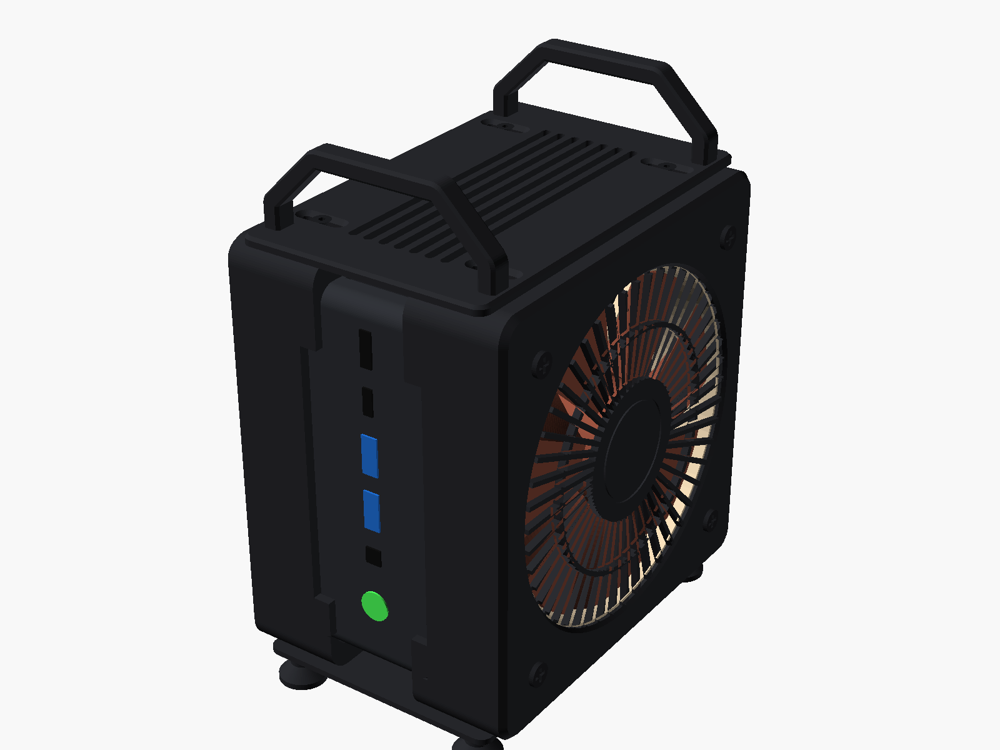
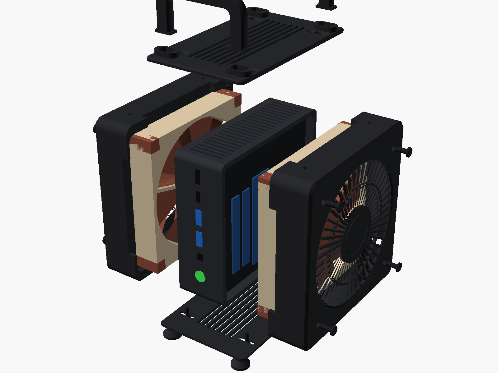
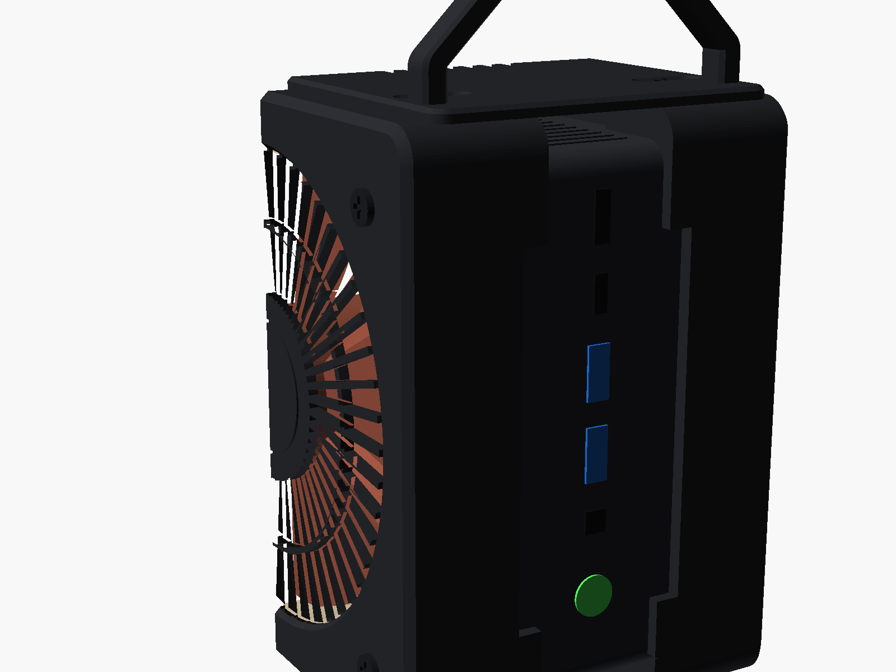
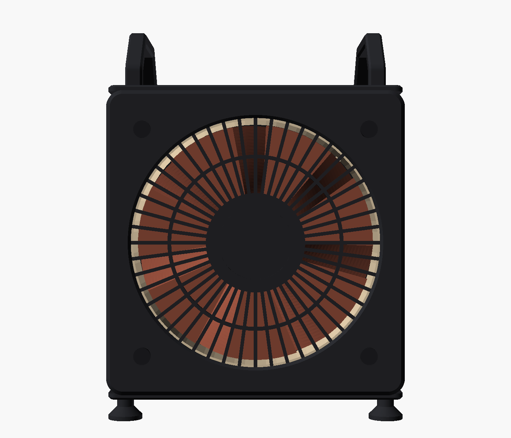
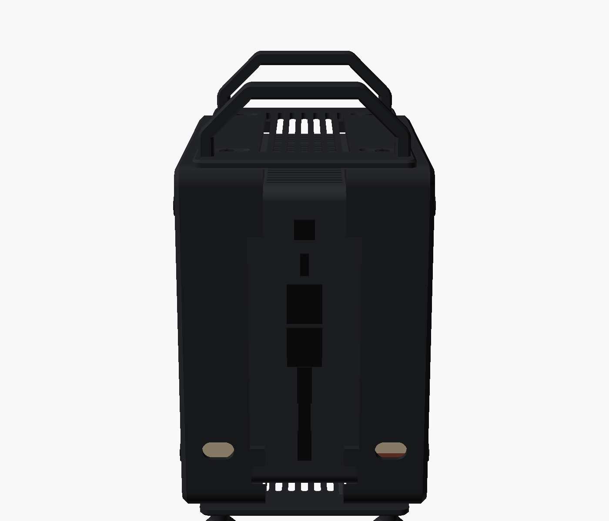
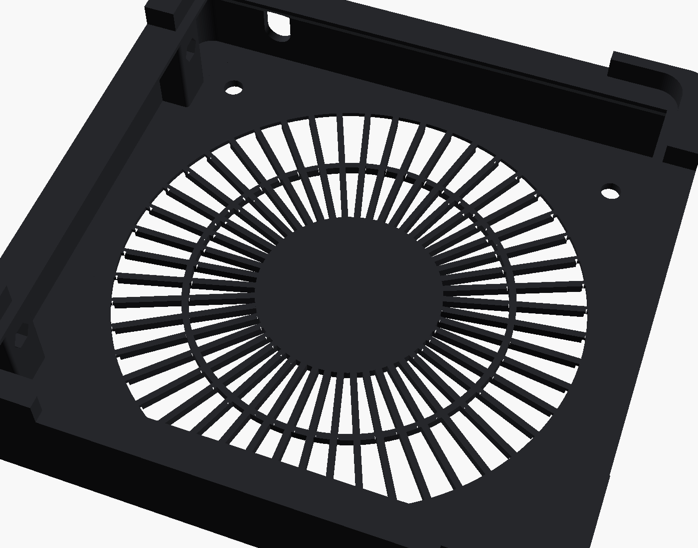
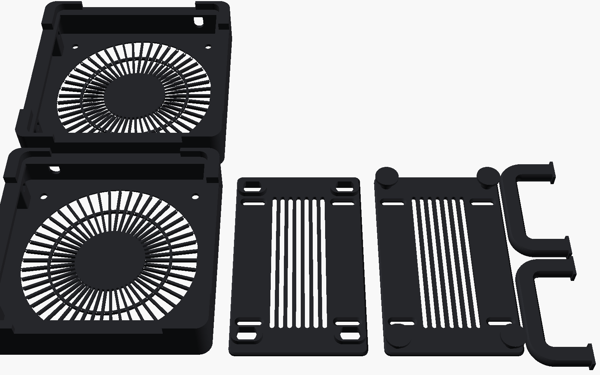

# GMKtec K11 Çift Fanlı Kasa

[English](README.md) · **Türkçe**

GMKtec K11 mini bilgisayarı, iki adet 120 mm fanlı, kapalı ve küçük bir kuleye dönüştüren 3D baskı kasa. Fanlar K11'in kendi USB portlarından beslenir: lehim yok, ek adaptör yok. Ön ve arka portların hepsi açık kalır.

| | |
|---|---|
| **Canlı 3D görüntüleyici** | **[hakanuzum.github.io/gmktec-k11-dual-fan-case](https://hakanuzum.github.io/gmktec-k11-dual-fan-case/viewer/)**: döndür, parçalara ayır, kesit al, hava akışını gör; **Show how it fits together** düğmesi her parçayı ayrı renge boyar ve kasayı şeffaf yapar, somun ve vidaların nereye girdiği görünür |
| **Bu sayfada 3D** | [Aşağıda](#3d-önizleme): GitHub sayfanın içinde gösterir, fareyle döndürebilirsin |
| **Tek parça 3D** | [`stl/`](stl/) klasöründeki herhangi bir dosyaya tıkla; GitHub 3D olarak açar |
| **Baskı dosyaları** | [`stl/`](stl/): 5 dosya, 6 baskı |
| **Düzenlenebilir kaynak** | [`cad/k11_dual_fan_case.scad`](cad/k11_dual_fan_case.scad) (OpenSCAD, kaydırıcılı ayar paneliyle) |



> **Durum:** Tasarım yazılım üzerinde kontrol edildi (bkz. [Doğrulama](#doğrulama)). Henüz basılıp gerçek bir K11'e takılmadı. Önce tek bir fan yuvası basıp cihaza takarak dene, sonra diğer parçaları bas. Fotoğraf ve geri bildirimlerini issue olarak paylaşabilirsin.

## 3D önizleme

Kapalı kasanın tek renkli, sadeleştirilmiş önizlemesi (içinde temsili bir K11 var). Renkler, parçalara ayırma ve hava akışı için [canlı görüntüleyiciyi](https://hakanuzum.github.io/gmktec-k11-dual-fan-case/viewer/) kullan.

<!-- model:start -->
```stl
solid K11_DUAL_FAN_CASE_PREVIEW
facet normal 0.7 -0.3 -0.7
outer loop
vertex 50 -65.5 17
vertex 48 -61.5 13
vertex 50 -61.5 15
endloop
endfacet
facet normal 0.7 -0.3 -0.7
outer loop
vertex 50 -65.5 17
vertex 48 -67 15.5
vertex 48 -61.5 13
endloop
endfacet
facet normal 0.7 -0.7 -0.3
outer loop
vertex 50 -65.5 17
vertex 50 -67.5 21
vertex 48 -69.5 21
endloop
endfacet
facet normal 0.7 -0.7 -0.3
outer loop
vertex 50 -65.5 17
vertex 48 -69.5 21
vertex 48 -67 15.5
endloop
endfacet
facet normal 1 -0 -0
outer loop
vertex 50 -65.5 17
vertex 50 -61.5 15
vertex 50 -67.5 21
endloop
endfacet
facet normal 1 0 0
outer loop
vertex 50 -61.5 15
vertex 50 -55 30
vertex 50 -55 33
endloop
endfacet
facet normal 1 0 -0
outer loop
vertex 50 -61.5 15
vertex 50 -52.5 29
vertex 50 -55 30
endloop
endfacet
facet normal 1 0 -0
outer loop
vertex 50 -61.5 15
vertex 50 -18 29
vertex 50 -52.5 29
endloop
endfacet
facet normal 1 0 -0
outer loop
vertex 50 -61.5 15
vertex 50 -55 33
vertex 50 -55 66
endloop
endfacet
facet normal 1 0 0
outer loop
vertex 50 -52.5 34
vertex 50 -55 66
vertex 50 -55 33
endloop
endfacet
facet normal 1 0 -0
outer loop
vertex 50 -52.5 29
vertex 50 -34 37
vertex 50 -50 30
endloop
endfacet
facet normal 1 -0 0
outer loop
vertex 50 -52.5 34
vertex 50 -50 33
vertex 50 -47 50
endloop
endfacet
facet normal 1 0 -0
outer loop
vertex 50 -50 30
vertex 50 -41 44
vertex 50 -50 33
endloop
endfacet
facet normal 1 0 -0
outer loop
vertex 50 -50 30
vertex 50 -40 43
vertex 50 -41 44
endloop
endfacet
facet normal 1 -0 -0
outer loop
vertex 50 -52.5 29
vertex 50 -18 29
vertex 50 -34 37
endloop
endfacet
facet normal 1 0 -0
outer loop
vertex 50 -50 30
vertex 50 -34 37
vertex 50 -40 43
endloop
endfacet
facet normal 1 0 -0
outer loop
vertex 50 -50 33
vertex 50 -41 44
vertex 50 -47 50
endloop
endfacet
facet normal -0 -0.4 -0.9
outer loop
vertex 48 -67 15.5
vertex 22 -67 15.5
vertex 48 -61.5 13
endloop
endfacet
facet normal -0 -0.9 -0.4
outer loop
vertex 48 -67 15.5
vertex 48 -69.5 21
vertex 22 -69.5 21
endloop
endfacet
facet normal 0.7 0 -0.7
outer loop
vertex 50 -61.5 15
vertex 48 -61.5 13
vertex 48 61.5 13
endloop
endfacet
facet normal 1 0 -0
outer loop
vertex 50 -61.5 15
vertex 50 -1 26
vertex 50 -18 29
endloop
endfacet
facet normal 1 0 -0
outer loop
vertex 50 -61.5 15
vertex 50 1 26
vertex 50 -1 26
endloop
endfacet
facet normal 1 0 -0
outer loop
vertex 50 -61.5 15
vertex 50 -55 66
vertex 50 -58 83
endloop
endfacet
facet normal 1 0 0
outer loop
vertex 50 -61.5 15
vertex 50 -67.5 147
vertex 50 -67.5 21
endloop
endfacet
facet normal 0.7 -0.7 0
outer loop
vertex 50 -67.5 21
vertex 48 -69.5 147
vertex 48 -69.5 21
endloop
endfacet
facet normal 1 0 0
outer loop
vertex 50 -61.5 15
vertex 50 -58 83
vertex 50 -58 85
endloop
endfacet
facet normal 1 0 -0
outer loop
vertex 50 -52.5 34
vertex 50 -47 50
vertex 50 -55 66
endloop
endfacet
facet normal 1 0 -0
outer loop
vertex 50 -61.5 15
vertex 50 -58 85
vertex 50 -67.5 147
endloop
endfacet
facet normal 1 0 -0
outer loop
vertex 50 -58 83
vertex 50 -23 83
vertex 50 -58 85
endloop
endfacet
facet normal 1 0 -0
outer loop
vertex 50 -40 43
vertex 50 -15 67.5
vertex 50 -41 44
endloop
endfacet
facet normal 1 0 -0
outer loop
vertex 50 -41 44
vertex 50 -15 67.5
vertex 50 -16.5 69
endloop
endfacet
facet normal 1 0 -0
outer loop
vertex 50 -1 26
vertex 50 1 61
vertex 50 -1 61
endloop
endfacet
facet normal 1 0 0
outer loop
vertex 50 -15 67.5
vertex 50 -11.5 64
vertex 50 -1 61
endloop
endfacet
facet normal 1 -0 -0
outer loop
vertex 50 -15 67.5
vertex 50 -1 61
vertex 50 -16.5 69
endloop
endfacet
facet normal 1 -0 -0
outer loop
vertex 50 -23 83
vertex 50 -20 72.5
vertex 50 -23 85
endloop
endfacet
facet normal 1 0 0
outer loop
vertex 50 -1 61
vertex 50 -20 72.5
vertex 50 -16.5 69
endloop
endfacet
facet normal 1 0 0
outer loop
vertex 50 -1 61
vertex 50 -23 85
vertex 50 -20 72.5
endloop
endfacet
facet normal 1 0 0
outer loop
vertex 50 1 61
vertex 50 -23 85
vertex 50 -1 61
endloop
endfacet
facet normal 1 0 -0
outer loop
vertex 50 1 61
vertex 50 11.5 64
vertex 50 -23 85
endloop
endfacet
facet normal 1 0 0
outer loop
vertex 50 16.5 69
vertex 50 -20 95.5
vertex 50 -23 85
endloop
endfacet
facet normal 0 -0.9 -0.4
outer loop
vertex 48 -67 15.5
vertex 22 -69.5 21
vertex 22 -67 15.5
endloop
endfacet
facet normal 0 -0.4 -0.9
outer loop
vertex 48 -61.5 13
vertex 22 -67 15.5
vertex 22 -61.5 13
endloop
endfacet
facet normal 0 0 -1
outer loop
vertex 48 -61.5 13
vertex 22 -61.5 13
vertex 22 -51.5 13
endloop
endfacet
facet normal 0 0 -1
outer loop
vertex 48 -61.5 13
vertex 22 -51.5 13
vertex 22 -44 13
endloop
endfacet
facet normal -0 -1 -0
outer loop
vertex 48 -69.5 21
vertex 22 -69.5 40
vertex 22 -69.5 21
endloop
endfacet
facet normal 0 0 -1
outer loop
vertex 48 -61.5 13
vertex 22 -44 13
vertex 22 -42.5 13
endloop
endfacet
facet normal 0 -0.4 -0.9
outer loop
vertex 22 -67 15.5
vertex 22 -61.5 13
vertex 22 -61.5 13
endloop
endfacet
facet normal 0 0 -1
outer loop
vertex 22 -61.5 13
vertex 22 -61.5 13
vertex 22 -51.5 13
endloop
endfacet
facet normal -1 0 -0
outer loop
vertex 22 -60.5 21
vertex 22 -52.5 22
vertex 22 -52.5 21
endloop
endfacet
facet normal -1 0 0
outer loop
vertex 22 -65 22.5
vertex 22 -66.5 27
vertex 22 -66.5 40
endloop
endfacet
facet normal -1 0 0
outer loop
vertex 22 -60.5 21
vertex 22 -60.5 23.5
vertex 22 -52.5 22
endloop
endfacet
facet normal -1 0 0
outer loop
vertex 22 -52.5 22
vertex 22 -60.5 23.5
vertex 22 -52 22.5
endloop
endfacet
facet normal -1 0 0
outer loop
vertex 22 -52 22.5
vertex 22 -60.5 23.5
vertex 22 -51.5 23
endloop
endfacet
facet normal 0 0 -1
outer loop
vertex 48 -61.5 13
vertex 22 -42.5 13
vertex 22 42.5 13
endloop
endfacet
facet normal -1 0 0
outer loop
vertex 22 -42.5 13
vertex 22 -42 13.5
vertex 22 42 13.5
endloop
endfacet
facet normal -1 0 0
outer loop
vertex 22 -42 13.5
vertex 22 -41.5 14
vertex 22 41.5 14
endloop
endfacet
facet normal -1 0 0
outer loop
vertex 22 -41.5 14
vertex 22 -41.5 22
vertex 22 41.5 22
endloop
endfacet
facet normal -1 0 0
outer loop
vertex 22 -51.5 23
vertex 22 -60.5 23.5
vertex 22 60.5 23.5
endloop
endfacet
facet normal -1 0 0
outer loop
vertex 22 -41.5 22
vertex 22 -42 22.5
vertex 22 42 22.5
endloop
endfacet
facet normal -1 0 0
outer loop
vertex 22 -42 22.5
vertex 22 -42.5 23
vertex 22 42.5 23
endloop
endfacet
facet normal -1 0 -0
outer loop
vertex 22 -51.5 23
vertex 22 60.5 23.5
vertex 22 -42.5 23
endloop
endfacet
facet normal -0 -1 -0
outer loop
vertex 48 -69.5 21
vertex 22 -69.5 128
vertex 22 -69.5 40
endloop
endfacet
facet normal -1 0 0
outer loop
vertex 22 -60.5 21
vertex 22 -65 22.5
vertex 22 -66.5 128
endloop
endfacet
facet normal -1 0 0
outer loop
vertex 22 -60.5 21
vertex 22 -66.5 128
vertex 22 -60.5 23.5
endloop
endfacet
facet normal -1 0 0
outer loop
vertex 22 -65 22.5
vertex 22 -66.5 40
vertex 22 -66.5 128
endloop
endfacet
facet normal -1 0 0
outer loop
vertex 22 -69.5 40
vertex 22 -69.5 128
vertex 22 -66.5 40
endloop
endfacet
facet normal 1 0 -0
outer loop
vertex 50 -61.5 15
vertex 50 67.5 21
vertex 50 1 26
endloop
endfacet
facet normal 0 0 -1
outer loop
vertex 48 -61.5 13
vertex 47.5 42.5 13
vertex 47.5 51.5 13
endloop
endfacet
facet normal 0 0 -1
outer loop
vertex 48 -61.5 13
vertex 47.5 51.5 13
vertex 48 61.5 13
endloop
endfacet
facet normal 0.7 0 -0.7
outer loop
vertex 50 -61.5 15
vertex 48 61.5 13
vertex 50 61.5 15
endloop
endfacet
facet normal 1 0 0
outer loop
vertex 50 -61.5 15
vertex 50 61.5 15
vertex 50 67.5 21
endloop
endfacet
facet normal 1 0 0
outer loop
vertex 50 67.5 21
vertex 50 18 29
vertex 50 1 26
endloop
endfacet
facet normal 1 0 0
outer loop
vertex 50 -1 26
vertex 50 1 26
vertex 50 1 61
endloop
endfacet
facet normal 0 0 -1
outer loop
vertex 48 -61.5 13
vertex 22 42.5 13
vertex 47.5 42.5 13
endloop
endfacet
facet normal 1 0 0
outer loop
vertex 50 67.5 21
vertex 50 52.5 29
vertex 50 18 29
endloop
endfacet
facet normal 0.7 0.3 -0.7
outer loop
vertex 50 61.5 15
vertex 48 61.5 13
vertex 50 65.5 17
endloop
endfacet
facet normal 0.7 0.3 -0.7
outer loop
vertex 48 61.5 13
vertex 48 67 15.5
vertex 50 65.5 17
endloop
endfacet
facet normal 1 0 0
outer loop
vertex 50 61.5 15
vertex 50 65.5 17
vertex 50 67.5 21
endloop
endfacet
facet normal 0.7 0.7 -0.3
outer loop
vertex 50 65.5 17
vertex 48 69.5 21
vertex 50 67.5 21
endloop
endfacet
facet normal 0.7 0.7 -0.3
outer loop
vertex 50 65.5 17
vertex 48 67 15.5
vertex 48 69.5 21
endloop
endfacet
facet normal 1 0 0
outer loop
vertex 50 67.5 21
vertex 50 55 30
vertex 50 52.5 29
endloop
endfacet
facet normal 1 0 0
outer loop
vertex 50 67.5 21
vertex 50 55 33
vertex 50 55 30
endloop
endfacet
facet normal 1 0 -0
outer loop
vertex 50 18 29
vertex 50 52.5 29
vertex 50 34 37
endloop
endfacet
facet normal 1 0 0
outer loop
vertex 50 40 43
vertex 50 34 37
vertex 50 50 30
endloop
endfacet
facet normal 1 -0 -0
outer loop
vertex 50 34 37
vertex 50 52.5 29
vertex 50 50 30
endloop
endfacet
facet normal 1 0 -0
outer loop
vertex 50 50 30
vertex 50 50 33
vertex 50 41 44
endloop
endfacet
facet normal 1 -0 -0
outer loop
vertex 50 40 43
vertex 50 50 30
vertex 50 41 44
endloop
endfacet
facet normal 1 -0 0
outer loop
vertex 50 47 50
vertex 50 50 33
vertex 50 52.5 34
endloop
endfacet
facet normal 1 0 0
outer loop
vertex 50 47 50
vertex 50 52.5 34
vertex 50 55 33
endloop
endfacet
facet normal 1 0 0
outer loop
vertex 50 47 50
vertex 50 41 44
vertex 50 50 33
endloop
endfacet
facet normal 1 0 0
outer loop
vertex 50 67.5 21
vertex 50 47 50
vertex 50 55 33
endloop
endfacet
facet normal 1 0 0
outer loop
vertex 50 67.5 21
vertex 50 55 66
vertex 50 47 50
endloop
endfacet
facet normal 0 1 -0
outer loop
vertex 48 69.5 21
vertex 40 69.5 36.5
vertex 41.5 69.5 39
endloop
endfacet
facet normal 0 1 -0
outer loop
vertex 48 69.5 21
vertex 37.5 69.5 35
vertex 40 69.5 36.5
endloop
endfacet
facet normal 0 0 -1
outer loop
vertex 47.5 51.5 13
vertex 22 61.5 13
vertex 48 61.5 13
endloop
endfacet
facet normal 0 0.4 -0.9
outer loop
vertex 48 61.5 13
vertex 22 61.5 13
vertex 48 67 15.5
endloop
endfacet
facet normal 0 0.9 -0.4
outer loop
vertex 48 67 15.5
vertex 22 69.5 21
vertex 48 69.5 21
endloop
endfacet
facet normal 0 1 -0
outer loop
vertex 48 69.5 21
vertex 32 69.5 35
vertex 37.5 69.5 35
endloop
endfacet
facet normal 0 1 -0
outer loop
vertex 48 69.5 21
vertex 22 69.5 21
vertex 32 69.5 35
endloop
endfacet
facet normal 1 0 0
outer loop
vertex 50 41 44
vertex 50 16.5 69
vertex 50 40 43
endloop
endfacet
facet normal 1 -0 -0
outer loop
vertex 50 15 67.5
vertex 50 40 43
vertex 50 16.5 69
endloop
endfacet
facet normal 1 0 -0
outer loop
vertex 50 11.5 64
vertex 50 15 67.5
vertex 50 -23 85
endloop
endfacet
facet normal 1 0 0
outer loop
vertex 50 16.5 69
vertex 50 -23 85
vertex 50 15 67.5
endloop
endfacet
facet normal 1 0 -0
outer loop
vertex 50 16.5 69
vertex 50 20 72.5
vertex 50 15 100.5
endloop
endfacet
facet normal 1 0 -0
outer loop
vertex 50 23 83
vertex 50 58 83
vertex 50 23 85
endloop
endfacet
facet normal 1 0 0
outer loop
vertex 50 67.5 21
vertex 50 58 83
vertex 50 55 66
endloop
endfacet
facet normal 0.7 0.7 -0
outer loop
vertex 50 67.5 21
vertex 48 69.5 21
vertex 48 69.5 147
endloop
endfacet
facet normal 0 1 -0
outer loop
vertex 48 69.5 21
vertex 41.5 69.5 39
vertex 48 69.5 147
endloop
endfacet
facet normal 0 1 0
outer loop
vertex 48 69.5 147
vertex 41.5 69.5 39
vertex 40 69.5 41.5
endloop
endfacet
facet normal 0 1 0
outer loop
vertex 48 69.5 147
vertex 40 69.5 41.5
vertex 37.5 69.5 43
endloop
endfacet
facet normal 0 1 0
outer loop
vertex 48 69.5 147
vertex 37.5 69.5 43
vertex 32 69.5 43
endloop
endfacet
facet normal 0 1 0
outer loop
vertex 48 69.5 147
vertex 32 69.5 43
vertex 29.5 69.5 41.5
endloop
endfacet
facet normal 0 1 0
outer loop
vertex 48 69.5 147
vertex 29.5 69.5 41.5
vertex 28.5 69.5 39
endloop
endfacet
facet normal -1 0 0
outer loop
vertex 22 -42.5 13
vertex 22 42 13.5
vertex 22 42.5 13
endloop
endfacet
facet normal -1 0 0
outer loop
vertex 22 -42 13.5
vertex 22 41.5 14
vertex 22 42 13.5
endloop
endfacet
facet normal -1 0 0
outer loop
vertex 22 -41.5 14
vertex 22 41.5 22
vertex 22 41.5 14
endloop
endfacet
facet normal -1 0 -0
outer loop
vertex 22 -41.5 22
vertex 22 42 22.5
vertex 22 41.5 22
endloop
endfacet
facet normal -1 0 -0
outer loop
vertex 22 -42 22.5
vertex 22 42.5 23
vertex 22 42 22.5
endloop
endfacet
facet normal -1 0 -0
outer loop
vertex 22 -42.5 23
vertex 22 60.5 23.5
vertex 22 42.5 23
endloop
endfacet
facet normal 0 0 -1
outer loop
vertex 47.5 51.5 13
vertex 22 51.5 13
vertex 22 61.5 13
endloop
endfacet
facet normal 0 0.4 -0.9
outer loop
vertex 48 67 15.5
vertex 22 61.5 13
vertex 22 67 15.5
endloop
endfacet
facet normal 0 0.9 -0.4
outer loop
vertex 48 67 15.5
vertex 22 67 15.5
vertex 22 69.5 21
endloop
endfacet
facet normal -0 1 0
outer loop
vertex 22 69.5 21
vertex 29.5 69.5 36.5
vertex 32 69.5 35
endloop
endfacet
facet normal -0 1 0
outer loop
vertex 22 69.5 21
vertex 28.5 69.5 39
vertex 29.5 69.5 36.5
endloop
endfacet
facet normal 0 0 -1
outer loop
vertex 22 44 13
vertex 22 44 13
vertex 22 51.5 13
endloop
endfacet
facet normal -1 0 -0
outer loop
vertex 22 42.5 23
vertex 22 60.5 23.5
vertex 22 51.5 23
endloop
endfacet
facet normal 0 0 -1
outer loop
vertex 22 44 13
vertex 22 61.5 13
vertex 22 51.5 13
endloop
endfacet
facet normal -1 0 0
outer loop
vertex 22 52.5 21
vertex 22 52.5 22
vertex 22 60.5 21
endloop
endfacet
facet normal -1 0 0
outer loop
vertex 22 60.5 21
vertex 22 52.5 22
vertex 22 52 22.5
endloop
endfacet
facet normal -1 0 -0
outer loop
vertex 22 51.5 23
vertex 22 60.5 23.5
vertex 22 52 22.5
endloop
endfacet
facet normal -1 0 0
outer loop
vertex 22 60.5 21
vertex 22 52 22.5
vertex 22 60.5 23.5
endloop
endfacet
facet normal -1 0 0
outer loop
vertex 22 60.5 21
vertex 22 60.5 23.5
vertex 22 65 22.5
endloop
endfacet
facet normal -0 1 0
outer loop
vertex 22 69.5 21
vertex 48 69.5 147
vertex 28.5 69.5 39
endloop
endfacet
facet normal 0 1 0
outer loop
vertex 22 69.5 21
vertex 22 69.5 40
vertex 48 69.5 147
endloop
endfacet
facet normal -1 0 0
outer loop
vertex 22 65 22.5
vertex 22 60.5 23.5
vertex 22 60.5 144.5
endloop
endfacet
facet normal -1 0 0
outer loop
vertex 22 65 22.5
vertex 22 60.5 144.5
vertex 22 66.5 27
endloop
endfacet
facet normal -1 0 0
outer loop
vertex 22 66.5 27
vertex 22 60.5 144.5
vertex 22 66.5 40
endloop
endfacet
facet normal -1 0 0
outer loop
vertex 22 66.5 40
vertex 22 66.5 128
vertex 22 69.5 40
endloop
endfacet
facet normal 0.7 -0.7 0
outer loop
vertex 50 -67.5 21
vertex 50 -67.5 147
vertex 48 -69.5 147
endloop
endfacet
facet normal 1 -0 0
outer loop
vertex 50 -67.5 147
vertex 50 -58 85
vertex 50 -55 102
endloop
endfacet
facet normal 0 -1 0
outer loop
vertex 48 -69.5 21
vertex 48 -69.5 147
vertex 22 -69.5 147
endloop
endfacet
facet normal 1 0 -0
outer loop
vertex 50 -23 83
vertex 50 -23 85
vertex 50 -58 85
endloop
endfacet
facet normal 1 0 0
outer loop
vertex 50 16.5 69
vertex 50 -16.5 99
vertex 50 -20 95.5
endloop
endfacet
facet normal 1 -0 -0
outer loop
vertex 50 -16.5 99
vertex 50 16.5 69
vertex 50 -15 100.5
endloop
endfacet
facet normal 1 0 0
outer loop
vertex 50 16.5 69
vertex 50 -11.5 104
vertex 50 -15 100.5
endloop
endfacet
facet normal 1 0 0
outer loop
vertex 50 -15 100.5
vertex 50 -40 125
vertex 50 -16.5 99
endloop
endfacet
facet normal 1 0 0
outer loop
vertex 50 -16.5 99
vertex 50 -40 125
vertex 50 -41 124
endloop
endfacet
facet normal 1 -0 0
outer loop
vertex 50 -67.5 147
vertex 50 -55 102
vertex 50 -47 118
endloop
endfacet
facet normal 1 -0 -0
outer loop
vertex 50 -67.5 147
vertex 50 -47 118
vertex 50 -55 135
endloop
endfacet
facet normal 1 0 -0
outer loop
vertex 50 -47 118
vertex 50 -41 124
vertex 50 -50 135
endloop
endfacet
facet normal 1 0 0
outer loop
vertex 50 -40 125
vertex 50 -50 135
vertex 50 -41 124
endloop
endfacet
facet normal 1 0 0
outer loop
vertex 50 -47 118
vertex 50 -52.5 134
vertex 50 -55 135
endloop
endfacet
facet normal 1 0 0
outer loop
vertex 50 -47 118
vertex 50 -50 135
vertex 50 -52.5 134
endloop
endfacet
facet normal 1 0 0
outer loop
vertex 50 -34 131
vertex 50 -50 138
vertex 50 -50 135
endloop
endfacet
facet normal 1 0 -0
outer loop
vertex 50 -40 125
vertex 50 -34 131
vertex 50 -50 135
endloop
endfacet
facet normal 1 -0 0
outer loop
vertex 50 -67.5 147
vertex 50 -55 135
vertex 50 -55 138
endloop
endfacet
facet normal 1 -0 0
outer loop
vertex 50 -67.5 147
vertex 50 -55 138
vertex 50 -52.5 139
endloop
endfacet
facet normal 0.7 -0.7 0.3
outer loop
vertex 50 -67.5 147
vertex 50 -65.5 151
vertex 48 -69.5 147
endloop
endfacet
facet normal 0.7 -0.7 0.3
outer loop
vertex 48 -69.5 147
vertex 50 -65.5 151
vertex 48 -67 152.5
endloop
endfacet
facet normal 1 0 -0
outer loop
vertex 50 -67.5 147
vertex 50 -61.5 153
vertex 50 -65.5 151
endloop
endfacet
facet normal 0.7 -0.3 0.7
outer loop
vertex 50 -65.5 151
vertex 50 -61.5 153
vertex 48 -61.5 155
endloop
endfacet
facet normal 0.7 -0.3 0.7
outer loop
vertex 50 -65.5 151
vertex 48 -61.5 155
vertex 48 -67 152.5
endloop
endfacet
facet normal 1 -0 0
outer loop
vertex 50 -67.5 147
vertex 50 -52.5 139
vertex 50 -18 139
endloop
endfacet
facet normal 1 -0 0
outer loop
vertex 50 -52.5 139
vertex 50 -50 138
vertex 50 -18 139
endloop
endfacet
facet normal 0 -0.9 0.4
outer loop
vertex 48 -69.5 147
vertex 48 -67 152.5
vertex 22 -69.5 147
endloop
endfacet
facet normal 0 -0.4 0.9
outer loop
vertex 48 -67 152.5
vertex 48 -61.5 155
vertex 22 -67 152.5
endloop
endfacet
facet normal 0 0 1
outer loop
vertex 48 -61.5 155
vertex 47.5 -51.5 155
vertex 22 -51.5 155
endloop
endfacet
facet normal 1 0 -0
outer loop
vertex 50 -34 131
vertex 50 -18 139
vertex 50 -50 138
endloop
endfacet
facet normal 1 0 -0
outer loop
vertex 50 -1 107
vertex 50 1 142
vertex 50 -1 142
endloop
endfacet
facet normal 1 -0 0
outer loop
vertex 50 -67.5 147
vertex 50 -18 139
vertex 50 -1 142
endloop
endfacet
facet normal 1 -0 0
outer loop
vertex 50 -67.5 147
vertex 50 -1 142
vertex 50 1 142
endloop
endfacet
facet normal 1 0 -0
outer loop
vertex 50 -67.5 147
vertex 50 65.5 151
vertex 50 -61.5 153
endloop
endfacet
facet normal 0.7 0 0.7
outer loop
vertex 50 -61.5 153
vertex 48 61.5 155
vertex 48 -61.5 155
endloop
endfacet
facet normal 0 -0 1
outer loop
vertex 48 -61.5 155
vertex 48 61.5 155
vertex 47.5 -51.5 155
endloop
endfacet
facet normal 0 -0 1
outer loop
vertex 47.5 -51.5 155
vertex 48 61.5 155
vertex 47.5 -42.5 155
endloop
endfacet
facet normal 1 -0 0
outer loop
vertex 50 -67.5 147
vertex 50 1 142
vertex 50 65.5 151
endloop
endfacet
facet normal 0 -0 1
outer loop
vertex 47.5 -42.5 155
vertex 47.5 51.5 155
vertex 22 -44 155
endloop
endfacet
facet normal -0 -1 -0
outer loop
vertex 48 -69.5 21
vertex 22 -69.5 147
vertex 22 -69.5 128
endloop
endfacet
facet normal -1 0 0
outer loop
vertex 22 -66.5 40
vertex 22 -69.5 128
vertex 22 -66.5 128
endloop
endfacet
facet normal -1 0 0
outer loop
vertex 22 -66.5 128
vertex 22 -66.5 141
vertex 22 -60.5 23.5
endloop
endfacet
facet normal -1 0 0
outer loop
vertex 22 -66.5 141
vertex 22 -65 145.5
vertex 22 -60.5 23.5
endloop
endfacet
facet normal -1 0 0
outer loop
vertex 22 -65 145.5
vertex 22 -60.5 144.5
vertex 22 -60.5 23.5
endloop
endfacet
facet normal 0 -0.9 0.4
outer loop
vertex 48 -67 152.5
vertex 22 -67 152.5
vertex 22 -69.5 147
endloop
endfacet
facet normal 0 -0.4 0.9
outer loop
vertex 48 -61.5 155
vertex 22 -61.5 155
vertex 22 -67 152.5
endloop
endfacet
facet normal 0 0 1
outer loop
vertex 48 -61.5 155
vertex 22 -51.5 155
vertex 22 -61.5 155
endloop
endfacet
facet normal -1 0 0
outer loop
vertex 22 -65 145.5
vertex 22 -60.5 147
vertex 22 -60.5 144.5
endloop
endfacet
facet normal -1 -0 0
outer loop
vertex 22 -52 145.5
vertex 22 -60.5 144.5
vertex 22 -60.5 147
endloop
endfacet
facet normal -1 0 -0
outer loop
vertex 22 -52 145.5
vertex 22 -51.5 145
vertex 22 -60.5 144.5
endloop
endfacet
facet normal -1 0 0
outer loop
vertex 22 -52 145.5
vertex 22 -60.5 147
vertex 22 -52.5 146
endloop
endfacet
facet normal 0 -0.4 0.9
outer loop
vertex 22 -67 152.5
vertex 22 -61.5 155
vertex 22 -61.5 155
endloop
endfacet
facet normal -1 0 0
outer loop
vertex 22 -52.5 146
vertex 22 -60.5 147
vertex 22 -52.5 147
endloop
endfacet
facet normal -1 0 -0
outer loop
vertex 22 -51.5 145
vertex 22 -42.5 145
vertex 22 -60.5 144.5
endloop
endfacet
facet normal -1 -0 -0
outer loop
vertex 22 -42.5 145
vertex 22 -42 144.5
vertex 22 -60.5 144.5
endloop
endfacet
facet normal -1 0 -0
outer loop
vertex 22 -42.5 145
vertex 22 -42 145.5
vertex 22 -42 144.5
endloop
endfacet
facet normal 0 0 1
outer loop
vertex 22 -44 155
vertex 22 -42.5 155
vertex 22 -44 155
endloop
endfacet
facet normal -1 0 -0
outer loop
vertex 22 -42 145.5
vertex 22 42 145.5
vertex 22 -42 144.5
endloop
endfacet
facet normal -1 0 0
outer loop
vertex 22 -42 145.5
vertex 22 -41.5 146
vertex 22 41.5 146
endloop
endfacet
facet normal -1 0 0
outer loop
vertex 22 -41.5 146
vertex 22 -41.5 154
vertex 22 41.5 154
endloop
endfacet
facet normal 0 0 1
outer loop
vertex 22 -44 155
vertex 22 42.5 155
vertex 22 -42.5 155
endloop
endfacet
facet normal -1 -0 -0
outer loop
vertex 22 -42.5 155
vertex 22 42 154.5
vertex 22 -42 154.5
endloop
endfacet
facet normal -1 0 0
outer loop
vertex 22 -41.5 154
vertex 22 -42 154.5
vertex 22 41.5 154
endloop
endfacet
facet normal 1 0 0
outer loop
vertex 50 16.5 69
vertex 50 15 100.5
vertex 50 11.5 104
endloop
endfacet
facet normal 1 0 0
outer loop
vertex 50 16.5 69
vertex 50 -1 107
vertex 50 -11.5 104
endloop
endfacet
facet normal 1 0 0
outer loop
vertex 50 16.5 69
vertex 50 1 107
vertex 50 -1 107
endloop
endfacet
facet normal 1 0 0
outer loop
vertex 50 16.5 69
vertex 50 11.5 104
vertex 50 1 107
endloop
endfacet
facet normal 1 0 -0
outer loop
vertex 50 20 72.5
vertex 50 23 83
vertex 50 15 100.5
endloop
endfacet
facet normal 1 0 -0
outer loop
vertex 50 23 83
vertex 50 23 85
vertex 50 15 100.5
endloop
endfacet
facet normal 1 0 0
outer loop
vertex 50 16.5 99
vertex 50 15 100.5
vertex 50 23 85
endloop
endfacet
facet normal 1 0 0
outer loop
vertex 50 20 95.5
vertex 50 16.5 99
vertex 50 23 85
endloop
endfacet
facet normal 1 0 -0
outer loop
vertex 50 1 107
vertex 50 1 142
vertex 50 -1 107
endloop
endfacet
facet normal 1 0 -0
outer loop
vertex 50 16.5 99
vertex 50 41 124
vertex 50 15 100.5
endloop
endfacet
facet normal 1 0 -0
outer loop
vertex 50 15 100.5
vertex 50 41 124
vertex 50 40 125
endloop
endfacet
facet normal 1 0 -0
outer loop
vertex 50 58 83
vertex 50 58 85
vertex 50 23 85
endloop
endfacet
facet normal 1 0 0
outer loop
vertex 50 67.5 21
vertex 50 65.5 151
vertex 50 58 83
endloop
endfacet
facet normal 1 0 0
outer loop
vertex 50 55 102
vertex 50 52.5 134
vertex 50 47 118
endloop
endfacet
facet normal 1 0 0
outer loop
vertex 50 65.5 151
vertex 50 58 85
vertex 50 58 83
endloop
endfacet
facet normal 0.7 0.7 0
outer loop
vertex 50 67.5 21
vertex 48 69.5 147
vertex 50 67.5 147
endloop
endfacet
facet normal 1 0 -0
outer loop
vertex 50 67.5 21
vertex 50 67.5 147
vertex 50 65.5 151
endloop
endfacet
facet normal 1 0 0
outer loop
vertex 50 65.5 151
vertex 50 55 102
vertex 50 58 85
endloop
endfacet
facet normal 1 -0 0
outer loop
vertex 50 18 139
vertex 50 34 131
vertex 50 50 138
endloop
endfacet
facet normal 1 0 0
outer loop
vertex 50 65.5 151
vertex 50 1 142
vertex 50 18 139
endloop
endfacet
facet normal 0.7 -0 0.7
outer loop
vertex 50 -61.5 153
vertex 50 61.5 153
vertex 48 61.5 155
endloop
endfacet
facet normal 1 -0 -0
outer loop
vertex 50 -61.5 153
vertex 50 65.5 151
vertex 50 61.5 153
endloop
endfacet
facet normal 0 -0 1
outer loop
vertex 47.5 -42.5 155
vertex 48 61.5 155
vertex 47.5 51.5 155
endloop
endfacet
facet normal 1 -0 0
outer loop
vertex 50 41 124
vertex 50 47 118
vertex 50 50 135
endloop
endfacet
facet normal 1 -0 0
outer loop
vertex 50 34 131
vertex 50 40 125
vertex 50 50 138
endloop
endfacet
facet normal 1 0 -0
outer loop
vertex 50 41 124
vertex 50 50 138
vertex 50 40 125
endloop
endfacet
facet normal 1 0 0
outer loop
vertex 50 41 124
vertex 50 50 135
vertex 50 50 138
endloop
endfacet
facet normal 1 0 -0
outer loop
vertex 50 47 118
vertex 50 52.5 134
vertex 50 50 135
endloop
endfacet
facet normal 1 0 0
outer loop
vertex 50 55 102
vertex 50 55 135
vertex 50 52.5 134
endloop
endfacet
facet normal 1 0 0
outer loop
vertex 50 65.5 151
vertex 50 55 135
vertex 50 55 102
endloop
endfacet
facet normal 1 -0 0
outer loop
vertex 50 18 139
vertex 50 50 138
vertex 50 52.5 139
endloop
endfacet
facet normal 1 0 0
outer loop
vertex 50 65.5 151
vertex 50 18 139
vertex 50 52.5 139
endloop
endfacet
facet normal 1 0 0
outer loop
vertex 50 65.5 151
vertex 50 55 138
vertex 50 55 135
endloop
endfacet
facet normal 1 0 0
outer loop
vertex 50 65.5 151
vertex 50 52.5 139
vertex 50 55 138
endloop
endfacet
facet normal 0.7 0.7 0.3
outer loop
vertex 50 67.5 147
vertex 48 69.5 147
vertex 50 65.5 151
endloop
endfacet
facet normal 0.7 0.7 0.3
outer loop
vertex 48 69.5 147
vertex 48 67 152.5
vertex 50 65.5 151
endloop
endfacet
facet normal 0.7 0.3 0.7
outer loop
vertex 50 61.5 153
vertex 50 65.5 151
vertex 48 61.5 155
endloop
endfacet
facet normal 0.7 0.3 0.7
outer loop
vertex 48 61.5 155
vertex 50 65.5 151
vertex 48 67 152.5
endloop
endfacet
facet normal 0 -0 1
outer loop
vertex 47.5 51.5 155
vertex 48 61.5 155
vertex 22 51.5 155
endloop
endfacet
facet normal -0 0.9 0.4
outer loop
vertex 48 69.5 147
vertex 22 67 152.5
vertex 48 67 152.5
endloop
endfacet
facet normal 0 0.4 0.9
outer loop
vertex 48 61.5 155
vertex 48 67 152.5
vertex 22 67 152.5
endloop
endfacet
facet normal 0 1 0
outer loop
vertex 22 69.5 40
vertex 22 69.5 128
vertex 48 69.5 147
endloop
endfacet
facet normal -1 0 0
outer loop
vertex 22 69.5 40
vertex 22 66.5 128
vertex 22 69.5 128
endloop
endfacet
facet normal -1 0 0
outer loop
vertex 22 66.5 40
vertex 22 60.5 144.5
vertex 22 66.5 128
endloop
endfacet
facet normal 0 -0 1
outer loop
vertex 22 -44 155
vertex 47.5 51.5 155
vertex 22 42.5 155
endloop
endfacet
facet normal -1 -0 0
outer loop
vertex 22 42.5 145
vertex 22 -42 144.5
vertex 22 42 145.5
endloop
endfacet
facet normal -1 0 0
outer loop
vertex 22 -42 145.5
vertex 22 41.5 146
vertex 22 42 145.5
endloop
endfacet
facet normal -1 0 -0
outer loop
vertex 22 42.5 145
vertex 22 51.5 145
vertex 22 -42 144.5
endloop
endfacet
facet normal -1 0 0
outer loop
vertex 22 -41.5 146
vertex 22 41.5 154
vertex 22 41.5 146
endloop
endfacet
facet normal -1 0 -0
outer loop
vertex 22 -42 154.5
vertex 22 42 154.5
vertex 22 41.5 154
endloop
endfacet
facet normal -1 0 -0
outer loop
vertex 22 -42.5 155
vertex 22 42.5 155
vertex 22 42 154.5
endloop
endfacet
facet normal -1 -0 -0
outer loop
vertex 22 51.5 145
vertex 22 60.5 144.5
vertex 22 -42 144.5
endloop
endfacet
facet normal 0 1 -0
outer loop
vertex 48 69.5 147
vertex 22 69.5 128
vertex 22 69.5 147
endloop
endfacet
facet normal 0 0 1
outer loop
vertex 48 61.5 155
vertex 22 61.5 155
vertex 22 51.5 155
endloop
endfacet
facet normal 0 0.9 0.4
outer loop
vertex 48 69.5 147
vertex 22 69.5 147
vertex 22 67 152.5
endloop
endfacet
facet normal 0 0.4 0.9
outer loop
vertex 48 61.5 155
vertex 22 67 152.5
vertex 22 61.5 155
endloop
endfacet
facet normal -1 0 0
outer loop
vertex 22 51.5 145
vertex 22 52 145.5
vertex 22 60.5 144.5
endloop
endfacet
facet normal -1 0 0
outer loop
vertex 22 52 145.5
vertex 22 52.5 146
vertex 22 60.5 147
endloop
endfacet
facet normal -1 0 -0
outer loop
vertex 22 52 145.5
vertex 22 60.5 147
vertex 22 60.5 144.5
endloop
endfacet
facet normal -1 0 0
outer loop
vertex 22 66.5 128
vertex 22 60.5 147
vertex 22 66.5 141
endloop
endfacet
facet normal -1 0 0
outer loop
vertex 22 66.5 128
vertex 22 60.5 144.5
vertex 22 60.5 147
endloop
endfacet
facet normal -1 0 0
outer loop
vertex 22 66.5 141
vertex 22 60.5 147
vertex 22 65 145.5
endloop
endfacet
facet normal -1 0 0
outer loop
vertex 22 52.5 146
vertex 22 52.5 147
vertex 22 60.5 147
endloop
endfacet
facet normal 0 0.4 0.9
outer loop
vertex 22 61.5 155
vertex 22 67 152.5
vertex 22 61.5 155
endloop
endfacet
facet normal -1 0 -0
outer loop
vertex 47.5 -65.5 17
vertex 47.5 -59.5 23.5
vertex 47.5 -61.5 15.5
endloop
endfacet
facet normal -1 0 0
outer loop
vertex 47.5 -65.5 17
vertex 47.5 -67 21
vertex 47.5 -59.5 23.5
endloop
endfacet
facet normal -1 0 0
outer loop
vertex 47.5 -61.5 15.5
vertex 47.5 -59.5 23.5
vertex 47.5 -52 22.5
endloop
endfacet
facet normal -1 0 0
outer loop
vertex 47.5 -61.5 15.5
vertex 47.5 -52.5 22
vertex 47.5 -52.5 15.5
endloop
endfacet
facet normal -1 0 -0
outer loop
vertex 47.5 -61.5 15.5
vertex 47.5 -52 22.5
vertex 47.5 -52.5 22
endloop
endfacet
facet normal -1 0 0
outer loop
vertex 47.5 -67 21
vertex 47.5 -60.5 28
vertex 47.5 -59.5 23.5
endloop
endfacet
facet normal -1 0 0
outer loop
vertex 47.5 -52 22.5
vertex 47.5 -59.5 23.5
vertex 47.5 -51.5 23
endloop
endfacet
facet normal -1 -0 0
outer loop
vertex 47.5 -55 30
vertex 47.5 -59.5 23.5
vertex 47.5 -60.5 28
endloop
endfacet
facet normal -1 -0 0
outer loop
vertex 47.5 -55 30
vertex 47.5 -60.5 28
vertex 47.5 -55 33
endloop
endfacet
facet normal -1 -0 0
outer loop
vertex 47.5 -53.5 29.5
vertex 47.5 -59.5 23.5
vertex 47.5 -55 30
endloop
endfacet
facet normal -1 0 -0
outer loop
vertex 47.5 -53.5 29.5
vertex 47.5 -52.5 29
vertex 47.5 -56.5 26
endloop
endfacet
facet normal -1 0 0
outer loop
vertex 47.5 -56.5 26
vertex 47.5 -52.5 29
vertex 47.5 -49 29
endloop
endfacet
facet normal -1 0 0
outer loop
vertex 47.5 -51.5 23
vertex 47.5 -59.5 23.5
vertex 47.5 -40.5 24.5
endloop
endfacet
facet normal -1 0 -0
outer loop
vertex 47.5 -51.5 23
vertex 47.5 -40.5 24.5
vertex 47.5 -42.5 23
endloop
endfacet
facet normal -1 0 0
outer loop
vertex 47.5 -52.5 29
vertex 47.5 -50 30
vertex 47.5 -49 29
endloop
endfacet
facet normal -1 -0 -0
outer loop
vertex 47.5 -50 32.5
vertex 47.5 -49 29
vertex 47.5 -50 30
endloop
endfacet
facet normal -1 0 0
outer loop
vertex 47.5 -42 22.5
vertex 47.5 -42.5 23
vertex 47.5 -40.5 24.5
endloop
endfacet
facet normal -1 0 0
outer loop
vertex 47.5 -67 21
vertex 47.5 -60.5 54.5
vertex 47.5 -60.5 28
endloop
endfacet
facet normal -1 -0 0
outer loop
vertex 47.5 -55 33
vertex 47.5 -60.5 28
vertex 47.5 -51.5 37
endloop
endfacet
facet normal -1 0 -0
outer loop
vertex 47.5 -55 33
vertex 47.5 -51.5 37
vertex 47.5 -52.5 34
endloop
endfacet
facet normal -1 0 -0
outer loop
vertex 47.5 -59 61.5
vertex 47.5 -50.5 40
vertex 47.5 -60 29.5
endloop
endfacet
facet normal -1 0 -0
outer loop
vertex 47.5 -52.5 34
vertex 47.5 -47 36.5
vertex 47.5 -50 33
endloop
endfacet
facet normal -1 0 0
outer loop
vertex 47.5 -50 32.5
vertex 47.5 -50 33
vertex 47.5 -47 36.5
endloop
endfacet
facet normal -1 -0 0
outer loop
vertex 47.5 -38 40.5
vertex 47.5 -49 29
vertex 47.5 -50 32.5
endloop
endfacet
facet normal -1 0 -0
outer loop
vertex 47.5 -51.5 37
vertex 47.5 -47 36.5
vertex 47.5 -52.5 34
endloop
endfacet
facet normal -1 0 -0
outer loop
vertex 47.5 -51.5 37
vertex 47.5 -41 44
vertex 47.5 -47 36.5
endloop
endfacet
facet normal -1 -0 0
outer loop
vertex 47.5 -38 40.5
vertex 47.5 -50 32.5
vertex 47.5 -40 43
endloop
endfacet
facet normal -1 0 0
outer loop
vertex 47.5 -41 34
vertex 47.5 -36 39
vertex 47.5 -34 37
endloop
endfacet
facet normal -1 -0 0
outer loop
vertex 47.5 -31.5 35.5
vertex 47.5 -41 34
vertex 47.5 -34 37
endloop
endfacet
facet normal -1 0 0
outer loop
vertex 47.5 -51.5 37
vertex 47.5 -50.5 40
vertex 47.5 -41 44
endloop
endfacet
facet normal -1 -0 0
outer loop
vertex 47.5 -41 44
vertex 47.5 -50.5 40
vertex 47.5 -47 50
endloop
endfacet
facet normal -1 -0 0
outer loop
vertex 47.5 -40 43
vertex 47.5 -50 32.5
vertex 47.5 -37 46
endloop
endfacet
facet normal -1 -0 0
outer loop
vertex 47.5 -26.5 58.5
vertex 47.5 -47 36.5
vertex 47.5 -41 44
endloop
endfacet
facet normal 0 0.4 0.9
outer loop
vertex 47.5 -65.5 17
vertex 47.5 -61.5 15.5
vertex 24.5 -61.5 15.5
endloop
endfacet
facet normal 0 0.9 0.4
outer loop
vertex 47.5 -65.5 17
vertex 24.5 -65.5 17
vertex 47.5 -67 21
endloop
endfacet
facet normal 0 -0 1
outer loop
vertex 47.5 -61.5 15.5
vertex 47.5 -52.5 15.5
vertex 24.5 -61.5 15.5
endloop
endfacet
facet normal -1 0 0
outer loop
vertex 47.5 -42 22.5
vertex 47.5 -40.5 24.5
vertex 47.5 -18 29
endloop
endfacet
facet normal -1 0 -0
outer loop
vertex 47.5 -30.5 35.5
vertex 47.5 -18 29
vertex 47.5 -40.5 24.5
endloop
endfacet
facet normal -1 0 0
outer loop
vertex 47.5 -42 22.5
vertex 47.5 -18 29
vertex 47.5 -1 26
endloop
endfacet
facet normal -1 0 0
outer loop
vertex 47.5 -41.5 15.5
vertex 47.5 -41.5 22
vertex 47.5 41.5 22
endloop
endfacet
facet normal -1 0 0
outer loop
vertex 47.5 -41.5 22
vertex 47.5 -42 22.5
vertex 47.5 42 22.5
endloop
endfacet
facet normal -1 0 0
outer loop
vertex 47.5 -42 22.5
vertex 47.5 -1 26
vertex 47.5 42 22.5
endloop
endfacet
facet normal 0 -0 1
outer loop
vertex 47.5 -41.5 15.5
vertex 47.5 41.5 15.5
vertex 24.5 -41.5 15.5
endloop
endfacet
facet normal -1 0 0
outer loop
vertex 47.5 -67 21
vertex 47.5 -60.5 73.5
vertex 47.5 -60.5 54.5
endloop
endfacet
facet normal -1 0 0
outer loop
vertex 47.5 -67 21
vertex 47.5 -60.5 77.5
vertex 47.5 -60.5 73.5
endloop
endfacet
facet normal -1 0 0
outer loop
vertex 47.5 -59 61.5
vertex 47.5 -55 66
vertex 47.5 -47 50
endloop
endfacet
facet normal -1 0 -0
outer loop
vertex 47.5 -60.5 73.5
vertex 47.5 -59 63
vertex 47.5 -60.5 54.5
endloop
endfacet
facet normal -1 0 -0
outer loop
vertex 47.5 -59 63
vertex 47.5 -55 66
vertex 47.5 -59 61.5
endloop
endfacet
facet normal -1 0 -0
outer loop
vertex 47.5 -59 61.5
vertex 47.5 -47 50
vertex 47.5 -50.5 40
endloop
endfacet
facet normal -1 0 -0
outer loop
vertex 47.5 -60.5 73.5
vertex 47.5 -55 66
vertex 47.5 -59 63
endloop
endfacet
facet normal -1 0 0
outer loop
vertex 47.5 -60.5 73.5
vertex 47.5 -58 83
vertex 47.5 -55 66
endloop
endfacet
facet normal -1 0 0
outer loop
vertex 47.5 -67 21
vertex 47.5 -61.5 152.5
vertex 47.5 -60.5 77.5
endloop
endfacet
facet normal -1 0 0
outer loop
vertex 47.5 -60.5 73.5
vertex 47.5 -58 85
vertex 47.5 -58 83
endloop
endfacet
facet normal -1 0 0
outer loop
vertex 47.5 -58 83
vertex 47.5 -58 85
vertex 47.5 -55 83
endloop
endfacet
facet normal -1 0 0
outer loop
vertex 47.5 -54.5 83
vertex 47.5 -54 85
vertex 47.5 -23 83
endloop
endfacet
facet normal 0 1 -0
outer loop
vertex 47.5 -67 21
vertex 24.5 -67 21
vertex 47.5 -67 147
endloop
endfacet
facet normal -1 0 0
outer loop
vertex 47.5 -40 43
vertex 47.5 -37 46
vertex 47.5 -15 67.5
endloop
endfacet
facet normal -1 0 -0
outer loop
vertex 47.5 -26.5 58.5
vertex 47.5 -15.5 68
vertex 47.5 -37 46
endloop
endfacet
facet normal -1 0 0
outer loop
vertex 47.5 -37 46
vertex 47.5 -15.5 68
vertex 47.5 -15 67.5
endloop
endfacet
facet normal -1 0 0
outer loop
vertex 47.5 -26.5 58.5
vertex 47.5 -16.5 69
vertex 47.5 -15.5 68
endloop
endfacet
facet normal -1 0 0
outer loop
vertex 47.5 -1 26
vertex 47.5 -1 61
vertex 47.5 1 61
endloop
endfacet
facet normal -1 0 0
outer loop
vertex 47.5 -7 63
vertex 47.5 -11.5 64
vertex 47.5 -11.5 64.5
endloop
endfacet
facet normal -1 0 0
outer loop
vertex 47.5 -15 67.5
vertex 47.5 -11.5 64.5
vertex 47.5 -11.5 64
endloop
endfacet
facet normal -1 0 0
outer loop
vertex 47.5 -20 72.5
vertex 47.5 -16.5 69.5
vertex 47.5 -16.5 69
endloop
endfacet
facet normal -1 -0 -0
outer loop
vertex 47.5 -18 72.5
vertex 47.5 -16.5 69.5
vertex 47.5 -20 72.5
endloop
endfacet
facet normal -1 -0 -0
outer loop
vertex 47.5 -20.5 74
vertex 47.5 -18 72.5
vertex 47.5 -20 72.5
endloop
endfacet
facet normal -1 0 0
outer loop
vertex 47.5 -15 67.5
vertex 47.5 -15.5 68
vertex 47.5 -15 68.5
endloop
endfacet
facet normal -1 -0 0
outer loop
vertex 47.5 -12 68
vertex 47.5 -15 67.5
vertex 47.5 -15 68.5
endloop
endfacet
facet normal -1 -0 -0
outer loop
vertex 47.5 -16.5 69.5
vertex 47.5 -15.5 68
vertex 47.5 -16.5 69
endloop
endfacet
facet normal -1 0 0
outer loop
vertex 47.5 -11.5 64.5
vertex 47.5 -15 67.5
vertex 47.5 -12 68
endloop
endfacet
facet normal -1 0 -0
outer loop
vertex 47.5 -6.5 63
vertex 47.5 6 77.5
vertex 47.5 -1 61
endloop
endfacet
facet normal -1 0 0
outer loop
vertex 47.5 -20.5 74.5
vertex 47.5 -23 83
vertex 47.5 -7 89.5
endloop
endfacet
facet normal 0 0.4 0.9
outer loop
vertex 47.5 -65.5 17
vertex 24.5 -61.5 15.5
vertex 24.5 -65.5 17
endloop
endfacet
facet normal 0 0.9 0.4
outer loop
vertex 47.5 -67 21
vertex 24.5 -65.5 17
vertex 24.5 -67 21
endloop
endfacet
facet normal 0 0 1
outer loop
vertex 47.5 -52.5 15.5
vertex 24.5 -52.5 15.5
vertex 24.5 -61.5 15.5
endloop
endfacet
facet normal 1 -0 0
outer loop
vertex 24.5 -65.5 17
vertex 24.5 -61.5 15.5
vertex 24.5 -60.5 23.5
endloop
endfacet
facet normal 1 0 -0
outer loop
vertex 24.5 -65.5 17
vertex 24.5 -60.5 23.5
vertex 24.5 -67 21
endloop
endfacet
facet normal 1 0 -0
outer loop
vertex 24.5 -61.5 15.5
vertex 24.5 -52 22.5
vertex 24.5 -60.5 23.5
endloop
endfacet
facet normal 1 0 0
outer loop
vertex 24.5 -61.5 15.5
vertex 24.5 -52.5 15.5
vertex 24.5 -52.5 22
endloop
endfacet
facet normal 1 0 0
outer loop
vertex 24.5 -61.5 15.5
vertex 24.5 -52.5 22
vertex 24.5 -52 22.5
endloop
endfacet
facet normal 1 0 -0
outer loop
vertex 24.5 -52 22.5
vertex 24.5 -51.5 23
vertex 24.5 -60.5 23.5
endloop
endfacet
facet normal 1 0 -0
outer loop
vertex 24.5 -51.5 23
vertex 24.5 -42.5 23
vertex 24.5 -60.5 23.5
endloop
endfacet
facet normal 1 0 -0
outer loop
vertex 24.5 -42.5 23
vertex 24.5 -42 23.5
vertex 24.5 -60.5 23.5
endloop
endfacet
facet normal 1 0 0
outer loop
vertex 24.5 -42 22.5
vertex 24.5 -42 23.5
vertex 24.5 -42.5 23
endloop
endfacet
facet normal 1 0 -0
outer loop
vertex 24.5 -41.5 15.5
vertex 24.5 41.5 15.5
vertex 24.5 -41.5 22
endloop
endfacet
facet normal 1 0 -0
outer loop
vertex 24.5 -41.5 22
vertex 24.5 41.5 22
vertex 24.5 -42 22.5
endloop
endfacet
facet normal 1 0 -0
outer loop
vertex 24.5 -42 22.5
vertex 24.5 42 22.5
vertex 24.5 -42 23.5
endloop
endfacet
facet normal 1 0 0
outer loop
vertex 24.5 -67 21
vertex 24.5 -60.5 23.5
vertex 24.5 -60.5 144.5
endloop
endfacet
facet normal -1 0 0
outer loop
vertex 47.5 -41.5 15.5
vertex 47.5 41.5 22
vertex 47.5 41.5 15.5
endloop
endfacet
facet normal -1 0 -0
outer loop
vertex 47.5 -41.5 22
vertex 47.5 42 22.5
vertex 47.5 41.5 22
endloop
endfacet
facet normal -1 0 0
outer loop
vertex 47.5 42 22.5
vertex 47.5 -1 26
vertex 47.5 1 26
endloop
endfacet
facet normal -1 0 0
outer loop
vertex 47.5 42 22.5
vertex 47.5 1 26
vertex 47.5 18 29
endloop
endfacet
facet normal -1 0 0
outer loop
vertex 47.5 42 22.5
vertex 47.5 18 29
vertex 47.5 42 24.5
endloop
endfacet
facet normal -1 0 0
outer loop
vertex 47.5 18 29
vertex 47.5 34 37
vertex 47.5 42 24.5
endloop
endfacet
facet normal -1 0 0
outer loop
vertex 47.5 -1 26
vertex 47.5 1 61
vertex 47.5 1 26
endloop
endfacet
facet normal -1 0 0
outer loop
vertex 47.5 42 22.5
vertex 47.5 42 24.5
vertex 47.5 42.5 23
endloop
endfacet
facet normal -1 0 0
outer loop
vertex 47.5 42.5 23
vertex 47.5 42 24.5
vertex 47.5 52.5 24
endloop
endfacet
facet normal -1 0 -0
outer loop
vertex 47.5 42.5 23
vertex 47.5 52.5 24
vertex 47.5 51.5 23
endloop
endfacet
facet normal -1 0 0
outer loop
vertex 47.5 52.5 29
vertex 47.5 44.5 32.5
vertex 47.5 50 30
endloop
endfacet
facet normal -1 0 0
outer loop
vertex 47.5 52.5 15.5
vertex 47.5 52.5 22
vertex 47.5 61.5 15.5
endloop
endfacet
facet normal -1 0 0
outer loop
vertex 47.5 61.5 15.5
vertex 47.5 52.5 22
vertex 47.5 52.5 24
endloop
endfacet
facet normal -1 0 -0
outer loop
vertex 47.5 61.5 15.5
vertex 47.5 67 21
vertex 47.5 65.5 17
endloop
endfacet
facet normal -1 0 0
outer loop
vertex 47.5 52.5 22
vertex 47.5 52 22.5
vertex 47.5 52.5 24
endloop
endfacet
facet normal -1 0 -0
outer loop
vertex 47.5 51.5 23
vertex 47.5 52.5 24
vertex 47.5 52 22.5
endloop
endfacet
facet normal -1 0 0
outer loop
vertex 47.5 61.5 15.5
vertex 47.5 52.5 24
vertex 47.5 53 28.5
endloop
endfacet
facet normal -1 0 0
outer loop
vertex 47.5 61.5 15.5
vertex 47.5 53 28.5
vertex 47.5 55 30
endloop
endfacet
facet normal -1 0 0
outer loop
vertex 47.5 61.5 15.5
vertex 47.5 55 30
vertex 47.5 55 33
endloop
endfacet
facet normal -1 0 0
outer loop
vertex 47.5 52 29
vertex 47.5 52.5 29
vertex 47.5 53 28.5
endloop
endfacet
facet normal -1 0 0
outer loop
vertex 47.5 52 29
vertex 47.5 52.5 29
vertex 47.5 52.5 29
endloop
endfacet
facet normal -1 0 0
outer loop
vertex 47.5 53 28.5
vertex 47.5 53 28.5
vertex 47.5 55 30
endloop
endfacet
facet normal -1 -0 0
outer loop
vertex 47.5 55 30
vertex 47.5 53 28.5
vertex 47.5 52.5 29
endloop
endfacet
facet normal -1 0 -0
outer loop
vertex 47.5 34 37
vertex 47.5 45 38
vertex 47.5 42 24.5
endloop
endfacet
facet normal -1 0 0
outer loop
vertex 47.5 34 37
vertex 47.5 40 43
vertex 47.5 45 38
endloop
endfacet
facet normal -1 0 0
outer loop
vertex 47.5 44.5 32.5
vertex 47.5 45.5 38
vertex 47.5 50 33
endloop
endfacet
facet normal -1 0 0
outer loop
vertex 47.5 50 30
vertex 47.5 44.5 32.5
vertex 47.5 50 33
endloop
endfacet
facet normal -1 0 -0
outer loop
vertex 47.5 45.5 38
vertex 47.5 52.5 34
vertex 47.5 50 33
endloop
endfacet
facet normal -1 0 0
outer loop
vertex 47.5 52.5 34
vertex 47.5 47.5 48
vertex 47.5 53 34
endloop
endfacet
facet normal -1 0 -0
outer loop
vertex 47.5 41 44
vertex 47.5 47 49
vertex 47.5 45 38.5
endloop
endfacet
facet normal -1 -0 -0
outer loop
vertex 47.5 47.5 48
vertex 47.5 52.5 34
vertex 47.5 45.5 38
endloop
endfacet
facet normal -1 0 0
outer loop
vertex 47.5 41 44
vertex 47.5 47 50
vertex 47.5 47 49
endloop
endfacet
facet normal -1 0 -0
outer loop
vertex 47.5 54 33.5
vertex 47.5 58.5 72
vertex 47.5 55 33
endloop
endfacet
facet normal -0 -1 0
outer loop
vertex 47.5 67 21
vertex 41.5 67 39
vertex 40 67 36.5
endloop
endfacet
facet normal -0 -1 0
outer loop
vertex 47.5 67 21
vertex 40 67 36.5
vertex 37.5 67 35
endloop
endfacet
facet normal 0 -0 1
outer loop
vertex 47.5 52.5 15.5
vertex 47.5 61.5 15.5
vertex 24.5 52.5 15.5
endloop
endfacet
facet normal 0 -0.4 0.9
outer loop
vertex 47.5 61.5 15.5
vertex 47.5 65.5 17
vertex 24.5 65.5 17
endloop
endfacet
facet normal 0 -0.9 0.4
outer loop
vertex 47.5 65.5 17
vertex 47.5 67 21
vertex 24.5 67 21
endloop
endfacet
facet normal -0 -1 0
outer loop
vertex 47.5 67 21
vertex 37.5 67 35
vertex 24.5 67 21
endloop
endfacet
facet normal -1 0 0
outer loop
vertex 47.5 40 43
vertex 47.5 15 67.5
vertex 47.5 45 38
endloop
endfacet
facet normal -1 -0 -0
outer loop
vertex 47.5 41 44
vertex 47.5 45 38.5
vertex 47.5 16.5 69
endloop
endfacet
facet normal -1 0 0
outer loop
vertex 47.5 45 38
vertex 47.5 15 67.5
vertex 47.5 6 77.5
endloop
endfacet
facet normal -1 0 0
outer loop
vertex 47.5 7 78.5
vertex 47.5 16.5 69
vertex 47.5 45 38.5
endloop
endfacet
facet normal -1 0 0
outer loop
vertex 47.5 1 61
vertex 47.5 -1 61
vertex 47.5 6 77.5
endloop
endfacet
facet normal -1 0 0
outer loop
vertex 47.5 1 61
vertex 47.5 6 77.5
vertex 47.5 11.5 64
endloop
endfacet
facet normal -1 0 -0
outer loop
vertex 47.5 6 77.5
vertex 47.5 15 67.5
vertex 47.5 11.5 64
endloop
endfacet
facet normal -1 0 -0
outer loop
vertex 47.5 7 78.5
vertex 47.5 20 72.5
vertex 47.5 16.5 69
endloop
endfacet
facet normal -1 0 -0
outer loop
vertex 47.5 7 78.5
vertex 47.5 23 83
vertex 47.5 20 72.5
endloop
endfacet
facet normal -1 0 0
outer loop
vertex 47.5 7 78.5
vertex 47.5 23 85
vertex 47.5 23 83
endloop
endfacet
facet normal -1 0 0
outer loop
vertex 47.5 54 83
vertex 47.5 23 83
vertex 47.5 23 85
endloop
endfacet
facet normal -1 0 -0
outer loop
vertex 47.5 47.5 48
vertex 47.5 55 66
vertex 47.5 53 34
endloop
endfacet
facet normal -1 0 -0
outer loop
vertex 47.5 47 49
vertex 47.5 55 66
vertex 47.5 47.5 48
endloop
endfacet
facet normal -1 -0 0
outer loop
vertex 47.5 55 66
vertex 47.5 47 49
vertex 47.5 47 50
endloop
endfacet
facet normal -1 0 0
outer loop
vertex 47.5 53 34
vertex 47.5 55 66
vertex 47.5 58 76
endloop
endfacet
facet normal -1 0 0
outer loop
vertex 47.5 61.5 15.5
vertex 47.5 67 147
vertex 47.5 67 21
endloop
endfacet
facet normal -1 0 0
outer loop
vertex 47.5 61.5 15.5
vertex 47.5 55 33
vertex 47.5 67 147
endloop
endfacet
facet normal -1 -0 0
outer loop
vertex 47.5 58 76
vertex 47.5 55 66
vertex 47.5 58 83
endloop
endfacet
facet normal -1 0 0
outer loop
vertex 47.5 54.5 83
vertex 47.5 55 85
vertex 47.5 58 83
endloop
endfacet
facet normal -1 -0 0
outer loop
vertex 47.5 67 147
vertex 47.5 55 33
vertex 47.5 58.5 72
endloop
endfacet
facet normal -0 -1 -0
outer loop
vertex 47.5 67 21
vertex 24.5 67 147
vertex 41.5 67 39
endloop
endfacet
facet normal 0 -1 0
outer loop
vertex 24.5 67 147
vertex 40 67 41.5
vertex 41.5 67 39
endloop
endfacet
facet normal 0 -1 0
outer loop
vertex 24.5 67 147
vertex 37.5 67 43
vertex 40 67 41.5
endloop
endfacet
facet normal 0 -0 1
outer loop
vertex 24.5 -41.5 15.5
vertex 47.5 41.5 15.5
vertex 24.5 41.5 15.5
endloop
endfacet
facet normal 1 -0 0
outer loop
vertex 24.5 -41.5 22
vertex 24.5 41.5 15.5
vertex 24.5 41.5 22
endloop
endfacet
facet normal 1 -0 0
outer loop
vertex 24.5 -42 22.5
vertex 24.5 41.5 22
vertex 24.5 42 22.5
endloop
endfacet
facet normal 1 0 -0
outer loop
vertex 24.5 42 22.5
vertex 24.5 42.5 23
vertex 24.5 -42 23.5
endloop
endfacet
facet normal 1 0 -0
outer loop
vertex 24.5 42.5 23
vertex 24.5 51.5 23
vertex 24.5 -42 23.5
endloop
endfacet
facet normal 1 0 -0
outer loop
vertex 24.5 51.5 23
vertex 24.5 60.5 23.5
vertex 24.5 -42 23.5
endloop
endfacet
facet normal 0 0 1
outer loop
vertex 47.5 61.5 15.5
vertex 24.5 61.5 15.5
vertex 24.5 52.5 15.5
endloop
endfacet
facet normal 0 -0.4 0.9
outer loop
vertex 47.5 61.5 15.5
vertex 24.5 65.5 17
vertex 24.5 61.5 15.5
endloop
endfacet
facet normal 0 -0.9 0.4
outer loop
vertex 47.5 65.5 17
vertex 24.5 67 21
vertex 24.5 65.5 17
endloop
endfacet
facet normal 0 -1 0
outer loop
vertex 24.5 67 21
vertex 37.5 67 35
vertex 32 67 35
endloop
endfacet
facet normal 0 -1 0
outer loop
vertex 24.5 67 21
vertex 32 67 35
vertex 29.5 67 36.5
endloop
endfacet
facet normal 0 -1 0
outer loop
vertex 24.5 67 21
vertex 29.5 67 36.5
vertex 28.5 67 39
endloop
endfacet
facet normal 1 0 -0
outer loop
vertex 24.5 52.5 15.5
vertex 24.5 61.5 15.5
vertex 24.5 52.5 22
endloop
endfacet
facet normal 1 0 0
outer loop
vertex 24.5 61.5 15.5
vertex 24.5 60.5 23.5
vertex 24.5 52.5 22
endloop
endfacet
facet normal 1 0 0
outer loop
vertex 24.5 61.5 15.5
vertex 24.5 65.5 17
vertex 24.5 67 21
endloop
endfacet
facet normal 1 0 -0
outer loop
vertex 24.5 52.5 22
vertex 24.5 60.5 23.5
vertex 24.5 52 22.5
endloop
endfacet
facet normal 1 -0 0
outer loop
vertex 24.5 51.5 23
vertex 24.5 52 22.5
vertex 24.5 60.5 23.5
endloop
endfacet
facet normal 0 -1 0
outer loop
vertex 24.5 67 147
vertex 32 67 43
vertex 37.5 67 43
endloop
endfacet
facet normal 0 -1 0
outer loop
vertex 24.5 67 21
vertex 28.5 67 39
vertex 24.5 67 147
endloop
endfacet
facet normal 0 -1 0
outer loop
vertex 24.5 67 147
vertex 29.5 67 41.5
vertex 32 67 43
endloop
endfacet
facet normal 0 -1 0
outer loop
vertex 24.5 67 147
vertex 28.5 67 39
vertex 29.5 67 41.5
endloop
endfacet
facet normal 1 0 0
outer loop
vertex 24.5 61.5 15.5
vertex 24.5 67 21
vertex 24.5 67 147
endloop
endfacet
facet normal 1 0 -0
outer loop
vertex 24.5 61.5 15.5
vertex 24.5 67 147
vertex 24.5 60.5 23.5
endloop
endfacet
facet normal -1 -0 0
outer loop
vertex 47.5 -54.5 85
vertex 47.5 -55 83
vertex 47.5 -58 85
endloop
endfacet
facet normal -1 0 -0
outer loop
vertex 47.5 -60.5 73.5
vertex 47.5 -55 117.5
vertex 47.5 -58 85
endloop
endfacet
facet normal -1 0 -0
outer loop
vertex 47.5 -58 85
vertex 47.5 -55 117.5
vertex 47.5 -55 102
endloop
endfacet
facet normal -1 0 0
outer loop
vertex 47.5 -67 21
vertex 47.5 -67 147
vertex 47.5 -61.5 152.5
endloop
endfacet
facet normal -1 -0 0
outer loop
vertex 47.5 -48.5 115
vertex 47.5 -55 102
vertex 47.5 -55 117.5
endloop
endfacet
facet normal -1 0 -0
outer loop
vertex 47.5 -61.5 152.5
vertex 47.5 -55 125.5
vertex 47.5 -60.5 77.5
endloop
endfacet
facet normal -1 0 0
outer loop
vertex 47.5 -47.5 117
vertex 47.5 -47 118.5
vertex 47.5 -47 118
endloop
endfacet
facet normal -1 0 0
outer loop
vertex 47.5 -54 85
vertex 47.5 -23 85
vertex 47.5 -23 83
endloop
endfacet
facet normal -1 0 0
outer loop
vertex 47.5 -23 83
vertex 47.5 -23 85
vertex 47.5 -7 89.5
endloop
endfacet
facet normal -1 -0 0
outer loop
vertex 47.5 -7 89.5
vertex 47.5 -23 85
vertex 47.5 -20 95.5
endloop
endfacet
facet normal -1 0 0
outer loop
vertex 47.5 -7 89.5
vertex 47.5 -20 95.5
vertex 47.5 -16.5 99
endloop
endfacet
facet normal -1 0 0
outer loop
vertex 47.5 -6 91
vertex 47.5 -15 100.5
vertex 47.5 -11.5 104
endloop
endfacet
facet normal -1 0 0
outer loop
vertex 47.5 -6 91
vertex 47.5 -11.5 104
vertex 47.5 -1 107
endloop
endfacet
facet normal -1 0 0
outer loop
vertex 47.5 -6 91
vertex 47.5 -1 107
vertex 47.5 1 107
endloop
endfacet
facet normal -1 0 0
outer loop
vertex 47.5 -7 89.5
vertex 47.5 -16.5 99
vertex 47.5 -45 129
endloop
endfacet
facet normal -1 0 0
outer loop
vertex 47.5 -6 91
vertex 47.5 -40 125
vertex 47.5 -15 100.5
endloop
endfacet
facet normal -1 0 0
outer loop
vertex 47.5 -16.5 99
vertex 47.5 -41 124
vertex 47.5 -45 129
endloop
endfacet
facet normal -1 0 0
outer loop
vertex 47.5 -6 91
vertex 47.5 -45 130
vertex 47.5 -40 125
endloop
endfacet
facet normal -1 -0 0
outer loop
vertex 47.5 -54 133.5
vertex 47.5 -55 125.5
vertex 47.5 -55 135
endloop
endfacet
facet normal -1 0 -0
outer loop
vertex 47.5 -54 133.5
vertex 47.5 -52.5 134
vertex 47.5 -53 131.5
endloop
endfacet
facet normal -1 -0 0
outer loop
vertex 47.5 -52.5 134
vertex 47.5 -54 133.5
vertex 47.5 -55 135
endloop
endfacet
facet normal -1 0 0
outer loop
vertex 47.5 -47 118
vertex 47.5 -47 118.5
vertex 47.5 -41 124
endloop
endfacet
facet normal -1 0 0
outer loop
vertex 47.5 -47 118.5
vertex 47.5 -45 129
vertex 47.5 -41 124
endloop
endfacet
facet normal -1 0 -0
outer loop
vertex 47.5 -53 131.5
vertex 47.5 -45.5 130.5
vertex 47.5 -47.5 120
endloop
endfacet
facet normal -1 0 0
outer loop
vertex 47.5 -53 131.5
vertex 47.5 -52.5 134
vertex 47.5 -45.5 130.5
endloop
endfacet
facet normal -1 0 0
outer loop
vertex 47.5 -45.5 130.5
vertex 47.5 -52.5 134
vertex 47.5 -50 135
endloop
endfacet
facet normal -1 0 0
outer loop
vertex 47.5 -50 135
vertex 47.5 -50 138
vertex 47.5 -45.5 130.5
endloop
endfacet
facet normal -1 0 -0
outer loop
vertex 47.5 -50 138
vertex 47.5 -44 138
vertex 47.5 -45.5 130.5
endloop
endfacet
facet normal -1 0 0
outer loop
vertex 47.5 -45 130
vertex 47.5 -42 144.5
vertex 47.5 -40 125
endloop
endfacet
facet normal -1 0 0
outer loop
vertex 47.5 -40 125
vertex 47.5 -42 144.5
vertex 47.5 -34 131
endloop
endfacet
facet normal -1 0 -0
outer loop
vertex 47.5 -61.5 152.5
vertex 47.5 -55 135
vertex 47.5 -55 125.5
endloop
endfacet
facet normal -1 0 0
outer loop
vertex 47.5 -55 138
vertex 47.5 -53 139.5
vertex 47.5 -52.5 139
endloop
endfacet
facet normal -1 0 0
outer loop
vertex 47.5 -55 138
vertex 47.5 -53 139.5
vertex 47.5 -53 139.5
endloop
endfacet
facet normal -1 -0 0
outer loop
vertex 47.5 -52 139
vertex 47.5 -52.5 139
vertex 47.5 -53 139.5
endloop
endfacet
facet normal -1 0 0
outer loop
vertex 47.5 -61.5 152.5
vertex 47.5 -55 138
vertex 47.5 -55 135
endloop
endfacet
facet normal -1 0 -0
outer loop
vertex 47.5 -61.5 152.5
vertex 47.5 -53 139.5
vertex 47.5 -55 138
endloop
endfacet
facet normal -1 0 -0
outer loop
vertex 47.5 -61.5 152.5
vertex 47.5 -52.5 144.5
vertex 47.5 -53 139.5
endloop
endfacet
facet normal -1 0 -0
outer loop
vertex 47.5 -52 145.5
vertex 47.5 -51.5 145
vertex 47.5 -52.5 144.5
endloop
endfacet
facet normal -1 -0 0
outer loop
vertex 47.5 -52 145.5
vertex 47.5 -52.5 144.5
vertex 47.5 -52.5 146
endloop
endfacet
facet normal -1 0 0
outer loop
vertex 47.5 -67 147
vertex 47.5 -65.5 151
vertex 47.5 -61.5 152.5
endloop
endfacet
facet normal -1 -0 0
outer loop
vertex 47.5 -52.5 146
vertex 47.5 -52.5 144.5
vertex 47.5 -61.5 152.5
endloop
endfacet
facet normal -1 0 0
outer loop
vertex 47.5 -52.5 146
vertex 47.5 -61.5 152.5
vertex 47.5 -52.5 152.5
endloop
endfacet
facet normal -1 0 0
outer loop
vertex 47.5 -52.5 139
vertex 47.5 -52 139
vertex 47.5 -50 138
endloop
endfacet
facet normal -1 0 -0
outer loop
vertex 47.5 -52 139
vertex 47.5 -44 138
vertex 47.5 -50 138
endloop
endfacet
facet normal -1 0 -0
outer loop
vertex 47.5 -51.5 145
vertex 47.5 -42.5 145
vertex 47.5 -52.5 144.5
endloop
endfacet
facet normal -1 -0 -0
outer loop
vertex 47.5 -42.5 145
vertex 47.5 -42 144.5
vertex 47.5 -52.5 144.5
endloop
endfacet
facet normal -1 0 -0
outer loop
vertex 47.5 -42.5 145
vertex 47.5 -42 145.5
vertex 47.5 -42 144.5
endloop
endfacet
facet normal 0 0.9 -0.4
outer loop
vertex 47.5 -67 147
vertex 24.5 -67 147
vertex 47.5 -65.5 151
endloop
endfacet
facet normal 0 0.4 -0.9
outer loop
vertex 47.5 -65.5 151
vertex 24.5 -65.5 151
vertex 47.5 -61.5 152.5
endloop
endfacet
facet normal 0 0 -1
outer loop
vertex 47.5 -61.5 152.5
vertex 24.5 -52.5 152.5
vertex 47.5 -52.5 152.5
endloop
endfacet
facet normal -1 0 0
outer loop
vertex 47.5 -1 107
vertex 47.5 -1 142
vertex 47.5 1 142
endloop
endfacet
facet normal -1 0 0
outer loop
vertex 47.5 -34 131
vertex 47.5 -42 144.5
vertex 47.5 -18 139
endloop
endfacet
facet normal -1 -0 -0
outer loop
vertex 47.5 -42 145.5
vertex 47.5 -18 139
vertex 47.5 -42 144.5
endloop
endfacet
facet normal -1 0 -0
outer loop
vertex 47.5 -42 145.5
vertex 47.5 -1 142
vertex 47.5 -18 139
endloop
endfacet
facet normal -1 -0 -0
outer loop
vertex 47.5 -42 145.5
vertex 47.5 1 142
vertex 47.5 -1 142
endloop
endfacet
facet normal -1 0 0
outer loop
vertex 47.5 -42 145.5
vertex 47.5 -41.5 146
vertex 47.5 41.5 146
endloop
endfacet
facet normal -1 0 0
outer loop
vertex 47.5 -41.5 146
vertex 47.5 -41.5 152.5
vertex 47.5 41.5 152.5
endloop
endfacet
facet normal 0 1 0
outer loop
vertex 24.5 -67 21
vertex 24.5 -67 147
vertex 47.5 -67 147
endloop
endfacet
facet normal 1 0 -0
outer loop
vertex 24.5 -67 21
vertex 24.5 -60.5 144.5
vertex 24.5 -61.5 152.5
endloop
endfacet
facet normal 1 0 -0
outer loop
vertex 24.5 -67 21
vertex 24.5 -61.5 152.5
vertex 24.5 -67 147
endloop
endfacet
facet normal 0 0.9 -0.4
outer loop
vertex 47.5 -65.5 151
vertex 24.5 -67 147
vertex 24.5 -65.5 151
endloop
endfacet
facet normal 0 0.4 -0.9
outer loop
vertex 47.5 -61.5 152.5
vertex 24.5 -65.5 151
vertex 24.5 -61.5 152.5
endloop
endfacet
facet normal 0 0 -1
outer loop
vertex 47.5 -61.5 152.5
vertex 24.5 -61.5 152.5
vertex 24.5 -52.5 152.5
endloop
endfacet
facet normal 1 -0 0
outer loop
vertex 24.5 -52 145.5
vertex 24.5 -60.5 144.5
vertex 24.5 -51.5 145
endloop
endfacet
facet normal 1 0 0
outer loop
vertex 24.5 -52 145.5
vertex 24.5 -52.5 146
vertex 24.5 -60.5 144.5
endloop
endfacet
facet normal 1 0 -0
outer loop
vertex 24.5 -67 147
vertex 24.5 -61.5 152.5
vertex 24.5 -65.5 151
endloop
endfacet
facet normal 1 0 0
outer loop
vertex 24.5 -52.5 146
vertex 24.5 -61.5 152.5
vertex 24.5 -60.5 144.5
endloop
endfacet
facet normal 1 0 -0
outer loop
vertex 24.5 -52.5 146
vertex 24.5 -52.5 152.5
vertex 24.5 -61.5 152.5
endloop
endfacet
facet normal 0 0 -1
outer loop
vertex 47.5 -41.5 152.5
vertex 24.5 -41.5 152.5
vertex 24.5 41.5 152.5
endloop
endfacet
facet normal 1 -0 0
outer loop
vertex 24.5 -51.5 145
vertex 24.5 -60.5 144.5
vertex 24.5 42 144.5
endloop
endfacet
facet normal 1 -0 -0
outer loop
vertex 24.5 -51.5 145
vertex 24.5 42 144.5
vertex 24.5 -42.5 145
endloop
endfacet
facet normal 1 -0 -0
outer loop
vertex 24.5 -42.5 145
vertex 24.5 42 144.5
vertex 24.5 -42 145.5
endloop
endfacet
facet normal 1 0 -0
outer loop
vertex 24.5 -42 145.5
vertex 24.5 42 145.5
vertex 24.5 -41.5 146
endloop
endfacet
facet normal 1 0 -0
outer loop
vertex 24.5 -41.5 146
vertex 24.5 41.5 146
vertex 24.5 -41.5 152.5
endloop
endfacet
facet normal -1 0 0
outer loop
vertex 47.5 7 78.5
vertex 47.5 19.5 92.5
vertex 47.5 23 85
endloop
endfacet
facet normal -1 -0 0
outer loop
vertex 47.5 6.5 105
vertex 47.5 -6 91
vertex 47.5 1 107
endloop
endfacet
facet normal -1 0 0
outer loop
vertex 47.5 16.5 98.5
vertex 47.5 15.5 100
vertex 47.5 16.5 99
endloop
endfacet
facet normal -1 -0 0
outer loop
vertex 47.5 16.5 98.5
vertex 47.5 16.5 98.5
vertex 47.5 16.5 99
endloop
endfacet
facet normal -1 0 0
outer loop
vertex 47.5 12.5 100.5
vertex 47.5 14 101.5
vertex 47.5 15 99.5
endloop
endfacet
facet normal -1 0 0
outer loop
vertex 47.5 14 101.5
vertex 47.5 15 100.5
vertex 47.5 15 99.5
endloop
endfacet
facet normal -1 0 0
outer loop
vertex 47.5 15 99.5
vertex 47.5 15 100.5
vertex 47.5 15.5 100
endloop
endfacet
facet normal -1 -0 -0
outer loop
vertex 47.5 20 95.5
vertex 47.5 23 85
vertex 47.5 19.5 92.5
endloop
endfacet
facet normal -1 0 -0
outer loop
vertex 47.5 16.5 98.5
vertex 47.5 20 95.5
vertex 47.5 19.5 92.5
endloop
endfacet
facet normal -1 0 0
outer loop
vertex 47.5 20 95.5
vertex 47.5 16.5 98.5
vertex 47.5 16.5 99
endloop
endfacet
facet normal -1 -0 -0
outer loop
vertex 47.5 7 105
vertex 47.5 11.5 104
vertex 47.5 7 105
endloop
endfacet
facet normal -1 0 0
outer loop
vertex 47.5 12 103.5
vertex 47.5 7 105
vertex 47.5 11.5 104
endloop
endfacet
facet normal -1 0 0
outer loop
vertex 47.5 1 107
vertex 47.5 -1 107
vertex 47.5 1 142
endloop
endfacet
facet normal -1 0 0
outer loop
vertex 47.5 16.5 99
vertex 47.5 15.5 100
vertex 47.5 37 122
endloop
endfacet
facet normal -1 0 -0
outer loop
vertex 47.5 15 100.5
vertex 47.5 37 122
vertex 47.5 15.5 100
endloop
endfacet
facet normal -1 0 0
outer loop
vertex 47.5 16.5 99
vertex 47.5 37 122
vertex 47.5 40.5 124.5
endloop
endfacet
facet normal -1 0 -0
outer loop
vertex 47.5 15 100.5
vertex 47.5 40 125
vertex 47.5 37 122
endloop
endfacet
facet normal -1 0 0
outer loop
vertex 47.5 16.5 99
vertex 47.5 40.5 124.5
vertex 47.5 41 124
endloop
endfacet
facet normal -1 -0 0
outer loop
vertex 47.5 54.5 85
vertex 47.5 54 83
vertex 47.5 23 85
endloop
endfacet
facet normal -1 0 0
outer loop
vertex 47.5 58 83
vertex 47.5 55 85
vertex 47.5 58 85
endloop
endfacet
facet normal -1 0 -0
outer loop
vertex 47.5 55 102
vertex 47.5 59 105
vertex 47.5 58 85
endloop
endfacet
facet normal -1 -0 0
outer loop
vertex 47.5 59 105.5
vertex 47.5 58 85
vertex 47.5 59 105
endloop
endfacet
facet normal -1 -0 0
outer loop
vertex 47.5 67 147
vertex 47.5 58.5 72
vertex 47.5 58 76
endloop
endfacet
facet normal -1 0 0
outer loop
vertex 47.5 59 106.5
vertex 47.5 47 118
vertex 47.5 50.5 128
endloop
endfacet
facet normal -1 0 -0
outer loop
vertex 47.5 55 102
vertex 47.5 59 106.5
vertex 47.5 59 105
endloop
endfacet
facet normal -1 -0 0
outer loop
vertex 47.5 59 106.5
vertex 47.5 55 102
vertex 47.5 47 118
endloop
endfacet
facet normal -1 -0 0
outer loop
vertex 47.5 67 147
vertex 47.5 58 76
vertex 47.5 58 83
endloop
endfacet
facet normal -1 -0 0
outer loop
vertex 47.5 67 147
vertex 47.5 58 83
vertex 47.5 58 85
endloop
endfacet
facet normal -1 -0 0
outer loop
vertex 47.5 67 147
vertex 47.5 58 85
vertex 47.5 59 105.5
endloop
endfacet
facet normal 0 -1 0
outer loop
vertex 47.5 67 21
vertex 47.5 67 147
vertex 24.5 67 147
endloop
endfacet
facet normal -1 0 -0
outer loop
vertex 47.5 -42 145.5
vertex 47.5 42 145.5
vertex 47.5 1 142
endloop
endfacet
facet normal -1 0 0
outer loop
vertex 47.5 -42 145.5
vertex 47.5 41.5 146
vertex 47.5 42 145.5
endloop
endfacet
facet normal -1 0 0
outer loop
vertex 47.5 -41.5 146
vertex 47.5 41.5 152.5
vertex 47.5 41.5 146
endloop
endfacet
facet normal -1 -0 0
outer loop
vertex 47.5 42 145.5
vertex 47.5 18 139
vertex 47.5 1 142
endloop
endfacet
facet normal -1 -0 0
outer loop
vertex 47.5 41 144.5
vertex 47.5 30.5 132.5
vertex 47.5 18 139
endloop
endfacet
facet normal -1 0 0
outer loop
vertex 47.5 42 145.5
vertex 47.5 41 144.5
vertex 47.5 18 139
endloop
endfacet
facet normal 0 0 -1
outer loop
vertex 47.5 -41.5 152.5
vertex 24.5 41.5 152.5
vertex 47.5 41.5 152.5
endloop
endfacet
facet normal -1 0 0
outer loop
vertex 47.5 37 122
vertex 47.5 40 125
vertex 47.5 45.5 130.5
endloop
endfacet
facet normal -1 0 -0
outer loop
vertex 47.5 38 127.5
vertex 47.5 45.5 130.5
vertex 47.5 40 125
endloop
endfacet
facet normal -1 0 0
outer loop
vertex 47.5 41 124
vertex 47.5 40.5 124.5
vertex 47.5 47 131.5
endloop
endfacet
facet normal -1 0 -0
outer loop
vertex 47.5 41 124
vertex 47.5 50.5 128
vertex 47.5 47 118
endloop
endfacet
facet normal -1 0 -0
outer loop
vertex 47.5 41 124
vertex 47.5 51.5 131
vertex 47.5 50.5 128
endloop
endfacet
facet normal -1 0 -0
outer loop
vertex 47.5 31.5 132.5
vertex 47.5 42 135
vertex 47.5 34 131
endloop
endfacet
facet normal -1 0 -0
outer loop
vertex 47.5 34 131
vertex 47.5 42 135
vertex 47.5 36 129
endloop
endfacet
facet normal -1 0 -0
outer loop
vertex 47.5 38 127.5
vertex 47.5 46.5 136.5
vertex 47.5 45.5 130.5
endloop
endfacet
facet normal -1 0 0
outer loop
vertex 47.5 41 124
vertex 47.5 47 131.5
vertex 47.5 51.5 131
endloop
endfacet
facet normal -1 0 -0
outer loop
vertex 47.5 45.5 130.5
vertex 47.5 50 135
vertex 47.5 47 131.5
endloop
endfacet
facet normal -1 0 -0
outer loop
vertex 47.5 47 131.5
vertex 47.5 52.5 134
vertex 47.5 51.5 131
endloop
endfacet
facet normal -1 -0 0
outer loop
vertex 47.5 50 135
vertex 47.5 45.5 130.5
vertex 47.5 46.5 136.5
endloop
endfacet
facet normal -1 -0 0
outer loop
vertex 47.5 52.5 134
vertex 47.5 47 131.5
vertex 47.5 50 135
endloop
endfacet
facet normal -1 0 0
outer loop
vertex 47.5 50 135
vertex 47.5 46.5 136.5
vertex 47.5 50 138
endloop
endfacet
facet normal -1 0 0
outer loop
vertex 47.5 59 106.5
vertex 47.5 50.5 128
vertex 47.5 60 138.5
endloop
endfacet
facet normal -1 0 0
outer loop
vertex 47.5 51.5 131
vertex 47.5 52.5 134
vertex 47.5 55 135
endloop
endfacet
facet normal -1 0 0
outer loop
vertex 47.5 51.5 131
vertex 47.5 55 135
vertex 47.5 60.5 140
endloop
endfacet
facet normal -1 -0 0
outer loop
vertex 47.5 67 147
vertex 47.5 59 105.5
vertex 47.5 60.5 140
endloop
endfacet
facet normal -1 -0 0
outer loop
vertex 47.5 42.5 145
vertex 47.5 41 144.5
vertex 47.5 42 145.5
endloop
endfacet
facet normal -1 -0 0
outer loop
vertex 47.5 50 138
vertex 47.5 46.5 136.5
vertex 47.5 56.5 142
endloop
endfacet
facet normal -1 0 -0
outer loop
vertex 47.5 42.5 145
vertex 47.5 51.5 145
vertex 47.5 41 144.5
endloop
endfacet
facet normal -1 -0 -0
outer loop
vertex 47.5 51.5 145
vertex 47.5 59.5 144.5
vertex 47.5 41 144.5
endloop
endfacet
facet normal -1 0 -0
outer loop
vertex 47.5 50 138
vertex 47.5 56.5 142
vertex 47.5 52.5 139
endloop
endfacet
facet normal -1 0 0
outer loop
vertex 47.5 53.5 138.5
vertex 47.5 52.5 139
vertex 47.5 56.5 142
endloop
endfacet
facet normal -1 0 -0
outer loop
vertex 47.5 53.5 138.5
vertex 47.5 59.5 144.5
vertex 47.5 55 138
endloop
endfacet
facet normal -1 -0 0
outer loop
vertex 47.5 60.5 140
vertex 47.5 55 135
vertex 47.5 55 138
endloop
endfacet
facet normal -1 -0 0
outer loop
vertex 47.5 60.5 140
vertex 47.5 55 138
vertex 47.5 59.5 144.5
endloop
endfacet
facet normal -1 0 0
outer loop
vertex 47.5 51.5 145
vertex 47.5 52 145.5
vertex 47.5 59.5 144.5
endloop
endfacet
facet normal -1 -0 0
outer loop
vertex 47.5 67 147
vertex 47.5 60.5 140
vertex 47.5 59.5 144.5
endloop
endfacet
facet normal -1 0 0
outer loop
vertex 47.5 52 145.5
vertex 47.5 52.5 146
vertex 47.5 61.5 152.5
endloop
endfacet
facet normal -1 0 0
outer loop
vertex 47.5 52.5 146
vertex 47.5 52.5 152.5
vertex 47.5 61.5 152.5
endloop
endfacet
facet normal -1 0 -0
outer loop
vertex 47.5 52 145.5
vertex 47.5 61.5 152.5
vertex 47.5 59.5 144.5
endloop
endfacet
facet normal -1 -0 0
outer loop
vertex 47.5 67 147
vertex 47.5 59.5 144.5
vertex 47.5 65.5 151
endloop
endfacet
facet normal -1 0 -0
outer loop
vertex 47.5 61.5 152.5
vertex 47.5 65.5 151
vertex 47.5 59.5 144.5
endloop
endfacet
facet normal 0 0 -1
outer loop
vertex 47.5 52.5 152.5
vertex 24.5 61.5 152.5
vertex 47.5 61.5 152.5
endloop
endfacet
facet normal -0 -0.9 -0.4
outer loop
vertex 47.5 67 147
vertex 47.5 65.5 151
vertex 24.5 65.5 151
endloop
endfacet
facet normal -0 -0.4 -0.9
outer loop
vertex 47.5 61.5 152.5
vertex 24.5 61.5 152.5
vertex 47.5 65.5 151
endloop
endfacet
facet normal 1 0 0
outer loop
vertex 24.5 67 147
vertex 24.5 60.5 144.5
vertex 24.5 60.5 23.5
endloop
endfacet
facet normal 1 -0 -0
outer loop
vertex 24.5 -42 145.5
vertex 24.5 42 144.5
vertex 24.5 42 145.5
endloop
endfacet
facet normal 1 -0 -0
outer loop
vertex 24.5 -41.5 146
vertex 24.5 42 145.5
vertex 24.5 41.5 146
endloop
endfacet
facet normal 1 -0 0
outer loop
vertex 24.5 -41.5 152.5
vertex 24.5 41.5 146
vertex 24.5 41.5 152.5
endloop
endfacet
facet normal 0 0 -1
outer loop
vertex 47.5 52.5 152.5
vertex 24.5 52.5 152.5
vertex 24.5 61.5 152.5
endloop
endfacet
facet normal 0 -0.9 -0.4
outer loop
vertex 47.5 67 147
vertex 24.5 65.5 151
vertex 24.5 67 147
endloop
endfacet
facet normal 0 -0.4 -0.9
outer loop
vertex 47.5 65.5 151
vertex 24.5 61.5 152.5
vertex 24.5 65.5 151
endloop
endfacet
facet normal 1 0 0
outer loop
vertex 24.5 42.5 145
vertex 24.5 42 145.5
vertex 24.5 42 144.5
endloop
endfacet
facet normal 1 -0 0
outer loop
vertex 24.5 42.5 145
vertex 24.5 42 144.5
vertex 24.5 60.5 144.5
endloop
endfacet
facet normal 1 -0 -0
outer loop
vertex 24.5 42.5 145
vertex 24.5 60.5 144.5
vertex 24.5 51.5 145
endloop
endfacet
facet normal 1 -0 -0
outer loop
vertex 24.5 51.5 145
vertex 24.5 60.5 144.5
vertex 24.5 52 145.5
endloop
endfacet
facet normal 1 0 -0
outer loop
vertex 24.5 52 145.5
vertex 24.5 61.5 152.5
vertex 24.5 52.5 146
endloop
endfacet
facet normal 1 0 -0
outer loop
vertex 24.5 52.5 146
vertex 24.5 61.5 152.5
vertex 24.5 52.5 152.5
endloop
endfacet
facet normal 1 -0 0
outer loop
vertex 24.5 52 145.5
vertex 24.5 60.5 144.5
vertex 24.5 61.5 152.5
endloop
endfacet
facet normal 1 0 0
outer loop
vertex 24.5 67 147
vertex 24.5 65.5 151
vertex 24.5 60.5 144.5
endloop
endfacet
facet normal 1 -0 0
outer loop
vertex 24.5 61.5 152.5
vertex 24.5 60.5 144.5
vertex 24.5 65.5 151
endloop
endfacet
facet normal -0 -1 0
outer loop
vertex 47.5 -52.5 15.5
vertex 47.5 -52.5 22
vertex 24.5 -52.5 15.5
endloop
endfacet
facet normal 0 -0.9 0.4
outer loop
vertex 47.5 -52.5 22
vertex 47.5 -52 22.5
vertex 24.5 -52.5 22
endloop
endfacet
facet normal 0 1 -0
outer loop
vertex 47.5 -41.5 15.5
vertex 24.5 -41.5 15.5
vertex 47.5 -41.5 22
endloop
endfacet
facet normal 0 -0.4 0.9
outer loop
vertex 47.5 -52 22.5
vertex 47.5 -51.5 23
vertex 24.5 -52 22.5
endloop
endfacet
facet normal 0 -0 1
outer loop
vertex 47.5 -51.5 23
vertex 47.5 -42.5 23
vertex 24.5 -51.5 23
endloop
endfacet
facet normal -0 0.4 0.9
outer loop
vertex 47.5 -42 22.5
vertex 24.5 -42.5 23
vertex 47.5 -42.5 23
endloop
endfacet
facet normal -0 0.9 0.4
outer loop
vertex 47.5 -41.5 22
vertex 24.5 -42 22.5
vertex 47.5 -42 22.5
endloop
endfacet
facet normal -0 -1 -0
outer loop
vertex 47.5 -52.5 22
vertex 24.5 -52.5 22
vertex 24.5 -52.5 15.5
endloop
endfacet
facet normal 0 -0.9 0.4
outer loop
vertex 47.5 -52 22.5
vertex 24.5 -52 22.5
vertex 24.5 -52.5 22
endloop
endfacet
facet normal 0 1 -0
outer loop
vertex 47.5 -41.5 22
vertex 24.5 -41.5 15.5
vertex 24.5 -41.5 22
endloop
endfacet
facet normal 0 -0.4 0.9
outer loop
vertex 47.5 -51.5 23
vertex 24.5 -51.5 23
vertex 24.5 -52 22.5
endloop
endfacet
facet normal 0 0 1
outer loop
vertex 47.5 -42.5 23
vertex 24.5 -42.5 23
vertex 24.5 -51.5 23
endloop
endfacet
facet normal 0 0.9 0.4
outer loop
vertex 47.5 -41.5 22
vertex 24.5 -41.5 22
vertex 24.5 -42 22.5
endloop
endfacet
facet normal 0 0.4 0.9
outer loop
vertex 47.5 -42 22.5
vertex 24.5 -42 22.5
vertex 24.5 -42.5 23
endloop
endfacet
facet normal -1 0 0
outer loop
vertex 22 -52.5 21
vertex 22 -52.5 22
vertex 22 -51.5 23
endloop
endfacet
facet normal 0 0 -1
outer loop
vertex 22 -51.5 13
vertex 22 -51.5 13
vertex 22 -44 13
endloop
endfacet
facet normal -1 0 0
outer loop
vertex 22 -44 13
vertex 22 -44 21
vertex 22 -42.5 13
endloop
endfacet
facet normal -1 -0 0
outer loop
vertex 22 -52.5 21
vertex 22 -42.5 23
vertex 22 -44 21
endloop
endfacet
facet normal -1 0 -0
outer loop
vertex 22 -42.5 13
vertex 22 -41.5 14
vertex 22 -42 13.5
endloop
endfacet
facet normal -1 0 0
outer loop
vertex 22 -42.5 13
vertex 22 -41.5 22
vertex 22 -41.5 14
endloop
endfacet
facet normal -1 0 -0
outer loop
vertex 22 -44 21
vertex 22 -41.5 22
vertex 22 -42.5 13
endloop
endfacet
facet normal -1 0 0
outer loop
vertex 22 -52.5 22
vertex 22 -52 22.5
vertex 22 -51.5 23
endloop
endfacet
facet normal -1 0 0
outer loop
vertex 22 -52.5 21
vertex 22 -51.5 23
vertex 22 -42.5 23
endloop
endfacet
facet normal -1 0 0
outer loop
vertex 22 -44 21
vertex 22 -42 22.5
vertex 22 -41.5 22
endloop
endfacet
facet normal -1 0 0
outer loop
vertex 22 -44 21
vertex 22 -42.5 23
vertex 22 -42 22.5
endloop
endfacet
facet normal 0 -1 0
outer loop
vertex 47.5 41.5 15.5
vertex 47.5 41.5 22
vertex 24.5 41.5 22
endloop
endfacet
facet normal 0 0 -1
outer loop
vertex 47.5 42.5 13
vertex 22 51.5 13
vertex 47.5 51.5 13
endloop
endfacet
facet normal 0 -0.9 0.4
outer loop
vertex 47.5 41.5 22
vertex 47.5 42 22.5
vertex 24.5 41.5 22
endloop
endfacet
facet normal 0 -0.4 0.9
outer loop
vertex 47.5 42 22.5
vertex 47.5 42.5 23
vertex 24.5 42 22.5
endloop
endfacet
facet normal 0 -0 1
outer loop
vertex 47.5 42.5 23
vertex 47.5 51.5 23
vertex 24.5 42.5 23
endloop
endfacet
facet normal 0 0.4 0.9
outer loop
vertex 47.5 51.5 23
vertex 47.5 52 22.5
vertex 24.5 51.5 23
endloop
endfacet
facet normal 0 1 -0
outer loop
vertex 47.5 52.5 15.5
vertex 24.5 52.5 15.5
vertex 47.5 52.5 22
endloop
endfacet
facet normal -0 0.9 0.4
outer loop
vertex 47.5 52.5 22
vertex 24.5 52 22.5
vertex 47.5 52 22.5
endloop
endfacet
facet normal -0 -1 -0
outer loop
vertex 47.5 41.5 15.5
vertex 24.5 41.5 22
vertex 24.5 41.5 15.5
endloop
endfacet
facet normal 0 0 -1
outer loop
vertex 47.5 42.5 13
vertex 22 42.5 13
vertex 22 44 13
endloop
endfacet
facet normal 0 0 -1
outer loop
vertex 47.5 42.5 13
vertex 22 44 13
vertex 22 51.5 13
endloop
endfacet
facet normal 0 -0.9 0.4
outer loop
vertex 47.5 42 22.5
vertex 24.5 42 22.5
vertex 24.5 41.5 22
endloop
endfacet
facet normal 0 -0.4 0.9
outer loop
vertex 47.5 42.5 23
vertex 24.5 42.5 23
vertex 24.5 42 22.5
endloop
endfacet
facet normal 0 0 1
outer loop
vertex 47.5 51.5 23
vertex 24.5 51.5 23
vertex 24.5 42.5 23
endloop
endfacet
facet normal 0 0.4 0.9
outer loop
vertex 47.5 52 22.5
vertex 24.5 52 22.5
vertex 24.5 51.5 23
endloop
endfacet
facet normal 0 1 -0
outer loop
vertex 47.5 52.5 22
vertex 24.5 52.5 15.5
vertex 24.5 52.5 22
endloop
endfacet
facet normal 0 0.9 0.4
outer loop
vertex 47.5 52.5 22
vertex 24.5 52.5 22
vertex 24.5 52 22.5
endloop
endfacet
facet normal -1 -0 -0
outer loop
vertex 22 42 13.5
vertex 22 44 13
vertex 22 42.5 13
endloop
endfacet
facet normal -1 0 0
outer loop
vertex 22 42 13.5
vertex 22 41.5 14
vertex 22 44 13
endloop
endfacet
facet normal -1 0 0
outer loop
vertex 22 41.5 14
vertex 22 42.5 23
vertex 22 44 13
endloop
endfacet
facet normal -1 0 0
outer loop
vertex 22 41.5 14
vertex 22 41.5 22
vertex 22 42.5 23
endloop
endfacet
facet normal 0 0 -1
outer loop
vertex 22 42.5 13
vertex 22 44 13
vertex 22 44 13
endloop
endfacet
facet normal -1 -0 -0
outer loop
vertex 22 44 13
vertex 22 42.5 23
vertex 22 44 21
endloop
endfacet
facet normal -1 0 0
outer loop
vertex 22 44 21
vertex 22 52.5 22
vertex 22 52.5 21
endloop
endfacet
facet normal -1 0 0
outer loop
vertex 22 41.5 22
vertex 22 42 22.5
vertex 22 42.5 23
endloop
endfacet
facet normal -1 0 0
outer loop
vertex 22 44 21
vertex 22 42.5 23
vertex 22 51.5 23
endloop
endfacet
facet normal -1 0 0
outer loop
vertex 22 44 21
vertex 22 51.5 23
vertex 22 52 22.5
endloop
endfacet
facet normal -1 0 0
outer loop
vertex 22 44 21
vertex 22 52 22.5
vertex 22 52.5 22
endloop
endfacet
facet normal 0 -0.9 -0.4
outer loop
vertex 47.5 -52 145.5
vertex 47.5 -52.5 146
vertex 24.5 -52 145.5
endloop
endfacet
facet normal 0 -1 0
outer loop
vertex 47.5 -52.5 146
vertex 47.5 -52.5 152.5
vertex 24.5 -52.5 152.5
endloop
endfacet
facet normal 0 -0.4 -0.9
outer loop
vertex 47.5 -52 145.5
vertex 24.5 -51.5 145
vertex 47.5 -51.5 145
endloop
endfacet
facet normal 0 0 -1
outer loop
vertex 47.5 -51.5 145
vertex 24.5 -42.5 145
vertex 47.5 -42.5 145
endloop
endfacet
facet normal 0 0.4 -0.9
outer loop
vertex 47.5 -42.5 145
vertex 24.5 -42 145.5
vertex 47.5 -42 145.5
endloop
endfacet
facet normal 0 0.9 -0.4
outer loop
vertex 47.5 -42 145.5
vertex 24.5 -41.5 146
vertex 47.5 -41.5 146
endloop
endfacet
facet normal 0 -0 1
outer loop
vertex 47.5 -51.5 155
vertex 47.5 -42.5 155
vertex 22 -51.5 155
endloop
endfacet
facet normal 0 1 -0
outer loop
vertex 47.5 -41.5 146
vertex 24.5 -41.5 146
vertex 47.5 -41.5 152.5
endloop
endfacet
facet normal -0 -0.9 -0.4
outer loop
vertex 47.5 -52.5 146
vertex 24.5 -52.5 146
vertex 24.5 -52 145.5
endloop
endfacet
facet normal -0 -1 -0
outer loop
vertex 47.5 -52.5 146
vertex 24.5 -52.5 152.5
vertex 24.5 -52.5 146
endloop
endfacet
facet normal -0 -0.4 -0.9
outer loop
vertex 47.5 -52 145.5
vertex 24.5 -52 145.5
vertex 24.5 -51.5 145
endloop
endfacet
facet normal 0 0 -1
outer loop
vertex 47.5 -51.5 145
vertex 24.5 -51.5 145
vertex 24.5 -42.5 145
endloop
endfacet
facet normal 0 0.4 -0.9
outer loop
vertex 47.5 -42.5 145
vertex 24.5 -42.5 145
vertex 24.5 -42 145.5
endloop
endfacet
facet normal 0 0.9 -0.4
outer loop
vertex 47.5 -42 145.5
vertex 24.5 -42 145.5
vertex 24.5 -41.5 146
endloop
endfacet
facet normal 0 0 1
outer loop
vertex 47.5 -42.5 155
vertex 22 -44 155
vertex 22 -51.5 155
endloop
endfacet
facet normal 0 1 -0
outer loop
vertex 47.5 -41.5 152.5
vertex 24.5 -41.5 146
vertex 24.5 -41.5 152.5
endloop
endfacet
facet normal -1 -0 -0
outer loop
vertex 22 -52 145.5
vertex 22 -52.5 146
vertex 22 -44 147
endloop
endfacet
facet normal -1 -0 -0
outer loop
vertex 22 -52 145.5
vertex 22 -44 147
vertex 22 -51.5 145
endloop
endfacet
facet normal -1 0 -0
outer loop
vertex 22 -51.5 145
vertex 22 -44 147
vertex 22 -42.5 145
endloop
endfacet
facet normal -1 0 -0
outer loop
vertex 22 -42.5 145
vertex 22 -41.5 146
vertex 22 -42 145.5
endloop
endfacet
facet normal -1 -0 0
outer loop
vertex 22 -52.5 146
vertex 22 -52.5 147
vertex 22 -44 147
endloop
endfacet
facet normal -1 0 0
outer loop
vertex 22 -42.5 145
vertex 22 -44 147
vertex 22 -44 155
endloop
endfacet
facet normal 0 0 1
outer loop
vertex 22 -44 155
vertex 22 -44 155
vertex 22 -44 155
endloop
endfacet
facet normal -1 0 0
outer loop
vertex 22 -42.5 145
vertex 22 -41.5 154
vertex 22 -41.5 146
endloop
endfacet
facet normal -1 0 -0
outer loop
vertex 22 -42.5 145
vertex 22 -44 155
vertex 22 -41.5 154
endloop
endfacet
facet normal -1 0 0
outer loop
vertex 22 -44 155
vertex 22 -42 154.5
vertex 22 -41.5 154
endloop
endfacet
facet normal -1 0 0
outer loop
vertex 22 -44 155
vertex 22 -42.5 155
vertex 22 -42 154.5
endloop
endfacet
facet normal 0 -0.9 -0.4
outer loop
vertex 47.5 42 145.5
vertex 47.5 41.5 146
vertex 24.5 42 145.5
endloop
endfacet
facet normal 0 -0.4 -0.9
outer loop
vertex 47.5 42.5 145
vertex 47.5 42 145.5
vertex 24.5 42.5 145
endloop
endfacet
facet normal 0 0 -1
outer loop
vertex 47.5 42.5 145
vertex 24.5 51.5 145
vertex 47.5 51.5 145
endloop
endfacet
facet normal 0 0.4 -0.9
outer loop
vertex 47.5 51.5 145
vertex 24.5 52 145.5
vertex 47.5 52 145.5
endloop
endfacet
facet normal 0 -1 0
outer loop
vertex 47.5 41.5 146
vertex 47.5 41.5 152.5
vertex 24.5 41.5 152.5
endloop
endfacet
facet normal 0 0.9 -0.4
outer loop
vertex 47.5 52 145.5
vertex 24.5 52.5 146
vertex 47.5 52.5 146
endloop
endfacet
facet normal 0 1 -0
outer loop
vertex 47.5 52.5 146
vertex 24.5 52.5 152.5
vertex 47.5 52.5 152.5
endloop
endfacet
facet normal -0 -0.4 -0.9
outer loop
vertex 47.5 42 145.5
vertex 24.5 42 145.5
vertex 24.5 42.5 145
endloop
endfacet
facet normal -0 -0.9 -0.4
outer loop
vertex 47.5 41.5 146
vertex 24.5 41.5 146
vertex 24.5 42 145.5
endloop
endfacet
facet normal 0 0 -1
outer loop
vertex 47.5 42.5 145
vertex 24.5 42.5 145
vertex 24.5 51.5 145
endloop
endfacet
facet normal 0 0.4 -0.9
outer loop
vertex 47.5 51.5 145
vertex 24.5 51.5 145
vertex 24.5 52 145.5
endloop
endfacet
facet normal -0 -1 -0
outer loop
vertex 47.5 41.5 146
vertex 24.5 41.5 152.5
vertex 24.5 41.5 146
endloop
endfacet
facet normal 0 0 1
outer loop
vertex 47.5 51.5 155
vertex 22 51.5 155
vertex 22 42.5 155
endloop
endfacet
facet normal 0 0.9 -0.4
outer loop
vertex 47.5 52 145.5
vertex 24.5 52 145.5
vertex 24.5 52.5 146
endloop
endfacet
facet normal 0 1 -0
outer loop
vertex 47.5 52.5 146
vertex 24.5 52.5 146
vertex 24.5 52.5 152.5
endloop
endfacet
facet normal -1 -0 -0
outer loop
vertex 22 42.5 145
vertex 22 42 145.5
vertex 22 44 147
endloop
endfacet
facet normal -1 -0 -0
outer loop
vertex 22 42 145.5
vertex 22 41.5 146
vertex 22 44 147
endloop
endfacet
facet normal -1 0 -0
outer loop
vertex 22 42.5 145
vertex 22 52.5 147
vertex 22 51.5 145
endloop
endfacet
facet normal -1 0 -0
outer loop
vertex 22 51.5 145
vertex 22 52.5 146
vertex 22 52 145.5
endloop
endfacet
facet normal -1 -0 0
outer loop
vertex 22 41.5 146
vertex 22 42.5 155
vertex 22 44 147
endloop
endfacet
facet normal -1 0 0
outer loop
vertex 22 41.5 146
vertex 22 41.5 154
vertex 22 42.5 155
endloop
endfacet
facet normal -1 0 0
outer loop
vertex 22 41.5 154
vertex 22 42 154.5
vertex 22 42.5 155
endloop
endfacet
facet normal -1 0 -0
outer loop
vertex 22 42.5 145
vertex 22 44 147
vertex 22 52.5 147
endloop
endfacet
facet normal -1 -0 -0
outer loop
vertex 22 42.5 155
vertex 22 44 155
vertex 22 44 147
endloop
endfacet
facet normal 0 -0 1
outer loop
vertex 22 42.5 155
vertex 22 51.5 155
vertex 22 44 155
endloop
endfacet
facet normal 0 -0 1
outer loop
vertex 22 44 155
vertex 22 51.5 155
vertex 22 51.5 155
endloop
endfacet
facet normal -1 0 0
outer loop
vertex 22 51.5 145
vertex 22 52.5 147
vertex 22 52.5 146
endloop
endfacet
facet normal 0 0 -1
outer loop
vertex 22 -61.5 13
vertex 22 -51.5 13
vertex 22 -51.5 13
endloop
endfacet
facet normal 0 -0.9 -0.4
outer loop
vertex 22 -67 15.5
vertex 22 -69.5 21
vertex 16 -67 15.5
endloop
endfacet
facet normal 0 -0.4 -0.9
outer loop
vertex 22 -67 15.5
vertex 16 -61.5 13
vertex 22 -61.5 13
endloop
endfacet
facet normal -0 -0.4 -0.9
outer loop
vertex 22 -67 15.5
vertex 16 -67 15.5
vertex 16 -61.5 13
endloop
endfacet
facet normal -1 0 -0
outer loop
vertex 16 -67 15.5
vertex 16 -60.5 21
vertex 16 -61.5 13
endloop
endfacet
facet normal -0 -0.9 -0.4
outer loop
vertex 22 -69.5 21
vertex 16 -69.5 21
vertex 16 -67 15.5
endloop
endfacet
facet normal -1 0 0
outer loop
vertex 16 -67 15.5
vertex 16 -69.5 21
vertex 16 -65 22.5
endloop
endfacet
facet normal 0 0.4 0.9
outer loop
vertex 22 -60.5 21
vertex 16 -60.5 21
vertex 16 -65 22.5
endloop
endfacet
facet normal -1 0 0
outer loop
vertex 16 -67 15.5
vertex 16 -65 22.5
vertex 16 -60.5 21
endloop
endfacet
facet normal 0 0 -1
outer loop
vertex 22 -61.5 13
vertex 16 -44 13
vertex 22 -51.5 13
endloop
endfacet
facet normal 0 -0 1
outer loop
vertex 22 -60.5 21
vertex 22 -52.5 21
vertex 16 -60.5 21
endloop
endfacet
facet normal 0 0 -1
outer loop
vertex 22 -61.5 13
vertex 16 -61.5 13
vertex 16 -44 13
endloop
endfacet
facet normal -1 0 0
outer loop
vertex 16 -61.5 13
vertex 16 -60.5 21
vertex 16 -44 13
endloop
endfacet
facet normal 0 0 1
outer loop
vertex 22 -52.5 21
vertex 16 -44 21
vertex 16 -60.5 21
endloop
endfacet
facet normal -0 0.9 0.4
outer loop
vertex 22 -65 22.5
vertex 16 -66.5 27
vertex 22 -66.5 27
endloop
endfacet
facet normal -0 0.4 0.9
outer loop
vertex 22 -60.5 21
vertex 16 -65 22.5
vertex 22 -65 22.5
endloop
endfacet
facet normal -0 -1 0
outer loop
vertex 22 -69.5 21
vertex 22 -69.5 40
vertex 16 -69.5 21
endloop
endfacet
facet normal 0 0.9 0.4
outer loop
vertex 22 -65 22.5
vertex 16 -65 22.5
vertex 16 -66.5 27
endloop
endfacet
facet normal -1 0 0
outer loop
vertex 16 -69.5 21
vertex 16 -66.5 27
vertex 16 -65 22.5
endloop
endfacet
facet normal -1 0 0
outer loop
vertex 16 -69.5 21
vertex 16 -69.5 40
vertex 16 -66.5 27
endloop
endfacet
facet normal 0 0 -1
outer loop
vertex 22 -51.5 13
vertex 16 -44 13
vertex 22 -44 13
endloop
endfacet
facet normal 0 1 -0
outer loop
vertex 22 -44 13
vertex 16 -44 13
vertex 22 -44 21
endloop
endfacet
facet normal 0 0 1
outer loop
vertex 22 -52.5 21
vertex 22 -44 21
vertex 16 -44 21
endloop
endfacet
facet normal -1 0 0
outer loop
vertex 16 -60.5 21
vertex 16 -44 21
vertex 16 -44 13
endloop
endfacet
facet normal 0 1 -0
outer loop
vertex 22 -44 21
vertex 16 -44 13
vertex 16 -44 21
endloop
endfacet
facet normal 0 1 -0
outer loop
vertex 22 -66.5 27
vertex 16 -66.5 40
vertex 22 -66.5 40
endloop
endfacet
facet normal 0 1 -0
outer loop
vertex 22 -66.5 27
vertex 16 -66.5 27
vertex 16 -66.5 40
endloop
endfacet
facet normal 0 -1 0
outer loop
vertex 16 -69.5 21
vertex 22 -69.5 40
vertex 16 -69.5 40
endloop
endfacet
facet normal -1 0 0
outer loop
vertex 16 -66.5 27
vertex 16 -69.5 40
vertex 16 -66.5 40
endloop
endfacet
facet normal 0 -0 1
outer loop
vertex 22 -69.5 40
vertex 22 -66.5 40
vertex 16 -69.5 40
endloop
endfacet
facet normal 0 0 1
outer loop
vertex 22 -66.5 40
vertex 16 -66.5 40
vertex 16 -69.5 40
endloop
endfacet
facet normal 0 -1 0
outer loop
vertex 22 44 13
vertex 22 44 21
vertex 16 44 21
endloop
endfacet
facet normal 0 -0 1
outer loop
vertex 22 44 21
vertex 22 52.5 21
vertex 16 44 21
endloop
endfacet
facet normal -0 -1 -0
outer loop
vertex 22 44 13
vertex 16 44 21
vertex 16 44 13
endloop
endfacet
facet normal 0 0 -1
outer loop
vertex 22 44 13
vertex 16 44 13
vertex 16 61.5 13
endloop
endfacet
facet normal -1 0 0
outer loop
vertex 16 44 13
vertex 16 44 21
vertex 16 60.5 21
endloop
endfacet
facet normal 0 0 -1
outer loop
vertex 22 44 13
vertex 16 61.5 13
vertex 22 61.5 13
endloop
endfacet
facet normal 0 0 1
outer loop
vertex 16 44 21
vertex 22 52.5 21
vertex 22 60.5 21
endloop
endfacet
facet normal -1 0 0
outer loop
vertex 16 44 13
vertex 16 60.5 21
vertex 16 61.5 13
endloop
endfacet
facet normal 0 -0 1
outer loop
vertex 16 44 21
vertex 22 60.5 21
vertex 16 60.5 21
endloop
endfacet
facet normal 0 0.4 -0.9
outer loop
vertex 22 61.5 13
vertex 16 67 15.5
vertex 22 67 15.5
endloop
endfacet
facet normal 0 -0.4 0.9
outer loop
vertex 22 60.5 21
vertex 22 65 22.5
vertex 16 60.5 21
endloop
endfacet
facet normal 0 0.9 -0.4
outer loop
vertex 22 67 15.5
vertex 16 69.5 21
vertex 22 69.5 21
endloop
endfacet
facet normal 0 0.4 -0.9
outer loop
vertex 22 61.5 13
vertex 16 61.5 13
vertex 16 67 15.5
endloop
endfacet
facet normal -1 0 -0
outer loop
vertex 16 60.5 21
vertex 16 67 15.5
vertex 16 61.5 13
endloop
endfacet
facet normal 0 0.9 -0.4
outer loop
vertex 22 67 15.5
vertex 16 67 15.5
vertex 16 69.5 21
endloop
endfacet
facet normal -1 0 0
outer loop
vertex 16 60.5 21
vertex 16 65 22.5
vertex 16 67 15.5
endloop
endfacet
facet normal -1 0 0
outer loop
vertex 16 67 15.5
vertex 16 65 22.5
vertex 16 69.5 21
endloop
endfacet
facet normal 0 -0.9 0.4
outer loop
vertex 22 65 22.5
vertex 22 66.5 27
vertex 16 65 22.5
endloop
endfacet
facet normal 0 -0.4 0.9
outer loop
vertex 22 65 22.5
vertex 16 65 22.5
vertex 16 60.5 21
endloop
endfacet
facet normal 0 -0.9 0.4
outer loop
vertex 22 66.5 27
vertex 16 66.5 27
vertex 16 65 22.5
endloop
endfacet
facet normal -1 0 0
outer loop
vertex 16 69.5 21
vertex 16 65 22.5
vertex 16 66.5 27
endloop
endfacet
facet normal 0 1 -0
outer loop
vertex 22 69.5 21
vertex 16 69.5 21
vertex 16 69.5 40
endloop
endfacet
facet normal -1 0 0
outer loop
vertex 16 69.5 21
vertex 16 66.5 27
vertex 16 69.5 40
endloop
endfacet
facet normal -0 -1 0
outer loop
vertex 22 66.5 27
vertex 22 66.5 40
vertex 16 66.5 27
endloop
endfacet
facet normal 0 1 -0
outer loop
vertex 22 69.5 21
vertex 16 69.5 40
vertex 22 69.5 40
endloop
endfacet
facet normal 0 -1 0
outer loop
vertex 16 66.5 27
vertex 22 66.5 40
vertex 16 66.5 40
endloop
endfacet
facet normal -1 0 0
outer loop
vertex 16 66.5 27
vertex 16 66.5 40
vertex 16 69.5 40
endloop
endfacet
facet normal 0 -0 1
outer loop
vertex 22 66.5 40
vertex 22 69.5 40
vertex 16 66.5 40
endloop
endfacet
facet normal 0 0 1
outer loop
vertex 22 69.5 40
vertex 16 69.5 40
vertex 16 66.5 40
endloop
endfacet
facet normal 0 0 -1
outer loop
vertex 22 -69.5 128
vertex 16 -66.5 128
vertex 22 -66.5 128
endloop
endfacet
facet normal 0 0 -1
outer loop
vertex 22 -69.5 128
vertex 16 -69.5 128
vertex 16 -66.5 128
endloop
endfacet
facet normal -0 -1 0
outer loop
vertex 22 -69.5 128
vertex 22 -69.5 147
vertex 16 -69.5 128
endloop
endfacet
facet normal 0 1 -0
outer loop
vertex 22 -66.5 128
vertex 16 -66.5 141
vertex 22 -66.5 141
endloop
endfacet
facet normal 0 1 -0
outer loop
vertex 22 -66.5 128
vertex 16 -66.5 128
vertex 16 -66.5 141
endloop
endfacet
facet normal -1 0 0
outer loop
vertex 16 -69.5 128
vertex 16 -66.5 141
vertex 16 -66.5 128
endloop
endfacet
facet normal 0 -0 1
outer loop
vertex 22 -61.5 155
vertex 22 -51.5 155
vertex 22 -61.5 155
endloop
endfacet
facet normal 0 0.9 -0.4
outer loop
vertex 22 -66.5 141
vertex 16 -65 145.5
vertex 22 -65 145.5
endloop
endfacet
facet normal 0 -1 0
outer loop
vertex 16 -69.5 128
vertex 22 -69.5 147
vertex 16 -69.5 147
endloop
endfacet
facet normal -1 0 0
outer loop
vertex 16 -69.5 128
vertex 16 -69.5 147
vertex 16 -66.5 141
endloop
endfacet
facet normal 0 0.9 -0.4
outer loop
vertex 22 -66.5 141
vertex 16 -66.5 141
vertex 16 -65 145.5
endloop
endfacet
facet normal -1 0 0
outer loop
vertex 16 -66.5 141
vertex 16 -69.5 147
vertex 16 -65 145.5
endloop
endfacet
facet normal 0 0.4 -0.9
outer loop
vertex 22 -65 145.5
vertex 16 -65 145.5
vertex 16 -60.5 147
endloop
endfacet
facet normal 0 -0.9 0.4
outer loop
vertex 22 -69.5 147
vertex 22 -67 152.5
vertex 16 -69.5 147
endloop
endfacet
facet normal 0 0.4 -0.9
outer loop
vertex 22 -65 145.5
vertex 16 -60.5 147
vertex 22 -60.5 147
endloop
endfacet
facet normal 0 -0.4 0.9
outer loop
vertex 22 -67 152.5
vertex 22 -61.5 155
vertex 16 -67 152.5
endloop
endfacet
facet normal -1 0 0
outer loop
vertex 16 -65 145.5
vertex 16 -69.5 147
vertex 16 -67 152.5
endloop
endfacet
facet normal -1 0 0
outer loop
vertex 16 -65 145.5
vertex 16 -67 152.5
vertex 16 -60.5 147
endloop
endfacet
facet normal 0 -0.9 0.4
outer loop
vertex 22 -67 152.5
vertex 16 -67 152.5
vertex 16 -69.5 147
endloop
endfacet
facet normal 0 -0.4 0.9
outer loop
vertex 22 -61.5 155
vertex 16 -61.5 155
vertex 16 -67 152.5
endloop
endfacet
facet normal -1 0 0
outer loop
vertex 16 -67 152.5
vertex 16 -61.5 155
vertex 16 -60.5 147
endloop
endfacet
facet normal 0 0 -1
outer loop
vertex 22 -60.5 147
vertex 16 -44 147
vertex 22 -52.5 147
endloop
endfacet
facet normal 0 -0 1
outer loop
vertex 22 -61.5 155
vertex 22 -51.5 155
vertex 16 -61.5 155
endloop
endfacet
facet normal 0 -0 1
outer loop
vertex 16 -61.5 155
vertex 22 -51.5 155
vertex 22 -44 155
endloop
endfacet
facet normal 0 0 -1
outer loop
vertex 22 -60.5 147
vertex 16 -60.5 147
vertex 16 -44 147
endloop
endfacet
facet normal -1 0 -0
outer loop
vertex 16 -61.5 155
vertex 16 -44 155
vertex 16 -60.5 147
endloop
endfacet
facet normal 0 -0 1
outer loop
vertex 22 -51.5 155
vertex 22 -44 155
vertex 22 -44 155
endloop
endfacet
facet normal 0 0 -1
outer loop
vertex 22 -52.5 147
vertex 16 -44 147
vertex 22 -44 147
endloop
endfacet
facet normal 0 1 -0
outer loop
vertex 22 -44 147
vertex 16 -44 147
vertex 22 -44 155
endloop
endfacet
facet normal 0 -0 1
outer loop
vertex 22 -44 155
vertex 22 -44 155
vertex 16 -44 155
endloop
endfacet
facet normal -1 0 0
outer loop
vertex 16 -60.5 147
vertex 16 -44 155
vertex 16 -44 147
endloop
endfacet
facet normal 0 -0 1
outer loop
vertex 16 -61.5 155
vertex 22 -44 155
vertex 16 -44 155
endloop
endfacet
facet normal 0 1 -0
outer loop
vertex 22 -44 155
vertex 16 -44 147
vertex 16 -44 155
endloop
endfacet
facet normal 0 0 -1
outer loop
vertex 22 66.5 128
vertex 16 69.5 128
vertex 22 69.5 128
endloop
endfacet
facet normal 0 0 -1
outer loop
vertex 22 66.5 128
vertex 16 66.5 128
vertex 16 69.5 128
endloop
endfacet
facet normal -0 -1 0
outer loop
vertex 22 66.5 128
vertex 22 66.5 141
vertex 16 66.5 128
endloop
endfacet
facet normal -1 0 0
outer loop
vertex 16 66.5 128
vertex 16 66.5 141
vertex 16 69.5 128
endloop
endfacet
facet normal 0 1 -0
outer loop
vertex 22 69.5 128
vertex 16 69.5 128
vertex 16 69.5 147
endloop
endfacet
facet normal 0 -1 0
outer loop
vertex 16 66.5 128
vertex 22 66.5 141
vertex 16 66.5 141
endloop
endfacet
facet normal 0 0 -1
outer loop
vertex 22 44 147
vertex 16 44 147
vertex 22 52.5 147
endloop
endfacet
facet normal 0 -1 0
outer loop
vertex 22 44 147
vertex 22 44 155
vertex 16 44 155
endloop
endfacet
facet normal 0 -0 1
outer loop
vertex 22 44 155
vertex 22 51.5 155
vertex 16 44 155
endloop
endfacet
facet normal -0 -1 -0
outer loop
vertex 22 44 147
vertex 16 44 155
vertex 16 44 147
endloop
endfacet
facet normal -1 0 0
outer loop
vertex 16 44 147
vertex 16 44 155
vertex 16 60.5 147
endloop
endfacet
facet normal 0 -0 1
outer loop
vertex 22 51.5 155
vertex 22 61.5 155
vertex 22 51.5 155
endloop
endfacet
facet normal 0 1 -0
outer loop
vertex 22 69.5 128
vertex 16 69.5 147
vertex 22 69.5 147
endloop
endfacet
facet normal 0 -0.4 -0.9
outer loop
vertex 22 65 145.5
vertex 22 60.5 147
vertex 16 65 145.5
endloop
endfacet
facet normal 0 -0.9 -0.4
outer loop
vertex 22 66.5 141
vertex 22 65 145.5
vertex 16 66.5 141
endloop
endfacet
facet normal -1 0 0
outer loop
vertex 16 69.5 128
vertex 16 66.5 141
vertex 16 69.5 147
endloop
endfacet
facet normal -0 -0.9 -0.4
outer loop
vertex 22 65 145.5
vertex 16 65 145.5
vertex 16 66.5 141
endloop
endfacet
facet normal -1 0 0
outer loop
vertex 16 66.5 141
vertex 16 65 145.5
vertex 16 69.5 147
endloop
endfacet
facet normal 0 0 -1
outer loop
vertex 22 52.5 147
vertex 16 60.5 147
vertex 22 60.5 147
endloop
endfacet
facet normal 0 -0 1
outer loop
vertex 22 51.5 155
vertex 22 61.5 155
vertex 16 44 155
endloop
endfacet
facet normal 0 -0 1
outer loop
vertex 16 44 155
vertex 22 61.5 155
vertex 22 61.5 155
endloop
endfacet
facet normal 0 0 -1
outer loop
vertex 16 44 147
vertex 16 60.5 147
vertex 22 52.5 147
endloop
endfacet
facet normal 0 -0 1
outer loop
vertex 16 44 155
vertex 22 61.5 155
vertex 16 61.5 155
endloop
endfacet
facet normal -1 0 -0
outer loop
vertex 16 44 155
vertex 16 61.5 155
vertex 16 60.5 147
endloop
endfacet
facet normal 0 0.4 0.9
outer loop
vertex 22 61.5 155
vertex 22 67 152.5
vertex 16 61.5 155
endloop
endfacet
facet normal -0 0.9 0.4
outer loop
vertex 22 69.5 147
vertex 16 67 152.5
vertex 22 67 152.5
endloop
endfacet
facet normal -0 -0.4 -0.9
outer loop
vertex 22 60.5 147
vertex 16 60.5 147
vertex 16 65 145.5
endloop
endfacet
facet normal -1 0 0
outer loop
vertex 16 65 145.5
vertex 16 60.5 147
vertex 16 67 152.5
endloop
endfacet
facet normal 0 0.9 0.4
outer loop
vertex 22 69.5 147
vertex 16 69.5 147
vertex 16 67 152.5
endloop
endfacet
facet normal -1 0 0
outer loop
vertex 16 65 145.5
vertex 16 67 152.5
vertex 16 69.5 147
endloop
endfacet
facet normal -1 0 0
outer loop
vertex 16 60.5 147
vertex 16 61.5 155
vertex 16 67 152.5
endloop
endfacet
facet normal 0 0.4 0.9
outer loop
vertex 22 67 152.5
vertex 16 67 152.5
vertex 16 61.5 155
endloop
endfacet
facet normal 0 0.5 0.9
outer loop
vertex 50 -55 30
vertex 50 -52.5 29
vertex 47.5 -52.5 29
endloop
endfacet
facet normal -0 0.5 0.9
outer loop
vertex 47.5 -53.5 29.5
vertex 47.5 -55 30
vertex 50 -55 30
endloop
endfacet
facet normal 0 0.5 0.9
outer loop
vertex 47.5 -53.5 29.5
vertex 50 -55 30
vertex 47.5 -52.5 29
endloop
endfacet
facet normal -0 0.5 0.9
outer loop
vertex 47.5 -53.5 29.5
vertex 47.5 -53.5 29.5
vertex 50 -55 30
endloop
endfacet
facet normal 0 -0.5 0.9
outer loop
vertex 50 -52.5 29
vertex 50 -50 30
vertex 47.5 -50 30
endloop
endfacet
facet normal 0 -0.5 0.9
outer loop
vertex 50 -52.5 29
vertex 47.5 -50 30
vertex 47.5 -52.5 29
endloop
endfacet
facet normal 0 1 -0
outer loop
vertex 50 -55 30
vertex 47.5 -55 30
vertex 50 -55 33
endloop
endfacet
facet normal 0 0.5 -0.9
outer loop
vertex 50 -52.5 34
vertex 50 -55 33
vertex 47.5 -55 33
endloop
endfacet
facet normal -0 1 0
outer loop
vertex 47.5 -55 33
vertex 50 -55 33
vertex 47.5 -55 30
endloop
endfacet
facet normal 0 0.5 -0.9
outer loop
vertex 50 -52.5 34
vertex 47.5 -55 33
vertex 47.5 -52.5 34
endloop
endfacet
facet normal 0 -1 0
outer loop
vertex 50 -50 30
vertex 50 -50 33
vertex 47.5 -50 33
endloop
endfacet
facet normal -0 -0.5 -0.9
outer loop
vertex 50 -52.5 34
vertex 47.5 -52.5 34
vertex 50 -50 33
endloop
endfacet
facet normal 0 -1 0
outer loop
vertex 47.5 -50 32.5
vertex 47.5 -50 30
vertex 50 -50 30
endloop
endfacet
facet normal 0 -1 0
outer loop
vertex 47.5 -50 32.5
vertex 50 -50 30
vertex 47.5 -50 33
endloop
endfacet
facet normal 0 -0.5 -0.9
outer loop
vertex 47.5 -52.5 34
vertex 47.5 -50 33
vertex 50 -50 33
endloop
endfacet
facet normal 0 0.5 0.9
outer loop
vertex 50 50 30
vertex 50 52.5 29
vertex 47.5 52.5 29
endloop
endfacet
facet normal -0 0.5 0.9
outer loop
vertex 47.5 52.5 29
vertex 50 50 30
vertex 47.5 52.5 29
endloop
endfacet
facet normal -0 0.5 0.9
outer loop
vertex 47.5 52.5 29
vertex 47.5 50 30
vertex 50 50 30
endloop
endfacet
facet normal 0 -0.5 0.9
outer loop
vertex 50 52.5 29
vertex 50 55 30
vertex 47.5 55 30
endloop
endfacet
facet normal 0 -0.5 0.9
outer loop
vertex 47.5 55 30
vertex 47.5 52.5 29
vertex 50 52.5 29
endloop
endfacet
facet normal 0 1 -0
outer loop
vertex 50 50 30
vertex 47.5 50 30
vertex 50 50 33
endloop
endfacet
facet normal 0 0.5 -0.9
outer loop
vertex 50 52.5 34
vertex 50 50 33
vertex 47.5 50 33
endloop
endfacet
facet normal -0 1 0
outer loop
vertex 47.5 50 33
vertex 50 50 33
vertex 47.5 50 30
endloop
endfacet
facet normal 0 0.5 -0.9
outer loop
vertex 50 52.5 34
vertex 47.5 50 33
vertex 47.5 52.5 34
endloop
endfacet
facet normal -0 -1 -0
outer loop
vertex 50 55 33
vertex 47.5 55 33
vertex 50 55 30
endloop
endfacet
facet normal -0 -0.5 -0.9
outer loop
vertex 50 52.5 34
vertex 47.5 52.5 34
vertex 50 55 33
endloop
endfacet
facet normal -0 -1 -0
outer loop
vertex 50 55 30
vertex 47.5 55 33
vertex 47.5 55 30
endloop
endfacet
facet normal -0 -0.5 -0.9
outer loop
vertex 47.5 54 33.5
vertex 50 55 33
vertex 47.5 53 34
endloop
endfacet
facet normal 0 -0.5 -0.9
outer loop
vertex 47.5 53 34
vertex 50 55 33
vertex 47.5 52.5 34
endloop
endfacet
facet normal 0 -0.5 -0.9
outer loop
vertex 47.5 54 33.5
vertex 47.5 55 33
vertex 50 55 33
endloop
endfacet
facet normal 0 0.5 0.9
outer loop
vertex 47.5 -52.5 134
vertex 50 -55 135
vertex 50 -52.5 134
endloop
endfacet
facet normal 0 1 -0
outer loop
vertex 50 -55 135
vertex 47.5 -55 135
vertex 50 -55 138
endloop
endfacet
facet normal -0 0.5 0.9
outer loop
vertex 47.5 -52.5 134
vertex 47.5 -55 135
vertex 50 -55 135
endloop
endfacet
facet normal -0 1 0
outer loop
vertex 47.5 -55 138
vertex 50 -55 138
vertex 47.5 -55 135
endloop
endfacet
facet normal 0 -0.5 0.9
outer loop
vertex 47.5 -50 135
vertex 50 -52.5 134
vertex 50 -50 135
endloop
endfacet
facet normal 0 -1 0
outer loop
vertex 47.5 -50 138
vertex 50 -50 135
vertex 50 -50 138
endloop
endfacet
facet normal 0 -0.5 0.9
outer loop
vertex 47.5 -50 135
vertex 47.5 -52.5 134
vertex 50 -52.5 134
endloop
endfacet
facet normal 0 -1 0
outer loop
vertex 47.5 -50 138
vertex 47.5 -50 135
vertex 50 -50 135
endloop
endfacet
facet normal 0 0.5 -0.9
outer loop
vertex 50 -55 138
vertex 47.5 -55 138
vertex 50 -52.5 139
endloop
endfacet
facet normal 0 0.5 -0.9
outer loop
vertex 47.5 -55 138
vertex 47.5 -52.5 139
vertex 50 -52.5 139
endloop
endfacet
facet normal -0 -0.5 -0.9
outer loop
vertex 50 -52.5 139
vertex 47.5 -52.5 139
vertex 50 -50 138
endloop
endfacet
facet normal 0 -0.5 -0.9
outer loop
vertex 47.5 -52.5 139
vertex 47.5 -50 138
vertex 50 -50 138
endloop
endfacet
facet normal 0 0.5 0.9
outer loop
vertex 50 50 135
vertex 50 52.5 134
vertex 47.5 52.5 134
endloop
endfacet
facet normal 0 1 -0
outer loop
vertex 50 50 135
vertex 47.5 50 135
vertex 50 50 138
endloop
endfacet
facet normal -0 0.5 0.9
outer loop
vertex 47.5 52.5 134
vertex 47.5 50 135
vertex 50 50 135
endloop
endfacet
facet normal 0 1 0
outer loop
vertex 47.5 50 135
vertex 47.5 50 138
vertex 50 50 138
endloop
endfacet
facet normal 0 -0.5 0.9
outer loop
vertex 50 52.5 134
vertex 50 55 135
vertex 47.5 55 135
endloop
endfacet
facet normal -0 -1 -0
outer loop
vertex 50 55 138
vertex 47.5 55 138
vertex 50 55 135
endloop
endfacet
facet normal 0 -0.5 0.9
outer loop
vertex 50 52.5 134
vertex 47.5 55 135
vertex 47.5 52.5 134
endloop
endfacet
facet normal -0 -1 -0
outer loop
vertex 50 55 135
vertex 47.5 55 138
vertex 47.5 55 135
endloop
endfacet
facet normal 0 0.5 -0.9
outer loop
vertex 50 50 138
vertex 47.5 50 138
vertex 50 52.5 139
endloop
endfacet
facet normal 0 0.5 -0.9
outer loop
vertex 50 52.5 139
vertex 47.5 50 138
vertex 47.5 52.5 139
endloop
endfacet
facet normal -0 -0.5 -0.9
outer loop
vertex 50 52.5 139
vertex 47.5 52.5 139
vertex 50 55 138
endloop
endfacet
facet normal 0 -0.5 -0.9
outer loop
vertex 47.5 53.5 138.5
vertex 47.5 53.5 138.5
vertex 50 55 138
endloop
endfacet
facet normal -0 -0.5 -0.9
outer loop
vertex 47.5 53.5 138.5
vertex 50 55 138
vertex 47.5 52.5 139
endloop
endfacet
facet normal 0 -0.5 -0.9
outer loop
vertex 47.5 53.5 138.5
vertex 47.5 55 138
vertex 50 55 138
endloop
endfacet
facet normal -1 0 -0
outer loop
vertex 47.5 -56.5 26
vertex 47.5 -49 29
vertex 47.5 -59.5 23.5
endloop
endfacet
facet normal -1 0 0
outer loop
vertex 47.5 -53.5 29.5
vertex 47.5 -56.5 26
vertex 47.5 -59.5 23.5
endloop
endfacet
facet normal -1 -0 0
outer loop
vertex 47.5 -53.5 29.5
vertex 47.5 -56.5 26
vertex 47.5 -53.5 29.5
endloop
endfacet
facet normal -1 0 -0
outer loop
vertex 47.5 -59.5 23.5
vertex 47.5 -30.5 35.5
vertex 47.5 -40.5 24.5
endloop
endfacet
facet normal -1 0 0
outer loop
vertex 47.5 -59.5 23.5
vertex 47.5 -49 29
vertex 47.5 -30.5 35.5
endloop
endfacet
facet normal -1 -0 0
outer loop
vertex 47.5 -51.5 37
vertex 47.5 -60.5 28
vertex 47.5 -60 29.5
endloop
endfacet
facet normal -1 0 0
outer loop
vertex 47.5 -59 61.5
vertex 47.5 -60 29.5
vertex 47.5 -60.5 28
endloop
endfacet
facet normal -1 -0 0
outer loop
vertex 47.5 -51.5 37
vertex 47.5 -60 29.5
vertex 47.5 -50.5 40
endloop
endfacet
facet normal -1 0 -0
outer loop
vertex 47.5 -60.5 54.5
vertex 47.5 -59 63
vertex 47.5 -60.5 28
endloop
endfacet
facet normal -1 0 0
outer loop
vertex 47.5 -50 32.5
vertex 47.5 -47 36.5
vertex 47.5 -37 46
endloop
endfacet
facet normal -1 0 0
outer loop
vertex 47.5 -49 29
vertex 47.5 -41 34
vertex 47.5 -30.5 35.5
endloop
endfacet
facet normal -1 -0 0
outer loop
vertex 47.5 -41 34
vertex 47.5 -49 29
vertex 47.5 -36 39
endloop
endfacet
facet normal -1 0 -0
outer loop
vertex 47.5 -38 40.5
vertex 47.5 -36 39
vertex 47.5 -49 29
endloop
endfacet
facet normal -1 0 0
outer loop
vertex 47.5 -26.5 58.5
vertex 47.5 -37 46
vertex 47.5 -47 36.5
endloop
endfacet
facet normal -1 0 -0
outer loop
vertex 47.5 -31.5 35.5
vertex 47.5 -30.5 35.5
vertex 47.5 -41 34
endloop
endfacet
facet normal -1 0 0
outer loop
vertex 47.5 -59 63
vertex 47.5 -59 61.5
vertex 47.5 -60.5 28
endloop
endfacet
facet normal -1 -0 0
outer loop
vertex 47.5 -54.5 83
vertex 47.5 -55 83
vertex 47.5 -54 85
endloop
endfacet
facet normal -1 0 0
outer loop
vertex 47.5 -7 63
vertex 47.5 -11.5 64.5
vertex 47.5 -6.5 63
endloop
endfacet
facet normal -1 -0 -0
outer loop
vertex 47.5 -20.5 74.5
vertex 47.5 -18 72.5
vertex 47.5 -20.5 74
endloop
endfacet
facet normal -1 0 -0
outer loop
vertex 47.5 -16.5 69.5
vertex 47.5 -15 68.5
vertex 47.5 -15.5 68
endloop
endfacet
facet normal -1 0 0
outer loop
vertex 47.5 -11.5 64.5
vertex 47.5 -12 68
vertex 47.5 -7 89.5
endloop
endfacet
facet normal -1 0 0
outer loop
vertex 47.5 -6.5 63
vertex 47.5 -11.5 64.5
vertex 47.5 -7 89.5
endloop
endfacet
facet normal -1 0 -0
outer loop
vertex 47.5 -18 72.5
vertex 47.5 -7 89.5
vertex 47.5 -16.5 69.5
endloop
endfacet
facet normal -1 0 -0
outer loop
vertex 47.5 -20.5 74.5
vertex 47.5 -7 89.5
vertex 47.5 -18 72.5
endloop
endfacet
facet normal -1 0 -0
outer loop
vertex 47.5 -16.5 69.5
vertex 47.5 -7 89.5
vertex 47.5 -15 68.5
endloop
endfacet
facet normal -1 0 0
outer loop
vertex 47.5 -12 68
vertex 47.5 -15 68.5
vertex 47.5 -7 89.5
endloop
endfacet
facet normal -1 0 0
outer loop
vertex 47.5 -6.5 63
vertex 47.5 -7 89.5
vertex 47.5 6 77.5
endloop
endfacet
facet normal 0 -0 1
outer loop
vertex 22 -60.5 23.5
vertex 24.5 -60.5 23.5
vertex 22 60.5 23.5
endloop
endfacet
facet normal -0 0 1
outer loop
vertex 22 60.5 23.5
vertex 24.5 -60.5 23.5
vertex 24.5 -42 23.5
endloop
endfacet
facet normal 0 1 0
outer loop
vertex 24.5 -60.5 144.5
vertex 24.5 -60.5 23.5
vertex 22 -60.5 23.5
endloop
endfacet
facet normal -1 0 0
outer loop
vertex 47.5 52.5 24
vertex 47.5 42 24.5
vertex 47.5 53 28.5
endloop
endfacet
facet normal -1 0 0
outer loop
vertex 47.5 42 24.5
vertex 47.5 44.5 32.5
vertex 47.5 52.5 29
endloop
endfacet
facet normal -1 0 -0
outer loop
vertex 47.5 42 24.5
vertex 47.5 52.5 29
vertex 47.5 52 29
endloop
endfacet
facet normal -1 0 0
outer loop
vertex 47.5 42 24.5
vertex 47.5 52 29
vertex 47.5 53 28.5
endloop
endfacet
facet normal -1 0 0
outer loop
vertex 47.5 52 29
vertex 47.5 53 28.5
vertex 47.5 53 28.5
endloop
endfacet
facet normal -1 0 -0
outer loop
vertex 47.5 42 24.5
vertex 47.5 45.5 38
vertex 47.5 44.5 32.5
endloop
endfacet
facet normal -1 0 0
outer loop
vertex 47.5 42 24.5
vertex 47.5 45 38
vertex 47.5 45.5 38
endloop
endfacet
facet normal -1 -0 0
outer loop
vertex 47.5 47.5 48
vertex 47.5 45.5 38
vertex 47.5 45 38.5
endloop
endfacet
facet normal -1 0 -0
outer loop
vertex 47.5 47 49
vertex 47.5 47.5 48
vertex 47.5 45 38.5
endloop
endfacet
facet normal -1 0 0
outer loop
vertex 47.5 54 33.5
vertex 47.5 53 34
vertex 47.5 58.5 72
endloop
endfacet
facet normal -1 0 0
outer loop
vertex 47.5 45 38
vertex 47.5 6 77.5
vertex 47.5 45.5 38
endloop
endfacet
facet normal -1 0 0
outer loop
vertex 47.5 7 78.5
vertex 47.5 45 38.5
vertex 47.5 45.5 38
endloop
endfacet
facet normal -1 -0 -0
outer loop
vertex 47.5 7 78.5
vertex 47.5 45.5 38
vertex 47.5 -6 91
endloop
endfacet
facet normal -1 0 0
outer loop
vertex 47.5 45.5 38
vertex 47.5 6 77.5
vertex 47.5 -45.5 130.5
endloop
endfacet
facet normal -1 0 0
outer loop
vertex 47.5 53 34
vertex 47.5 58 76
vertex 47.5 58.5 72
endloop
endfacet
facet normal -1 0 0
outer loop
vertex 47.5 54.5 83
vertex 47.5 54 83
vertex 47.5 55 85
endloop
endfacet
facet normal 0 -0 1
outer loop
vertex 24.5 -42 23.5
vertex 24.5 60.5 23.5
vertex 22 60.5 23.5
endloop
endfacet
facet normal 0 -1 0
outer loop
vertex 22 60.5 144.5
vertex 22 60.5 23.5
vertex 24.5 60.5 23.5
endloop
endfacet
facet normal -1 0 -0
outer loop
vertex 47.5 -54.5 85
vertex 47.5 -54 85
vertex 47.5 -55 83
endloop
endfacet
facet normal -1 0 0
outer loop
vertex 47.5 -60.5 73.5
vertex 47.5 -60.5 77.5
vertex 47.5 -55 117.5
endloop
endfacet
facet normal -1 0 -0
outer loop
vertex 47.5 -60.5 77.5
vertex 47.5 -55 125.5
vertex 47.5 -55 117.5
endloop
endfacet
facet normal -1 0 0
outer loop
vertex 47.5 -48.5 115
vertex 47.5 -55 117.5
vertex 47.5 -47.5 117
endloop
endfacet
facet normal -1 0 0
outer loop
vertex 47.5 -47.5 117
vertex 47.5 -55 117.5
vertex 47.5 -47 118.5
endloop
endfacet
facet normal -1 0 0
outer loop
vertex 47.5 45.5 38
vertex 47.5 -45.5 130.5
vertex 47.5 -6 91
endloop
endfacet
facet normal -1 0 0
outer loop
vertex 47.5 -7 89.5
vertex 47.5 -45.5 130.5
vertex 47.5 6 77.5
endloop
endfacet
facet normal -1 0 0
outer loop
vertex 47.5 -7 89.5
vertex 47.5 -45 129
vertex 47.5 -45.5 130.5
endloop
endfacet
facet normal -1 0 0
outer loop
vertex 47.5 -45.5 130.5
vertex 47.5 -45 130
vertex 47.5 -6 91
endloop
endfacet
facet normal -1 -0 0
outer loop
vertex 47.5 -47 118.5
vertex 47.5 -55 117.5
vertex 47.5 -55 125.5
endloop
endfacet
facet normal -1 0 -0
outer loop
vertex 47.5 -54 133.5
vertex 47.5 -53 131.5
vertex 47.5 -55 125.5
endloop
endfacet
facet normal -1 0 0
outer loop
vertex 47.5 -53 131.5
vertex 47.5 -47.5 120
vertex 47.5 -47 118.5
endloop
endfacet
facet normal -1 0 -0
outer loop
vertex 47.5 -47.5 120
vertex 47.5 -45 129
vertex 47.5 -47 118.5
endloop
endfacet
facet normal -1 -0 -0
outer loop
vertex 47.5 -53 131.5
vertex 47.5 -47 118.5
vertex 47.5 -55 125.5
endloop
endfacet
facet normal -1 0 0
outer loop
vertex 47.5 -47.5 120
vertex 47.5 -45.5 130.5
vertex 47.5 -45 129
endloop
endfacet
facet normal -1 0 -0
outer loop
vertex 47.5 -45.5 130.5
vertex 47.5 -42 144.5
vertex 47.5 -45 130
endloop
endfacet
facet normal -1 0 0
outer loop
vertex 47.5 -53 139.5
vertex 47.5 -53 139.5
vertex 47.5 -52 139
endloop
endfacet
facet normal -1 0 0
outer loop
vertex 47.5 -52 139
vertex 47.5 -53 139.5
vertex 47.5 -42 144.5
endloop
endfacet
facet normal -1 0 0
outer loop
vertex 47.5 -45.5 130.5
vertex 47.5 -44 138
vertex 47.5 -42 144.5
endloop
endfacet
facet normal -1 0 0
outer loop
vertex 47.5 -44 138
vertex 47.5 -52 139
vertex 47.5 -42 144.5
endloop
endfacet
facet normal -1 0 -0
outer loop
vertex 47.5 -52.5 144.5
vertex 47.5 -42 144.5
vertex 47.5 -53 139.5
endloop
endfacet
facet normal 0 1 0
outer loop
vertex 22 -60.5 23.5
vertex 22 -60.5 144.5
vertex 24.5 -60.5 144.5
endloop
endfacet
facet normal 0 0 -1
outer loop
vertex 24.5 -60.5 144.5
vertex 22 -60.5 144.5
vertex 24.5 42 144.5
endloop
endfacet
facet normal 0 0 -1
outer loop
vertex 22 -60.5 144.5
vertex 22 -42 144.5
vertex 24.5 42 144.5
endloop
endfacet
facet normal -1 0 0
outer loop
vertex 47.5 7 78.5
vertex 47.5 -6 91
vertex 47.5 19.5 92.5
endloop
endfacet
facet normal -1 0 0
outer loop
vertex 47.5 -6 91
vertex 47.5 12.5 100.5
vertex 47.5 19.5 92.5
endloop
endfacet
facet normal -1 0 -0
outer loop
vertex 47.5 6.5 105
vertex 47.5 7 105
vertex 47.5 -6 91
endloop
endfacet
facet normal -1 -0 0
outer loop
vertex 47.5 12 103.5
vertex 47.5 -6 91
vertex 47.5 7 105
endloop
endfacet
facet normal -1 -0 0
outer loop
vertex 47.5 12.5 100.5
vertex 47.5 -6 91
vertex 47.5 14 101.5
endloop
endfacet
facet normal -1 0 -0
outer loop
vertex 47.5 12 103.5
vertex 47.5 14 101.5
vertex 47.5 -6 91
endloop
endfacet
facet normal -1 -0 -0
outer loop
vertex 47.5 16.5 98.5
vertex 47.5 19.5 92.5
vertex 47.5 16.5 98.5
endloop
endfacet
facet normal -1 0 0
outer loop
vertex 47.5 19.5 92.5
vertex 47.5 15 99.5
vertex 47.5 16.5 98.5
endloop
endfacet
facet normal -1 0 0
outer loop
vertex 47.5 12.5 100.5
vertex 47.5 15 99.5
vertex 47.5 19.5 92.5
endloop
endfacet
facet normal -1 0 0
outer loop
vertex 47.5 15 99.5
vertex 47.5 15.5 100
vertex 47.5 16.5 98.5
endloop
endfacet
facet normal -1 0 -0
outer loop
vertex 47.5 6.5 105
vertex 47.5 7 105
vertex 47.5 7 105
endloop
endfacet
facet normal -1 0 -0
outer loop
vertex 47.5 54.5 85
vertex 47.5 55 85
vertex 47.5 54 83
endloop
endfacet
facet normal -1 -0 0
outer loop
vertex 47.5 59 105.5
vertex 47.5 59 105
vertex 47.5 60.5 140
endloop
endfacet
facet normal -1 0 -0
outer loop
vertex 47.5 59 106.5
vertex 47.5 60.5 140
vertex 47.5 59 105
endloop
endfacet
facet normal -1 0 0
outer loop
vertex 47.5 31.5 132.5
vertex 47.5 30.5 132.5
vertex 47.5 42 135
endloop
endfacet
facet normal -1 -0 0
outer loop
vertex 47.5 40.5 124.5
vertex 47.5 37 122
vertex 47.5 47 131.5
endloop
endfacet
facet normal -1 0 0
outer loop
vertex 47.5 37 122
vertex 47.5 45.5 130.5
vertex 47.5 47 131.5
endloop
endfacet
facet normal -1 0 0
outer loop
vertex 47.5 38 127.5
vertex 47.5 36 129
vertex 47.5 46.5 136.5
endloop
endfacet
facet normal -1 0 -0
outer loop
vertex 47.5 42 135
vertex 47.5 46.5 136.5
vertex 47.5 36 129
endloop
endfacet
facet normal -1 0 0
outer loop
vertex 47.5 59 106.5
vertex 47.5 60 138.5
vertex 47.5 60.5 140
endloop
endfacet
facet normal -1 -0 0
outer loop
vertex 47.5 60 138.5
vertex 47.5 50.5 128
vertex 47.5 51.5 131
endloop
endfacet
facet normal -1 0 -0
outer loop
vertex 47.5 51.5 131
vertex 47.5 60.5 140
vertex 47.5 60 138.5
endloop
endfacet
facet normal -1 0 -0
outer loop
vertex 47.5 30.5 132.5
vertex 47.5 59.5 144.5
vertex 47.5 42 135
endloop
endfacet
facet normal -1 0 -0
outer loop
vertex 47.5 41 144.5
vertex 47.5 59.5 144.5
vertex 47.5 30.5 132.5
endloop
endfacet
facet normal -1 0 -0
outer loop
vertex 47.5 42 135
vertex 47.5 59.5 144.5
vertex 47.5 46.5 136.5
endloop
endfacet
facet normal -1 0 -0
outer loop
vertex 47.5 46.5 136.5
vertex 47.5 59.5 144.5
vertex 47.5 56.5 142
endloop
endfacet
facet normal -1 0 -0
outer loop
vertex 47.5 53.5 138.5
vertex 47.5 56.5 142
vertex 47.5 53.5 138.5
endloop
endfacet
facet normal -1 0 0
outer loop
vertex 47.5 53.5 138.5
vertex 47.5 56.5 142
vertex 47.5 59.5 144.5
endloop
endfacet
facet normal 0 -1 0
outer loop
vertex 24.5 60.5 23.5
vertex 24.5 60.5 144.5
vertex 22 60.5 144.5
endloop
endfacet
facet normal -0 0 -1
outer loop
vertex 24.5 42 144.5
vertex 22 -42 144.5
vertex 24.5 60.5 144.5
endloop
endfacet
facet normal -0 0 -1
outer loop
vertex 24.5 60.5 144.5
vertex 22 -42 144.5
vertex 22 60.5 144.5
endloop
endfacet
facet normal 0 0.7 0.7
outer loop
vertex 50 -34 37
vertex 47.5 -34 37
vertex 50 -40 43
endloop
endfacet
facet normal -0 0.7 0.7
outer loop
vertex 47.5 -41 44
vertex 47.5 -47 50
vertex 50 -47 50
endloop
endfacet
facet normal -0 0.7 0.7
outer loop
vertex 47.5 -38 40.5
vertex 47.5 -40 43
vertex 50 -40 43
endloop
endfacet
facet normal 0 0.7 0.7
outer loop
vertex 47.5 -36 39
vertex 47.5 -38 40.5
vertex 50 -40 43
endloop
endfacet
facet normal 0 0.7 0.7
outer loop
vertex 47.5 -36 39
vertex 50 -40 43
vertex 47.5 -34 37
endloop
endfacet
facet normal 0 0.7 0.7
outer loop
vertex 50 -47 50
vertex 50 -41 44
vertex 47.5 -41 44
endloop
endfacet
facet normal -0 0.2 1
outer loop
vertex 47.5 -18 29
vertex 50 -18 29
vertex 47.5 -1 26
endloop
endfacet
facet normal 0 0.2 1
outer loop
vertex 50 -18 29
vertex 50 -1 26
vertex 47.5 -1 26
endloop
endfacet
facet normal -0 0.5 0.9
outer loop
vertex 47.5 -30.5 35.5
vertex 50 -34 37
vertex 47.5 -18 29
endloop
endfacet
facet normal -0 0.5 0.9
outer loop
vertex 47.5 -31.5 35.5
vertex 47.5 -34 37
vertex 50 -34 37
endloop
endfacet
facet normal 0 0.5 0.9
outer loop
vertex 47.5 -31.5 35.5
vertex 50 -34 37
vertex 47.5 -30.5 35.5
endloop
endfacet
facet normal 0 0.5 0.9
outer loop
vertex 50 -18 29
vertex 47.5 -18 29
vertex 50 -34 37
endloop
endfacet
facet normal 0 -1 0
outer loop
vertex 47.5 -1 26
vertex 50 -1 26
vertex 47.5 -1 61
endloop
endfacet
facet normal -0 0.9 0.5
outer loop
vertex 47.5 -55 66
vertex 50 -55 66
vertex 47.5 -47 50
endloop
endfacet
facet normal 0 0.9 0.5
outer loop
vertex 50 -47 50
vertex 47.5 -47 50
vertex 50 -55 66
endloop
endfacet
facet normal 0 -0.7 0.7
outer loop
vertex 47.5 -26.5 58.5
vertex 47.5 -41 44
vertex 50 -41 44
endloop
endfacet
facet normal 0 1 0.2
outer loop
vertex 50 -55 66
vertex 47.5 -55 66
vertex 50 -58 83
endloop
endfacet
facet normal -0 1 0.2
outer loop
vertex 47.5 -55 66
vertex 47.5 -58 83
vertex 50 -58 83
endloop
endfacet
facet normal 0 0 -1
outer loop
vertex 50 -58 83
vertex 47.5 -58 83
vertex 50 -23 83
endloop
endfacet
facet normal -0 0 -1
outer loop
vertex 47.5 -55 83
vertex 50 -23 83
vertex 47.5 -58 83
endloop
endfacet
facet normal -0 0 -1
outer loop
vertex 47.5 -55 83
vertex 47.5 -54.5 83
vertex 50 -23 83
endloop
endfacet
facet normal 0 0.7 -0.7
outer loop
vertex 50 -40 43
vertex 47.5 -40 43
vertex 50 -15 67.5
endloop
endfacet
facet normal 0 -0.7 0.7
outer loop
vertex 47.5 -26.5 58.5
vertex 50 -41 44
vertex 47.5 -16.5 69
endloop
endfacet
facet normal 0 -0.7 0.7
outer loop
vertex 50 -41 44
vertex 50 -16.5 69
vertex 47.5 -16.5 69
endloop
endfacet
facet normal 0 0.7 -0.7
outer loop
vertex 47.5 -15 67.5
vertex 50 -15 67.5
vertex 47.5 -40 43
endloop
endfacet
facet normal 0 -1 0
outer loop
vertex 50 -1 26
vertex 50 -1 61
vertex 47.5 -1 61
endloop
endfacet
facet normal 0 -0.7 -0.7
outer loop
vertex 47.5 -15 67.5
vertex 47.5 -11.5 64
vertex 50 -11.5 64
endloop
endfacet
facet normal 0 -0.3 -1
outer loop
vertex 47.5 -6.5 63
vertex 47.5 -1 61
vertex 50 -1 61
endloop
endfacet
facet normal -0 -0.3 -1
outer loop
vertex 50 -11.5 64
vertex 47.5 -11.5 64
vertex 50 -1 61
endloop
endfacet
facet normal 0 -0.3 -1
outer loop
vertex 47.5 -7 63
vertex 50 -1 61
vertex 47.5 -11.5 64
endloop
endfacet
facet normal -0 -0.3 -1
outer loop
vertex 47.5 -7 63
vertex 47.5 -6.5 63
vertex 50 -1 61
endloop
endfacet
facet normal 0 -0.7 -0.7
outer loop
vertex 47.5 -20 72.5
vertex 47.5 -16.5 69
vertex 50 -16.5 69
endloop
endfacet
facet normal -0 -0.7 -0.7
outer loop
vertex 50 -20 72.5
vertex 47.5 -20 72.5
vertex 50 -16.5 69
endloop
endfacet
facet normal 0 -1 -0.3
outer loop
vertex 47.5 -20.5 74
vertex 47.5 -20 72.5
vertex 50 -20 72.5
endloop
endfacet
facet normal 0 -1 -0.3
outer loop
vertex 47.5 -20.5 74.5
vertex 47.5 -20.5 74
vertex 50 -20 72.5
endloop
endfacet
facet normal 0 0 -1
outer loop
vertex 47.5 -54.5 83
vertex 47.5 -23 83
vertex 50 -23 83
endloop
endfacet
facet normal -0 -1 -0.3
outer loop
vertex 47.5 -20.5 74.5
vertex 50 -20 72.5
vertex 47.5 -23 83
endloop
endfacet
facet normal -0 -1 -0.3
outer loop
vertex 50 -23 83
vertex 47.5 -23 83
vertex 50 -20 72.5
endloop
endfacet
facet normal -0 -0.7 -0.7
outer loop
vertex 50 -15 67.5
vertex 47.5 -15 67.5
vertex 50 -11.5 64
endloop
endfacet
facet normal 0 -0.2 1
outer loop
vertex 50 1 26
vertex 47.5 18 29
vertex 47.5 1 26
endloop
endfacet
facet normal 0 -0.2 1
outer loop
vertex 50 1 26
vertex 50 18 29
vertex 47.5 18 29
endloop
endfacet
facet normal 0 1 0
outer loop
vertex 50 1 61
vertex 50 1 26
vertex 47.5 1 26
endloop
endfacet
facet normal 0 -0.5 0.9
outer loop
vertex 50 18 29
vertex 47.5 34 37
vertex 47.5 18 29
endloop
endfacet
facet normal 0 -0.5 0.9
outer loop
vertex 50 18 29
vertex 50 34 37
vertex 47.5 34 37
endloop
endfacet
facet normal 0 -0.7 0.7
outer loop
vertex 47.5 34 37
vertex 50 34 37
vertex 47.5 40 43
endloop
endfacet
facet normal 0 -0.7 0.7
outer loop
vertex 50 40 43
vertex 47.5 40 43
vertex 50 34 37
endloop
endfacet
facet normal 0 -0.7 0.7
outer loop
vertex 50 47 50
vertex 47.5 41 44
vertex 50 41 44
endloop
endfacet
facet normal 0 -0.7 0.7
outer loop
vertex 47.5 41 44
vertex 50 47 50
vertex 47.5 47 50
endloop
endfacet
facet normal -0 1 0
outer loop
vertex 47.5 1 61
vertex 50 1 61
vertex 47.5 1 26
endloop
endfacet
facet normal 0 0.3 -1
outer loop
vertex 50 1 61
vertex 47.5 1 61
vertex 50 11.5 64
endloop
endfacet
facet normal 0 0.3 -1
outer loop
vertex 47.5 11.5 64
vertex 50 11.5 64
vertex 47.5 1 61
endloop
endfacet
facet normal 0 0.7 -0.7
outer loop
vertex 50 11.5 64
vertex 47.5 11.5 64
vertex 50 15 67.5
endloop
endfacet
facet normal 0 0.7 0.7
outer loop
vertex 50 41 44
vertex 47.5 41 44
vertex 50 16.5 69
endloop
endfacet
facet normal 0 -0.7 -0.7
outer loop
vertex 47.5 40 43
vertex 50 40 43
vertex 47.5 15 67.5
endloop
endfacet
facet normal -0 -0.7 -0.7
outer loop
vertex 50 15 67.5
vertex 47.5 15 67.5
vertex 50 40 43
endloop
endfacet
facet normal -0 0.7 0.7
outer loop
vertex 47.5 16.5 69
vertex 50 16.5 69
vertex 47.5 41 44
endloop
endfacet
facet normal 0 0.7 -0.7
outer loop
vertex 47.5 15 67.5
vertex 50 15 67.5
vertex 47.5 11.5 64
endloop
endfacet
facet normal 0 0.7 -0.7
outer loop
vertex 50 16.5 69
vertex 47.5 16.5 69
vertex 50 20 72.5
endloop
endfacet
facet normal 0 0.7 -0.7
outer loop
vertex 47.5 20 72.5
vertex 50 20 72.5
vertex 47.5 16.5 69
endloop
endfacet
facet normal 0 1 -0.3
outer loop
vertex 50 20 72.5
vertex 47.5 20 72.5
vertex 50 23 83
endloop
endfacet
facet normal 0 1 -0.3
outer loop
vertex 47.5 23 83
vertex 50 23 83
vertex 47.5 20 72.5
endloop
endfacet
facet normal 0 0 -1
outer loop
vertex 50 23 83
vertex 47.5 23 83
vertex 50 58 83
endloop
endfacet
facet normal 0 -0.9 0.5
outer loop
vertex 47.5 55 66
vertex 47.5 47 50
vertex 50 47 50
endloop
endfacet
facet normal 0 -0.9 0.5
outer loop
vertex 47.5 55 66
vertex 50 47 50
vertex 50 55 66
endloop
endfacet
facet normal 0 -0 -1
outer loop
vertex 47.5 54 83
vertex 50 58 83
vertex 47.5 23 83
endloop
endfacet
facet normal 0 -1 0.2
outer loop
vertex 47.5 55 66
vertex 50 55 66
vertex 47.5 58 83
endloop
endfacet
facet normal 0 -1 0.2
outer loop
vertex 50 58 83
vertex 47.5 58 83
vertex 50 55 66
endloop
endfacet
facet normal 0 0 -1
outer loop
vertex 47.5 54 83
vertex 47.5 54.5 83
vertex 50 58 83
endloop
endfacet
facet normal 0 0 -1
outer loop
vertex 47.5 54.5 83
vertex 47.5 58 83
vertex 50 58 83
endloop
endfacet
facet normal -0 0 1
outer loop
vertex 47.5 -54.5 85
vertex 47.5 -58 85
vertex 50 -58 85
endloop
endfacet
facet normal -0 -0 1
outer loop
vertex 47.5 -54.5 85
vertex 50 -58 85
vertex 47.5 -54 85
endloop
endfacet
facet normal 0 1 -0.2
outer loop
vertex 50 -58 85
vertex 47.5 -58 85
vertex 50 -55 102
endloop
endfacet
facet normal 0 1 -0.2
outer loop
vertex 47.5 -55 102
vertex 50 -55 102
vertex 47.5 -58 85
endloop
endfacet
facet normal -0 -0 1
outer loop
vertex 47.5 -54 85
vertex 50 -58 85
vertex 47.5 -23 85
endloop
endfacet
facet normal 0 0.9 -0.5
outer loop
vertex 50 -55 102
vertex 47.5 -55 102
vertex 50 -47 118
endloop
endfacet
facet normal 0 0.9 -0.5
outer loop
vertex 47.5 -48.5 115
vertex 50 -47 118
vertex 47.5 -55 102
endloop
endfacet
facet normal -0 0.9 -0.5
outer loop
vertex 47.5 -48.5 115
vertex 47.5 -47.5 117
vertex 50 -47 118
endloop
endfacet
facet normal 0 0.9 -0.5
outer loop
vertex 47.5 -47.5 117
vertex 47.5 -47 118
vertex 50 -47 118
endloop
endfacet
facet normal 0 -0 1
outer loop
vertex 50 -58 85
vertex 50 -23 85
vertex 47.5 -23 85
endloop
endfacet
facet normal 0 -1 0.3
outer loop
vertex 47.5 -23 85
vertex 50 -23 85
vertex 47.5 -20 95.5
endloop
endfacet
facet normal 0 -1 0.3
outer loop
vertex 50 -23 85
vertex 50 -20 95.5
vertex 47.5 -20 95.5
endloop
endfacet
facet normal 0 -0.7 0.7
outer loop
vertex 50 -20 95.5
vertex 47.5 -16.5 99
vertex 47.5 -20 95.5
endloop
endfacet
facet normal 0 -0.7 0.7
outer loop
vertex 50 -20 95.5
vertex 50 -16.5 99
vertex 47.5 -16.5 99
endloop
endfacet
facet normal 0 -0.7 0.7
outer loop
vertex 47.5 -11.5 104
vertex 47.5 -15 100.5
vertex 50 -15 100.5
endloop
endfacet
facet normal 0 0.7 0.7
outer loop
vertex 50 -15 100.5
vertex 47.5 -15 100.5
vertex 50 -40 125
endloop
endfacet
facet normal 0 -0.7 -0.7
outer loop
vertex 47.5 -16.5 99
vertex 50 -16.5 99
vertex 47.5 -41 124
endloop
endfacet
facet normal 0 -0.7 -0.7
outer loop
vertex 47.5 -41 124
vertex 50 -16.5 99
vertex 50 -41 124
endloop
endfacet
facet normal -0 0.7 0.7
outer loop
vertex 47.5 -40 125
vertex 50 -40 125
vertex 47.5 -15 100.5
endloop
endfacet
facet normal 0 -0.7 0.7
outer loop
vertex 47.5 -11.5 104
vertex 50 -15 100.5
vertex 50 -11.5 104
endloop
endfacet
facet normal 0 -0.3 1
outer loop
vertex 47.5 -1 107
vertex 50 -11.5 104
vertex 50 -1 107
endloop
endfacet
facet normal 0 -0.3 1
outer loop
vertex 47.5 -1 107
vertex 47.5 -11.5 104
vertex 50 -11.5 104
endloop
endfacet
facet normal 0 -1 0
outer loop
vertex 47.5 -1 107
vertex 50 -1 107
vertex 47.5 -1 142
endloop
endfacet
facet normal 0 0.7 -0.7
outer loop
vertex 47.5 -41 124
vertex 50 -47 118
vertex 47.5 -47 118
endloop
endfacet
facet normal 0 0.7 -0.7
outer loop
vertex 50 -47 118
vertex 47.5 -41 124
vertex 50 -41 124
endloop
endfacet
facet normal 0 0.7 -0.7
outer loop
vertex 50 -40 125
vertex 47.5 -40 125
vertex 50 -34 131
endloop
endfacet
facet normal 0 0.7 -0.7
outer loop
vertex 47.5 -34 131
vertex 50 -34 131
vertex 47.5 -40 125
endloop
endfacet
facet normal 0 0.5 -0.9
outer loop
vertex 50 -34 131
vertex 47.5 -34 131
vertex 50 -18 139
endloop
endfacet
facet normal 0 0.5 -0.9
outer loop
vertex 47.5 -18 139
vertex 50 -18 139
vertex 47.5 -34 131
endloop
endfacet
facet normal 0 -1 0
outer loop
vertex 47.5 -1 142
vertex 50 -1 107
vertex 50 -1 142
endloop
endfacet
facet normal 0 0.2 -1
outer loop
vertex 50 -18 139
vertex 47.5 -18 139
vertex 50 -1 142
endloop
endfacet
facet normal 0 0.2 -1
outer loop
vertex 47.5 -1 142
vertex 50 -1 142
vertex 47.5 -18 139
endloop
endfacet
facet normal 0 0.7 0.7
outer loop
vertex 50 11.5 104
vertex 50 15 100.5
vertex 47.5 15 100.5
endloop
endfacet
facet normal 0 1 0.3
outer loop
vertex 47.5 23 85
vertex 50 20 95.5
vertex 50 23 85
endloop
endfacet
facet normal -0 1 0.3
outer loop
vertex 47.5 23 85
vertex 47.5 20 95.5
vertex 50 20 95.5
endloop
endfacet
facet normal -0 0 1
outer loop
vertex 47.5 54.5 85
vertex 47.5 23 85
vertex 50 23 85
endloop
endfacet
facet normal 0 0.7 0.7
outer loop
vertex 50 20 95.5
vertex 47.5 20 95.5
vertex 50 16.5 99
endloop
endfacet
facet normal -0 0.7 0.7
outer loop
vertex 47.5 20 95.5
vertex 47.5 16.5 99
vertex 50 16.5 99
endloop
endfacet
facet normal 0 0.3 1
outer loop
vertex 47.5 11.5 104
vertex 50 1 107
vertex 50 11.5 104
endloop
endfacet
facet normal 0 0.3 1
outer loop
vertex 47.5 6.5 105
vertex 50 1 107
vertex 47.5 7 105
endloop
endfacet
facet normal 0 0.3 1
outer loop
vertex 47.5 7 105
vertex 50 1 107
vertex 47.5 11.5 104
endloop
endfacet
facet normal -0 0.3 1
outer loop
vertex 47.5 6.5 105
vertex 47.5 1 107
vertex 50 1 107
endloop
endfacet
facet normal -0 0.7 0.7
outer loop
vertex 47.5 12 103.5
vertex 47.5 11.5 104
vertex 50 11.5 104
endloop
endfacet
facet normal 0 0.7 0.7
outer loop
vertex 47.5 12 103.5
vertex 50 11.5 104
vertex 47.5 14 101.5
endloop
endfacet
facet normal -0 0.7 0.7
outer loop
vertex 47.5 14 101.5
vertex 50 11.5 104
vertex 47.5 15 100.5
endloop
endfacet
facet normal 0 1 -0
outer loop
vertex 50 1 107
vertex 47.5 1 107
vertex 50 1 142
endloop
endfacet
facet normal 0 0.7 -0.7
outer loop
vertex 50 16.5 99
vertex 47.5 16.5 99
vertex 50 41 124
endloop
endfacet
facet normal 0 -0.7 0.7
outer loop
vertex 47.5 15 100.5
vertex 50 15 100.5
vertex 47.5 40 125
endloop
endfacet
facet normal 0 -0.7 0.7
outer loop
vertex 50 15 100.5
vertex 50 40 125
vertex 47.5 40 125
endloop
endfacet
facet normal 0 0.7 -0.7
outer loop
vertex 47.5 16.5 99
vertex 47.5 41 124
vertex 50 41 124
endloop
endfacet
facet normal -0 0 1
outer loop
vertex 47.5 58 85
vertex 50 23 85
vertex 50 58 85
endloop
endfacet
facet normal -0 -0 1
outer loop
vertex 47.5 54.5 85
vertex 50 23 85
vertex 47.5 55 85
endloop
endfacet
facet normal -0 -0 1
outer loop
vertex 47.5 55 85
vertex 50 23 85
vertex 47.5 58 85
endloop
endfacet
facet normal 0 -1 -0.2
outer loop
vertex 47.5 55 102
vertex 47.5 58 85
vertex 50 58 85
endloop
endfacet
facet normal 0 -1 -0.2
outer loop
vertex 47.5 55 102
vertex 50 58 85
vertex 50 55 102
endloop
endfacet
facet normal 0 -0.9 -0.5
outer loop
vertex 47.5 47 118
vertex 50 55 102
vertex 50 47 118
endloop
endfacet
facet normal 0 -0.9 -0.5
outer loop
vertex 47.5 47 118
vertex 47.5 55 102
vertex 50 55 102
endloop
endfacet
facet normal -0 1 0
outer loop
vertex 47.5 1 142
vertex 50 1 142
vertex 47.5 1 107
endloop
endfacet
facet normal -0 -0.5 -0.9
outer loop
vertex 50 18 139
vertex 47.5 18 139
vertex 50 34 131
endloop
endfacet
facet normal -0 -0.5 -0.9
outer loop
vertex 47.5 30.5 132.5
vertex 47.5 31.5 132.5
vertex 50 34 131
endloop
endfacet
facet normal 0 -0.5 -0.9
outer loop
vertex 47.5 31.5 132.5
vertex 47.5 34 131
vertex 50 34 131
endloop
endfacet
facet normal 0 -0.5 -0.9
outer loop
vertex 47.5 30.5 132.5
vertex 50 34 131
vertex 47.5 18 139
endloop
endfacet
facet normal -0 -0.2 -1
outer loop
vertex 50 1 142
vertex 47.5 1 142
vertex 50 18 139
endloop
endfacet
facet normal 0 -0.2 -1
outer loop
vertex 47.5 18 139
vertex 50 18 139
vertex 47.5 1 142
endloop
endfacet
facet normal -0 -0.7 -0.7
outer loop
vertex 50 41 124
vertex 47.5 41 124
vertex 50 47 118
endloop
endfacet
facet normal -0 -0.7 -0.7
outer loop
vertex 47.5 36 129
vertex 50 40 125
vertex 47.5 34 131
endloop
endfacet
facet normal 0 -0.7 -0.7
outer loop
vertex 47.5 36 129
vertex 47.5 38 127.5
vertex 50 40 125
endloop
endfacet
facet normal 0 -0.7 -0.7
outer loop
vertex 47.5 38 127.5
vertex 47.5 40 125
vertex 50 40 125
endloop
endfacet
facet normal 0 -0.7 -0.7
outer loop
vertex 47.5 41 124
vertex 47.5 47 118
vertex 50 47 118
endloop
endfacet
facet normal -0 -0.7 -0.7
outer loop
vertex 50 34 131
vertex 47.5 34 131
vertex 50 40 125
endloop
endfacet
facet normal -0.9 0 0.4
outer loop
vertex 41.5 69.5 39
vertex 40 69.5 36.5
vertex 40 67 36.5
endloop
endfacet
facet normal -0.9 0 0.4
outer loop
vertex 41.5 69.5 39
vertex 40 67 36.5
vertex 41.5 67 39
endloop
endfacet
facet normal -0.4 0 0.9
outer loop
vertex 40 67 36.5
vertex 40 69.5 36.5
vertex 37.5 67 35
endloop
endfacet
facet normal -0.4 0 0.9
outer loop
vertex 40 69.5 36.5
vertex 37.5 69.5 35
vertex 37.5 67 35
endloop
endfacet
facet normal -0.9 -0 -0.4
outer loop
vertex 41.5 69.5 39
vertex 41.5 67 39
vertex 40 69.5 41.5
endloop
endfacet
facet normal -0.9 0 -0.4
outer loop
vertex 40 69.5 41.5
vertex 41.5 67 39
vertex 40 67 41.5
endloop
endfacet
facet normal -0.4 -0 -0.9
outer loop
vertex 40 69.5 41.5
vertex 40 67 41.5
vertex 37.5 69.5 43
endloop
endfacet
facet normal -0.4 0 -0.9
outer loop
vertex 37.5 69.5 43
vertex 40 67 41.5
vertex 37.5 67 43
endloop
endfacet
facet normal 0 -0 1
outer loop
vertex 37.5 67 35
vertex 37.5 69.5 35
vertex 32 67 35
endloop
endfacet
facet normal 0 0 1
outer loop
vertex 37.5 69.5 35
vertex 32 69.5 35
vertex 32 67 35
endloop
endfacet
facet normal -0 -0 -1
outer loop
vertex 37.5 69.5 43
vertex 37.5 67 43
vertex 32 69.5 43
endloop
endfacet
facet normal -0 -0 -1
outer loop
vertex 32 69.5 43
vertex 37.5 67 43
vertex 32 67 43
endloop
endfacet
facet normal 0.4 -0 0.9
outer loop
vertex 32 67 35
vertex 32 69.5 35
vertex 29.5 67 36.5
endloop
endfacet
facet normal 0.4 0 0.9
outer loop
vertex 32 69.5 35
vertex 29.5 69.5 36.5
vertex 29.5 67 36.5
endloop
endfacet
facet normal 0.9 -0 0.4
outer loop
vertex 29.5 67 36.5
vertex 29.5 69.5 36.5
vertex 28.5 67 39
endloop
endfacet
facet normal 0.4 0 -0.9
outer loop
vertex 32 69.5 43
vertex 32 67 43
vertex 29.5 69.5 41.5
endloop
endfacet
facet normal 0.4 0 -0.9
outer loop
vertex 29.5 69.5 41.5
vertex 32 67 43
vertex 29.5 67 41.5
endloop
endfacet
facet normal 0.9 0 -0.4
outer loop
vertex 28.5 69.5 39
vertex 29.5 69.5 41.5
vertex 29.5 67 41.5
endloop
endfacet
facet normal 0.9 0 0.4
outer loop
vertex 29.5 69.5 36.5
vertex 28.5 69.5 39
vertex 28.5 67 39
endloop
endfacet
facet normal 0.9 0 -0.4
outer loop
vertex 28.5 67 39
vertex 28.5 69.5 39
vertex 29.5 67 41.5
endloop
endfacet
facet normal -0.7 -0.3 0.7
outer loop
vertex -50 -65.5 151
vertex -48 -61.5 155
vertex -50 -61.5 153
endloop
endfacet
facet normal -0.7 -0.3 0.7
outer loop
vertex -50 -65.5 151
vertex -48 -67 152.5
vertex -48 -61.5 155
endloop
endfacet
facet normal -0.7 -0.7 0.3
outer loop
vertex -50 -65.5 151
vertex -50 -67.5 147
vertex -48 -69.5 147
endloop
endfacet
facet normal -0.7 -0.7 0.3
outer loop
vertex -50 -65.5 151
vertex -48 -69.5 147
vertex -48 -67 152.5
endloop
endfacet
facet normal -1 0 -0
outer loop
vertex -50 -65.5 151
vertex -50 -61.5 153
vertex -50 -67.5 147
endloop
endfacet
facet normal -1 0 0
outer loop
vertex -50 -61.5 153
vertex -50 -55 138
vertex -50 -55 135
endloop
endfacet
facet normal -1 0 -0
outer loop
vertex -50 -61.5 153
vertex -50 -52.5 139
vertex -50 -55 138
endloop
endfacet
facet normal -1 0 -0
outer loop
vertex -50 -61.5 153
vertex -50 -18 139
vertex -50 -52.5 139
endloop
endfacet
facet normal -1 0 -0
outer loop
vertex -50 -61.5 153
vertex -50 -55 135
vertex -50 -55 102
endloop
endfacet
facet normal -1 -0 0
outer loop
vertex -50 -52.5 134
vertex -50 -55 102
vertex -50 -55 135
endloop
endfacet
facet normal -1 -0 -0
outer loop
vertex -50 -52.5 139
vertex -50 -34 131
vertex -50 -50 138
endloop
endfacet
facet normal -1 0 0
outer loop
vertex -50 -52.5 134
vertex -50 -50 135
vertex -50 -47 118
endloop
endfacet
facet normal -1 -0 -0
outer loop
vertex -50 -50 138
vertex -50 -41 124
vertex -50 -50 135
endloop
endfacet
facet normal -1 0 -0
outer loop
vertex -50 -50 138
vertex -50 -40 125
vertex -50 -41 124
endloop
endfacet
facet normal -1 0 -0
outer loop
vertex -50 -52.5 139
vertex -50 -18 139
vertex -50 -34 131
endloop
endfacet
facet normal -1 0 -0
outer loop
vertex -50 -50 138
vertex -50 -34 131
vertex -50 -40 125
endloop
endfacet
facet normal -1 0 -0
outer loop
vertex -50 -50 135
vertex -50 -41 124
vertex -50 -47 118
endloop
endfacet
facet normal 0 -0.4 0.9
outer loop
vertex -48 -67 152.5
vertex -22 -67 152.5
vertex -48 -61.5 155
endloop
endfacet
facet normal 0 -0.9 0.4
outer loop
vertex -48 -67 152.5
vertex -48 -69.5 147
vertex -22 -69.5 147
endloop
endfacet
facet normal -0.7 0 0.7
outer loop
vertex -50 -61.5 153
vertex -48 -61.5 155
vertex -48 61.5 155
endloop
endfacet
facet normal -1 0 -0
outer loop
vertex -50 -61.5 153
vertex -50 -1 142
vertex -50 -18 139
endloop
endfacet
facet normal -1 -0 -0
outer loop
vertex -50 -61.5 153
vertex -50 1 142
vertex -50 -1 142
endloop
endfacet
facet normal -1 0 -0
outer loop
vertex -50 -61.5 153
vertex -50 -55 102
vertex -50 -58 85
endloop
endfacet
facet normal -1 -0 0
outer loop
vertex -50 -61.5 153
vertex -50 -67.5 21
vertex -50 -67.5 147
endloop
endfacet
facet normal -0.7 -0.7 0
outer loop
vertex -50 -67.5 147
vertex -48 -69.5 21
vertex -48 -69.5 147
endloop
endfacet
facet normal -1 0 0
outer loop
vertex -50 -61.5 153
vertex -50 -58 85
vertex -50 -58 83
endloop
endfacet
facet normal -1 0 -0
outer loop
vertex -50 -52.5 134
vertex -50 -47 118
vertex -50 -55 102
endloop
endfacet
facet normal -1 0 -0
outer loop
vertex -50 -61.5 153
vertex -50 -58 83
vertex -50 -67.5 21
endloop
endfacet
facet normal -1 0 -0
outer loop
vertex -50 -58 85
vertex -50 -23 85
vertex -50 -58 83
endloop
endfacet
facet normal -1 -0 -0
outer loop
vertex -50 -40 125
vertex -50 -15 100.5
vertex -50 -41 124
endloop
endfacet
facet normal -1 0 -0
outer loop
vertex -50 -41 124
vertex -50 -15 100.5
vertex -50 -16.5 99
endloop
endfacet
facet normal -1 -0 -0
outer loop
vertex -50 -1 142
vertex -50 1 107
vertex -50 -1 107
endloop
endfacet
facet normal -1 0 0
outer loop
vertex -50 -15 100.5
vertex -50 -11.5 104
vertex -50 -1 107
endloop
endfacet
facet normal -1 0 -0
outer loop
vertex -50 -15 100.5
vertex -50 -1 107
vertex -50 -16.5 99
endloop
endfacet
facet normal -1 0 -0
outer loop
vertex -50 -23 85
vertex -50 -20 95.5
vertex -50 -23 83
endloop
endfacet
facet normal -1 -0 0
outer loop
vertex -50 -1 107
vertex -50 -20 95.5
vertex -50 -16.5 99
endloop
endfacet
facet normal -1 -0 0
outer loop
vertex -50 -1 107
vertex -50 -23 83
vertex -50 -20 95.5
endloop
endfacet
facet normal -1 -0 0
outer loop
vertex -50 1 107
vertex -50 -23 83
vertex -50 -1 107
endloop
endfacet
facet normal -1 0 -0
outer loop
vertex -50 1 107
vertex -50 11.5 104
vertex -50 -23 83
endloop
endfacet
facet normal -1 -0 0
outer loop
vertex -50 16.5 99
vertex -50 -20 72.5
vertex -50 -23 83
endloop
endfacet
facet normal 0 -0.9 0.4
outer loop
vertex -48 -67 152.5
vertex -22 -69.5 147
vertex -22 -67 152.5
endloop
endfacet
facet normal 0 -0.4 0.9
outer loop
vertex -48 -61.5 155
vertex -22 -67 152.5
vertex -22 -61.5 155
endloop
endfacet
facet normal 0 0 1
outer loop
vertex -48 -61.5 155
vertex -22 -61.5 155
vertex -22 -51.5 155
endloop
endfacet
facet normal 0 0 1
outer loop
vertex -48 -61.5 155
vertex -22 -51.5 155
vertex -22 -44 155
endloop
endfacet
facet normal 0 -1 0
outer loop
vertex -48 -69.5 147
vertex -22 -69.5 128
vertex -22 -69.5 147
endloop
endfacet
facet normal 0 -0 1
outer loop
vertex -48 -61.5 155
vertex -22 -44 155
vertex -22 -42.5 155
endloop
endfacet
facet normal 0 -0.4 0.9
outer loop
vertex -22 -67 152.5
vertex -22 -61.5 155
vertex -22 -61.5 155
endloop
endfacet
facet normal 0 0 1
outer loop
vertex -22 -61.5 155
vertex -22 -61.5 155
vertex -22 -51.5 155
endloop
endfacet
facet normal 1 -0 -0
outer loop
vertex -22 -60.5 147
vertex -22 -52.5 146
vertex -22 -52.5 147
endloop
endfacet
facet normal 1 0 0
outer loop
vertex -22 -65 145.5
vertex -22 -66.5 141
vertex -22 -66.5 128
endloop
endfacet
facet normal 1 -0 0
outer loop
vertex -22 -60.5 147
vertex -22 -60.5 144.5
vertex -22 -52.5 146
endloop
endfacet
facet normal 1 -0 0
outer loop
vertex -22 -52.5 146
vertex -22 -60.5 144.5
vertex -22 -52 145.5
endloop
endfacet
facet normal 1 -0 0
outer loop
vertex -22 -52 145.5
vertex -22 -60.5 144.5
vertex -22 -51.5 145
endloop
endfacet
facet normal 0 0 1
outer loop
vertex -48 -61.5 155
vertex -22 -42.5 155
vertex -22 42.5 155
endloop
endfacet
facet normal 1 -0 0
outer loop
vertex -22 -42.5 155
vertex -22 -42 154.5
vertex -22 42 154.5
endloop
endfacet
facet normal 1 -0 0
outer loop
vertex -22 -42 154.5
vertex -22 -41.5 154
vertex -22 41.5 154
endloop
endfacet
facet normal 1 -0 0
outer loop
vertex -22 -41.5 154
vertex -22 -41.5 146
vertex -22 41.5 146
endloop
endfacet
facet normal 1 -0 0
outer loop
vertex -22 -51.5 145
vertex -22 -60.5 144.5
vertex -22 60.5 144.5
endloop
endfacet
facet normal 1 -0 0
outer loop
vertex -22 -41.5 146
vertex -22 -42 145.5
vertex -22 42 145.5
endloop
endfacet
facet normal 1 -0 0
outer loop
vertex -22 -42 145.5
vertex -22 -42.5 145
vertex -22 42.5 145
endloop
endfacet
facet normal 1 -0 -0
outer loop
vertex -22 -51.5 145
vertex -22 60.5 144.5
vertex -22 -42.5 145
endloop
endfacet
facet normal 0 -1 0
outer loop
vertex -48 -69.5 147
vertex -22 -69.5 40
vertex -22 -69.5 128
endloop
endfacet
facet normal 1 0 0
outer loop
vertex -22 -60.5 147
vertex -22 -65 145.5
vertex -22 -66.5 40
endloop
endfacet
facet normal 1 -0 0
outer loop
vertex -22 -60.5 147
vertex -22 -66.5 40
vertex -22 -60.5 144.5
endloop
endfacet
facet normal 1 0 0
outer loop
vertex -22 -65 145.5
vertex -22 -66.5 128
vertex -22 -66.5 40
endloop
endfacet
facet normal 1 -0 0
outer loop
vertex -22 -69.5 128
vertex -22 -69.5 40
vertex -22 -66.5 128
endloop
endfacet
facet normal -1 0 -0
outer loop
vertex -50 -61.5 153
vertex -50 67.5 147
vertex -50 1 142
endloop
endfacet
facet normal 0 0 1
outer loop
vertex -48 -61.5 155
vertex -47.5 42.5 155
vertex -47.5 51.5 155
endloop
endfacet
facet normal 0 -0 1
outer loop
vertex -48 -61.5 155
vertex -47.5 51.5 155
vertex -48 61.5 155
endloop
endfacet
facet normal -0.7 0 0.7
outer loop
vertex -50 -61.5 153
vertex -48 61.5 155
vertex -50 61.5 153
endloop
endfacet
facet normal -1 0 0
outer loop
vertex -50 -61.5 153
vertex -50 61.5 153
vertex -50 67.5 147
endloop
endfacet
facet normal -1 -0 0
outer loop
vertex -50 67.5 147
vertex -50 18 139
vertex -50 1 142
endloop
endfacet
facet normal -1 0 0
outer loop
vertex -50 -1 142
vertex -50 1 142
vertex -50 1 107
endloop
endfacet
facet normal 0 -0 1
outer loop
vertex -48 -61.5 155
vertex -22 42.5 155
vertex -47.5 42.5 155
endloop
endfacet
facet normal -1 -0 0
outer loop
vertex -50 67.5 147
vertex -50 52.5 139
vertex -50 18 139
endloop
endfacet
facet normal -0.7 0.3 0.7
outer loop
vertex -50 61.5 153
vertex -48 61.5 155
vertex -50 65.5 151
endloop
endfacet
facet normal -0.7 0.3 0.7
outer loop
vertex -48 61.5 155
vertex -48 67 152.5
vertex -50 65.5 151
endloop
endfacet
facet normal -1 0 0
outer loop
vertex -50 61.5 153
vertex -50 65.5 151
vertex -50 67.5 147
endloop
endfacet
facet normal -0.7 0.7 0.3
outer loop
vertex -50 65.5 151
vertex -48 69.5 147
vertex -50 67.5 147
endloop
endfacet
facet normal -0.7 0.7 0.3
outer loop
vertex -50 65.5 151
vertex -48 67 152.5
vertex -48 69.5 147
endloop
endfacet
facet normal -1 -0 0
outer loop
vertex -50 67.5 147
vertex -50 55 138
vertex -50 52.5 139
endloop
endfacet
facet normal -1 -0 0
outer loop
vertex -50 67.5 147
vertex -50 55 135
vertex -50 55 138
endloop
endfacet
facet normal -1 0 -0
outer loop
vertex -50 18 139
vertex -50 52.5 139
vertex -50 34 131
endloop
endfacet
facet normal -1 0 0
outer loop
vertex -50 40 125
vertex -50 34 131
vertex -50 50 138
endloop
endfacet
facet normal -1 0 -0
outer loop
vertex -50 34 131
vertex -50 52.5 139
vertex -50 50 138
endloop
endfacet
facet normal -1 0 -0
outer loop
vertex -50 50 138
vertex -50 50 135
vertex -50 41 124
endloop
endfacet
facet normal -1 0 -0
outer loop
vertex -50 40 125
vertex -50 50 138
vertex -50 41 124
endloop
endfacet
facet normal -1 0 0
outer loop
vertex -50 47 118
vertex -50 50 135
vertex -50 52.5 134
endloop
endfacet
facet normal -1 0 0
outer loop
vertex -50 47 118
vertex -50 52.5 134
vertex -50 55 135
endloop
endfacet
facet normal -1 0 0
outer loop
vertex -50 47 118
vertex -50 41 124
vertex -50 50 135
endloop
endfacet
facet normal -1 -0 0
outer loop
vertex -50 67.5 147
vertex -50 47 118
vertex -50 55 135
endloop
endfacet
facet normal -1 -0 0
outer loop
vertex -50 67.5 147
vertex -50 55 102
vertex -50 47 118
endloop
endfacet
facet normal 0 -0 1
outer loop
vertex -47.5 51.5 155
vertex -22 61.5 155
vertex -48 61.5 155
endloop
endfacet
facet normal -0 0.4 0.9
outer loop
vertex -48 61.5 155
vertex -22 61.5 155
vertex -48 67 152.5
endloop
endfacet
facet normal 0 0.9 0.4
outer loop
vertex -48 67 152.5
vertex -22 69.5 147
vertex -48 69.5 147
endloop
endfacet
facet normal -1 -0 0
outer loop
vertex -50 41 124
vertex -50 16.5 99
vertex -50 40 125
endloop
endfacet
facet normal -1 0 -0
outer loop
vertex -50 15 100.5
vertex -50 40 125
vertex -50 16.5 99
endloop
endfacet
facet normal -1 0 -0
outer loop
vertex -50 11.5 104
vertex -50 15 100.5
vertex -50 -23 83
endloop
endfacet
facet normal -1 -0 0
outer loop
vertex -50 16.5 99
vertex -50 -23 83
vertex -50 15 100.5
endloop
endfacet
facet normal -1 0 -0
outer loop
vertex -50 16.5 99
vertex -50 20 95.5
vertex -50 15 67.5
endloop
endfacet
facet normal -1 0 -0
outer loop
vertex -50 23 85
vertex -50 58 85
vertex -50 23 83
endloop
endfacet
facet normal -1 -0 0
outer loop
vertex -50 67.5 147
vertex -50 58 85
vertex -50 55 102
endloop
endfacet
facet normal -0.7 0.7 0
outer loop
vertex -50 67.5 147
vertex -48 69.5 147
vertex -48 69.5 21
endloop
endfacet
facet normal -0 1 0
outer loop
vertex -48 69.5 147
vertex -22 69.5 147
vertex -48 69.5 21
endloop
endfacet
facet normal 1 -0 0
outer loop
vertex -22 -42.5 155
vertex -22 42 154.5
vertex -22 42.5 155
endloop
endfacet
facet normal 1 -0 0
outer loop
vertex -22 -42 154.5
vertex -22 41.5 154
vertex -22 42 154.5
endloop
endfacet
facet normal 1 -0 0
outer loop
vertex -22 -41.5 154
vertex -22 41.5 146
vertex -22 41.5 154
endloop
endfacet
facet normal 1 -0 -0
outer loop
vertex -22 -41.5 146
vertex -22 42 145.5
vertex -22 41.5 146
endloop
endfacet
facet normal 1 -0 -0
outer loop
vertex -22 -42 145.5
vertex -22 42.5 145
vertex -22 42 145.5
endloop
endfacet
facet normal 1 -0 -0
outer loop
vertex -22 -42.5 145
vertex -22 60.5 144.5
vertex -22 42.5 145
endloop
endfacet
facet normal 0 0 1
outer loop
vertex -47.5 51.5 155
vertex -22 51.5 155
vertex -22 61.5 155
endloop
endfacet
facet normal 0 0.4 0.9
outer loop
vertex -48 67 152.5
vertex -22 61.5 155
vertex -22 67 152.5
endloop
endfacet
facet normal -0 0.9 0.4
outer loop
vertex -48 67 152.5
vertex -22 67 152.5
vertex -22 69.5 147
endloop
endfacet
facet normal 0 -0 1
outer loop
vertex -22 44 155
vertex -22 44 155
vertex -22 51.5 155
endloop
endfacet
facet normal 1 -0 -0
outer loop
vertex -22 42.5 145
vertex -22 60.5 144.5
vertex -22 51.5 145
endloop
endfacet
facet normal 0 -0 1
outer loop
vertex -22 44 155
vertex -22 61.5 155
vertex -22 51.5 155
endloop
endfacet
facet normal 1 0 -0
outer loop
vertex -22 52.5 147
vertex -22 52.5 146
vertex -22 60.5 147
endloop
endfacet
facet normal 1 0 0
outer loop
vertex -22 60.5 147
vertex -22 52.5 146
vertex -22 52 145.5
endloop
endfacet
facet normal 1 -0 -0
outer loop
vertex -22 51.5 145
vertex -22 60.5 144.5
vertex -22 52 145.5
endloop
endfacet
facet normal 1 0 0
outer loop
vertex -22 60.5 147
vertex -22 52 145.5
vertex -22 60.5 144.5
endloop
endfacet
facet normal 1 -0 0
outer loop
vertex -22 60.5 147
vertex -22 60.5 144.5
vertex -22 65 145.5
endloop
endfacet
facet normal 0 1 0
outer loop
vertex -22 69.5 147
vertex -22 69.5 128
vertex -48 69.5 21
endloop
endfacet
facet normal 1 0 0
outer loop
vertex -22 65 145.5
vertex -22 60.5 144.5
vertex -22 60.5 23.5
endloop
endfacet
facet normal 1 -0 0
outer loop
vertex -22 65 145.5
vertex -22 60.5 23.5
vertex -22 66.5 141
endloop
endfacet
facet normal 1 -0 0
outer loop
vertex -22 66.5 141
vertex -22 60.5 23.5
vertex -22 66.5 128
endloop
endfacet
facet normal 1 -0 0
outer loop
vertex -22 66.5 128
vertex -22 66.5 40
vertex -22 69.5 128
endloop
endfacet
facet normal -0.7 -0.7 -0
outer loop
vertex -50 -67.5 147
vertex -50 -67.5 21
vertex -48 -69.5 21
endloop
endfacet
facet normal -1 0 0
outer loop
vertex -50 -67.5 21
vertex -50 -58 83
vertex -50 -55 66
endloop
endfacet
facet normal 0 -1 0
outer loop
vertex -48 -69.5 147
vertex -48 -69.5 21
vertex -22 -69.5 21
endloop
endfacet
facet normal -1 -0 -0
outer loop
vertex -50 -23 85
vertex -50 -23 83
vertex -50 -58 83
endloop
endfacet
facet normal -1 -0 0
outer loop
vertex -50 16.5 99
vertex -50 -16.5 69
vertex -50 -20 72.5
endloop
endfacet
facet normal -1 0 -0
outer loop
vertex -50 -16.5 69
vertex -50 16.5 99
vertex -50 -15 67.5
endloop
endfacet
facet normal -1 -0 0
outer loop
vertex -50 16.5 99
vertex -50 -11.5 64
vertex -50 -15 67.5
endloop
endfacet
facet normal -1 -0 0
outer loop
vertex -50 -15 67.5
vertex -50 -40 43
vertex -50 -16.5 69
endloop
endfacet
facet normal -1 -0 0
outer loop
vertex -50 -16.5 69
vertex -50 -40 43
vertex -50 -41 44
endloop
endfacet
facet normal -1 0 0
outer loop
vertex -50 -67.5 21
vertex -50 -55 66
vertex -50 -47 50
endloop
endfacet
facet normal -1 0 -0
outer loop
vertex -50 -67.5 21
vertex -50 -47 50
vertex -50 -55 33
endloop
endfacet
facet normal -1 0 -0
outer loop
vertex -50 -47 50
vertex -50 -41 44
vertex -50 -50 33
endloop
endfacet
facet normal -1 -0 0
outer loop
vertex -50 -40 43
vertex -50 -50 33
vertex -50 -41 44
endloop
endfacet
facet normal -1 0 0
outer loop
vertex -50 -47 50
vertex -50 -52.5 34
vertex -50 -55 33
endloop
endfacet
facet normal -1 -0 0
outer loop
vertex -50 -47 50
vertex -50 -50 33
vertex -50 -52.5 34
endloop
endfacet
facet normal -1 -0 0
outer loop
vertex -50 -34 37
vertex -50 -50 30
vertex -50 -50 33
endloop
endfacet
facet normal -1 0 -0
outer loop
vertex -50 -40 43
vertex -50 -34 37
vertex -50 -50 33
endloop
endfacet
facet normal -1 0 0
outer loop
vertex -50 -67.5 21
vertex -50 -55 33
vertex -50 -55 30
endloop
endfacet
facet normal -1 0 0
outer loop
vertex -50 -67.5 21
vertex -50 -55 30
vertex -50 -52.5 29
endloop
endfacet
facet normal -0.7 -0.7 -0.3
outer loop
vertex -50 -67.5 21
vertex -50 -65.5 17
vertex -48 -69.5 21
endloop
endfacet
facet normal -0.7 -0.7 -0.3
outer loop
vertex -48 -69.5 21
vertex -50 -65.5 17
vertex -48 -67 15.5
endloop
endfacet
facet normal -1 -0 -0
outer loop
vertex -50 -67.5 21
vertex -50 -61.5 15
vertex -50 -65.5 17
endloop
endfacet
facet normal -0.7 -0.3 -0.7
outer loop
vertex -50 -65.5 17
vertex -50 -61.5 15
vertex -48 -61.5 13
endloop
endfacet
facet normal -0.7 -0.3 -0.7
outer loop
vertex -50 -65.5 17
vertex -48 -61.5 13
vertex -48 -67 15.5
endloop
endfacet
facet normal -1 0 0
outer loop
vertex -50 -67.5 21
vertex -50 -52.5 29
vertex -50 -18 29
endloop
endfacet
facet normal -1 0 0
outer loop
vertex -50 -52.5 29
vertex -50 -50 30
vertex -50 -18 29
endloop
endfacet
facet normal 0 -0.9 -0.4
outer loop
vertex -48 -69.5 21
vertex -48 -67 15.5
vertex -22 -69.5 21
endloop
endfacet
facet normal 0 -0.4 -0.9
outer loop
vertex -48 -67 15.5
vertex -48 -61.5 13
vertex -22 -67 15.5
endloop
endfacet
facet normal 0 0 -1
outer loop
vertex -48 -61.5 13
vertex -47.5 -51.5 13
vertex -22 -51.5 13
endloop
endfacet
facet normal -1 -0 -0
outer loop
vertex -50 -34 37
vertex -50 -18 29
vertex -50 -50 30
endloop
endfacet
facet normal -1 -0 -0
outer loop
vertex -50 -1 61
vertex -50 1 26
vertex -50 -1 26
endloop
endfacet
facet normal -1 0 0
outer loop
vertex -50 -67.5 21
vertex -50 -18 29
vertex -50 -1 26
endloop
endfacet
facet normal -1 0 0
outer loop
vertex -50 -67.5 21
vertex -50 -1 26
vertex -50 1 26
endloop
endfacet
facet normal -1 0 -0
outer loop
vertex -50 -67.5 21
vertex -50 65.5 17
vertex -50 -61.5 15
endloop
endfacet
facet normal -0.7 -0 -0.7
outer loop
vertex -50 -61.5 15
vertex -48 61.5 13
vertex -48 -61.5 13
endloop
endfacet
facet normal 0 0 -1
outer loop
vertex -48 -61.5 13
vertex -48 61.5 13
vertex -47.5 -51.5 13
endloop
endfacet
facet normal 0 0 -1
outer loop
vertex -47.5 -51.5 13
vertex -48 61.5 13
vertex -47.5 -42.5 13
endloop
endfacet
facet normal -1 0 0
outer loop
vertex -50 -67.5 21
vertex -50 1 26
vertex -50 65.5 17
endloop
endfacet
facet normal 0 0 -1
outer loop
vertex -47.5 -42.5 13
vertex -47.5 51.5 13
vertex -22 -44 13
endloop
endfacet
facet normal 0 -1 0
outer loop
vertex -48 -69.5 147
vertex -22 -69.5 21
vertex -22 -69.5 40
endloop
endfacet
facet normal 1 -0 0
outer loop
vertex -22 -66.5 128
vertex -22 -69.5 40
vertex -22 -66.5 40
endloop
endfacet
facet normal 1 -0 0
outer loop
vertex -22 -66.5 40
vertex -22 -66.5 27
vertex -22 -60.5 144.5
endloop
endfacet
facet normal 1 -0 0
outer loop
vertex -22 -66.5 27
vertex -22 -65 22.5
vertex -22 -60.5 144.5
endloop
endfacet
facet normal 1 0 0
outer loop
vertex -22 -65 22.5
vertex -22 -60.5 23.5
vertex -22 -60.5 144.5
endloop
endfacet
facet normal 0 -0.9 -0.4
outer loop
vertex -48 -67 15.5
vertex -22 -67 15.5
vertex -22 -69.5 21
endloop
endfacet
facet normal 0 -0.4 -0.9
outer loop
vertex -48 -61.5 13
vertex -22 -61.5 13
vertex -22 -67 15.5
endloop
endfacet
facet normal 0 0 -1
outer loop
vertex -48 -61.5 13
vertex -22 -51.5 13
vertex -22 -61.5 13
endloop
endfacet
facet normal 1 -0 0
outer loop
vertex -22 -65 22.5
vertex -22 -60.5 21
vertex -22 -60.5 23.5
endloop
endfacet
facet normal 1 0 0
outer loop
vertex -22 -52 22.5
vertex -22 -60.5 23.5
vertex -22 -60.5 21
endloop
endfacet
facet normal 1 0 -0
outer loop
vertex -22 -52 22.5
vertex -22 -51.5 23
vertex -22 -60.5 23.5
endloop
endfacet
facet normal 1 -0 0
outer loop
vertex -22 -52 22.5
vertex -22 -60.5 21
vertex -22 -52.5 22
endloop
endfacet
facet normal 0 -0.4 -0.9
outer loop
vertex -22 -67 15.5
vertex -22 -61.5 13
vertex -22 -61.5 13
endloop
endfacet
facet normal 1 -0 0
outer loop
vertex -22 -52.5 22
vertex -22 -60.5 21
vertex -22 -52.5 21
endloop
endfacet
facet normal 1 0 -0
outer loop
vertex -22 -51.5 23
vertex -22 -42.5 23
vertex -22 -60.5 23.5
endloop
endfacet
facet normal 1 0 -0
outer loop
vertex -22 -42.5 23
vertex -22 -42 23.5
vertex -22 -60.5 23.5
endloop
endfacet
facet normal 1 -0 -0
outer loop
vertex -22 -42.5 23
vertex -22 -42 22.5
vertex -22 -42 23.5
endloop
endfacet
facet normal 0 0 -1
outer loop
vertex -22 -44 13
vertex -22 -42.5 13
vertex -22 -44 13
endloop
endfacet
facet normal 1 0 -0
outer loop
vertex -22 -42 22.5
vertex -22 42 22.5
vertex -22 -42 23.5
endloop
endfacet
facet normal 1 -0 0
outer loop
vertex -22 -42 22.5
vertex -22 -41.5 22
vertex -22 41.5 22
endloop
endfacet
facet normal 1 -0 0
outer loop
vertex -22 -41.5 22
vertex -22 -41.5 14
vertex -22 41.5 14
endloop
endfacet
facet normal 0 0 -1
outer loop
vertex -22 -44 13
vertex -22 42.5 13
vertex -22 -42.5 13
endloop
endfacet
facet normal 1 0 -0
outer loop
vertex -22 -42.5 13
vertex -22 42 13.5
vertex -22 -42 13.5
endloop
endfacet
facet normal 1 -0 0
outer loop
vertex -22 -41.5 14
vertex -22 -42 13.5
vertex -22 41.5 14
endloop
endfacet
facet normal -1 0 0
outer loop
vertex -50 16.5 99
vertex -50 15 67.5
vertex -50 11.5 64
endloop
endfacet
facet normal -1 -0 0
outer loop
vertex -50 16.5 99
vertex -50 -1 61
vertex -50 -11.5 64
endloop
endfacet
facet normal -1 -0 0
outer loop
vertex -50 16.5 99
vertex -50 1 61
vertex -50 -1 61
endloop
endfacet
facet normal -1 0 0
outer loop
vertex -50 16.5 99
vertex -50 11.5 64
vertex -50 1 61
endloop
endfacet
facet normal -1 0 -0
outer loop
vertex -50 20 95.5
vertex -50 23 85
vertex -50 15 67.5
endloop
endfacet
facet normal -1 0 -0
outer loop
vertex -50 23 85
vertex -50 23 83
vertex -50 15 67.5
endloop
endfacet
facet normal -1 -0 0
outer loop
vertex -50 16.5 69
vertex -50 15 67.5
vertex -50 23 83
endloop
endfacet
facet normal -1 -0 0
outer loop
vertex -50 20 72.5
vertex -50 16.5 69
vertex -50 23 83
endloop
endfacet
facet normal -1 -0 -0
outer loop
vertex -50 1 61
vertex -50 1 26
vertex -50 -1 61
endloop
endfacet
facet normal -1 -0 -0
outer loop
vertex -50 16.5 69
vertex -50 41 44
vertex -50 15 67.5
endloop
endfacet
facet normal -1 0 -0
outer loop
vertex -50 15 67.5
vertex -50 41 44
vertex -50 40 43
endloop
endfacet
facet normal -1 -0 -0
outer loop
vertex -50 58 85
vertex -50 58 83
vertex -50 23 83
endloop
endfacet
facet normal -1 -0 0
outer loop
vertex -50 67.5 147
vertex -50 65.5 17
vertex -50 58 85
endloop
endfacet
facet normal -1 -0 0
outer loop
vertex -50 55 66
vertex -50 52.5 34
vertex -50 47 50
endloop
endfacet
facet normal -1 0 0
outer loop
vertex -50 65.5 17
vertex -50 58 83
vertex -50 58 85
endloop
endfacet
facet normal -0.7 0.7 0
outer loop
vertex -50 67.5 147
vertex -48 69.5 21
vertex -50 67.5 21
endloop
endfacet
facet normal -1 0 -0
outer loop
vertex -50 67.5 147
vertex -50 67.5 21
vertex -50 65.5 17
endloop
endfacet
facet normal -1 0 0
outer loop
vertex -50 65.5 17
vertex -50 55 66
vertex -50 58 83
endloop
endfacet
facet normal 0 1 0
outer loop
vertex -22 69.5 128
vertex -37.5 69.5 43
vertex -40 69.5 41.5
endloop
endfacet
facet normal 0 1 0
outer loop
vertex -22 69.5 128
vertex -40 69.5 41.5
vertex -41.5 69.5 39
endloop
endfacet
facet normal 0 1 0
outer loop
vertex -22 69.5 128
vertex -41.5 69.5 39
vertex -48 69.5 21
endloop
endfacet
facet normal -1 0 0
outer loop
vertex -50 18 29
vertex -50 34 37
vertex -50 50 30
endloop
endfacet
facet normal -1 0 0
outer loop
vertex -50 65.5 17
vertex -50 1 26
vertex -50 18 29
endloop
endfacet
facet normal -0.7 0 -0.7
outer loop
vertex -50 -61.5 15
vertex -50 61.5 15
vertex -48 61.5 13
endloop
endfacet
facet normal -1 0 -0
outer loop
vertex -50 -61.5 15
vertex -50 65.5 17
vertex -50 61.5 15
endloop
endfacet
facet normal 0 0 -1
outer loop
vertex -47.5 -42.5 13
vertex -48 61.5 13
vertex -47.5 51.5 13
endloop
endfacet
facet normal -1 0 0
outer loop
vertex -50 41 44
vertex -50 47 50
vertex -50 50 33
endloop
endfacet
facet normal -1 0 0
outer loop
vertex -50 34 37
vertex -50 40 43
vertex -50 50 30
endloop
endfacet
facet normal -1 -0 -0
outer loop
vertex -50 41 44
vertex -50 50 30
vertex -50 40 43
endloop
endfacet
facet normal -1 0 0
outer loop
vertex -50 41 44
vertex -50 50 33
vertex -50 50 30
endloop
endfacet
facet normal -1 0 -0
outer loop
vertex -50 47 50
vertex -50 52.5 34
vertex -50 50 33
endloop
endfacet
facet normal -1 -0 0
outer loop
vertex -50 55 66
vertex -50 55 33
vertex -50 52.5 34
endloop
endfacet
facet normal -1 0 0
outer loop
vertex -50 65.5 17
vertex -50 55 33
vertex -50 55 66
endloop
endfacet
facet normal -0 1 0
outer loop
vertex -48 69.5 21
vertex -41.5 69.5 39
vertex -40 69.5 36.5
endloop
endfacet
facet normal -0 1 0
outer loop
vertex -48 69.5 21
vertex -40 69.5 36.5
vertex -37.5 69.5 35
endloop
endfacet
facet normal -1 0 0
outer loop
vertex -50 18 29
vertex -50 50 30
vertex -50 52.5 29
endloop
endfacet
facet normal -1 0 0
outer loop
vertex -50 65.5 17
vertex -50 18 29
vertex -50 52.5 29
endloop
endfacet
facet normal -1 0 0
outer loop
vertex -50 65.5 17
vertex -50 55 30
vertex -50 55 33
endloop
endfacet
facet normal -1 0 0
outer loop
vertex -50 65.5 17
vertex -50 52.5 29
vertex -50 55 30
endloop
endfacet
facet normal -0.7 0.7 -0.3
outer loop
vertex -50 67.5 21
vertex -48 69.5 21
vertex -50 65.5 17
endloop
endfacet
facet normal -0.7 0.7 -0.3
outer loop
vertex -48 69.5 21
vertex -48 67 15.5
vertex -50 65.5 17
endloop
endfacet
facet normal -0.7 0.3 -0.7
outer loop
vertex -50 61.5 15
vertex -50 65.5 17
vertex -48 61.5 13
endloop
endfacet
facet normal -0.7 0.3 -0.7
outer loop
vertex -48 61.5 13
vertex -50 65.5 17
vertex -48 67 15.5
endloop
endfacet
facet normal 0 1 0
outer loop
vertex -48 69.5 21
vertex -32 69.5 35
vertex -29.5 69.5 36.5
endloop
endfacet
facet normal 0 1 0
outer loop
vertex -48 69.5 21
vertex -29.5 69.5 36.5
vertex -22 69.5 40
endloop
endfacet
facet normal 0 1 0
outer loop
vertex -48 69.5 21
vertex -37.5 69.5 35
vertex -32 69.5 35
endloop
endfacet
facet normal 0 0 -1
outer loop
vertex -47.5 51.5 13
vertex -48 61.5 13
vertex -22 51.5 13
endloop
endfacet
facet normal 0 0.9 -0.4
outer loop
vertex -48 69.5 21
vertex -22 67 15.5
vertex -48 67 15.5
endloop
endfacet
facet normal 0 0.4 -0.9
outer loop
vertex -48 61.5 13
vertex -48 67 15.5
vertex -22 67 15.5
endloop
endfacet
facet normal 0 1 0
outer loop
vertex -22 69.5 128
vertex -32 69.5 43
vertex -37.5 69.5 43
endloop
endfacet
facet normal 0 1 0
outer loop
vertex -22 69.5 128
vertex -29.5 69.5 41.5
vertex -32 69.5 43
endloop
endfacet
facet normal 0 1 0
outer loop
vertex -22 69.5 128
vertex -28.5 69.5 39
vertex -29.5 69.5 41.5
endloop
endfacet
facet normal 0 1 0
outer loop
vertex -22 69.5 128
vertex -22 69.5 40
vertex -28.5 69.5 39
endloop
endfacet
facet normal 1 -0 0
outer loop
vertex -22 69.5 128
vertex -22 66.5 40
vertex -22 69.5 40
endloop
endfacet
facet normal 1 -0 0
outer loop
vertex -22 66.5 128
vertex -22 60.5 23.5
vertex -22 66.5 40
endloop
endfacet
facet normal 0 0 -1
outer loop
vertex -22 -44 13
vertex -47.5 51.5 13
vertex -22 42.5 13
endloop
endfacet
facet normal 1 0 0
outer loop
vertex -22 42.5 23
vertex -22 -42 23.5
vertex -22 42 22.5
endloop
endfacet
facet normal 1 -0 0
outer loop
vertex -22 -42 22.5
vertex -22 41.5 22
vertex -22 42 22.5
endloop
endfacet
facet normal 1 0 -0
outer loop
vertex -22 42.5 23
vertex -22 51.5 23
vertex -22 -42 23.5
endloop
endfacet
facet normal 1 -0 0
outer loop
vertex -22 -41.5 22
vertex -22 41.5 14
vertex -22 41.5 22
endloop
endfacet
facet normal 1 0 -0
outer loop
vertex -22 -42 13.5
vertex -22 42 13.5
vertex -22 41.5 14
endloop
endfacet
facet normal 1 0 -0
outer loop
vertex -22 -42.5 13
vertex -22 42.5 13
vertex -22 42 13.5
endloop
endfacet
facet normal 1 0 -0
outer loop
vertex -22 51.5 23
vertex -22 60.5 23.5
vertex -22 -42 23.5
endloop
endfacet
facet normal 0 1 -0
outer loop
vertex -22 69.5 40
vertex -29.5 69.5 36.5
vertex -28.5 69.5 39
endloop
endfacet
facet normal -0 1 0
outer loop
vertex -48 69.5 21
vertex -22 69.5 40
vertex -22 69.5 21
endloop
endfacet
facet normal 0 0 -1
outer loop
vertex -48 61.5 13
vertex -22 61.5 13
vertex -22 51.5 13
endloop
endfacet
facet normal 0 0.9 -0.4
outer loop
vertex -48 69.5 21
vertex -22 69.5 21
vertex -22 67 15.5
endloop
endfacet
facet normal 0 0.4 -0.9
outer loop
vertex -48 61.5 13
vertex -22 67 15.5
vertex -22 61.5 13
endloop
endfacet
facet normal 1 -0 0
outer loop
vertex -22 51.5 23
vertex -22 52 22.5
vertex -22 60.5 23.5
endloop
endfacet
facet normal 1 0 0
outer loop
vertex -22 52 22.5
vertex -22 52.5 22
vertex -22 60.5 21
endloop
endfacet
facet normal 1 -0 -0
outer loop
vertex -22 52 22.5
vertex -22 60.5 21
vertex -22 60.5 23.5
endloop
endfacet
facet normal 1 -0 0
outer loop
vertex -22 66.5 40
vertex -22 60.5 21
vertex -22 66.5 27
endloop
endfacet
facet normal 1 0 0
outer loop
vertex -22 66.5 40
vertex -22 60.5 23.5
vertex -22 60.5 21
endloop
endfacet
facet normal 1 -0 0
outer loop
vertex -22 66.5 27
vertex -22 60.5 21
vertex -22 65 22.5
endloop
endfacet
facet normal 1 -0 0
outer loop
vertex -22 52.5 22
vertex -22 52.5 21
vertex -22 60.5 21
endloop
endfacet
facet normal 0 0.4 -0.9
outer loop
vertex -22 61.5 13
vertex -22 67 15.5
vertex -22 61.5 13
endloop
endfacet
facet normal 1 -0 -0
outer loop
vertex -47.5 -65.5 151
vertex -47.5 -59.5 144.5
vertex -47.5 -61.5 152.5
endloop
endfacet
facet normal 1 0 0
outer loop
vertex -47.5 -65.5 151
vertex -47.5 -67 147
vertex -47.5 -59.5 144.5
endloop
endfacet
facet normal 1 -0 0
outer loop
vertex -47.5 -61.5 152.5
vertex -47.5 -59.5 144.5
vertex -47.5 -52 145.5
endloop
endfacet
facet normal 1 -0 0
outer loop
vertex -47.5 -61.5 152.5
vertex -47.5 -52.5 146
vertex -47.5 -52.5 152.5
endloop
endfacet
facet normal 1 -0 -0
outer loop
vertex -47.5 -61.5 152.5
vertex -47.5 -52 145.5
vertex -47.5 -52.5 146
endloop
endfacet
facet normal 1 -0 0
outer loop
vertex -47.5 -67 147
vertex -47.5 -60.5 140
vertex -47.5 -59.5 144.5
endloop
endfacet
facet normal 1 -0 0
outer loop
vertex -47.5 -52 145.5
vertex -47.5 -59.5 144.5
vertex -47.5 -51.5 145
endloop
endfacet
facet normal 1 0 0
outer loop
vertex -47.5 -55 138
vertex -47.5 -59.5 144.5
vertex -47.5 -60.5 140
endloop
endfacet
facet normal 1 0 0
outer loop
vertex -47.5 -55 138
vertex -47.5 -60.5 140
vertex -47.5 -55 135
endloop
endfacet
facet normal 1 0 0
outer loop
vertex -47.5 -53.5 138.5
vertex -47.5 -59.5 144.5
vertex -47.5 -55 138
endloop
endfacet
facet normal 1 0 -0
outer loop
vertex -47.5 -53.5 138.5
vertex -47.5 -52.5 139
vertex -47.5 -56.5 142
endloop
endfacet
facet normal 1 -0 0
outer loop
vertex -47.5 -56.5 142
vertex -47.5 -52.5 139
vertex -47.5 -49 139
endloop
endfacet
facet normal 1 0 0
outer loop
vertex -47.5 -51.5 145
vertex -47.5 -59.5 144.5
vertex -47.5 -40.5 143.5
endloop
endfacet
facet normal 1 -0 -0
outer loop
vertex -47.5 -51.5 145
vertex -47.5 -40.5 143.5
vertex -47.5 -42.5 145
endloop
endfacet
facet normal 1 -0 0
outer loop
vertex -47.5 -52.5 139
vertex -47.5 -50 138
vertex -47.5 -49 139
endloop
endfacet
facet normal 1 0 -0
outer loop
vertex -47.5 -50 135.5
vertex -47.5 -49 139
vertex -47.5 -50 138
endloop
endfacet
facet normal 1 0 0
outer loop
vertex -47.5 -42 145.5
vertex -47.5 -42.5 145
vertex -47.5 -40.5 143.5
endloop
endfacet
facet normal 1 -0 0
outer loop
vertex -47.5 -67 147
vertex -47.5 -60.5 113.5
vertex -47.5 -60.5 140
endloop
endfacet
facet normal 1 0 0
outer loop
vertex -47.5 -55 135
vertex -47.5 -60.5 140
vertex -47.5 -51.5 131
endloop
endfacet
facet normal 1 -0 -0
outer loop
vertex -47.5 -55 135
vertex -47.5 -51.5 131
vertex -47.5 -52.5 134
endloop
endfacet
facet normal 1 0 -0
outer loop
vertex -47.5 -59 106.5
vertex -47.5 -50.5 128
vertex -47.5 -60 138.5
endloop
endfacet
facet normal 1 -0 -0
outer loop
vertex -47.5 -52.5 134
vertex -47.5 -47 131.5
vertex -47.5 -50 135
endloop
endfacet
facet normal 1 0 0
outer loop
vertex -47.5 -50 135.5
vertex -47.5 -50 135
vertex -47.5 -47 131.5
endloop
endfacet
facet normal 1 0 0
outer loop
vertex -47.5 -38 127.5
vertex -47.5 -49 139
vertex -47.5 -50 135.5
endloop
endfacet
facet normal 1 0 -0
outer loop
vertex -47.5 -51.5 131
vertex -47.5 -47 131.5
vertex -47.5 -52.5 134
endloop
endfacet
facet normal 1 -0 -0
outer loop
vertex -47.5 -51.5 131
vertex -47.5 -41 124
vertex -47.5 -47 131.5
endloop
endfacet
facet normal 1 0 0
outer loop
vertex -47.5 -38 127.5
vertex -47.5 -50 135.5
vertex -47.5 -40 125
endloop
endfacet
facet normal 1 -0 0
outer loop
vertex -47.5 -41 134
vertex -47.5 -36 129
vertex -47.5 -34 131
endloop
endfacet
facet normal 1 0 0
outer loop
vertex -47.5 -31.5 132.5
vertex -47.5 -41 134
vertex -47.5 -34 131
endloop
endfacet
facet normal 1 0 0
outer loop
vertex -47.5 -51.5 131
vertex -47.5 -50.5 128
vertex -47.5 -41 124
endloop
endfacet
facet normal 1 0 0
outer loop
vertex -47.5 -41 124
vertex -47.5 -50.5 128
vertex -47.5 -47 118
endloop
endfacet
facet normal 1 0 0
outer loop
vertex -47.5 -40 125
vertex -47.5 -50 135.5
vertex -47.5 -37 122
endloop
endfacet
facet normal 1 0 0
outer loop
vertex -47.5 -26.5 109.5
vertex -47.5 -47 131.5
vertex -47.5 -41 124
endloop
endfacet
facet normal 0 0.4 -0.9
outer loop
vertex -47.5 -65.5 151
vertex -47.5 -61.5 152.5
vertex -24.5 -61.5 152.5
endloop
endfacet
facet normal 0 0.9 -0.4
outer loop
vertex -47.5 -65.5 151
vertex -24.5 -65.5 151
vertex -47.5 -67 147
endloop
endfacet
facet normal 0 0 -1
outer loop
vertex -47.5 -61.5 152.5
vertex -47.5 -52.5 152.5
vertex -24.5 -61.5 152.5
endloop
endfacet
facet normal 1 0 0
outer loop
vertex -47.5 -42 145.5
vertex -47.5 -40.5 143.5
vertex -47.5 -18 139
endloop
endfacet
facet normal 1 0 -0
outer loop
vertex -47.5 -30.5 132.5
vertex -47.5 -18 139
vertex -47.5 -40.5 143.5
endloop
endfacet
facet normal 1 -0 0
outer loop
vertex -47.5 -42 145.5
vertex -47.5 -18 139
vertex -47.5 -1 142
endloop
endfacet
facet normal 1 -0 0
outer loop
vertex -47.5 -41.5 152.5
vertex -47.5 -41.5 146
vertex -47.5 41.5 146
endloop
endfacet
facet normal 1 -0 0
outer loop
vertex -47.5 -41.5 146
vertex -47.5 -42 145.5
vertex -47.5 42 145.5
endloop
endfacet
facet normal 1 -0 0
outer loop
vertex -47.5 -42 145.5
vertex -47.5 -1 142
vertex -47.5 42 145.5
endloop
endfacet
facet normal 0 0 -1
outer loop
vertex -47.5 -41.5 152.5
vertex -47.5 41.5 152.5
vertex -24.5 -41.5 152.5
endloop
endfacet
facet normal 1 -0 0
outer loop
vertex -47.5 -67 147
vertex -47.5 -60.5 94.5
vertex -47.5 -60.5 113.5
endloop
endfacet
facet normal 1 -0 0
outer loop
vertex -47.5 -67 147
vertex -47.5 -60.5 90.5
vertex -47.5 -60.5 94.5
endloop
endfacet
facet normal 1 -0 0
outer loop
vertex -47.5 -59 106.5
vertex -47.5 -55 102
vertex -47.5 -47 118
endloop
endfacet
facet normal 1 0 -0
outer loop
vertex -47.5 -60.5 94.5
vertex -47.5 -59 105
vertex -47.5 -60.5 113.5
endloop
endfacet
facet normal 1 -0 -0
outer loop
vertex -47.5 -59 105
vertex -47.5 -55 102
vertex -47.5 -59 106.5
endloop
endfacet
facet normal 1 0 -0
outer loop
vertex -47.5 -59 106.5
vertex -47.5 -47 118
vertex -47.5 -50.5 128
endloop
endfacet
facet normal 1 0 -0
outer loop
vertex -47.5 -60.5 94.5
vertex -47.5 -55 102
vertex -47.5 -59 105
endloop
endfacet
facet normal 1 -0 0
outer loop
vertex -47.5 -60.5 94.5
vertex -47.5 -58 85
vertex -47.5 -55 102
endloop
endfacet
facet normal 1 -0 0
outer loop
vertex -47.5 -67 147
vertex -47.5 -61.5 15.5
vertex -47.5 -60.5 90.5
endloop
endfacet
facet normal 1 -0 0
outer loop
vertex -47.5 -60.5 94.5
vertex -47.5 -58 83
vertex -47.5 -58 85
endloop
endfacet
facet normal 1 -0 0
outer loop
vertex -47.5 -58 85
vertex -47.5 -58 83
vertex -47.5 -55 85
endloop
endfacet
facet normal 1 -0 0
outer loop
vertex -47.5 -54.5 85
vertex -47.5 -54 83
vertex -47.5 -23 85
endloop
endfacet
facet normal -0 1 0
outer loop
vertex -47.5 -67 147
vertex -24.5 -67 147
vertex -47.5 -67 21
endloop
endfacet
facet normal 1 0 0
outer loop
vertex -47.5 -40 125
vertex -47.5 -37 122
vertex -47.5 -15 100.5
endloop
endfacet
facet normal 1 -0 -0
outer loop
vertex -47.5 -26.5 109.5
vertex -47.5 -15.5 100
vertex -47.5 -37 122
endloop
endfacet
facet normal 1 -0 0
outer loop
vertex -47.5 -37 122
vertex -47.5 -15.5 100
vertex -47.5 -15 100.5
endloop
endfacet
facet normal 1 -0 0
outer loop
vertex -47.5 -26.5 109.5
vertex -47.5 -16.5 99
vertex -47.5 -15.5 100
endloop
endfacet
facet normal 1 -0 0
outer loop
vertex -47.5 -1 142
vertex -47.5 -1 107
vertex -47.5 1 107
endloop
endfacet
facet normal 1 0 0
outer loop
vertex -47.5 -7 105
vertex -47.5 -11.5 104
vertex -47.5 -11.5 103.5
endloop
endfacet
facet normal 1 0 0
outer loop
vertex -47.5 -15 100.5
vertex -47.5 -11.5 103.5
vertex -47.5 -11.5 104
endloop
endfacet
facet normal 1 0 0
outer loop
vertex -47.5 -20 95.5
vertex -47.5 -16.5 98.5
vertex -47.5 -16.5 99
endloop
endfacet
facet normal 1 0 -0
outer loop
vertex -47.5 -18 95.5
vertex -47.5 -16.5 98.5
vertex -47.5 -20 95.5
endloop
endfacet
facet normal 1 0 -0
outer loop
vertex -47.5 -20.5 94
vertex -47.5 -18 95.5
vertex -47.5 -20 95.5
endloop
endfacet
facet normal 1 0 0
outer loop
vertex -47.5 -15 100.5
vertex -47.5 -15.5 100
vertex -47.5 -15 99.5
endloop
endfacet
facet normal 1 0 0
outer loop
vertex -47.5 -12 100
vertex -47.5 -15 100.5
vertex -47.5 -15 99.5
endloop
endfacet
facet normal 1 0 -0
outer loop
vertex -47.5 -16.5 98.5
vertex -47.5 -15.5 100
vertex -47.5 -16.5 99
endloop
endfacet
facet normal 1 0 0
outer loop
vertex -47.5 -11.5 103.5
vertex -47.5 -15 100.5
vertex -47.5 -12 100
endloop
endfacet
facet normal 1 -0 -0
outer loop
vertex -47.5 -6.5 105
vertex -47.5 6 90.5
vertex -47.5 -1 107
endloop
endfacet
facet normal 1 0 0
outer loop
vertex -47.5 -20.5 93.5
vertex -47.5 -23 85
vertex -47.5 -7 78.5
endloop
endfacet
facet normal 0 0.4 -0.9
outer loop
vertex -47.5 -65.5 151
vertex -24.5 -61.5 152.5
vertex -24.5 -65.5 151
endloop
endfacet
facet normal 0 0.9 -0.4
outer loop
vertex -47.5 -67 147
vertex -24.5 -65.5 151
vertex -24.5 -67 147
endloop
endfacet
facet normal 0 0 -1
outer loop
vertex -47.5 -52.5 152.5
vertex -24.5 -52.5 152.5
vertex -24.5 -61.5 152.5
endloop
endfacet
facet normal -1 0 0
outer loop
vertex -24.5 -65.5 151
vertex -24.5 -61.5 152.5
vertex -24.5 -60.5 144.5
endloop
endfacet
facet normal -1 -0 -0
outer loop
vertex -24.5 -65.5 151
vertex -24.5 -60.5 144.5
vertex -24.5 -67 147
endloop
endfacet
facet normal -1 0 -0
outer loop
vertex -24.5 -61.5 152.5
vertex -24.5 -52 145.5
vertex -24.5 -60.5 144.5
endloop
endfacet
facet normal -1 0 0
outer loop
vertex -24.5 -61.5 152.5
vertex -24.5 -52.5 152.5
vertex -24.5 -52.5 146
endloop
endfacet
facet normal -1 0 0
outer loop
vertex -24.5 -61.5 152.5
vertex -24.5 -52.5 146
vertex -24.5 -52 145.5
endloop
endfacet
facet normal -1 0 -0
outer loop
vertex -24.5 -52 145.5
vertex -24.5 -51.5 145
vertex -24.5 -60.5 144.5
endloop
endfacet
facet normal -1 0 -0
outer loop
vertex -24.5 -51.5 145
vertex -24.5 -42.5 145
vertex -24.5 -60.5 144.5
endloop
endfacet
facet normal -1 -0 -0
outer loop
vertex -24.5 -42.5 145
vertex -24.5 -42 144.5
vertex -24.5 -60.5 144.5
endloop
endfacet
facet normal -1 -0 0
outer loop
vertex -24.5 -42 145.5
vertex -24.5 -42 144.5
vertex -24.5 -42.5 145
endloop
endfacet
facet normal -1 0 -0
outer loop
vertex -24.5 -41.5 152.5
vertex -24.5 41.5 152.5
vertex -24.5 -41.5 146
endloop
endfacet
facet normal -1 0 -0
outer loop
vertex -24.5 -41.5 146
vertex -24.5 41.5 146
vertex -24.5 -42 145.5
endloop
endfacet
facet normal -1 0 -0
outer loop
vertex -24.5 -42 145.5
vertex -24.5 42 145.5
vertex -24.5 -42 144.5
endloop
endfacet
facet normal -1 0 0
outer loop
vertex -24.5 -67 147
vertex -24.5 -60.5 144.5
vertex -24.5 -60.5 23.5
endloop
endfacet
facet normal 1 -0 0
outer loop
vertex -47.5 -41.5 152.5
vertex -47.5 41.5 146
vertex -47.5 41.5 152.5
endloop
endfacet
facet normal 1 -0 -0
outer loop
vertex -47.5 -41.5 146
vertex -47.5 42 145.5
vertex -47.5 41.5 146
endloop
endfacet
facet normal 1 -0 0
outer loop
vertex -47.5 42 145.5
vertex -47.5 -1 142
vertex -47.5 1 142
endloop
endfacet
facet normal 1 0 0
outer loop
vertex -47.5 42 145.5
vertex -47.5 1 142
vertex -47.5 18 139
endloop
endfacet
facet normal 1 -0 0
outer loop
vertex -47.5 42 145.5
vertex -47.5 18 139
vertex -47.5 42 143.5
endloop
endfacet
facet normal 1 -0 0
outer loop
vertex -47.5 18 139
vertex -47.5 34 131
vertex -47.5 42 143.5
endloop
endfacet
facet normal 1 -0 0
outer loop
vertex -47.5 -1 142
vertex -47.5 1 107
vertex -47.5 1 142
endloop
endfacet
facet normal 1 -0 0
outer loop
vertex -47.5 42 145.5
vertex -47.5 42 143.5
vertex -47.5 42.5 145
endloop
endfacet
facet normal 1 -0 0
outer loop
vertex -47.5 42.5 145
vertex -47.5 42 143.5
vertex -47.5 52.5 144
endloop
endfacet
facet normal 1 -0 -0
outer loop
vertex -47.5 42.5 145
vertex -47.5 52.5 144
vertex -47.5 51.5 145
endloop
endfacet
facet normal 1 -0 0
outer loop
vertex -47.5 52.5 139
vertex -47.5 44.5 135.5
vertex -47.5 50 138
endloop
endfacet
facet normal 1 -0 0
outer loop
vertex -47.5 52.5 152.5
vertex -47.5 52.5 146
vertex -47.5 61.5 152.5
endloop
endfacet
facet normal 1 0 0
outer loop
vertex -47.5 61.5 152.5
vertex -47.5 52.5 146
vertex -47.5 52.5 144
endloop
endfacet
facet normal 1 -0 -0
outer loop
vertex -47.5 61.5 152.5
vertex -47.5 67 147
vertex -47.5 65.5 151
endloop
endfacet
facet normal 1 0 0
outer loop
vertex -47.5 52.5 146
vertex -47.5 52 145.5
vertex -47.5 52.5 144
endloop
endfacet
facet normal 1 -0 -0
outer loop
vertex -47.5 51.5 145
vertex -47.5 52.5 144
vertex -47.5 52 145.5
endloop
endfacet
facet normal 1 0 0
outer loop
vertex -47.5 61.5 152.5
vertex -47.5 52.5 144
vertex -47.5 53 139.5
endloop
endfacet
facet normal 1 0 0
outer loop
vertex -47.5 61.5 152.5
vertex -47.5 53 139.5
vertex -47.5 55 138
endloop
endfacet
facet normal 1 0 0
outer loop
vertex -47.5 61.5 152.5
vertex -47.5 55 138
vertex -47.5 55 135
endloop
endfacet
facet normal 1 -0 0
outer loop
vertex -47.5 52 139
vertex -47.5 52.5 139
vertex -47.5 53 139.5
endloop
endfacet
facet normal 1 -0 0
outer loop
vertex -47.5 52 139
vertex -47.5 52.5 139
vertex -47.5 52.5 139
endloop
endfacet
facet normal 1 0 0
outer loop
vertex -47.5 53 139.5
vertex -47.5 53 139.5
vertex -47.5 55 138
endloop
endfacet
facet normal 1 0 0
outer loop
vertex -47.5 55 138
vertex -47.5 53 139.5
vertex -47.5 52.5 139
endloop
endfacet
facet normal 1 -0 -0
outer loop
vertex -47.5 34 131
vertex -47.5 45 130
vertex -47.5 42 143.5
endloop
endfacet
facet normal 1 -0 0
outer loop
vertex -47.5 34 131
vertex -47.5 40 125
vertex -47.5 45 130
endloop
endfacet
facet normal 1 -0 0
outer loop
vertex -47.5 44.5 135.5
vertex -47.5 45.5 130
vertex -47.5 50 135
endloop
endfacet
facet normal 1 0 0
outer loop
vertex -47.5 50 138
vertex -47.5 44.5 135.5
vertex -47.5 50 135
endloop
endfacet
facet normal 1 0 -0
outer loop
vertex -47.5 45.5 130
vertex -47.5 52.5 134
vertex -47.5 50 135
endloop
endfacet
facet normal 1 -0 0
outer loop
vertex -47.5 52.5 134
vertex -47.5 47.5 120
vertex -47.5 53 134
endloop
endfacet
facet normal 1 -0 -0
outer loop
vertex -47.5 41 124
vertex -47.5 47 119
vertex -47.5 45 129.5
endloop
endfacet
facet normal 1 0 -0
outer loop
vertex -47.5 47.5 120
vertex -47.5 52.5 134
vertex -47.5 45.5 130
endloop
endfacet
facet normal 1 -0 0
outer loop
vertex -47.5 41 124
vertex -47.5 47 118
vertex -47.5 47 119
endloop
endfacet
facet normal 1 -0 -0
outer loop
vertex -47.5 54 134.5
vertex -47.5 58.5 96
vertex -47.5 55 135
endloop
endfacet
facet normal 0 0 -1
outer loop
vertex -47.5 52.5 152.5
vertex -47.5 61.5 152.5
vertex -24.5 52.5 152.5
endloop
endfacet
facet normal 0 -0.4 -0.9
outer loop
vertex -47.5 61.5 152.5
vertex -47.5 65.5 151
vertex -24.5 65.5 151
endloop
endfacet
facet normal 0 -0.9 -0.4
outer loop
vertex -47.5 65.5 151
vertex -47.5 67 147
vertex -24.5 67 147
endloop
endfacet
facet normal 1 -0 0
outer loop
vertex -47.5 40 125
vertex -47.5 15 100.5
vertex -47.5 45 130
endloop
endfacet
facet normal 1 0 -0
outer loop
vertex -47.5 41 124
vertex -47.5 45 129.5
vertex -47.5 16.5 99
endloop
endfacet
facet normal 1 0 0
outer loop
vertex -47.5 45 130
vertex -47.5 15 100.5
vertex -47.5 6 90.5
endloop
endfacet
facet normal 1 0 0
outer loop
vertex -47.5 7 89.5
vertex -47.5 16.5 99
vertex -47.5 45 129.5
endloop
endfacet
facet normal 1 0 0
outer loop
vertex -47.5 1 107
vertex -47.5 -1 107
vertex -47.5 6 90.5
endloop
endfacet
facet normal 1 -0 0
outer loop
vertex -47.5 1 107
vertex -47.5 6 90.5
vertex -47.5 11.5 104
endloop
endfacet
facet normal 1 0 -0
outer loop
vertex -47.5 6 90.5
vertex -47.5 15 100.5
vertex -47.5 11.5 104
endloop
endfacet
facet normal 1 0 -0
outer loop
vertex -47.5 7 89.5
vertex -47.5 20 95.5
vertex -47.5 16.5 99
endloop
endfacet
facet normal 1 -0 -0
outer loop
vertex -47.5 7 89.5
vertex -47.5 23 85
vertex -47.5 20 95.5
endloop
endfacet
facet normal 1 -0 0
outer loop
vertex -47.5 7 89.5
vertex -47.5 23 83
vertex -47.5 23 85
endloop
endfacet
facet normal 1 0 0
outer loop
vertex -47.5 54 85
vertex -47.5 23 85
vertex -47.5 23 83
endloop
endfacet
facet normal 1 -0 -0
outer loop
vertex -47.5 47.5 120
vertex -47.5 55 102
vertex -47.5 53 134
endloop
endfacet
facet normal 1 -0 -0
outer loop
vertex -47.5 47 119
vertex -47.5 55 102
vertex -47.5 47.5 120
endloop
endfacet
facet normal 1 0 0
outer loop
vertex -47.5 55 102
vertex -47.5 47 119
vertex -47.5 47 118
endloop
endfacet
facet normal 1 0 0
outer loop
vertex -47.5 53 134
vertex -47.5 55 102
vertex -47.5 58 92
endloop
endfacet
facet normal 1 -0 0
outer loop
vertex -47.5 61.5 152.5
vertex -47.5 67 21
vertex -47.5 67 147
endloop
endfacet
facet normal 1 0 0
outer loop
vertex -47.5 61.5 152.5
vertex -47.5 55 135
vertex -47.5 67 21
endloop
endfacet
facet normal 1 0 0
outer loop
vertex -47.5 58 92
vertex -47.5 55 102
vertex -47.5 58 85
endloop
endfacet
facet normal 1 -0 0
outer loop
vertex -47.5 54.5 85
vertex -47.5 55 83
vertex -47.5 58 85
endloop
endfacet
facet normal 1 0 0
outer loop
vertex -47.5 67 21
vertex -47.5 55 135
vertex -47.5 58.5 96
endloop
endfacet
facet normal 0 0 -1
outer loop
vertex -24.5 -41.5 152.5
vertex -47.5 41.5 152.5
vertex -24.5 41.5 152.5
endloop
endfacet
facet normal -1 0 0
outer loop
vertex -24.5 -41.5 146
vertex -24.5 41.5 152.5
vertex -24.5 41.5 146
endloop
endfacet
facet normal -1 0 0
outer loop
vertex -24.5 -42 145.5
vertex -24.5 41.5 146
vertex -24.5 42 145.5
endloop
endfacet
facet normal -1 0 -0
outer loop
vertex -24.5 42 145.5
vertex -24.5 42.5 145
vertex -24.5 -42 144.5
endloop
endfacet
facet normal -1 0 -0
outer loop
vertex -24.5 42.5 145
vertex -24.5 51.5 145
vertex -24.5 -42 144.5
endloop
endfacet
facet normal -1 -0 -0
outer loop
vertex -24.5 51.5 145
vertex -24.5 60.5 144.5
vertex -24.5 -42 144.5
endloop
endfacet
facet normal 0 0 -1
outer loop
vertex -47.5 61.5 152.5
vertex -24.5 61.5 152.5
vertex -24.5 52.5 152.5
endloop
endfacet
facet normal 0 -0.4 -0.9
outer loop
vertex -47.5 61.5 152.5
vertex -24.5 65.5 151
vertex -24.5 61.5 152.5
endloop
endfacet
facet normal 0 -0.9 -0.4
outer loop
vertex -47.5 65.5 151
vertex -24.5 67 147
vertex -24.5 65.5 151
endloop
endfacet
facet normal -1 0 -0
outer loop
vertex -24.5 52.5 152.5
vertex -24.5 61.5 152.5
vertex -24.5 52.5 146
endloop
endfacet
facet normal -1 -0 0
outer loop
vertex -24.5 61.5 152.5
vertex -24.5 60.5 144.5
vertex -24.5 52.5 146
endloop
endfacet
facet normal -1 0 0
outer loop
vertex -24.5 61.5 152.5
vertex -24.5 65.5 151
vertex -24.5 67 147
endloop
endfacet
facet normal -1 -0 -0
outer loop
vertex -24.5 52.5 146
vertex -24.5 60.5 144.5
vertex -24.5 52 145.5
endloop
endfacet
facet normal -1 0 0
outer loop
vertex -24.5 51.5 145
vertex -24.5 52 145.5
vertex -24.5 60.5 144.5
endloop
endfacet
facet normal 0 -1 0
outer loop
vertex -47.5 67 147
vertex -24.5 67 21
vertex -24.5 67 147
endloop
endfacet
facet normal -1 0 0
outer loop
vertex -24.5 61.5 152.5
vertex -24.5 67 147
vertex -24.5 67 21
endloop
endfacet
facet normal -1 -0 -0
outer loop
vertex -24.5 61.5 152.5
vertex -24.5 67 21
vertex -24.5 60.5 144.5
endloop
endfacet
facet normal 1 0 0
outer loop
vertex -47.5 -54.5 83
vertex -47.5 -55 85
vertex -47.5 -58 83
endloop
endfacet
facet normal 1 -0 -0
outer loop
vertex -47.5 -60.5 94.5
vertex -47.5 -55 50.5
vertex -47.5 -58 83
endloop
endfacet
facet normal 1 -0 -0
outer loop
vertex -47.5 -58 83
vertex -47.5 -55 50.5
vertex -47.5 -55 66
endloop
endfacet
facet normal 1 0 0
outer loop
vertex -47.5 -67 147
vertex -47.5 -67 21
vertex -47.5 -61.5 15.5
endloop
endfacet
facet normal 1 0 0
outer loop
vertex -47.5 -48.5 53
vertex -47.5 -55 66
vertex -47.5 -55 50.5
endloop
endfacet
facet normal 1 0 -0
outer loop
vertex -47.5 -61.5 15.5
vertex -47.5 -55 42.5
vertex -47.5 -60.5 90.5
endloop
endfacet
facet normal 1 -0 0
outer loop
vertex -47.5 -47.5 51
vertex -47.5 -47 49.5
vertex -47.5 -47 50
endloop
endfacet
facet normal 1 0 0
outer loop
vertex -47.5 -54 83
vertex -47.5 -23 83
vertex -47.5 -23 85
endloop
endfacet
facet normal 1 0 0
outer loop
vertex -47.5 -23 85
vertex -47.5 -23 83
vertex -47.5 -7 78.5
endloop
endfacet
facet normal 1 0 0
outer loop
vertex -47.5 -7 78.5
vertex -47.5 -23 83
vertex -47.5 -20 72.5
endloop
endfacet
facet normal 1 0 0
outer loop
vertex -47.5 -7 78.5
vertex -47.5 -20 72.5
vertex -47.5 -16.5 69
endloop
endfacet
facet normal 1 0 0
outer loop
vertex -47.5 -6 77
vertex -47.5 -15 67.5
vertex -47.5 -11.5 64
endloop
endfacet
facet normal 1 0 0
outer loop
vertex -47.5 -6 77
vertex -47.5 -11.5 64
vertex -47.5 -1 61
endloop
endfacet
facet normal 1 -0 0
outer loop
vertex -47.5 -6 77
vertex -47.5 -1 61
vertex -47.5 1 61
endloop
endfacet
facet normal 1 0 0
outer loop
vertex -47.5 -7 78.5
vertex -47.5 -16.5 69
vertex -47.5 -45 39
endloop
endfacet
facet normal 1 -0 0
outer loop
vertex -47.5 -6 77
vertex -47.5 -40 43
vertex -47.5 -15 67.5
endloop
endfacet
facet normal 1 0 0
outer loop
vertex -47.5 -16.5 69
vertex -47.5 -41 44
vertex -47.5 -45 39
endloop
endfacet
facet normal 1 -0 0
outer loop
vertex -47.5 -6 77
vertex -47.5 -45 38
vertex -47.5 -40 43
endloop
endfacet
facet normal 1 0 0
outer loop
vertex -47.5 -54 34.5
vertex -47.5 -55 42.5
vertex -47.5 -55 33
endloop
endfacet
facet normal 1 -0 -0
outer loop
vertex -47.5 -54 34.5
vertex -47.5 -52.5 34
vertex -47.5 -53 36.5
endloop
endfacet
facet normal 1 0 0
outer loop
vertex -47.5 -52.5 34
vertex -47.5 -54 34.5
vertex -47.5 -55 33
endloop
endfacet
facet normal 1 0 0
outer loop
vertex -47.5 -47 50
vertex -47.5 -47 49.5
vertex -47.5 -41 44
endloop
endfacet
facet normal 1 -0 0
outer loop
vertex -47.5 -47 49.5
vertex -47.5 -45 39
vertex -47.5 -41 44
endloop
endfacet
facet normal 1 0 -0
outer loop
vertex -47.5 -53 36.5
vertex -47.5 -45.5 37.5
vertex -47.5 -47.5 48
endloop
endfacet
facet normal 1 -0 0
outer loop
vertex -47.5 -53 36.5
vertex -47.5 -52.5 34
vertex -47.5 -45.5 37.5
endloop
endfacet
facet normal 1 0 0
outer loop
vertex -47.5 -45.5 37.5
vertex -47.5 -52.5 34
vertex -47.5 -50 33
endloop
endfacet
facet normal 1 -0 0
outer loop
vertex -47.5 -50 33
vertex -47.5 -50 30
vertex -47.5 -45.5 37.5
endloop
endfacet
facet normal 1 -0 -0
outer loop
vertex -47.5 -50 30
vertex -47.5 -44 30
vertex -47.5 -45.5 37.5
endloop
endfacet
facet normal 1 -0 0
outer loop
vertex -47.5 -45 38
vertex -47.5 -42 23.5
vertex -47.5 -40 43
endloop
endfacet
facet normal 1 -0 0
outer loop
vertex -47.5 -40 43
vertex -47.5 -42 23.5
vertex -47.5 -34 37
endloop
endfacet
facet normal 1 0 -0
outer loop
vertex -47.5 -61.5 15.5
vertex -47.5 -55 33
vertex -47.5 -55 42.5
endloop
endfacet
facet normal 1 -0 0
outer loop
vertex -47.5 -55 30
vertex -47.5 -53 28.5
vertex -47.5 -52.5 29
endloop
endfacet
facet normal 1 -0 0
outer loop
vertex -47.5 -55 30
vertex -47.5 -53 28.5
vertex -47.5 -53 28.5
endloop
endfacet
facet normal 1 0 0
outer loop
vertex -47.5 -52 29
vertex -47.5 -52.5 29
vertex -47.5 -53 28.5
endloop
endfacet
facet normal 1 0 0
outer loop
vertex -47.5 -61.5 15.5
vertex -47.5 -55 30
vertex -47.5 -55 33
endloop
endfacet
facet normal 1 0 -0
outer loop
vertex -47.5 -61.5 15.5
vertex -47.5 -53 28.5
vertex -47.5 -55 30
endloop
endfacet
facet normal 1 0 -0
outer loop
vertex -47.5 -61.5 15.5
vertex -47.5 -52.5 23.5
vertex -47.5 -53 28.5
endloop
endfacet
facet normal 1 0 -0
outer loop
vertex -47.5 -52 22.5
vertex -47.5 -51.5 23
vertex -47.5 -52.5 23.5
endloop
endfacet
facet normal 1 0 0
outer loop
vertex -47.5 -52 22.5
vertex -47.5 -52.5 23.5
vertex -47.5 -52.5 22
endloop
endfacet
facet normal 1 0 0
outer loop
vertex -47.5 -67 21
vertex -47.5 -65.5 17
vertex -47.5 -61.5 15.5
endloop
endfacet
facet normal 1 0 0
outer loop
vertex -47.5 -52.5 22
vertex -47.5 -52.5 23.5
vertex -47.5 -61.5 15.5
endloop
endfacet
facet normal 1 -0 0
outer loop
vertex -47.5 -52.5 22
vertex -47.5 -61.5 15.5
vertex -47.5 -52.5 15.5
endloop
endfacet
facet normal 1 -0 0
outer loop
vertex -47.5 -52.5 29
vertex -47.5 -52 29
vertex -47.5 -50 30
endloop
endfacet
facet normal 1 0 -0
outer loop
vertex -47.5 -52 29
vertex -47.5 -44 30
vertex -47.5 -50 30
endloop
endfacet
facet normal 1 0 -0
outer loop
vertex -47.5 -51.5 23
vertex -47.5 -42.5 23
vertex -47.5 -52.5 23.5
endloop
endfacet
facet normal 1 0 -0
outer loop
vertex -47.5 -42.5 23
vertex -47.5 -42 23.5
vertex -47.5 -52.5 23.5
endloop
endfacet
facet normal 1 -0 -0
outer loop
vertex -47.5 -42.5 23
vertex -47.5 -42 22.5
vertex -47.5 -42 23.5
endloop
endfacet
facet normal -0 0.9 0.4
outer loop
vertex -47.5 -67 21
vertex -24.5 -67 21
vertex -47.5 -65.5 17
endloop
endfacet
facet normal -0 0.4 0.9
outer loop
vertex -47.5 -65.5 17
vertex -24.5 -65.5 17
vertex -47.5 -61.5 15.5
endloop
endfacet
facet normal 0 -0 1
outer loop
vertex -47.5 -61.5 15.5
vertex -24.5 -52.5 15.5
vertex -47.5 -52.5 15.5
endloop
endfacet
facet normal 1 -0 0
outer loop
vertex -47.5 -1 61
vertex -47.5 -1 26
vertex -47.5 1 26
endloop
endfacet
facet normal 1 -0 0
outer loop
vertex -47.5 -34 37
vertex -47.5 -42 23.5
vertex -47.5 -18 29
endloop
endfacet
facet normal 1 0 -0
outer loop
vertex -47.5 -42 22.5
vertex -47.5 -18 29
vertex -47.5 -42 23.5
endloop
endfacet
facet normal 1 0 -0
outer loop
vertex -47.5 -42 22.5
vertex -47.5 -1 26
vertex -47.5 -18 29
endloop
endfacet
facet normal 1 0 -0
outer loop
vertex -47.5 -42 22.5
vertex -47.5 1 26
vertex -47.5 -1 26
endloop
endfacet
facet normal 1 -0 0
outer loop
vertex -47.5 -42 22.5
vertex -47.5 -41.5 22
vertex -47.5 41.5 22
endloop
endfacet
facet normal 1 -0 0
outer loop
vertex -47.5 -41.5 22
vertex -47.5 -41.5 15.5
vertex -47.5 41.5 15.5
endloop
endfacet
facet normal 0 1 0
outer loop
vertex -24.5 -67 147
vertex -24.5 -67 21
vertex -47.5 -67 21
endloop
endfacet
facet normal -1 0 -0
outer loop
vertex -24.5 -67 147
vertex -24.5 -60.5 23.5
vertex -24.5 -61.5 15.5
endloop
endfacet
facet normal -1 -0 -0
outer loop
vertex -24.5 -67 147
vertex -24.5 -61.5 15.5
vertex -24.5 -67 21
endloop
endfacet
facet normal 0 0.9 0.4
outer loop
vertex -47.5 -65.5 17
vertex -24.5 -67 21
vertex -24.5 -65.5 17
endloop
endfacet
facet normal 0 0.4 0.9
outer loop
vertex -47.5 -61.5 15.5
vertex -24.5 -65.5 17
vertex -24.5 -61.5 15.5
endloop
endfacet
facet normal 0 0 1
outer loop
vertex -47.5 -61.5 15.5
vertex -24.5 -61.5 15.5
vertex -24.5 -52.5 15.5
endloop
endfacet
facet normal -1 0 0
outer loop
vertex -24.5 -52 22.5
vertex -24.5 -60.5 23.5
vertex -24.5 -51.5 23
endloop
endfacet
facet normal -1 -0 0
outer loop
vertex -24.5 -52 22.5
vertex -24.5 -52.5 22
vertex -24.5 -60.5 23.5
endloop
endfacet
facet normal -1 -0 -0
outer loop
vertex -24.5 -67 21
vertex -24.5 -61.5 15.5
vertex -24.5 -65.5 17
endloop
endfacet
facet normal -1 -0 0
outer loop
vertex -24.5 -52.5 22
vertex -24.5 -61.5 15.5
vertex -24.5 -60.5 23.5
endloop
endfacet
facet normal -1 -0 -0
outer loop
vertex -24.5 -52.5 22
vertex -24.5 -52.5 15.5
vertex -24.5 -61.5 15.5
endloop
endfacet
facet normal 0 0 1
outer loop
vertex -47.5 -41.5 15.5
vertex -24.5 -41.5 15.5
vertex -24.5 41.5 15.5
endloop
endfacet
facet normal -1 0 0
outer loop
vertex -24.5 -51.5 23
vertex -24.5 -60.5 23.5
vertex -24.5 42 23.5
endloop
endfacet
facet normal -1 0 -0
outer loop
vertex -24.5 -51.5 23
vertex -24.5 42 23.5
vertex -24.5 -42.5 23
endloop
endfacet
facet normal -1 0 -0
outer loop
vertex -24.5 -42.5 23
vertex -24.5 42 23.5
vertex -24.5 -42 22.5
endloop
endfacet
facet normal -1 0 -0
outer loop
vertex -24.5 -42 22.5
vertex -24.5 42 22.5
vertex -24.5 -41.5 22
endloop
endfacet
facet normal -1 0 -0
outer loop
vertex -24.5 -41.5 22
vertex -24.5 41.5 22
vertex -24.5 -41.5 15.5
endloop
endfacet
facet normal 1 -0 0
outer loop
vertex -47.5 7 89.5
vertex -47.5 19.5 75.5
vertex -47.5 23 83
endloop
endfacet
facet normal 1 0 0
outer loop
vertex -47.5 6.5 63
vertex -47.5 -6 77
vertex -47.5 1 61
endloop
endfacet
facet normal 1 -0 0
outer loop
vertex -47.5 16.5 69.5
vertex -47.5 15.5 68
vertex -47.5 16.5 69
endloop
endfacet
facet normal 1 0 0
outer loop
vertex -47.5 16.5 69.5
vertex -47.5 16.5 69.5
vertex -47.5 16.5 69
endloop
endfacet
facet normal 1 -0 0
outer loop
vertex -47.5 12.5 67.5
vertex -47.5 14 66.5
vertex -47.5 15 68.5
endloop
endfacet
facet normal 1 0 0
outer loop
vertex -47.5 14 66.5
vertex -47.5 15 67.5
vertex -47.5 15 68.5
endloop
endfacet
facet normal 1 -0 0
outer loop
vertex -47.5 15 68.5
vertex -47.5 15 67.5
vertex -47.5 15.5 68
endloop
endfacet
facet normal 1 0 -0
outer loop
vertex -47.5 20 72.5
vertex -47.5 23 83
vertex -47.5 19.5 75.5
endloop
endfacet
facet normal 1 0 -0
outer loop
vertex -47.5 16.5 69.5
vertex -47.5 20 72.5
vertex -47.5 19.5 75.5
endloop
endfacet
facet normal 1 0 0
outer loop
vertex -47.5 20 72.5
vertex -47.5 16.5 69.5
vertex -47.5 16.5 69
endloop
endfacet
facet normal 1 0 -0
outer loop
vertex -47.5 7 63
vertex -47.5 11.5 64
vertex -47.5 7 63
endloop
endfacet
facet normal 1 -0 0
outer loop
vertex -47.5 12 64.5
vertex -47.5 7 63
vertex -47.5 11.5 64
endloop
endfacet
facet normal 1 0 0
outer loop
vertex -47.5 1 61
vertex -47.5 -1 61
vertex -47.5 1 26
endloop
endfacet
facet normal 1 0 0
outer loop
vertex -47.5 16.5 69
vertex -47.5 15.5 68
vertex -47.5 37 46
endloop
endfacet
facet normal 1 -0 -0
outer loop
vertex -47.5 15 67.5
vertex -47.5 37 46
vertex -47.5 15.5 68
endloop
endfacet
facet normal 1 0 0
outer loop
vertex -47.5 16.5 69
vertex -47.5 37 46
vertex -47.5 40.5 43.5
endloop
endfacet
facet normal 1 -0 -0
outer loop
vertex -47.5 15 67.5
vertex -47.5 40 43
vertex -47.5 37 46
endloop
endfacet
facet normal 1 -0 0
outer loop
vertex -47.5 16.5 69
vertex -47.5 40.5 43.5
vertex -47.5 41 44
endloop
endfacet
facet normal 1 0 0
outer loop
vertex -47.5 54.5 83
vertex -47.5 54 85
vertex -47.5 23 83
endloop
endfacet
facet normal 1 -0 0
outer loop
vertex -47.5 58 85
vertex -47.5 55 83
vertex -47.5 58 83
endloop
endfacet
facet normal 1 -0 -0
outer loop
vertex -47.5 55 66
vertex -47.5 59 63
vertex -47.5 58 83
endloop
endfacet
facet normal 1 0 0
outer loop
vertex -47.5 59 62.5
vertex -47.5 58 83
vertex -47.5 59 63
endloop
endfacet
facet normal 1 0 0
outer loop
vertex -47.5 67 21
vertex -47.5 58.5 96
vertex -47.5 58 92
endloop
endfacet
facet normal 0 -1 0
outer loop
vertex -47.5 67 147
vertex -41.5 67 39
vertex -40 67 41.5
endloop
endfacet
facet normal 0 -1 0
outer loop
vertex -47.5 67 147
vertex -40 67 41.5
vertex -37.5 67 43
endloop
endfacet
facet normal 0 -1 0
outer loop
vertex -47.5 67 147
vertex -47.5 67 21
vertex -41.5 67 39
endloop
endfacet
facet normal 1 0 0
outer loop
vertex -47.5 59 61.5
vertex -47.5 47 50
vertex -47.5 50.5 40
endloop
endfacet
facet normal 1 -0 -0
outer loop
vertex -47.5 55 66
vertex -47.5 59 61.5
vertex -47.5 59 63
endloop
endfacet
facet normal 1 0 0
outer loop
vertex -47.5 59 61.5
vertex -47.5 55 66
vertex -47.5 47 50
endloop
endfacet
facet normal 1 0 0
outer loop
vertex -47.5 67 21
vertex -47.5 58 92
vertex -47.5 58 85
endloop
endfacet
facet normal 1 0 0
outer loop
vertex -47.5 67 21
vertex -47.5 58 85
vertex -47.5 58 83
endloop
endfacet
facet normal 1 0 0
outer loop
vertex -47.5 67 21
vertex -47.5 58 83
vertex -47.5 59 62.5
endloop
endfacet
facet normal 0 -1 0
outer loop
vertex -47.5 67 147
vertex -37.5 67 43
vertex -32 67 43
endloop
endfacet
facet normal 0 -1 0
outer loop
vertex -47.5 67 147
vertex -32 67 43
vertex -29.5 67 41.5
endloop
endfacet
facet normal 0 -1 0
outer loop
vertex -47.5 67 147
vertex -29.5 67 41.5
vertex -28.5 67 39
endloop
endfacet
facet normal 0 -1 0
outer loop
vertex -47.5 67 147
vertex -28.5 67 39
vertex -24.5 67 21
endloop
endfacet
facet normal 1 0 -0
outer loop
vertex -47.5 -42 22.5
vertex -47.5 42 22.5
vertex -47.5 1 26
endloop
endfacet
facet normal 1 -0 0
outer loop
vertex -47.5 -42 22.5
vertex -47.5 41.5 22
vertex -47.5 42 22.5
endloop
endfacet
facet normal 1 -0 0
outer loop
vertex -47.5 -41.5 22
vertex -47.5 41.5 15.5
vertex -47.5 41.5 22
endloop
endfacet
facet normal 1 0 0
outer loop
vertex -47.5 42 22.5
vertex -47.5 18 29
vertex -47.5 1 26
endloop
endfacet
facet normal 1 0 0
outer loop
vertex -47.5 41 23.5
vertex -47.5 30.5 35.5
vertex -47.5 18 29
endloop
endfacet
facet normal 1 0 0
outer loop
vertex -47.5 42 22.5
vertex -47.5 41 23.5
vertex -47.5 18 29
endloop
endfacet
facet normal 0 -0 1
outer loop
vertex -47.5 -41.5 15.5
vertex -24.5 41.5 15.5
vertex -47.5 41.5 15.5
endloop
endfacet
facet normal 1 0 0
outer loop
vertex -47.5 37 46
vertex -47.5 40 43
vertex -47.5 45.5 37.5
endloop
endfacet
facet normal 1 -0 -0
outer loop
vertex -47.5 38 40.5
vertex -47.5 45.5 37.5
vertex -47.5 40 43
endloop
endfacet
facet normal 1 0 0
outer loop
vertex -47.5 41 44
vertex -47.5 40.5 43.5
vertex -47.5 47 36.5
endloop
endfacet
facet normal 1 -0 -0
outer loop
vertex -47.5 41 44
vertex -47.5 50.5 40
vertex -47.5 47 50
endloop
endfacet
facet normal 1 -0 -0
outer loop
vertex -47.5 41 44
vertex -47.5 51.5 37
vertex -47.5 50.5 40
endloop
endfacet
facet normal 1 -0 -0
outer loop
vertex -47.5 31.5 35.5
vertex -47.5 42 33
vertex -47.5 34 37
endloop
endfacet
facet normal 1 -0 -0
outer loop
vertex -47.5 34 37
vertex -47.5 42 33
vertex -47.5 36 39
endloop
endfacet
facet normal 1 -0 -0
outer loop
vertex -47.5 38 40.5
vertex -47.5 46.5 31.5
vertex -47.5 45.5 37.5
endloop
endfacet
facet normal 1 -0 0
outer loop
vertex -47.5 41 44
vertex -47.5 47 36.5
vertex -47.5 51.5 37
endloop
endfacet
facet normal 1 -0 -0
outer loop
vertex -47.5 45.5 37.5
vertex -47.5 50 33
vertex -47.5 47 36.5
endloop
endfacet
facet normal 1 -0 -0
outer loop
vertex -47.5 47 36.5
vertex -47.5 52.5 34
vertex -47.5 51.5 37
endloop
endfacet
facet normal 1 0 0
outer loop
vertex -47.5 50 33
vertex -47.5 45.5 37.5
vertex -47.5 46.5 31.5
endloop
endfacet
facet normal 1 0 0
outer loop
vertex -47.5 52.5 34
vertex -47.5 47 36.5
vertex -47.5 50 33
endloop
endfacet
facet normal 1 0 0
outer loop
vertex -47.5 50 33
vertex -47.5 46.5 31.5
vertex -47.5 50 30
endloop
endfacet
facet normal 1 0 0
outer loop
vertex -47.5 59 61.5
vertex -47.5 50.5 40
vertex -47.5 60 29.5
endloop
endfacet
facet normal 1 0 0
outer loop
vertex -47.5 51.5 37
vertex -47.5 52.5 34
vertex -47.5 55 33
endloop
endfacet
facet normal 1 0 0
outer loop
vertex -47.5 51.5 37
vertex -47.5 55 33
vertex -47.5 60.5 28
endloop
endfacet
facet normal 1 0 0
outer loop
vertex -47.5 67 21
vertex -47.5 59 62.5
vertex -47.5 60.5 28
endloop
endfacet
facet normal 0 -1 0
outer loop
vertex -47.5 67 21
vertex -40 67 36.5
vertex -41.5 67 39
endloop
endfacet
facet normal 0 -1 0
outer loop
vertex -47.5 67 21
vertex -37.5 67 35
vertex -40 67 36.5
endloop
endfacet
facet normal 1 0 0
outer loop
vertex -47.5 42.5 23
vertex -47.5 41 23.5
vertex -47.5 42 22.5
endloop
endfacet
facet normal 1 0 0
outer loop
vertex -47.5 50 30
vertex -47.5 46.5 31.5
vertex -47.5 56.5 26
endloop
endfacet
facet normal 1 0 -0
outer loop
vertex -47.5 42.5 23
vertex -47.5 51.5 23
vertex -47.5 41 23.5
endloop
endfacet
facet normal 1 0 -0
outer loop
vertex -47.5 51.5 23
vertex -47.5 59.5 23.5
vertex -47.5 41 23.5
endloop
endfacet
facet normal 1 -0 -0
outer loop
vertex -47.5 50 30
vertex -47.5 56.5 26
vertex -47.5 52.5 29
endloop
endfacet
facet normal 1 0 0
outer loop
vertex -47.5 53.5 29.5
vertex -47.5 52.5 29
vertex -47.5 56.5 26
endloop
endfacet
facet normal 1 -0 -0
outer loop
vertex -47.5 53.5 29.5
vertex -47.5 59.5 23.5
vertex -47.5 55 30
endloop
endfacet
facet normal 1 0 0
outer loop
vertex -47.5 60.5 28
vertex -47.5 55 33
vertex -47.5 55 30
endloop
endfacet
facet normal 1 0 0
outer loop
vertex -47.5 60.5 28
vertex -47.5 55 30
vertex -47.5 59.5 23.5
endloop
endfacet
facet normal 1 -0 0
outer loop
vertex -47.5 51.5 23
vertex -47.5 52 22.5
vertex -47.5 59.5 23.5
endloop
endfacet
facet normal 1 0 0
outer loop
vertex -47.5 67 21
vertex -47.5 60.5 28
vertex -47.5 59.5 23.5
endloop
endfacet
facet normal 1 0 0
outer loop
vertex -47.5 52 22.5
vertex -47.5 52.5 22
vertex -47.5 61.5 15.5
endloop
endfacet
facet normal 1 -0 0
outer loop
vertex -47.5 52.5 22
vertex -47.5 52.5 15.5
vertex -47.5 61.5 15.5
endloop
endfacet
facet normal 1 -0 -0
outer loop
vertex -47.5 52 22.5
vertex -47.5 61.5 15.5
vertex -47.5 59.5 23.5
endloop
endfacet
facet normal 1 0 0
outer loop
vertex -47.5 67 21
vertex -47.5 59.5 23.5
vertex -47.5 65.5 17
endloop
endfacet
facet normal 1 0 -0
outer loop
vertex -47.5 61.5 15.5
vertex -47.5 65.5 17
vertex -47.5 59.5 23.5
endloop
endfacet
facet normal 0 -0 1
outer loop
vertex -47.5 52.5 15.5
vertex -24.5 61.5 15.5
vertex -47.5 61.5 15.5
endloop
endfacet
facet normal 0 -0.9 0.4
outer loop
vertex -47.5 67 21
vertex -47.5 65.5 17
vertex -24.5 65.5 17
endloop
endfacet
facet normal 0 -0.4 0.9
outer loop
vertex -47.5 61.5 15.5
vertex -24.5 61.5 15.5
vertex -47.5 65.5 17
endloop
endfacet
facet normal 0 -1 0
outer loop
vertex -47.5 67 21
vertex -24.5 67 21
vertex -37.5 67 35
endloop
endfacet
facet normal -1 0 0
outer loop
vertex -24.5 67 21
vertex -24.5 60.5 23.5
vertex -24.5 60.5 144.5
endloop
endfacet
facet normal -1 0 -0
outer loop
vertex -24.5 -42 22.5
vertex -24.5 42 23.5
vertex -24.5 42 22.5
endloop
endfacet
facet normal -1 0 -0
outer loop
vertex -24.5 -41.5 22
vertex -24.5 42 22.5
vertex -24.5 41.5 22
endloop
endfacet
facet normal -1 0 0
outer loop
vertex -24.5 -41.5 15.5
vertex -24.5 41.5 22
vertex -24.5 41.5 15.5
endloop
endfacet
facet normal -0 -1 0
outer loop
vertex -24.5 67 21
vertex -29.5 67 36.5
vertex -32 67 35
endloop
endfacet
facet normal -0 -1 0
outer loop
vertex -24.5 67 21
vertex -28.5 67 39
vertex -29.5 67 36.5
endloop
endfacet
facet normal 0 -1 0
outer loop
vertex -24.5 67 21
vertex -32 67 35
vertex -37.5 67 35
endloop
endfacet
facet normal 0 0 1
outer loop
vertex -47.5 52.5 15.5
vertex -24.5 52.5 15.5
vertex -24.5 61.5 15.5
endloop
endfacet
facet normal 0 -0.9 0.4
outer loop
vertex -47.5 67 21
vertex -24.5 65.5 17
vertex -24.5 67 21
endloop
endfacet
facet normal 0 -0.4 0.9
outer loop
vertex -47.5 65.5 17
vertex -24.5 61.5 15.5
vertex -24.5 65.5 17
endloop
endfacet
facet normal -1 -0 0
outer loop
vertex -24.5 42.5 23
vertex -24.5 42 22.5
vertex -24.5 42 23.5
endloop
endfacet
facet normal -1 0 0
outer loop
vertex -24.5 42.5 23
vertex -24.5 42 23.5
vertex -24.5 60.5 23.5
endloop
endfacet
facet normal -1 0 -0
outer loop
vertex -24.5 42.5 23
vertex -24.5 60.5 23.5
vertex -24.5 51.5 23
endloop
endfacet
facet normal -1 0 -0
outer loop
vertex -24.5 51.5 23
vertex -24.5 60.5 23.5
vertex -24.5 52 22.5
endloop
endfacet
facet normal -1 -0 -0
outer loop
vertex -24.5 52 22.5
vertex -24.5 61.5 15.5
vertex -24.5 52.5 22
endloop
endfacet
facet normal -1 -0 -0
outer loop
vertex -24.5 52.5 22
vertex -24.5 61.5 15.5
vertex -24.5 52.5 15.5
endloop
endfacet
facet normal -1 0 0
outer loop
vertex -24.5 52 22.5
vertex -24.5 60.5 23.5
vertex -24.5 61.5 15.5
endloop
endfacet
facet normal -1 -0 0
outer loop
vertex -24.5 67 21
vertex -24.5 65.5 17
vertex -24.5 60.5 23.5
endloop
endfacet
facet normal -1 0 0
outer loop
vertex -24.5 61.5 15.5
vertex -24.5 60.5 23.5
vertex -24.5 65.5 17
endloop
endfacet
facet normal 0 -1 0
outer loop
vertex -47.5 -52.5 152.5
vertex -47.5 -52.5 146
vertex -24.5 -52.5 152.5
endloop
endfacet
facet normal 0 -0.9 -0.4
outer loop
vertex -47.5 -52.5 146
vertex -47.5 -52 145.5
vertex -24.5 -52.5 146
endloop
endfacet
facet normal -0 1 0
outer loop
vertex -47.5 -41.5 152.5
vertex -24.5 -41.5 152.5
vertex -47.5 -41.5 146
endloop
endfacet
facet normal 0 -0.4 -0.9
outer loop
vertex -47.5 -52 145.5
vertex -47.5 -51.5 145
vertex -24.5 -52 145.5
endloop
endfacet
facet normal 0 0 -1
outer loop
vertex -47.5 -51.5 145
vertex -47.5 -42.5 145
vertex -24.5 -51.5 145
endloop
endfacet
facet normal 0 0.4 -0.9
outer loop
vertex -47.5 -42 145.5
vertex -24.5 -42.5 145
vertex -47.5 -42.5 145
endloop
endfacet
facet normal 0 0.9 -0.4
outer loop
vertex -47.5 -41.5 146
vertex -24.5 -42 145.5
vertex -47.5 -42 145.5
endloop
endfacet
facet normal 0 -1 0
outer loop
vertex -47.5 -52.5 146
vertex -24.5 -52.5 146
vertex -24.5 -52.5 152.5
endloop
endfacet
facet normal 0 -0.9 -0.4
outer loop
vertex -47.5 -52 145.5
vertex -24.5 -52 145.5
vertex -24.5 -52.5 146
endloop
endfacet
facet normal -0 1 0
outer loop
vertex -47.5 -41.5 146
vertex -24.5 -41.5 152.5
vertex -24.5 -41.5 146
endloop
endfacet
facet normal 0 -0.4 -0.9
outer loop
vertex -47.5 -51.5 145
vertex -24.5 -51.5 145
vertex -24.5 -52 145.5
endloop
endfacet
facet normal 0 0 -1
outer loop
vertex -47.5 -42.5 145
vertex -24.5 -42.5 145
vertex -24.5 -51.5 145
endloop
endfacet
facet normal 0 0.9 -0.4
outer loop
vertex -47.5 -41.5 146
vertex -24.5 -41.5 146
vertex -24.5 -42 145.5
endloop
endfacet
facet normal 0 0.4 -0.9
outer loop
vertex -47.5 -42 145.5
vertex -24.5 -42 145.5
vertex -24.5 -42.5 145
endloop
endfacet
facet normal 1 0 0
outer loop
vertex -22 -52.5 147
vertex -22 -52.5 146
vertex -22 -51.5 145
endloop
endfacet
facet normal 0 0 1
outer loop
vertex -22 -51.5 155
vertex -22 -51.5 155
vertex -22 -44 155
endloop
endfacet
facet normal 1 0 0
outer loop
vertex -22 -44 155
vertex -22 -44 147
vertex -22 -42.5 155
endloop
endfacet
facet normal 1 -0 -0
outer loop
vertex -22 -52.5 147
vertex -22 -42.5 145
vertex -22 -44 147
endloop
endfacet
facet normal 1 -0 -0
outer loop
vertex -22 -42.5 155
vertex -22 -41.5 154
vertex -22 -42 154.5
endloop
endfacet
facet normal 1 -0 0
outer loop
vertex -22 -42.5 155
vertex -22 -41.5 146
vertex -22 -41.5 154
endloop
endfacet
facet normal 1 0 0
outer loop
vertex -22 -44 147
vertex -22 -41.5 146
vertex -22 -42.5 155
endloop
endfacet
facet normal 1 0 0
outer loop
vertex -22 -52.5 146
vertex -22 -52 145.5
vertex -22 -51.5 145
endloop
endfacet
facet normal 1 -0 0
outer loop
vertex -22 -52.5 147
vertex -22 -51.5 145
vertex -22 -42.5 145
endloop
endfacet
facet normal 1 0 -0
outer loop
vertex -22 -44 147
vertex -22 -42 145.5
vertex -22 -41.5 146
endloop
endfacet
facet normal 1 0 -0
outer loop
vertex -22 -44 147
vertex -22 -42.5 145
vertex -22 -42 145.5
endloop
endfacet
facet normal 0 -1 0
outer loop
vertex -47.5 41.5 152.5
vertex -47.5 41.5 146
vertex -24.5 41.5 146
endloop
endfacet
facet normal 0 -0 1
outer loop
vertex -47.5 42.5 155
vertex -22 51.5 155
vertex -47.5 51.5 155
endloop
endfacet
facet normal 0 -0.9 -0.4
outer loop
vertex -47.5 41.5 146
vertex -47.5 42 145.5
vertex -24.5 41.5 146
endloop
endfacet
facet normal 0 -0.4 -0.9
outer loop
vertex -47.5 42 145.5
vertex -47.5 42.5 145
vertex -24.5 42 145.5
endloop
endfacet
facet normal 0 0 -1
outer loop
vertex -47.5 42.5 145
vertex -47.5 51.5 145
vertex -24.5 42.5 145
endloop
endfacet
facet normal 0 0.4 -0.9
outer loop
vertex -47.5 51.5 145
vertex -47.5 52 145.5
vertex -24.5 51.5 145
endloop
endfacet
facet normal -0 1 0
outer loop
vertex -47.5 52.5 152.5
vertex -24.5 52.5 152.5
vertex -47.5 52.5 146
endloop
endfacet
facet normal 0 0.9 -0.4
outer loop
vertex -47.5 52.5 146
vertex -24.5 52 145.5
vertex -47.5 52 145.5
endloop
endfacet
facet normal 0 -1 0
outer loop
vertex -47.5 41.5 152.5
vertex -24.5 41.5 146
vertex -24.5 41.5 152.5
endloop
endfacet
facet normal 0 -0 1
outer loop
vertex -47.5 42.5 155
vertex -22 42.5 155
vertex -22 44 155
endloop
endfacet
facet normal 0 0 1
outer loop
vertex -47.5 42.5 155
vertex -22 44 155
vertex -22 51.5 155
endloop
endfacet
facet normal 0 -0.9 -0.4
outer loop
vertex -47.5 42 145.5
vertex -24.5 42 145.5
vertex -24.5 41.5 146
endloop
endfacet
facet normal 0 -0.4 -0.9
outer loop
vertex -47.5 42.5 145
vertex -24.5 42.5 145
vertex -24.5 42 145.5
endloop
endfacet
facet normal 0 0 -1
outer loop
vertex -47.5 51.5 145
vertex -24.5 51.5 145
vertex -24.5 42.5 145
endloop
endfacet
facet normal 0 0.4 -0.9
outer loop
vertex -47.5 52 145.5
vertex -24.5 52 145.5
vertex -24.5 51.5 145
endloop
endfacet
facet normal -0 1 0
outer loop
vertex -47.5 52.5 146
vertex -24.5 52.5 152.5
vertex -24.5 52.5 146
endloop
endfacet
facet normal 0 0.9 -0.4
outer loop
vertex -47.5 52.5 146
vertex -24.5 52.5 146
vertex -24.5 52 145.5
endloop
endfacet
facet normal 1 0 -0
outer loop
vertex -22 42 154.5
vertex -22 44 155
vertex -22 42.5 155
endloop
endfacet
facet normal 1 -0 0
outer loop
vertex -22 42 154.5
vertex -22 41.5 154
vertex -22 44 155
endloop
endfacet
facet normal 1 -0 0
outer loop
vertex -22 41.5 154
vertex -22 42.5 145
vertex -22 44 155
endloop
endfacet
facet normal 1 0 0
outer loop
vertex -22 41.5 154
vertex -22 41.5 146
vertex -22 42.5 145
endloop
endfacet
facet normal 0 -0 1
outer loop
vertex -22 42.5 155
vertex -22 44 155
vertex -22 44 155
endloop
endfacet
facet normal 1 -0 0
outer loop
vertex -22 44 155
vertex -22 42.5 145
vertex -22 44 147
endloop
endfacet
facet normal 1 0 -0
outer loop
vertex -22 44 147
vertex -22 52.5 146
vertex -22 52.5 147
endloop
endfacet
facet normal 1 0 0
outer loop
vertex -22 41.5 146
vertex -22 42 145.5
vertex -22 42.5 145
endloop
endfacet
facet normal 1 0 -0
outer loop
vertex -22 44 147
vertex -22 42.5 145
vertex -22 51.5 145
endloop
endfacet
facet normal 1 0 -0
outer loop
vertex -22 44 147
vertex -22 51.5 145
vertex -22 52 145.5
endloop
endfacet
facet normal 1 0 -0
outer loop
vertex -22 44 147
vertex -22 52 145.5
vertex -22 52.5 146
endloop
endfacet
facet normal 0 -0.9 0.4
outer loop
vertex -47.5 -52 22.5
vertex -47.5 -52.5 22
vertex -24.5 -52 22.5
endloop
endfacet
facet normal 0 -1 0
outer loop
vertex -47.5 -52.5 22
vertex -47.5 -52.5 15.5
vertex -24.5 -52.5 15.5
endloop
endfacet
facet normal 0 -0.4 0.9
outer loop
vertex -47.5 -52 22.5
vertex -24.5 -51.5 23
vertex -47.5 -51.5 23
endloop
endfacet
facet normal 0 -0 1
outer loop
vertex -47.5 -51.5 23
vertex -24.5 -42.5 23
vertex -47.5 -42.5 23
endloop
endfacet
facet normal 0 0.4 0.9
outer loop
vertex -47.5 -42.5 23
vertex -24.5 -42 22.5
vertex -47.5 -42 22.5
endloop
endfacet
facet normal 0 0.9 0.4
outer loop
vertex -47.5 -42 22.5
vertex -24.5 -41.5 22
vertex -47.5 -41.5 22
endloop
endfacet
facet normal 0 0 -1
outer loop
vertex -47.5 -51.5 13
vertex -47.5 -42.5 13
vertex -22 -51.5 13
endloop
endfacet
facet normal -0 1 0
outer loop
vertex -47.5 -41.5 22
vertex -24.5 -41.5 22
vertex -47.5 -41.5 15.5
endloop
endfacet
facet normal 0 -0.9 0.4
outer loop
vertex -47.5 -52.5 22
vertex -24.5 -52.5 22
vertex -24.5 -52 22.5
endloop
endfacet
facet normal 0 -1 0
outer loop
vertex -47.5 -52.5 22
vertex -24.5 -52.5 15.5
vertex -24.5 -52.5 22
endloop
endfacet
facet normal 0 -0.4 0.9
outer loop
vertex -47.5 -52 22.5
vertex -24.5 -52 22.5
vertex -24.5 -51.5 23
endloop
endfacet
facet normal 0 0 1
outer loop
vertex -47.5 -51.5 23
vertex -24.5 -51.5 23
vertex -24.5 -42.5 23
endloop
endfacet
facet normal -0 0.4 0.9
outer loop
vertex -47.5 -42.5 23
vertex -24.5 -42.5 23
vertex -24.5 -42 22.5
endloop
endfacet
facet normal -0 0.9 0.4
outer loop
vertex -47.5 -42 22.5
vertex -24.5 -42 22.5
vertex -24.5 -41.5 22
endloop
endfacet
facet normal 0 0 -1
outer loop
vertex -47.5 -42.5 13
vertex -22 -44 13
vertex -22 -51.5 13
endloop
endfacet
facet normal -0 1 0
outer loop
vertex -47.5 -41.5 15.5
vertex -24.5 -41.5 22
vertex -24.5 -41.5 15.5
endloop
endfacet
facet normal 1 -0 0
outer loop
vertex -22 -52 22.5
vertex -22 -52.5 22
vertex -22 -44 21
endloop
endfacet
facet normal 1 -0 0
outer loop
vertex -22 -52 22.5
vertex -22 -44 21
vertex -22 -51.5 23
endloop
endfacet
facet normal 1 0 0
outer loop
vertex -22 -51.5 23
vertex -22 -44 21
vertex -22 -42.5 23
endloop
endfacet
facet normal 1 -0 -0
outer loop
vertex -22 -42.5 23
vertex -22 -41.5 22
vertex -22 -42 22.5
endloop
endfacet
facet normal 1 -0 0
outer loop
vertex -22 -52.5 22
vertex -22 -52.5 21
vertex -22 -44 21
endloop
endfacet
facet normal 1 0 0
outer loop
vertex -22 -42.5 23
vertex -22 -44 21
vertex -22 -44 13
endloop
endfacet
facet normal 0 0 -1
outer loop
vertex -22 -44 13
vertex -22 -44 13
vertex -22 -44 13
endloop
endfacet
facet normal 1 -0 0
outer loop
vertex -22 -42.5 23
vertex -22 -41.5 14
vertex -22 -41.5 22
endloop
endfacet
facet normal 1 0 0
outer loop
vertex -22 -42.5 23
vertex -22 -44 13
vertex -22 -41.5 14
endloop
endfacet
facet normal 1 0 -0
outer loop
vertex -22 -44 13
vertex -22 -42 13.5
vertex -22 -41.5 14
endloop
endfacet
facet normal 1 0 -0
outer loop
vertex -22 -44 13
vertex -22 -42.5 13
vertex -22 -42 13.5
endloop
endfacet
facet normal 0 -0.9 0.4
outer loop
vertex -47.5 42 22.5
vertex -47.5 41.5 22
vertex -24.5 42 22.5
endloop
endfacet
facet normal 0 -0.4 0.9
outer loop
vertex -47.5 42.5 23
vertex -47.5 42 22.5
vertex -24.5 42.5 23
endloop
endfacet
facet normal 0 -0 1
outer loop
vertex -47.5 42.5 23
vertex -24.5 51.5 23
vertex -47.5 51.5 23
endloop
endfacet
facet normal 0 0.4 0.9
outer loop
vertex -47.5 51.5 23
vertex -24.5 52 22.5
vertex -47.5 52 22.5
endloop
endfacet
facet normal 0 -1 0
outer loop
vertex -47.5 41.5 22
vertex -47.5 41.5 15.5
vertex -24.5 41.5 15.5
endloop
endfacet
facet normal 0 0.9 0.4
outer loop
vertex -47.5 52 22.5
vertex -24.5 52.5 22
vertex -47.5 52.5 22
endloop
endfacet
facet normal 0 1 0
outer loop
vertex -47.5 52.5 22
vertex -24.5 52.5 15.5
vertex -47.5 52.5 15.5
endloop
endfacet
facet normal 0 -0.4 0.9
outer loop
vertex -47.5 42 22.5
vertex -24.5 42 22.5
vertex -24.5 42.5 23
endloop
endfacet
facet normal 0 -0.9 0.4
outer loop
vertex -47.5 41.5 22
vertex -24.5 41.5 22
vertex -24.5 42 22.5
endloop
endfacet
facet normal 0 0 1
outer loop
vertex -47.5 42.5 23
vertex -24.5 42.5 23
vertex -24.5 51.5 23
endloop
endfacet
facet normal -0 0.4 0.9
outer loop
vertex -47.5 51.5 23
vertex -24.5 51.5 23
vertex -24.5 52 22.5
endloop
endfacet
facet normal 0 -1 0
outer loop
vertex -47.5 41.5 22
vertex -24.5 41.5 15.5
vertex -24.5 41.5 22
endloop
endfacet
facet normal 0 0 -1
outer loop
vertex -47.5 51.5 13
vertex -22 51.5 13
vertex -22 42.5 13
endloop
endfacet
facet normal -0 0.9 0.4
outer loop
vertex -47.5 52 22.5
vertex -24.5 52 22.5
vertex -24.5 52.5 22
endloop
endfacet
facet normal -0 1 0
outer loop
vertex -47.5 52.5 22
vertex -24.5 52.5 22
vertex -24.5 52.5 15.5
endloop
endfacet
facet normal 1 -0 0
outer loop
vertex -22 42.5 23
vertex -22 42 22.5
vertex -22 44 21
endloop
endfacet
facet normal 1 -0 0
outer loop
vertex -22 42 22.5
vertex -22 41.5 22
vertex -22 44 21
endloop
endfacet
facet normal 1 -0 -0
outer loop
vertex -22 42.5 23
vertex -22 52.5 21
vertex -22 51.5 23
endloop
endfacet
facet normal 1 -0 -0
outer loop
vertex -22 51.5 23
vertex -22 52.5 22
vertex -22 52 22.5
endloop
endfacet
facet normal 1 -0 -0
outer loop
vertex -22 41.5 22
vertex -22 42.5 13
vertex -22 44 21
endloop
endfacet
facet normal 1 0 0
outer loop
vertex -22 41.5 22
vertex -22 41.5 14
vertex -22 42.5 13
endloop
endfacet
facet normal 1 0 0
outer loop
vertex -22 41.5 14
vertex -22 42 13.5
vertex -22 42.5 13
endloop
endfacet
facet normal 1 0 0
outer loop
vertex -22 42.5 23
vertex -22 44 21
vertex -22 52.5 21
endloop
endfacet
facet normal 1 -0 0
outer loop
vertex -22 42.5 13
vertex -22 44 13
vertex -22 44 21
endloop
endfacet
facet normal 0 0 -1
outer loop
vertex -22 42.5 13
vertex -22 51.5 13
vertex -22 44 13
endloop
endfacet
facet normal 0 0 -1
outer loop
vertex -22 44 13
vertex -22 51.5 13
vertex -22 51.5 13
endloop
endfacet
facet normal 1 -0 0
outer loop
vertex -22 51.5 23
vertex -22 52.5 21
vertex -22 52.5 22
endloop
endfacet
facet normal 0 -0 1
outer loop
vertex -22 -61.5 155
vertex -22 -51.5 155
vertex -22 -51.5 155
endloop
endfacet
facet normal 0 -0.9 0.4
outer loop
vertex -22 -67 152.5
vertex -22 -69.5 147
vertex -16 -67 152.5
endloop
endfacet
facet normal 0 -0.4 0.9
outer loop
vertex -22 -67 152.5
vertex -16 -61.5 155
vertex -22 -61.5 155
endloop
endfacet
facet normal 0 -0.4 0.9
outer loop
vertex -22 -67 152.5
vertex -16 -67 152.5
vertex -16 -61.5 155
endloop
endfacet
facet normal 1 -0 -0
outer loop
vertex -16 -67 152.5
vertex -16 -60.5 147
vertex -16 -61.5 155
endloop
endfacet
facet normal 0 -0.9 0.4
outer loop
vertex -22 -69.5 147
vertex -16 -69.5 147
vertex -16 -67 152.5
endloop
endfacet
facet normal 1 0 0
outer loop
vertex -16 -67 152.5
vertex -16 -69.5 147
vertex -16 -65 145.5
endloop
endfacet
facet normal 0 0.4 -0.9
outer loop
vertex -22 -60.5 147
vertex -16 -60.5 147
vertex -16 -65 145.5
endloop
endfacet
facet normal 1 -0 0
outer loop
vertex -16 -67 152.5
vertex -16 -65 145.5
vertex -16 -60.5 147
endloop
endfacet
facet normal 0 -0 1
outer loop
vertex -22 -61.5 155
vertex -16 -44 155
vertex -22 -51.5 155
endloop
endfacet
facet normal 0 0 -1
outer loop
vertex -22 -60.5 147
vertex -22 -52.5 147
vertex -16 -60.5 147
endloop
endfacet
facet normal 0 0 1
outer loop
vertex -22 -61.5 155
vertex -16 -61.5 155
vertex -16 -44 155
endloop
endfacet
facet normal 1 -0 0
outer loop
vertex -16 -61.5 155
vertex -16 -60.5 147
vertex -16 -44 155
endloop
endfacet
facet normal 0 0 -1
outer loop
vertex -22 -52.5 147
vertex -16 -44 147
vertex -16 -60.5 147
endloop
endfacet
facet normal 0 0.9 -0.4
outer loop
vertex -22 -65 145.5
vertex -16 -66.5 141
vertex -22 -66.5 141
endloop
endfacet
facet normal 0 0.4 -0.9
outer loop
vertex -22 -60.5 147
vertex -16 -65 145.5
vertex -22 -65 145.5
endloop
endfacet
facet normal 0 -1 0
outer loop
vertex -22 -69.5 147
vertex -22 -69.5 128
vertex -16 -69.5 147
endloop
endfacet
facet normal 0 0.9 -0.4
outer loop
vertex -22 -65 145.5
vertex -16 -65 145.5
vertex -16 -66.5 141
endloop
endfacet
facet normal 1 -0 0
outer loop
vertex -16 -69.5 147
vertex -16 -66.5 141
vertex -16 -65 145.5
endloop
endfacet
facet normal 1 -0 0
outer loop
vertex -16 -69.5 147
vertex -16 -69.5 128
vertex -16 -66.5 141
endloop
endfacet
facet normal 0 -0 1
outer loop
vertex -22 -51.5 155
vertex -16 -44 155
vertex -22 -44 155
endloop
endfacet
facet normal -0 1 0
outer loop
vertex -22 -44 155
vertex -16 -44 155
vertex -22 -44 147
endloop
endfacet
facet normal 0 0 -1
outer loop
vertex -22 -52.5 147
vertex -22 -44 147
vertex -16 -44 147
endloop
endfacet
facet normal 1 0 0
outer loop
vertex -16 -60.5 147
vertex -16 -44 147
vertex -16 -44 155
endloop
endfacet
facet normal -0 1 0
outer loop
vertex -22 -44 147
vertex -16 -44 155
vertex -16 -44 147
endloop
endfacet
facet normal 0 1 0
outer loop
vertex -22 -66.5 141
vertex -16 -66.5 128
vertex -22 -66.5 128
endloop
endfacet
facet normal -0 1 0
outer loop
vertex -22 -66.5 141
vertex -16 -66.5 141
vertex -16 -66.5 128
endloop
endfacet
facet normal 0 -1 -0
outer loop
vertex -16 -69.5 147
vertex -22 -69.5 128
vertex -16 -69.5 128
endloop
endfacet
facet normal 1 -0 0
outer loop
vertex -16 -66.5 141
vertex -16 -69.5 128
vertex -16 -66.5 128
endloop
endfacet
facet normal 0 0 -1
outer loop
vertex -22 -69.5 128
vertex -22 -66.5 128
vertex -16 -69.5 128
endloop
endfacet
facet normal 0 0 -1
outer loop
vertex -22 -66.5 128
vertex -16 -66.5 128
vertex -16 -69.5 128
endloop
endfacet
facet normal 0 -1 0
outer loop
vertex -22 44 155
vertex -22 44 147
vertex -16 44 147
endloop
endfacet
facet normal 0 0 -1
outer loop
vertex -22 44 147
vertex -22 52.5 147
vertex -16 44 147
endloop
endfacet
facet normal 0 -1 0
outer loop
vertex -22 44 155
vertex -16 44 147
vertex -16 44 155
endloop
endfacet
facet normal 0 0 1
outer loop
vertex -22 44 155
vertex -16 44 155
vertex -16 61.5 155
endloop
endfacet
facet normal 1 -0 0
outer loop
vertex -16 44 155
vertex -16 44 147
vertex -16 60.5 147
endloop
endfacet
facet normal 0 -0 1
outer loop
vertex -22 44 155
vertex -16 61.5 155
vertex -22 61.5 155
endloop
endfacet
facet normal 0 0 -1
outer loop
vertex -16 44 147
vertex -22 52.5 147
vertex -22 60.5 147
endloop
endfacet
facet normal 1 -0 0
outer loop
vertex -16 44 155
vertex -16 60.5 147
vertex -16 61.5 155
endloop
endfacet
facet normal 0 0 -1
outer loop
vertex -16 44 147
vertex -22 60.5 147
vertex -16 60.5 147
endloop
endfacet
facet normal 0 0.4 0.9
outer loop
vertex -22 61.5 155
vertex -16 67 152.5
vertex -22 67 152.5
endloop
endfacet
facet normal 0 -0.4 -0.9
outer loop
vertex -22 60.5 147
vertex -22 65 145.5
vertex -16 60.5 147
endloop
endfacet
facet normal 0 0.9 0.4
outer loop
vertex -22 67 152.5
vertex -16 69.5 147
vertex -22 69.5 147
endloop
endfacet
facet normal -0 0.4 0.9
outer loop
vertex -22 61.5 155
vertex -16 61.5 155
vertex -16 67 152.5
endloop
endfacet
facet normal 1 0 -0
outer loop
vertex -16 60.5 147
vertex -16 67 152.5
vertex -16 61.5 155
endloop
endfacet
facet normal -0 0.9 0.4
outer loop
vertex -22 67 152.5
vertex -16 67 152.5
vertex -16 69.5 147
endloop
endfacet
facet normal 1 -0 0
outer loop
vertex -16 60.5 147
vertex -16 65 145.5
vertex -16 67 152.5
endloop
endfacet
facet normal 1 -0 0
outer loop
vertex -16 67 152.5
vertex -16 65 145.5
vertex -16 69.5 147
endloop
endfacet
facet normal 0 -0.9 -0.4
outer loop
vertex -22 65 145.5
vertex -22 66.5 141
vertex -16 65 145.5
endloop
endfacet
facet normal 0 -0.4 -0.9
outer loop
vertex -22 65 145.5
vertex -16 65 145.5
vertex -16 60.5 147
endloop
endfacet
facet normal 0 -0.9 -0.4
outer loop
vertex -22 66.5 141
vertex -16 66.5 141
vertex -16 65 145.5
endloop
endfacet
facet normal 1 0 0
outer loop
vertex -16 69.5 147
vertex -16 65 145.5
vertex -16 66.5 141
endloop
endfacet
facet normal -0 1 0
outer loop
vertex -22 69.5 147
vertex -16 69.5 147
vertex -16 69.5 128
endloop
endfacet
facet normal 1 0 0
outer loop
vertex -16 69.5 147
vertex -16 66.5 141
vertex -16 69.5 128
endloop
endfacet
facet normal 0 -1 0
outer loop
vertex -22 66.5 141
vertex -22 66.5 128
vertex -16 66.5 141
endloop
endfacet
facet normal 0 1 0
outer loop
vertex -22 69.5 147
vertex -16 69.5 128
vertex -22 69.5 128
endloop
endfacet
facet normal 0 -1 -0
outer loop
vertex -16 66.5 141
vertex -22 66.5 128
vertex -16 66.5 128
endloop
endfacet
facet normal 1 -0 0
outer loop
vertex -16 66.5 141
vertex -16 66.5 128
vertex -16 69.5 128
endloop
endfacet
facet normal 0 0 -1
outer loop
vertex -22 66.5 128
vertex -22 69.5 128
vertex -16 66.5 128
endloop
endfacet
facet normal 0 0 -1
outer loop
vertex -22 69.5 128
vertex -16 69.5 128
vertex -16 66.5 128
endloop
endfacet
facet normal 0 -0 1
outer loop
vertex -22 -69.5 40
vertex -16 -66.5 40
vertex -22 -66.5 40
endloop
endfacet
facet normal 0 0 1
outer loop
vertex -22 -69.5 40
vertex -16 -69.5 40
vertex -16 -66.5 40
endloop
endfacet
facet normal 0 -1 0
outer loop
vertex -22 -69.5 40
vertex -22 -69.5 21
vertex -16 -69.5 40
endloop
endfacet
facet normal 0 1 0
outer loop
vertex -22 -66.5 40
vertex -16 -66.5 27
vertex -22 -66.5 27
endloop
endfacet
facet normal -0 1 0
outer loop
vertex -22 -66.5 40
vertex -16 -66.5 40
vertex -16 -66.5 27
endloop
endfacet
facet normal 1 -0 0
outer loop
vertex -16 -69.5 40
vertex -16 -66.5 27
vertex -16 -66.5 40
endloop
endfacet
facet normal 0 0 -1
outer loop
vertex -22 -61.5 13
vertex -22 -51.5 13
vertex -22 -61.5 13
endloop
endfacet
facet normal 0 0.9 0.4
outer loop
vertex -22 -66.5 27
vertex -16 -65 22.5
vertex -22 -65 22.5
endloop
endfacet
facet normal 0 -1 -0
outer loop
vertex -16 -69.5 40
vertex -22 -69.5 21
vertex -16 -69.5 21
endloop
endfacet
facet normal 1 -0 0
outer loop
vertex -16 -69.5 40
vertex -16 -69.5 21
vertex -16 -66.5 27
endloop
endfacet
facet normal -0 0.9 0.4
outer loop
vertex -22 -66.5 27
vertex -16 -66.5 27
vertex -16 -65 22.5
endloop
endfacet
facet normal 1 -0 0
outer loop
vertex -16 -66.5 27
vertex -16 -69.5 21
vertex -16 -65 22.5
endloop
endfacet
facet normal -0 0.4 0.9
outer loop
vertex -22 -65 22.5
vertex -16 -65 22.5
vertex -16 -60.5 21
endloop
endfacet
facet normal 0 -0.9 -0.4
outer loop
vertex -22 -69.5 21
vertex -22 -67 15.5
vertex -16 -69.5 21
endloop
endfacet
facet normal 0 0.4 0.9
outer loop
vertex -22 -65 22.5
vertex -16 -60.5 21
vertex -22 -60.5 21
endloop
endfacet
facet normal 0 -0.4 -0.9
outer loop
vertex -22 -67 15.5
vertex -22 -61.5 13
vertex -16 -67 15.5
endloop
endfacet
facet normal 1 0 0
outer loop
vertex -16 -65 22.5
vertex -16 -69.5 21
vertex -16 -67 15.5
endloop
endfacet
facet normal 1 -0 0
outer loop
vertex -16 -65 22.5
vertex -16 -67 15.5
vertex -16 -60.5 21
endloop
endfacet
facet normal 0 -0.9 -0.4
outer loop
vertex -22 -67 15.5
vertex -16 -67 15.5
vertex -16 -69.5 21
endloop
endfacet
facet normal 0 -0.4 -0.9
outer loop
vertex -22 -61.5 13
vertex -16 -61.5 13
vertex -16 -67 15.5
endloop
endfacet
facet normal 1 -0 0
outer loop
vertex -16 -67 15.5
vertex -16 -61.5 13
vertex -16 -60.5 21
endloop
endfacet
facet normal 0 -0 1
outer loop
vertex -22 -60.5 21
vertex -16 -44 21
vertex -22 -52.5 21
endloop
endfacet
facet normal 0 0 -1
outer loop
vertex -22 -61.5 13
vertex -22 -51.5 13
vertex -16 -61.5 13
endloop
endfacet
facet normal 0 0 -1
outer loop
vertex -16 -61.5 13
vertex -22 -51.5 13
vertex -22 -44 13
endloop
endfacet
facet normal 0 0 1
outer loop
vertex -22 -60.5 21
vertex -16 -60.5 21
vertex -16 -44 21
endloop
endfacet
facet normal 1 0 -0
outer loop
vertex -16 -61.5 13
vertex -16 -44 13
vertex -16 -60.5 21
endloop
endfacet
facet normal 0 0 -1
outer loop
vertex -22 -51.5 13
vertex -22 -44 13
vertex -22 -44 13
endloop
endfacet
facet normal 0 -0 1
outer loop
vertex -22 -52.5 21
vertex -16 -44 21
vertex -22 -44 21
endloop
endfacet
facet normal -0 1 0
outer loop
vertex -22 -44 21
vertex -16 -44 21
vertex -22 -44 13
endloop
endfacet
facet normal 0 0 -1
outer loop
vertex -22 -44 13
vertex -22 -44 13
vertex -16 -44 13
endloop
endfacet
facet normal 1 -0 0
outer loop
vertex -16 -60.5 21
vertex -16 -44 13
vertex -16 -44 21
endloop
endfacet
facet normal 0 0 -1
outer loop
vertex -16 -61.5 13
vertex -22 -44 13
vertex -16 -44 13
endloop
endfacet
facet normal -0 1 0
outer loop
vertex -22 -44 13
vertex -16 -44 21
vertex -16 -44 13
endloop
endfacet
facet normal 0 -0 1
outer loop
vertex -22 66.5 40
vertex -16 69.5 40
vertex -22 69.5 40
endloop
endfacet
facet normal 0 0 1
outer loop
vertex -22 66.5 40
vertex -16 66.5 40
vertex -16 69.5 40
endloop
endfacet
facet normal 0 -1 0
outer loop
vertex -22 66.5 40
vertex -22 66.5 27
vertex -16 66.5 40
endloop
endfacet
facet normal 1 -0 0
outer loop
vertex -16 66.5 40
vertex -16 66.5 27
vertex -16 69.5 40
endloop
endfacet
facet normal -0 1 0
outer loop
vertex -22 69.5 40
vertex -16 69.5 40
vertex -16 69.5 21
endloop
endfacet
facet normal 0 -1 -0
outer loop
vertex -16 66.5 40
vertex -22 66.5 27
vertex -16 66.5 27
endloop
endfacet
facet normal 0 -0 1
outer loop
vertex -22 44 21
vertex -16 44 21
vertex -22 52.5 21
endloop
endfacet
facet normal 0 -1 0
outer loop
vertex -22 44 21
vertex -22 44 13
vertex -16 44 13
endloop
endfacet
facet normal 0 0 -1
outer loop
vertex -22 44 13
vertex -22 51.5 13
vertex -16 44 13
endloop
endfacet
facet normal 0 -1 0
outer loop
vertex -22 44 21
vertex -16 44 13
vertex -16 44 21
endloop
endfacet
facet normal 1 -0 0
outer loop
vertex -16 44 21
vertex -16 44 13
vertex -16 60.5 21
endloop
endfacet
facet normal 0 0 -1
outer loop
vertex -22 51.5 13
vertex -22 61.5 13
vertex -22 51.5 13
endloop
endfacet
facet normal 0 1 0
outer loop
vertex -22 69.5 40
vertex -16 69.5 21
vertex -22 69.5 21
endloop
endfacet
facet normal 0 -0.4 0.9
outer loop
vertex -22 65 22.5
vertex -22 60.5 21
vertex -16 65 22.5
endloop
endfacet
facet normal 0 -0.9 0.4
outer loop
vertex -22 66.5 27
vertex -22 65 22.5
vertex -16 66.5 27
endloop
endfacet
facet normal 1 0 0
outer loop
vertex -16 69.5 40
vertex -16 66.5 27
vertex -16 69.5 21
endloop
endfacet
facet normal 0 -0.9 0.4
outer loop
vertex -22 65 22.5
vertex -16 65 22.5
vertex -16 66.5 27
endloop
endfacet
facet normal 1 0 0
outer loop
vertex -16 66.5 27
vertex -16 65 22.5
vertex -16 69.5 21
endloop
endfacet
facet normal 0 -0 1
outer loop
vertex -22 52.5 21
vertex -16 60.5 21
vertex -22 60.5 21
endloop
endfacet
facet normal 0 0 -1
outer loop
vertex -22 51.5 13
vertex -22 61.5 13
vertex -16 44 13
endloop
endfacet
facet normal 0 0 -1
outer loop
vertex -16 44 13
vertex -22 61.5 13
vertex -22 61.5 13
endloop
endfacet
facet normal 0 -0 1
outer loop
vertex -16 44 21
vertex -16 60.5 21
vertex -22 52.5 21
endloop
endfacet
facet normal 0 0 -1
outer loop
vertex -16 44 13
vertex -22 61.5 13
vertex -16 61.5 13
endloop
endfacet
facet normal 1 0 -0
outer loop
vertex -16 44 13
vertex -16 61.5 13
vertex -16 60.5 21
endloop
endfacet
facet normal 0 0.4 -0.9
outer loop
vertex -22 61.5 13
vertex -22 67 15.5
vertex -16 61.5 13
endloop
endfacet
facet normal 0 0.9 -0.4
outer loop
vertex -22 69.5 21
vertex -16 67 15.5
vertex -22 67 15.5
endloop
endfacet
facet normal 0 -0.4 0.9
outer loop
vertex -22 60.5 21
vertex -16 60.5 21
vertex -16 65 22.5
endloop
endfacet
facet normal 1 0 0
outer loop
vertex -16 65 22.5
vertex -16 60.5 21
vertex -16 67 15.5
endloop
endfacet
facet normal 0 0.9 -0.4
outer loop
vertex -22 69.5 21
vertex -16 69.5 21
vertex -16 67 15.5
endloop
endfacet
facet normal 1 -0 0
outer loop
vertex -16 65 22.5
vertex -16 67 15.5
vertex -16 69.5 21
endloop
endfacet
facet normal 1 -0 0
outer loop
vertex -16 60.5 21
vertex -16 61.5 13
vertex -16 67 15.5
endloop
endfacet
facet normal 0 0.4 -0.9
outer loop
vertex -22 67 15.5
vertex -16 67 15.5
vertex -16 61.5 13
endloop
endfacet
facet normal 0 0.5 -0.9
outer loop
vertex -50 -55 138
vertex -50 -52.5 139
vertex -47.5 -52.5 139
endloop
endfacet
facet normal 0 0.5 -0.9
outer loop
vertex -47.5 -53.5 138.5
vertex -47.5 -55 138
vertex -50 -55 138
endloop
endfacet
facet normal 0 0.5 -0.9
outer loop
vertex -47.5 -53.5 138.5
vertex -50 -55 138
vertex -47.5 -52.5 139
endloop
endfacet
facet normal -0 0.5 -0.9
outer loop
vertex -47.5 -53.5 138.5
vertex -47.5 -53.5 138.5
vertex -50 -55 138
endloop
endfacet
facet normal 0 -0.5 -0.9
outer loop
vertex -50 -52.5 139
vertex -50 -50 138
vertex -47.5 -50 138
endloop
endfacet
facet normal 0 -0.5 -0.9
outer loop
vertex -50 -52.5 139
vertex -47.5 -50 138
vertex -47.5 -52.5 139
endloop
endfacet
facet normal -0 1 0
outer loop
vertex -50 -55 138
vertex -47.5 -55 138
vertex -50 -55 135
endloop
endfacet
facet normal -0 0.5 0.9
outer loop
vertex -50 -52.5 134
vertex -50 -55 135
vertex -47.5 -55 135
endloop
endfacet
facet normal 0 1 -0
outer loop
vertex -47.5 -55 135
vertex -50 -55 135
vertex -47.5 -55 138
endloop
endfacet
facet normal 0 0.5 0.9
outer loop
vertex -50 -52.5 134
vertex -47.5 -55 135
vertex -47.5 -52.5 134
endloop
endfacet
facet normal 0 -1 0
outer loop
vertex -50 -50 138
vertex -50 -50 135
vertex -47.5 -50 135
endloop
endfacet
facet normal 0 -0.5 0.9
outer loop
vertex -50 -52.5 134
vertex -47.5 -52.5 134
vertex -50 -50 135
endloop
endfacet
facet normal 0 -1 0
outer loop
vertex -47.5 -50 135.5
vertex -47.5 -50 138
vertex -50 -50 138
endloop
endfacet
facet normal -0 -1 -0
outer loop
vertex -47.5 -50 135.5
vertex -50 -50 138
vertex -47.5 -50 135
endloop
endfacet
facet normal 0 -0.5 0.9
outer loop
vertex -47.5 -52.5 134
vertex -47.5 -50 135
vertex -50 -50 135
endloop
endfacet
facet normal 0 0.5 -0.9
outer loop
vertex -50 50 138
vertex -50 52.5 139
vertex -47.5 52.5 139
endloop
endfacet
facet normal -0 0.5 -0.9
outer loop
vertex -47.5 52.5 139
vertex -50 50 138
vertex -47.5 52.5 139
endloop
endfacet
facet normal 0 0.5 -0.9
outer loop
vertex -47.5 52.5 139
vertex -47.5 50 138
vertex -50 50 138
endloop
endfacet
facet normal 0 -0.5 -0.9
outer loop
vertex -50 52.5 139
vertex -50 55 138
vertex -47.5 55 138
endloop
endfacet
facet normal -0 -0.5 -0.9
outer loop
vertex -47.5 55 138
vertex -47.5 52.5 139
vertex -50 52.5 139
endloop
endfacet
facet normal -0 1 0
outer loop
vertex -50 50 138
vertex -47.5 50 138
vertex -50 50 135
endloop
endfacet
facet normal -0 0.5 0.9
outer loop
vertex -50 52.5 134
vertex -50 50 135
vertex -47.5 50 135
endloop
endfacet
facet normal 0 1 -0
outer loop
vertex -47.5 50 135
vertex -50 50 135
vertex -47.5 50 138
endloop
endfacet
facet normal 0 0.5 0.9
outer loop
vertex -50 52.5 134
vertex -47.5 50 135
vertex -47.5 52.5 134
endloop
endfacet
facet normal 0 -1 0
outer loop
vertex -50 55 135
vertex -47.5 55 135
vertex -50 55 138
endloop
endfacet
facet normal 0 -0.5 0.9
outer loop
vertex -50 52.5 134
vertex -47.5 52.5 134
vertex -50 55 135
endloop
endfacet
facet normal 0 -1 0
outer loop
vertex -50 55 138
vertex -47.5 55 135
vertex -47.5 55 138
endloop
endfacet
facet normal -0 -0.5 0.9
outer loop
vertex -47.5 54 134.5
vertex -50 55 135
vertex -47.5 53 134
endloop
endfacet
facet normal -0 -0.5 0.9
outer loop
vertex -47.5 53 134
vertex -50 55 135
vertex -47.5 52.5 134
endloop
endfacet
facet normal 0 -0.5 0.9
outer loop
vertex -47.5 54 134.5
vertex -47.5 55 135
vertex -50 55 135
endloop
endfacet
facet normal 0 0.5 -0.9
outer loop
vertex -47.5 -52.5 34
vertex -50 -55 33
vertex -50 -52.5 34
endloop
endfacet
facet normal -0 1 0
outer loop
vertex -50 -55 33
vertex -47.5 -55 33
vertex -50 -55 30
endloop
endfacet
facet normal 0 0.5 -0.9
outer loop
vertex -47.5 -52.5 34
vertex -47.5 -55 33
vertex -50 -55 33
endloop
endfacet
facet normal 0 1 -0
outer loop
vertex -47.5 -55 30
vertex -50 -55 30
vertex -47.5 -55 33
endloop
endfacet
facet normal 0 -0.5 -0.9
outer loop
vertex -47.5 -50 33
vertex -50 -52.5 34
vertex -50 -50 33
endloop
endfacet
facet normal -0 -1 -0
outer loop
vertex -47.5 -50 30
vertex -50 -50 33
vertex -50 -50 30
endloop
endfacet
facet normal -0 -0.5 -0.9
outer loop
vertex -47.5 -50 33
vertex -47.5 -52.5 34
vertex -50 -52.5 34
endloop
endfacet
facet normal 0 -1 0
outer loop
vertex -47.5 -50 30
vertex -47.5 -50 33
vertex -50 -50 33
endloop
endfacet
facet normal -0 0.5 0.9
outer loop
vertex -50 -55 30
vertex -47.5 -55 30
vertex -50 -52.5 29
endloop
endfacet
facet normal 0 0.5 0.9
outer loop
vertex -47.5 -55 30
vertex -47.5 -52.5 29
vertex -50 -52.5 29
endloop
endfacet
facet normal 0 -0.5 0.9
outer loop
vertex -50 -52.5 29
vertex -47.5 -52.5 29
vertex -50 -50 30
endloop
endfacet
facet normal 0 -0.5 0.9
outer loop
vertex -47.5 -52.5 29
vertex -47.5 -50 30
vertex -50 -50 30
endloop
endfacet
facet normal 0 0.5 -0.9
outer loop
vertex -50 50 33
vertex -50 52.5 34
vertex -47.5 52.5 34
endloop
endfacet
facet normal -0 1 0
outer loop
vertex -50 50 33
vertex -47.5 50 33
vertex -50 50 30
endloop
endfacet
facet normal 0 0.5 -0.9
outer loop
vertex -47.5 52.5 34
vertex -47.5 50 33
vertex -50 50 33
endloop
endfacet
facet normal 0 1 0
outer loop
vertex -47.5 50 33
vertex -47.5 50 30
vertex -50 50 30
endloop
endfacet
facet normal 0 -0.5 -0.9
outer loop
vertex -50 52.5 34
vertex -50 55 33
vertex -47.5 55 33
endloop
endfacet
facet normal 0 -1 0
outer loop
vertex -50 55 30
vertex -47.5 55 30
vertex -50 55 33
endloop
endfacet
facet normal 0 -0.5 -0.9
outer loop
vertex -50 52.5 34
vertex -47.5 55 33
vertex -47.5 52.5 34
endloop
endfacet
facet normal 0 -1 0
outer loop
vertex -50 55 33
vertex -47.5 55 30
vertex -47.5 55 33
endloop
endfacet
facet normal -0 0.5 0.9
outer loop
vertex -50 50 30
vertex -47.5 50 30
vertex -50 52.5 29
endloop
endfacet
facet normal 0 0.5 0.9
outer loop
vertex -50 52.5 29
vertex -47.5 50 30
vertex -47.5 52.5 29
endloop
endfacet
facet normal 0 -0.5 0.9
outer loop
vertex -50 52.5 29
vertex -47.5 52.5 29
vertex -50 55 30
endloop
endfacet
facet normal 0 -0.5 0.9
outer loop
vertex -47.5 53.5 29.5
vertex -47.5 53.5 29.5
vertex -50 55 30
endloop
endfacet
facet normal -0 -0.5 0.9
outer loop
vertex -47.5 53.5 29.5
vertex -50 55 30
vertex -47.5 52.5 29
endloop
endfacet
facet normal 0 -0.5 0.9
outer loop
vertex -47.5 53.5 29.5
vertex -47.5 55 30
vertex -50 55 30
endloop
endfacet
facet normal 1 -0 -0
outer loop
vertex -47.5 -56.5 142
vertex -47.5 -49 139
vertex -47.5 -59.5 144.5
endloop
endfacet
facet normal 1 0 0
outer loop
vertex -47.5 -53.5 138.5
vertex -47.5 -56.5 142
vertex -47.5 -59.5 144.5
endloop
endfacet
facet normal 1 0 0
outer loop
vertex -47.5 -53.5 138.5
vertex -47.5 -56.5 142
vertex -47.5 -53.5 138.5
endloop
endfacet
facet normal 1 -0 -0
outer loop
vertex -47.5 -59.5 144.5
vertex -47.5 -30.5 132.5
vertex -47.5 -40.5 143.5
endloop
endfacet
facet normal 1 0 0
outer loop
vertex -47.5 -59.5 144.5
vertex -47.5 -49 139
vertex -47.5 -30.5 132.5
endloop
endfacet
facet normal 1 0 0
outer loop
vertex -47.5 -51.5 131
vertex -47.5 -60.5 140
vertex -47.5 -60 138.5
endloop
endfacet
facet normal 1 0 0
outer loop
vertex -47.5 -59 106.5
vertex -47.5 -60 138.5
vertex -47.5 -60.5 140
endloop
endfacet
facet normal 1 0 0
outer loop
vertex -47.5 -51.5 131
vertex -47.5 -60 138.5
vertex -47.5 -50.5 128
endloop
endfacet
facet normal 1 -0 -0
outer loop
vertex -47.5 -60.5 113.5
vertex -47.5 -59 105
vertex -47.5 -60.5 140
endloop
endfacet
facet normal 1 0 0
outer loop
vertex -47.5 -50 135.5
vertex -47.5 -47 131.5
vertex -47.5 -37 122
endloop
endfacet
facet normal 1 0 0
outer loop
vertex -47.5 -49 139
vertex -47.5 -41 134
vertex -47.5 -30.5 132.5
endloop
endfacet
facet normal 1 0 0
outer loop
vertex -47.5 -41 134
vertex -47.5 -49 139
vertex -47.5 -36 129
endloop
endfacet
facet normal 1 0 -0
outer loop
vertex -47.5 -38 127.5
vertex -47.5 -36 129
vertex -47.5 -49 139
endloop
endfacet
facet normal 1 0 0
outer loop
vertex -47.5 -26.5 109.5
vertex -47.5 -37 122
vertex -47.5 -47 131.5
endloop
endfacet
facet normal 1 0 -0
outer loop
vertex -47.5 -31.5 132.5
vertex -47.5 -30.5 132.5
vertex -47.5 -41 134
endloop
endfacet
facet normal 1 0 0
outer loop
vertex -47.5 -59 105
vertex -47.5 -59 106.5
vertex -47.5 -60.5 140
endloop
endfacet
facet normal 1 0 0
outer loop
vertex -47.5 -54.5 85
vertex -47.5 -55 85
vertex -47.5 -54 83
endloop
endfacet
facet normal 1 -0 0
outer loop
vertex -47.5 -7 105
vertex -47.5 -11.5 103.5
vertex -47.5 -6.5 105
endloop
endfacet
facet normal 1 0 -0
outer loop
vertex -47.5 -20.5 93.5
vertex -47.5 -18 95.5
vertex -47.5 -20.5 94
endloop
endfacet
facet normal 1 0 -0
outer loop
vertex -47.5 -16.5 98.5
vertex -47.5 -15 99.5
vertex -47.5 -15.5 100
endloop
endfacet
facet normal 1 0 0
outer loop
vertex -47.5 -11.5 103.5
vertex -47.5 -12 100
vertex -47.5 -7 78.5
endloop
endfacet
facet normal 1 0 0
outer loop
vertex -47.5 -6.5 105
vertex -47.5 -11.5 103.5
vertex -47.5 -7 78.5
endloop
endfacet
facet normal 1 -0 -0
outer loop
vertex -47.5 -18 95.5
vertex -47.5 -7 78.5
vertex -47.5 -16.5 98.5
endloop
endfacet
facet normal 1 -0 -0
outer loop
vertex -47.5 -20.5 93.5
vertex -47.5 -7 78.5
vertex -47.5 -18 95.5
endloop
endfacet
facet normal 1 -0 -0
outer loop
vertex -47.5 -16.5 98.5
vertex -47.5 -7 78.5
vertex -47.5 -15 99.5
endloop
endfacet
facet normal 1 0 0
outer loop
vertex -47.5 -12 100
vertex -47.5 -15 99.5
vertex -47.5 -7 78.5
endloop
endfacet
facet normal 1 -0 0
outer loop
vertex -47.5 -6.5 105
vertex -47.5 -7 78.5
vertex -47.5 6 90.5
endloop
endfacet
facet normal 0 0 -1
outer loop
vertex -22 -60.5 144.5
vertex -24.5 -60.5 144.5
vertex -22 60.5 144.5
endloop
endfacet
facet normal -0 0 -1
outer loop
vertex -22 60.5 144.5
vertex -24.5 -60.5 144.5
vertex -24.5 -42 144.5
endloop
endfacet
facet normal 0 1 0
outer loop
vertex -24.5 -60.5 23.5
vertex -24.5 -60.5 144.5
vertex -22 -60.5 144.5
endloop
endfacet
facet normal 1 0 0
outer loop
vertex -47.5 52.5 144
vertex -47.5 42 143.5
vertex -47.5 53 139.5
endloop
endfacet
facet normal 1 -0 0
outer loop
vertex -47.5 42 143.5
vertex -47.5 44.5 135.5
vertex -47.5 52.5 139
endloop
endfacet
facet normal 1 -0 -0
outer loop
vertex -47.5 42 143.5
vertex -47.5 52.5 139
vertex -47.5 52 139
endloop
endfacet
facet normal 1 -0 0
outer loop
vertex -47.5 42 143.5
vertex -47.5 52 139
vertex -47.5 53 139.5
endloop
endfacet
facet normal 1 0 0
outer loop
vertex -47.5 52 139
vertex -47.5 53 139.5
vertex -47.5 53 139.5
endloop
endfacet
facet normal 1 -0 -0
outer loop
vertex -47.5 42 143.5
vertex -47.5 45.5 130
vertex -47.5 44.5 135.5
endloop
endfacet
facet normal 1 -0 0
outer loop
vertex -47.5 42 143.5
vertex -47.5 45 130
vertex -47.5 45.5 130
endloop
endfacet
facet normal 1 0 0
outer loop
vertex -47.5 47.5 120
vertex -47.5 45.5 130
vertex -47.5 45 129.5
endloop
endfacet
facet normal 1 0 -0
outer loop
vertex -47.5 47 119
vertex -47.5 47.5 120
vertex -47.5 45 129.5
endloop
endfacet
facet normal 1 0 0
outer loop
vertex -47.5 54 134.5
vertex -47.5 53 134
vertex -47.5 58.5 96
endloop
endfacet
facet normal 1 -0 0
outer loop
vertex -47.5 45 130
vertex -47.5 6 90.5
vertex -47.5 45.5 130
endloop
endfacet
facet normal 1 0 0
outer loop
vertex -47.5 7 89.5
vertex -47.5 45 129.5
vertex -47.5 45.5 130
endloop
endfacet
facet normal 1 0 -0
outer loop
vertex -47.5 7 89.5
vertex -47.5 45.5 130
vertex -47.5 -6 77
endloop
endfacet
facet normal 1 0 0
outer loop
vertex -47.5 45.5 130
vertex -47.5 6 90.5
vertex -47.5 -45.5 37.5
endloop
endfacet
facet normal 1 -0 0
outer loop
vertex -47.5 53 134
vertex -47.5 58 92
vertex -47.5 58.5 96
endloop
endfacet
facet normal 1 0 0
outer loop
vertex -47.5 54.5 85
vertex -47.5 54 85
vertex -47.5 55 83
endloop
endfacet
facet normal 0 0 -1
outer loop
vertex -24.5 -42 144.5
vertex -24.5 60.5 144.5
vertex -22 60.5 144.5
endloop
endfacet
facet normal 0 -1 0
outer loop
vertex -22 60.5 23.5
vertex -22 60.5 144.5
vertex -24.5 60.5 144.5
endloop
endfacet
facet normal 1 0 -0
outer loop
vertex -47.5 -54.5 83
vertex -47.5 -54 83
vertex -47.5 -55 85
endloop
endfacet
facet normal 1 0 0
outer loop
vertex -47.5 -60.5 94.5
vertex -47.5 -60.5 90.5
vertex -47.5 -55 50.5
endloop
endfacet
facet normal 1 -0 -0
outer loop
vertex -47.5 -60.5 90.5
vertex -47.5 -55 42.5
vertex -47.5 -55 50.5
endloop
endfacet
facet normal 1 -0 0
outer loop
vertex -47.5 -48.5 53
vertex -47.5 -55 50.5
vertex -47.5 -47.5 51
endloop
endfacet
facet normal 1 0 0
outer loop
vertex -47.5 -47.5 51
vertex -47.5 -55 50.5
vertex -47.5 -47 49.5
endloop
endfacet
facet normal 1 -0 0
outer loop
vertex -47.5 45.5 130
vertex -47.5 -45.5 37.5
vertex -47.5 -6 77
endloop
endfacet
facet normal 1 -0 0
outer loop
vertex -47.5 -7 78.5
vertex -47.5 -45.5 37.5
vertex -47.5 6 90.5
endloop
endfacet
facet normal 1 0 0
outer loop
vertex -47.5 -7 78.5
vertex -47.5 -45 39
vertex -47.5 -45.5 37.5
endloop
endfacet
facet normal 1 0 0
outer loop
vertex -47.5 -45.5 37.5
vertex -47.5 -45 38
vertex -47.5 -6 77
endloop
endfacet
facet normal 1 0 0
outer loop
vertex -47.5 -47 49.5
vertex -47.5 -55 50.5
vertex -47.5 -55 42.5
endloop
endfacet
facet normal 1 0 -0
outer loop
vertex -47.5 -54 34.5
vertex -47.5 -53 36.5
vertex -47.5 -55 42.5
endloop
endfacet
facet normal 1 0 0
outer loop
vertex -47.5 -53 36.5
vertex -47.5 -47.5 48
vertex -47.5 -47 49.5
endloop
endfacet
facet normal 1 -0 -0
outer loop
vertex -47.5 -47.5 48
vertex -47.5 -45 39
vertex -47.5 -47 49.5
endloop
endfacet
facet normal 1 0 -0
outer loop
vertex -47.5 -53 36.5
vertex -47.5 -47 49.5
vertex -47.5 -55 42.5
endloop
endfacet
facet normal 1 -0 0
outer loop
vertex -47.5 -47.5 48
vertex -47.5 -45.5 37.5
vertex -47.5 -45 39
endloop
endfacet
facet normal 1 -0 -0
outer loop
vertex -47.5 -45.5 37.5
vertex -47.5 -42 23.5
vertex -47.5 -45 38
endloop
endfacet
facet normal 1 -0 0
outer loop
vertex -47.5 -53 28.5
vertex -47.5 -53 28.5
vertex -47.5 -52 29
endloop
endfacet
facet normal 1 0 0
outer loop
vertex -47.5 -52 29
vertex -47.5 -53 28.5
vertex -47.5 -42 23.5
endloop
endfacet
facet normal 1 0 0
outer loop
vertex -47.5 -45.5 37.5
vertex -47.5 -44 30
vertex -47.5 -42 23.5
endloop
endfacet
facet normal 1 0 0
outer loop
vertex -47.5 -44 30
vertex -47.5 -52 29
vertex -47.5 -42 23.5
endloop
endfacet
facet normal 1 0 -0
outer loop
vertex -47.5 -52.5 23.5
vertex -47.5 -42 23.5
vertex -47.5 -53 28.5
endloop
endfacet
facet normal 0 1 0
outer loop
vertex -22 -60.5 144.5
vertex -22 -60.5 23.5
vertex -24.5 -60.5 23.5
endloop
endfacet
facet normal 0 -0 1
outer loop
vertex -24.5 -60.5 23.5
vertex -22 -60.5 23.5
vertex -24.5 42 23.5
endloop
endfacet
facet normal 0 -0 1
outer loop
vertex -22 -60.5 23.5
vertex -22 -42 23.5
vertex -24.5 42 23.5
endloop
endfacet
facet normal 1 0 0
outer loop
vertex -47.5 7 89.5
vertex -47.5 -6 77
vertex -47.5 19.5 75.5
endloop
endfacet
facet normal 1 -0 0
outer loop
vertex -47.5 -6 77
vertex -47.5 12.5 67.5
vertex -47.5 19.5 75.5
endloop
endfacet
facet normal 1 0 -0
outer loop
vertex -47.5 6.5 63
vertex -47.5 7 63
vertex -47.5 -6 77
endloop
endfacet
facet normal 1 0 0
outer loop
vertex -47.5 12 64.5
vertex -47.5 -6 77
vertex -47.5 7 63
endloop
endfacet
facet normal 1 0 0
outer loop
vertex -47.5 12.5 67.5
vertex -47.5 -6 77
vertex -47.5 14 66.5
endloop
endfacet
facet normal 1 0 -0
outer loop
vertex -47.5 12 64.5
vertex -47.5 14 66.5
vertex -47.5 -6 77
endloop
endfacet
facet normal 1 0 -0
outer loop
vertex -47.5 16.5 69.5
vertex -47.5 19.5 75.5
vertex -47.5 16.5 69.5
endloop
endfacet
facet normal 1 -0 0
outer loop
vertex -47.5 19.5 75.5
vertex -47.5 15 68.5
vertex -47.5 16.5 69.5
endloop
endfacet
facet normal 1 0 0
outer loop
vertex -47.5 12.5 67.5
vertex -47.5 15 68.5
vertex -47.5 19.5 75.5
endloop
endfacet
facet normal 1 -0 0
outer loop
vertex -47.5 15 68.5
vertex -47.5 15.5 68
vertex -47.5 16.5 69.5
endloop
endfacet
facet normal 1 0 -0
outer loop
vertex -47.5 6.5 63
vertex -47.5 7 63
vertex -47.5 7 63
endloop
endfacet
facet normal 1 0 -0
outer loop
vertex -47.5 54.5 83
vertex -47.5 55 83
vertex -47.5 54 85
endloop
endfacet
facet normal 1 0 0
outer loop
vertex -47.5 59 62.5
vertex -47.5 59 63
vertex -47.5 60.5 28
endloop
endfacet
facet normal 1 -0 -0
outer loop
vertex -47.5 59 61.5
vertex -47.5 60.5 28
vertex -47.5 59 63
endloop
endfacet
facet normal 1 0 0
outer loop
vertex -47.5 31.5 35.5
vertex -47.5 30.5 35.5
vertex -47.5 42 33
endloop
endfacet
facet normal 1 0 0
outer loop
vertex -47.5 40.5 43.5
vertex -47.5 37 46
vertex -47.5 47 36.5
endloop
endfacet
facet normal 1 0 0
outer loop
vertex -47.5 37 46
vertex -47.5 45.5 37.5
vertex -47.5 47 36.5
endloop
endfacet
facet normal 1 0 0
outer loop
vertex -47.5 38 40.5
vertex -47.5 36 39
vertex -47.5 46.5 31.5
endloop
endfacet
facet normal 1 -0 -0
outer loop
vertex -47.5 42 33
vertex -47.5 46.5 31.5
vertex -47.5 36 39
endloop
endfacet
facet normal 1 0 0
outer loop
vertex -47.5 59 61.5
vertex -47.5 60 29.5
vertex -47.5 60.5 28
endloop
endfacet
facet normal 1 0 0
outer loop
vertex -47.5 60 29.5
vertex -47.5 50.5 40
vertex -47.5 51.5 37
endloop
endfacet
facet normal 1 -0 -0
outer loop
vertex -47.5 51.5 37
vertex -47.5 60.5 28
vertex -47.5 60 29.5
endloop
endfacet
facet normal 1 -0 -0
outer loop
vertex -47.5 30.5 35.5
vertex -47.5 59.5 23.5
vertex -47.5 42 33
endloop
endfacet
facet normal 1 0 -0
outer loop
vertex -47.5 41 23.5
vertex -47.5 59.5 23.5
vertex -47.5 30.5 35.5
endloop
endfacet
facet normal 1 -0 -0
outer loop
vertex -47.5 42 33
vertex -47.5 59.5 23.5
vertex -47.5 46.5 31.5
endloop
endfacet
facet normal 1 -0 -0
outer loop
vertex -47.5 46.5 31.5
vertex -47.5 59.5 23.5
vertex -47.5 56.5 26
endloop
endfacet
facet normal 1 -0 -0
outer loop
vertex -47.5 53.5 29.5
vertex -47.5 56.5 26
vertex -47.5 53.5 29.5
endloop
endfacet
facet normal 1 0 0
outer loop
vertex -47.5 53.5 29.5
vertex -47.5 56.5 26
vertex -47.5 59.5 23.5
endloop
endfacet
facet normal 0 -1 0
outer loop
vertex -24.5 60.5 144.5
vertex -24.5 60.5 23.5
vertex -22 60.5 23.5
endloop
endfacet
facet normal -0 -0 1
outer loop
vertex -24.5 42 23.5
vertex -22 -42 23.5
vertex -24.5 60.5 23.5
endloop
endfacet
facet normal -0 0 1
outer loop
vertex -24.5 60.5 23.5
vertex -22 -42 23.5
vertex -22 60.5 23.5
endloop
endfacet
facet normal 0 0.7 -0.7
outer loop
vertex -50 -34 131
vertex -47.5 -34 131
vertex -50 -40 125
endloop
endfacet
facet normal 0 0.7 -0.7
outer loop
vertex -47.5 -41 124
vertex -47.5 -47 118
vertex -50 -47 118
endloop
endfacet
facet normal 0 0.7 -0.7
outer loop
vertex -47.5 -38 127.5
vertex -47.5 -40 125
vertex -50 -40 125
endloop
endfacet
facet normal -0 0.7 -0.7
outer loop
vertex -47.5 -36 129
vertex -47.5 -38 127.5
vertex -50 -40 125
endloop
endfacet
facet normal 0 0.7 -0.7
outer loop
vertex -47.5 -36 129
vertex -50 -40 125
vertex -47.5 -34 131
endloop
endfacet
facet normal 0 0.7 -0.7
outer loop
vertex -50 -47 118
vertex -50 -41 124
vertex -47.5 -41 124
endloop
endfacet
facet normal 0 0.2 -1
outer loop
vertex -47.5 -18 139
vertex -50 -18 139
vertex -47.5 -1 142
endloop
endfacet
facet normal 0 0.2 -1
outer loop
vertex -50 -18 139
vertex -50 -1 142
vertex -47.5 -1 142
endloop
endfacet
facet normal -0 0.5 -0.9
outer loop
vertex -47.5 -30.5 132.5
vertex -50 -34 131
vertex -47.5 -18 139
endloop
endfacet
facet normal 0 0.5 -0.9
outer loop
vertex -47.5 -31.5 132.5
vertex -47.5 -34 131
vertex -50 -34 131
endloop
endfacet
facet normal 0 0.5 -0.9
outer loop
vertex -47.5 -31.5 132.5
vertex -50 -34 131
vertex -47.5 -30.5 132.5
endloop
endfacet
facet normal 0 0.5 -0.9
outer loop
vertex -50 -18 139
vertex -47.5 -18 139
vertex -50 -34 131
endloop
endfacet
facet normal -0 -1 -0
outer loop
vertex -47.5 -1 142
vertex -50 -1 142
vertex -47.5 -1 107
endloop
endfacet
facet normal 0 0.9 -0.5
outer loop
vertex -47.5 -55 102
vertex -50 -55 102
vertex -47.5 -47 118
endloop
endfacet
facet normal 0 0.9 -0.5
outer loop
vertex -50 -47 118
vertex -47.5 -47 118
vertex -50 -55 102
endloop
endfacet
facet normal -0 -0.7 -0.7
outer loop
vertex -47.5 -26.5 109.5
vertex -47.5 -41 124
vertex -50 -41 124
endloop
endfacet
facet normal 0 1 -0.2
outer loop
vertex -50 -55 102
vertex -47.5 -55 102
vertex -50 -58 85
endloop
endfacet
facet normal 0 1 -0.2
outer loop
vertex -47.5 -55 102
vertex -47.5 -58 85
vertex -50 -58 85
endloop
endfacet
facet normal -0 0 1
outer loop
vertex -50 -58 85
vertex -47.5 -58 85
vertex -50 -23 85
endloop
endfacet
facet normal 0 0 1
outer loop
vertex -47.5 -55 85
vertex -50 -23 85
vertex -47.5 -58 85
endloop
endfacet
facet normal 0 0 1
outer loop
vertex -47.5 -55 85
vertex -47.5 -54.5 85
vertex -50 -23 85
endloop
endfacet
facet normal -0 0.7 0.7
outer loop
vertex -50 -40 125
vertex -47.5 -40 125
vertex -50 -15 100.5
endloop
endfacet
facet normal 0 -0.7 -0.7
outer loop
vertex -47.5 -26.5 109.5
vertex -50 -41 124
vertex -47.5 -16.5 99
endloop
endfacet
facet normal 0 -0.7 -0.7
outer loop
vertex -50 -41 124
vertex -50 -16.5 99
vertex -47.5 -16.5 99
endloop
endfacet
facet normal 0 0.7 0.7
outer loop
vertex -47.5 -15 100.5
vertex -50 -15 100.5
vertex -47.5 -40 125
endloop
endfacet
facet normal 0 -1 0
outer loop
vertex -50 -1 142
vertex -50 -1 107
vertex -47.5 -1 107
endloop
endfacet
facet normal 0 -0.7 0.7
outer loop
vertex -47.5 -15 100.5
vertex -47.5 -11.5 104
vertex -50 -11.5 104
endloop
endfacet
facet normal 0 -0.3 1
outer loop
vertex -47.5 -6.5 105
vertex -47.5 -1 107
vertex -50 -1 107
endloop
endfacet
facet normal 0 -0.3 1
outer loop
vertex -50 -11.5 104
vertex -47.5 -11.5 104
vertex -50 -1 107
endloop
endfacet
facet normal -0 -0.3 1
outer loop
vertex -47.5 -7 105
vertex -50 -1 107
vertex -47.5 -11.5 104
endloop
endfacet
facet normal -0 -0.3 1
outer loop
vertex -47.5 -7 105
vertex -47.5 -6.5 105
vertex -50 -1 107
endloop
endfacet
facet normal 0 -0.7 0.7
outer loop
vertex -47.5 -20 95.5
vertex -47.5 -16.5 99
vertex -50 -16.5 99
endloop
endfacet
facet normal 0 -0.7 0.7
outer loop
vertex -50 -20 95.5
vertex -47.5 -20 95.5
vertex -50 -16.5 99
endloop
endfacet
facet normal 0 -1 0.3
outer loop
vertex -47.5 -20.5 94
vertex -47.5 -20 95.5
vertex -50 -20 95.5
endloop
endfacet
facet normal -0 -1 0.3
outer loop
vertex -47.5 -20.5 93.5
vertex -47.5 -20.5 94
vertex -50 -20 95.5
endloop
endfacet
facet normal 0 0 1
outer loop
vertex -47.5 -54.5 85
vertex -47.5 -23 85
vertex -50 -23 85
endloop
endfacet
facet normal 0 -1 0.3
outer loop
vertex -47.5 -20.5 93.5
vertex -50 -20 95.5
vertex -47.5 -23 85
endloop
endfacet
facet normal 0 -1 0.3
outer loop
vertex -50 -23 85
vertex -47.5 -23 85
vertex -50 -20 95.5
endloop
endfacet
facet normal 0 -0.7 0.7
outer loop
vertex -50 -15 100.5
vertex -47.5 -15 100.5
vertex -50 -11.5 104
endloop
endfacet
facet normal 0 -0.2 -1
outer loop
vertex -50 1 142
vertex -47.5 18 139
vertex -47.5 1 142
endloop
endfacet
facet normal 0 -0.2 -1
outer loop
vertex -50 1 142
vertex -50 18 139
vertex -47.5 18 139
endloop
endfacet
facet normal 0 1 0
outer loop
vertex -50 1 107
vertex -50 1 142
vertex -47.5 1 142
endloop
endfacet
facet normal 0 -0.5 -0.9
outer loop
vertex -50 18 139
vertex -47.5 34 131
vertex -47.5 18 139
endloop
endfacet
facet normal 0 -0.5 -0.9
outer loop
vertex -50 18 139
vertex -50 34 131
vertex -47.5 34 131
endloop
endfacet
facet normal -0 -0.7 -0.7
outer loop
vertex -47.5 34 131
vertex -50 34 131
vertex -47.5 40 125
endloop
endfacet
facet normal 0 -0.7 -0.7
outer loop
vertex -50 40 125
vertex -47.5 40 125
vertex -50 34 131
endloop
endfacet
facet normal -0 -0.7 -0.7
outer loop
vertex -50 47 118
vertex -47.5 41 124
vertex -50 41 124
endloop
endfacet
facet normal 0 -0.7 -0.7
outer loop
vertex -47.5 41 124
vertex -50 47 118
vertex -47.5 47 118
endloop
endfacet
facet normal 0 1 -0
outer loop
vertex -47.5 1 107
vertex -50 1 107
vertex -47.5 1 142
endloop
endfacet
facet normal -0 0.3 1
outer loop
vertex -50 1 107
vertex -47.5 1 107
vertex -50 11.5 104
endloop
endfacet
facet normal 0 0.3 1
outer loop
vertex -47.5 11.5 104
vertex -50 11.5 104
vertex -47.5 1 107
endloop
endfacet
facet normal -0 0.7 0.7
outer loop
vertex -50 11.5 104
vertex -47.5 11.5 104
vertex -50 15 100.5
endloop
endfacet
facet normal 0 0.7 -0.7
outer loop
vertex -50 41 124
vertex -47.5 41 124
vertex -50 16.5 99
endloop
endfacet
facet normal 0 -0.7 0.7
outer loop
vertex -47.5 40 125
vertex -50 40 125
vertex -47.5 15 100.5
endloop
endfacet
facet normal 0 -0.7 0.7
outer loop
vertex -50 15 100.5
vertex -47.5 15 100.5
vertex -50 40 125
endloop
endfacet
facet normal 0 0.7 -0.7
outer loop
vertex -47.5 16.5 99
vertex -50 16.5 99
vertex -47.5 41 124
endloop
endfacet
facet normal 0 0.7 0.7
outer loop
vertex -47.5 15 100.5
vertex -50 15 100.5
vertex -47.5 11.5 104
endloop
endfacet
facet normal -0 0.7 0.7
outer loop
vertex -50 16.5 99
vertex -47.5 16.5 99
vertex -50 20 95.5
endloop
endfacet
facet normal 0 0.7 0.7
outer loop
vertex -47.5 20 95.5
vertex -50 20 95.5
vertex -47.5 16.5 99
endloop
endfacet
facet normal -0 1 0.3
outer loop
vertex -50 20 95.5
vertex -47.5 20 95.5
vertex -50 23 85
endloop
endfacet
facet normal 0 1 0.3
outer loop
vertex -47.5 23 85
vertex -50 23 85
vertex -47.5 20 95.5
endloop
endfacet
facet normal 0 -0 1
outer loop
vertex -50 23 85
vertex -47.5 23 85
vertex -50 58 85
endloop
endfacet
facet normal -0 -0.9 -0.5
outer loop
vertex -47.5 55 102
vertex -47.5 47 118
vertex -50 47 118
endloop
endfacet
facet normal 0 -0.9 -0.5
outer loop
vertex -47.5 55 102
vertex -50 47 118
vertex -50 55 102
endloop
endfacet
facet normal 0 0 1
outer loop
vertex -47.5 54 85
vertex -50 58 85
vertex -47.5 23 85
endloop
endfacet
facet normal -0 -1 -0.2
outer loop
vertex -47.5 55 102
vertex -50 55 102
vertex -47.5 58 85
endloop
endfacet
facet normal 0 -1 -0.2
outer loop
vertex -50 58 85
vertex -47.5 58 85
vertex -50 55 102
endloop
endfacet
facet normal 0 -0 1
outer loop
vertex -47.5 54 85
vertex -47.5 54.5 85
vertex -50 58 85
endloop
endfacet
facet normal 0 -0 1
outer loop
vertex -47.5 54.5 85
vertex -47.5 58 85
vertex -50 58 85
endloop
endfacet
facet normal -0 -0 -1
outer loop
vertex -47.5 -54.5 83
vertex -47.5 -58 83
vertex -50 -58 83
endloop
endfacet
facet normal -0 0 -1
outer loop
vertex -47.5 -54.5 83
vertex -50 -58 83
vertex -47.5 -54 83
endloop
endfacet
facet normal -0 1 0.2
outer loop
vertex -50 -58 83
vertex -47.5 -58 83
vertex -50 -55 66
endloop
endfacet
facet normal 0 1 0.2
outer loop
vertex -47.5 -55 66
vertex -50 -55 66
vertex -47.5 -58 83
endloop
endfacet
facet normal -0 0 -1
outer loop
vertex -47.5 -54 83
vertex -50 -58 83
vertex -47.5 -23 83
endloop
endfacet
facet normal -0 0.9 0.5
outer loop
vertex -50 -55 66
vertex -47.5 -55 66
vertex -50 -47 50
endloop
endfacet
facet normal -0 0.9 0.5
outer loop
vertex -47.5 -48.5 53
vertex -50 -47 50
vertex -47.5 -55 66
endloop
endfacet
facet normal 0 0.9 0.5
outer loop
vertex -47.5 -48.5 53
vertex -47.5 -47.5 51
vertex -50 -47 50
endloop
endfacet
facet normal 0 0.9 0.5
outer loop
vertex -47.5 -47.5 51
vertex -47.5 -47 50
vertex -50 -47 50
endloop
endfacet
facet normal 0 0 -1
outer loop
vertex -50 -58 83
vertex -50 -23 83
vertex -47.5 -23 83
endloop
endfacet
facet normal -0 -1 -0.3
outer loop
vertex -47.5 -23 83
vertex -50 -23 83
vertex -47.5 -20 72.5
endloop
endfacet
facet normal 0 -1 -0.3
outer loop
vertex -50 -23 83
vertex -50 -20 72.5
vertex -47.5 -20 72.5
endloop
endfacet
facet normal 0 -0.7 -0.7
outer loop
vertex -50 -20 72.5
vertex -47.5 -16.5 69
vertex -47.5 -20 72.5
endloop
endfacet
facet normal 0 -0.7 -0.7
outer loop
vertex -50 -20 72.5
vertex -50 -16.5 69
vertex -47.5 -16.5 69
endloop
endfacet
facet normal -0 -0.7 -0.7
outer loop
vertex -47.5 -11.5 64
vertex -47.5 -15 67.5
vertex -50 -15 67.5
endloop
endfacet
facet normal 0 0.7 -0.7
outer loop
vertex -50 -15 67.5
vertex -47.5 -15 67.5
vertex -50 -40 43
endloop
endfacet
facet normal 0 -0.7 0.7
outer loop
vertex -47.5 -16.5 69
vertex -50 -16.5 69
vertex -47.5 -41 44
endloop
endfacet
facet normal 0 -0.7 0.7
outer loop
vertex -47.5 -41 44
vertex -50 -16.5 69
vertex -50 -41 44
endloop
endfacet
facet normal 0 0.7 -0.7
outer loop
vertex -47.5 -40 43
vertex -50 -40 43
vertex -47.5 -15 67.5
endloop
endfacet
facet normal 0 -0.7 -0.7
outer loop
vertex -47.5 -11.5 64
vertex -50 -15 67.5
vertex -50 -11.5 64
endloop
endfacet
facet normal 0 -0.3 -1
outer loop
vertex -47.5 -1 61
vertex -50 -11.5 64
vertex -50 -1 61
endloop
endfacet
facet normal -0 -0.3 -1
outer loop
vertex -47.5 -1 61
vertex -47.5 -11.5 64
vertex -50 -11.5 64
endloop
endfacet
facet normal -0 -1 -0
outer loop
vertex -47.5 -1 61
vertex -50 -1 61
vertex -47.5 -1 26
endloop
endfacet
facet normal -0 0.7 0.7
outer loop
vertex -47.5 -41 44
vertex -50 -47 50
vertex -47.5 -47 50
endloop
endfacet
facet normal 0 0.7 0.7
outer loop
vertex -50 -47 50
vertex -47.5 -41 44
vertex -50 -41 44
endloop
endfacet
facet normal -0 0.7 0.7
outer loop
vertex -50 -40 43
vertex -47.5 -40 43
vertex -50 -34 37
endloop
endfacet
facet normal 0 0.7 0.7
outer loop
vertex -47.5 -34 37
vertex -50 -34 37
vertex -47.5 -40 43
endloop
endfacet
facet normal -0 0.5 0.9
outer loop
vertex -50 -34 37
vertex -47.5 -34 37
vertex -50 -18 29
endloop
endfacet
facet normal 0 0.5 0.9
outer loop
vertex -47.5 -18 29
vertex -50 -18 29
vertex -47.5 -34 37
endloop
endfacet
facet normal -0 -1 -0
outer loop
vertex -47.5 -1 26
vertex -50 -1 61
vertex -50 -1 26
endloop
endfacet
facet normal -0 0.2 1
outer loop
vertex -50 -18 29
vertex -47.5 -18 29
vertex -50 -1 26
endloop
endfacet
facet normal 0 0.2 1
outer loop
vertex -47.5 -1 26
vertex -50 -1 26
vertex -47.5 -18 29
endloop
endfacet
facet normal 0 0.7 -0.7
outer loop
vertex -50 11.5 64
vertex -50 15 67.5
vertex -47.5 15 67.5
endloop
endfacet
facet normal 0 1 -0.3
outer loop
vertex -47.5 23 83
vertex -50 20 72.5
vertex -50 23 83
endloop
endfacet
facet normal 0 1 -0.3
outer loop
vertex -47.5 23 83
vertex -47.5 20 72.5
vertex -50 20 72.5
endloop
endfacet
facet normal -0 -0 -1
outer loop
vertex -47.5 54.5 83
vertex -47.5 23 83
vertex -50 23 83
endloop
endfacet
facet normal 0 0.7 -0.7
outer loop
vertex -50 20 72.5
vertex -47.5 20 72.5
vertex -50 16.5 69
endloop
endfacet
facet normal 0 0.7 -0.7
outer loop
vertex -47.5 20 72.5
vertex -47.5 16.5 69
vertex -50 16.5 69
endloop
endfacet
facet normal 0 0.3 -1
outer loop
vertex -47.5 11.5 64
vertex -50 1 61
vertex -50 11.5 64
endloop
endfacet
facet normal 0 0.3 -1
outer loop
vertex -47.5 6.5 63
vertex -50 1 61
vertex -47.5 7 63
endloop
endfacet
facet normal -0 0.3 -1
outer loop
vertex -47.5 7 63
vertex -50 1 61
vertex -47.5 11.5 64
endloop
endfacet
facet normal 0 0.3 -1
outer loop
vertex -47.5 6.5 63
vertex -47.5 1 61
vertex -50 1 61
endloop
endfacet
facet normal 0 0.7 -0.7
outer loop
vertex -47.5 12 64.5
vertex -47.5 11.5 64
vertex -50 11.5 64
endloop
endfacet
facet normal -0 0.7 -0.7
outer loop
vertex -47.5 12 64.5
vertex -50 11.5 64
vertex -47.5 14 66.5
endloop
endfacet
facet normal 0 0.7 -0.7
outer loop
vertex -47.5 14 66.5
vertex -50 11.5 64
vertex -47.5 15 67.5
endloop
endfacet
facet normal -0 1 0
outer loop
vertex -50 1 61
vertex -47.5 1 61
vertex -50 1 26
endloop
endfacet
facet normal -0 0.7 0.7
outer loop
vertex -50 16.5 69
vertex -47.5 16.5 69
vertex -50 41 44
endloop
endfacet
facet normal -0 -0.7 -0.7
outer loop
vertex -47.5 15 67.5
vertex -50 15 67.5
vertex -47.5 40 43
endloop
endfacet
facet normal 0 -0.7 -0.7
outer loop
vertex -50 15 67.5
vertex -50 40 43
vertex -47.5 40 43
endloop
endfacet
facet normal 0 0.7 0.7
outer loop
vertex -47.5 16.5 69
vertex -47.5 41 44
vertex -50 41 44
endloop
endfacet
facet normal -0 0 -1
outer loop
vertex -47.5 58 83
vertex -50 23 83
vertex -50 58 83
endloop
endfacet
facet normal -0 0 -1
outer loop
vertex -47.5 54.5 83
vertex -50 23 83
vertex -47.5 55 83
endloop
endfacet
facet normal -0 0 -1
outer loop
vertex -47.5 55 83
vertex -50 23 83
vertex -47.5 58 83
endloop
endfacet
facet normal 0 -1 0.2
outer loop
vertex -47.5 55 66
vertex -47.5 58 83
vertex -50 58 83
endloop
endfacet
facet normal 0 -1 0.2
outer loop
vertex -47.5 55 66
vertex -50 58 83
vertex -50 55 66
endloop
endfacet
facet normal 0 -0.9 0.5
outer loop
vertex -47.5 47 50
vertex -50 55 66
vertex -50 47 50
endloop
endfacet
facet normal 0 -0.9 0.5
outer loop
vertex -47.5 47 50
vertex -47.5 55 66
vertex -50 55 66
endloop
endfacet
facet normal 0 1 -0
outer loop
vertex -47.5 1 26
vertex -50 1 26
vertex -47.5 1 61
endloop
endfacet
facet normal 0 -0.5 0.9
outer loop
vertex -50 18 29
vertex -47.5 18 29
vertex -50 34 37
endloop
endfacet
facet normal -0 -0.5 0.9
outer loop
vertex -47.5 30.5 35.5
vertex -47.5 31.5 35.5
vertex -50 34 37
endloop
endfacet
facet normal 0 -0.5 0.9
outer loop
vertex -47.5 31.5 35.5
vertex -47.5 34 37
vertex -50 34 37
endloop
endfacet
facet normal 0 -0.5 0.9
outer loop
vertex -47.5 30.5 35.5
vertex -50 34 37
vertex -47.5 18 29
endloop
endfacet
facet normal 0 -0.2 1
outer loop
vertex -50 1 26
vertex -47.5 1 26
vertex -50 18 29
endloop
endfacet
facet normal 0 -0.2 1
outer loop
vertex -47.5 18 29
vertex -50 18 29
vertex -47.5 1 26
endloop
endfacet
facet normal 0 -0.7 0.7
outer loop
vertex -50 41 44
vertex -47.5 41 44
vertex -50 47 50
endloop
endfacet
facet normal -0 -0.7 0.7
outer loop
vertex -47.5 36 39
vertex -50 40 43
vertex -47.5 34 37
endloop
endfacet
facet normal -0 -0.7 0.7
outer loop
vertex -47.5 36 39
vertex -47.5 38 40.5
vertex -50 40 43
endloop
endfacet
facet normal 0 -0.7 0.7
outer loop
vertex -47.5 38 40.5
vertex -47.5 40 43
vertex -50 40 43
endloop
endfacet
facet normal 0 -0.7 0.7
outer loop
vertex -47.5 41 44
vertex -47.5 47 50
vertex -50 47 50
endloop
endfacet
facet normal 0 -0.7 0.7
outer loop
vertex -50 34 37
vertex -47.5 34 37
vertex -50 40 43
endloop
endfacet
facet normal 0.9 0 -0.4
outer loop
vertex -40 67 41.5
vertex -41.5 69.5 39
vertex -40 69.5 41.5
endloop
endfacet
facet normal 0.9 0 -0.4
outer loop
vertex -40 67 41.5
vertex -41.5 67 39
vertex -41.5 69.5 39
endloop
endfacet
facet normal 0.4 0 -0.9
outer loop
vertex -40 67 41.5
vertex -40 69.5 41.5
vertex -37.5 67 43
endloop
endfacet
facet normal 0.4 0 -0.9
outer loop
vertex -37.5 67 43
vertex -40 69.5 41.5
vertex -37.5 69.5 43
endloop
endfacet
facet normal 0.9 0 0.4
outer loop
vertex -41.5 69.5 39
vertex -41.5 67 39
vertex -40 69.5 36.5
endloop
endfacet
facet normal 0.9 -0 0.4
outer loop
vertex -41.5 67 39
vertex -40 67 36.5
vertex -40 69.5 36.5
endloop
endfacet
facet normal 0.4 0 0.9
outer loop
vertex -40 69.5 36.5
vertex -40 67 36.5
vertex -37.5 69.5 35
endloop
endfacet
facet normal 0.4 -0 0.9
outer loop
vertex -40 67 36.5
vertex -37.5 67 35
vertex -37.5 69.5 35
endloop
endfacet
facet normal 0 0 -1
outer loop
vertex -37.5 67 43
vertex -37.5 69.5 43
vertex -32 67 43
endloop
endfacet
facet normal 0 0 -1
outer loop
vertex -32 67 43
vertex -37.5 69.5 43
vertex -32 69.5 43
endloop
endfacet
facet normal -0 0 1
outer loop
vertex -37.5 69.5 35
vertex -37.5 67 35
vertex -32 69.5 35
endloop
endfacet
facet normal 0 0 1
outer loop
vertex -37.5 67 35
vertex -32 67 35
vertex -32 69.5 35
endloop
endfacet
facet normal -0.4 0 -0.9
outer loop
vertex -32 67 43
vertex -32 69.5 43
vertex -29.5 67 41.5
endloop
endfacet
facet normal -0.4 0 -0.9
outer loop
vertex -29.5 67 41.5
vertex -32 69.5 43
vertex -29.5 69.5 41.5
endloop
endfacet
facet normal -0.9 0 -0.4
outer loop
vertex -29.5 67 41.5
vertex -29.5 69.5 41.5
vertex -28.5 67 39
endloop
endfacet
facet normal -0.4 0 0.9
outer loop
vertex -32 69.5 35
vertex -32 67 35
vertex -29.5 69.5 36.5
endloop
endfacet
facet normal -0.4 0 0.9
outer loop
vertex -32 67 35
vertex -29.5 67 36.5
vertex -29.5 69.5 36.5
endloop
endfacet
facet normal -0.9 0 0.4
outer loop
vertex -29.5 67 36.5
vertex -28.5 69.5 39
vertex -29.5 69.5 36.5
endloop
endfacet
facet normal -0.9 0 -0.4
outer loop
vertex -28.5 67 39
vertex -29.5 69.5 41.5
vertex -28.5 69.5 39
endloop
endfacet
facet normal -0.9 0 0.4
outer loop
vertex -28.5 67 39
vertex -28.5 69.5 39
vertex -29.5 67 36.5
endloop
endfacet
facet normal 0 -0.4 -0.9
outer loop
vertex -41.5 -69 156.5
vertex -43 -65.5 155
vertex -42 -65.5 155
endloop
endfacet
facet normal -0.5 -0.4 -0.8
outer loop
vertex -41.5 -69 156.5
vertex -42 -65.5 155
vertex -39 -69.5 155
endloop
endfacet
facet normal 0 -0 -1
outer loop
vertex -42 -65.5 155
vertex -24.5 -62 155
vertex -39 -69.5 155
endloop
endfacet
facet normal 0 0 -1
outer loop
vertex -42 -65.5 155
vertex -39.5 -62 155
vertex -24.5 -62 155
endloop
endfacet
facet normal -0.9 -0.3 0.2
outer loop
vertex -43 -65.5 155
vertex -41.5 -69 156.5
vertex -42.5 -65.5 158
endloop
endfacet
facet normal -0 0 -1
outer loop
vertex -39.5 -53 155
vertex -38.5 -48 155
vertex -22.5 -47 155
endloop
endfacet
facet normal 0 0 -1
outer loop
vertex -24.5 -62 155
vertex -24.5 -53 155
vertex -16.5 -52 155
endloop
endfacet
facet normal -0 0 -1
outer loop
vertex -22.5 -47 155
vertex -24.5 -53 155
vertex -39.5 -53 155
endloop
endfacet
facet normal 0 0 -1
outer loop
vertex -24.5 -53 155
vertex -22.5 -47 155
vertex -16.5 -52 155
endloop
endfacet
facet normal -0.4 -0.4 0.8
outer loop
vertex -42.5 -65.5 158
vertex -41.5 -69 156.5
vertex -39 -68.5 158
endloop
endfacet
facet normal -0 -0 1
outer loop
vertex -42.5 -65.5 158
vertex -40.5 -61.5 158
vertex -42 -57.5 158
endloop
endfacet
facet normal -0 -0 1
outer loop
vertex -42.5 -65.5 158
vertex -31 -64 158
vertex -40.5 -61.5 158
endloop
endfacet
facet normal 0 -0 1
outer loop
vertex -40.5 -53.5 158
vertex -33 -51 158
vertex -39 -47 158
endloop
endfacet
facet normal 0 -0 1
outer loop
vertex -33 -51 158
vertex -23 -47.5 158
vertex -39 -47 158
endloop
endfacet
facet normal 0 -0 1
outer loop
vertex -23.5 -53.5 158
vertex -23 -47.5 158
vertex -33 -51 158
endloop
endfacet
facet normal 0 -0 1
outer loop
vertex -23.5 -53.5 158
vertex -18 -50 158
vertex -23 -47.5 158
endloop
endfacet
facet normal 0 0 -1
outer loop
vertex -43 -65.5 155
vertex -43 65.5 155
vertex -42 -65.5 155
endloop
endfacet
facet normal 0 0 -1
outer loop
vertex -42 -65.5 155
vertex -42 68.5 155
vertex -39.5 -62 155
endloop
endfacet
facet normal 0 -0 -1
outer loop
vertex -39.5 -53 155
vertex -37 45.5 155
vertex -38.5 -48 155
endloop
endfacet
facet normal -1 -0 0.2
outer loop
vertex -43 -65.5 155
vertex -42.5 -65.5 158
vertex -43 65.5 157
endloop
endfacet
facet normal 0 0 -1
outer loop
vertex -42 68.5 155
vertex -39.5 -53 155
vertex -39.5 -62 155
endloop
endfacet
facet normal -0 0 -1
outer loop
vertex -38.5 -48 155
vertex -37 45.5 155
vertex -37.5 -45.5 155
endloop
endfacet
facet normal 0 -0 -1
outer loop
vertex -37.5 -45.5 155
vertex -18 50 155
vertex -22.5 -47 155
endloop
endfacet
facet normal -0.4 0 0.9
outer loop
vertex -42.5 -65.5 158
vertex -42 -57.5 158
vertex -43 65.5 157
endloop
endfacet
facet normal 0 -0 1
outer loop
vertex -42 -57.5 158
vertex -40.5 -53.5 158
vertex -42 57.5 158
endloop
endfacet
facet normal 0 -0 1
outer loop
vertex -40.5 -53.5 158
vertex -39 -47 158
vertex -40.5 53.5 158
endloop
endfacet
facet normal -0 0 1
outer loop
vertex -40.5 53.5 158
vertex -39 -47 158
vertex -25 -45.5 158
endloop
endfacet
facet normal 0 -0 1
outer loop
vertex -23 -47.5 158
vertex -18 30 158
vertex -25 -45.5 158
endloop
endfacet
facet normal 0 0 -1
outer loop
vertex -24.5 -62 155
vertex -16.5 -52 155
vertex -10.5 -51.5 155
endloop
endfacet
facet normal 0 -0 -1
outer loop
vertex -24.5 -62 155
vertex -10.5 -51.5 155
vertex -5 -51.5 155
endloop
endfacet
facet normal -0 -0.9 0.4
outer loop
vertex -39 -69.5 155
vertex 39 -69.5 157
vertex -41.5 -69 156.5
endloop
endfacet
facet normal 0 0 -1
outer loop
vertex -16.5 -52 155
vertex -12.5 -50 155
vertex -10.5 -51.5 155
endloop
endfacet
facet normal 0 0 -1
outer loop
vertex -39 -69.5 155
vertex -24.5 -62 155
vertex 42 -68.5 155
endloop
endfacet
facet normal -0 0 -1
outer loop
vertex -24.5 -62 155
vertex -5 -51.5 155
vertex 0.5 -51.5 155
endloop
endfacet
facet normal 0 -0 -1
outer loop
vertex -10.5 -51.5 155
vertex -7 -50 155
vertex -5 -51.5 155
endloop
endfacet
facet normal -0 -0 -1
outer loop
vertex -5 -51.5 155
vertex -1.5 -50 155
vertex 0.5 -51.5 155
endloop
endfacet
facet normal -0 -1 0.3
outer loop
vertex -41.5 -69 156.5
vertex 39 -69.5 157
vertex -39 -68.5 158
endloop
endfacet
facet normal 0 -0 1
outer loop
vertex -23.5 -53.5 158
vertex -11 -51.5 158
vertex -16.5 -51.5 158
endloop
endfacet
facet normal -0 0.1 1
outer loop
vertex -42.5 -65.5 158
vertex -39 -68.5 158
vertex 41 -67.5 158
endloop
endfacet
facet normal -0 -0.1 1
outer loop
vertex -42.5 -65.5 158
vertex 41 -67.5 158
vertex -31 -64 158
endloop
endfacet
facet normal 0 -0 1
outer loop
vertex -23.5 -53.5 158
vertex -16.5 -51.5 158
vertex -18 -50 158
endloop
endfacet
facet normal -0 0 1
outer loop
vertex -16.5 -51.5 158
vertex -12 -51 158
vertex -15 -50 158
endloop
endfacet
facet normal 0 -0 1
outer loop
vertex -16.5 -51.5 158
vertex -11 -51.5 158
vertex -12 -51 158
endloop
endfacet
facet normal 0 0 1
outer loop
vertex -31 -64 158
vertex 24.5 -62.5 158
vertex -22 -59 158
endloop
endfacet
facet normal 0 -0 1
outer loop
vertex -22 -59 158
vertex 22 -56 158
vertex -23.5 -53.5 158
endloop
endfacet
facet normal 0 -0 1
outer loop
vertex -23.5 -53.5 158
vertex 27.5 -52 158
vertex -11 -51.5 158
endloop
endfacet
facet normal -0 0 1
outer loop
vertex -11 -51.5 158
vertex -6.5 -51 158
vertex -10 -51 158
endloop
endfacet
facet normal -0 0 1
outer loop
vertex -10 -51 158
vertex -6.5 -51 158
vertex -9.5 -50 158
endloop
endfacet
facet normal 0 -0 1
outer loop
vertex -11 -51.5 158
vertex -5.5 -51.5 158
vertex -6.5 -51 158
endloop
endfacet
facet normal 0 -0 1
outer loop
vertex -5.5 -51.5 158
vertex -1 -51 158
vertex -4.5 -51 158
endloop
endfacet
facet normal 0 -0 1
outer loop
vertex -4.5 -51 158
vertex -1 -51 158
vertex -4 -50 158
endloop
endfacet
facet normal 0 -0 1
outer loop
vertex -5.5 -51.5 158
vertex 0 -51.5 158
vertex -1 -51 158
endloop
endfacet
facet normal -0 -0 -1
outer loop
vertex -18 50 155
vertex -16.5 -52 155
vertex -22.5 -47 155
endloop
endfacet
facet normal 0 -0 -1
outer loop
vertex -15 50 155
vertex -12.5 -50 155
vertex -16.5 -52 155
endloop
endfacet
facet normal 0 -0 -1
outer loop
vertex -9.5 50 155
vertex -7 -50 155
vertex -10.5 -51.5 155
endloop
endfacet
facet normal -0 -0 -1
outer loop
vertex -4 50 155
vertex -1.5 -50 155
vertex -5 -51.5 155
endloop
endfacet
facet normal 0 -0 1
outer loop
vertex -18 -50 158
vertex -18 30 158
vertex -23 -47.5 158
endloop
endfacet
facet normal -0 0 1
outer loop
vertex -15 -50 158
vertex -12 -51 158
vertex -12.5 50 158
endloop
endfacet
facet normal -0 0 1
outer loop
vertex -7 50 158
vertex -9.5 -50 158
vertex -6.5 -51 158
endloop
endfacet
facet normal 0 0 1
outer loop
vertex -1.5 50 158
vertex -4 -50 158
vertex -1 -51 158
endloop
endfacet
facet normal 0 0 -1
outer loop
vertex -39.5 -53 155
vertex -38 46 155
vertex -37 45.5 155
endloop
endfacet
facet normal 0 0 -1
outer loop
vertex -39.5 -53 155
vertex -38.5 47 155
vertex -38 46 155
endloop
endfacet
facet normal -0 0 -1
outer loop
vertex -37.5 -45.5 155
vertex -37 45.5 155
vertex -22.5 47 155
endloop
endfacet
facet normal 0 0 -1
outer loop
vertex -42 -65.5 155
vertex -43 65.5 155
vertex -42 68.5 155
endloop
endfacet
facet normal 0 -0 -1
outer loop
vertex -42 68.5 155
vertex -38.5 47 155
vertex -39.5 -53 155
endloop
endfacet
facet normal -1 0 0
outer loop
vertex -43 -65.5 155
vertex -43 65.5 157
vertex -43 65.5 155
endloop
endfacet
facet normal -0 0 -1
outer loop
vertex -37.5 -45.5 155
vertex -22.5 47 155
vertex -18 50 155
endloop
endfacet
facet normal 0 -0 1
outer loop
vertex -40.5 -53.5 158
vertex -40.5 53.5 158
vertex -42 57.5 158
endloop
endfacet
facet normal -0.7 0 0.7
outer loop
vertex -42 -57.5 158
vertex -42 57.5 158
vertex -43 65.5 157
endloop
endfacet
facet normal -0 -0 1
outer loop
vertex -40.5 53.5 158
vertex -25 -45.5 158
vertex -39 47 158
endloop
endfacet
facet normal 0 -0 1
outer loop
vertex -25 -45.5 158
vertex -18 30 158
vertex -39 47 158
endloop
endfacet
facet normal -0 -0 -1
outer loop
vertex -38.5 47 155
vertex -39.5 53 155
vertex -37.5 48.5 155
endloop
endfacet
facet normal 0 0 -1
outer loop
vertex -24.5 53 155
vertex -37.5 48.5 155
vertex -39.5 53 155
endloop
endfacet
facet normal 0 0 -1
outer loop
vertex -42 68.5 155
vertex -39.5 53 155
vertex -38.5 47 155
endloop
endfacet
facet normal 0 0 -1
outer loop
vertex -42 68.5 155
vertex -39.5 62 155
vertex -39.5 53 155
endloop
endfacet
facet normal -0.9 0.4 0
outer loop
vertex -43 65.5 155
vertex -43 65.5 157
vertex -42 68.5 155
endloop
endfacet
facet normal -0.4 0.9 0
outer loop
vertex -42 68.5 155
vertex -42 68.5 157
vertex -39 69.5 155
endloop
endfacet
facet normal -0 -0 -1
outer loop
vertex -42 68.5 155
vertex -24.5 62 155
vertex -39.5 62 155
endloop
endfacet
facet normal -0.9 0.4 0
outer loop
vertex -42 68.5 155
vertex -43 65.5 157
vertex -42 68.5 157
endloop
endfacet
facet normal -0.4 0.9 0
outer loop
vertex -39 69.5 155
vertex -42 68.5 157
vertex -39 69.5 157
endloop
endfacet
facet normal 0 -0 -1
outer loop
vertex -37.5 48.5 155
vertex -16.5 51.5 155
vertex -22.5 47 155
endloop
endfacet
facet normal 0 0 -1
outer loop
vertex -24.5 53 155
vertex -16.5 51.5 155
vertex -37.5 48.5 155
endloop
endfacet
facet normal 0 0 -1
outer loop
vertex -24.5 53 155
vertex -24.5 62 155
vertex -16.5 51.5 155
endloop
endfacet
facet normal 0 0 1
outer loop
vertex -36.5 52 158
vertex -40.5 53.5 158
vertex -39 47 158
endloop
endfacet
facet normal -0 0 1
outer loop
vertex -36.5 52 158
vertex -39 47 158
vertex -23.5 48.5 158
endloop
endfacet
facet normal -0.7 0.3 0.7
outer loop
vertex -43 65.5 157
vertex -41 67.5 158
vertex -42 68.5 157
endloop
endfacet
facet normal -0.3 0.7 0.7
outer loop
vertex -42 68.5 157
vertex -41 67.5 158
vertex -39 69.5 157
endloop
endfacet
facet normal -0.7 0 0.7
outer loop
vertex -43 65.5 157
vertex -42 57.5 158
vertex -42 65.5 158
endloop
endfacet
facet normal 0 0 1
outer loop
vertex -42 57.5 158
vertex -40 62 158
vertex -42 65.5 158
endloop
endfacet
facet normal 0 -0 1
outer loop
vertex -40 62 158
vertex -41 67.5 158
vertex -42 65.5 158
endloop
endfacet
facet normal -0.7 0.3 0.7
outer loop
vertex -43 65.5 157
vertex -42 65.5 158
vertex -41 67.5 158
endloop
endfacet
facet normal -0.3 0.7 0.7
outer loop
vertex -39 69.5 157
vertex -41 67.5 158
vertex -39 68.5 158
endloop
endfacet
facet normal 0 0 1
outer loop
vertex -36.5 52 158
vertex -23.5 48.5 158
vertex -27.5 52 158
endloop
endfacet
facet normal -0 -0 1
outer loop
vertex -39 47 158
vertex -18 30 158
vertex -24 45.5 158
endloop
endfacet
facet normal 0 -0 1
outer loop
vertex -24 45.5 158
vertex -17.5 51.5 158
vertex -23.5 48.5 158
endloop
endfacet
facet normal -0 0 1
outer loop
vertex -27.5 52 158
vertex -23.5 48.5 158
vertex -17.5 51.5 158
endloop
endfacet
facet normal 0 0 -1
outer loop
vertex -12.5 -50 155
vertex -15 50 155
vertex -11.5 51.5 155
endloop
endfacet
facet normal 0 0 -1
outer loop
vertex -7 -50 155
vertex -9.5 50 155
vertex -6 51.5 155
endloop
endfacet
facet normal 0 0 -1
outer loop
vertex -1.5 -50 155
vertex -4 50 155
vertex -0.5 51.5 155
endloop
endfacet
facet normal 0 -0 1
outer loop
vertex -12.5 50 158
vertex -15.5 51 158
vertex -15 -50 158
endloop
endfacet
facet normal 0 -0 1
outer loop
vertex -7 50 158
vertex -10 51 158
vertex -9.5 -50 158
endloop
endfacet
facet normal 0 -0 1
outer loop
vertex -4 -50 158
vertex -1.5 50 158
vertex -4.5 51 158
endloop
endfacet
facet normal 0 -0 -1
outer loop
vertex -22.5 47 155
vertex -16.5 51.5 155
vertex -18 50 155
endloop
endfacet
facet normal 0 0 -1
outer loop
vertex -15 50 155
vertex -16.5 51.5 155
vertex -11.5 51.5 155
endloop
endfacet
facet normal 0 0 -1
outer loop
vertex -24.5 62 155
vertex -11.5 51.5 155
vertex -16.5 51.5 155
endloop
endfacet
facet normal -0 -0 -1
outer loop
vertex -24.5 62 155
vertex -6 51.5 155
vertex -11.5 51.5 155
endloop
endfacet
facet normal -0 -0 -1
outer loop
vertex -42 68.5 155
vertex 24.5 62 155
vertex -24.5 62 155
endloop
endfacet
facet normal 0 0 -1
outer loop
vertex -42 68.5 155
vertex -39 69.5 155
vertex 39 69.5 155
endloop
endfacet
facet normal 0 1 0
outer loop
vertex -39 69.5 155
vertex -39 69.5 157
vertex 39 69.5 157
endloop
endfacet
facet normal -0 0 -1
outer loop
vertex -9.5 50 155
vertex -11.5 51.5 155
vertex -6 51.5 155
endloop
endfacet
facet normal 0 0 -1
outer loop
vertex -4 50 155
vertex -6 51.5 155
vertex -0.5 51.5 155
endloop
endfacet
facet normal 0 -0 -1
outer loop
vertex -24.5 62 155
vertex -0.5 51.5 155
vertex -6 51.5 155
endloop
endfacet
facet normal -0 -0 1
outer loop
vertex -24 45.5 158
vertex -18 30 158
vertex -17.5 51.5 158
endloop
endfacet
facet normal 0 0 1
outer loop
vertex -27.5 52 158
vertex -17.5 51.5 158
vertex -11.5 51.5 158
endloop
endfacet
facet normal -0 0 1
outer loop
vertex -27.5 52 158
vertex -11.5 51.5 158
vertex -5.5 51.5 158
endloop
endfacet
facet normal 0 0 1
outer loop
vertex -15.5 51 158
vertex -11.5 51.5 158
vertex -17.5 51.5 158
endloop
endfacet
facet normal 0 -0 1
outer loop
vertex -15.5 51 158
vertex -12.5 50 158
vertex -11.5 51.5 158
endloop
endfacet
facet normal -0 0 1
outer loop
vertex -27.5 52 158
vertex -5.5 51.5 158
vertex 0 51.5 158
endloop
endfacet
facet normal 0 -0 1
outer loop
vertex -41 67.5 158
vertex 39 68.5 158
vertex -39 68.5 158
endloop
endfacet
facet normal -0 0.7 0.7
outer loop
vertex -39 69.5 157
vertex -39 68.5 158
vertex 39 68.5 158
endloop
endfacet
facet normal 0 -0 1
outer loop
vertex -41 67.5 158
vertex -40 62 158
vertex 41 67.5 158
endloop
endfacet
facet normal -0 0 1
outer loop
vertex -10 51 158
vertex -5.5 51.5 158
vertex -11.5 51.5 158
endloop
endfacet
facet normal 0 -0 1
outer loop
vertex -10 51 158
vertex -7 50 158
vertex -6.5 51 158
endloop
endfacet
facet normal 0 -0 1
outer loop
vertex -10 51 158
vertex -6.5 51 158
vertex -5.5 51.5 158
endloop
endfacet
facet normal -0 0 1
outer loop
vertex -27.5 52 158
vertex 0 51.5 158
vertex 5.5 51.5 158
endloop
endfacet
facet normal -0 0 1
outer loop
vertex -27.5 52 158
vertex 5.5 51.5 158
vertex 11 51.5 158
endloop
endfacet
facet normal 0 0 1
outer loop
vertex -4.5 51 158
vertex 0 51.5 158
vertex -5.5 51.5 158
endloop
endfacet
facet normal 0 -0 1
outer loop
vertex -4.5 51 158
vertex -1.5 50 158
vertex -1 51 158
endloop
endfacet
facet normal 0 -0 1
outer loop
vertex -4.5 51 158
vertex -1 51 158
vertex 0 51.5 158
endloop
endfacet
facet normal -0 0 1
outer loop
vertex -27.5 52 158
vertex 23 53.5 158
vertex -22 56 158
endloop
endfacet
facet normal 0 -0 1
outer loop
vertex -22 56 158
vertex 24 62 158
vertex -24.5 62.5 158
endloop
endfacet
facet normal 0 -0 1
outer loop
vertex -40 62 158
vertex -24.5 62.5 158
vertex 41 67.5 158
endloop
endfacet
facet normal 0 0 -1
outer loop
vertex -24.5 -62 155
vertex 0.5 -51.5 155
vertex 24.5 -62 155
endloop
endfacet
facet normal 0 0 -1
outer loop
vertex 0.5 -51.5 155
vertex 6 -51.5 155
vertex 24.5 -62 155
endloop
endfacet
facet normal 0 0 -1
outer loop
vertex 0.5 -51.5 155
vertex 4 -50 155
vertex 6 -51.5 155
endloop
endfacet
facet normal 0 -0 -1
outer loop
vertex 6 -51.5 155
vertex 9.5 -50 155
vertex 11.5 -51.5 155
endloop
endfacet
facet normal 0 -0 -1
outer loop
vertex -39 -69.5 155
vertex 42 -68.5 155
vertex 39 -69.5 155
endloop
endfacet
facet normal 0 0 -1
outer loop
vertex 42 -68.5 155
vertex -24.5 -62 155
vertex 24.5 -62 155
endloop
endfacet
facet normal 0 -1 0
outer loop
vertex -39 -69.5 155
vertex 39 -69.5 155
vertex 39 -69.5 157
endloop
endfacet
facet normal 0 0 -1
outer loop
vertex 6 -51.5 155
vertex 11.5 -51.5 155
vertex 24.5 -62 155
endloop
endfacet
facet normal -0 -0 -1
outer loop
vertex 11.5 -51.5 155
vertex 17 -51.5 155
vertex 24.5 -62 155
endloop
endfacet
facet normal -0 -0 -1
outer loop
vertex 11.5 -51.5 155
vertex 15 -50 155
vertex 17 -51.5 155
endloop
endfacet
facet normal -0 -0 1
outer loop
vertex -22 -59 158
vertex 24.5 -62.5 158
vertex 22 -56 158
endloop
endfacet
facet normal 0 -0 1
outer loop
vertex -23.5 -53.5 158
vertex 22 -56 158
vertex 27.5 -52 158
endloop
endfacet
facet normal -0 0 1
outer loop
vertex 0 -51.5 158
vertex 4.5 -51 158
vertex 1 -51 158
endloop
endfacet
facet normal -0 0 1
outer loop
vertex 1 -51 158
vertex 4.5 -51 158
vertex 1.5 -50 158
endloop
endfacet
facet normal 0 -0 1
outer loop
vertex 0 -51.5 158
vertex 5.5 -51.5 158
vertex 4.5 -51 158
endloop
endfacet
facet normal 0 0 1
outer loop
vertex 27.5 -52 158
vertex -5.5 -51.5 158
vertex -11 -51.5 158
endloop
endfacet
facet normal 0 0 1
outer loop
vertex 27.5 -52 158
vertex 0 -51.5 158
vertex -5.5 -51.5 158
endloop
endfacet
facet normal -0 0 1
outer loop
vertex 5.5 -51.5 158
vertex 10 -51 158
vertex 6.5 -51 158
endloop
endfacet
facet normal -0 0 1
outer loop
vertex 6.5 -51 158
vertex 10 -51 158
vertex 7 -50 158
endloop
endfacet
facet normal 0 -0 1
outer loop
vertex 5.5 -51.5 158
vertex 11.5 -51.5 158
vertex 10 -51 158
endloop
endfacet
facet normal 0 -0.7 0.7
outer loop
vertex -39 -68.5 158
vertex 39 -69.5 157
vertex 39 -68.5 158
endloop
endfacet
facet normal 0 0 1
outer loop
vertex -39 -68.5 158
vertex 39 -68.5 158
vertex 41 -67.5 158
endloop
endfacet
facet normal 0 0 1
outer loop
vertex -31 -64 158
vertex 41 -67.5 158
vertex 24.5 -62.5 158
endloop
endfacet
facet normal 0 0 1
outer loop
vertex 27.5 -52 158
vertex 5.5 -51.5 158
vertex 0 -51.5 158
endloop
endfacet
facet normal -0 0 1
outer loop
vertex 11.5 -51.5 158
vertex 15.5 -51 158
vertex 12.5 -50 158
endloop
endfacet
facet normal -0 -0 1
outer loop
vertex 11.5 -51.5 158
vertex 17.5 -51.5 158
vertex 15.5 -51 158
endloop
endfacet
facet normal 0 0 1
outer loop
vertex 27.5 -52 158
vertex 11.5 -51.5 158
vertex 5.5 -51.5 158
endloop
endfacet
facet normal -0 -0 1
outer loop
vertex 27.5 -52 158
vertex 17.5 -51.5 158
vertex 11.5 -51.5 158
endloop
endfacet
facet normal 0 0 1
outer loop
vertex 17.5 -51.5 158
vertex 22.5 -47 158
vertex 18 -30 158
endloop
endfacet
facet normal 0 -0 -1
outer loop
vertex 1.5 50 155
vertex 4 -50 155
vertex 0.5 -51.5 155
endloop
endfacet
facet normal 0 -0 -1
outer loop
vertex 7 50 155
vertex 9.5 -50 155
vertex 6 -51.5 155
endloop
endfacet
facet normal 0 -0 -1
outer loop
vertex 17 -51.5 155
vertex 18 32 155
vertex 22.5 -47 155
endloop
endfacet
facet normal -0 -0 -1
outer loop
vertex 12.5 50 155
vertex 15 -50 155
vertex 11.5 -51.5 155
endloop
endfacet
facet normal -0 0 1
outer loop
vertex 4 50 158
vertex 1.5 -50 158
vertex 4.5 -51 158
endloop
endfacet
facet normal -0 0 1
outer loop
vertex 9.5 50 158
vertex 7 -50 158
vertex 10 -51 158
endloop
endfacet
facet normal -0 0 1
outer loop
vertex 15 50 158
vertex 12.5 -50 158
vertex 15.5 -51 158
endloop
endfacet
facet normal 0 0 -1
outer loop
vertex 17 -51.5 155
vertex 24.5 -53 155
vertex 24.5 -62 155
endloop
endfacet
facet normal -0 -0 -1
outer loop
vertex 17 -51.5 155
vertex 37.5 -48.5 155
vertex 24.5 -53 155
endloop
endfacet
facet normal -0 0 -1
outer loop
vertex 17 -51.5 155
vertex 22.5 -47 155
vertex 37.5 -48.5 155
endloop
endfacet
facet normal 0 0 -1
outer loop
vertex 42 -68.5 155
vertex 24.5 -62 155
vertex 39.5 -62 155
endloop
endfacet
facet normal 0 0 -1
outer loop
vertex 42 -68.5 155
vertex 39.5 -62 155
vertex 39.5 -53 155
endloop
endfacet
facet normal 0.4 -0.9 0
outer loop
vertex 39 -69.5 155
vertex 42 -68.5 155
vertex 39 -69.5 157
endloop
endfacet
facet normal 0.9 -0.4 0
outer loop
vertex 42 -68.5 155
vertex 43 -65.5 155
vertex 42 -68.5 157
endloop
endfacet
facet normal 0 0 -1
outer loop
vertex 42 -68.5 155
vertex 39.5 -53 155
vertex 38.5 -47 155
endloop
endfacet
facet normal 0.4 -0.9 0
outer loop
vertex 42 -68.5 155
vertex 42 -68.5 157
vertex 39 -69.5 157
endloop
endfacet
facet normal 0.9 -0.4 0
outer loop
vertex 43 -65.5 155
vertex 43 -65.5 157
vertex 42 -68.5 157
endloop
endfacet
facet normal -0 -0 -1
outer loop
vertex 39.5 -53 155
vertex 24.5 -53 155
vertex 37.5 -48.5 155
endloop
endfacet
facet normal 0 0 -1
outer loop
vertex 39.5 -53 155
vertex 37.5 -48.5 155
vertex 38.5 -47 155
endloop
endfacet
facet normal 0 0 1
outer loop
vertex 27.5 -52 158
vertex 22.5 -47 158
vertex 17.5 -51.5 158
endloop
endfacet
facet normal 0 0 1
outer loop
vertex 39 -47 158
vertex 18 -30 158
vertex 22.5 -47 158
endloop
endfacet
facet normal 0 -0 1
outer loop
vertex 27.5 -52 158
vertex 36.5 -52 158
vertex 22.5 -47 158
endloop
endfacet
facet normal 0.3 -0.7 0.7
outer loop
vertex 39 -69.5 157
vertex 42 -68.5 157
vertex 41 -67.5 158
endloop
endfacet
facet normal 0.7 -0.3 0.7
outer loop
vertex 42 -68.5 157
vertex 43 -65.5 157
vertex 41 -67.5 158
endloop
endfacet
facet normal -0 -0 1
outer loop
vertex 24.5 -62.5 158
vertex 41 -67.5 158
vertex 41 -61.5 158
endloop
endfacet
facet normal 0.3 -0.7 0.7
outer loop
vertex 39 -69.5 157
vertex 41 -67.5 158
vertex 39 -68.5 158
endloop
endfacet
facet normal 0.5 -0 0.9
outer loop
vertex 43 -65.5 157
vertex 41 -61.5 158
vertex 41 -67.5 158
endloop
endfacet
facet normal 0.4 -0.1 0.9
outer loop
vertex 43 -65.5 157
vertex 42 -57.5 158
vertex 41 -61.5 158
endloop
endfacet
facet normal 0 -0 1
outer loop
vertex 36.5 -52 158
vertex 39 -47 158
vertex 22.5 -47 158
endloop
endfacet
facet normal 0 0 1
outer loop
vertex 40.5 -53.5 158
vertex 39 -47 158
vertex 36.5 -52 158
endloop
endfacet
facet normal -0 -0 -1
outer loop
vertex 22.5 -47 155
vertex 18 32 155
vertex 37 -45.5 155
endloop
endfacet
facet normal 0 0 -1
outer loop
vertex 42 -68.5 155
vertex 38.5 -47 155
vertex 38 46 155
endloop
endfacet
facet normal 0 0 -1
outer loop
vertex 42 -68.5 155
vertex 43 65.5 155
vertex 43 -65.5 155
endloop
endfacet
facet normal 1 0 -0
outer loop
vertex 43 -65.5 155
vertex 43 65.5 157
vertex 43 -65.5 157
endloop
endfacet
facet normal 0 0 -1
outer loop
vertex 37 -45.5 155
vertex 38 46 155
vertex 38 -46 155
endloop
endfacet
facet normal 0 0 -1
outer loop
vertex 38 -46 155
vertex 38 46 155
vertex 38.5 -47 155
endloop
endfacet
facet normal -0 -0 1
outer loop
vertex 18 -30 158
vertex 39 -47 158
vertex 25 45.5 158
endloop
endfacet
facet normal 0 0 1
outer loop
vertex 40.5 -53.5 158
vertex 25 45.5 158
vertex 39 -47 158
endloop
endfacet
facet normal 0.7 0 0.7
outer loop
vertex 43 -65.5 157
vertex 42 57.5 158
vertex 42 -57.5 158
endloop
endfacet
facet normal 0 0 1
outer loop
vertex 42 -57.5 158
vertex 40.5 53.5 158
vertex 40.5 -53.5 158
endloop
endfacet
facet normal 0 0 -1
outer loop
vertex 4 -50 155
vertex 1.5 50 155
vertex 5 51.5 155
endloop
endfacet
facet normal 0 0 -1
outer loop
vertex 9.5 -50 155
vertex 7 50 155
vertex 10.5 51.5 155
endloop
endfacet
facet normal 0 0 -1
outer loop
vertex 15 -50 155
vertex 12.5 50 155
vertex 16.5 52 155
endloop
endfacet
facet normal 0 -0 1
outer loop
vertex 1.5 -50 158
vertex 4 50 158
vertex 1 51 158
endloop
endfacet
facet normal 0 -0 1
outer loop
vertex 9.5 50 158
vertex 6.5 51 158
vertex 7 -50 158
endloop
endfacet
facet normal 0 -0 1
outer loop
vertex 15 50 158
vertex 12 51 158
vertex 12.5 -50 158
endloop
endfacet
facet normal -0 0 1
outer loop
vertex 17 51.5 158
vertex 18 -30 158
vertex 23 47.5 158
endloop
endfacet
facet normal 0 0 -1
outer loop
vertex 1.5 50 155
vertex -0.5 51.5 155
vertex 5 51.5 155
endloop
endfacet
facet normal -0 0 -1
outer loop
vertex 7 50 155
vertex 5 51.5 155
vertex 10.5 51.5 155
endloop
endfacet
facet normal 0 -0 -1
outer loop
vertex -24.5 62 155
vertex 24.5 62 155
vertex -0.5 51.5 155
endloop
endfacet
facet normal 0 -0 -1
outer loop
vertex -0.5 51.5 155
vertex 24.5 62 155
vertex 5 51.5 155
endloop
endfacet
facet normal 0 -0 -1
outer loop
vertex -42 68.5 155
vertex 39 69.5 155
vertex 24.5 62 155
endloop
endfacet
facet normal 0 0 -1
outer loop
vertex 12.5 50 155
vertex 10.5 51.5 155
vertex 16.5 52 155
endloop
endfacet
facet normal 0 0 -1
outer loop
vertex 18 32 155
vertex 16.5 52 155
vertex 22.5 47 155
endloop
endfacet
facet normal -0 0 -1
outer loop
vertex 5 51.5 155
vertex 24.5 62 155
vertex 10.5 51.5 155
endloop
endfacet
facet normal -0 1 0
outer loop
vertex -39 69.5 155
vertex 39 69.5 157
vertex 39 69.5 155
endloop
endfacet
facet normal 0 -0 -1
outer loop
vertex 10.5 51.5 155
vertex 24.5 62 155
vertex 16.5 52 155
endloop
endfacet
facet normal 0 -0 1
outer loop
vertex 1 51 158
vertex 5.5 51.5 158
vertex 0 51.5 158
endloop
endfacet
facet normal -0 0 1
outer loop
vertex 1 51 158
vertex 4 50 158
vertex 4.5 51 158
endloop
endfacet
facet normal 0 0 1
outer loop
vertex 1 51 158
vertex 4.5 51 158
vertex 5.5 51.5 158
endloop
endfacet
facet normal 0 0 1
outer loop
vertex 6.5 51 158
vertex 11 51.5 158
vertex 5.5 51.5 158
endloop
endfacet
facet normal 0 -0 1
outer loop
vertex 6.5 51 158
vertex 9.5 50 158
vertex 10 51 158
endloop
endfacet
facet normal 0 -0 1
outer loop
vertex 6.5 51 158
vertex 10 51 158
vertex 11 51.5 158
endloop
endfacet
facet normal -0 0 1
outer loop
vertex -27.5 52 158
vertex 11 51.5 158
vertex 23 53.5 158
endloop
endfacet
facet normal -0 0 1
outer loop
vertex -22 56 158
vertex 23 53.5 158
vertex 24 62 158
endloop
endfacet
facet normal -0 0 1
outer loop
vertex 12 51 158
vertex 17 51.5 158
vertex 11 51.5 158
endloop
endfacet
facet normal 0 -0 1
outer loop
vertex 12 51 158
vertex 15 50 158
vertex 17 51.5 158
endloop
endfacet
facet normal 0 0.7 0.7
outer loop
vertex -39 69.5 157
vertex 39 68.5 158
vertex 39 69.5 157
endloop
endfacet
facet normal 0 -0 1
outer loop
vertex -41 67.5 158
vertex 41 67.5 158
vertex 39 68.5 158
endloop
endfacet
facet normal -0 -0 1
outer loop
vertex -24.5 62.5 158
vertex 24 62 158
vertex 41 67.5 158
endloop
endfacet
facet normal -0 0 1
outer loop
vertex 23 53.5 158
vertex 11 51.5 158
vertex 17 51.5 158
endloop
endfacet
facet normal 0 0 -1
outer loop
vertex 37 -45.5 155
vertex 18 32 155
vertex 37 45.5 155
endloop
endfacet
facet normal 0 0 -1
outer loop
vertex 37 -45.5 155
vertex 37 45.5 155
vertex 38 46 155
endloop
endfacet
facet normal 0 0 -1
outer loop
vertex 42 -68.5 155
vertex 38 46 155
vertex 38.5 48 155
endloop
endfacet
facet normal -0 -0 -1
outer loop
vertex 42 -68.5 155
vertex 38.5 48 155
vertex 39.5 53 155
endloop
endfacet
facet normal 0 0 -1
outer loop
vertex 42 -68.5 155
vertex 39.5 53 155
vertex 39.5 62 155
endloop
endfacet
facet normal 0 0 -1
outer loop
vertex 42 -68.5 155
vertex 39.5 62 155
vertex 43 65.5 155
endloop
endfacet
facet normal 1 0 0
outer loop
vertex 43 -65.5 155
vertex 43 65.5 155
vertex 43 65.5 157
endloop
endfacet
facet normal 0 -0 1
outer loop
vertex 18 -30 158
vertex 25 45.5 158
vertex 23 47.5 158
endloop
endfacet
facet normal 0 0 1
outer loop
vertex 40.5 -53.5 158
vertex 39 47 158
vertex 25 45.5 158
endloop
endfacet
facet normal 0 -0 1
outer loop
vertex 40.5 -53.5 158
vertex 40.5 53.5 158
vertex 39 47 158
endloop
endfacet
facet normal 0.7 -0 0.7
outer loop
vertex 43 -65.5 157
vertex 43 65.5 157
vertex 42 65.5 158
endloop
endfacet
facet normal 0.7 0 0.7
outer loop
vertex 43 -65.5 157
vertex 42 65.5 158
vertex 42 57.5 158
endloop
endfacet
facet normal 0 -0 1
outer loop
vertex 42 -57.5 158
vertex 42 57.5 158
vertex 40.5 53.5 158
endloop
endfacet
facet normal 0 0 -1
outer loop
vertex 18 32 155
vertex 22.5 47 155
vertex 37 45.5 155
endloop
endfacet
facet normal 0 -0 -1
outer loop
vertex 16.5 52 155
vertex 24.5 53 155
vertex 22.5 47 155
endloop
endfacet
facet normal 0 0 -1
outer loop
vertex 22.5 47 155
vertex 24.5 53 155
vertex 39.5 53 155
endloop
endfacet
facet normal 0 0 -1
outer loop
vertex 16.5 52 155
vertex 24.5 62 155
vertex 24.5 53 155
endloop
endfacet
facet normal 0 -0 -1
outer loop
vertex 39.5 53 155
vertex 38.5 48 155
vertex 22.5 47 155
endloop
endfacet
facet normal -0 -0 -1
outer loop
vertex 39 69.5 155
vertex 39.5 62 155
vertex 24.5 62 155
endloop
endfacet
facet normal 0 -0 -1
outer loop
vertex 39 69.5 155
vertex 43 65.5 155
vertex 39.5 62 155
endloop
endfacet
facet normal 0.4 0.4 -0.8
outer loop
vertex 39 69.5 155
vertex 42 68.5 156
vertex 43 65.5 155
endloop
endfacet
facet normal 0.3 0.9 -0
outer loop
vertex 39 69.5 155
vertex 39 69.5 157
vertex 42 68.5 156
endloop
endfacet
facet normal 0.9 0.3 0
outer loop
vertex 43 65.5 155
vertex 42 68.5 156
vertex 43 65.5 157
endloop
endfacet
facet normal 0 0 1
outer loop
vertex 23 53.5 158
vertex 17 51.5 158
vertex 23 47.5 158
endloop
endfacet
facet normal 0 0 1
outer loop
vertex 23 53.5 158
vertex 23 47.5 158
vertex 39 47 158
endloop
endfacet
facet normal -0 -0 1
outer loop
vertex 23 53.5 158
vertex 39 47 158
vertex 36.5 52 158
endloop
endfacet
facet normal -0 0 1
outer loop
vertex 36.5 52 158
vertex 39 47 158
vertex 40.5 53.5 158
endloop
endfacet
facet normal 0.4 0.8 0.5
outer loop
vertex 39 69.5 157
vertex 41 67.5 158
vertex 42 68.5 156
endloop
endfacet
facet normal 0.8 0.4 0.5
outer loop
vertex 43 65.5 157
vertex 42 68.5 156
vertex 41 67.5 158
endloop
endfacet
facet normal -0 0 1
outer loop
vertex 24 62 158
vertex 39.5 62.5 158
vertex 41 67.5 158
endloop
endfacet
facet normal 0.3 0.7 0.7
outer loop
vertex 39 69.5 157
vertex 39 68.5 158
vertex 41 67.5 158
endloop
endfacet
facet normal 0 0 1
outer loop
vertex 42 57.5 158
vertex 41 67.5 158
vertex 39.5 62.5 158
endloop
endfacet
facet normal 0 -0 1
outer loop
vertex 42 57.5 158
vertex 42 65.5 158
vertex 41 67.5 158
endloop
endfacet
facet normal 0.7 0.3 0.7
outer loop
vertex 43 65.5 157
vertex 41 67.5 158
vertex 42 65.5 158
endloop
endfacet
facet normal -0.3 -1 0.1
outer loop
vertex -40.5 -61.5 158
vertex -31 -64 158
vertex -41.5 -61 162
endloop
endfacet
facet normal -0.9 -0.4 -0.2
outer loop
vertex -40.5 -61.5 158
vertex -41.5 -61 162
vertex -42 -57.5 158
endloop
endfacet
facet normal -0.9 0.4 0.4
outer loop
vertex -42 -57.5 158
vertex -41.5 -61 162
vertex -40.5 -53.5 158
endloop
endfacet
facet normal -0.3 1 -0
outer loop
vertex -40.5 -53.5 158
vertex -37 -52.5 162
vertex -33 -51 158
endloop
endfacet
facet normal 0.4 -0.9 -0.2
outer loop
vertex -31 -64 158
vertex -22 -59 158
vertex -22.5 -60 162
endloop
endfacet
facet normal 0.3 1 0
outer loop
vertex -23.5 -53.5 158
vertex -33 -51 158
vertex -28 -52.5 162
endloop
endfacet
facet normal 1 0.3 -0
outer loop
vertex -22 -59 158
vertex -23.5 -53.5 158
vertex -23.5 -53.5 162
endloop
endfacet
facet normal -0.8 0.4 0.5
outer loop
vertex -40.5 -53.5 158
vertex -41.5 -61 162
vertex -37 -52.5 162
endloop
endfacet
facet normal -0.1 -0.9 0.3
outer loop
vertex -31 -64 158
vertex -27.5 -63 162
vertex -41.5 -61 162
endloop
endfacet
facet normal 0 -0 1
outer loop
vertex -41.5 -61 162
vertex -37.5 -60.5 162
vertex -37 -52.5 162
endloop
endfacet
facet normal 0 0 1
outer loop
vertex -41.5 -61 162
vertex -27.5 -63 162
vertex -37.5 -60.5 162
endloop
endfacet
facet normal 0.5 -0.8 -0.3
outer loop
vertex -31 -64 158
vertex -22.5 -60 162
vertex -27.5 -63 162
endloop
endfacet
facet normal 0.2 1 0
outer loop
vertex -23.5 -53.5 158
vertex -28 -52.5 162
vertex -23.5 -53.5 162
endloop
endfacet
facet normal 1 0.2 0.1
outer loop
vertex -22 -59 158
vertex -23.5 -53.5 162
vertex -22.5 -60 162
endloop
endfacet
facet normal 0 0 1
outer loop
vertex -27.5 -63 162
vertex -28 -62 162
vertex -37.5 -60.5 162
endloop
endfacet
facet normal 0 -0 1
outer loop
vertex -27.5 -63 162
vertex -25.5 -57.5 162
vertex -28 -62 162
endloop
endfacet
facet normal 0 -0 1
outer loop
vertex -27.5 -63 162
vertex -23.5 -53.5 162
vertex -25.5 -57.5 162
endloop
endfacet
facet normal 0 -0 1
outer loop
vertex -27.5 -63 162
vertex -22.5 -60 162
vertex -23.5 -53.5 162
endloop
endfacet
facet normal -0 0 1
outer loop
vertex -23.5 -53.5 162
vertex -28 -52.5 162
vertex -25.5 -57.5 162
endloop
endfacet
facet normal 0 1 0.3
outer loop
vertex -33 -51 158
vertex -37 -52.5 162
vertex -28 -52.5 162
endloop
endfacet
facet normal -0.9 -0.4 -0.2
outer loop
vertex -40.5 53.5 158
vertex -42 56 162
vertex -42 57.5 158
endloop
endfacet
facet normal -0.9 0.4 0.2
outer loop
vertex -42 57.5 158
vertex -42 56 162
vertex -40 62 158
endloop
endfacet
facet normal -0.4 -0.9 0.2
outer loop
vertex -36.5 52 158
vertex -36 52.5 162
vertex -40.5 53.5 158
endloop
endfacet
facet normal -0 1 -0.1
outer loop
vertex -40 62 158
vertex -39.5 62.5 162
vertex -24.5 62.5 158
endloop
endfacet
facet normal 0 -1 0.1
outer loop
vertex -36.5 52 158
vertex -27.5 52 158
vertex -24.5 52.5 162
endloop
endfacet
facet normal 0.5 -0.8 -0.3
outer loop
vertex -27.5 52 158
vertex -22 56 158
vertex -24.5 52.5 162
endloop
endfacet
facet normal 0.9 0.4 -0.3
outer loop
vertex -22 56 158
vertex -24.5 62.5 158
vertex -22 59 162
endloop
endfacet
facet normal 0 -1 0.1
outer loop
vertex -36.5 52 158
vertex -24.5 52.5 162
vertex -36 52.5 162
endloop
endfacet
facet normal -0.9 0.4 0.1
outer loop
vertex -40 62 158
vertex -42 56 162
vertex -39.5 62.5 162
endloop
endfacet
facet normal -0.5 -0.8 0.3
outer loop
vertex -40.5 53.5 158
vertex -36 52.5 162
vertex -42 56 162
endloop
endfacet
facet normal 0 0 1
outer loop
vertex -36 52.5 162
vertex -38 59.5 162
vertex -42 56 162
endloop
endfacet
facet normal 0 0 1
outer loop
vertex -42 56 162
vertex -38 59.5 162
vertex -39.5 62.5 162
endloop
endfacet
facet normal -0 -0 1
outer loop
vertex -39.5 62.5 162
vertex -38 59.5 162
vertex -28 62.5 162
endloop
endfacet
facet normal -0 1 -0
outer loop
vertex -24.5 62.5 158
vertex -39.5 62.5 162
vertex -28 62.5 162
endloop
endfacet
facet normal 0.9 -0.4 0.3
outer loop
vertex -22 56 158
vertex -22 59 162
vertex -24.5 52.5 162
endloop
endfacet
facet normal 0.5 0.8 0.3
outer loop
vertex -24.5 62.5 158
vertex -28 62.5 162
vertex -22 59 162
endloop
endfacet
facet normal 0 -0 1
outer loop
vertex -24.5 52.5 162
vertex -26 55.5 162
vertex -36 52.5 162
endloop
endfacet
facet normal 0 -0 1
outer loop
vertex -24.5 52.5 162
vertex -22 59 162
vertex -26 55.5 162
endloop
endfacet
facet normal -0 -0 1
outer loop
vertex -28 62.5 162
vertex -26 55.5 162
vertex -22 59 162
endloop
endfacet
facet normal -0.9 -0.3 -0.4
outer loop
vertex 24.5 -62.5 158
vertex 22.5 -61 162
vertex 22 -56 158
endloop
endfacet
facet normal -0.6 0.8 0
outer loop
vertex 22 -56 158
vertex 27 -52.5 162
vertex 27.5 -52 158
endloop
endfacet
facet normal 0 1 0.1
outer loop
vertex 27.5 -52 158
vertex 27 -52.5 162
vertex 36.5 -52 158
endloop
endfacet
facet normal 0 -1 -0.3
outer loop
vertex 24.5 -62.5 158
vertex 41 -61.5 158
vertex 36.5 -63 162
endloop
endfacet
facet normal 0.4 0.9 0.2
outer loop
vertex 40.5 -53.5 158
vertex 36.5 -52 158
vertex 36 -52.5 162
endloop
endfacet
facet normal 1 -0.3 -0.1
outer loop
vertex 41 -61.5 158
vertex 42 -57.5 158
vertex 41.5 -60 162
endloop
endfacet
facet normal 0.9 0.4 -0
outer loop
vertex 42 -57.5 158
vertex 40.5 -53.5 158
vertex 40.5 -53.5 162
endloop
endfacet
facet normal -0.7 0.4 0.6
outer loop
vertex 22 -56 158
vertex 22.5 -61 162
vertex 27 -52.5 162
endloop
endfacet
facet normal -0.1 -0.9 0.3
outer loop
vertex 24.5 -62.5 158
vertex 36.5 -63 162
vertex 22.5 -61 162
endloop
endfacet
facet normal -0 0 1
outer loop
vertex 22.5 -61 162
vertex 26.5 -60.5 162
vertex 27 -52.5 162
endloop
endfacet
facet normal -0 -0 1
outer loop
vertex 22.5 -61 162
vertex 36.5 -63 162
vertex 26.5 -60.5 162
endloop
endfacet
facet normal 0.5 -0.8 0.3
outer loop
vertex 41 -61.5 158
vertex 41.5 -60 162
vertex 36.5 -63 162
endloop
endfacet
facet normal 0.2 1 0
outer loop
vertex 40.5 -53.5 158
vertex 36 -52.5 162
vertex 40.5 -53.5 162
endloop
endfacet
facet normal 1 0.2 0.2
outer loop
vertex 42 -57.5 158
vertex 40.5 -53.5 162
vertex 41.5 -60 162
endloop
endfacet
facet normal 0 0 1
outer loop
vertex 36.5 -63 162
vertex 36 -62 162
vertex 26.5 -60.5 162
endloop
endfacet
facet normal 0 -0 1
outer loop
vertex 36.5 -63 162
vertex 38.5 -57.5 162
vertex 36 -62 162
endloop
endfacet
facet normal 0 -0 1
outer loop
vertex 36.5 -63 162
vertex 40.5 -53.5 162
vertex 38.5 -57.5 162
endloop
endfacet
facet normal 0 -0 1
outer loop
vertex 36.5 -63 162
vertex 41.5 -60 162
vertex 40.5 -53.5 162
endloop
endfacet
facet normal 0 0 1
outer loop
vertex 40.5 -53.5 162
vertex 36 -52.5 162
vertex 38.5 -57.5 162
endloop
endfacet
facet normal 0 1 0.1
outer loop
vertex 36.5 -52 158
vertex 27 -52.5 162
vertex 36 -52.5 162
endloop
endfacet
facet normal -1 0.1 -0.2
outer loop
vertex 23 53.5 158
vertex 22.5 54 162
vertex 24 62 158
endloop
endfacet
facet normal -0 1 -0.1
outer loop
vertex 24 62 158
vertex 24.5 62.5 162
vertex 39.5 62.5 158
endloop
endfacet
facet normal -0.1 -1 0
outer loop
vertex 23 53.5 158
vertex 36.5 52 158
vertex 36.5 52 162
endloop
endfacet
facet normal 0.4 -0.9 0.2
outer loop
vertex 36.5 52 158
vertex 40.5 53.5 158
vertex 41.5 55 162
endloop
endfacet
facet normal 0.9 -0.4 -0.2
outer loop
vertex 40.5 53.5 158
vertex 42 57.5 158
vertex 41.5 55 162
endloop
endfacet
facet normal 0.9 0.5 -0.1
outer loop
vertex 42 57.5 158
vertex 39.5 62.5 158
vertex 40.5 61.5 162
endloop
endfacet
facet normal -0.2 -1 0.2
outer loop
vertex 23 53.5 158
vertex 36.5 52 162
vertex 22.5 54 162
endloop
endfacet
facet normal -1 0.3 0.1
outer loop
vertex 24 62 158
vertex 22.5 54 162
vertex 24.5 62.5 162
endloop
endfacet
facet normal -0 0 1
outer loop
vertex 22.5 54 162
vertex 26.5 54.5 162
vertex 24.5 62.5 162
endloop
endfacet
facet normal -0 0 1
outer loop
vertex 24.5 62.5 162
vertex 26.5 54.5 162
vertex 28 62 162
endloop
endfacet
facet normal -0 -0 1
outer loop
vertex 22.5 54 162
vertex 36.5 52 162
vertex 26.5 54.5 162
endloop
endfacet
facet normal -0 0 1
outer loop
vertex 24.5 62.5 162
vertex 28 62 162
vertex 36 62.5 162
endloop
endfacet
facet normal -0 1 -0
outer loop
vertex 39.5 62.5 158
vertex 24.5 62.5 162
vertex 36 62.5 162
endloop
endfacet
facet normal 0.5 -0.9 0
outer loop
vertex 36.5 52 158
vertex 41.5 55 162
vertex 36.5 52 162
endloop
endfacet
facet normal 1 0.2 0.2
outer loop
vertex 42 57.5 158
vertex 40.5 61.5 162
vertex 41.5 55 162
endloop
endfacet
facet normal 0.2 1 0.2
outer loop
vertex 39.5 62.5 158
vertex 36 62.5 162
vertex 40.5 61.5 162
endloop
endfacet
facet normal 0 0 1
outer loop
vertex 36.5 52 162
vertex 36 53 162
vertex 26.5 54.5 162
endloop
endfacet
facet normal 0 -0 1
outer loop
vertex 36.5 52 162
vertex 38.5 57.5 162
vertex 36 53 162
endloop
endfacet
facet normal 0 -0 1
outer loop
vertex 36.5 52 162
vertex 41.5 55 162
vertex 40.5 61.5 162
endloop
endfacet
facet normal 0 -0 1
outer loop
vertex 36.5 52 162
vertex 40.5 61.5 162
vertex 38.5 57.5 162
endloop
endfacet
facet normal 0 -0 1
outer loop
vertex 36 62.5 162
vertex 38.5 57.5 162
vertex 40.5 61.5 162
endloop
endfacet
facet normal 0.9 -0.3 0.2
outer loop
vertex -39 -47 158
vertex -38.5 -48 155
vertex -37.5 -45.5 155
endloop
endfacet
facet normal -0.1 1 -0.3
outer loop
vertex -22.5 -47 155
vertex -38.5 -48 155
vertex -39 -47 158
endloop
endfacet
facet normal -0.1 -0.9 0.5
outer loop
vertex -37.5 -45.5 155
vertex -22.5 -47 155
vertex -25 -45.5 158
endloop
endfacet
facet normal 0.1 -0.9 -0.5
outer loop
vertex -25 -45.5 158
vertex -39 -47 158
vertex -37.5 -45.5 155
endloop
endfacet
facet normal 0 1 0.1
outer loop
vertex -39 -47 158
vertex -23 -47.5 158
vertex -22.5 -47 155
endloop
endfacet
facet normal -0.7 -0.7 -0.1
outer loop
vertex -23 -47.5 158
vertex -25 -45.5 158
vertex -22.5 -47 155
endloop
endfacet
facet normal 0.9 0.4 0.1
outer loop
vertex -39 47 158
vertex -38 46 155
vertex -38.5 47 155
endloop
endfacet
facet normal 0.9 -0.5 0.1
outer loop
vertex -39 47 158
vertex -38.5 47 155
vertex -37.5 48.5 155
endloop
endfacet
facet normal 0.4 0.9 -0.3
outer loop
vertex -39 47 158
vertex -37 45.5 155
vertex -38 46 155
endloop
endfacet
facet normal -0.1 0.9 0.4
outer loop
vertex -37 45.5 155
vertex -24 45.5 158
vertex -22.5 47 155
endloop
endfacet
facet normal -0.1 -0.9 0.4
outer loop
vertex -37.5 48.5 155
vertex -22.5 47 155
vertex -23.5 48.5 158
endloop
endfacet
facet normal 0.1 0.9 -0.4
outer loop
vertex -39 47 158
vertex -24 45.5 158
vertex -37 45.5 155
endloop
endfacet
facet normal 0.1 -0.9 -0.4
outer loop
vertex -23.5 48.5 158
vertex -39 47 158
vertex -37.5 48.5 155
endloop
endfacet
facet normal -1 0.2 -0.3
outer loop
vertex -22.5 47 155
vertex -24 45.5 158
vertex -23.5 48.5 158
endloop
endfacet
facet normal 0.1 1 0.1
outer loop
vertex 37.5 -48.5 155
vertex 22.5 -47 155
vertex 22.5 -47 158
endloop
endfacet
facet normal 0.1 -0.9 -0.5
outer loop
vertex 22.5 -47 155
vertex 37 -45.5 155
vertex 39 -47 158
endloop
endfacet
facet normal -0.4 -0.9 -0.2
outer loop
vertex 37 -45.5 155
vertex 38 -46 155
vertex 39 -47 158
endloop
endfacet
facet normal -0.9 0.5 0.1
outer loop
vertex 38.5 -47 155
vertex 37.5 -48.5 155
vertex 39 -47 158
endloop
endfacet
facet normal -0.9 -0.4 0.1
outer loop
vertex 38 -46 155
vertex 38.5 -47 155
vertex 39 -47 158
endloop
endfacet
facet normal 0 -1 -0.1
outer loop
vertex 39 -47 158
vertex 22.5 -47 158
vertex 22.5 -47 155
endloop
endfacet
facet normal -0 0.9 -0.5
outer loop
vertex 22.5 -47 158
vertex 39 -47 158
vertex 37.5 -48.5 155
endloop
endfacet
facet normal 0.1 0.9 0.5
outer loop
vertex 37 45.5 155
vertex 22.5 47 155
vertex 25 45.5 158
endloop
endfacet
facet normal 0.1 -1 -0.3
outer loop
vertex 22.5 47 155
vertex 38.5 48 155
vertex 39 47 158
endloop
endfacet
facet normal -0.4 0.9 -0.3
outer loop
vertex 38 46 155
vertex 37 45.5 155
vertex 39 47 158
endloop
endfacet
facet normal -1 0.2 0.2
outer loop
vertex 38.5 48 155
vertex 38 46 155
vertex 39 47 158
endloop
endfacet
facet normal 0.7 0.7 -0.1
outer loop
vertex 23 47.5 158
vertex 25 45.5 158
vertex 22.5 47 155
endloop
endfacet
facet normal -0 -1 0.1
outer loop
vertex 23 47.5 158
vertex 22.5 47 155
vertex 39 47 158
endloop
endfacet
facet normal -0.1 0.9 -0.5
outer loop
vertex 25 45.5 158
vertex 39 47 158
vertex 37 45.5 155
endloop
endfacet
facet normal 0.7 0.7 -0.1
outer loop
vertex -16.5 -52 155
vertex -18 -50 158
vertex -16.5 -51.5 158
endloop
endfacet
facet normal -0.8 0.6 0
outer loop
vertex -16.5 -52 155
vertex -16.5 -51.5 158
vertex -15 -50 158
endloop
endfacet
facet normal 0.9 0 0.4
outer loop
vertex -18 -50 158
vertex -16.5 -52 155
vertex -18 50 155
endloop
endfacet
facet normal -0.9 0 0.4
outer loop
vertex -15 -50 158
vertex -15 50 155
vertex -16.5 -52 155
endloop
endfacet
facet normal 1 -0 -0
outer loop
vertex -18 -50 158
vertex -18 50 155
vertex -18 30 158
endloop
endfacet
facet normal -1 -0 -0.1
outer loop
vertex -15 -50 158
vertex -15.5 51 158
vertex -15 50 155
endloop
endfacet
facet normal 0.7 -0.7 0.2
outer loop
vertex -18 50 155
vertex -16.5 51.5 155
vertex -17.5 51.5 158
endloop
endfacet
facet normal -0.8 -0.6 0.1
outer loop
vertex -15 50 155
vertex -15.5 51 158
vertex -16.5 51.5 155
endloop
endfacet
facet normal 1 -0 -0.2
outer loop
vertex -18 30 158
vertex -18 50 155
vertex -17.5 51.5 158
endloop
endfacet
facet normal -0.2 -1 -0.2
outer loop
vertex -16.5 51.5 155
vertex -15.5 51 158
vertex -17.5 51.5 158
endloop
endfacet
facet normal 0.7 0.7 0.2
outer loop
vertex -10.5 -51.5 155
vertex -12.5 -50 155
vertex -12 -51 158
endloop
endfacet
facet normal 0.4 0.9 -0
outer loop
vertex -10.5 -51.5 155
vertex -12 -51 158
vertex -11 -51.5 158
endloop
endfacet
facet normal -0.4 0.9 -0.1
outer loop
vertex -10.5 -51.5 155
vertex -11 -51.5 158
vertex -10 -51 158
endloop
endfacet
facet normal -0.9 0.4 0.1
outer loop
vertex -10.5 -51.5 155
vertex -10 -51 158
vertex -9.5 -50 158
endloop
endfacet
facet normal -0.9 0 0.4
outer loop
vertex -9.5 50 155
vertex -10.5 -51.5 155
vertex -9.5 -50 158
endloop
endfacet
facet normal 1 0 -0.1
outer loop
vertex -12.5 50 158
vertex -12 -51 158
vertex -12.5 -50 155
endloop
endfacet
facet normal 0.9 -0 0.4
outer loop
vertex -12.5 -50 155
vertex -11.5 51.5 155
vertex -12.5 50 158
endloop
endfacet
facet normal -1 -0 -0.1
outer loop
vertex -9.5 -50 158
vertex -10 51 158
vertex -9.5 50 155
endloop
endfacet
facet normal -0.7 -0.7 0.2
outer loop
vertex -9.5 50 155
vertex -10 51 158
vertex -11.5 51.5 155
endloop
endfacet
facet normal 0.9 -0.5 0
outer loop
vertex -11.5 51.5 155
vertex -11.5 51.5 158
vertex -12.5 50 158
endloop
endfacet
facet normal -0.2 -1 -0.1
outer loop
vertex -11.5 51.5 155
vertex -10 51 158
vertex -11.5 51.5 158
endloop
endfacet
facet normal 0.7 0.7 0.2
outer loop
vertex -5 -51.5 155
vertex -7 -50 155
vertex -6.5 -51 158
endloop
endfacet
facet normal 0.4 0.9 -0
outer loop
vertex -5 -51.5 155
vertex -6.5 -51 158
vertex -5.5 -51.5 158
endloop
endfacet
facet normal -0.4 0.9 -0.1
outer loop
vertex -5 -51.5 155
vertex -5.5 -51.5 158
vertex -4.5 -51 158
endloop
endfacet
facet normal -0.9 0.4 0.1
outer loop
vertex -5 -51.5 155
vertex -4.5 -51 158
vertex -4 -50 158
endloop
endfacet
facet normal -0.9 0 0.4
outer loop
vertex -4 50 155
vertex -5 -51.5 155
vertex -4 -50 158
endloop
endfacet
facet normal 1 0 -0.1
outer loop
vertex -7 50 158
vertex -6.5 -51 158
vertex -7 -50 155
endloop
endfacet
facet normal 0.9 -0 0.4
outer loop
vertex -7 -50 155
vertex -6 51.5 155
vertex -7 50 158
endloop
endfacet
facet normal -1 -0 -0.1
outer loop
vertex -4 -50 158
vertex -4.5 51 158
vertex -4 50 155
endloop
endfacet
facet normal -0.7 -0.7 0.2
outer loop
vertex -4 50 155
vertex -4.5 51 158
vertex -6 51.5 155
endloop
endfacet
facet normal 0.9 -0.4 0.1
outer loop
vertex -6 51.5 155
vertex -6.5 51 158
vertex -7 50 158
endloop
endfacet
facet normal 0.4 -0.9 -0.1
outer loop
vertex -6 51.5 155
vertex -5.5 51.5 158
vertex -6.5 51 158
endloop
endfacet
facet normal -0.4 -0.9 -0
outer loop
vertex -6 51.5 155
vertex -4.5 51 158
vertex -5.5 51.5 158
endloop
endfacet
facet normal 0.7 0.7 0.2
outer loop
vertex 0.5 -51.5 155
vertex -1.5 -50 155
vertex -1 -51 158
endloop
endfacet
facet normal 0.4 0.9 -0
outer loop
vertex 0.5 -51.5 155
vertex -1 -51 158
vertex 0 -51.5 158
endloop
endfacet
facet normal 1 0 -0.1
outer loop
vertex -1.5 50 158
vertex -1 -51 158
vertex -1.5 -50 155
endloop
endfacet
facet normal 0.9 -0 0.4
outer loop
vertex -1.5 -50 155
vertex -0.5 51.5 155
vertex -1.5 50 158
endloop
endfacet
facet normal 0.9 -0.4 0.1
outer loop
vertex -0.5 51.5 155
vertex -1 51 158
vertex -1.5 50 158
endloop
endfacet
facet normal 0.4 -0.9 -0.1
outer loop
vertex -0.5 51.5 155
vertex 0 51.5 158
vertex -1 51 158
endloop
endfacet
facet normal -0.4 0.9 -0.1
outer loop
vertex 0.5 -51.5 155
vertex 0 -51.5 158
vertex 1 -51 158
endloop
endfacet
facet normal -0.9 0.4 0.1
outer loop
vertex 0.5 -51.5 155
vertex 1 -51 158
vertex 1.5 -50 158
endloop
endfacet
facet normal -0.9 0 0.4
outer loop
vertex 1.5 50 155
vertex 0.5 -51.5 155
vertex 1.5 -50 158
endloop
endfacet
facet normal -1 -0 -0.1
outer loop
vertex 1.5 -50 158
vertex 1 51 158
vertex 1.5 50 155
endloop
endfacet
facet normal -0.7 -0.7 0.2
outer loop
vertex 1.5 50 155
vertex 1 51 158
vertex -0.5 51.5 155
endloop
endfacet
facet normal -0.4 -0.9 -0
outer loop
vertex -0.5 51.5 155
vertex 1 51 158
vertex 0 51.5 158
endloop
endfacet
facet normal 0.7 0.7 0.2
outer loop
vertex 6 -51.5 155
vertex 4 -50 155
vertex 4.5 -51 158
endloop
endfacet
facet normal 0.4 0.9 -0
outer loop
vertex 6 -51.5 155
vertex 4.5 -51 158
vertex 5.5 -51.5 158
endloop
endfacet
facet normal -0.4 0.9 -0.1
outer loop
vertex 6 -51.5 155
vertex 5.5 -51.5 158
vertex 6.5 -51 158
endloop
endfacet
facet normal -0.9 0.4 0.1
outer loop
vertex 6 -51.5 155
vertex 6.5 -51 158
vertex 7 -50 158
endloop
endfacet
facet normal -0.9 0 0.4
outer loop
vertex 7 50 155
vertex 6 -51.5 155
vertex 7 -50 158
endloop
endfacet
facet normal 1 0 -0.1
outer loop
vertex 4 50 158
vertex 4.5 -51 158
vertex 4 -50 155
endloop
endfacet
facet normal 0.9 -0 0.4
outer loop
vertex 4 -50 155
vertex 5 51.5 155
vertex 4 50 158
endloop
endfacet
facet normal -1 -0 -0.1
outer loop
vertex 7 -50 158
vertex 6.5 51 158
vertex 7 50 155
endloop
endfacet
facet normal -0.7 -0.7 0.2
outer loop
vertex 7 50 155
vertex 6.5 51 158
vertex 5 51.5 155
endloop
endfacet
facet normal 0.9 -0.4 0.1
outer loop
vertex 5 51.5 155
vertex 4.5 51 158
vertex 4 50 158
endloop
endfacet
facet normal 0.4 -0.9 -0.1
outer loop
vertex 5 51.5 155
vertex 5.5 51.5 158
vertex 4.5 51 158
endloop
endfacet
facet normal -0.4 -0.9 -0
outer loop
vertex 5 51.5 155
vertex 6.5 51 158
vertex 5.5 51.5 158
endloop
endfacet
facet normal 0.7 0.7 0.2
outer loop
vertex 11.5 -51.5 155
vertex 9.5 -50 155
vertex 10 -51 158
endloop
endfacet
facet normal 0.2 1 -0.1
outer loop
vertex 11.5 -51.5 155
vertex 10 -51 158
vertex 11.5 -51.5 158
endloop
endfacet
facet normal -0.9 0.5 0
outer loop
vertex 11.5 -51.5 155
vertex 11.5 -51.5 158
vertex 12.5 -50 158
endloop
endfacet
facet normal -0.9 0 0.4
outer loop
vertex 12.5 50 155
vertex 11.5 -51.5 155
vertex 12.5 -50 158
endloop
endfacet
facet normal 1 0 -0.1
outer loop
vertex 9.5 50 158
vertex 10 -51 158
vertex 9.5 -50 155
endloop
endfacet
facet normal 0.9 -0 0.4
outer loop
vertex 9.5 -50 155
vertex 10.5 51.5 155
vertex 9.5 50 158
endloop
endfacet
facet normal -1 -0 -0.1
outer loop
vertex 12.5 -50 158
vertex 12 51 158
vertex 12.5 50 155
endloop
endfacet
facet normal -0.7 -0.7 0.2
outer loop
vertex 12.5 50 155
vertex 12 51 158
vertex 10.5 51.5 155
endloop
endfacet
facet normal 0.9 -0.4 0.1
outer loop
vertex 10.5 51.5 155
vertex 10 51 158
vertex 9.5 50 158
endloop
endfacet
facet normal 0.4 -0.9 -0.1
outer loop
vertex 10.5 51.5 155
vertex 11 51.5 158
vertex 10 51 158
endloop
endfacet
facet normal -0.4 -0.9 -0
outer loop
vertex 10.5 51.5 155
vertex 12 51 158
vertex 11 51.5 158
endloop
endfacet
facet normal 0.6 0.7 0.2
outer loop
vertex 17 -51.5 155
vertex 15 -50 155
vertex 15.5 -51 158
endloop
endfacet
facet normal 0.2 1 -0.2
outer loop
vertex 17 -51.5 155
vertex 15.5 -51 158
vertex 17.5 -51.5 158
endloop
endfacet
facet normal -1 0 0.2
outer loop
vertex 17 -51.5 155
vertex 17.5 -51.5 158
vertex 18 -30 158
endloop
endfacet
facet normal -1 0 0.2
outer loop
vertex 17 -51.5 155
vertex 18 -30 158
vertex 18 32 155
endloop
endfacet
facet normal 1 0 -0.1
outer loop
vertex 15 50 158
vertex 15.5 -51 158
vertex 15 -50 155
endloop
endfacet
facet normal 0.9 -0 0.4
outer loop
vertex 15 50 158
vertex 15 -50 155
vertex 16.5 52 155
endloop
endfacet
facet normal -1 -0 -0.2
outer loop
vertex 17 51.5 158
vertex 18 32 155
vertex 18 -30 158
endloop
endfacet
facet normal -1 -0.1 0.2
outer loop
vertex 17 51.5 158
vertex 16.5 52 155
vertex 18 32 155
endloop
endfacet
facet normal 0.6 -0.8 -0.1
outer loop
vertex 16.5 52 155
vertex 17 51.5 158
vertex 15 50 158
endloop
endfacet
facet normal 0.2 1 0.2
outer loop
vertex -38 -59.5 157
vertex -37.5 -60.5 162
vertex -25.5 -61.5 157
endloop
endfacet
facet normal 1 0.1 -0.3
outer loop
vertex -38 -59.5 157
vertex -38.5 -53.5 157
vertex -37 -52.5 162
endloop
endfacet
facet normal -0.1 -0.9 0.5
outer loop
vertex -38.5 -53.5 157
vertex -26 -55.5 157
vertex -28 -52.5 162
endloop
endfacet
facet normal -0.9 -0 -0.5
outer loop
vertex -25.5 -61.5 157
vertex -28 -62 162
vertex -26 -55.5 157
endloop
endfacet
facet normal 1 -0 -0.1
outer loop
vertex -38 -59.5 157
vertex -37 -52.5 162
vertex -37.5 -60.5 162
endloop
endfacet
facet normal -0 -1 0.2
outer loop
vertex -38.5 -53.5 157
vertex -28 -52.5 162
vertex -37 -52.5 162
endloop
endfacet
facet normal 0.1 1 0.1
outer loop
vertex -25.5 -61.5 157
vertex -37.5 -60.5 162
vertex -28 -62 162
endloop
endfacet
facet normal -0.9 -0.4 -0.1
outer loop
vertex -26 -55.5 157
vertex -25.5 -57.5 162
vertex -28 -52.5 162
endloop
endfacet
facet normal -0.8 0.5 0.2
outer loop
vertex -26 -55.5 157
vertex -28 -62 162
vertex -25.5 -57.5 162
endloop
endfacet
facet normal 0.9 0 -0.4
outer loop
vertex -38.5 -53.5 157
vertex -39.5 -62 155
vertex -39.5 -53 155
endloop
endfacet
facet normal 0 1 0
outer loop
vertex -39.5 -62 157
vertex -24.5 -62 155
vertex -39.5 -62 155
endloop
endfacet
facet normal 1 -0.1 0
outer loop
vertex -39.5 -62 157
vertex -39.5 -62 155
vertex -38.5 -53.5 157
endloop
endfacet
facet normal 0 -1 -0.2
outer loop
vertex -38.5 -53.5 157
vertex -39.5 -53 155
vertex -24.5 -53 157
endloop
endfacet
facet normal 0 -1 -0
outer loop
vertex -24.5 -53 157
vertex -39.5 -53 155
vertex -24.5 -53 155
endloop
endfacet
facet normal -0.9 -0 -0.4
outer loop
vertex -25.5 -61.5 157
vertex -24.5 -53 155
vertex -24.5 -62 155
endloop
endfacet
facet normal -0 1 -0.2
outer loop
vertex -39.5 -62 157
vertex -25.5 -61.5 157
vertex -24.5 -62 155
endloop
endfacet
facet normal -1 0.1 0
outer loop
vertex -25.5 -61.5 157
vertex -24.5 -53 157
vertex -24.5 -53 155
endloop
endfacet
facet normal 0 -0 -1
outer loop
vertex -39.5 -62 157
vertex -38.5 -53.5 157
vertex -38 -59.5 157
endloop
endfacet
facet normal 0 0 -1
outer loop
vertex -39.5 -62 157
vertex -38 -59.5 157
vertex -25.5 -61.5 157
endloop
endfacet
facet normal 0 -0 -1
outer loop
vertex -38.5 -53.5 157
vertex -24.5 -53 157
vertex -26 -55.5 157
endloop
endfacet
facet normal -0 -0 -1
outer loop
vertex -25.5 -61.5 157
vertex -26 -55.5 157
vertex -24.5 -53 157
endloop
endfacet
facet normal 0.9 -0.3 0.3
outer loop
vertex -38 55.5 157
vertex -36 62 157
vertex -38 59.5 162
endloop
endfacet
facet normal 0.1 0.9 0.5
outer loop
vertex -38 55.5 157
vertex -36 52.5 162
vertex -25.5 53.5 157
endloop
endfacet
facet normal -1 -0.1 -0
outer loop
vertex -25.5 53.5 157
vertex -26 55.5 162
vertex -26 59.5 157
endloop
endfacet
facet normal -0.2 -0.9 0.5
outer loop
vertex -36 62 157
vertex -26 59.5 157
vertex -28 62.5 162
endloop
endfacet
facet normal 0.9 0.3 -0.2
outer loop
vertex -38 55.5 157
vertex -38 59.5 162
vertex -36 52.5 162
endloop
endfacet
facet normal 0.3 -0.9 -0.3
outer loop
vertex -36 62 157
vertex -28 62.5 162
vertex -38 59.5 162
endloop
endfacet
facet normal -0.3 0.9 -0.4
outer loop
vertex -25.5 53.5 157
vertex -36 52.5 162
vertex -26 55.5 162
endloop
endfacet
facet normal -0.9 -0.3 -0.2
outer loop
vertex -26 59.5 157
vertex -26 55.5 162
vertex -28 62.5 162
endloop
endfacet
facet normal 1 -0 0
outer loop
vertex -39.5 62 157
vertex -39.5 53 155
vertex -39.5 62 155
endloop
endfacet
facet normal 0 1 0
outer loop
vertex -39.5 53 157
vertex -24.5 53 155
vertex -39.5 53 155
endloop
endfacet
facet normal 1 -0 0
outer loop
vertex -39.5 53 157
vertex -39.5 53 155
vertex -39.5 62 157
endloop
endfacet
facet normal 0 -1 0
outer loop
vertex -39.5 62 157
vertex -39.5 62 155
vertex -24.5 62 157
endloop
endfacet
facet normal 0 -1 -0
outer loop
vertex -24.5 62 157
vertex -39.5 62 155
vertex -24.5 62 155
endloop
endfacet
facet normal -0.9 -0 -0.4
outer loop
vertex -25.5 53.5 157
vertex -24.5 62 155
vertex -24.5 53 155
endloop
endfacet
facet normal -0 1 -0.2
outer loop
vertex -39.5 53 157
vertex -25.5 53.5 157
vertex -24.5 53 155
endloop
endfacet
facet normal -1 0.1 0
outer loop
vertex -25.5 53.5 157
vertex -24.5 62 157
vertex -24.5 62 155
endloop
endfacet
facet normal 0 0 -1
outer loop
vertex -39.5 53 157
vertex -39.5 62 157
vertex -38 55.5 157
endloop
endfacet
facet normal -0 -0 -1
outer loop
vertex -38 55.5 157
vertex -39.5 62 157
vertex -36 62 157
endloop
endfacet
facet normal 0 0 -1
outer loop
vertex -39.5 53 157
vertex -38 55.5 157
vertex -25.5 53.5 157
endloop
endfacet
facet normal 0 -0 -1
outer loop
vertex -39.5 62 157
vertex -24.5 62 157
vertex -36 62 157
endloop
endfacet
facet normal 0 -0 -1
outer loop
vertex -36 62 157
vertex -24.5 62 157
vertex -26 59.5 157
endloop
endfacet
facet normal -0 -0 -1
outer loop
vertex -25.5 53.5 157
vertex -26 59.5 157
vertex -24.5 62 157
endloop
endfacet
facet normal 0.2 1 0.2
outer loop
vertex 26 -59.5 157
vertex 26.5 -60.5 162
vertex 38.5 -61.5 157
endloop
endfacet
facet normal 1 0.1 -0.3
outer loop
vertex 26 -59.5 157
vertex 25.5 -53.5 157
vertex 27 -52.5 162
endloop
endfacet
facet normal -0.1 -0.9 0.5
outer loop
vertex 25.5 -53.5 157
vertex 38 -55.5 157
vertex 36 -52.5 162
endloop
endfacet
facet normal -0.9 -0 -0.5
outer loop
vertex 38.5 -61.5 157
vertex 36 -62 162
vertex 38 -55.5 157
endloop
endfacet
facet normal 1 -0 -0.1
outer loop
vertex 26 -59.5 157
vertex 27 -52.5 162
vertex 26.5 -60.5 162
endloop
endfacet
facet normal -0 -1 0.2
outer loop
vertex 25.5 -53.5 157
vertex 36 -52.5 162
vertex 27 -52.5 162
endloop
endfacet
facet normal 0.1 1 0.1
outer loop
vertex 38.5 -61.5 157
vertex 26.5 -60.5 162
vertex 36 -62 162
endloop
endfacet
facet normal -0.8 0.5 0.2
outer loop
vertex 38 -55.5 157
vertex 36 -62 162
vertex 38.5 -57.5 162
endloop
endfacet
facet normal -0.9 -0.4 -0.1
outer loop
vertex 38 -55.5 157
vertex 38.5 -57.5 162
vertex 36 -52.5 162
endloop
endfacet
facet normal 0.9 0 -0.4
outer loop
vertex 25.5 -53.5 157
vertex 24.5 -62 155
vertex 24.5 -53 155
endloop
endfacet
facet normal 0 1 0
outer loop
vertex 24.5 -62 157
vertex 39.5 -62 155
vertex 24.5 -62 155
endloop
endfacet
facet normal 1 -0.1 0
outer loop
vertex 24.5 -62 157
vertex 24.5 -62 155
vertex 25.5 -53.5 157
endloop
endfacet
facet normal 0 -1 -0.2
outer loop
vertex 25.5 -53.5 157
vertex 24.5 -53 155
vertex 39.5 -53 157
endloop
endfacet
facet normal 0 -1 -0
outer loop
vertex 39.5 -53 157
vertex 24.5 -53 155
vertex 39.5 -53 155
endloop
endfacet
facet normal -0.9 -0 -0.4
outer loop
vertex 38.5 -61.5 157
vertex 39.5 -53 155
vertex 39.5 -62 155
endloop
endfacet
facet normal -0 1 -0.2
outer loop
vertex 24.5 -62 157
vertex 38.5 -61.5 157
vertex 39.5 -62 155
endloop
endfacet
facet normal -1 0.1 0
outer loop
vertex 38.5 -61.5 157
vertex 39.5 -53 157
vertex 39.5 -53 155
endloop
endfacet
facet normal 0 -0 -1
outer loop
vertex 24.5 -62 157
vertex 25.5 -53.5 157
vertex 26 -59.5 157
endloop
endfacet
facet normal 0 0 -1
outer loop
vertex 24.5 -62 157
vertex 26 -59.5 157
vertex 38.5 -61.5 157
endloop
endfacet
facet normal 0 -0 -1
outer loop
vertex 25.5 -53.5 157
vertex 39.5 -53 157
vertex 38 -55.5 157
endloop
endfacet
facet normal -0 -0 -1
outer loop
vertex 38.5 -61.5 157
vertex 38 -55.5 157
vertex 39.5 -53 157
endloop
endfacet
facet normal 0.9 0 -0.5
outer loop
vertex 26 55.5 157
vertex 25.5 61.5 157
vertex 28 62 162
endloop
endfacet
facet normal 0.2 1 0.2
outer loop
vertex 26 55.5 157
vertex 26.5 54.5 162
vertex 38.5 53.5 157
endloop
endfacet
facet normal -0.9 -0 -0.5
outer loop
vertex 38.5 53.5 157
vertex 36 53 162
vertex 38 59.5 157
endloop
endfacet
facet normal -0.1 -0.9 0.5
outer loop
vertex 25.5 61.5 157
vertex 38 59.5 157
vertex 36 62.5 162
endloop
endfacet
facet normal 1 -0.2 -0.2
outer loop
vertex 26 55.5 157
vertex 28 62 162
vertex 26.5 54.5 162
endloop
endfacet
facet normal 0.1 -1 0
outer loop
vertex 25.5 61.5 157
vertex 36 62.5 162
vertex 28 62 162
endloop
endfacet
facet normal 0.1 1 0.1
outer loop
vertex 38.5 53.5 157
vertex 26.5 54.5 162
vertex 36 53 162
endloop
endfacet
facet normal -0.8 0.5 0.2
outer loop
vertex 38 59.5 157
vertex 36 53 162
vertex 38.5 57.5 162
endloop
endfacet
facet normal -0.9 -0.4 -0.1
outer loop
vertex 38 59.5 157
vertex 38.5 57.5 162
vertex 36 62.5 162
endloop
endfacet
facet normal 0.9 0 -0.4
outer loop
vertex 25.5 61.5 157
vertex 24.5 53 155
vertex 24.5 62 155
endloop
endfacet
facet normal 0 1 0
outer loop
vertex 24.5 53 157
vertex 39.5 53 155
vertex 24.5 53 155
endloop
endfacet
facet normal 1 -0.1 0
outer loop
vertex 24.5 53 157
vertex 24.5 53 155
vertex 25.5 61.5 157
endloop
endfacet
facet normal 0 -1 -0.2
outer loop
vertex 25.5 61.5 157
vertex 24.5 62 155
vertex 39.5 62 157
endloop
endfacet
facet normal 0 -1 -0
outer loop
vertex 39.5 62 157
vertex 24.5 62 155
vertex 39.5 62 155
endloop
endfacet
facet normal -0.9 -0 -0.4
outer loop
vertex 38.5 53.5 157
vertex 39.5 62 155
vertex 39.5 53 155
endloop
endfacet
facet normal -0 1 -0.2
outer loop
vertex 24.5 53 157
vertex 38.5 53.5 157
vertex 39.5 53 155
endloop
endfacet
facet normal -1 0.1 0
outer loop
vertex 38.5 53.5 157
vertex 39.5 62 157
vertex 39.5 62 155
endloop
endfacet
facet normal 0 -0 -1
outer loop
vertex 24.5 53 157
vertex 25.5 61.5 157
vertex 26 55.5 157
endloop
endfacet
facet normal 0 0 -1
outer loop
vertex 24.5 53 157
vertex 26 55.5 157
vertex 38.5 53.5 157
endloop
endfacet
facet normal 0 -0 -1
outer loop
vertex 25.5 61.5 157
vertex 39.5 62 157
vertex 38 59.5 157
endloop
endfacet
facet normal -0 -0 -1
outer loop
vertex 38.5 53.5 157
vertex 38 59.5 157
vertex 39.5 62 157
endloop
endfacet
facet normal 0 0 1
outer loop
vertex -42 -68.5 13
vertex -42 -65.5 13
vertex -43 -65.5 13
endloop
endfacet
facet normal -0 -0 1
outer loop
vertex -42 -68.5 13
vertex -39 -69.5 13
vertex -42 -65.5 13
endloop
endfacet
facet normal -0.9 -0.4 0
outer loop
vertex -42 -68.5 13
vertex -43 -65.5 13
vertex -42 -68.5 11
endloop
endfacet
facet normal -0.4 -0.9 0
outer loop
vertex -42 -68.5 13
vertex -42 -68.5 11
vertex -39 -69.5 13
endloop
endfacet
facet normal 0 -0 1
outer loop
vertex -39 -69.5 13
vertex -38 -48.5 13
vertex -38.5 -47 13
endloop
endfacet
facet normal 0 -0 1
outer loop
vertex -39 -69.5 13
vertex -23.5 -48.5 13
vertex -38 -48.5 13
endloop
endfacet
facet normal -0.3 -0.3 -0.9
outer loop
vertex -42 -68.5 11
vertex -42 -65.5 10
vertex -39 -68.5 10
endloop
endfacet
facet normal -0 -0 -1
outer loop
vertex -42 -65.5 10
vertex -38.5 -64 10
vertex -39 -68.5 10
endloop
endfacet
facet normal -0 0 -1
outer loop
vertex -42 -65.5 10
vertex -37 -58.5 10
vertex -38.5 -64 10
endloop
endfacet
facet normal 0 -0 -1
outer loop
vertex -42 -65.5 10
vertex -38 -48.5 10
vertex -37 -58.5 10
endloop
endfacet
facet normal 0 -0 -1
outer loop
vertex -39 -68.5 10
vertex -38.5 -64 10
vertex -35 -66 10
endloop
endfacet
facet normal -0 -0 -1
outer loop
vertex -37 -58.5 10
vertex -38 -48.5 10
vertex -31.5 -60 10
endloop
endfacet
facet normal -0 0 1
outer loop
vertex -39 -69.5 13
vertex -16 -51.5 13
vertex -23.5 -48.5 13
endloop
endfacet
facet normal -0 0 -1
outer loop
vertex -31.5 -60 10
vertex -23 -48 10
vertex -17 -51.5 10
endloop
endfacet
facet normal -0 -0 1
outer loop
vertex -24 -45.5 13
vertex -23.5 -48.5 13
vertex -18 -50 13
endloop
endfacet
facet normal -0 0 -1
outer loop
vertex -31.5 -60 10
vertex -38 -48.5 10
vertex -23 -48 10
endloop
endfacet
facet normal -0 -0 -1
outer loop
vertex -23 -48 10
vertex -24 -45.5 10
vertex -17 -51.5 10
endloop
endfacet
facet normal -0 -0 1
outer loop
vertex -42 -65.5 13
vertex -39 -69.5 13
vertex -42 68.5 13
endloop
endfacet
facet normal 0 -0 1
outer loop
vertex -43 -65.5 13
vertex -42 -65.5 13
vertex -43 65.5 13
endloop
endfacet
facet normal 0 0 1
outer loop
vertex -39 -69.5 13
vertex -38.5 -47 13
vertex -37 45.5 13
endloop
endfacet
facet normal -0.9 -0 -0.4
outer loop
vertex -43 -65.5 13
vertex -43 65.5 11
vertex -42 -68.5 11
endloop
endfacet
facet normal -1 -0 0.1
outer loop
vertex -42 -68.5 11
vertex -43 65.5 11
vertex -42 -65.5 10
endloop
endfacet
facet normal 0 -0 -1
outer loop
vertex -42 -65.5 10
vertex -37 45.5 10
vertex -38 -48.5 10
endloop
endfacet
facet normal 0 -0 1
outer loop
vertex -38.5 -47 13
vertex -37.5 -45.5 13
vertex -37 45.5 13
endloop
endfacet
facet normal 0 0 -1
outer loop
vertex -37 45.5 10
vertex -38 -45.5 10
vertex -38 -48.5 10
endloop
endfacet
facet normal -0 0 -1
outer loop
vertex -24 -45.5 10
vertex -38 -45.5 10
vertex -18 30 10
endloop
endfacet
facet normal -0 0 1
outer loop
vertex -37.5 -45.5 13
vertex -24 -45.5 13
vertex -18 51 13
endloop
endfacet
facet normal -0 -0.9 -0.4
outer loop
vertex -39 -69.5 13
vertex -42 -68.5 11
vertex 39 -69.5 11
endloop
endfacet
facet normal 0 -0 -1
outer loop
vertex -31.5 -60 10
vertex -17 -51.5 10
vertex -10.5 -51.5 10
endloop
endfacet
facet normal 0 -0 -1
outer loop
vertex -31.5 -60 10
vertex -10.5 -51.5 10
vertex -6 -51.5 10
endloop
endfacet
facet normal -0 -1 0.1
outer loop
vertex -42 -68.5 11
vertex -39 -68.5 10
vertex 39 -69.5 11
endloop
endfacet
facet normal 0 0 -1
outer loop
vertex -39 -68.5 10
vertex -35 -66 10
vertex 41 -67.5 10
endloop
endfacet
facet normal 0 0 -1
outer loop
vertex -35 -66 10
vertex -32 -65 10
vertex 32 -65 10
endloop
endfacet
facet normal 0 0 1
outer loop
vertex -16 -51.5 13
vertex -18 -50 13
vertex -23.5 -48.5 13
endloop
endfacet
facet normal 0 0 1
outer loop
vertex -16 -51.5 13
vertex -10.5 -51.5 13
vertex -12.5 -50 13
endloop
endfacet
facet normal 0 0 -1
outer loop
vertex -17 -51.5 10
vertex -15 -50 10
vertex -12 -51 10
endloop
endfacet
facet normal 0 0 -1
outer loop
vertex -17 -51.5 10
vertex -12 -51 10
vertex -10.5 -51.5 10
endloop
endfacet
facet normal 0 -0 1
outer loop
vertex -39 -69.5 13
vertex 42 -68.5 13
vertex -16 -51.5 13
endloop
endfacet
facet normal 0 -0 -1
outer loop
vertex -32 -65 10
vertex -31.5 -60 10
vertex 31 -60.5 10
endloop
endfacet
facet normal 0 0 -1
outer loop
vertex -31.5 -60 10
vertex -6 -51.5 10
vertex 31 -60.5 10
endloop
endfacet
facet normal -0 0 1
outer loop
vertex -10.5 -51.5 13
vertex -5 -51.5 13
vertex -7 -50 13
endloop
endfacet
facet normal 0 -0 1
outer loop
vertex -5 -51.5 13
vertex -0.5 -51.5 13
vertex -1.5 -50 13
endloop
endfacet
facet normal 0 -0 -1
outer loop
vertex -10.5 -51.5 10
vertex -9.5 -50 10
vertex -6 -51.5 10
endloop
endfacet
facet normal -0 -0 -1
outer loop
vertex -6 -51.5 10
vertex -4 -50 10
vertex -1 -51 10
endloop
endfacet
facet normal -0 -0 -1
outer loop
vertex -6 -51.5 10
vertex -1 -51 10
vertex 0.5 -51.5 10
endloop
endfacet
facet normal 0 0 -1
outer loop
vertex -18 30 10
vertex -17 -51.5 10
vertex -24 -45.5 10
endloop
endfacet
facet normal 0 -0 1
outer loop
vertex -18 51 13
vertex -24 -45.5 13
vertex -18 -50 13
endloop
endfacet
facet normal 0 0 1
outer loop
vertex -15 50 13
vertex -16 -51.5 13
vertex -12.5 -50 13
endloop
endfacet
facet normal 0 -0 -1
outer loop
vertex -12.5 50 10
vertex -12 -51 10
vertex -15 -50 10
endloop
endfacet
facet normal -0 0 1
outer loop
vertex -9.5 50 13
vertex -10.5 -51.5 13
vertex -7 -50 13
endloop
endfacet
facet normal 0 0 1
outer loop
vertex -4 50 13
vertex -5 -51.5 13
vertex -1.5 -50 13
endloop
endfacet
facet normal 0 -0 -1
outer loop
vertex -7 50 10
vertex -6 -51.5 10
vertex -9.5 -50 10
endloop
endfacet
facet normal -0 -0 -1
outer loop
vertex -1.5 50 10
vertex -1 -51 10
vertex -4 -50 10
endloop
endfacet
facet normal 0 -0 1
outer loop
vertex -39 -69.5 13
vertex -37 45.5 13
vertex -38.5 46.5 13
endloop
endfacet
facet normal 0 -0 1
outer loop
vertex -39 -69.5 13
vertex -38.5 46.5 13
vertex -42 68.5 13
endloop
endfacet
facet normal 0 -0 1
outer loop
vertex -37.5 -45.5 13
vertex -23.5 45.5 13
vertex -37 45.5 13
endloop
endfacet
facet normal 0 -0 -1
outer loop
vertex -42 -65.5 10
vertex -38.5 46 10
vertex -37 45.5 10
endloop
endfacet
facet normal -0 0 -1
outer loop
vertex -42 -65.5 10
vertex -38.5 60 10
vertex -38.5 46 10
endloop
endfacet
facet normal -1 0 0
outer loop
vertex -43 -65.5 13
vertex -43 65.5 13
vertex -43 65.5 11
endloop
endfacet
facet normal 0 -0 1
outer loop
vertex -42 -65.5 13
vertex -42 68.5 13
vertex -43 65.5 13
endloop
endfacet
facet normal -0.7 0 -0.7
outer loop
vertex -42 -65.5 10
vertex -43 65.5 11
vertex -42 65.5 10
endloop
endfacet
facet normal 0 -0 -1
outer loop
vertex -42 -65.5 10
vertex -41 67.5 10
vertex -38.5 60 10
endloop
endfacet
facet normal 0 0 -1
outer loop
vertex -42 -65.5 10
vertex -42 65.5 10
vertex -41 67.5 10
endloop
endfacet
facet normal 0 -0 1
outer loop
vertex -37.5 -45.5 13
vertex -18 51 13
vertex -23.5 45.5 13
endloop
endfacet
facet normal 0 -0 -1
outer loop
vertex -37 45.5 10
vertex -18 30 10
vertex -38 -45.5 10
endloop
endfacet
facet normal 0 0 -1
outer loop
vertex -38.5 60 10
vertex -38 48.5 10
vertex -38.5 46 10
endloop
endfacet
facet normal -0 -0 1
outer loop
vertex -42 68.5 13
vertex -38.5 46.5 13
vertex -37.5 48.5 13
endloop
endfacet
facet normal -0.9 0.4 0
outer loop
vertex -43 65.5 13
vertex -42 68.5 13
vertex -43 65.5 11
endloop
endfacet
facet normal -0.4 0.9 0
outer loop
vertex -42 68.5 13
vertex -39 69.5 13
vertex -42 68.5 11
endloop
endfacet
facet normal -0.9 0.4 0
outer loop
vertex -42 68.5 13
vertex -42 68.5 11
vertex -43 65.5 11
endloop
endfacet
facet normal -0.4 0.9 0
outer loop
vertex -39 69.5 13
vertex -39 69.5 11
vertex -42 68.5 11
endloop
endfacet
facet normal -0 0 1
outer loop
vertex -42 68.5 13
vertex -37.5 48.5 13
vertex -24 48.5 13
endloop
endfacet
facet normal -0.7 0.3 -0.7
outer loop
vertex -43 65.5 11
vertex -42 68.5 11
vertex -41 67.5 10
endloop
endfacet
facet normal -0.3 0.7 -0.7
outer loop
vertex -42 68.5 11
vertex -39 69.5 11
vertex -41 67.5 10
endloop
endfacet
facet normal -0.7 0.3 -0.7
outer loop
vertex -43 65.5 11
vertex -41 67.5 10
vertex -42 65.5 10
endloop
endfacet
facet normal -0 -0 -1
outer loop
vertex -41 67.5 10
vertex -37 65.5 10
vertex -38.5 60 10
endloop
endfacet
facet normal -0.3 0.7 -0.7
outer loop
vertex -39 69.5 11
vertex -39 68.5 10
vertex -41 67.5 10
endloop
endfacet
facet normal -0 0 -1
outer loop
vertex -38.5 60 10
vertex -35 58 10
vertex -38 48.5 10
endloop
endfacet
facet normal 0 -0 1
outer loop
vertex -24 48.5 13
vertex -23.5 45.5 13
vertex -18 51 13
endloop
endfacet
facet normal -0 0 -1
outer loop
vertex -35 58 10
vertex -24 48.5 10
vertex -38 48.5 10
endloop
endfacet
facet normal 0 0 -1
outer loop
vertex -37 45.5 10
vertex -23 46 10
vertex -18 30 10
endloop
endfacet
facet normal 0 -0 -1
outer loop
vertex -23 46 10
vertex -24 48.5 10
vertex -17.5 51.5 10
endloop
endfacet
facet normal 0 0 1
outer loop
vertex -42 68.5 13
vertex -24 48.5 13
vertex -18 51 13
endloop
endfacet
facet normal 0 0 1
outer loop
vertex -42 68.5 13
vertex -18 51 13
vertex -16 51.5 13
endloop
endfacet
facet normal -0 0 -1
outer loop
vertex -35 58 10
vertex -32 59 10
vertex -24 48.5 10
endloop
endfacet
facet normal 0 0 -1
outer loop
vertex -32 59 10
vertex -17.5 51.5 10
vertex -24 48.5 10
endloop
endfacet
facet normal 0 -0 1
outer loop
vertex -12.5 -50 13
vertex -11.5 51.5 13
vertex -15 50 13
endloop
endfacet
facet normal -0 0 -1
outer loop
vertex -12.5 50 10
vertex -15 -50 10
vertex -15.5 51 10
endloop
endfacet
facet normal 0 -0 1
outer loop
vertex -7 -50 13
vertex -6.5 51 13
vertex -9.5 50 13
endloop
endfacet
facet normal -0 -0 1
outer loop
vertex -1.5 -50 13
vertex -0.5 51.5 13
vertex -4 50 13
endloop
endfacet
facet normal 0 0 -1
outer loop
vertex -9.5 -50 10
vertex -10.5 51.5 10
vertex -7 50 10
endloop
endfacet
facet normal -0 0 -1
outer loop
vertex -4 -50 10
vertex -5 51.5 10
vertex -1.5 50 10
endloop
endfacet
facet normal -0 0 1
outer loop
vertex -16 51.5 13
vertex -15 50 13
vertex -11.5 51.5 13
endloop
endfacet
facet normal -0 0 -1
outer loop
vertex -18 30 10
vertex -23 46 10
vertex -17.5 51.5 10
endloop
endfacet
facet normal -0 -0 -1
outer loop
vertex -15.5 51 10
vertex -17.5 51.5 10
vertex -10.5 51.5 10
endloop
endfacet
facet normal -0 0 -1
outer loop
vertex -15.5 51 10
vertex -10.5 51.5 10
vertex -12.5 50 10
endloop
endfacet
facet normal 0 -0 1
outer loop
vertex -42 68.5 13
vertex 39 69.5 13
vertex -39 69.5 13
endloop
endfacet
facet normal 0 1 0
outer loop
vertex -39 69.5 13
vertex 39 69.5 11
vertex -39 69.5 11
endloop
endfacet
facet normal -0 -0 -1
outer loop
vertex -32 59 10
vertex -10.5 51.5 10
vertex -17.5 51.5 10
endloop
endfacet
facet normal 0 0 -1
outer loop
vertex -32 59 10
vertex -5 51.5 10
vertex -10.5 51.5 10
endloop
endfacet
facet normal -0 -0 -1
outer loop
vertex -41 67.5 10
vertex 32 65 10
vertex -37 65.5 10
endloop
endfacet
facet normal 0 0 -1
outer loop
vertex -41 67.5 10
vertex -39 68.5 10
vertex 39 68.5 10
endloop
endfacet
facet normal 0 -0 -1
outer loop
vertex -37 65.5 10
vertex 32 65 10
vertex -31.5 64 10
endloop
endfacet
facet normal 0 0.7 -0.7
outer loop
vertex -39 69.5 11
vertex 39 68.5 10
vertex -39 68.5 10
endloop
endfacet
facet normal -0 0 1
outer loop
vertex -11.5 51.5 13
vertex -9.5 50 13
vertex -6.5 51 13
endloop
endfacet
facet normal -0 0 1
outer loop
vertex -11.5 51.5 13
vertex -6.5 51 13
vertex -5 51.5 13
endloop
endfacet
facet normal -0 -0 1
outer loop
vertex -5 51.5 13
vertex -4 50 13
vertex -0.5 51.5 13
endloop
endfacet
facet normal 0 0 -1
outer loop
vertex -10.5 51.5 10
vertex -5 51.5 10
vertex -7 50 10
endloop
endfacet
facet normal -0 0 -1
outer loop
vertex -5 51.5 10
vertex -0.5 51.5 10
vertex -1.5 50 10
endloop
endfacet
facet normal 0 -0 1
outer loop
vertex -42 68.5 13
vertex -16 51.5 13
vertex 39 69.5 13
endloop
endfacet
facet normal 0 0 -1
outer loop
vertex -32 59 10
vertex -31.5 64 10
vertex 31 62 10
endloop
endfacet
facet normal 0 -0 -1
outer loop
vertex -32 59 10
vertex 32 59 10
vertex -5 51.5 10
endloop
endfacet
facet normal 0 0 1
outer loop
vertex 42 -68.5 13
vertex -10.5 -51.5 13
vertex -16 -51.5 13
endloop
endfacet
facet normal -0 -0 1
outer loop
vertex 42 -68.5 13
vertex -5 -51.5 13
vertex -10.5 -51.5 13
endloop
endfacet
facet normal 0 0 -1
outer loop
vertex -35 -66 10
vertex 32 -65 10
vertex 37 -65.5 10
endloop
endfacet
facet normal 0 0 -1
outer loop
vertex -32 -65 10
vertex 31 -60.5 10
vertex 32 -65 10
endloop
endfacet
facet normal -0 -0 -1
outer loop
vertex 31 -60.5 10
vertex -6 -51.5 10
vertex 0.5 -51.5 10
endloop
endfacet
facet normal -0 -0 1
outer loop
vertex -0.5 -51.5 13
vertex 5 -51.5 13
vertex 1 -51 13
endloop
endfacet
facet normal -0 -0 1
outer loop
vertex 1 -51 13
vertex 5 -51.5 13
vertex 4 -50 13
endloop
endfacet
facet normal -0 0 1
outer loop
vertex 6.5 -51 13
vertex 5 -51.5 13
vertex 10.5 -51.5 13
endloop
endfacet
facet normal -0 -0 1
outer loop
vertex 6.5 -51 13
vertex 10.5 -51.5 13
vertex 9.5 -50 13
endloop
endfacet
facet normal 0 -0 -1
outer loop
vertex 0.5 -51.5 10
vertex 1.5 -50 10
vertex 4.5 -51 10
endloop
endfacet
facet normal 0 0 -1
outer loop
vertex 0.5 -51.5 10
vertex 4.5 -51 10
vertex 6 -51.5 10
endloop
endfacet
facet normal 0 -0 -1
outer loop
vertex 6 -51.5 10
vertex 7 -50 10
vertex 10 -51 10
endloop
endfacet
facet normal 0 0 -1
outer loop
vertex 6 -51.5 10
vertex 10 -51 10
vertex 11.5 -51.5 10
endloop
endfacet
facet normal 0 -1 0
outer loop
vertex -39 -69.5 13
vertex 39 -69.5 11
vertex 39 -69.5 13
endloop
endfacet
facet normal 0 0 1
outer loop
vertex -39 -69.5 13
vertex 39 -69.5 13
vertex 42 -68.5 13
endloop
endfacet
facet normal 0 0 1
outer loop
vertex 42 -68.5 13
vertex -0.5 -51.5 13
vertex -5 -51.5 13
endloop
endfacet
facet normal -0 -0 1
outer loop
vertex 42 -68.5 13
vertex 5 -51.5 13
vertex -0.5 -51.5 13
endloop
endfacet
facet normal 0 0 1
outer loop
vertex 42 -68.5 13
vertex 10.5 -51.5 13
vertex 5 -51.5 13
endloop
endfacet
facet normal 0 -0.7 -0.7
outer loop
vertex -39 -68.5 10
vertex 39 -68.5 10
vertex 39 -69.5 11
endloop
endfacet
facet normal 0 -0 -1
outer loop
vertex -39 -68.5 10
vertex 41 -67.5 10
vertex 39 -68.5 10
endloop
endfacet
facet normal 0 0 -1
outer loop
vertex -35 -66 10
vertex 37 -65.5 10
vertex 41 -67.5 10
endloop
endfacet
facet normal 0 0 -1
outer loop
vertex 31 -60.5 10
vertex 0.5 -51.5 10
vertex 6 -51.5 10
endloop
endfacet
facet normal 0 0 -1
outer loop
vertex 31 -60.5 10
vertex 6 -51.5 10
vertex 11.5 -51.5 10
endloop
endfacet
facet normal 0 0 -1
outer loop
vertex 31 -60.5 10
vertex 11.5 -51.5 10
vertex 17.5 -51.5 10
endloop
endfacet
facet normal -0 0 1
outer loop
vertex 12 -51 13
vertex 10.5 -51.5 13
vertex 16 -51.5 13
endloop
endfacet
facet normal -0 0 1
outer loop
vertex 12 -51 13
vertex 16 -51.5 13
vertex 15 -50 13
endloop
endfacet
facet normal 0 -0 -1
outer loop
vertex 11.5 -51.5 10
vertex 12.5 -50 10
vertex 15.5 -51 10
endloop
endfacet
facet normal 0 0 -1
outer loop
vertex 11.5 -51.5 10
vertex 15.5 -51 10
vertex 17.5 -51.5 10
endloop
endfacet
facet normal 0 -0 -1
outer loop
vertex 17.5 -51.5 10
vertex 18 -30 10
vertex 24 -45.5 10
endloop
endfacet
facet normal -0 0 1
outer loop
vertex 1.5 50 13
vertex 1 -51 13
vertex 4 -50 13
endloop
endfacet
facet normal -0 0 1
outer loop
vertex 7 50 13
vertex 6.5 -51 13
vertex 9.5 -50 13
endloop
endfacet
facet normal 0 -0 -1
outer loop
vertex 4 50 10
vertex 4.5 -51 10
vertex 1.5 -50 10
endloop
endfacet
facet normal 0 -0 -1
outer loop
vertex 9.5 50 10
vertex 10 -51 10
vertex 7 -50 10
endloop
endfacet
facet normal -0 0 1
outer loop
vertex 18 -51 13
vertex 23 -48 13
vertex 18 32 13
endloop
endfacet
facet normal -0 0 1
outer loop
vertex 12.5 50 13
vertex 12 -51 13
vertex 15 -50 13
endloop
endfacet
facet normal 0 -0 -1
outer loop
vertex 15 50 10
vertex 15.5 -51 10
vertex 12.5 -50 10
endloop
endfacet
facet normal -0 -0 1
outer loop
vertex 42 -68.5 13
vertex 16 -51.5 13
vertex 10.5 -51.5 13
endloop
endfacet
facet normal 0 0 1
outer loop
vertex 42 -68.5 13
vertex 18 -51 13
vertex 16 -51.5 13
endloop
endfacet
facet normal -0 -0 1
outer loop
vertex 42 -68.5 13
vertex 23 -48 13
vertex 18 -51 13
endloop
endfacet
facet normal -0 -0 -1
outer loop
vertex 31 -60.5 10
vertex 17.5 -51.5 10
vertex 23.5 -48.5 10
endloop
endfacet
facet normal 0 0 -1
outer loop
vertex 31 -60.5 10
vertex 23.5 -48.5 10
vertex 36.5 -58 10
endloop
endfacet
facet normal -0 0 -1
outer loop
vertex 24 -45.5 10
vertex 23.5 -48.5 10
vertex 17.5 -51.5 10
endloop
endfacet
facet normal -0 -0 -1
outer loop
vertex 37 -45.5 10
vertex 24 -45.5 10
vertex 18 -30 10
endloop
endfacet
facet normal 0 0 -1
outer loop
vertex 36.5 -58 10
vertex 23.5 -48.5 10
vertex 38 -48.5 10
endloop
endfacet
facet normal -0 -0 1
outer loop
vertex 42 -68.5 13
vertex 37.5 -48.5 13
vertex 23 -48 13
endloop
endfacet
facet normal 0.4 -0.9 0
outer loop
vertex 39 -69.5 13
vertex 39 -69.5 11
vertex 42 -68.5 13
endloop
endfacet
facet normal 0.9 -0.4 0
outer loop
vertex 42 -68.5 13
vertex 42 -68.5 11
vertex 43 -65.5 13
endloop
endfacet
facet normal 0.4 -0.9 0
outer loop
vertex 42 -68.5 13
vertex 39 -69.5 11
vertex 42 -68.5 11
endloop
endfacet
facet normal 0.9 -0.4 0
outer loop
vertex 43 -65.5 13
vertex 42 -68.5 11
vertex 43 -65.5 11
endloop
endfacet
facet normal 0 0 1
outer loop
vertex 42 -68.5 13
vertex 38.5 -46.5 13
vertex 37.5 -48.5 13
endloop
endfacet
facet normal 0.3 -0.7 -0.7
outer loop
vertex 39 -69.5 11
vertex 41 -67.5 10
vertex 42 -68.5 11
endloop
endfacet
facet normal 0.7 -0.3 -0.7
outer loop
vertex 42 -68.5 11
vertex 41 -67.5 10
vertex 43 -65.5 11
endloop
endfacet
facet normal 0.3 -0.7 -0.7
outer loop
vertex 39 -69.5 11
vertex 39 -68.5 10
vertex 41 -67.5 10
endloop
endfacet
facet normal 0 0 -1
outer loop
vertex 37 -65.5 10
vertex 39 -62 10
vertex 41 -67.5 10
endloop
endfacet
facet normal 0.7 -0.3 -0.7
outer loop
vertex 43 -65.5 11
vertex 41 -67.5 10
vertex 42 -65.5 10
endloop
endfacet
facet normal 0 0 -1
outer loop
vertex 39 -62 10
vertex 36.5 -58 10
vertex 38 -48.5 10
endloop
endfacet
facet normal -0 -0 -1
outer loop
vertex 39 -62 10
vertex 38 -48.5 10
vertex 38.5 -46 10
endloop
endfacet
facet normal -0 0 1
outer loop
vertex 23 -48 13
vertex 24 -45.5 13
vertex 18 32 13
endloop
endfacet
facet normal 0 0 1
outer loop
vertex 24 -45.5 13
vertex 37 -45.5 13
vertex 18 32 13
endloop
endfacet
facet normal 0 0 -1
outer loop
vertex 18 -30 10
vertex 23.5 45.5 10
vertex 37 -45.5 10
endloop
endfacet
facet normal 0 0 1
outer loop
vertex 42 -68.5 13
vertex 38 46 13
vertex 38.5 -46.5 13
endloop
endfacet
facet normal 0 0 1
outer loop
vertex 42 -68.5 13
vertex 43 -65.5 13
vertex 43 65.5 13
endloop
endfacet
facet normal 1 -0 0
outer loop
vertex 43 -65.5 13
vertex 43 -65.5 11
vertex 43 65.5 11
endloop
endfacet
facet normal 0 0 -1
outer loop
vertex 41 -67.5 10
vertex 42 65.5 10
vertex 42 -65.5 10
endloop
endfacet
facet normal 0.7 0 -0.7
outer loop
vertex 43 -65.5 11
vertex 42 -65.5 10
vertex 42 65.5 10
endloop
endfacet
facet normal 0 0 -1
outer loop
vertex 39 -62 10
vertex 41 67.5 10
vertex 41 -67.5 10
endloop
endfacet
facet normal -0 -0 1
outer loop
vertex 37 -45.5 13
vertex 38.5 -46.5 13
vertex 38 46 13
endloop
endfacet
facet normal 0 -0 -1
outer loop
vertex 39 -62 10
vertex 38.5 -46 10
vertex 41 67.5 10
endloop
endfacet
facet normal -0 0 -1
outer loop
vertex 41 67.5 10
vertex 38.5 -46 10
vertex 37 -45.5 10
endloop
endfacet
facet normal 0 -0 1
outer loop
vertex 4 -50 13
vertex 4.5 51 13
vertex 1.5 50 13
endloop
endfacet
facet normal 0 -0 1
outer loop
vertex 9.5 -50 13
vertex 10 51 13
vertex 7 50 13
endloop
endfacet
facet normal 0 0 -1
outer loop
vertex 1.5 -50 10
vertex 1 51 10
vertex 4 50 10
endloop
endfacet
facet normal -0 0 -1
outer loop
vertex 9.5 50 10
vertex 7 -50 10
vertex 6.5 51 10
endloop
endfacet
facet normal 0 -0 1
outer loop
vertex 15 -50 13
vertex 15.5 51 13
vertex 12.5 50 13
endloop
endfacet
facet normal -0 0 -1
outer loop
vertex 15 50 10
vertex 12.5 -50 10
vertex 12 51 10
endloop
endfacet
facet normal -0 0 -1
outer loop
vertex 18 -30 10
vertex 17.5 51 10
vertex 23.5 45.5 10
endloop
endfacet
facet normal 0 -0 1
outer loop
vertex -0.5 51.5 13
vertex 1.5 50 13
vertex 4.5 51 13
endloop
endfacet
facet normal 0 -0 1
outer loop
vertex -0.5 51.5 13
vertex 4.5 51 13
vertex 6 51.5 13
endloop
endfacet
facet normal -0 0 1
outer loop
vertex 6 51.5 13
vertex 7 50 13
vertex 10 51 13
endloop
endfacet
facet normal -0 0 1
outer loop
vertex 6 51.5 13
vertex 10 51 13
vertex 11.5 51.5 13
endloop
endfacet
facet normal 0 0 -1
outer loop
vertex 1 51 10
vertex -0.5 51.5 10
vertex 5 51.5 10
endloop
endfacet
facet normal 0 -0 -1
outer loop
vertex 1 51 10
vertex 5 51.5 10
vertex 4 50 10
endloop
endfacet
facet normal 0 -0 -1
outer loop
vertex 6.5 51 10
vertex 5 51.5 10
vertex 10.5 51.5 10
endloop
endfacet
facet normal -0 0 -1
outer loop
vertex 6.5 51 10
vertex 10.5 51.5 10
vertex 9.5 50 10
endloop
endfacet
facet normal -0 0 1
outer loop
vertex 39 69.5 13
vertex -16 51.5 13
vertex -11.5 51.5 13
endloop
endfacet
facet normal 0 0 1
outer loop
vertex 39 69.5 13
vertex -11.5 51.5 13
vertex -5 51.5 13
endloop
endfacet
facet normal -0 0 -1
outer loop
vertex 32 59 10
vertex -0.5 51.5 10
vertex -5 51.5 10
endloop
endfacet
facet normal 0 0 -1
outer loop
vertex -32 59 10
vertex 31 62 10
vertex 32 59 10
endloop
endfacet
facet normal 0 -0 -1
outer loop
vertex -31.5 64 10
vertex 32 65 10
vertex 31 62 10
endloop
endfacet
facet normal 0 -0 -1
outer loop
vertex -41 67.5 10
vertex 35 66 10
vertex 32 65 10
endloop
endfacet
facet normal -0 0 1
outer loop
vertex 11.5 51.5 13
vertex 12.5 50 13
vertex 15.5 51 13
endloop
endfacet
facet normal -0 0 1
outer loop
vertex 11.5 51.5 13
vertex 15.5 51 13
vertex 17 51.5 13
endloop
endfacet
facet normal -0 0 1
outer loop
vertex 18 32 13
vertex 23 46 13
vertex 18 50 13
endloop
endfacet
facet normal 0 0 1
outer loop
vertex 17 51.5 13
vertex 18 50 13
vertex 24 48.5 13
endloop
endfacet
facet normal -0 -0 -1
outer loop
vertex 12 51 10
vertex 10.5 51.5 10
vertex 16 51.5 10
endloop
endfacet
facet normal -0 0 -1
outer loop
vertex 12 51 10
vertex 16 51.5 10
vertex 15 50 10
endloop
endfacet
facet normal -0 0 1
outer loop
vertex 39 69.5 13
vertex -5 51.5 13
vertex -0.5 51.5 13
endloop
endfacet
facet normal 0 -0 1
outer loop
vertex 39 69.5 13
vertex -0.5 51.5 13
vertex 6 51.5 13
endloop
endfacet
facet normal -0 1 0
outer loop
vertex -39 69.5 13
vertex 39 69.5 13
vertex 39 69.5 11
endloop
endfacet
facet normal -0 0 1
outer loop
vertex 39 69.5 13
vertex 6 51.5 13
vertex 11.5 51.5 13
endloop
endfacet
facet normal 0 0 -1
outer loop
vertex 32 59 10
vertex 5 51.5 10
vertex -0.5 51.5 10
endloop
endfacet
facet normal 0 0.7 -0.7
outer loop
vertex -39 69.5 11
vertex 39 69.5 11
vertex 39 68.5 10
endloop
endfacet
facet normal 0 -0 -1
outer loop
vertex -41 67.5 10
vertex 41 67.5 10
vertex 35 66 10
endloop
endfacet
facet normal 0 0 -1
outer loop
vertex -41 67.5 10
vertex 39 68.5 10
vertex 41 67.5 10
endloop
endfacet
facet normal 0 0 -1
outer loop
vertex 32 59 10
vertex 10.5 51.5 10
vertex 5 51.5 10
endloop
endfacet
facet normal -0 0 -1
outer loop
vertex 32 59 10
vertex 16 51.5 10
vertex 10.5 51.5 10
endloop
endfacet
facet normal 0 -0 1
outer loop
vertex 37 -45.5 13
vertex 37 45.5 13
vertex 18 32 13
endloop
endfacet
facet normal 0 -0 1
outer loop
vertex 37 -45.5 13
vertex 38 46 13
vertex 37 45.5 13
endloop
endfacet
facet normal -0 -0 1
outer loop
vertex 42 -68.5 13
vertex 38.5 48 13
vertex 38 46 13
endloop
endfacet
facet normal 0 0 1
outer loop
vertex 42 -68.5 13
vertex 39 69.5 13
vertex 38.5 48 13
endloop
endfacet
facet normal 0 -0 -1
outer loop
vertex 23.5 45.5 10
vertex 38.5 46 10
vertex 37 -45.5 10
endloop
endfacet
facet normal 1 -0 0
outer loop
vertex 43 -65.5 13
vertex 43 65.5 11
vertex 43 65.5 13
endloop
endfacet
facet normal 0 -0 1
outer loop
vertex 42 -68.5 13
vertex 43 65.5 13
vertex 39 69.5 13
endloop
endfacet
facet normal 0.7 0 -0.7
outer loop
vertex 43 -65.5 11
vertex 42 65.5 10
vertex 43 65.5 11
endloop
endfacet
facet normal -0 0 -1
outer loop
vertex 41 67.5 10
vertex 37 -45.5 10
vertex 38.5 46 10
endloop
endfacet
facet normal 0 0 -1
outer loop
vertex 41 -67.5 10
vertex 41 67.5 10
vertex 42 65.5 10
endloop
endfacet
facet normal 0 -0 1
outer loop
vertex 37 45.5 13
vertex 23 46 13
vertex 18 32 13
endloop
endfacet
facet normal 0 0 1
outer loop
vertex 23 46 13
vertex 24 48.5 13
vertex 18 50 13
endloop
endfacet
facet normal -0 -0 -1
outer loop
vertex 24 48.5 10
vertex 23.5 45.5 10
vertex 17.5 51 10
endloop
endfacet
facet normal 0 0 -1
outer loop
vertex 32 59 10
vertex 37.5 48.5 10
vertex 24 48.5 10
endloop
endfacet
facet normal 0 0 1
outer loop
vertex 39 69.5 13
vertex 11.5 51.5 13
vertex 17 51.5 13
endloop
endfacet
facet normal 0 0 1
outer loop
vertex 39 69.5 13
vertex 17 51.5 13
vertex 24 48.5 13
endloop
endfacet
facet normal 0 -0 -1
outer loop
vertex 32 59 10
vertex 17.5 51 10
vertex 16 51.5 10
endloop
endfacet
facet normal -0 0 -1
outer loop
vertex 32 59 10
vertex 24 48.5 10
vertex 17.5 51 10
endloop
endfacet
facet normal -0 -0 -1
outer loop
vertex 37 58.5 10
vertex 38.5 46 10
vertex 37.5 48.5 10
endloop
endfacet
facet normal -0 0 1
outer loop
vertex 39 69.5 13
vertex 24 48.5 13
vertex 38.5 48 13
endloop
endfacet
facet normal 0.3 0.9 0
outer loop
vertex 39 69.5 13
vertex 42 68.5 12
vertex 39 69.5 11
endloop
endfacet
facet normal 0.4 0.4 0.8
outer loop
vertex 39 69.5 13
vertex 43 65.5 13
vertex 42 68.5 12
endloop
endfacet
facet normal 0.9 0.3 0
outer loop
vertex 43 65.5 13
vertex 43 65.5 11
vertex 42 68.5 12
endloop
endfacet
facet normal -0 -0 -1
outer loop
vertex 32 59 10
vertex 37 58.5 10
vertex 37.5 48.5 10
endloop
endfacet
facet normal 0 -0 -1
outer loop
vertex 37 58.5 10
vertex 38.5 64 10
vertex 38.5 46 10
endloop
endfacet
facet normal 0 -0 -1
outer loop
vertex 38.5 64 10
vertex 41 67.5 10
vertex 38.5 46 10
endloop
endfacet
facet normal 0.4 0.8 -0.5
outer loop
vertex 39 69.5 11
vertex 42 68.5 12
vertex 41 67.5 10
endloop
endfacet
facet normal 0.8 0.4 -0.5
outer loop
vertex 43 65.5 11
vertex 41 67.5 10
vertex 42 68.5 12
endloop
endfacet
facet normal 0.3 0.7 -0.7
outer loop
vertex 39 69.5 11
vertex 41 67.5 10
vertex 39 68.5 10
endloop
endfacet
facet normal -0 0 -1
outer loop
vertex 35 66 10
vertex 41 67.5 10
vertex 38.5 64 10
endloop
endfacet
facet normal 0.7 0.3 -0.7
outer loop
vertex 43 65.5 11
vertex 42 65.5 10
vertex 41 67.5 10
endloop
endfacet
facet normal -0.9 0.3 0.3
outer loop
vertex -38.5 -64 10
vertex -37 -58.5 10
vertex -38.5 -60 6
endloop
endfacet
facet normal -0.5 -0.9 0.2
outer loop
vertex -38.5 -64 10
vertex -37 -65.5 6
vertex -35 -66 10
endloop
endfacet
facet normal 0.4 -0.9 -0.1
outer loop
vertex -35 -66 10
vertex -31.5 -64 6
vertex -32 -65 10
endloop
endfacet
facet normal 0.3 0.9 0.3
outer loop
vertex -37 -58.5 10
vertex -31.5 -60 10
vertex -33 -58.5 6
endloop
endfacet
facet normal -0.9 -0.3 -0.3
outer loop
vertex -38.5 -64 10
vertex -38.5 -60 6
vertex -37 -65.5 6
endloop
endfacet
facet normal 0.3 -0.9 -0.2
outer loop
vertex -35 -66 10
vertex -37 -65.5 6
vertex -31.5 -64 6
endloop
endfacet
facet normal -0.3 0.9 -0.3
outer loop
vertex -37 -58.5 10
vertex -33 -58.5 6
vertex -38.5 -60 6
endloop
endfacet
facet normal 1 -0.2 0.2
outer loop
vertex -32 -65 10
vertex -31.5 -64 6
vertex -31.5 -60 10
endloop
endfacet
facet normal 0.9 0.3 -0.3
outer loop
vertex -31.5 -60 10
vertex -31.5 -64 6
vertex -33 -58.5 6
endloop
endfacet
facet normal -0.7 -0.2 0.7
outer loop
vertex -38.5 -60 6
vertex -43 -62 1
vertex -37 -65.5 6
endloop
endfacet
facet normal -0.7 -0.4 0.6
outer loop
vertex -37 -65.5 6
vertex -43 -62 1
vertex -41 -68 0.5
endloop
endfacet
facet normal -0.4 -0.7 0.6
outer loop
vertex -37 -65.5 6
vertex -41 -68 0.5
vertex -35 -70 2
endloop
endfacet
facet normal -0.8 0.4 0.5
outer loop
vertex -38.5 -60 6
vertex -41 -56 0.5
vertex -43 -62 1
endloop
endfacet
facet normal -0.4 0.7 0.6
outer loop
vertex -38.5 -60 6
vertex -35 -54 2
vertex -41 -56 0.5
endloop
endfacet
facet normal 0.2 -0.6 0.7
outer loop
vertex -37 -65.5 6
vertex -35 -70 2
vertex -31.5 -64 6
endloop
endfacet
facet normal -0.2 0.6 0.7
outer loop
vertex -38.5 -60 6
vertex -33 -58.5 6
vertex -35 -54 2
endloop
endfacet
facet normal 0.4 -0.7 0.6
outer loop
vertex -31.5 -64 6
vertex -35 -70 2
vertex -29 -68 0.5
endloop
endfacet
facet normal 0.8 -0.4 0.5
outer loop
vertex -31.5 -64 6
vertex -29 -68 0.5
vertex -27 -62 1
endloop
endfacet
facet normal 0.7 0.2 0.7
outer loop
vertex -31.5 -64 6
vertex -27 -62 1
vertex -33 -58.5 6
endloop
endfacet
facet normal 0.4 0.7 0.6
outer loop
vertex -33 -58.5 6
vertex -29 -56 0.5
vertex -35 -54 2
endloop
endfacet
facet normal 0.7 0.4 0.6
outer loop
vertex -33 -58.5 6
vertex -27 -62 1
vertex -29 -56 0.5
endloop
endfacet
facet normal -0.3 -0 -1
outer loop
vertex -41 -68 0.5
vertex -43 -62 1
vertex -41 -56 0.5
endloop
endfacet
facet normal -0.1 -0 -1
outer loop
vertex -41 -68 0.5
vertex -41 -56 0.5
vertex -35 -70 0
endloop
endfacet
facet normal -0.4 -0.9 0
outer loop
vertex -41 -68 0.5
vertex -35 -70 0
vertex -35 -70 2
endloop
endfacet
facet normal 0.3 -0.9 0
outer loop
vertex -35 -70 2
vertex -35 -70 0
vertex -29 -68 0.5
endloop
endfacet
facet normal 0.1 0 -1
outer loop
vertex -35 -70 0
vertex -35 -54 0
vertex -29 -68 0.5
endloop
endfacet
facet normal 0.4 0.9 0
outer loop
vertex -35 -54 2
vertex -29 -56 0.5
vertex -35 -54 0
endloop
endfacet
facet normal -0.1 -0 -1
outer loop
vertex -41 -56 0.5
vertex -35 -54 0
vertex -35 -70 0
endloop
endfacet
facet normal -0.3 0.9 0
outer loop
vertex -35 -54 2
vertex -35 -54 0
vertex -41 -56 0.5
endloop
endfacet
facet normal 0.3 0 -1
outer loop
vertex -29 -68 0.5
vertex -29 -56 0.5
vertex -27 -62 1
endloop
endfacet
facet normal 0.1 0 -1
outer loop
vertex -35 -54 0
vertex -29 -56 0.5
vertex -29 -68 0.5
endloop
endfacet
facet normal -0.9 0.3 0.3
outer loop
vertex -38.5 60 10
vertex -37 65.5 10
vertex -38.5 64 6
endloop
endfacet
facet normal -0.5 -0.9 0.2
outer loop
vertex -38.5 60 10
vertex -37 58.5 6
vertex -35 58 10
endloop
endfacet
facet normal 0.4 -0.9 -0.1
outer loop
vertex -35 58 10
vertex -31.5 60 6
vertex -32 59 10
endloop
endfacet
facet normal 0.3 0.9 0.3
outer loop
vertex -37 65.5 10
vertex -31.5 64 10
vertex -33 65.5 6
endloop
endfacet
facet normal -0.9 -0.3 -0.3
outer loop
vertex -38.5 60 10
vertex -38.5 64 6
vertex -37 58.5 6
endloop
endfacet
facet normal 0.3 -0.9 -0.2
outer loop
vertex -35 58 10
vertex -37 58.5 6
vertex -31.5 60 6
endloop
endfacet
facet normal -0.3 0.9 -0.3
outer loop
vertex -37 65.5 10
vertex -33 65.5 6
vertex -38.5 64 6
endloop
endfacet
facet normal 1 -0.2 0.2
outer loop
vertex -32 59 10
vertex -31.5 60 6
vertex -31.5 64 10
endloop
endfacet
facet normal 0.9 0.3 -0.3
outer loop
vertex -31.5 64 10
vertex -31.5 60 6
vertex -33 65.5 6
endloop
endfacet
facet normal -0.7 -0.2 0.7
outer loop
vertex -37 58.5 6
vertex -38.5 64 6
vertex -43 62 1
endloop
endfacet
facet normal -0.7 -0.4 0.6
outer loop
vertex -37 58.5 6
vertex -43 62 1
vertex -41 56 0.5
endloop
endfacet
facet normal -0.4 -0.7 0.6
outer loop
vertex -37 58.5 6
vertex -41 56 0.5
vertex -35 54 2
endloop
endfacet
facet normal -0.8 0.4 0.5
outer loop
vertex -38.5 64 6
vertex -41 68 0.5
vertex -43 62 1
endloop
endfacet
facet normal -0.4 0.7 0.6
outer loop
vertex -38.5 64 6
vertex -35 70 2
vertex -41 68 0.5
endloop
endfacet
facet normal 0.2 -0.6 0.7
outer loop
vertex -37 58.5 6
vertex -35 54 2
vertex -31.5 60 6
endloop
endfacet
facet normal -0.2 0.6 0.7
outer loop
vertex -38.5 64 6
vertex -33 65.5 6
vertex -35 70 2
endloop
endfacet
facet normal 0.4 -0.7 0.6
outer loop
vertex -31.5 60 6
vertex -35 54 2
vertex -29 56 0.5
endloop
endfacet
facet normal 0.8 -0.4 0.5
outer loop
vertex -31.5 60 6
vertex -29 56 0.5
vertex -27 62 1
endloop
endfacet
facet normal 0.7 0.2 0.7
outer loop
vertex -31.5 60 6
vertex -27 62 1
vertex -33 65.5 6
endloop
endfacet
facet normal 0.4 0.7 0.6
outer loop
vertex -33 65.5 6
vertex -29 68 0.5
vertex -35 70 2
endloop
endfacet
facet normal 0.7 0.4 0.6
outer loop
vertex -33 65.5 6
vertex -27 62 1
vertex -29 68 0.5
endloop
endfacet
facet normal -0.1 -0 -1
outer loop
vertex -41 56 0.5
vertex -41 68 0.5
vertex -35 54 0
endloop
endfacet
facet normal -0.3 -0 -1
outer loop
vertex -41 56 0.5
vertex -43 62 1
vertex -41 68 0.5
endloop
endfacet
facet normal -0.4 -0.9 0
outer loop
vertex -41 56 0.5
vertex -35 54 0
vertex -35 54 2
endloop
endfacet
facet normal 0.3 -0.9 0
outer loop
vertex -35 54 2
vertex -35 54 0
vertex -29 56 0.5
endloop
endfacet
facet normal 0.1 0 -1
outer loop
vertex -35 54 0
vertex -35 70 0
vertex -29 56 0.5
endloop
endfacet
facet normal 0.4 0.9 0
outer loop
vertex -35 70 2
vertex -29 68 0.5
vertex -35 70 0
endloop
endfacet
facet normal -0.1 -0 -1
outer loop
vertex -41 68 0.5
vertex -35 70 0
vertex -35 54 0
endloop
endfacet
facet normal -0.3 0.9 0
outer loop
vertex -35 70 2
vertex -35 70 0
vertex -41 68 0.5
endloop
endfacet
facet normal 0.1 0 -1
outer loop
vertex -35 70 0
vertex -29 68 0.5
vertex -29 56 0.5
endloop
endfacet
facet normal 0.3 0 -1
outer loop
vertex -29 56 0.5
vertex -29 68 0.5
vertex -27 62 1
endloop
endfacet
facet normal -0.9 -0.3 -0.2
outer loop
vertex 32 -65 10
vertex 31 -60.5 10
vertex 33 -65.5 6
endloop
endfacet
facet normal -0.9 -0.3 -0.1
outer loop
vertex 31 -60.5 10
vertex 31.5 -60 6
vertex 33 -65.5 6
endloop
endfacet
facet normal -0.2 -1 0.2
outer loop
vertex 32 -65 10
vertex 33 -65.5 6
vertex 37 -65.5 10
endloop
endfacet
facet normal -0.5 0.9 0.1
outer loop
vertex 31 -60.5 10
vertex 36.5 -58 10
vertex 31.5 -60 6
endloop
endfacet
facet normal 0.9 -0.5 0.2
outer loop
vertex 37 -65.5 10
vertex 38.5 -64 6
vertex 39 -62 10
endloop
endfacet
facet normal 0.8 0.6 0.1
outer loop
vertex 39 -62 10
vertex 37 -58.5 6
vertex 36.5 -58 10
endloop
endfacet
facet normal 0.3 -0.9 -0.3
outer loop
vertex 37 -65.5 10
vertex 33 -65.5 6
vertex 38.5 -64 6
endloop
endfacet
facet normal -0.3 0.9 -0.1
outer loop
vertex 36.5 -58 10
vertex 37 -58.5 6
vertex 31.5 -60 6
endloop
endfacet
facet normal 0.9 0.3 -0.2
outer loop
vertex 39 -62 10
vertex 38.5 -64 6
vertex 37 -58.5 6
endloop
endfacet
facet normal -0.7 -0.2 0.7
outer loop
vertex 33 -65.5 6
vertex 31.5 -60 6
vertex 27 -62 1
endloop
endfacet
facet normal -0.7 -0.4 0.6
outer loop
vertex 33 -65.5 6
vertex 27 -62 1
vertex 29 -68 0.5
endloop
endfacet
facet normal -0.4 -0.7 0.6
outer loop
vertex 33 -65.5 6
vertex 29 -68 0.5
vertex 35 -70 2
endloop
endfacet
facet normal -0.8 0.4 0.5
outer loop
vertex 31.5 -60 6
vertex 29 -56 0.5
vertex 27 -62 1
endloop
endfacet
facet normal -0.4 0.7 0.6
outer loop
vertex 31.5 -60 6
vertex 35 -54 2
vertex 29 -56 0.5
endloop
endfacet
facet normal 0.2 -0.6 0.7
outer loop
vertex 33 -65.5 6
vertex 35 -70 2
vertex 38.5 -64 6
endloop
endfacet
facet normal -0.2 0.6 0.7
outer loop
vertex 31.5 -60 6
vertex 37 -58.5 6
vertex 35 -54 2
endloop
endfacet
facet normal 0.4 -0.7 0.6
outer loop
vertex 38.5 -64 6
vertex 35 -70 2
vertex 41 -68 0.5
endloop
endfacet
facet normal 0.8 -0.4 0.5
outer loop
vertex 38.5 -64 6
vertex 41 -68 0.5
vertex 43 -62 1
endloop
endfacet
facet normal 0.7 0.2 0.7
outer loop
vertex 38.5 -64 6
vertex 43 -62 1
vertex 37 -58.5 6
endloop
endfacet
facet normal 0.4 0.7 0.6
outer loop
vertex 37 -58.5 6
vertex 41 -56 0.5
vertex 35 -54 2
endloop
endfacet
facet normal 0.7 0.4 0.6
outer loop
vertex 37 -58.5 6
vertex 43 -62 1
vertex 41 -56 0.5
endloop
endfacet
facet normal -0.3 -0 -1
outer loop
vertex 29 -68 0.5
vertex 27 -62 1
vertex 29 -56 0.5
endloop
endfacet
facet normal -0.1 -0 -1
outer loop
vertex 29 -68 0.5
vertex 29 -56 0.5
vertex 35 -70 0
endloop
endfacet
facet normal -0.4 -0.9 0
outer loop
vertex 29 -68 0.5
vertex 35 -70 0
vertex 35 -70 2
endloop
endfacet
facet normal 0.3 -0.9 0
outer loop
vertex 35 -70 2
vertex 35 -70 0
vertex 41 -68 0.5
endloop
endfacet
facet normal 0.1 0 -1
outer loop
vertex 35 -70 0
vertex 35 -54 0
vertex 41 -68 0.5
endloop
endfacet
facet normal 0.4 0.9 0
outer loop
vertex 35 -54 2
vertex 41 -56 0.5
vertex 35 -54 0
endloop
endfacet
facet normal -0.1 -0 -1
outer loop
vertex 29 -56 0.5
vertex 35 -54 0
vertex 35 -70 0
endloop
endfacet
facet normal -0.3 0.9 0
outer loop
vertex 29 -56 0.5
vertex 35 -54 2
vertex 35 -54 0
endloop
endfacet
facet normal 0.3 0 -1
outer loop
vertex 41 -68 0.5
vertex 41 -56 0.5
vertex 43 -62 1
endloop
endfacet
facet normal 0.1 0 -1
outer loop
vertex 35 -54 0
vertex 41 -56 0.5
vertex 41 -68 0.5
endloop
endfacet
facet normal -0.9 -0.4 -0.1
outer loop
vertex 32 59 10
vertex 31 62 10
vertex 33 58.5 6
endloop
endfacet
facet normal -0.9 0.4 0.1
outer loop
vertex 31 62 10
vertex 32 65 10
vertex 31.5 64 6
endloop
endfacet
facet normal -0.9 -0.3 -0.2
outer loop
vertex 31 62 10
vertex 31.5 64 6
vertex 33 58.5 6
endloop
endfacet
facet normal -0.2 -1 0.2
outer loop
vertex 32 59 10
vertex 33 58.5 6
vertex 37 58.5 10
endloop
endfacet
facet normal -0.4 0.9 -0.1
outer loop
vertex 32 65 10
vertex 35 66 10
vertex 31.5 64 6
endloop
endfacet
facet normal 0.5 0.9 0.2
outer loop
vertex 35 66 10
vertex 38.5 64 10
vertex 37 65.5 6
endloop
endfacet
facet normal 0.9 -0.3 0.3
outer loop
vertex 37 58.5 10
vertex 38.5 60 6
vertex 38.5 64 10
endloop
endfacet
facet normal 0.3 -0.9 -0.3
outer loop
vertex 37 58.5 10
vertex 33 58.5 6
vertex 38.5 60 6
endloop
endfacet
facet normal -0.3 0.9 -0.2
outer loop
vertex 35 66 10
vertex 37 65.5 6
vertex 31.5 64 6
endloop
endfacet
facet normal 0.9 0.3 -0.3
outer loop
vertex 38.5 64 10
vertex 38.5 60 6
vertex 37 65.5 6
endloop
endfacet
facet normal -0.7 -0.2 0.7
outer loop
vertex 33 58.5 6
vertex 31.5 64 6
vertex 27 62 1
endloop
endfacet
facet normal -0.7 -0.4 0.6
outer loop
vertex 33 58.5 6
vertex 27 62 1
vertex 29 56 0.5
endloop
endfacet
facet normal -0.4 -0.7 0.6
outer loop
vertex 33 58.5 6
vertex 29 56 0.5
vertex 35 54 2
endloop
endfacet
facet normal -0.8 0.4 0.5
outer loop
vertex 31.5 64 6
vertex 29 68 0.5
vertex 27 62 1
endloop
endfacet
facet normal -0.4 0.7 0.6
outer loop
vertex 31.5 64 6
vertex 35 70 2
vertex 29 68 0.5
endloop
endfacet
facet normal 0.2 -0.6 0.7
outer loop
vertex 33 58.5 6
vertex 35 54 2
vertex 38.5 60 6
endloop
endfacet
facet normal -0.2 0.6 0.7
outer loop
vertex 31.5 64 6
vertex 37 65.5 6
vertex 35 70 2
endloop
endfacet
facet normal 0.4 -0.7 0.6
outer loop
vertex 38.5 60 6
vertex 35 54 2
vertex 41 56 0.5
endloop
endfacet
facet normal 0.8 -0.4 0.5
outer loop
vertex 38.5 60 6
vertex 41 56 0.5
vertex 43 62 1
endloop
endfacet
facet normal 0.7 0.2 0.7
outer loop
vertex 37 65.5 6
vertex 38.5 60 6
vertex 43 62 1
endloop
endfacet
facet normal 0.4 0.7 0.6
outer loop
vertex 37 65.5 6
vertex 41 68 0.5
vertex 35 70 2
endloop
endfacet
facet normal 0.7 0.4 0.6
outer loop
vertex 37 65.5 6
vertex 43 62 1
vertex 41 68 0.5
endloop
endfacet
facet normal -0.1 -0 -1
outer loop
vertex 29 56 0.5
vertex 29 68 0.5
vertex 35 54 0
endloop
endfacet
facet normal -0.3 -0 -1
outer loop
vertex 29 56 0.5
vertex 27 62 1
vertex 29 68 0.5
endloop
endfacet
facet normal -0.4 -0.9 0
outer loop
vertex 29 56 0.5
vertex 35 54 0
vertex 35 54 2
endloop
endfacet
facet normal 0.3 -0.9 0
outer loop
vertex 35 54 2
vertex 35 54 0
vertex 41 56 0.5
endloop
endfacet
facet normal 0.1 0 -1
outer loop
vertex 35 54 0
vertex 35 70 0
vertex 41 56 0.5
endloop
endfacet
facet normal 0.4 0.9 0
outer loop
vertex 35 70 2
vertex 41 68 0.5
vertex 35 70 0
endloop
endfacet
facet normal -0.1 -0 -1
outer loop
vertex 29 68 0.5
vertex 35 70 0
vertex 35 54 0
endloop
endfacet
facet normal -0.3 0.9 0
outer loop
vertex 29 68 0.5
vertex 35 70 2
vertex 35 70 0
endloop
endfacet
facet normal 0.1 0 -1
outer loop
vertex 35 70 0
vertex 41 68 0.5
vertex 41 56 0.5
endloop
endfacet
facet normal 0.3 0 -1
outer loop
vertex 41 56 0.5
vertex 41 68 0.5
vertex 43 62 1
endloop
endfacet
facet normal 0.9 0.4 -0.1
outer loop
vertex -38 -48.5 13
vertex -38 -48.5 10
vertex -38.5 -47 13
endloop
endfacet
facet normal 0.9 -0.5 -0
outer loop
vertex -38.5 -47 13
vertex -38 -45.5 10
vertex -37.5 -45.5 13
endloop
endfacet
facet normal -0 1 0.1
outer loop
vertex -23.5 -48.5 13
vertex -38 -48.5 10
vertex -38 -48.5 13
endloop
endfacet
facet normal 1 -0.1 0.2
outer loop
vertex -38.5 -47 13
vertex -38 -48.5 10
vertex -38 -45.5 10
endloop
endfacet
facet normal 0 -1 0
outer loop
vertex -24 -45.5 10
vertex -37.5 -45.5 13
vertex -38 -45.5 10
endloop
endfacet
facet normal -0 -1 -0
outer loop
vertex -37.5 -45.5 13
vertex -24 -45.5 10
vertex -24 -45.5 13
endloop
endfacet
facet normal -1 -0.1 -0.1
outer loop
vertex -24 -45.5 13
vertex -23 -48 10
vertex -23.5 -48.5 13
endloop
endfacet
facet normal -0 1 0.1
outer loop
vertex -38 -48.5 10
vertex -23.5 -48.5 13
vertex -23 -48 10
endloop
endfacet
facet normal -1 -0.3 0
outer loop
vertex -24 -45.5 13
vertex -24 -45.5 10
vertex -23 -48 10
endloop
endfacet
facet normal 0.9 -0.4 -0
outer loop
vertex -38 48.5 10
vertex -37.5 48.5 13
vertex -38.5 46.5 13
endloop
endfacet
facet normal 0.6 0.8 -0.1
outer loop
vertex -38.5 46 10
vertex -38.5 46.5 13
vertex -37 45.5 13
endloop
endfacet
facet normal -0 1 0
outer loop
vertex -37 45.5 10
vertex -37 45.5 13
vertex -23.5 45.5 13
endloop
endfacet
facet normal 1 -0.2 0.1
outer loop
vertex -38 48.5 10
vertex -38.5 46.5 13
vertex -38.5 46 10
endloop
endfacet
facet normal 0.5 0.9 0
outer loop
vertex -38.5 46 10
vertex -37 45.5 13
vertex -37 45.5 10
endloop
endfacet
facet normal 0 -1 0
outer loop
vertex -24 48.5 10
vertex -37.5 48.5 13
vertex -38 48.5 10
endloop
endfacet
facet normal -0 -1 -0
outer loop
vertex -37.5 48.5 13
vertex -24 48.5 10
vertex -24 48.5 13
endloop
endfacet
facet normal -1 -0.1 -0.1
outer loop
vertex -24 48.5 13
vertex -23 46 10
vertex -23.5 45.5 13
endloop
endfacet
facet normal -0 1 0.1
outer loop
vertex -37 45.5 10
vertex -23.5 45.5 13
vertex -23 46 10
endloop
endfacet
facet normal -1 -0.3 0
outer loop
vertex -24 48.5 13
vertex -24 48.5 10
vertex -23 46 10
endloop
endfacet
facet normal 1 -0.3 -0
outer loop
vertex 23 -48 13
vertex 24 -45.5 10
vertex 24 -45.5 13
endloop
endfacet
facet normal 0 1 -0.1
outer loop
vertex 37.5 -48.5 13
vertex 23.5 -48.5 10
vertex 23 -48 13
endloop
endfacet
facet normal 1 -0.1 0.1
outer loop
vertex 23 -48 13
vertex 23.5 -48.5 10
vertex 24 -45.5 10
endloop
endfacet
facet normal 0 -1 0
outer loop
vertex 37 -45.5 10
vertex 24 -45.5 13
vertex 24 -45.5 10
endloop
endfacet
facet normal 0 -1 0
outer loop
vertex 24 -45.5 13
vertex 37 -45.5 10
vertex 37 -45.5 13
endloop
endfacet
facet normal -0.6 -0.8 -0.1
outer loop
vertex 37 -45.5 13
vertex 38.5 -46 10
vertex 38.5 -46.5 13
endloop
endfacet
facet normal -0.9 0.4 -0
outer loop
vertex 38.5 -46.5 13
vertex 38 -48.5 10
vertex 37.5 -48.5 13
endloop
endfacet
facet normal 0 1 0
outer loop
vertex 23.5 -48.5 10
vertex 37.5 -48.5 13
vertex 38 -48.5 10
endloop
endfacet
facet normal -0.5 -0.9 -0
outer loop
vertex 37 -45.5 13
vertex 37 -45.5 10
vertex 38.5 -46 10
endloop
endfacet
facet normal -1 0.2 0.1
outer loop
vertex 38 -48.5 10
vertex 38.5 -46.5 13
vertex 38.5 -46 10
endloop
endfacet
facet normal 1 -0.3 -0
outer loop
vertex 23 46 13
vertex 24 48.5 10
vertex 24 48.5 13
endloop
endfacet
facet normal 0 1 -0.1
outer loop
vertex 37 45.5 13
vertex 23.5 45.5 10
vertex 23 46 13
endloop
endfacet
facet normal 1 -0.1 0.1
outer loop
vertex 23 46 13
vertex 23.5 45.5 10
vertex 24 48.5 10
endloop
endfacet
facet normal 0 -1 0
outer loop
vertex 37.5 48.5 10
vertex 24 48.5 13
vertex 24 48.5 10
endloop
endfacet
facet normal -0 -1 -0.2
outer loop
vertex 24 48.5 13
vertex 37.5 48.5 10
vertex 38.5 48 13
endloop
endfacet
facet normal -0.4 0.9 0
outer loop
vertex 38 46 13
vertex 38.5 46 10
vertex 37 45.5 13
endloop
endfacet
facet normal -1 0.2 -0.1
outer loop
vertex 38.5 48 13
vertex 38.5 46 10
vertex 38 46 13
endloop
endfacet
facet normal -0 1 0.2
outer loop
vertex 23.5 45.5 10
vertex 37 45.5 13
vertex 38.5 46 10
endloop
endfacet
facet normal -0.9 -0.3 0.2
outer loop
vertex 38.5 46 10
vertex 38.5 48 13
vertex 37.5 48.5 10
endloop
endfacet
facet normal 0.7 0.7 -0.2
outer loop
vertex -16 -51.5 13
vertex -17 -51.5 10
vertex -18 -50 13
endloop
endfacet
facet normal -0.7 0.7 0.2
outer loop
vertex -16 -51.5 13
vertex -15 -50 10
vertex -17 -51.5 10
endloop
endfacet
facet normal 0.9 0 0.4
outer loop
vertex -18 30 10
vertex -18 -50 13
vertex -17 -51.5 10
endloop
endfacet
facet normal -0.9 0 -0.4
outer loop
vertex -15 50 13
vertex -15 -50 10
vertex -16 -51.5 13
endloop
endfacet
facet normal 1 -0 -0
outer loop
vertex -18 30 10
vertex -18 51 13
vertex -18 -50 13
endloop
endfacet
facet normal -1 -0 0.1
outer loop
vertex -15 -50 10
vertex -15 50 13
vertex -15.5 51 10
endloop
endfacet
facet normal 0.3 -1 -0.1
outer loop
vertex -18 51 13
vertex -17.5 51.5 10
vertex -16 51.5 13
endloop
endfacet
facet normal -0.9 -0.5 -0.1
outer loop
vertex -16 51.5 13
vertex -15.5 51 10
vertex -15 50 13
endloop
endfacet
facet normal 1 -0 0.1
outer loop
vertex -18 30 10
vertex -17.5 51.5 10
vertex -18 51 13
endloop
endfacet
facet normal -0.2 -1 0.1
outer loop
vertex -16 51.5 13
vertex -17.5 51.5 10
vertex -15.5 51 10
endloop
endfacet
facet normal 0.7 0.7 -0.2
outer loop
vertex -10.5 -51.5 13
vertex -12 -51 10
vertex -12.5 -50 13
endloop
endfacet
facet normal 0.2 1 0.1
outer loop
vertex -10.5 -51.5 13
vertex -10.5 -51.5 10
vertex -12 -51 10
endloop
endfacet
facet normal -0.9 0.5 -0
outer loop
vertex -10.5 -51.5 13
vertex -9.5 -50 10
vertex -10.5 -51.5 10
endloop
endfacet
facet normal 1 0 0.1
outer loop
vertex -12.5 50 10
vertex -12.5 -50 13
vertex -12 -51 10
endloop
endfacet
facet normal -0.9 0 -0.4
outer loop
vertex -9.5 50 13
vertex -9.5 -50 10
vertex -10.5 -51.5 13
endloop
endfacet
facet normal 0.9 -0 -0.4
outer loop
vertex -12.5 -50 13
vertex -12.5 50 10
vertex -11.5 51.5 13
endloop
endfacet
facet normal -0.9 -0 0.4
outer loop
vertex -9.5 -50 10
vertex -9.5 50 13
vertex -10.5 51.5 10
endloop
endfacet
facet normal 0.7 -0.7 0.2
outer loop
vertex -11.5 51.5 13
vertex -12.5 50 10
vertex -10.5 51.5 10
endloop
endfacet
facet normal -0.7 -0.7 -0.2
outer loop
vertex -11.5 51.5 13
vertex -10.5 51.5 10
vertex -9.5 50 13
endloop
endfacet
facet normal 0.7 0.7 -0.2
outer loop
vertex -5 -51.5 13
vertex -6 -51.5 10
vertex -7 -50 13
endloop
endfacet
facet normal -0.7 0.7 0.2
outer loop
vertex -5 -51.5 13
vertex -4 -50 10
vertex -6 -51.5 10
endloop
endfacet
facet normal -0.9 0 -0.4
outer loop
vertex -4 50 13
vertex -4 -50 10
vertex -5 -51.5 13
endloop
endfacet
facet normal 0.9 0 0.4
outer loop
vertex -7 50 10
vertex -7 -50 13
vertex -6 -51.5 10
endloop
endfacet
facet normal 1 -0 -0.1
outer loop
vertex -7 -50 13
vertex -7 50 10
vertex -6.5 51 13
endloop
endfacet
facet normal -0.9 -0 0.4
outer loop
vertex -4 -50 10
vertex -4 50 13
vertex -5 51.5 10
endloop
endfacet
facet normal 0.2 -1 -0.1
outer loop
vertex -6.5 51 13
vertex -5 51.5 10
vertex -5 51.5 13
endloop
endfacet
facet normal -0.9 -0.5 0
outer loop
vertex -5 51.5 13
vertex -5 51.5 10
vertex -4 50 13
endloop
endfacet
facet normal 0.7 -0.7 0.2
outer loop
vertex -6.5 51 13
vertex -7 50 10
vertex -5 51.5 10
endloop
endfacet
facet normal 0.9 0.5 -0.1
outer loop
vertex -0.5 -51.5 13
vertex -1 -51 10
vertex -1.5 -50 13
endloop
endfacet
facet normal 0.2 1 0.1
outer loop
vertex -0.5 -51.5 13
vertex 0.5 -51.5 10
vertex -1 -51 10
endloop
endfacet
facet normal 1 0 0.1
outer loop
vertex -1.5 50 10
vertex -1.5 -50 13
vertex -1 -51 10
endloop
endfacet
facet normal 0.9 -0 -0.4
outer loop
vertex -1.5 -50 13
vertex -1.5 50 10
vertex -0.5 51.5 13
endloop
endfacet
facet normal 0.9 -0.5 -0
outer loop
vertex -0.5 51.5 13
vertex -1.5 50 10
vertex -0.5 51.5 10
endloop
endfacet
facet normal -0.2 1 -0.1
outer loop
vertex -0.5 -51.5 13
vertex 1 -51 13
vertex 0.5 -51.5 10
endloop
endfacet
facet normal -0.9 0.5 0.1
outer loop
vertex 1 -51 13
vertex 1.5 -50 10
vertex 0.5 -51.5 10
endloop
endfacet
facet normal -1 0 -0.1
outer loop
vertex 1.5 50 13
vertex 1.5 -50 10
vertex 1 -51 13
endloop
endfacet
facet normal -1 -0 0.1
outer loop
vertex 1.5 -50 10
vertex 1.5 50 13
vertex 1 51 10
endloop
endfacet
facet normal -0.7 -0.7 -0.2
outer loop
vertex -0.5 51.5 13
vertex 1 51 10
vertex 1.5 50 13
endloop
endfacet
facet normal -0.2 -1 0.1
outer loop
vertex -0.5 51.5 13
vertex -0.5 51.5 10
vertex 1 51 10
endloop
endfacet
facet normal 0.9 0.5 -0.1
outer loop
vertex 5 -51.5 13
vertex 4.5 -51 10
vertex 4 -50 13
endloop
endfacet
facet normal -0.2 1 -0.1
outer loop
vertex 6.5 -51 13
vertex 6 -51.5 10
vertex 5 -51.5 13
endloop
endfacet
facet normal 0.2 1 0.1
outer loop
vertex 5 -51.5 13
vertex 6 -51.5 10
vertex 4.5 -51 10
endloop
endfacet
facet normal -0.9 0.5 0.1
outer loop
vertex 6.5 -51 13
vertex 7 -50 10
vertex 6 -51.5 10
endloop
endfacet
facet normal -1 0 -0.1
outer loop
vertex 7 50 13
vertex 7 -50 10
vertex 6.5 -51 13
endloop
endfacet
facet normal 1 0 0.1
outer loop
vertex 4 50 10
vertex 4 -50 13
vertex 4.5 -51 10
endloop
endfacet
facet normal 1 -0 -0.1
outer loop
vertex 4 -50 13
vertex 4 50 10
vertex 4.5 51 13
endloop
endfacet
facet normal -1 -0 0.1
outer loop
vertex 7 -50 10
vertex 7 50 13
vertex 6.5 51 10
endloop
endfacet
facet normal 0.2 -1 -0.1
outer loop
vertex 4.5 51 13
vertex 5 51.5 10
vertex 6 51.5 13
endloop
endfacet
facet normal -0.9 -0.5 -0.1
outer loop
vertex 6 51.5 13
vertex 6.5 51 10
vertex 7 50 13
endloop
endfacet
facet normal 0.9 -0.5 0.1
outer loop
vertex 4.5 51 13
vertex 4 50 10
vertex 5 51.5 10
endloop
endfacet
facet normal -0.2 -1 0.1
outer loop
vertex 6 51.5 13
vertex 5 51.5 10
vertex 6.5 51 10
endloop
endfacet
facet normal 0.9 0.5 -0.1
outer loop
vertex 10.5 -51.5 13
vertex 10 -51 10
vertex 9.5 -50 13
endloop
endfacet
facet normal 0.2 1 0.1
outer loop
vertex 10.5 -51.5 13
vertex 11.5 -51.5 10
vertex 10 -51 10
endloop
endfacet
facet normal -0.2 1 -0.1
outer loop
vertex 12 -51 13
vertex 11.5 -51.5 10
vertex 10.5 -51.5 13
endloop
endfacet
facet normal -0.9 0.5 0.1
outer loop
vertex 12 -51 13
vertex 12.5 -50 10
vertex 11.5 -51.5 10
endloop
endfacet
facet normal 1 0 0.1
outer loop
vertex 9.5 50 10
vertex 9.5 -50 13
vertex 10 -51 10
endloop
endfacet
facet normal -1 0 -0.1
outer loop
vertex 12.5 50 13
vertex 12.5 -50 10
vertex 12 -51 13
endloop
endfacet
facet normal 1 -0 -0.1
outer loop
vertex 9.5 -50 13
vertex 9.5 50 10
vertex 10 51 13
endloop
endfacet
facet normal -1 -0 0.1
outer loop
vertex 12.5 -50 10
vertex 12.5 50 13
vertex 12 51 10
endloop
endfacet
facet normal 0.2 -1 -0.1
outer loop
vertex 10 51 13
vertex 10.5 51.5 10
vertex 11.5 51.5 13
endloop
endfacet
facet normal 0.9 -0.5 0.1
outer loop
vertex 10 51 13
vertex 9.5 50 10
vertex 10.5 51.5 10
endloop
endfacet
facet normal -0.9 -0.5 -0.1
outer loop
vertex 11.5 51.5 13
vertex 12 51 10
vertex 12.5 50 13
endloop
endfacet
facet normal -0.2 -1 0.1
outer loop
vertex 11.5 51.5 13
vertex 10.5 51.5 10
vertex 12 51 10
endloop
endfacet
facet normal 0.9 0.5 -0.1
outer loop
vertex 16 -51.5 13
vertex 15.5 -51 10
vertex 15 -50 13
endloop
endfacet
facet normal -0.3 1 -0.1
outer loop
vertex 18 -51 13
vertex 17.5 -51.5 10
vertex 16 -51.5 13
endloop
endfacet
facet normal 0.2 1 0.1
outer loop
vertex 16 -51.5 13
vertex 17.5 -51.5 10
vertex 15.5 -51 10
endloop
endfacet
facet normal -1 0 0.1
outer loop
vertex 18 -51 13
vertex 18 -30 10
vertex 17.5 -51.5 10
endloop
endfacet
facet normal -1 0 -0
outer loop
vertex 18 -51 13
vertex 18 32 13
vertex 18 -30 10
endloop
endfacet
facet normal 1 0 0.1
outer loop
vertex 15 50 10
vertex 15 -50 13
vertex 15.5 -51 10
endloop
endfacet
facet normal 1 -0 -0.1
outer loop
vertex 15 -50 13
vertex 15 50 10
vertex 15.5 51 13
endloop
endfacet
facet normal -1 0 0
outer loop
vertex 18 -30 10
vertex 18 32 13
vertex 18 50 13
endloop
endfacet
facet normal -1 -0 0.1
outer loop
vertex 18 -30 10
vertex 18 50 13
vertex 17.5 51 10
endloop
endfacet
facet normal 0.2 -1 -0.1
outer loop
vertex 15.5 51 13
vertex 16 51.5 10
vertex 17 51.5 13
endloop
endfacet
facet normal -0.9 -0.5 -0.1
outer loop
vertex 17 51.5 13
vertex 17.5 51 10
vertex 18 50 13
endloop
endfacet
facet normal 0.9 -0.5 0.1
outer loop
vertex 15.5 51 13
vertex 15 50 10
vertex 16 51.5 10
endloop
endfacet
facet normal -0.2 -1 0.1
outer loop
vertex 17 51.5 13
vertex 16 51.5 10
vertex 17.5 51 10
endloop
endfacet
facet normal 0.9 0.5 -0
outer loop
vertex 38 -57.5 157
vertex 35.5 -53.5 157
vertex 35.5 -53.5 178
endloop
endfacet
facet normal -0.9 0.5 0
outer loop
vertex 28.5 -53.5 157
vertex 26 -57.5 157
vertex 26 -57.5 178
endloop
endfacet
facet normal -0.9 0.5 0
outer loop
vertex 26 -57.5 178
vertex 28.5 -53.5 178
vertex 28.5 -53.5 157
endloop
endfacet
facet normal 0.9 0.5 0
outer loop
vertex 38 -57.5 157
vertex 35.5 -53.5 178
vertex 38 -57.5 178
endloop
endfacet
facet normal 0.9 -0.5 0
outer loop
vertex 38 -57.5 157
vertex 38 -57.5 178
vertex 35.5 -61.5 157
endloop
endfacet
facet normal -0.9 -0.5 0
outer loop
vertex 26 -57.5 157
vertex 28.5 -61.5 157
vertex 28.5 -61.5 178
endloop
endfacet
facet normal -0.9 -0.5 0
outer loop
vertex 26 -57.5 157
vertex 28.5 -61.5 178
vertex 26 -57.5 178
endloop
endfacet
facet normal 0.9 -0.5 0
outer loop
vertex 38 -57.5 178
vertex 35.5 -61.5 178
vertex 35.5 -61.5 157
endloop
endfacet
facet normal -0.3 0.5 -0.8
outer loop
vertex 22 -53.5 184
vertex 22 -53.5 184.5
vertex 26.5 -53.5 182.5
endloop
endfacet
facet normal -0.8 0.5 -0.3
outer loop
vertex 25 -57.5 181
vertex 26.5 -53.5 182.5
vertex 28.5 -53.5 178
endloop
endfacet
facet normal -0.3 0.5 -0.8
outer loop
vertex 22 -53.5 184
vertex 26.5 -53.5 182.5
vertex 25 -57.5 181
endloop
endfacet
facet normal 0.8 0.5 0.3
outer loop
vertex 38 -57.5 178
vertex 35.5 -53.5 178
vertex 31.5 -53.5 187.5
endloop
endfacet
facet normal -0.8 0.5 -0.3
outer loop
vertex 26 -57.5 178
vertex 25 -57.5 181
vertex 28.5 -53.5 178
endloop
endfacet
facet normal -0.3 0.5 -0.8
outer loop
vertex 22 -53.5 184
vertex 25 -57.5 181
vertex 22 -56 183
endloop
endfacet
facet normal -0.3 0.5 -0.8
outer loop
vertex 22 -56 183
vertex 25 -57.5 181
vertex 22 -57.5 182
endloop
endfacet
facet normal -1 0 0
outer loop
vertex 22 -53.5 184
vertex 22 -53.5 184.5
vertex 22 -53.5 184.5
endloop
endfacet
facet normal -1 0 0
outer loop
vertex 22 -53.5 192
vertex 22 -53.5 191.5
vertex 22 -53.5 191.5
endloop
endfacet
facet normal 0.3 0.5 0.8
outer loop
vertex 22 -53.5 192
vertex 33.5 -57.5 189.5
vertex 22 -53.5 191.5
endloop
endfacet
facet normal 0.3 0.5 0.8
outer loop
vertex 33.5 -57.5 189.5
vertex 31.5 -53.5 187.5
vertex 22 -53.5 191.5
endloop
endfacet
facet normal 0.3 0.5 0.8
outer loop
vertex 22 -56 193
vertex 33.5 -57.5 189.5
vertex 22 -53.5 192
endloop
endfacet
facet normal 0.3 0.5 0.8
outer loop
vertex 22 -57.5 194
vertex 33.5 -57.5 189.5
vertex 22 -56 193
endloop
endfacet
facet normal 0.8 0.5 0.3
outer loop
vertex 38 -57.5 178
vertex 31.5 -53.5 187.5
vertex 33.5 -57.5 189.5
endloop
endfacet
facet normal -1 -0 0
outer loop
vertex 22 -56 183
vertex 22 -57.5 182
vertex 22 -59 183
endloop
endfacet
facet normal -0.3 -0.5 -0.8
outer loop
vertex 22 -57.5 182
vertex 25 -57.5 181
vertex 22 -59 183
endloop
endfacet
facet normal -0.3 -0.5 -0.8
outer loop
vertex 25 -57.5 181
vertex 22 -61.5 184
vertex 22 -59 183
endloop
endfacet
facet normal -0.8 -0.5 -0.3
outer loop
vertex 26 -57.5 178
vertex 26.5 -61.5 182.5
vertex 25 -57.5 181
endloop
endfacet
facet normal 0.8 -0.5 0.3
outer loop
vertex 38 -57.5 178
vertex 33.5 -57.5 189.5
vertex 35.5 -61.5 178
endloop
endfacet
facet normal -0.3 -0.5 -0.8
outer loop
vertex 25 -57.5 181
vertex 22 -61.5 184.5
vertex 22 -61.5 184
endloop
endfacet
facet normal -0.8 -0.5 -0.3
outer loop
vertex 26 -57.5 178
vertex 28.5 -61.5 178
vertex 26.5 -61.5 182.5
endloop
endfacet
facet normal -0.3 -0.5 -0.8
outer loop
vertex 25 -57.5 181
vertex 26.5 -61.5 182.5
vertex 22 -61.5 184.5
endloop
endfacet
facet normal -1 0 0
outer loop
vertex 22 -56 193
vertex 22 -59 193
vertex 22 -57.5 194
endloop
endfacet
facet normal 0.3 -0.5 0.8
outer loop
vertex 22 -57.5 194
vertex 22 -59 193
vertex 33.5 -57.5 189.5
endloop
endfacet
facet normal 0.3 -0.5 0.8
outer loop
vertex 22 -59 193
vertex 22 -61.5 192
vertex 33.5 -57.5 189.5
endloop
endfacet
facet normal -1 0 0
outer loop
vertex 22 -61.5 184
vertex 22 -61.5 184.5
vertex 22 -61.5 184.5
endloop
endfacet
facet normal 0.3 -0.5 0.8
outer loop
vertex 33.5 -57.5 189.5
vertex 22 -61.5 192
vertex 31.5 -61.5 187.5
endloop
endfacet
facet normal -1 -0 0
outer loop
vertex 22 -61.5 192
vertex 22 -61.5 191.5
vertex 22 -61.5 191.5
endloop
endfacet
facet normal 0.3 -0.5 0.8
outer loop
vertex 22 -61.5 192
vertex 22 -61.5 191.5
vertex 31.5 -61.5 187.5
endloop
endfacet
facet normal 0.8 -0.5 0.3
outer loop
vertex 33.5 -57.5 189.5
vertex 31.5 -61.5 187.5
vertex 35.5 -61.5 178
endloop
endfacet
facet normal -0 1 0
outer loop
vertex 25 -53.5 155
vertex 25 -53.5 157
vertex 28.5 -53.5 155
endloop
endfacet
facet normal -0 1 0
outer loop
vertex 25 -53.5 157
vertex 28.5 -53.5 157
vertex 28.5 -53.5 155
endloop
endfacet
facet normal -0 0 1
outer loop
vertex 25 -53.5 157
vertex 26 -57.5 157
vertex 28.5 -53.5 157
endloop
endfacet
facet normal -0 1 0
outer loop
vertex 35.5 -53.5 155
vertex 35.5 -53.5 157
vertex 39 -53.5 155
endloop
endfacet
facet normal -0 1 0
outer loop
vertex 35.5 -53.5 157
vertex 39 -53.5 157
vertex 39 -53.5 155
endloop
endfacet
facet normal -0 0 1
outer loop
vertex 35.5 -53.5 157
vertex 38 -57.5 157
vertex 39 -53.5 157
endloop
endfacet
facet normal -1 0 0
outer loop
vertex 25 -53.5 155
vertex 25 -61.5 157
vertex 25 -53.5 157
endloop
endfacet
facet normal 0 0 -1
outer loop
vertex 25 -53.5 155
vertex 28.5 -53.5 155
vertex 39 -61.5 155
endloop
endfacet
facet normal 0 0 -1
outer loop
vertex 28.5 -53.5 155
vertex 35.5 -53.5 155
vertex 39 -61.5 155
endloop
endfacet
facet normal 0 0 -1
outer loop
vertex 35.5 -53.5 155
vertex 39 -53.5 155
vertex 39 -61.5 155
endloop
endfacet
facet normal 1 0 -0
outer loop
vertex 39 -53.5 155
vertex 39 -53.5 157
vertex 39 -61.5 155
endloop
endfacet
facet normal -0 0 1
outer loop
vertex 25 -53.5 157
vertex 25 -61.5 157
vertex 26 -57.5 157
endloop
endfacet
facet normal -1 0 0
outer loop
vertex 25 -53.5 155
vertex 25 -61.5 155
vertex 25 -61.5 157
endloop
endfacet
facet normal -0 -0 -1
outer loop
vertex 25 -53.5 155
vertex 28.5 -61.5 155
vertex 25 -61.5 155
endloop
endfacet
facet normal 0 0 1
outer loop
vertex 39 -53.5 157
vertex 38 -57.5 157
vertex 39 -61.5 157
endloop
endfacet
facet normal -0 -0 -1
outer loop
vertex 25 -53.5 155
vertex 35.5 -61.5 155
vertex 28.5 -61.5 155
endloop
endfacet
facet normal -0 -0 -1
outer loop
vertex 25 -53.5 155
vertex 39 -61.5 155
vertex 35.5 -61.5 155
endloop
endfacet
facet normal 1 0 0
outer loop
vertex 39 -53.5 157
vertex 39 -61.5 157
vertex 39 -61.5 155
endloop
endfacet
facet normal -0 0 1
outer loop
vertex 26 -57.5 157
vertex 25 -61.5 157
vertex 28.5 -61.5 157
endloop
endfacet
facet normal 0 -1 0
outer loop
vertex 25 -61.5 155
vertex 28.5 -61.5 157
vertex 25 -61.5 157
endloop
endfacet
facet normal 0 -1 0
outer loop
vertex 25 -61.5 155
vertex 28.5 -61.5 155
vertex 28.5 -61.5 157
endloop
endfacet
facet normal -0 0 1
outer loop
vertex 38 -57.5 157
vertex 35.5 -61.5 157
vertex 39 -61.5 157
endloop
endfacet
facet normal 0 -1 0
outer loop
vertex 35.5 -61.5 155
vertex 39 -61.5 155
vertex 39 -61.5 157
endloop
endfacet
facet normal 0 -1 0
outer loop
vertex 35.5 -61.5 155
vertex 39 -61.5 157
vertex 35.5 -61.5 157
endloop
endfacet
facet normal -0.9 0.5 0
outer loop
vertex -38 -57.5 157
vertex -38 -57.5 178
vertex -35.5 -53.5 157
endloop
endfacet
facet normal 0.9 0.5 0
outer loop
vertex -28.5 -53.5 157
vertex -26 -57.5 178
vertex -26 -57.5 157
endloop
endfacet
facet normal -0.9 0.5 0
outer loop
vertex -38 -57.5 178
vertex -35.5 -53.5 178
vertex -35.5 -53.5 157
endloop
endfacet
facet normal 0.9 0.5 -0
outer loop
vertex -28.5 -53.5 157
vertex -28.5 -53.5 178
vertex -26 -57.5 178
endloop
endfacet
facet normal -0.9 -0.5 0
outer loop
vertex -38 -57.5 157
vertex -35.5 -61.5 157
vertex -38 -57.5 178
endloop
endfacet
facet normal 0.9 -0.5 0
outer loop
vertex -26 -57.5 157
vertex -26 -57.5 178
vertex -28.5 -61.5 157
endloop
endfacet
facet normal -0.9 -0.5 0
outer loop
vertex -35.5 -61.5 157
vertex -35.5 -61.5 178
vertex -38 -57.5 178
endloop
endfacet
facet normal 0.9 -0.5 0
outer loop
vertex -26 -57.5 178
vertex -28.5 -61.5 178
vertex -28.5 -61.5 157
endloop
endfacet
facet normal 0.8 0.5 -0.3
outer loop
vertex -26 -57.5 178
vertex -28.5 -53.5 178
vertex -26.5 -53.5 182.5
endloop
endfacet
facet normal 0.3 0.5 -0.8
outer loop
vertex -25 -57.5 181
vertex -26.5 -53.5 182.5
vertex -22 -53.5 184.5
endloop
endfacet
facet normal 0.3 0.5 -0.8
outer loop
vertex -22 -53.5 184
vertex -25 -57.5 181
vertex -22 -53.5 184.5
endloop
endfacet
facet normal -0.8 0.5 0.3
outer loop
vertex -38 -57.5 178
vertex -33.5 -57.5 189.5
vertex -35.5 -53.5 178
endloop
endfacet
facet normal 0.8 0.5 -0.3
outer loop
vertex -26 -57.5 178
vertex -26.5 -53.5 182.5
vertex -25 -57.5 181
endloop
endfacet
facet normal 0.3 0.5 -0.8
outer loop
vertex -22 -53.5 184
vertex -22 -56 183
vertex -25 -57.5 181
endloop
endfacet
facet normal 0.3 0.5 -0.8
outer loop
vertex -22 -56 183
vertex -22 -57.5 182
vertex -25 -57.5 181
endloop
endfacet
facet normal -0.8 0.5 0.3
outer loop
vertex -33.5 -57.5 189.5
vertex -31.5 -53.5 187.5
vertex -35.5 -53.5 178
endloop
endfacet
facet normal 1 0 0
outer loop
vertex -22 -53.5 184
vertex -22 -53.5 184.5
vertex -22 -53.5 184.5
endloop
endfacet
facet normal -0.3 0.5 0.8
outer loop
vertex -22 -53.5 192
vertex -22 -53.5 191.5
vertex -31.5 -53.5 187.5
endloop
endfacet
facet normal -0.3 0.5 0.8
outer loop
vertex -22 -53.5 192
vertex -31.5 -53.5 187.5
vertex -22 -56 193
endloop
endfacet
facet normal 1 -0 0
outer loop
vertex -22 -53.5 192
vertex -22 -53.5 191.5
vertex -22 -53.5 191.5
endloop
endfacet
facet normal -0.3 0.5 0.8
outer loop
vertex -33.5 -57.5 189.5
vertex -22 -57.5 194
vertex -31.5 -53.5 187.5
endloop
endfacet
facet normal -0.3 0.5 0.8
outer loop
vertex -22 -56 193
vertex -31.5 -53.5 187.5
vertex -22 -57.5 194
endloop
endfacet
facet normal 0.8 -0.5 -0.3
outer loop
vertex -26 -57.5 178
vertex -25 -57.5 181
vertex -28.5 -61.5 178
endloop
endfacet
facet normal 1 0 0
outer loop
vertex -22 -56 183
vertex -22 -59 183
vertex -22 -57.5 182
endloop
endfacet
facet normal 0.3 -0.5 -0.8
outer loop
vertex -25 -57.5 181
vertex -22 -57.5 182
vertex -26.5 -61.5 182.5
endloop
endfacet
facet normal 0.3 -0.5 -0.8
outer loop
vertex -22 -57.5 182
vertex -22 -59 183
vertex -26.5 -61.5 182.5
endloop
endfacet
facet normal -0.8 -0.5 0.3
outer loop
vertex -38 -57.5 178
vertex -35.5 -61.5 178
vertex -31.5 -61.5 187.5
endloop
endfacet
facet normal 0.8 -0.5 -0.3
outer loop
vertex -25 -57.5 181
vertex -26.5 -61.5 182.5
vertex -28.5 -61.5 178
endloop
endfacet
facet normal 0.3 -0.5 -0.8
outer loop
vertex -22 -59 183
vertex -22 -61.5 184
vertex -26.5 -61.5 182.5
endloop
endfacet
facet normal 0.3 -0.5 -0.8
outer loop
vertex -22 -61.5 184
vertex -22 -61.5 184.5
vertex -26.5 -61.5 182.5
endloop
endfacet
facet normal -0.8 -0.5 0.3
outer loop
vertex -38 -57.5 178
vertex -31.5 -61.5 187.5
vertex -33.5 -57.5 189.5
endloop
endfacet
facet normal -0.3 -0.5 0.8
outer loop
vertex -33.5 -57.5 189.5
vertex -22 -59 193
vertex -22 -57.5 194
endloop
endfacet
facet normal 1 0 0
outer loop
vertex -22 -56 193
vertex -22 -57.5 194
vertex -22 -59 193
endloop
endfacet
facet normal -0.3 -0.5 0.8
outer loop
vertex -33.5 -57.5 189.5
vertex -22 -61.5 192
vertex -22 -59 193
endloop
endfacet
facet normal 1 0 0
outer loop
vertex -22 -61.5 184
vertex -22 -61.5 184.5
vertex -22 -61.5 184.5
endloop
endfacet
facet normal -0.3 -0.5 0.8
outer loop
vertex -33.5 -57.5 189.5
vertex -31.5 -61.5 187.5
vertex -22 -61.5 191.5
endloop
endfacet
facet normal -0.3 -0.5 0.8
outer loop
vertex -33.5 -57.5 189.5
vertex -22 -61.5 191.5
vertex -22 -61.5 192
endloop
endfacet
facet normal 1 0 0
outer loop
vertex -22 -61.5 192
vertex -22 -61.5 191.5
vertex -22 -61.5 191.5
endloop
endfacet
facet normal -0 1 0
outer loop
vertex -39 -53.5 155
vertex -35.5 -53.5 157
vertex -35.5 -53.5 155
endloop
endfacet
facet normal 0 1 0
outer loop
vertex -39 -53.5 155
vertex -39 -53.5 157
vertex -35.5 -53.5 157
endloop
endfacet
facet normal -0 0 1
outer loop
vertex -39 -53.5 157
vertex -38 -57.5 157
vertex -35.5 -53.5 157
endloop
endfacet
facet normal 0 1 0
outer loop
vertex -28.5 -53.5 155
vertex -28.5 -53.5 157
vertex -25 -53.5 157
endloop
endfacet
facet normal -0 1 0
outer loop
vertex -28.5 -53.5 155
vertex -25 -53.5 157
vertex -25 -53.5 155
endloop
endfacet
facet normal -0 0 1
outer loop
vertex -28.5 -53.5 157
vertex -26 -57.5 157
vertex -25 -53.5 157
endloop
endfacet
facet normal 0 -0 -1
outer loop
vertex -39 -53.5 155
vertex -35.5 -53.5 155
vertex -39 -61.5 155
endloop
endfacet
facet normal -1 0 0
outer loop
vertex -39 -53.5 155
vertex -39 -61.5 155
vertex -39 -53.5 157
endloop
endfacet
facet normal 0 -0 -1
outer loop
vertex -35.5 -53.5 155
vertex -28.5 -53.5 155
vertex -39 -61.5 155
endloop
endfacet
facet normal 0 -0 -1
outer loop
vertex -28.5 -53.5 155
vertex -25 -53.5 155
vertex -39 -61.5 155
endloop
endfacet
facet normal 1 0 -0
outer loop
vertex -25 -53.5 155
vertex -25 -53.5 157
vertex -25 -61.5 157
endloop
endfacet
facet normal -0 0 1
outer loop
vertex -39 -53.5 157
vertex -39 -61.5 157
vertex -38 -57.5 157
endloop
endfacet
facet normal -1 -0 0
outer loop
vertex -39 -53.5 157
vertex -39 -61.5 155
vertex -39 -61.5 157
endloop
endfacet
facet normal -0 0 -1
outer loop
vertex -25 -53.5 155
vertex -35.5 -61.5 155
vertex -39 -61.5 155
endloop
endfacet
facet normal -0 0 -1
outer loop
vertex -25 -53.5 155
vertex -28.5 -61.5 155
vertex -35.5 -61.5 155
endloop
endfacet
facet normal 0 0 1
outer loop
vertex -25 -53.5 157
vertex -26 -57.5 157
vertex -25 -61.5 157
endloop
endfacet
facet normal -0 -0 -1
outer loop
vertex -25 -53.5 155
vertex -25 -61.5 155
vertex -28.5 -61.5 155
endloop
endfacet
facet normal 1 0 0
outer loop
vertex -25 -53.5 155
vertex -25 -61.5 157
vertex -25 -61.5 155
endloop
endfacet
facet normal -0 0 1
outer loop
vertex -38 -57.5 157
vertex -39 -61.5 157
vertex -35.5 -61.5 157
endloop
endfacet
facet normal 0 -1 0
outer loop
vertex -39 -61.5 155
vertex -35.5 -61.5 155
vertex -39 -61.5 157
endloop
endfacet
facet normal 0 -1 0
outer loop
vertex -39 -61.5 157
vertex -35.5 -61.5 155
vertex -35.5 -61.5 157
endloop
endfacet
facet normal -0 0 1
outer loop
vertex -26 -57.5 157
vertex -28.5 -61.5 157
vertex -25 -61.5 157
endloop
endfacet
facet normal 0 -1 0
outer loop
vertex -28.5 -61.5 155
vertex -25 -61.5 155
vertex -28.5 -61.5 157
endloop
endfacet
facet normal 0 -1 0
outer loop
vertex -28.5 -61.5 157
vertex -25 -61.5 155
vertex -25 -61.5 157
endloop
endfacet
facet normal -1 -0 0
outer loop
vertex -22 -53.5 184
vertex -22 -54.5 183
vertex -22 -56 183
endloop
endfacet
facet normal -1 0 0
outer loop
vertex -22 -53.5 192
vertex -22 -56 193
vertex -22 -54.5 193
endloop
endfacet
facet normal -0 0.9 -0.5
outer loop
vertex -22 -53.5 184
vertex 22 -53.5 184.5
vertex -22 -54.5 183
endloop
endfacet
facet normal -0 -0 -1
outer loop
vertex -22 -54.5 183
vertex 22 -60.5 183
vertex -22 -56 183
endloop
endfacet
facet normal 0 0.9 -0.5
outer loop
vertex -22 -53.5 184
vertex -22 -53.5 184.5
vertex 22 -53.5 184.5
endloop
endfacet
facet normal -0 0.9 0.5
outer loop
vertex -22 -53.5 192
vertex 22 -54.5 193
vertex -22 -53.5 191.5
endloop
endfacet
facet normal -0 0.9 0.5
outer loop
vertex -22 -53.5 192
vertex -22 -54.5 193
vertex 22 -54.5 193
endloop
endfacet
facet normal -0 0 1
outer loop
vertex -22 -54.5 193
vertex -22 -56 193
vertex 22 -54.5 193
endloop
endfacet
facet normal -0 0 1
outer loop
vertex -22 -56 193
vertex -22 -59 193
vertex 22 -54.5 193
endloop
endfacet
facet normal -1 0 0
outer loop
vertex -22 -59 183
vertex -22 -60.5 183
vertex -22 -61.5 184
endloop
endfacet
facet normal -1 -0 0
outer loop
vertex -22 -59 193
vertex -22 -61.5 192
vertex -22 -60.5 193
endloop
endfacet
facet normal -0 -0 -1
outer loop
vertex -22 -56 183
vertex 22 -60.5 183
vertex -22 -59 183
endloop
endfacet
facet normal -0 -0 -1
outer loop
vertex -22 -59 183
vertex 22 -60.5 183
vertex -22 -60.5 183
endloop
endfacet
facet normal 0 -0.9 -0.5
outer loop
vertex -22 -60.5 183
vertex 22 -60.5 183
vertex -22 -61.5 184
endloop
endfacet
facet normal -0 -0.9 -0.5
outer loop
vertex -22 -61.5 184
vertex 22 -60.5 183
vertex -22 -61.5 184.5
endloop
endfacet
facet normal -0 0 1
outer loop
vertex -22 -59 193
vertex -22 -60.5 193
vertex 22 -54.5 193
endloop
endfacet
facet normal -0 -0.9 0.5
outer loop
vertex -22 -60.5 193
vertex -22 -61.5 192
vertex 22 -61.5 191.5
endloop
endfacet
facet normal 0 -0.9 0.5
outer loop
vertex -22 -61.5 192
vertex -22 -61.5 191.5
vertex 22 -61.5 191.5
endloop
endfacet
facet normal 0 0.9 -0.5
outer loop
vertex -22 -54.5 183
vertex 22 -53.5 184.5
vertex 22 -53.5 184
endloop
endfacet
facet normal 0 0.9 -0.5
outer loop
vertex -22 -54.5 183
vertex 22 -53.5 184
vertex 22 -54.5 183
endloop
endfacet
facet normal 0 0 -1
outer loop
vertex -22 -54.5 183
vertex 22 -54.5 183
vertex 22 -56 183
endloop
endfacet
facet normal 0 0 -1
outer loop
vertex -22 -54.5 183
vertex 22 -56 183
vertex 22 -59 183
endloop
endfacet
facet normal 0 0.9 0.5
outer loop
vertex 22 -53.5 192
vertex 22 -53.5 191.5
vertex -22 -53.5 191.5
endloop
endfacet
facet normal 0 0.9 0.5
outer loop
vertex 22 -53.5 192
vertex -22 -53.5 191.5
vertex 22 -54.5 193
endloop
endfacet
facet normal 0 0 1
outer loop
vertex -22 -60.5 193
vertex 22 -56 193
vertex 22 -54.5 193
endloop
endfacet
facet normal 1 -0 0
outer loop
vertex 22 -53.5 184
vertex 22 -56 183
vertex 22 -54.5 183
endloop
endfacet
facet normal 1 0 0
outer loop
vertex 22 -53.5 192
vertex 22 -54.5 193
vertex 22 -56 193
endloop
endfacet
facet normal 0 0 -1
outer loop
vertex -22 -54.5 183
vertex 22 -59 183
vertex 22 -60.5 183
endloop
endfacet
facet normal 0 -0.9 -0.5
outer loop
vertex 22 -60.5 183
vertex 22 -61.5 184
vertex -22 -61.5 184.5
endloop
endfacet
facet normal 0 0 1
outer loop
vertex -22 -60.5 193
vertex 22 -59 193
vertex 22 -56 193
endloop
endfacet
facet normal -0 -0.9 -0.5
outer loop
vertex 22 -61.5 184
vertex 22 -61.5 184.5
vertex -22 -61.5 184.5
endloop
endfacet
facet normal 0 0 1
outer loop
vertex -22 -60.5 193
vertex 22 -60.5 193
vertex 22 -59 193
endloop
endfacet
facet normal 0 -0.9 0.5
outer loop
vertex -22 -60.5 193
vertex 22 -61.5 192
vertex 22 -60.5 193
endloop
endfacet
facet normal 0 -0.9 0.5
outer loop
vertex -22 -60.5 193
vertex 22 -61.5 191.5
vertex 22 -61.5 192
endloop
endfacet
facet normal 1 0 0
outer loop
vertex 22 -59 183
vertex 22 -61.5 184
vertex 22 -60.5 183
endloop
endfacet
facet normal 1 0 0
outer loop
vertex 22 -59 193
vertex 22 -60.5 193
vertex 22 -61.5 192
endloop
endfacet
facet normal 0 1 0
outer loop
vertex -35.5 -53.5 155
vertex -35.5 -53.5 157
vertex -28.5 -53.5 157
endloop
endfacet
facet normal -0 1 0
outer loop
vertex -35.5 -53.5 155
vertex -28.5 -53.5 157
vertex -28.5 -53.5 155
endloop
endfacet
facet normal -0 1 0
outer loop
vertex -35.5 -53.5 157
vertex -28.5 -53.5 178
vertex -28.5 -53.5 157
endloop
endfacet
facet normal 0 1 0
outer loop
vertex -35.5 -53.5 157
vertex -35.5 -53.5 178
vertex -28.5 -53.5 178
endloop
endfacet
facet normal 0 -1 0
outer loop
vertex -35.5 -61.5 155
vertex -28.5 -61.5 155
vertex -35.5 -61.5 157
endloop
endfacet
facet normal 0 -1 0
outer loop
vertex -28.5 -61.5 155
vertex -28.5 -61.5 157
vertex -35.5 -61.5 157
endloop
endfacet
facet normal 0 -1 0
outer loop
vertex -35.5 -61.5 157
vertex -28.5 -61.5 157
vertex -35.5 -61.5 178
endloop
endfacet
facet normal 0 -1 0
outer loop
vertex -28.5 -61.5 157
vertex -28.5 -61.5 178
vertex -35.5 -61.5 178
endloop
endfacet
facet normal 0 1 -0
outer loop
vertex -28.5 -53.5 178
vertex -35.5 -53.5 178
vertex -26.5 -53.5 182.5
endloop
endfacet
facet normal 0 1 -0
outer loop
vertex -26.5 -53.5 182.5
vertex -35.5 -53.5 178
vertex -31.5 -53.5 187.5
endloop
endfacet
facet normal 0 1 0
outer loop
vertex -22 -53.5 184.5
vertex -26.5 -53.5 182.5
vertex -31.5 -53.5 187.5
endloop
endfacet
facet normal -0 1 -0
outer loop
vertex -22 -53.5 184.5
vertex -31.5 -53.5 187.5
vertex -22 -53.5 184.5
endloop
endfacet
facet normal -0 1 0
outer loop
vertex -31.5 -53.5 187.5
vertex -22 -53.5 191.5
vertex -22 -53.5 184.5
endloop
endfacet
facet normal -0 1 0
outer loop
vertex -31.5 -53.5 187.5
vertex -22 -53.5 191.5
vertex -22 -53.5 191.5
endloop
endfacet
facet normal -0 1 0
outer loop
vertex -22 -53.5 184.5
vertex -22 -53.5 191.5
vertex 22 -53.5 184.5
endloop
endfacet
facet normal -0 -1 0
outer loop
vertex -28.5 -61.5 178
vertex -31.5 -61.5 187.5
vertex -35.5 -61.5 178
endloop
endfacet
facet normal 0 -1 0
outer loop
vertex -28.5 -61.5 178
vertex -26.5 -61.5 182.5
vertex -31.5 -61.5 187.5
endloop
endfacet
facet normal -0 -1 0
outer loop
vertex -22 -61.5 184.5
vertex -22 -61.5 184.5
vertex -26.5 -61.5 182.5
endloop
endfacet
facet normal -0 -1 0
outer loop
vertex -26.5 -61.5 182.5
vertex -22 -61.5 191.5
vertex -31.5 -61.5 187.5
endloop
endfacet
facet normal -0 -1 0
outer loop
vertex -22 -61.5 184.5
vertex -22 -61.5 191.5
vertex -26.5 -61.5 182.5
endloop
endfacet
facet normal 0 -1 0
outer loop
vertex -26.5 -61.5 182.5
vertex -22 -61.5 191.5
vertex -22 -61.5 191.5
endloop
endfacet
facet normal 0 -1 0
outer loop
vertex -22 -61.5 184.5
vertex 22 -61.5 191.5
vertex -22 -61.5 191.5
endloop
endfacet
facet normal 0 1 0
outer loop
vertex 28.5 -53.5 155
vertex 28.5 -53.5 157
vertex 35.5 -53.5 157
endloop
endfacet
facet normal -0 1 0
outer loop
vertex 28.5 -53.5 155
vertex 35.5 -53.5 157
vertex 35.5 -53.5 155
endloop
endfacet
facet normal 0 1 -0
outer loop
vertex 35.5 -53.5 157
vertex 28.5 -53.5 157
vertex 35.5 -53.5 178
endloop
endfacet
facet normal 0 1 0
outer loop
vertex 28.5 -53.5 157
vertex 28.5 -53.5 178
vertex 35.5 -53.5 178
endloop
endfacet
facet normal 0 -1 0
outer loop
vertex 28.5 -61.5 157
vertex 28.5 -61.5 155
vertex 35.5 -61.5 155
endloop
endfacet
facet normal 0 -1 0
outer loop
vertex 28.5 -61.5 157
vertex 35.5 -61.5 155
vertex 35.5 -61.5 157
endloop
endfacet
facet normal 0 -1 0
outer loop
vertex 28.5 -61.5 157
vertex 35.5 -61.5 157
vertex 28.5 -61.5 178
endloop
endfacet
facet normal 0 -1 0
outer loop
vertex 28.5 -61.5 178
vertex 35.5 -61.5 157
vertex 35.5 -61.5 178
endloop
endfacet
facet normal -0 1 0
outer loop
vertex -22 -53.5 191.5
vertex 22 -53.5 191.5
vertex 22 -53.5 184.5
endloop
endfacet
facet normal -0 1 0
outer loop
vertex 22 -53.5 184.5
vertex 22 -53.5 184.5
vertex 26.5 -53.5 182.5
endloop
endfacet
facet normal -0 1 0
outer loop
vertex 26.5 -53.5 182.5
vertex 31.5 -53.5 187.5
vertex 28.5 -53.5 178
endloop
endfacet
facet normal 0 1 -0
outer loop
vertex 35.5 -53.5 178
vertex 28.5 -53.5 178
vertex 31.5 -53.5 187.5
endloop
endfacet
facet normal -0 1 0
outer loop
vertex 22 -53.5 184.5
vertex 22 -53.5 191.5
vertex 26.5 -53.5 182.5
endloop
endfacet
facet normal 0 1 -0
outer loop
vertex 26.5 -53.5 182.5
vertex 22 -53.5 191.5
vertex 22 -53.5 191.5
endloop
endfacet
facet normal -0 1 -0
outer loop
vertex 26.5 -53.5 182.5
vertex 22 -53.5 191.5
vertex 31.5 -53.5 187.5
endloop
endfacet
facet normal 0 -1 0
outer loop
vertex -22 -61.5 184.5
vertex 22 -61.5 184.5
vertex 22 -61.5 191.5
endloop
endfacet
facet normal 0 -1 0
outer loop
vertex 28.5 -61.5 178
vertex 35.5 -61.5 178
vertex 26.5 -61.5 182.5
endloop
endfacet
facet normal 0 -1 0
outer loop
vertex 26.5 -61.5 182.5
vertex 35.5 -61.5 178
vertex 31.5 -61.5 187.5
endloop
endfacet
facet normal 0 -1 0
outer loop
vertex 22 -61.5 184.5
vertex 26.5 -61.5 182.5
vertex 31.5 -61.5 187.5
endloop
endfacet
facet normal 0 -1 0
outer loop
vertex 22 -61.5 184.5
vertex 22 -61.5 184.5
vertex 31.5 -61.5 187.5
endloop
endfacet
facet normal 0 -1 0
outer loop
vertex 22 -61.5 184.5
vertex 31.5 -61.5 187.5
vertex 22 -61.5 191.5
endloop
endfacet
facet normal 0 -1 0
outer loop
vertex 22 -61.5 191.5
vertex 22 -61.5 191.5
vertex 31.5 -61.5 187.5
endloop
endfacet
facet normal 0.9 0.5 -0
outer loop
vertex 38 57.5 157
vertex 35.5 61.5 157
vertex 35.5 61.5 178
endloop
endfacet
facet normal -0.9 0.5 0
outer loop
vertex 28.5 61.5 157
vertex 26 57.5 157
vertex 26 57.5 178
endloop
endfacet
facet normal -0.9 0.5 0
outer loop
vertex 26 57.5 178
vertex 28.5 61.5 178
vertex 28.5 61.5 157
endloop
endfacet
facet normal 0.9 0.5 0
outer loop
vertex 38 57.5 157
vertex 35.5 61.5 178
vertex 38 57.5 178
endloop
endfacet
facet normal 0.9 -0.5 0
outer loop
vertex 38 57.5 157
vertex 38 57.5 178
vertex 35.5 53.5 157
endloop
endfacet
facet normal -0.9 -0.5 0
outer loop
vertex 26 57.5 157
vertex 28.5 53.5 157
vertex 28.5 53.5 178
endloop
endfacet
facet normal -0.9 -0.5 0
outer loop
vertex 26 57.5 157
vertex 28.5 53.5 178
vertex 26 57.5 178
endloop
endfacet
facet normal 0.9 -0.5 0
outer loop
vertex 38 57.5 178
vertex 35.5 53.5 178
vertex 35.5 53.5 157
endloop
endfacet
facet normal -0.3 0.5 -0.8
outer loop
vertex 22 61.5 184
vertex 22 61.5 184.5
vertex 26.5 61.5 182.5
endloop
endfacet
facet normal -0.8 0.5 -0.3
outer loop
vertex 25 57.5 181
vertex 26.5 61.5 182.5
vertex 28.5 61.5 178
endloop
endfacet
facet normal -0.3 0.5 -0.8
outer loop
vertex 22 61.5 184
vertex 26.5 61.5 182.5
vertex 25 57.5 181
endloop
endfacet
facet normal 0.8 0.5 0.3
outer loop
vertex 38 57.5 178
vertex 35.5 61.5 178
vertex 31.5 61.5 187.5
endloop
endfacet
facet normal -0.8 0.5 -0.3
outer loop
vertex 26 57.5 178
vertex 25 57.5 181
vertex 28.5 61.5 178
endloop
endfacet
facet normal -0.3 0.5 -0.8
outer loop
vertex 22 61.5 184
vertex 25 57.5 181
vertex 22 59 183
endloop
endfacet
facet normal -0.3 0.5 -0.8
outer loop
vertex 22 59 183
vertex 25 57.5 181
vertex 22 57.5 182
endloop
endfacet
facet normal -1 0 0
outer loop
vertex 22 61.5 184
vertex 22 61.5 184.5
vertex 22 61.5 184.5
endloop
endfacet
facet normal -1 0 0
outer loop
vertex 22 61.5 192
vertex 22 61.5 191.5
vertex 22 61.5 191.5
endloop
endfacet
facet normal 0.3 0.5 0.8
outer loop
vertex 22 61.5 192
vertex 33.5 57.5 189.5
vertex 22 61.5 191.5
endloop
endfacet
facet normal 0.3 0.5 0.8
outer loop
vertex 33.5 57.5 189.5
vertex 31.5 61.5 187.5
vertex 22 61.5 191.5
endloop
endfacet
facet normal 0.3 0.5 0.8
outer loop
vertex 22 59 193
vertex 33.5 57.5 189.5
vertex 22 61.5 192
endloop
endfacet
facet normal 0.3 0.5 0.8
outer loop
vertex 22 57.5 194
vertex 33.5 57.5 189.5
vertex 22 59 193
endloop
endfacet
facet normal 0.8 0.5 0.3
outer loop
vertex 38 57.5 178
vertex 31.5 61.5 187.5
vertex 33.5 57.5 189.5
endloop
endfacet
facet normal -1 -0 0
outer loop
vertex 22 59 183
vertex 22 57.5 182
vertex 22 56 183
endloop
endfacet
facet normal -0.3 -0.5 -0.8
outer loop
vertex 22 57.5 182
vertex 25 57.5 181
vertex 22 56 183
endloop
endfacet
facet normal -0.3 -0.5 -0.8
outer loop
vertex 25 57.5 181
vertex 22 53.5 184
vertex 22 56 183
endloop
endfacet
facet normal -0.8 -0.5 -0.3
outer loop
vertex 26 57.5 178
vertex 26.5 53.5 182.5
vertex 25 57.5 181
endloop
endfacet
facet normal 0.8 -0.5 0.3
outer loop
vertex 38 57.5 178
vertex 33.5 57.5 189.5
vertex 35.5 53.5 178
endloop
endfacet
facet normal -0.3 -0.5 -0.8
outer loop
vertex 25 57.5 181
vertex 22 53.5 184.5
vertex 22 53.5 184
endloop
endfacet
facet normal -0.8 -0.5 -0.3
outer loop
vertex 26 57.5 178
vertex 28.5 53.5 178
vertex 26.5 53.5 182.5
endloop
endfacet
facet normal -0.3 -0.5 -0.8
outer loop
vertex 25 57.5 181
vertex 26.5 53.5 182.5
vertex 22 53.5 184.5
endloop
endfacet
facet normal -1 0 0
outer loop
vertex 22 59 193
vertex 22 56 193
vertex 22 57.5 194
endloop
endfacet
facet normal 0.3 -0.5 0.8
outer loop
vertex 22 57.5 194
vertex 22 56 193
vertex 33.5 57.5 189.5
endloop
endfacet
facet normal 0.3 -0.5 0.8
outer loop
vertex 22 56 193
vertex 22 53.5 192
vertex 33.5 57.5 189.5
endloop
endfacet
facet normal -1 0 0
outer loop
vertex 22 53.5 184
vertex 22 53.5 184.5
vertex 22 53.5 184.5
endloop
endfacet
facet normal 0.3 -0.5 0.8
outer loop
vertex 33.5 57.5 189.5
vertex 22 53.5 192
vertex 31.5 53.5 187.5
endloop
endfacet
facet normal -1 -0 0
outer loop
vertex 22 53.5 192
vertex 22 53.5 191.5
vertex 22 53.5 191.5
endloop
endfacet
facet normal 0.3 -0.5 0.8
outer loop
vertex 22 53.5 192
vertex 22 53.5 191.5
vertex 31.5 53.5 187.5
endloop
endfacet
facet normal 0.8 -0.5 0.3
outer loop
vertex 33.5 57.5 189.5
vertex 31.5 53.5 187.5
vertex 35.5 53.5 178
endloop
endfacet
facet normal -0 1 0
outer loop
vertex 25 61.5 155
vertex 25 61.5 157
vertex 28.5 61.5 155
endloop
endfacet
facet normal -0 1 0
outer loop
vertex 25 61.5 157
vertex 28.5 61.5 157
vertex 28.5 61.5 155
endloop
endfacet
facet normal -0 0 1
outer loop
vertex 25 61.5 157
vertex 26 57.5 157
vertex 28.5 61.5 157
endloop
endfacet
facet normal -0 1 0
outer loop
vertex 35.5 61.5 155
vertex 35.5 61.5 157
vertex 39 61.5 155
endloop
endfacet
facet normal -0 1 0
outer loop
vertex 35.5 61.5 157
vertex 39 61.5 157
vertex 39 61.5 155
endloop
endfacet
facet normal -0 0 1
outer loop
vertex 35.5 61.5 157
vertex 38 57.5 157
vertex 39 61.5 157
endloop
endfacet
facet normal -1 0 0
outer loop
vertex 25 61.5 155
vertex 25 53.5 157
vertex 25 61.5 157
endloop
endfacet
facet normal 0 0 -1
outer loop
vertex 25 61.5 155
vertex 28.5 61.5 155
vertex 39 53.5 155
endloop
endfacet
facet normal 0 0 -1
outer loop
vertex 28.5 61.5 155
vertex 35.5 61.5 155
vertex 39 53.5 155
endloop
endfacet
facet normal 0 0 -1
outer loop
vertex 35.5 61.5 155
vertex 39 61.5 155
vertex 39 53.5 155
endloop
endfacet
facet normal 1 0 -0
outer loop
vertex 39 61.5 155
vertex 39 61.5 157
vertex 39 53.5 155
endloop
endfacet
facet normal -0 0 1
outer loop
vertex 25 61.5 157
vertex 25 53.5 157
vertex 26 57.5 157
endloop
endfacet
facet normal -1 0 0
outer loop
vertex 25 61.5 155
vertex 25 53.5 155
vertex 25 53.5 157
endloop
endfacet
facet normal -0 -0 -1
outer loop
vertex 25 61.5 155
vertex 28.5 53.5 155
vertex 25 53.5 155
endloop
endfacet
facet normal 0 0 1
outer loop
vertex 39 61.5 157
vertex 38 57.5 157
vertex 39 53.5 157
endloop
endfacet
facet normal -0 -0 -1
outer loop
vertex 25 61.5 155
vertex 35.5 53.5 155
vertex 28.5 53.5 155
endloop
endfacet
facet normal -0 -0 -1
outer loop
vertex 25 61.5 155
vertex 39 53.5 155
vertex 35.5 53.5 155
endloop
endfacet
facet normal 1 0 0
outer loop
vertex 39 61.5 157
vertex 39 53.5 157
vertex 39 53.5 155
endloop
endfacet
facet normal -0 0 1
outer loop
vertex 26 57.5 157
vertex 25 53.5 157
vertex 28.5 53.5 157
endloop
endfacet
facet normal 0 -1 0
outer loop
vertex 25 53.5 155
vertex 28.5 53.5 157
vertex 25 53.5 157
endloop
endfacet
facet normal 0 -1 0
outer loop
vertex 25 53.5 155
vertex 28.5 53.5 155
vertex 28.5 53.5 157
endloop
endfacet
facet normal -0 0 1
outer loop
vertex 38 57.5 157
vertex 35.5 53.5 157
vertex 39 53.5 157
endloop
endfacet
facet normal 0 -1 0
outer loop
vertex 35.5 53.5 155
vertex 39 53.5 155
vertex 39 53.5 157
endloop
endfacet
facet normal 0 -1 0
outer loop
vertex 35.5 53.5 155
vertex 39 53.5 157
vertex 35.5 53.5 157
endloop
endfacet
facet normal -0.9 0.5 0
outer loop
vertex -38 57.5 157
vertex -38 57.5 178
vertex -35.5 61.5 157
endloop
endfacet
facet normal 0.9 0.5 0
outer loop
vertex -28.5 61.5 157
vertex -26 57.5 178
vertex -26 57.5 157
endloop
endfacet
facet normal -0.9 0.5 0
outer loop
vertex -38 57.5 178
vertex -35.5 61.5 178
vertex -35.5 61.5 157
endloop
endfacet
facet normal 0.9 0.5 -0
outer loop
vertex -28.5 61.5 157
vertex -28.5 61.5 178
vertex -26 57.5 178
endloop
endfacet
facet normal -0.9 -0.5 0
outer loop
vertex -38 57.5 157
vertex -35.5 53.5 157
vertex -38 57.5 178
endloop
endfacet
facet normal 0.9 -0.5 0
outer loop
vertex -26 57.5 157
vertex -26 57.5 178
vertex -28.5 53.5 157
endloop
endfacet
facet normal -0.9 -0.5 0
outer loop
vertex -35.5 53.5 157
vertex -35.5 53.5 178
vertex -38 57.5 178
endloop
endfacet
facet normal 0.9 -0.5 0
outer loop
vertex -26 57.5 178
vertex -28.5 53.5 178
vertex -28.5 53.5 157
endloop
endfacet
facet normal 0.8 0.5 -0.3
outer loop
vertex -26 57.5 178
vertex -28.5 61.5 178
vertex -26.5 61.5 182.5
endloop
endfacet
facet normal 0.3 0.5 -0.8
outer loop
vertex -25 57.5 181
vertex -26.5 61.5 182.5
vertex -22 61.5 184.5
endloop
endfacet
facet normal 0.3 0.5 -0.8
outer loop
vertex -22 61.5 184
vertex -25 57.5 181
vertex -22 61.5 184.5
endloop
endfacet
facet normal -0.8 0.5 0.3
outer loop
vertex -38 57.5 178
vertex -33.5 57.5 189.5
vertex -35.5 61.5 178
endloop
endfacet
facet normal 0.8 0.5 -0.3
outer loop
vertex -26 57.5 178
vertex -26.5 61.5 182.5
vertex -25 57.5 181
endloop
endfacet
facet normal 0.3 0.5 -0.8
outer loop
vertex -22 61.5 184
vertex -22 59 183
vertex -25 57.5 181
endloop
endfacet
facet normal 0.3 0.5 -0.8
outer loop
vertex -22 59 183
vertex -22 57.5 182
vertex -25 57.5 181
endloop
endfacet
facet normal -0.8 0.5 0.3
outer loop
vertex -33.5 57.5 189.5
vertex -31.5 61.5 187.5
vertex -35.5 61.5 178
endloop
endfacet
facet normal 1 0 0
outer loop
vertex -22 61.5 184
vertex -22 61.5 184.5
vertex -22 61.5 184.5
endloop
endfacet
facet normal -0.3 0.5 0.8
outer loop
vertex -22 61.5 192
vertex -22 61.5 191.5
vertex -31.5 61.5 187.5
endloop
endfacet
facet normal -0.3 0.5 0.8
outer loop
vertex -22 61.5 192
vertex -31.5 61.5 187.5
vertex -22 59 193
endloop
endfacet
facet normal 1 -0 0
outer loop
vertex -22 61.5 192
vertex -22 61.5 191.5
vertex -22 61.5 191.5
endloop
endfacet
facet normal -0.3 0.5 0.8
outer loop
vertex -33.5 57.5 189.5
vertex -22 57.5 194
vertex -31.5 61.5 187.5
endloop
endfacet
facet normal -0.3 0.5 0.8
outer loop
vertex -22 59 193
vertex -31.5 61.5 187.5
vertex -22 57.5 194
endloop
endfacet
facet normal 0.8 -0.5 -0.3
outer loop
vertex -26 57.5 178
vertex -25 57.5 181
vertex -28.5 53.5 178
endloop
endfacet
facet normal 1 0 0
outer loop
vertex -22 59 183
vertex -22 56 183
vertex -22 57.5 182
endloop
endfacet
facet normal 0.3 -0.5 -0.8
outer loop
vertex -25 57.5 181
vertex -22 57.5 182
vertex -26.5 53.5 182.5
endloop
endfacet
facet normal 0.3 -0.5 -0.8
outer loop
vertex -22 57.5 182
vertex -22 56 183
vertex -26.5 53.5 182.5
endloop
endfacet
facet normal -0.8 -0.5 0.3
outer loop
vertex -38 57.5 178
vertex -35.5 53.5 178
vertex -31.5 53.5 187.5
endloop
endfacet
facet normal 0.8 -0.5 -0.3
outer loop
vertex -25 57.5 181
vertex -26.5 53.5 182.5
vertex -28.5 53.5 178
endloop
endfacet
facet normal 0.3 -0.5 -0.8
outer loop
vertex -22 56 183
vertex -22 53.5 184
vertex -26.5 53.5 182.5
endloop
endfacet
facet normal 0.3 -0.5 -0.8
outer loop
vertex -22 53.5 184
vertex -22 53.5 184.5
vertex -26.5 53.5 182.5
endloop
endfacet
facet normal -0.8 -0.5 0.3
outer loop
vertex -38 57.5 178
vertex -31.5 53.5 187.5
vertex -33.5 57.5 189.5
endloop
endfacet
facet normal -0.3 -0.5 0.8
outer loop
vertex -33.5 57.5 189.5
vertex -22 56 193
vertex -22 57.5 194
endloop
endfacet
facet normal 1 0 0
outer loop
vertex -22 59 193
vertex -22 57.5 194
vertex -22 56 193
endloop
endfacet
facet normal -0.3 -0.5 0.8
outer loop
vertex -33.5 57.5 189.5
vertex -22 53.5 192
vertex -22 56 193
endloop
endfacet
facet normal 1 0 0
outer loop
vertex -22 53.5 184
vertex -22 53.5 184.5
vertex -22 53.5 184.5
endloop
endfacet
facet normal -0.3 -0.5 0.8
outer loop
vertex -33.5 57.5 189.5
vertex -31.5 53.5 187.5
vertex -22 53.5 191.5
endloop
endfacet
facet normal -0.3 -0.5 0.8
outer loop
vertex -33.5 57.5 189.5
vertex -22 53.5 191.5
vertex -22 53.5 192
endloop
endfacet
facet normal 1 0 0
outer loop
vertex -22 53.5 192
vertex -22 53.5 191.5
vertex -22 53.5 191.5
endloop
endfacet
facet normal -0 1 0
outer loop
vertex -39 61.5 155
vertex -35.5 61.5 157
vertex -35.5 61.5 155
endloop
endfacet
facet normal 0 1 0
outer loop
vertex -39 61.5 155
vertex -39 61.5 157
vertex -35.5 61.5 157
endloop
endfacet
facet normal -0 0 1
outer loop
vertex -39 61.5 157
vertex -38 57.5 157
vertex -35.5 61.5 157
endloop
endfacet
facet normal 0 1 0
outer loop
vertex -28.5 61.5 155
vertex -28.5 61.5 157
vertex -25 61.5 157
endloop
endfacet
facet normal -0 1 0
outer loop
vertex -28.5 61.5 155
vertex -25 61.5 157
vertex -25 61.5 155
endloop
endfacet
facet normal -0 0 1
outer loop
vertex -28.5 61.5 157
vertex -26 57.5 157
vertex -25 61.5 157
endloop
endfacet
facet normal 0 -0 -1
outer loop
vertex -39 61.5 155
vertex -35.5 61.5 155
vertex -39 53.5 155
endloop
endfacet
facet normal -1 0 0
outer loop
vertex -39 61.5 155
vertex -39 53.5 155
vertex -39 61.5 157
endloop
endfacet
facet normal 0 -0 -1
outer loop
vertex -35.5 61.5 155
vertex -28.5 61.5 155
vertex -39 53.5 155
endloop
endfacet
facet normal 0 -0 -1
outer loop
vertex -28.5 61.5 155
vertex -25 61.5 155
vertex -39 53.5 155
endloop
endfacet
facet normal 1 0 -0
outer loop
vertex -25 61.5 155
vertex -25 61.5 157
vertex -25 53.5 157
endloop
endfacet
facet normal -0 0 1
outer loop
vertex -39 61.5 157
vertex -39 53.5 157
vertex -38 57.5 157
endloop
endfacet
facet normal -1 -0 0
outer loop
vertex -39 61.5 157
vertex -39 53.5 155
vertex -39 53.5 157
endloop
endfacet
facet normal -0 0 -1
outer loop
vertex -25 61.5 155
vertex -35.5 53.5 155
vertex -39 53.5 155
endloop
endfacet
facet normal -0 0 -1
outer loop
vertex -25 61.5 155
vertex -28.5 53.5 155
vertex -35.5 53.5 155
endloop
endfacet
facet normal 0 0 1
outer loop
vertex -25 61.5 157
vertex -26 57.5 157
vertex -25 53.5 157
endloop
endfacet
facet normal -0 -0 -1
outer loop
vertex -25 61.5 155
vertex -25 53.5 155
vertex -28.5 53.5 155
endloop
endfacet
facet normal 1 0 0
outer loop
vertex -25 61.5 155
vertex -25 53.5 157
vertex -25 53.5 155
endloop
endfacet
facet normal -0 0 1
outer loop
vertex -38 57.5 157
vertex -39 53.5 157
vertex -35.5 53.5 157
endloop
endfacet
facet normal 0 -1 0
outer loop
vertex -39 53.5 155
vertex -35.5 53.5 155
vertex -39 53.5 157
endloop
endfacet
facet normal 0 -1 0
outer loop
vertex -39 53.5 157
vertex -35.5 53.5 155
vertex -35.5 53.5 157
endloop
endfacet
facet normal -0 0 1
outer loop
vertex -26 57.5 157
vertex -28.5 53.5 157
vertex -25 53.5 157
endloop
endfacet
facet normal 0 -1 0
outer loop
vertex -28.5 53.5 155
vertex -25 53.5 155
vertex -28.5 53.5 157
endloop
endfacet
facet normal 0 -1 0
outer loop
vertex -28.5 53.5 157
vertex -25 53.5 155
vertex -25 53.5 157
endloop
endfacet
facet normal -1 -0 0
outer loop
vertex -22 61.5 184
vertex -22 60.5 183
vertex -22 59 183
endloop
endfacet
facet normal -1 0 0
outer loop
vertex -22 61.5 192
vertex -22 59 193
vertex -22 60.5 193
endloop
endfacet
facet normal -0 0.9 -0.5
outer loop
vertex -22 61.5 184
vertex 22 61.5 184.5
vertex -22 60.5 183
endloop
endfacet
facet normal -0 -0 -1
outer loop
vertex -22 60.5 183
vertex 22 54.5 183
vertex -22 59 183
endloop
endfacet
facet normal 0 0.9 -0.5
outer loop
vertex -22 61.5 184
vertex -22 61.5 184.5
vertex 22 61.5 184.5
endloop
endfacet
facet normal -0 0.9 0.5
outer loop
vertex -22 61.5 192
vertex 22 60.5 193
vertex -22 61.5 191.5
endloop
endfacet
facet normal -0 0.9 0.5
outer loop
vertex -22 61.5 192
vertex -22 60.5 193
vertex 22 60.5 193
endloop
endfacet
facet normal -0 0 1
outer loop
vertex -22 60.5 193
vertex -22 59 193
vertex 22 60.5 193
endloop
endfacet
facet normal -0 0 1
outer loop
vertex -22 59 193
vertex -22 56 193
vertex 22 60.5 193
endloop
endfacet
facet normal -1 0 0
outer loop
vertex -22 56 183
vertex -22 54.5 183
vertex -22 53.5 184
endloop
endfacet
facet normal -1 -0 0
outer loop
vertex -22 56 193
vertex -22 53.5 192
vertex -22 54.5 193
endloop
endfacet
facet normal -0 -0 -1
outer loop
vertex -22 59 183
vertex 22 54.5 183
vertex -22 56 183
endloop
endfacet
facet normal -0 -0 -1
outer loop
vertex -22 56 183
vertex 22 54.5 183
vertex -22 54.5 183
endloop
endfacet
facet normal 0 -0.9 -0.5
outer loop
vertex -22 54.5 183
vertex 22 54.5 183
vertex -22 53.5 184
endloop
endfacet
facet normal -0 -0.9 -0.5
outer loop
vertex -22 53.5 184
vertex 22 54.5 183
vertex -22 53.5 184.5
endloop
endfacet
facet normal -0 0 1
outer loop
vertex -22 56 193
vertex -22 54.5 193
vertex 22 60.5 193
endloop
endfacet
facet normal -0 -0.9 0.5
outer loop
vertex -22 54.5 193
vertex -22 53.5 192
vertex 22 53.5 191.5
endloop
endfacet
facet normal 0 -0.9 0.5
outer loop
vertex -22 53.5 192
vertex -22 53.5 191.5
vertex 22 53.5 191.5
endloop
endfacet
facet normal 0 0.9 -0.5
outer loop
vertex -22 60.5 183
vertex 22 61.5 184.5
vertex 22 61.5 184
endloop
endfacet
facet normal 0 0.9 -0.5
outer loop
vertex -22 60.5 183
vertex 22 61.5 184
vertex 22 60.5 183
endloop
endfacet
facet normal 0 0 -1
outer loop
vertex -22 60.5 183
vertex 22 60.5 183
vertex 22 59 183
endloop
endfacet
facet normal 0 0 -1
outer loop
vertex -22 60.5 183
vertex 22 59 183
vertex 22 56 183
endloop
endfacet
facet normal 0 0.9 0.5
outer loop
vertex 22 61.5 192
vertex 22 61.5 191.5
vertex -22 61.5 191.5
endloop
endfacet
facet normal 0 0.9 0.5
outer loop
vertex 22 61.5 192
vertex -22 61.5 191.5
vertex 22 60.5 193
endloop
endfacet
facet normal 0 0 1
outer loop
vertex -22 54.5 193
vertex 22 59 193
vertex 22 60.5 193
endloop
endfacet
facet normal 1 -0 0
outer loop
vertex 22 61.5 184
vertex 22 59 183
vertex 22 60.5 183
endloop
endfacet
facet normal 1 0 0
outer loop
vertex 22 61.5 192
vertex 22 60.5 193
vertex 22 59 193
endloop
endfacet
facet normal 0 0 -1
outer loop
vertex -22 60.5 183
vertex 22 56 183
vertex 22 54.5 183
endloop
endfacet
facet normal 0 -0.9 -0.5
outer loop
vertex 22 54.5 183
vertex 22 53.5 184
vertex -22 53.5 184.5
endloop
endfacet
facet normal 0 0 1
outer loop
vertex -22 54.5 193
vertex 22 56 193
vertex 22 59 193
endloop
endfacet
facet normal -0 -0.9 -0.5
outer loop
vertex 22 53.5 184
vertex 22 53.5 184.5
vertex -22 53.5 184.5
endloop
endfacet
facet normal 0 0 1
outer loop
vertex -22 54.5 193
vertex 22 54.5 193
vertex 22 56 193
endloop
endfacet
facet normal 0 -0.9 0.5
outer loop
vertex -22 54.5 193
vertex 22 53.5 192
vertex 22 54.5 193
endloop
endfacet
facet normal 0 -0.9 0.5
outer loop
vertex -22 54.5 193
vertex 22 53.5 191.5
vertex 22 53.5 192
endloop
endfacet
facet normal 1 0 0
outer loop
vertex 22 56 183
vertex 22 53.5 184
vertex 22 54.5 183
endloop
endfacet
facet normal 1 0 0
outer loop
vertex 22 56 193
vertex 22 54.5 193
vertex 22 53.5 192
endloop
endfacet
facet normal 0 1 0
outer loop
vertex -35.5 61.5 155
vertex -35.5 61.5 157
vertex -28.5 61.5 157
endloop
endfacet
facet normal -0 1 0
outer loop
vertex -35.5 61.5 155
vertex -28.5 61.5 157
vertex -28.5 61.5 155
endloop
endfacet
facet normal -0 1 0
outer loop
vertex -35.5 61.5 157
vertex -28.5 61.5 178
vertex -28.5 61.5 157
endloop
endfacet
facet normal 0 1 0
outer loop
vertex -35.5 61.5 157
vertex -35.5 61.5 178
vertex -28.5 61.5 178
endloop
endfacet
facet normal 0 -1 0
outer loop
vertex -35.5 53.5 155
vertex -28.5 53.5 155
vertex -35.5 53.5 157
endloop
endfacet
facet normal 0 -1 0
outer loop
vertex -28.5 53.5 155
vertex -28.5 53.5 157
vertex -35.5 53.5 157
endloop
endfacet
facet normal 0 -1 0
outer loop
vertex -35.5 53.5 157
vertex -28.5 53.5 157
vertex -35.5 53.5 178
endloop
endfacet
facet normal 0 -1 0
outer loop
vertex -28.5 53.5 157
vertex -28.5 53.5 178
vertex -35.5 53.5 178
endloop
endfacet
facet normal 0 1 -0
outer loop
vertex -28.5 61.5 178
vertex -35.5 61.5 178
vertex -26.5 61.5 182.5
endloop
endfacet
facet normal 0 1 -0
outer loop
vertex -26.5 61.5 182.5
vertex -35.5 61.5 178
vertex -31.5 61.5 187.5
endloop
endfacet
facet normal 0 1 0
outer loop
vertex -22 61.5 184.5
vertex -26.5 61.5 182.5
vertex -31.5 61.5 187.5
endloop
endfacet
facet normal -0 1 -0
outer loop
vertex -22 61.5 184.5
vertex -31.5 61.5 187.5
vertex -22 61.5 184.5
endloop
endfacet
facet normal -0 1 0
outer loop
vertex -31.5 61.5 187.5
vertex -22 61.5 191.5
vertex -22 61.5 184.5
endloop
endfacet
facet normal -0 1 0
outer loop
vertex -31.5 61.5 187.5
vertex -22 61.5 191.5
vertex -22 61.5 191.5
endloop
endfacet
facet normal -0 1 0
outer loop
vertex -22 61.5 184.5
vertex -22 61.5 191.5
vertex 22 61.5 184.5
endloop
endfacet
facet normal -0 -1 0
outer loop
vertex -28.5 53.5 178
vertex -31.5 53.5 187.5
vertex -35.5 53.5 178
endloop
endfacet
facet normal 0 -1 0
outer loop
vertex -28.5 53.5 178
vertex -26.5 53.5 182.5
vertex -31.5 53.5 187.5
endloop
endfacet
facet normal -0 -1 0
outer loop
vertex -22 53.5 184.5
vertex -22 53.5 184.5
vertex -26.5 53.5 182.5
endloop
endfacet
facet normal -0 -1 0
outer loop
vertex -26.5 53.5 182.5
vertex -22 53.5 191.5
vertex -31.5 53.5 187.5
endloop
endfacet
facet normal -0 -1 0
outer loop
vertex -22 53.5 184.5
vertex -22 53.5 191.5
vertex -26.5 53.5 182.5
endloop
endfacet
facet normal 0 -1 0
outer loop
vertex -26.5 53.5 182.5
vertex -22 53.5 191.5
vertex -22 53.5 191.5
endloop
endfacet
facet normal 0 -1 0
outer loop
vertex -22 53.5 184.5
vertex 22 53.5 191.5
vertex -22 53.5 191.5
endloop
endfacet
facet normal 0 1 0
outer loop
vertex 28.5 61.5 155
vertex 28.5 61.5 157
vertex 35.5 61.5 157
endloop
endfacet
facet normal -0 1 0
outer loop
vertex 28.5 61.5 155
vertex 35.5 61.5 157
vertex 35.5 61.5 155
endloop
endfacet
facet normal 0 1 -0
outer loop
vertex 35.5 61.5 157
vertex 28.5 61.5 157
vertex 35.5 61.5 178
endloop
endfacet
facet normal 0 1 0
outer loop
vertex 28.5 61.5 157
vertex 28.5 61.5 178
vertex 35.5 61.5 178
endloop
endfacet
facet normal 0 -1 0
outer loop
vertex 28.5 53.5 157
vertex 28.5 53.5 155
vertex 35.5 53.5 155
endloop
endfacet
facet normal 0 -1 0
outer loop
vertex 28.5 53.5 157
vertex 35.5 53.5 155
vertex 35.5 53.5 157
endloop
endfacet
facet normal 0 -1 0
outer loop
vertex 28.5 53.5 157
vertex 35.5 53.5 157
vertex 28.5 53.5 178
endloop
endfacet
facet normal 0 -1 0
outer loop
vertex 28.5 53.5 178
vertex 35.5 53.5 157
vertex 35.5 53.5 178
endloop
endfacet
facet normal -0 1 0
outer loop
vertex -22 61.5 191.5
vertex 22 61.5 191.5
vertex 22 61.5 184.5
endloop
endfacet
facet normal -0 1 0
outer loop
vertex 22 61.5 184.5
vertex 22 61.5 184.5
vertex 26.5 61.5 182.5
endloop
endfacet
facet normal -0 1 0
outer loop
vertex 26.5 61.5 182.5
vertex 31.5 61.5 187.5
vertex 28.5 61.5 178
endloop
endfacet
facet normal 0 1 -0
outer loop
vertex 35.5 61.5 178
vertex 28.5 61.5 178
vertex 31.5 61.5 187.5
endloop
endfacet
facet normal -0 1 0
outer loop
vertex 22 61.5 184.5
vertex 22 61.5 191.5
vertex 26.5 61.5 182.5
endloop
endfacet
facet normal 0 1 -0
outer loop
vertex 26.5 61.5 182.5
vertex 22 61.5 191.5
vertex 22 61.5 191.5
endloop
endfacet
facet normal -0 1 -0
outer loop
vertex 26.5 61.5 182.5
vertex 22 61.5 191.5
vertex 31.5 61.5 187.5
endloop
endfacet
facet normal 0 -1 0
outer loop
vertex -22 53.5 184.5
vertex 22 53.5 184.5
vertex 22 53.5 191.5
endloop
endfacet
facet normal 0 -1 0
outer loop
vertex 28.5 53.5 178
vertex 35.5 53.5 178
vertex 26.5 53.5 182.5
endloop
endfacet
facet normal 0 -1 0
outer loop
vertex 26.5 53.5 182.5
vertex 35.5 53.5 178
vertex 31.5 53.5 187.5
endloop
endfacet
facet normal 0 -1 0
outer loop
vertex 22 53.5 184.5
vertex 26.5 53.5 182.5
vertex 31.5 53.5 187.5
endloop
endfacet
facet normal 0 -1 0
outer loop
vertex 22 53.5 184.5
vertex 22 53.5 184.5
vertex 31.5 53.5 187.5
endloop
endfacet
facet normal 0 -1 0
outer loop
vertex 22 53.5 184.5
vertex 31.5 53.5 187.5
vertex 22 53.5 191.5
endloop
endfacet
facet normal 0 -1 0
outer loop
vertex 22 53.5 191.5
vertex 22 53.5 191.5
vertex 31.5 53.5 187.5
endloop
endfacet
facet normal -0 -0.4 -0.9
outer loop
vertex -22 -60.5 21.5
vertex 22 -64.5 23
vertex -22 -64.5 23
endloop
endfacet
facet normal 0 -0.4 -0.9
outer loop
vertex -22 -60.5 21.5
vertex 22 -60.5 21.5
vertex 22 -64.5 23
endloop
endfacet
facet normal -0 -0 -1
outer loop
vertex -22 60.5 21.5
vertex 22 -60.5 21.5
vertex -22 -60.5 21.5
endloop
endfacet
facet normal 0 0 -1
outer loop
vertex -22 60.5 21.5
vertex 22 60.5 21.5
vertex 22 -60.5 21.5
endloop
endfacet
facet normal 0 0.4 -0.9
outer loop
vertex -22 64.5 23
vertex 22 60.5 21.5
vertex -22 60.5 21.5
endloop
endfacet
facet normal 0 0.4 -0.9
outer loop
vertex -22 64.5 23
vertex 22 64.5 23
vertex 22 60.5 21.5
endloop
endfacet
facet normal 0 0.9 -0.4
outer loop
vertex -22 66 27
vertex 22 64.5 23
vertex -22 64.5 23
endloop
endfacet
facet normal 0 0.9 -0.4
outer loop
vertex -22 66 27
vertex 22 66 27
vertex 22 64.5 23
endloop
endfacet
facet normal 0 1 0
outer loop
vertex -22 66 141
vertex 22 66 27
vertex -22 66 27
endloop
endfacet
facet normal -0 1 0
outer loop
vertex -22 66 141
vertex 22 66 141
vertex 22 66 27
endloop
endfacet
facet normal 0 0.9 0.4
outer loop
vertex -22 64.5 145
vertex 22 66 141
vertex -22 66 141
endloop
endfacet
facet normal -0 0.9 0.4
outer loop
vertex -22 64.5 145
vertex 22 64.5 145
vertex 22 66 141
endloop
endfacet
facet normal 0 0.4 0.9
outer loop
vertex -22 60.5 146.5
vertex 22 64.5 145
vertex -22 64.5 145
endloop
endfacet
facet normal -0 0.4 0.9
outer loop
vertex -22 60.5 146.5
vertex 22 60.5 146.5
vertex 22 64.5 145
endloop
endfacet
facet normal 0 -0 1
outer loop
vertex -22 -60.5 146.5
vertex 22 60.5 146.5
vertex -22 60.5 146.5
endloop
endfacet
facet normal 0 0 1
outer loop
vertex -22 -60.5 146.5
vertex 22 -60.5 146.5
vertex 22 60.5 146.5
endloop
endfacet
facet normal 0 -0.4 0.9
outer loop
vertex -22 -64.5 145
vertex 22 -60.5 146.5
vertex -22 -60.5 146.5
endloop
endfacet
facet normal 0 -0.4 0.9
outer loop
vertex -22 -64.5 145
vertex 22 -64.5 145
vertex 22 -60.5 146.5
endloop
endfacet
facet normal 0 -0.9 0.4
outer loop
vertex -22 -66 141
vertex 22 -64.5 145
vertex -22 -64.5 145
endloop
endfacet
facet normal 0 -0.9 0.4
outer loop
vertex -22 -66 141
vertex 22 -66 141
vertex 22 -64.5 145
endloop
endfacet
facet normal 0 -1 0
outer loop
vertex -22 -66 27
vertex 22 -66 141
vertex -22 -66 141
endloop
endfacet
facet normal 0 -1 0
outer loop
vertex -22 -66 27
vertex 22 -66 27
vertex 22 -66 141
endloop
endfacet
facet normal -0 -0.9 -0.4
outer loop
vertex -22 -64.5 23
vertex 22 -66 27
vertex -22 -66 27
endloop
endfacet
facet normal 0 -0.9 -0.4
outer loop
vertex -22 -64.5 23
vertex 22 -64.5 23
vertex 22 -66 27
endloop
endfacet
facet normal 1 -0 -0
outer loop
vertex 22 -64.5 23
vertex 22 -60.5 21.5
vertex 22 -66 27
endloop
endfacet
facet normal 1 0 0
outer loop
vertex 22 -60.5 21.5
vertex 22 -66 141
vertex 22 -66 27
endloop
endfacet
facet normal 1 0 -0
outer loop
vertex 22 -60.5 21.5
vertex 22 60.5 21.5
vertex 22 -66 141
endloop
endfacet
facet normal 1 0 0
outer loop
vertex 22 60.5 21.5
vertex 22 -64.5 145
vertex 22 -66 141
endloop
endfacet
facet normal 1 0 -0
outer loop
vertex 22 60.5 21.5
vertex 22 64.5 23
vertex 22 -64.5 145
endloop
endfacet
facet normal 1 0 0
outer loop
vertex 22 64.5 23
vertex 22 -60.5 146.5
vertex 22 -64.5 145
endloop
endfacet
facet normal 1 0 -0
outer loop
vertex 22 64.5 23
vertex 22 66 27
vertex 22 -60.5 146.5
endloop
endfacet
facet normal 1 0 0
outer loop
vertex 22 66 27
vertex 22 60.5 146.5
vertex 22 -60.5 146.5
endloop
endfacet
facet normal 1 0 -0
outer loop
vertex 22 66 27
vertex 22 66 141
vertex 22 60.5 146.5
endloop
endfacet
facet normal 1 0 0
outer loop
vertex 22 66 141
vertex 22 64.5 145
vertex 22 60.5 146.5
endloop
endfacet
facet normal -1 -0 -0
outer loop
vertex -22 -66 27
vertex -22 -60.5 21.5
vertex -22 -64.5 23
endloop
endfacet
facet normal -1 0 0
outer loop
vertex -22 -66 27
vertex -22 -66 141
vertex -22 -60.5 21.5
endloop
endfacet
facet normal -1 -0 -0
outer loop
vertex -22 -66 141
vertex -22 60.5 21.5
vertex -22 -60.5 21.5
endloop
endfacet
facet normal -1 0 0
outer loop
vertex -22 -66 141
vertex -22 -64.5 145
vertex -22 60.5 21.5
endloop
endfacet
facet normal -1 0 -0
outer loop
vertex -22 -64.5 145
vertex -22 64.5 23
vertex -22 60.5 21.5
endloop
endfacet
facet normal -1 0 0
outer loop
vertex -22 -64.5 145
vertex -22 -60.5 146.5
vertex -22 64.5 23
endloop
endfacet
facet normal -1 0 -0
outer loop
vertex -22 -60.5 146.5
vertex -22 66 27
vertex -22 64.5 23
endloop
endfacet
facet normal -1 0 0
outer loop
vertex -22 -60.5 146.5
vertex -22 60.5 146.5
vertex -22 66 27
endloop
endfacet
facet normal -1 0 0
outer loop
vertex -22 60.5 146.5
vertex -22 66 141
vertex -22 66 27
endloop
endfacet
facet normal -1 0 0
outer loop
vertex -22 60.5 146.5
vertex -22 64.5 145
vertex -22 66 141
endloop
endfacet
endsolid K11_DUAL_FAN_CASE_PREVIEW
```
<!-- model:end -->

## Öne çıkanlar

- **Kapalı, derli toplu görünüm.** Ortası kapaklı radyal kanatlı fan ızgaraları, vidasız oval taşıma tutamakları, kaide ayaklar ve yüzeyle aynı hizada siyah havşa başlı vidalar.
- **Portlar açık.** Yuvalar K11'i yalnızca dört köşesinden kavrar. Ön ve arka portların hiçbirinin önü kapanmaz, K11'in arkadan sıcak hava çıkışı da açık kalır.
- **Metal diş.** Kapak vidaları, yuvalardaki altıgen ceplere itilen M3 somunlara (ya da pirinç inserte) vidalanır; kasayı istediğin kadar açıp kapatabilirsin.
- **Ölçü almak yok.** K11'in kapakları sökülmüş gövde kalınlığı hiçbir yerde yayımlanmamış. Kapaklardaki vida kanalları kızaklı olduğu için 32–56 mm arası her kalınlığa oturur.
- **Her 120 mm fan olur.** Standart 120 × 120 × 25 mm fanlar değişiklik yapmadan oturur; vida delik aralığı her zaman 105 mm. 15 mm ince fanlar için SCAD dosyasında tek bir ayar var.
- **USB'den güç, lehim yok.** 12 V fan, USB 5 V→12 V yükseltici fan kablosuyla çalışır. 5 V USB fan doğrudan takılır.
- **Az filament.** Fan yuvaları içi boş, 2,4 mm duvarlı. Toplam katı hacim yaklaşık 250 cm³.
- **Desteksiz baskı**, 180 × 180 mm tablaya sığar.

## Görseller

| Parçalara ayrılmış | Kesit |
|---|---|
|  |  |
| **Fan tarafı** | **Arka: portlar ve kablo delikleri** |
|  |  |
| **Fan yuvasının içi** | **Baskı yerleşimi** |
|  |  |

## Malzeme listesi

Alternatifler ve örnek mağazalarla tam liste: [docs/bill-of-materials.md](docs/bill-of-materials.md) (İngilizce).

| Malzeme | Adet | Not |
|---|---|---|
| 120 mm fan, 25 mm kalınlık | 2 | Örnek: Noctua NF-F12 PWM (12 V). [PTTAVM'de 1.961 TL](https://www.pttavm.com/noctua-nf-f12-pwm-120mm-1500-300rpm-55cfm-max-22-4db-max-krem-bordo-kasa-fani-p-1437883957). Her standart 120 mm fan olur. |
| USB 5 V→12 V yükseltici fan kablosu | 1–2 | Sadece 12 V fanlar için. USB-A → 4 pin. Açıklamasında "5V→12V" ya da "step-up" yazmalı. Örnek: Akasa AK-CBFA10-60BK. Arama: *USB 12V fan kablosu yükseltici 4 pin*. |
| M3×10 havşa başlı imbus vida, DIN 7991, siyah | 8 | Pul gerekmez. Yedekle 10 tane al. [Tokgözler'de tanesi 1,30 TL](https://www.tokgozler.com/m3x10-din-7991-havsa-basli-imbus-109-kalite-celik-civata-siyah). |
| M3 altıgen somun, DIN 934 | 8 | Fan yuvalarındaki altıgen ceplere itilir. Hırdavatçıda tane ile satılır. Havyan varsa yerine 8 adet M3 pirinç insert ve [`stl/heat-set-insert/`](stl/heat-set-insert/) yuvaları. |
| Fan vidası | 8 | Fanın kutusundan çıkar. |
| PETG filament (tercihen mat siyah) | ~250–320 g | PLA, K11'in arkasından çıkan sıcak havada yumuşayabilir. |
| Alet | | 2 mm alyan, yıldız tornavida |

Fiyatlar Kasım 2026'da bakıldı, değişebilir.

## Baskı

Ayrıntılar: [docs/printing.md](docs/printing.md) (İngilizce).

| Parça | Dosya | Adet | Tablaya yerleşim |
|---|---|---|---|
| Fan yuvası, sağ | [`fan_holder_right.stl`](stl/fan_holder_right.stl) | 1 | Izgaralı yüz tablada |
| Fan yuvası, sol | [`fan_holder_left.stl`](stl/fan_holder_left.stl) | 1 | Izgaralı yüz tablada |
| Üst kapak | [`top_plate.stl`](stl/top_plate.stl) | 1 | Düz yüz tablada |
| Alt kapak | [`bottom_plate.stl`](stl/bottom_plate.stl) | 1 | Düz yüz tablada, ayaklar yukarı |
| Tutamak | [`handle.stl`](stl/handle.stl) | 2 | Yan yatık (isteğe bağlı) |

STL dosyaları zaten doğru yönde; dilimleyicide otomatik yönlendirme yapma. Sağ ve sol yuva birbirinin aynası, birbirinin yerine kullanılamaz. Pirinç insert kullanacaksan yuvaları [`stl/heat-set-insert/`](stl/heat-set-insert/) klasöründen bas; kapaklar ve tutamaklar aynı.

### Temiz yüzey için dilimleyici ayarları

Bambu Studio, OrcaSlicer, PrusaSlicer ve Cura'da çalışır (ayar adları biraz farklı olabilir). 0,4 mm nozul için:

| Ayar | Değer | Neden |
|---|---|---|
| Katman yüksekliği | 0,12–0,16 mm | Yan duvarlarda katman çizgileri incelir. Parçalar kısa olduğu için süre çok uzamaz. |
| İlk katman | 0,2 mm | Sağlam ilk katman. Fan yuvalarında görünen ızgaralı yüz bu katman. |
| Duvar sayısı | 3–4, Arachne duvar üretici | 2,4 mm kabuk tamamen duvar olarak basılır. |
| Üst / alt katman sayısı | 5–6 / 5 | Dolgu deseni yüzeyden belli olmaz. |
| Üst yüzey deseni | Monotonic | Görünen üst yüzeylerde düzgün, paralel çizgiler. |
| Ütüleme (ironing) | Açık, sadece üst yüzeyler | Üst kapağın ve tutamakların üstü pürüzsüz olur. |
| Dikiş (seam) konumu | Arka (Back); varsa "scarf seam" açık | STL'nin arkası kasanın arkası; dikiş izi kabloların olduğu tarafa düşer. |
| Dolgu | %15–20, gyroid | Dolgu sadece vida bloklarında ve ayaklarda var. |
| Destek | Kapalı | Hiçbir parçaya gerekmez. Yuva çerçevesindeki köprüler 6–8 mm. |
| Dış duvar hızı | 40–60 mm/s | Yavaş dış duvar, daha temiz ve eşit yüzey. |
| Dış duvar ivmesi | ≤ 3000 mm/s² (Bambu/Orca) | Köşelerde ve kablo deliği çevresinde dalgalanma azalır. |
| Gezinme | "Duvarları geçmekten kaçın" açık; Z-hop 0,4 mm | PETG'de nozul üst yüzeye sürtüp çizik bırakmasın diye. |
| Fil ayağı telafisi | 0,1–0,15 mm | İlk katmandaki ızgara kanatları keskin kalır. |
| Nozul / tabla (PETG) | 235–245 °C / 70–80 °C | Filament etiketindeki değerlere uy. |
| Parça fanı (PETG) | %30–50, köprülerde %100 | Köprüler düzgün çıkar, katmanlar zayıflamaz. |

İpuçları:

- **PETG'yi kurut** (yaklaşık 65 °C'de 4–6 saat). Nemli PETG ip çeker, kabarcık ve damla bırakır.
- **Tabla yüzeyi.** Fan yuvalarının ızgaralı yüzü tablaya basılır, görünümünü tabla belirler. Desenli (textured) PEI tabla izleri saklayan eşit mat bir yüzey verir; düz PEI parlak bir yüzey verir. Baskıdan önce tablayı temizle, PETG'de parmak izi belli olur.
- **Geri çekme (retraction)** ayarını filamentine göre yap; ızgaranın üstünde ip kalmasın (doğrudan beslemede genelde 0,6–1,0 mm, Bowden'da 4–6 mm).
- **Önce tek fan yuvası bas** ve K11'e takıp dene.

## Montaj

Ayrıntılar: [docs/assembly.md](docs/assembly.md) (İngilizce).

1. K11'i kapat ve fişini çek. Şeffaf üst kapağı çevirerek çıkar, üzerindeki RGB fanın kablosunu söküp fanı çıkar, alt kapağı aç. CPU fanı ve soğutucusu yerinde kalır.
2. Her yuvanın içindeki 4 altıgen cebe birer M3 somun it. Sonra fanın fişini ve kablosunu arka duvarın altındaki kablo deliğinden geçir ve fanı 4 vidasıyla ızgaralı yüze vidala; fan artık somunların düşmesini engeller. Fanın üzerindeki ok K11'e baksın.
3. K11'i yan yatır ve her açık yüzüne bir yuva oturt. Yakalar köşeleri kavrar.
4. İki tutamağı, ayakları (flanşları) aşağıda olacak şekilde yuvaların üstüne koy; her tutamağın bir ayağı sol, bir ayağı sağ yuvaya basar. Tutamağın vidası yok: üst kapak vidalanınca ayaklarını altına sıkıştırır ([görsel](docs/assembly.md#5-top-handles-and-top-plate)).
5. Üst kapağı tutamak direklerinin üzerinden geçir. Yuvaları hafifçe K11'e bastır ve 4 üst vidayı 2 mm alyanla somunlara sık. Kasayı ters çevir, alt kapağı da aynı şekilde vidala.
6. Fanları yükseltici kabloyla K11'in arkasındaki USB portlarına tak.

## Hava akışı

Varsayılan düzende iki fan da içeri üfler: ızgaradan serin havayı alıp K11'in iki açık yüzüne basar. Isınan hava K11'in arkasından, üst kapaktaki yarıklardan ve K11'in altındaki hava boşluğunun önünden ve arkasından çıkar.

[Referans proje](https://github.com/orenaksakal/gmktec-k11-noctua-mod) CPU tarafının içeri, RAM/SSD tarafının dışarı üflemesini öneriyor. Geçmek için tek bir fanı ters çevirmen yeterli, böylece ikisini aynı yük altında karşılaştırabilirsin. Canlı görüntüleyicide iki düzen de var.

USB'de hız (PWM) sinyali olmadığı için fanlar tam devir döner: NF-F12 PWM'de 1500 rpm ve 22,4 dB(A). Daha sessiz istersen fanın kutusundan çıkan düşük gürültü adaptörünü (L.N.A.) araya tak. Bkz. [docs/fans-and-power.md](docs/fans-and-power.md).

## Uyumluluk

- **Model:** GMKtec K11. Yan yüz zarfı (126 × 133 mm, 5,95 mm köşe yarıçapı) ve 6 mm yaka, referans projede gerçek bir K11 üzerinde denenmiş değerler. NucBox M7/M7 Pro'nun aynı kasayı kullandığı söyleniyor; K7 doğrulanmadı.
- **Gövde kalınlığı:** Kapaklar sökülmüşken 32–56 mm; kızaklı kanallar bu aralığı karşılıyor.
- **Fan:** 120 × 120 × 25 mm doğrudan; 120 × 120 × 15 mm için `fan_thickness = 15`.
- **Dış ölçü:** 44 mm gövde için 100 × 139 mm taban, tutamaklarla 194 mm yükseklik (tutamaksız 158 mm).

## Özelleştirme

[`cad/k11_dual_fan_case.scad`](cad/k11_dual_fan_case.scad) dosyasını [OpenSCAD](https://openscad.org/) 2024 veya daha yeni bir sürümle aç, *Window → Customizer* panelini kullan.

| Parametre | Varsayılan | Ne yapar |
|---|---|---|
| `view` | `assembly` | Renkli montaj, tek parça ya da baskı yerleşimi |
| `explode` | `0` | Önizlemede parçaları birbirinden ayırır |
| `section_cut` | `false` | Montajı ortadan keser |
| `handles` | `true` | Tutamakları ve üst kapaktaki yuvalarını ekler |
| `fan_thickness` | `25` | İnce fanlar için `15` |
| `screw_anchor` | `nut` | `nut` (altıgen cepte M3 somun), `insert` (pirinç insert) ya da `self_tap` (plastiğe doğrudan vida) |
| `k11_thickness` | `44` | Sadece önizleme; baskı parçaları 32–56 mm'ye uyar |
| `case_color`, `fan_style`, `show_device` | | Önizleme renkleri ve görünürlük |

## Doğrulama

`python tools/build.py check` komutu her parçayı montajdaki yerinde dışa aktarır ve K11 kalınlığı 32, 44 ve 56 mm iken, 25 mm ve 15 mm fanlarla şunları kontrol eder:

- hiçbir baskı parçası ya da tutamak K11 gövdesine, fanlara, K11'in ön ve arka portlarının önündeki bölgeye girmiyor;
- baskı parçaları birbirine değiyor ama birbirinin içine girmiyor;
- her kapak vidası kanalından geçip yuvaya giriyor; her M3 somun cebine sığıyor, cebinde dönemiyor, üstünde 3,6 mm plastik var ve vida somunun tamamından geçiyor (insert ve doğrudan vida seçenekleri de kontrol ediliyor); her fan vidası yüzden rahat geçiyor;
- tutamak flanşları yuvaların üstüne oturuyor;
- her baskı dosyası tek parça, su geçirmez ve 180 mm tablaya sığıyor.

540 kontrolün hepsi geçiyor. Bunlar temsili bir K11 modeline karşı yapılan geometrik kontroller; gerçek bir deneme takmanın yerini tutmaz.

## Repo yapısı

```
cad/       k11_dual_fan_case.scad   parametrik kaynak (tek doğruluk kaynağı)
stl/       baskıya hazır parçalar (heat-set-insert/: pirinç insertli fan yuvaları)
viewer/    index.html               tek dosyalık 3D görüntüleyici (GitHub Pages'te de yayında)
docs/      malzeme listesi, baskı, montaj, fan ve güç, tasarım notları, görseller
tools/     build.py                 stl/, viewer/, docs/images/ ve README önizlemesini yeniden üretir
           check_geometry.py        yukarıdaki kontroller
           viewer.js, viewer_template.html   görüntüleyici kaynağı
```

## Kaynaktan derleme

```sh
python3 -m venv .venv && source .venv/bin/activate
pip install -r tools/requirements.txt
python tools/build.py all        # OpenSCAD 2024+ gerekir; gerekirse OPENSCAD=/yol/openscad
```

## Teşekkür ve kaynaklar

- Gerçek K11'de denenmiş ölçüler ve yan fan fikri: [orenaksakal/gmktec-k11-noctua-mod](https://github.com/orenaksakal/gmktec-k11-noctua-mod). Bu proje o repodan dosya kullanmıyor; yalnızca ölçülmüş yaka ve fan cebi değerlerini kullanıyor.
- K11 ölçüleri, port listesi ve arkadan sıcak hava çıkışı: [Notebookcheck K11 incelemesi](https://www.notebookcheck.net/GMK-NucBox-K11-mini-PC-review-Strong-performance-per-dollar-with-AMD-Zen-4.968377.0.html).
- Görünüm, küçük bilgisayarlar için yapılan kule tipi alüminyum kasalardan esinlendi. Hiçbir marka adı ya da logo kullanılmadı.

Bu bağımsız bir topluluk projesi; GMKtec ya da Noctua'nın resmi aksesuarı değildir. K11'i açmak garantiyi etkileyebilir. Fan açıklıkları ızgaralı, yine de kabloları kanatlardan uzak tut.

## Lisans

Tasarım dosyaları (`cad/`, `stl/`, `docs/`) [CC BY-SA 4.0](https://creativecommons.org/licenses/by-sa/4.0/deed.tr), kodlar (`tools/`, görüntüleyici betiği) MIT lisanslıdır. Bkz. [LICENSE.md](LICENSE.md).
