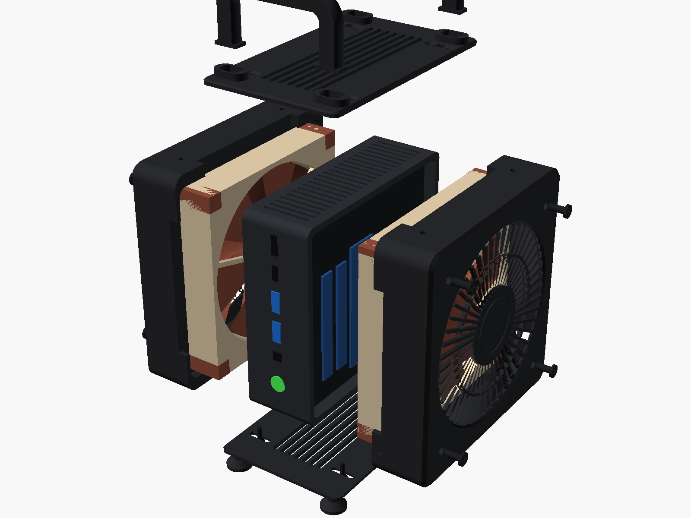
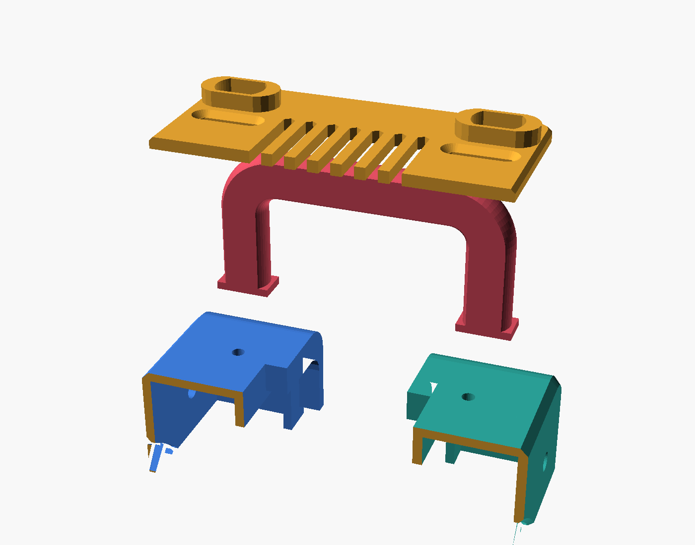
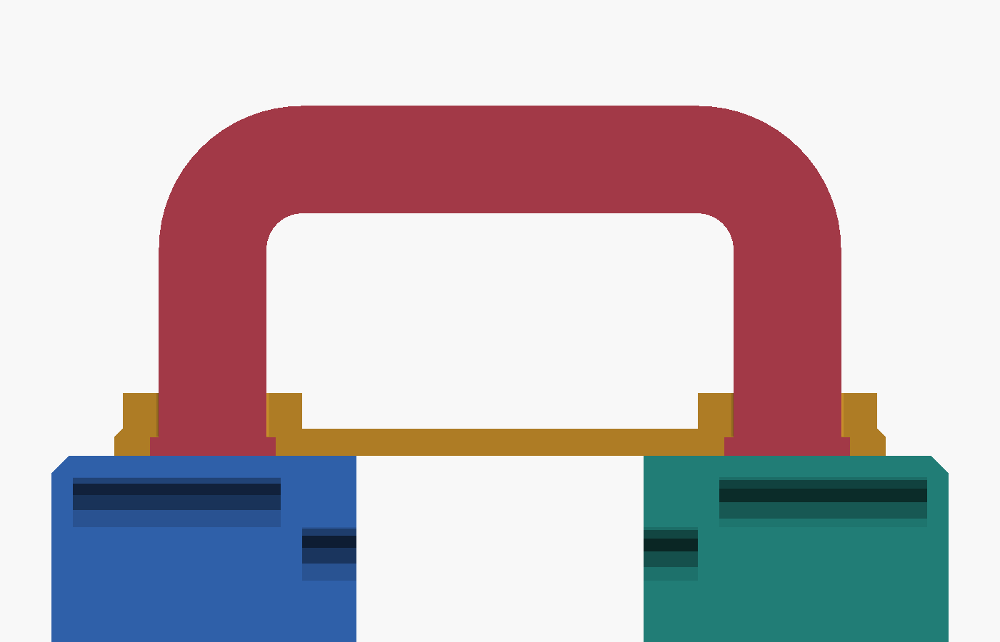

# Assembly

[← Back to README](../README.md)

You need: the 6 printed parts, 2 fans with their screws, 8 × M3×10 DIN 7991 screws, 8 × M3 hex nuts, the USB cable(s), a 2 mm hex key and a Phillips screwdriver.

Tip: the [live viewer](https://hakanuzum.github.io/gmktec-k11-dual-fan-case/viewer/) has a **Show how it fits together** button: exploded, colour-coded, see-through, with the nuts sliding out of their pockets.

## 1. Prepare the K11

1. Shut down the K11 and unplug the power cable.
2. Twist off the clear top cover. The RGB fan is attached to it: unplug its cable from the board and unscrew the fan.
3. Remove the bottom cover.
4. Leave the CPU blower and its heatsink installed. They keep doing their job; the big fan feeds them cool air.

The open sides are now the "faces" the fan holders press against. Store the covers and the RGB fan in case you want to revert.

## 2. Nuts into the holders

Each fan holder has four hexagonal pockets in the corner blocks, two at the top and two at the bottom, open towards the fan opening.

1. Push an M3 nut into each pocket, flat side first, until it stops. It is a snug fit; a hex key or a small screwdriver helps.
2. Do this before fitting the fan. The fan frame then sits right in front of the pockets and keeps the nuts from falling out.

Using the heat-set-insert holders instead: melt one insert into each of the four holes on the top and bottom faces with a soldering iron (about 220–240 °C for PETG), flush with the surface.

## 3. Fans into the holders

1. Pick the holder for each side. The cable hole must end up low on the rear wall.
2. Push the fan's plug and cable through the cable hole from the inside.
3. Lay the fan into the holder against the grille face. The arrow on the fan frame that shows the airflow points away from the grille, towards the K11 (intake).
4. Screw the fan to the face with its 4 fan screws through the corner holes. Snug, not tight.
5. Tuck the cable along the inside of the holder so it cannot touch the blades.

## 4. Holders onto the K11

1. Stand the K11 on its side, ports facing front and back. A vented side faces the desk.
2. Fit a holder on each open face. The collars wrap the four corners of the K11.

## 5. Top: handles and top plate

The handles have no screws. Each post ends in a small flange that is wider than the hole in the top plate. The handle stands on the two holders, the plate goes over the posts, and when the plate is screwed down the flange is trapped between the plate and the holder, like a nail head under a board.

| Order: holders, handle, top plate | Section: flange trapped under the plate |
|---|---|
|  |  |

1. Stand the two handles on top of the holders, flanges down, one at the front and one at the back. Each handle bridges both holders: one post on the left holder, one on the right.
2. Lower the top plate over the four handle posts. The flanges drop into the pockets under the plate.
3. Press both holders lightly against the K11 so the fans touch its faces.
4. Drive the 4 top screws with the 2 mm hex key into the nuts. The channels are slotted, so the screws find their nuts whatever the K11 thickness. Stop as soon as the heads sit flush.

## 6. Bottom plate

1. Carefully turn the case upside down (hold the holders together).
2. Place the bottom plate, feet up, and drive its 4 screws the same way.
3. Turn the case back onto its feet.

## 7. Power the fans

Connect each fan to a USB 5 V→12 V step-up cable (or directly, for 5 V USB fans) and plug the USB end into a USB port on the back of the K11. Two Noctua fans can share one cable through the Y-cable from the fan box.

Power on and check that both fans spin and nothing touches the blades.

## Checks

- Both fans spin freely and quietly.
- All front and rear ports are reachable; the power button works.
- Nothing blocks the K11's rear exhaust.
- The case does not rock on its feet.

To compare airflow layouts, flip one fan so it blows out and compare temperatures under the same load (for example with HWiNFO).
